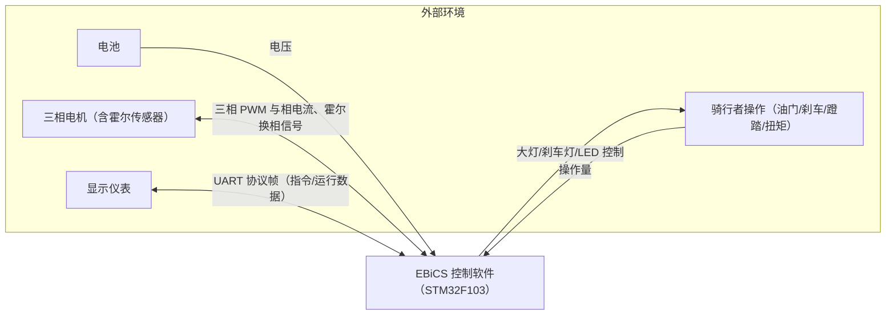
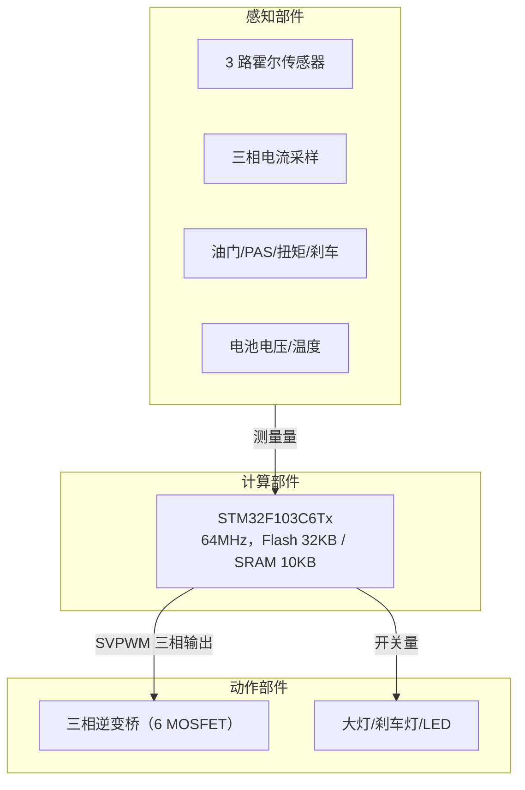
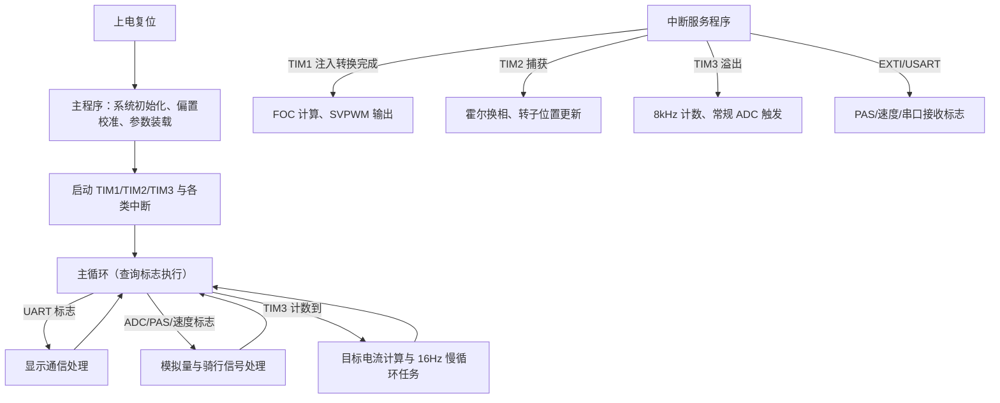
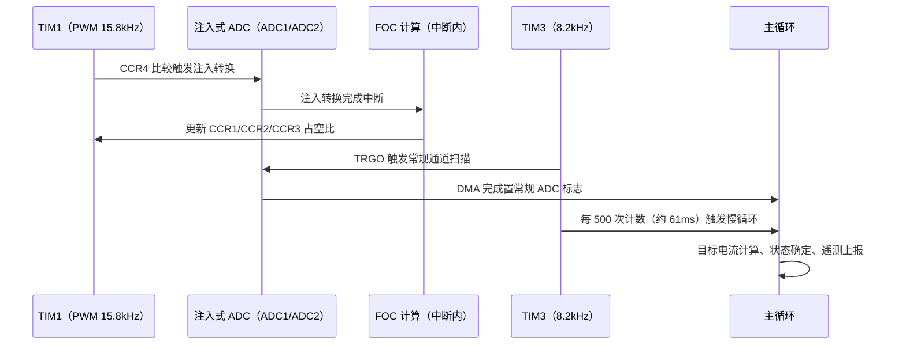
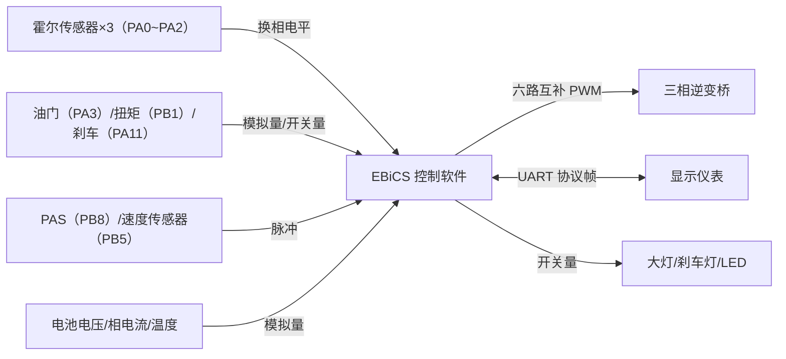
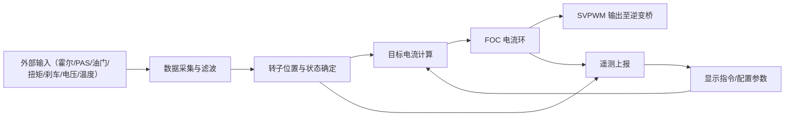
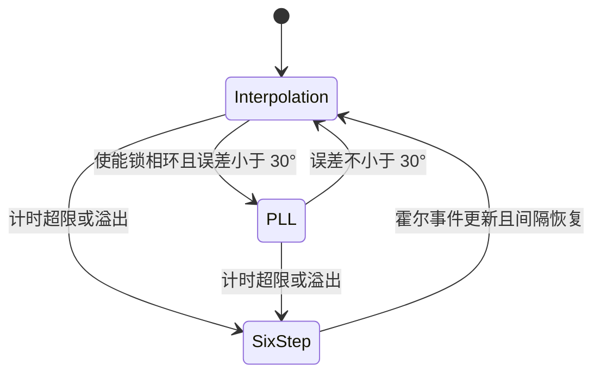
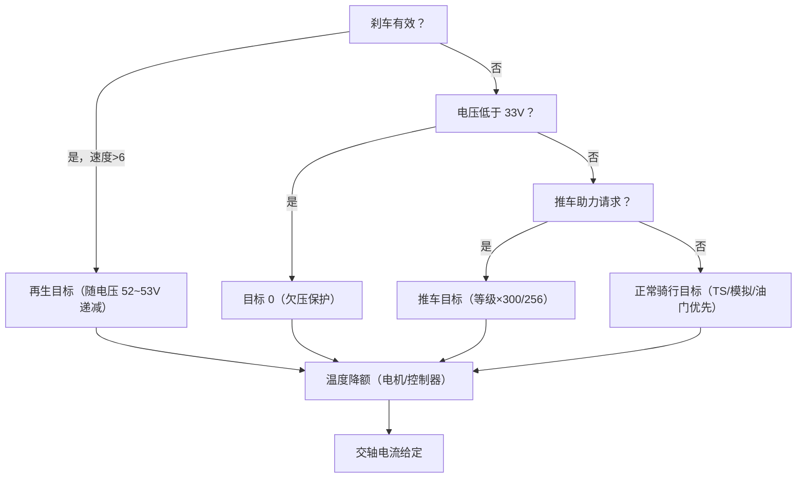

# EBiCS_Firmware软件需求规格说明

> 本文档由代码仓库逆向生成。生成日期：2026-10-17；代码仓库：EBiCS_Firmware（master 分支，GitHub EBiCS/EBiCS_Firmware）。
> 全文需求标识前缀：EB（EBiCS）。
> 标注约定：（文件名）为代码出处；[待确认] 为代码中无法确定、需人工确认的内容。

# 1 概述

## 1.1 软件概述（README.md、main.c、config.h）

EBiCS_Firmware 是面向电动自行车（Pedelec）的永磁同步电机磁场定向控制（FOC）固件，运行于以 STM32F103 微控制器为核心的 Lishui 开源控制器硬件上。软件依据霍尔传感器确定转子位置，对电机相电流进行闭环矢量控制，以空间矢量调制（SVPWM）方式输出六路 PWM 驱动三相逆变桥；同时采集油门转把、蹬踏（PAS）、扭矩、刹车、电池电压与温度等骑行输入，计算目标转矩电流，实现助力骑行、推车助力与再生制动，并通过串口与多种显示仪表（Bafang、Kunteng、KingMeter、No2 等协议）交换指令与运行数据，最终达到按骑行者意图平稳、安全地驱动电动自行车电机的目标状态。



图1.1-1 EBiCS_Firmware 与外部环境关系图

图中电池与电机是软件的能量与控制对象，显示仪表是遥控指令来源与遥测去向，骑行者操作量为助力意图来源。

软件按以下阶段工作：

- 上电初始化与自检：外设初始化、模拟通道偏置校准、参数装载、初始转子位置确定；
- 电机参数自学习（条件触发）：上电组合键或仪表设置指令触发，开环拖动电机记录霍尔换相角，随后进行 KV 检测；
- 正常运行：以 15.8kHz 周期执行电流环 FOC 计算与 SVPWM 输出，主循环计算目标电流，转子位置按插值/锁相环/六步三种方式估计；
- 再生制动：刹车有效且速度足够时施加回馈制动电流，制动强度随电池电压升高递减；
- 故障保护：欠压、过温、过流、堵转时降额或停止输出，看门狗监控程序运行。

## 1.2 系统组成（main.c、main.h、stm32f1xx_hal_msp.c）

软件与外围部件共同构成电动自行车驱动系统，由感知部件、动作部件与计算部件组成。

> 1）感知部件（敏感器）：3 路霍尔传感器（电机换相信号，TIM2 三通道异或捕获）；3 路相电流采样（双 ADC 注入式同步采集）；油门转把（PA3 模拟量）；蹬踏 PAS 传感器（PB8 脉冲）与可选外部速度传感器（PB5 脉冲）；扭矩传感器（PB1 模拟量，可选）；刹车把手（PA11 开关量，可选模拟刹车）；电池电压（PA7 分压）；芯片内部温度传感器与可选电机 NTC 温度传感器。
>
> 2）动作部件（执行器）：三相逆变桥 6 只 MOSFET，由 TIM1 输出 3 对互补 PWM（高边 PA8/PA9/PA10、低边 PB13/PB14/PB15）驱动，驱动芯片为 IRS2003 半桥驱动器（代码注释称低边脉冲需反相、死区由驱动器产生）；大灯（PB9）、刹车灯（PB10）、状态指示 LED（PB2）。
>
> 3）计算部件（控制器）：STM32F103C6Tx（Cortex-M3 内核，主频 64MHz，片上 Flash 32KB、SRAM 10KB）。



图1.2-1 系统组成图

感知部件向软件提供转子位置、电流、骑行意图与电源状态，软件计算后由动作部件输出电机驱动与灯光控制信号。

# 2 运行环境规定

## 2.1 运行方案和场景（main.c、stm32f1xx_it.c）

软件采用主程序加中断的方式运行：主程序完成初始化后进入无限循环，查询各中断置位的标志并执行非实时任务；实时控制任务（电流环）完全在中断服务程序中完成。

1. **主程序功能：**系统初始化、模拟通道偏置校准、参数装载、初始位置确定；主循环内依次执行显示通信处理、常规 ADC 数据处理、PAS/速度信号处理、目标电流计算、PWM 使能控制与 16Hz 慢循环任务（状态确定、温度更新、调试输出、看门狗刷新）。
2. **中断服务程序功能：**TIM1 注入式 ADC 转换完成中断内执行 FOC 计算与 PWM 占空比更新；TIM2 捕获中断处理霍尔换相事件；TIM3 周期中断产生 8kHz 时基、维持各类计数器并触发常规 ADC；EXTI 中断置位 PAS/速度标志；USART 空闲中断置位串口接收标志。



图2.1-1 主程序与中断结构示意图

主循环与中断通过全局标志位交换数据，实时性最强的电流环只在 TIM1 注入转换完成中断中执行。

控制周期由定时器产生：TIM1 为中心对齐计数模式，周期寄存器 _T=2028，产生 64MHz/(2×2028)≈15.8kHz 的 PWM 周期，同时 TIM1 的 CCR4（初值 2020，即 PWM 周期中段之前）触发注入式 ADC，注入转换完成中断即为 FOC 计算节拍；TIM3 周期 7813 产生 64MHz/7814≈8.2kHz 时基（代码注释称 8kHz），触发常规 ADC 扫描并驱动主循环各计数器；TIM3 计数超过 500（约 61ms，16Hz）时主循环执行一次慢循环任务。



图2.1-2 周期任务时序图

图中上方为每个 PWM 周期执行一次的 FOC 实时链，下方为主循环的 16Hz 慢循环任务链，两者并行运行。

## 2.2 硬件环境（STM32F103C6Tx_FLASH_Bootloader.ld、startup_stm32f103x6.s、Documentation）

### 2.2.1 宿主计算机

CPU 型号为 STM32F103C6Tx（ARM Cortex-M3），主频 64MHz（内部 HSI 8MHz 经 2 分频后 16 倍频），片上代码存储器 Flash 32KB，数据存储器 SRAM 10KB。硬件为 Lishui 系列电动自行车控制器板，仓库 Documentation 目录提供新旧两代硬件引脚图（新代控制器刹车信号位于 PA15，代码中保留相应注释）。

### 2.2.2 中断设置

软件使用的中断及其优先级（NVIC 优先级分组为全抢占，组 4）如下表。

表2.2-1 中断信息表

| 中断源 | 优先级 | 中断源（名称） | 触发方式 |
|-------|-------|--------------|---------|
| ADC1_2 | 0,0（最高） | 双 ADC 共享中断（注入/常规转换） | 注入转换完成（TIM1 CCR4 硬件触发） |
| TIM1_TRG_COM | 0,0 | TIM1 触发与换相 | 硬件触发事件 |
| TIM1_CC | 0,0 | TIM1 捕获比较（CC4） | 比较匹配 |
| TIM2 | 0,1 | 霍尔捕获中断 | 输入捕获（三路霍尔异或边沿） |
| USART1 | 0,0 | 串口中断 | 接收空闲/收发事件 |
| DMA1_CH1 | 0,1 | ADC1 DMA 中断 | 传输完成 |
| DMA1_CH5 | 1,0 | 串口接收 DMA 中断 | 传输完成 |
| TIM1_UP | 1,0 | TIM1 更新中断 | 计数上溢/下溢 |
| EXTI9_5 | 2,0 | 外部中断线 5/8（速度/PAS） | 下降沿 |
| TIM3 | 3,0 | 8kHz 时基中断 | 周期溢出 |
| DMA1_CH4 | 3,1 | 串口发送 DMA 中断 | 传输完成 |
| SysTick | 0,0 | 系统节拍中断 | 1kHz 周期 |
| RCC | 0,0 | 时钟安全中断 | 时钟事件 |

初始化操作：在 stm32f1xx_hal_msp.c 中调用 HAL_NVIC_SetPriorityGrouping 设置为 4 位抢占优先级分组，按上表对各中断源写优先级并使能；ADC1 与 ADC2 的注入通道通过置位 CR2 的 JEXTTRIG 位使能外部触发（TIM1 CC4 经 TRGO 输出触发），并各自使能 JEOC 中断。

### 2.2.3 存储器

表2.2-2 存储器信息表

| 属性 | 代码存储器 FLASH | 数据存储器 SRAM |
|------|--------------|---------------|
| 组成 | 片上 Flash，1 片（每页 1KB，共 32 页） | 片上 SRAM，1 片 |
| 单片容量 | 32KB | 10KB |
| 数据宽度 | 32bit（按字节寻址） | 32bit（按字节寻址） |
| 片选信号 | - | - |
| 总容量 | 32KB | 10KB |
| 地址分配 | 0x08000000～0x08007FFF；Bootloader 构建时应用区为 0x08001000 起 29KB，虚拟 EEPROM 区为 0x08007800 起 2KB | 0x20000000～0x200027FF（最小堆 0x200 字节、最小栈 0x400 字节） |

## 2.3 支持软件环境（makefile、Compile_Makefile.bat、README.md）

### 2.3.1 编程语言

编程语言：C 语言。

### 2.3.2 编译调试工具

> 编辑及编译软件：System Workbench for STM32（SW4STM32 / Ac6，基于 Eclipse 的 OpenSTM32 工具链），版本 1.17.0.201812190825；编译器 arm-none-eabi-gcc（MCU GCC，Cortex-M3、软浮点），链接采用 nano.specs/nosys.specs 精简 C 库与 CMSIS-DSP 数学库（libarm_cortexM3l_math）；外设底层框架由 STM32CubeMX 生成（STM32F1 HAL 库与 CMSIS）；烧写使用 ST-LINK Utility（STM32 ST-LINK Utility 命令行）；参数配置使用随仓库提供的 Java 图形配置器（JavaConfigurator，生成 config.h）；代码许可为 GPLv3。

## 2.4 接口（main.h、stm32f1xx_hal_msp.c）



图2.4-1 接口关系图

软件居中，左侧为输入类接口，右侧为输出与双向接口，括号内为信号引脚。

### 2.4.1 与其他软件接口

1. **显示仪表协议**：经 USART1（PB6/PB7，重映射）按所选协议与显示仪表双向交换遥控指令与运行数据，支持 No2（默认）、Kunteng、Bafang、KingMeter 618U/901U、EBiCS（ANT+ LEV 逻辑）与调试 ASCII 输出，帧格式见 3.2.2；
2. **参数配置工具**：JavaConfigurator（Lishui Parameter Configurator）为离线配置工具，读取并改写 config.h 中的编译期参数（显示协议、限速、限流、轮径等），不参与运行时通信；
3. **调试终端**：DISPLAY_TYPE_DEBUG 编译配置下以 56000 波特率向串口输出 ASCII 调试文本（printf_/sprintf_ 简化实现）。

### 2.4.2 硬件接口

表2.4-1 硬件接口信息表

| 序号 | 编号 | 描述 | 接口类型 | 数据 |
|------|------|------|---------|------|
| 1. | EB-IREQ1 | 与霍尔传感器接口 | GPIO 输入（PA0~PA2）、TIM2 异或捕获 | Input: 电机换相跳变信号 |
| 2. | EB-IREQ2 | 与油门转把接口 | AD 采集（PA3，ADC1_IN3） | Input: 0~3.3V 模拟量 |
| 3. | EB-IREQ3 | 与扭矩传感器接口（可选） | AD 采集（PB1，ADC1_IN9） | Input: 0~3.3V 模拟量 |
| 4. | EB-IREQ4 | 与刹车把手接口 | GPIO 输入（PA11，低有效）/可选 AD 采集（PB0，ADC1_IN8） | Input: 开关量或模拟量 |
| 5. | EB-IREQ5 | 与 PAS 蹬踏传感器接口 | GPIO 外部中断（PB8，下降沿） | Input: 蹬踏脉冲 |
| 6. | EB-IREQ6 | 与外部速度传感器接口（可选） | GPIO 外部中断（PB5，下降沿） | Input: 轮速脉冲 |
| 7. | EB-IREQ7 | 与三相逆变桥接口 | TIM1 互补 PWM 输出（PA8/PA9/PA10 高边，PB13/PB14/PB15 低边） | Output: 6 路 PWM（15.8kHz，死区 0.5µs） |
| 8. | EB-IREQ8 | 与电池接口 | AD 采集（PA7，ADC1_IN7 分压） | Input: 电池电压（25mV/LSB） |
| 9. | EB-IREQ9 | 与温度传感器接口 | AD 采集（内部温度传感器通道 16；可选 NTC 接 PB1） | Input: 控制器/电机温度 |
| 10. | EB-IREQ10 | 与显示仪表接口 | UART 串口（PB6/PB7，USART1 重映射，9600/1200/56000 波特率） | Input: 遥控指令帧<br>Output: 运行数据帧 |
| 11. | EB-IREQ11 | 与灯光指示接口 | GPIO 输出（PB9 大灯、PB10 刹车灯、PB2 LED） | Output: 开关量 |
| 12. | EB-IREQ12 | 与调试烧写接口 | SWD（PA13/PA14，禁用 JTAG 保留 SW-DP） | Input/Output: 调试与程序烧写 |
| 13. | EB-IREQ13 | 与相电流采样接口 | 双 ADC 注入式采集（PA4/PA5/PA6，ADC1/ADC2 共享） | Input: 三相电流模拟量 |

# 3 软件详细需求

## 3.1 功能分解（main.c、FOC.c、config.h）

对软件功能进行分解，软件顶层数据流图如下。



图3.1-1 软件顶层数据流图

数据自外部输入经采集、位置确定、目标计算、电流环后输出到逆变桥，同时向仪表回传运行数据。

功能清单如下表（表中功能编号对应 3.2 节各功能）。

| 需求标识 | 功能名称 | 一句话描述 | 主要证据文件 |
|---------|---------|-----------|-------------|
| FREQ1 | 初始化 | 系统与外设初始化、偏置校准、参数装载 | main.c |
| FREQ2 | 显示通信与遥控处理 | 按所选协议收发仪表帧并施加指令 | display_No_2.c、display_kunteng.c |
| FREQ3 | 模拟量采集 | 常规通道采集滤波与相电流注入式采集 | main.c |
| FREQ4 | 霍尔信号采集与转子位置确定 | 霍尔换相、位置插值/锁相环、转速测量 | main.c |
| FREQ5 | 骑行输入信号处理 | PAS 蹬踏与外部速度信号处理 | main.c |
| FREQ6 | 目标电流计算 | 按优先级决策助力/再生/保护目标电流 | main.c |
| FREQ7 | FOC 电流环与 SVPWM 输出 | 坐标变换、PI 电流调节、空间矢量调制 | FOC.c |
| FREQ8 | 系统状态确定与故障保护 | 状态确定、静止检测、看门狗管理 | main.c |
| FREQ9 | 电机参数自学习 | 霍尔角度自学习与 KV 检测 | main.c |
| FREQ10 | 参数存储 | 虚拟 EEPROM 参数读写 | eeprom.c、eeprom.h |

## 3.2 功能需求

### 3.2.1 初始化（main.c）

**a. 需求标识：**EB-FREQ1

**b. 功能描述：**完成系统时钟、外设、控制参数与虚拟 EEPROM 的初始化，校准模拟通道偏置，装载电机参数并确定初始转子位置。

**c. 调用条件：**上电或复位后由主程序调用一次。

**d. 输入：**config.h 编译期参数、虚拟 EEPROM 存储的电机参数、模拟通道原始采样值、复位标志。

**e. 输出：**初始化后的外设配置、电机状态结构 MS 与参数结构 MP、PI 调节器参数、各通道偏置值、初始转子位置。

**f. 处理：**

1. 初始化 HAL 库、系统时钟（HSI 8MHz 二分频后 16 倍频至 64MHz，APB1 分频 2、APB2 不分频、ADC 时钟 6 分频）及 GPIO/DMA/USART1 外设；
2. 初始化电机状态与参数结构：MS.hall_angle_detect_flag=1、MS.Speed=128000、MS.assist_level=127、MS.regen_level=7；按 config.h 装载轮周长、限速、电池电流上限；初始化三个 PI 调节器（参数见表3.2-1）；
3. 解锁 Flash 并初始化虚拟 EEPROM（EE_Init），随后重新上锁；
4. 初始化 ADC1/ADC2 并执行校准，使能注入通道外部触发（JEXTTRIG）与注入转换完成中断（JEOC）；
5. 启动 ADC1 八通道常规 DMA 循环采集与 ADC2 中断采集；
6. 初始化并启动 TIM1（六路互补 PWM 及 CC4 中断，CCR4=2020）、TIM2（霍尔异或捕获）与 TIM3（8kHz 时基）；
7. 按编译配置初始化显示协议（默认 No2_Init），启动 64 字节 UART DMA 循环接收；
8. 关断 PWM 输出（清 MOE 位，CCR1/CCR2/CCR3 置 1023），延时 500ms 等待电路稳定；
9. 连续采集 32 次常规 ADC 数据求均值并加 5，得到相电流 1/2/3 偏置、油门偏置与扭矩偏置（TQONAD1 编译配置下独立校准，否则与油门共用）；
10. 初始化看门狗并区分复位原因（看门狗复位时 LED 常亮）；检测上电自学习条件（刹车与油门同时保持约 7s）；从虚拟 EEPROM 装载霍尔角度、霍尔顺序、KV 值与内部温度 25℃ 基准；调用 get_standstill_position 确定初始转子位置。

表3.2-1 初始化关键参数表

| 参数 | 取值 | 说明 |
|------|------|------|
| 系统时钟 | 64MHz | HSI 8MHz/2×16，FLASH 延时 2 个等待周期 |
| PWM 周期 _T | 2028 | TIM1 中心对齐，PWM 频率 15.8kHz |
| TIM1->CCR4 初值 | 2020（TRIGGER_DEFAULT） | 注入 ADC 采样点在 PWM 中点前 |
| PI_iq 参数 | p=50、i=2、限幅 2000、步长 5000、移位 10 | 交轴电流环 |
| PI_id 参数 | p=50、i=2、限幅 2000、步长 5000、移位 10、积分限 1800 | 直轴电流环 |
| PI_speed 参数 | p=1、i=10、限幅 1200、步长 50、移位 5 | 仅 SPEEDTHROTTLE 编译配置 |
| 电机初始参数 | 轮周长 2200mm、限速 25km/h、电池限流 14000mA | config.h 编译期定值 |
| 偏置校准 | 32 次均值加 5 | 相电流×3、油门、扭矩 |

证据位置：main.c（main、SystemClock_Config、MX_ADC1_Init、get_standstill_position）、config.h（编译期参数）、main.h（结构体与宏定义）、eeprom.c（EE_Init）、stm32f1xx_hal_msp.c（外设底层配置）

### 3.2.2 显示通信与遥控处理（display_No_2.c、display_kunteng.c、display_bafang.c、display_kingmeter.c、display_ebics.c）

**a. 需求标识：**EB-FREQ2

**b. 功能描述：**按编译期选定的协议与显示仪表双向收发 UART 帧，解析遥控指令并施加到电机控制，组帧上报运行数据。

**c. 调用条件：**USART1 空闲中断置位 ui8_UART_flag 后由主循环查询调用；UART 错误中断回调中重新初始化协议状态机。

**d. 输入：**USART1 DMA 循环接收缓冲中的仪表帧、电机状态 MS、电机参数 MP。

**e. 输出：**应答帧、助力等级 MS.assist_level、灯控输出、推车助力标志 ui8_Push_Assist_flag、直接电流给定 KM.DirectSetpoint、限速与轮径等参数。

**f. 处理：**

1. 编译期按 config.h 的 DISPLAY_TYPE 宏选择唯一协议（协议清单见表3.2-2），各协议初始化函数启动 UART DMA 接收；
2. 主循环检测到 ui8_UART_flag 后调用对应协议服务函数，完成后清零标志；
3. 服务函数依据 DMA 计数寄存器差值从循环缓冲取出新接收数据（含缓冲回绕处理），按协议校验（异或或累加和），校验失败时丢弃或重同步接收；
4. 解析遥控指令并施加：写入助力等级、驱动大灯（LIGHT 引脚）与 LED、置位推车助力标志、更新限速/轮径参数；
5. 组帧上报：轮转周期（由速度换算）、电池电流、电量、错误码、刹车状态等；
6. UART 错误中断（HAL_UART_ErrorCallback）中调用协议初始化函数重建接收状态机。

表3.2-2 显示协议编译配置表

| 协议 | 配置宏 | 波特率 | 帧特点 | 备注 |
|------|-------|--------|-------|------|
| 调试输出 | DISPLAY_TYPE_DEBUG | 56000 | 无帧格式，ASCII 文本 | 调试用 |
| Kunteng LCD | DISPLAY_TYPE_KUNTENG | 9600 | 13 字节帧，异或校验 | LCD3/LCD5 等仪表 |
| Bafang LCD | DISPLAY_TYPE_BAFANG_LCD | 1200 | 0x11 请求/0x16 信息帧 | Blaupunkt 仪表 |
| Bafang 850/860 | DISPLAY_TYPE_BAFANG_850_860 | 9600 | 0x11 请求/0x16 信息帧 | 支持 1200 波特率探测 |
| KingMeter 618U | DISPLAY_TYPE_KINGMETER_618U | 9600 | 发送 8 字节/接收 6 字节 | J-LCD 仪表 |
| KingMeter 901U | DISPLAY_TYPE_KINGMETER_901U | 9600 | 0x3A 帧头，16 位累加和 | KM5s 仪表 |
| EBiCS | DISPLAY_TYPE_EBiCS | 9600 | 12 字节页帧，异或校验 | ANT+ LEV 逻辑 |
| No2（默认） | DISPLAY_TYPE_NO2 | 9600 | 接收 20 字节/发送 14 字节 | S866 等国产仪表 |

证据位置：config.h（DISPLAY_TYPE 定义）、main.c（主循环分发与各 update 函数）、stm32f1xx_it.c（USART1_IRQHandler、UART_IdleItCallback）、display_No_2.c（No2_Service）

#### 3.2.2.1 No2 协议处理（display_No_2.c）

**a. 需求标识：**EB-FREQ2-1

**b. 功能描述：**以 No2 协议（默认配置）收发仪表帧，解析助力等级、灯控、推车指令并上报运行数据。

**c. 调用条件：**主循环在 ui8_UART_flag 置位时调用 No2_Service。

**d. 输入：**64 字节 DMA 循环接收缓冲中的 20 字节仪表帧、电机状态 MS。

**e. 输出：**14 字节应答帧、MS.assist_level、大灯输出、推车助力标志。

**f. 处理：**

1. 初始化时调用 No2_Init 启动 64 字节 DMA 循环接收；
2. 依据 DMA1_Channel5 计数寄存器与上次指针的差值取出新增字节（含回绕处理）；
3. 校验：帧长 20 字节，第 20 字节（序号 19）等于前 19 字节按位异或（calculate_checksum），校验失败整帧丢弃；
4. 按表3.2-3 解析接收帧并调用 No2_update：助力等级写入 MS.assist_level，灯控与推车指令施加到引脚与标志，同时准备上报数据（轮转周期、电流、错误码、刹车标志）；
5. 按表3.2-4 组帧，用 HAL_UART_Transmit 阻塞发送 14 字节。

表3.2-3 No2 接收帧格式表（仪表→控制器，20 字节）

| 字节序号 | 参数含义 | 数据类型 | 备注 |
|---------|---------|---------|------|
| 0~2 | 帧头 | 原码 | 0x02、0x0E、0x01 |
| 3 | 油门模式 | 原码 | Throttle_mode，数值含义未读出 [待确认] |
| 4 | 助力等级 | 原码 | 0~15 档，左移 4 位得 0~240 |
| 5 | 功能位 | 位域 | D6 零启动（ZeroStart）；D5 大灯；D1 推车助力 |
| 6 | 传动比 | 原码 | GearRatio |
| 7~8 | 轮径×10（英寸） | 原码，高字节在前 | WheelSizeInch_x10 |
| 9 | PAS 启动延时 | 原码 | Start_delay_PAS |
| 10 | 助力增强 | 原码 | BoostPower |
| 11 | 未使用 | - | - |
| 12 | 最高限速 | 原码 | SPEEDMAX_Limit |
| 13 | 电流限制（A） | 原码 | CUR_Limit_A |
| 14~15 | 最低电压×10 | 原码，高字节在前 | Voltage_min_x10 |
| 16~17 | 未使用 | - | - |
| 18 | PAS 磁钢数与巡航 | 位域 | D3~D0 磁钢数；D6 巡航控制 |
| 19 | 校验 | 原码 | 前 19 字节按位异或 |

表3.2-4 No2 发送帧格式表（控制器→仪表，14 字节）

| 字节序号 | 参数含义 | 数据类型 | 备注 |
|---------|---------|---------|------|
| 0~2 | 帧头 | 原码 | 0x02、0x0E、0x01 |
| 3 | 错误码 | 原码 | 0 无故障；7 电机过热（>130℃）；9 控制器过热（>80℃） |
| 4 | 刹车标志 | 位域 | D5 刹车有效 |
| 5 | 保留 | - | 0x00 |
| 6~7 | 电池电流×10 | 原码，高字节在前 | 单位 0.1A |
| 8~9 | 轮转周期 | 原码，高字节在前 | 单位 ms，静止时 64000 |
| 10~11 | 保留 | - | 0x00 |
| 12 | 保留 | - | 0xFF |
| 13 | 校验 | 原码 | 前 13 字节按位异或 |

证据位置：display_No_2.c（No2_Init、No2_Service、calculate_checksum）、main.c（No2_update）、display_No_2.h（No2_t 结构）

#### 3.2.2.2 Kunteng 协议处理（display_kunteng.c）

**a. 需求标识：**EB-FREQ2-2

**b. 功能描述：**以 Kunteng 协议收发 13 字节仪表帧，解析仪表参数（P1~P5、C1~C14 系列）并上报运行数据。

**c. 调用条件：**编译配置为 DISPLAY_TYPE_KUNTENG；主循环在 ui8_UART_flag 置位时调用 check_message。

**d. 输入：**13 字节 DMA 循环接收缓冲、电机状态 MS、电机参数 MP、虚拟 EEPROM 存储的显示参数。

**e. 输出：**12 字节发送帧、助力等级、灯控输出、EEPROM 参数更新。

**f. 处理：**

1. kunteng_init 启动 13 字节 DMA 接收，并从虚拟 EEPROM（KT_B0_B3 等 5 组地址）恢复显示配置字节与初始 CRC（帧校验字节 = 除 B5 外 0~12 字节异或再异或 10）；
2. 帧尾校验：字节 11 为 0x32 或 0x37 且字节 12 为 0x0E；CRC 校验：字节 5 等于全帧（跳过字节 5）异或值再异或 10，或异或自学习值 ui8_last_XOR（校验失败时在 0~50 内搜索匹配值）；
3. 按表3.2-5 解析仪表参数并施加：助力等级（字节 1 低 3 位）、大灯（字节 1 最高位，同时驱动 LIGHT 与 LED 引脚）、限速、传动比（P1 参数）；
4. display_update 按表3.2-5 组帧发送：电池 SOC 按电压分档计算（带滞回缓冲带）、轮转周期、控制器电流（×4，0.25A/LSB）、电机温度减 15、运动指示位（刹车 D5、油门 D1）；
5. 帧尾错误时重同步接收：DMA 计数重设为 2 搜索帧尾序列 0x32/0x37+0x0E，找到后恢复 13 字节接收；
6. check_recent 将变化后的显示参数写回虚拟 EEPROM。

表3.2-5 Kunteng 收发帧格式表

| 字节序号 | 接收含义（仪表→控制器） | 发送含义（控制器→仪表） | 备注 |
|---------|----------------------|----------------------|------|
| 0 | P5 参数 | 帧头 65（0x41） | |
| 1 | 助力等级（D2~D0，0~5）与大灯（D7） | 电池 SOC | 0x04/0x08/0x0C/0x10 对应 1~4 格 |
| 2 | 轮径与限速位 | 电池电压 | COMMUNICATIONS_BATTERY_VOLTAGE |
| 3 | P1 参数（传动比） | 轮转周期高字节 | |
| 4 | P2~P4 与限速位 | 轮转周期低字节 | |
| 5 | CRC 校验 | 错误码 | 全帧（跳字节 5）异或再异或 10 |
| 6 | C1/C2 参数 | CRC 校验 | 字节 1~11 异或 |
| 7 | C5/C14 参数 | 运动指示 | 刹车 D5、油门 D1 |
| 8 | C4 参数 | 控制器电流×4 | 0.25A/LSB |
| 9 | C12 参数 | 电机温度-15 | |
| 10 | C13 参数 | 0 | |
| 11 | 帧尾 0x32/0x37 | 0 | |
| 12 | 帧尾 0x0E | - | 接收 13 字节，发送 12 字节 |

证据位置：display_kunteng.c（kunteng_init、check_message、display_update、check_recent）、display_kunteng.h（配置变量结构）

#### 3.2.2.3 Bafang 协议处理（display_bafang.c）

**a. 需求标识：**EB-FREQ2-3

**b. 功能描述：**以 Bafang 协议按请求-应答方式向仪表提供速度、状态、电量、功率等数据，并接收助力等级、灯与轮径指令。

**c. 调用条件：**编译配置为 DISPLAY_TYPE_BAFANG 系列；主循环在 ui8_UART_flag 置位时调用 bafang_update 与 Bafang_Service。

**d. 输入：**64 字节 DMA 循环接收缓冲中的 0x11 请求帧/0x16 信息帧、电机状态 MS。

**e. 输出：**各命令应答帧、助力等级、灯控输出、推车助力标志。

**f. 处理：**

1. Bafang_Init 启动 64 字节 DMA 接收并复位接收状态机；
2. 帧头为 0x11（请求）时按命令码从表3.2-6 组帧应答，经 UART DMA 发送；
3. 帧头为 0x16（信息）时解析：0x0B 助力等级（字节 2 等级码、字节 3 为前三字节和校验）、0x1A 灯控（字节 2 为 241 时开灯）、0x1F 轮径（字节 2~3）；
4. bafang_update 准备上报量：电量百分比（按电压在 32.3V~38.0V 间线性换算）、速度（换算后乘经验系数 20/256）、功率（电流/500，0.5A/LSB）、状态（过热/刹车判定）。

表3.2-6 Bafang 命令与应答表

| 命令码 | 含义 | 应答内容 |
|-------|------|---------|
| 0x20 | 请求速度 | 3 字节：速度高字节、低字节、校验（=前两字节和+32） |
| 0x08 | 请求状态 | 1 字节：0x01 正常、0x03 刹车、0x10 控制器过热、0x11 电机过热 |
| 0x11 | 请求电量 | 2 字节：电量百分比 |
| 0x0A | 请求功率 | 2 字节：功率 |
| 0x31 | 请求运动指示 | 2 字节：'1'（0x31）运动 / '0'（0x30）静止 |
| 0x22 | 请求续航（电机温度） | 3 字节：温度高字节、低字节、校验 |
| 0x24 | 请求热量（电压） | 3 字节：电池电压高字节、低字节、校验 |
| 0x0B | 信息：助力等级 | 字节 2 等级码：0/11/13/21/23/3/27/28/29/30 对应 0~9 档，6 为推车；字节 3=前三字节和 |
| 0x1A | 信息：灯控 | 字节 2 为 241 时开灯 |
| 0x1F | 信息：轮径 | 字节 2~3 轮径 |

证据位置：display_bafang.c（Bafang_Init、Bafang_Service）、main.c（bafang_update）、display_bafang.h（命令码与状态码定义）

#### 3.2.2.4 KingMeter 协议处理（display_kingmeter.c）

**a. 需求标识：**EB-FREQ2-4

**b. 功能描述：**以 KingMeter 618U（J-LCD）或 901U（KM5s）协议收发仪表帧，解析运行指令与设置指令（含自学习触发）。

**c. 调用条件：**编译配置为 DISPLAY_TYPE_KINGMETER_618U/901U；主循环在 ui8_UART_flag 置位时调用 KingMeter_Service。

**d. 输入：**618U 为 6 字节接收缓冲、901U 为 64 字节 DMA 循环缓冲；电机状态 MS。

**e. 输出：**618U 为 8 字节帧、901U 为 0x3A 帧；助力等级、灯控、推车标志、直接电流给定、自学习触发。

**f. 处理：**

1. 618U 协议：组帧 8 字节发送（表3.2-7），收到 6 字节后校验（字节 4=字节 1~3 异或），解析助力等级（字节 1 低 3 位）、大灯（D7）、推车（D4）、限速（字节 2 高 5 位加 10 乘 10）与轮径索引；
2. 901U 协议：按表3.2-8 解析 0x3A 帧，16 位累加和校验（字节 1 起累加至校验字节前，减去校验段后为零）；
3. 901U 运行模式（0x52）：解析助力等级（0~255）与字节 5 状态位（灯 D7~D6、电量 D5、推车 D4、助力 D3、油门 D2、巡航 D1、超速 D0），组帧回发运行数据；
4. 901U 设置模式（0x53）：解析 P18（自学习执行位）、P19（反转位）、PAS 容差、PAS 比率、油门参数、慢启动、速度磁钢数、欠压阈值、轮径、限速与电流限制，按握手码表（64 字节 KM_901U_HANDSHAKE）回发设置应答；ExecAutodetect 置位且首次运行时触发霍尔角度自学习；
5. 901U 直给模式（0x54）：将帧数据字节 4 写入 KM.DirectSetpoint，主循环按 DirectSetpoint×PH_CURRENT_MAX/128 覆盖目标电流。

表3.2-7 KingMeter 618U 收发帧格式表

| 字节序号 | 发送含义（控制器→仪表） | 接收含义（仪表→控制器） |
|---------|----------------------|----------------------|
| 0 | 帧头 0x46 | - |
| 1 | 电量（0x01 正常，0x00 低电闪烁） | 助力等级（D2~D0，1~5）与大灯（D7）、推车（D4） |
| 2 | 电流×3/10（单位 1/3A） | 限速（D7~D3，加 10 乘 10 得 km/h）与轮径索引（D2~D0） |
| 3~4 | 轮转周期 ms（高/低字节） | - |
| 5 | 轮径/限速回复字 0x7A | - |
| 6 | 错误码（0x00 无、0x25 电机过热、0x26 控制器过热） | - |
| 7 | 校验（字节 1~6 异或） | - |
| - | - | 字节 4 校验（=字节 1~3 异或） |

表3.2-8 KingMeter 901U 帧格式表

| 字节序号 | 参数含义 | 数据类型 | 备注 |
|---------|---------|---------|------|
| 0 | 帧头 | 原码 | 0x3A |
| 1 | 源地址 | 原码 | 0x1A 控制器 |
| 2 | 命令码 | 原码 | 0x52 运行 / 0x53 设置 / 0x54 直给 |
| 3 | 数据长度 | 原码 | |
| 4~4+n | 数据 | 原码/位域 | 运行：字节 4 助力等级（0~255）、字节 5 状态位；设置：P18/P19/PAS/限速/电流限制/轮径等 |
| 末 4 字节 | 校验与帧尾 | 原码 | 16 位累加和（低字节在前，累加范围自字节 1 至校验字节前）+0x0D 0x0A |

证据位置：display_kingmeter.c（KingMeter_Init、KM_618U_Service、KM_901U_Service）、display_kingmeter.h（常量与结构定义）、main.c（kingmeter_update）

#### 3.2.2.5 EBiCS 协议处理（display_ebics.c）

**a. 需求标识：**EB-FREQ2-5

**b. 功能描述：**以 EBiCS 协议（ANT+ LEV 逻辑）按页收发 12 字节帧，周期性广播运行页并处理仪表页指令。

**c. 调用条件：**编译配置为 DISPLAY_TYPE_EBiCS；接收在 ui8_UART_flag 置位时处理，发送每 4 个慢循环（约 4Hz）轮流执行。

**d. 输入：**12 字节 DMA 接收缓冲、电机状态 MS、电机参数 MP。

**e. 输出：**12 字节广播页帧、助力/再生等级、灯控、自学习触发。

**f. 处理：**

1. 接收帧校验：前 11 字节按位异或等于第 12 字节；
2. 解析页 16：轮周长（字节 5 高、字节 4 低）、再生等级（字节 6 低 3 位）与助力等级（字节 6 高 3 位）、灯控（字节 7 的 D3，同时驱动 LIGHT 与 LED 引脚）；
3. 解析页 6：字节 4 非零时触发霍尔角度自学习；
4. 每 4 个慢循环切换发送页号（1~4 轮流），按表3.2-9 组帧发送：页 1 含温度状态、旅行模式、系统状态、档位、错误码与速度×10；页 4 含燃料消耗（电池电流/10）与电池电压（1/4V 单位）。

表3.2-9 EBiCS 收发帧格式表（12 字节）

| 字节序号 | 参数含义 | 数据类型 | 备注 |
|---------|---------|---------|------|
| 0 | 同步字 | 原码 | 164（0xA4） |
| 1 | 消息长度 | 原码 | 12 |
| 2 | 消息 ID | 原码 | 0x4E 广播数据 |
| 3 | 页号 | 原码 | 接收页 6/16；发送页 1~4 |
| 4~10 | 页数据 | 原码/位域 | 依页号定义 |
| 11 | 校验 | 原码 | 前 11 字节按位异或 |

证据位置：display_ebics.c（process_ant_page、send_ant_page）、main.c（慢循环页计数与发送调度）

### 3.2.3 模拟量采集（main.c）

**a. 需求标识：**EB-FREQ3

**b. 功能描述：**采集油门、刹车、扭矩、电池电压、温度等常规模拟量与三相电流注入式模拟量，滤波后供控制使用。

**c. 调用条件：**常规通道由 TIM3 触发经 DMA 采集、主循环查询处理；注入通道由 TIM1 CCR4 触发、在注入转换完成中断内处理。

**d. 输入：**ADC1 八通道、ADC2 注入通道及各通道引脚模拟量。

**e. 输出：**adcData 缓冲、滤波后的油门/扭矩/刹车值、相电流 1/2 值、偏置值。

**f. 处理：**

1. ADC1 常规通道 8 路扫描由 TIM3 TRGO 触发，DMA 循环写入 adcData，完成回调置位 ui8_adc_regular_flag；
2. 主循环对油门、扭矩、刹车进行一阶低通滤波（累加值减去自身的 1/16 再加新采样），得到 ui16_throttle、ui16_torque、ui16_brake_adc；
3. ADC1/ADC2 以双 ADC 同步模式工作（常规同步+注入同步），注入通道由 TIM1 CC4 触发，完成回调置位后执行转子位置估计与 FOC 计算；
4. 通道配置与动态通道切换分别见表3.2-10 与表3.2-11。

#### 3.2.3.1 常规通道采集与滤波（main.c）

**a. 需求标识：**EB-FREQ3-1

**b. 功能描述：**采集并滤波电池电压、油门、三路常规相电流、AD2、AD1 与内部温度共 8 个常规通道。

**c. 调用条件：**TIM3 TRGO 触发 ADC1 扫描，DMA 完成回调置标志，主循环查询处理。

**d. 输入：**表3.2-10 所列 8 路模拟通道。

**e. 输出：**adcData[0]~adcData[7]、滤波后的油门/扭矩/刹车值、MS.Voltage、MS.int_Temperature。

**f. 处理：**

1. ADC1 按表3.2-10 的顺序连续扫描 8 个通道，DMA 循环传输到 adcData 缓冲；
2. 主循环在 ui8_adc_regular_flag 置位时对油门、扭矩、刹车通道做 1/16 一阶低通滤波并清零标志；
3. 慢循环中直接读取 adcData[0] 作为 MS.Voltage（电池电压原始值），对内部温度通道做 1/32 滤波后按 0.1875℃/LSB 斜率与 25℃ 基准换算为 MS.int_Temperature。

表3.2-10 常规 ADC 通道配置表

| 通道 | 引脚 | 用途 | 后处理 |
|------|------|------|-------|
| ADC1_IN7 | PA7 | 电池电压 | MS.Voltage，当量 25mV/LSB |
| ADC1_IN3 | PA3 | 油门转把 | 1/16 滤波，减偏置得 ui16_throttle |
| ADC1_IN4 | PA4 | 相电流 1 | 常规采样（用于上电偏置校准） |
| ADC1_IN5 | PA5 | 相电流 2 | 同上 |
| ADC1_IN6 | PA6 | 相电流 3 | 同上 |
| ADC1_IN8 | PB0 | AD2 接口（模拟刹车，ADC_BRAKE 选项） | 1/16 滤波得 ui16_brake_adc |
| ADC1_IN9 | PB1 | AD1 接口（扭矩或电机温度） | 1/16 滤波得 ui16_torque |
| 温度传感器通道 16 | 片内 | 控制器温度 | 1/32 滤波得 MS.int_Temperature |

证据位置：main.c（MX_ADC1_Init、主循环常规 ADC 处理）、stm32f1xx_hal_msp.c（ADC 引脚与 DMA 配置）

#### 3.2.3.2 相电流注入式采集与动态通道切换（main.c）

**a. 需求标识：**EB-FREQ3-2

**b. 功能描述：**以双 ADC 注入同步方式在每个 PWM 周期采集两相电流，按占空比动态选择可测相并由基尔霍夫定律计算第三相。

**c. 调用条件：**TIM1 CCR4 比较事件触发注入转换，注入转换完成中断内读取。

**d. 输入：**ADC1/ADC2 注入通道（PA4/PA5/PA6）、三相占空比 switchtime。

**e. 输出：**i16_ph1_current、i16_ph2_current、动态切换后的注入通道配置与 CCR4 采样时刻。

**f. 处理：**

1. 双 ADC 注入同步模式（ADC_DUALMODE_REGSIMULT_INJECSIMULT），ADC1 与 ADC2 各自注入 1 通道，由 TIM1 CC4 经 TRGO 触发，转换完成进 JEOC 中断；
2. dyn_adc_state 比较三相 switchtime，确定占空比最高的相（高占空比时该相下管导通时间过短、电流不可测），并按表3.2-11 切换注入通道采集其余两相，第三相电流由 i1+i2+i3=0 计算；
3. 采样时刻动态调整：最高相 CCR 大于 1500 时置 TIM1->CCR4=CCR−50（TRIGGER_OFFSET_ADC），否则恢复默认 2020；
4. 时隙过小（状态 0）时保持上一次电流值不更新；
5. 读取注入值（硬件偏置由注入偏置寄存器 JOFR1 扣除）后，若 PWM 已使能则调用 FOC_calculation，并将 SVPWM 结果写入 CCR1/CCR2/CCR3。

表3.2-11 动态注入通道选择表

| 状态 | 高占空比相 | ADC1 注入通道 | ADC2 注入通道 | 相位计算 |
|------|-----------|--------------|--------------|---------|
| 1 | C | A（通道 4） | B（通道 5） | A、B 直读 |
| 2 | A | C（通道 6） | B（通道 5） | A=−B−C |
| 3 | B | A（通道 4） | C（通道 6） | B=−A−C |
| 0 | 时隙过小 | - | - | 保持上次值 |

证据位置：main.c（HAL_ADCEx_InjectedConvCpltCallback、dyn_adc_state、set_inj_channel）、stm32f1xx_hal_msp.c（注入通道配置）

#### 3.2.3.3 上电偏置校准（main.c）

**a. 需求标识：**EB-FREQ3-3

**b. 功能描述：**上电后电机未通电时采集 32 次常规 ADC 数据求均值，确定相电流、油门与扭矩通道的零位偏置。

**c. 调用条件：**初始化阶段关断 PWM 并延时 500ms 稳定后执行一次。

**d. 输入：**常规 ADC 的相电流、油门、扭矩通道采样值。

**e. 输出：**ui16_ph1_offset、ui16_ph2_offset、ui16_ph3_offset、ui16_throttle_offset、ui16_torque_offset。

**f. 处理：**

1. 连续等待 32 次常规 ADC 完成标志，累加相电流 1/2/3（adcData[2]/[3]/[4]）、油门（adcData[1]）与扭矩（adcData[6]）通道值；
2. 各累加值右移 5 位（除以 32）再加 5 作为偏置值，置位 ui8_adc_offset_done_flag；
3. DISABLE_DYNAMIC_ADC 编译配置下将相电流偏置写入注入通道偏置寄存器（ADC1->JOFR1、ADC2->JOFR1），并固定注入通道；动态 ADC 配置下偏置值随通道切换写入。

证据位置：main.c（main 中偏移校准循环）、config.h（TQONAD1、DISABLE_DYNAMIC_ADC 开关）

### 3.2.4 霍尔信号采集与转子位置确定（main.c）

**a. 需求标识：**EB-FREQ4

**b. 功能描述：**捕获霍尔换相事件确定转子电角度，通过扇区内插值或锁相环外推估计实时转子位置，并测量电机转速。

**c. 调用条件：**TIM2 捕获中断处理霍尔事件；TIM1 注入转换完成中断内估计转子位置。

**d. 输入：**三路霍尔信号（PA0~PA2）、TIM2 计数值、EEPROM 中的霍尔角度表。

**e. 输出：**q31_rotorposition_absolute（q31 格式转子电角度）、转子位置估计状态、转速与滤波后霍尔间隔。

**f. 处理：**

1. TIM2 捕获中断中读取霍尔状态并查表更新基准电角度（3.2.4.1）；
2. TIM1 注入转换完成中断中按插值/PLL/六步三种方式估计实时位置（3.2.4.2）；
3. 对霍尔间隔滤波得到转速与电转频率（3.2.4.3）。

#### 3.2.4.1 霍尔换相信号采集（main.c）

**a. 需求标识：**EB-FREQ4-1

**b. 功能描述：**以三路霍尔异或信号作为 TIM2 输入，捕获每次换相跳变并查表更新转子基准角度与旋转方向。

**c. 调用条件：**TIM2 输入捕获中断触发（TIM2 从模式复位，异或组合输入，500kHz 计数）。

**d. 输入：**霍尔电平（GPIOA IDR 低 3 位）、TIM2 捕获值 CCR1。

**e. 输出：**ui16_timertics（相邻霍尔事件间隔）、q31_rotorposition_hall（扇区基准角）、旋转方向 i8_recent_rotor_direction、换相计数器复位。

**f. 处理：**

1. 读取捕获值：CCR1 大于 20（40µs 去抖）才更新 ui16_timertics，否则忽略本次跳变；
2. 读取三路霍尔电平组成 ui8_hall_state（0~7），与上次状态组合为换相事件码 ui8_hall_case=旧状态×10+新状态；
3. 按表3.2-12 查表更新转子基准角度与旋转方向，并在整圈/半圈事件处清零对应计数器（用于堵转检测）；默认编译配置始终按 120° 霍尔配置处理，60° 判别仅在 USE_FIX_POSITIONS 配置下生效；
4. 对霍尔间隔做 1/8 一阶滤波（uint32_tics_filtered），清零角度溢出标志，置位速度控制标志 ui8_SPEED_control_flag；
5. 锁相环模式下更新角度误差 q31_PLL_error 与每计时刻度角增量 q31_angle_per_tic。

表3.2-12 霍尔换相事件表（120° 配置，换相事件码=旧状态×10+新状态）

| 换相事件码 | 方向 | 基准角度赋值 | 计数器动作 |
|-----------|------|-------------|-----------|
| 64（6→4） | 正向 | q31_rotorposition_hall=Hall_64 | 整圈计数清零 |
| 45（4→5） | 正向 | q31_rotorposition_hall=Hall_45 | - |
| 51（5→1） | 正向 | q31_rotorposition_hall=Hall_51 | - |
| 13（1→3） | 正向 | q31_rotorposition_hall=Hall_13 | 半圈计数清零 |
| 32（3→2） | 正向 | q31_rotorposition_hall=Hall_32 | - |
| 26（2→6） | 正向 | q31_rotorposition_hall=Hall_26 | - |
| 46（4→6） | 反向 | q31_rotorposition_hall=Hall_64 | - |
| 62（6→2） | 反向 | q31_rotorposition_hall=Hall_26 | - |
| 23（2→3） | 反向 | q31_rotorposition_hall=Hall_32 | 半圈计数清零 |
| 31（3→1） | 反向 | q31_rotorposition_hall=Hall_13 | - |
| 15（1→5） | 反向 | q31_rotorposition_hall=Hall_51 | - |
| 54（5→4） | 反向 | q31_rotorposition_hall=Hall_45 | 整圈计数清零 |

正向事件旋转方向取 −i16_hall_order，反向事件取 +i16_hall_order；霍尔状态 0 与 7 为非法状态，不参与角度更新。

证据位置：main.c（HAL_TIM_IC_CaptureCallback、Set_Hall_Angle120、Set_Hall_Angle60、MX_TIM2_Init）

#### 3.2.4.2 转子位置估计（main.c）

**a. 需求标识：**EB-FREQ4-2

**b. 功能描述：**在每个 PWM 周期内依据霍尔间隔与计时值，以线性插值、锁相环外推或六步扇区中点方式估计实时转子电角度。

**c. 调用条件：**TIM1 注入转换完成中断内、霍尔角度自学习完成后执行。

**d. 输入：**q31_rotorposition_hall、ui16_timertics、TIM2 当前计数值 ui16_tim2_recent、q31_angle_per_tic、PLL 误差。

**e. 输出：**q31_rotorposition_absolute、MS.system_state（Interpolation/PLL/SixStep）、六步标志 ui8_6step_flag、溢出标志 ui8_overflow_flag。

**f. 处理：**

1. 六步判定：霍尔间隔大于 30000（20000×6/4，约 60ms，约 2.8 电转/秒）时置位六步标志，小于 20000 且最近计数值小于 200 时清除；
2. 锁相环外推（编译配置 SPEED_PLL=1 时）：角度累加 q31_angle_per_tic，误差小于 30°（deg_30）时采用 PLL 角度并置状态为 PLL；
3. 正常区间判定：最近计数值小于 1.25 倍霍尔间隔且无溢出、非六步时，处于正常区间；
4. 正常区间内（默认 SPEED_PLL=0 即纯插值）：实时角度=扇区基准角+方向×((10923×最近计数值)/霍尔间隔)<<16，即按计时比例在 60° 扇区内线性插值（10923<<16 为 60° 的 q31 表示），状态为 Interpolation；
5. 超时或溢出：置位溢出标志，角度取扇区基准角加方向×sign(i_q 给定)×30°（扇区中点，KV 检测时不加偏移），状态为 SixStep，防止静止时角度漂移失控。



图3.2-1 转子位置估计状态切换图

三种估计方式间按上图的切换条件迁移，切换条件如下：

- 条件1（Interpolation→PLL）：编译配置 SPEED_PLL=1 且 |q31_PLL_error| 小于 30°；
- 条件2（PLL→Interpolation）：|q31_PLL_error| 不小于 30°；
- 条件3（Interpolation/PLL→SixStep）：最近计数值不小于 1.25 倍霍尔间隔，或溢出标志置位，或六步标志置位；
- 条件4（SixStep→Interpolation）：霍尔捕获事件清零溢出标志且计时间隔恢复正常。

证据位置：main.c（HAL_ADCEx_InjectedConvCpltCallback、speed_PLL、get_standstill_position）、config.h（SPEED_PLL、SIXSTEPTHRESHOLD）

#### 3.2.4.3 转速测量（main.c）

**a. 需求标识：**EB-FREQ4-3

**b. 功能描述：**由滤波后霍尔间隔计算电机转速、电转频率与车速，供控制与显示使用。

**c. 调用条件：**主循环与慢循环周期执行；速度控制标志置位时更新电转频率。

**d. 输入：**uint32_tics_filtered（滤波后霍尔间隔）、外部速度计数器。

**e. 输出：**MS.Speed、uint32_SPEEDx100_cumulated（车速×100 滤波值）、ui16_erps（电转频率）。

**f. 处理：**

1. 内部速度源（默认）：MS.Speed=滤波后霍尔间隔右移 3 位，速度控制标志置位时按表3.2-13 换算车速×100 并做 SPEEDFILTER 滤波；
2. 外部速度源（SPEEDSOURCE=EXTERNAL 编译配置）：对外部速度计数器换算车速×100 并滤波；
3. 车速超过约 2 秒无更新时置为 32000（静止表示）。

表3.2-13 速度换算公式表

| 项目 | 公式 | 说明 |
|------|------|------|
| 内部车速×100 | 轮周长×50×3600/(6×传动比×霍尔间隔) | 单位 0.01km/h |
| 外部车速×100 | 轮周长×8×360/(每转脉冲数×脉冲间隔) | 单位 0.01km/h |
| 电转频率 erps | 500000/((霍尔间隔>>3)×6) | 电转/秒 |
| 限速判据 tics | 轮周长×5×3600/(6×传动比×限速×10) | 限速与限速+2 分别构成上下界 |
| 显示轮转周期 | (MS.Speed×传动比×6)>>9 | 单位 ms，超界置 64000 |

注：代码中多处将 MS.Speed（=霍尔间隔>>3）直接按 500kHz 计时标度参与换算（电转频率、显示轮转周期），与该标度的理论换算存在约 8 倍出入；Bafang 速度发送处注释自述采用经验系数 ×20/256 修正，标度设计意图 [待确认]。

证据位置：main.c（internal_tics_to_speedx100、external_tics_to_speedx100、tics_to_speed、speed_to_tics、主循环速度处理）

### 3.2.5 骑行输入信号处理（main.c）

**a. 需求标识：**EB-FREQ5

**b. 功能描述：**处理蹬踏（PAS）脉冲与外部速度脉冲，去抖后测量周期并计算助力相关量。

**c. 调用条件：**PB8/PB5 下降沿外部中断置位标志，主循环查询处理。

**d. 输入：**PAS 引脚电平（PB8）、速度引脚脉冲（PB5）、TIM3 计数器。

**e. 输出：**uint32_PAS（PAS 周期滤波值）、PAS 高电平占比、扭矩累积值、蹬踏方向判定、MS.Speed（外部速度源时）。

**f. 处理：**

1. 外部中断回调中分别置位 ui8_PAS_flag 与 ui8_SPEED_flag；
2. 主循环中按 3.2.5.1 与 3.2.5.2 处理，并完成去抖。

#### 3.2.5.1 PAS 蹬踏信号处理（main.c）

**a. 需求标识：**EB-FREQ5-1

**b. 功能描述：**测量相邻 PAS 脉冲间隔与高电平占比，用于助力计算与蹬踏方向判定，并在扭矩传感器模式下累积单圈扭矩。

**c. 调用条件：**ui8_PAS_flag 置位后主循环调用。

**d. 输入：**uint32_PAS_counter（8kHz 时基计数）、uint32_PAS_HIGH_counter、ui16_torque 与偏置。

**e. 输出：**uint32_PAS（1/4 一阶滤波的脉冲间隔）、uint32_PAS_fraction（高电平占比×100）、uint32_torque_cumulated（单圈扭矩累积）、蹬踏停止标志（PAS_counter 超时）。

**f. 处理：**

1. 去抖：PAS 计数器大于 100（约 12ms）才认为脉冲有效，否则忽略；
2. 周期滤波：PAS 累积值减去 1/4 再加本次计数值，右移 2 位得滤波周期；高电平累积值同步滤波，占比=高电平累积/周期×100；
3. 方向判定（DIRDET 编译配置，默认关闭）：占比小于 15（FRAC_LOW）或大于 30（FRAC_HIGH）判定倒踩，助力目标清零；
4. 扭矩累积（扭矩传感器模式）：每次有效脉冲按 1/32 滑窗衰减累积值，并累加本时刻扭矩采样与偏置之差（扭矩小于偏置时计零）；
5. 蹬踏停止判定：PAS 计数器超过 PAS_TIMEOUT（3000，约 366ms）后视为停止蹬踏，助力目标清零并将 PAS 值复位为 32000。

证据位置：main.c（主循环 PAS 处理、HAL_TIM_PeriodElapsedCallback）、config.h（PAS_TIMEOUT、FRAC_LOW、FRAC_HIGH、PAS_IMP_PER_TURN）

#### 3.2.5.2 外部速度传感器信号处理（main.c）

**a. 需求标识：**EB-FREQ5-2

**b. 功能描述：**测量外部速度传感器相邻脉冲间隔，换算车轮速度（外部速度源编译配置下启用）。

**c. 调用条件：**ui8_SPEED_flag 置位后主循环调用（仅 SPEEDSOURCE=EXTERNAL 编译配置）。

**d. 输入：**uint32_SPEED_counter（8kHz 时基计数）。

**e. 输出：**MS.Speed、uint32_SPEEDx100_cumulated。

**f. 处理：**

1. 去抖：计数器大于 200（约 24ms）才认为脉冲有效；
2. 有效时将计数器值写入 MS.Speed 并清零；
3. 按表3.2-13 外部速度公式换算车速×100，按 SPEEDFILTER（默认 1/2）一阶滤波。

证据位置：main.c（主循环速度处理、HAL_GPIO_EXTI_Callback）、config.h（SPEEDSOURCE、SPEEDFILTER）

### 3.2.6 目标电流计算（main.c）

**a. 需求标识：**EB-FREQ6

**b. 功能描述：**综合刹车、电压、推车、蹬踏、油门、扭矩与温度条件，按优先级计算交轴目标电流（转矩指令）。

**c. 调用条件：**主循环每轮执行，慢循环更新状态量。

**d. 输入：**刹车标志、MS.Voltage、推车助力标志、PAS/扭矩/油门滤波值、MS.assist_level、温度、车速。

**e. 输出：**int32_temp_current_target、MS.i_q_setpoint（经温度降额后的最终目标）。

**f. 处理：**

1. 按 3.2.6.1 的优先级决策出目标电流；
2. 按 3.2.6.2 计算助力模式目标（扭矩传感器模式或扭矩模拟模式+油门优先）；
3. 按 3.2.6.3 施加温度降额与限速（编译配置），并进行 KV 检测期间的给定覆盖。

#### 3.2.6.1 目标电流优先级决策（main.c）

**a. 需求标识：**EB-FREQ6-1

**b. 功能描述：**按"再生制动>欠压保护>推车助力>正常骑行"的优先级确定目标电流来源。

**c. 调用条件：**主循环每轮执行。

**d. 输入：**brake_flag、车速、MS.Voltage、ui8_Push_Assist_flag。

**e. 输出：**int32_temp_current_target。

**f. 处理：**

1. 再生制动：刹车有效（数字刹车低电平或模拟刹车映射值非零）且车速名义值大于 6 时，目标取再生电流（模拟刹车按表3.2-14 映射），并按电池电压在 52V~53V 间线性衰减至零（电压越接近满充上限再生越弱），速度不足时目标为零；
2. 欠压保护：电压低于 VOLTAGE_MIN（原始值 1320，即 33V）时目标强制为零；
3. 推车助力：推车助力标志置位时目标取助力等级×300/256（Kunteng 协议档位 6 置位该标志；Kunteng 专用分支另引用未定义变量 ui8_Walk_Assist_flag，编译该协议时存在编译错误风险 [待确认]）；
4. 正常骑行：执行 3.2.6.2 的助力目标计算；
5. 直接给定覆盖：KingMeter 协议的 KM.DirectSetpoint 非 −1 时目标=DirectSetpoint×PH_CURRENT_MAX/128。



图3.2-2 目标电流决策流程图

表3.2-14 目标电流优先级表

| 优先级 | 条件 | 目标电流取值 |
|-------|------|-------------|
| 1（最高） | 刹车有效且速度>6 | 再生电流 REGEN_CURRENT（800）或模拟刹车映射值，随电压 52V→53V 线性衰减至 0 |
| 2 | 电压<33V | 0 |
| 3 | 推车助力标志 | 助力等级×PUSHASSIST_CURRENT(300)>>8 |
| 4（最低） | 正常骑行 | 扭矩传感器模式或扭矩模拟模式目标，油门超过时覆盖 |

证据位置：main.c（主循环目标电流计算段）、config.h（REGEN_CURRENT、VOLTAGE_MIN、PUSHASSIST_CURRENT、BATTERYVOLTAGE_MAX）

#### 3.2.6.2 助力目标计算（main.c）

**a. 需求标识：**EB-FREQ6-2

**b. 功能描述：**在扭矩传感器模式（默认）或扭矩模拟模式下，由蹬踏、扭矩、助力等级与油门计算助力目标电流。

**c. 调用条件：**主循环每轮执行（正常骑行分支）。

**d. 输入：**uint32_PAS、uint32_torque_cumulated、MS.assist_level、ui16_throttle 与偏置、车速。

**e. 输出：**int32_temp_current_target、uint16_mapped_throttle、uint16_mapped_PAS。

**f. 处理：**

1. 扭矩传感器模式（TS_MODE，默认编译配置）：目标=TS_COEF(2400)×助力等级×(单圈扭矩累积×8)>>8/蹬踏周期>>8，上限钳制 PH_CURRENT_MAX（1200）；蹬踏停止超时后目标归零并使扭矩累积值缓慢衰减；
2. 扭矩模拟模式（TS_MODE 未定义时）：按表3.2-15 将助力等级换算为最大目标电流，再按蹬踏周期在 RAMP_END（1200）与 PAS_TIMEOUT（3000）之间线性映射（蹬踏越快目标越大），蹬踏停止超时目标归零；
3. 倒踩保护（DIRDET 配置）：占比超出 15~30 范围时目标归零；
4. 油门优先（THROTTLE_OVERRIDE，默认编译配置）：油门按（偏置~2850）映射到 0~PH_CURRENT_MAX，大于当前目标时覆盖目标；SPEEDTHROTTLE 配置下油门映射为速度目标（×SPEEDLIMIT/PH_CURRENT_MAX）由速度环控制（低速低于 3km/h 时限流 100）。

表3.2-15 各协议助力等级换算表

| 协议 | 最大目标换算 | 等级范围 |
|------|-------------|---------|
| Bafang | 查表 assist_factor：{0,51,102,153,204,255}×PH_CURRENT_MAX/256 | 0~5 档对应 0/20/40/60/80/100% |
| Kunteng | 等级×PH_CURRENT_MAX/5 | 0~5 |
| KingMeter 618U | (等级−1)×PH_CURRENT_MAX/4 | 1~5 |
| KingMeter 901U / No2 | 等级×PH_CURRENT_MAX/256 | 0~255 |
| 调试 | PH_CURRENT_MAX 全幅 | - |

证据位置：main.c（主循环目标电流计算段）、config.h（TS_COEF、TS_MODE、THROTTLE_OVERRIDE、THROTTLE_MAX）

#### 3.2.6.3 温度降额与速度限制（main.c）

**a. 需求标识：**EB-FREQ6-3

**b. 功能描述：**按电机与控制器温度对目标电流降额，超温时平滑降至零；可选编译配置下按车速限制目标。

**c. 调用条件：**主循环每轮执行（目标电流计算末尾）。

**d. 输入：**MS.Temperature、MS.int_Temperature、车速滤波值、目标电流。

**e. 输出：**MS.i_q_setpoint。

**f. 处理：**

1. 电机温度降额：目标在 100℃~130℃ 区间线性映射至零（默认配置 R_TEMP_PULLUP=0 时电机温度恒为 25℃，降额不生效，NTC 配置下生效）；
2. 控制器温度降额：目标在 70℃~80℃ 区间线性映射至零（仅 INT_TEMP_25 非零编译配置生效，默认关闭）；
3. 限速（LEGALFLAG 编译配置，默认关闭）：非刹车状态下车速在 25~27km/h 区间将目标线性映射至零；蹬踏停止时按 5~7km/h 区间限速；
4. KV 检测期间（ui8_KV_detect_flag 非零）目标覆盖为检测电流值，检测完成后恢复。

证据位置：main.c（主循环温度降额与限速段）、main.h（MOTOR_TEMPERATURE_THRESHOLD/MAX、CONTROLLER_TEMPERATURE_THRESHOLD/MAX）

### 3.2.7 FOC 电流环与 SVPWM 输出（FOC.c）

**a. 需求标识：**EB-FREQ7

**b. 功能描述：**在每个 PWM 周期内完成 Clarke/Park 坐标变换、交直轴电流 PI 调节、电压限幅与空间矢量调制，输出三相 PWM 占空比。

**c. 调用条件：**TIM1 注入转换完成中断内、PWM 使能（MOE 置位）时调用 FOC_calculation。

**d. 输入：**两相电流采样值、转子电角度、交轴电流目标、电机状态 MS。

**e. 输出：**switchtime[0..2]（三相比较值，写入 CCR1/CCR2/CCR3）、MS.i_d/i_q/u_d/u_q/u_abs、电池电流估计值。

**f. 处理：**

1. Clarke 变换将两相电流转为 αβ 坐标系（arm_clarke_q31），Park 变换转为 dq 坐标系（arm_park_q31），并对 i_d/i_q 做 1/16 一阶滤波；
2. 调用 runPIcontrol 完成交直轴电流调节与电池电流限制（3.2.7.2）；
3. 逆 Park 变换（arm_inv_park_q31）得到 αβ 电压，经 svpwm 计算三相占空比（3.2.7.3）。

#### 3.2.7.1 坐标变换与电流滤波（FOC.c）

**a. 需求标识：**EB-FREQ7-1

**b. 功能描述：**以 CMSIS-DSP q31 定点库完成 Clarke 与 Park 变换，将相电流变换到旋转 dq 坐标系并滤波。

**c. 调用条件：**FOC_calculation 内每个 PWM 周期执行。

**d. 输入：**i16_ph1_current、i16_ph2_current、q31_rotorposition_absolute。

**e. 输出：**MS.i_d、MS.i_q（1/16 一阶滤波值）。

**f. 处理：**

1. arm_clarke_q31 计算 q31_i_alpha、q31_i_beta；
2. arm_sin_cos_q31 计算转子角的正余弦，对 ±2^31 极值做饱和防护（防溢出）；
3. arm_park_q31 计算 q31_i_d、q31_i_q；
4. 对 i_d/i_q 做一阶低通滤波：滤波值减去自身的 1/16 再加新值，右移 4 位写入 MS.i_d/MS.i_q。

证据位置：FOC.c（FOC_calculation）

#### 3.2.7.2 电流调节与电池电流限制（FOC.c）

**a. 需求标识：**EB-FREQ7-2

**b. 功能描述：**以 PI 调节器闭环控制交直轴电流，估计电池电流并在超限时切换为电池电流闭环（带滞回）。

**c. 调用条件：**FOC_calculation 内每个 PWM 周期执行。

**d. 输入：**MS.i_q、MS.i_d、MS.i_q_setpoint、MS.i_d_setpoint、电池电流限制参数。

**e. 输出：**q31_u_q_temp、q31_u_d_temp、MS.Battery_Current（mA）、电池限流标志 ui8_BC_limit_flag。

**f. 处理：**

1. 电池电流估计：滤波累积值减去 1/256 再加 (i_q×u_abs)>>11×38，右移 8 位乘方向得 MS.Battery_Current（单位 mA）；
2. 电池电流限制标志：电池电流大于 battery_current_max（14000mA）或小于 −REGEN_CURRENT_MAX（−10000mA）时置位；期望功率小于限制的 7/8 时清零（滞回）；
3. 交轴环：正常时给定=方向×MS.i_q_setpoint、反馈=MS.i_q；限流时反馈=电池电流/64、给定=±限制值/64，输出 q31_u_q_temp；
4. 直轴环：给定=MS.i_d_setpoint（正常运行为 0，自学习时为 300），反馈=MS.i_d，输出取负得 q31_u_d_temp。

**具体算法如下（PI_control 调节器）：**

```
1. 进入条件
   每个 PWM 周期调用一次，参数为 PI 结构体指针
2. 比例与积分
   q31_p = (setpoint - recent_value) × gain_p
   integral_part += (setpoint - recent_value) × gain_i
3. 积分限幅（抗饱和）
   若 |integral_part| > limit_i << shift，钳制到边界
   若 PWM 未使能（MOE=0），积分清零
4. 步长限制
   若 p+积分 超出上次输出 ±max_step，输出仅步进 max_step
5. 输出限幅
   若 |out| > limit_output << shift，钳制到边界
   若 PWM 未使能，输出清零
6. 返回 out >> shift
```

证据位置：FOC.c（runPIcontrol、PI_control）、main.h（PI_control_t 结构）

#### 3.2.7.3 电压限幅与 SVPWM 调制（FOC.c）

**a. 需求标识：**EB-FREQ7-3

**b. 功能描述：**对 dq 电压矢量做幅值限幅后，按 UM1052 第 4.9 节算法计算三相空间矢量调制占空比。

**c. 调用条件：**FOC_calculation 内每个 PWM 周期执行。

**d. 输入：**q31_u_d_temp、q31_u_q_temp。

**e. 输出：**MS.u_d/MS.u_q/MS.u_abs、switchtime[0..2]。

**f. 处理：**

1. 电压矢量幅值：arm_sqrt_q31 计算 (u_d²+u_q²)<<1 的平方根，右移 16 加 1 得 MS.u_abs；
2. 限幅：幅值大于 _U_MAX（2000）时 u_d/u_q 按比例缩小，幅值置为 _U_MAX；
3. 逆 Park 变换（arm_inv_park_q31）将 dq 电压转为 αβ 电压；
4. 调用 svpwm 计算三相比较值 switchtime。

**具体算法如下（svpwm 扇区判别与占空比计算）：**

```
1. 标度变换
   U_alpha = (√3·_T·u_alpha) >> 4      // √3 用 28 表示（×16）
   U_beta  = -_T·u_beta
   X = U_beta；Y = (U_alpha+U_beta)>>1；Z = (U_beta-U_alpha)>>1
2. 扇区判别（六扇区，两两对称）
   扇区1/4：(Y≥0 且 Z<0 且 X>0) 或 (Y<0 且 Z≥0 且 X≤0)
     switchtime[0] = ((_T+X-Z)>>12) + (_T>>1)
     switchtime[1] = switchtime[0] + (Z>>11)
     switchtime[2] = switchtime[1] - (X>>11)
   扇区2/5：(Y≥0 且 Z≥0) 或 (Y<0 且 Z<0)
     switchtime[0] = ((_T+Y-Z)>>12) + (_T>>1)
     switchtime[1] = switchtime[0] + (Z>>11)
     switchtime[2] = switchtime[0] - (Y>>11)
   扇区3/6：(Y<0 且 Z≥0 且 X>0) 或 (Y≥0 且 Z<0 且 X≤0)
     switchtime[0] = ((_T+Y-X)>>12) + (_T>>1)
     switchtime[2] = switchtime[0] - (Y>>11)
     switchtime[1] = switchtime[2] + (X>>11)
3. 中断返回前将 switchtime 写入 TIM1 CCR1/CCR2/CCR3
```

证据位置：FOC.c（FOC_calculation、svpwm）、FOC.h（_U_MAX、_SQRT3 定义）

### 3.2.8 系统状态确定与故障保护（main.c）

**a. 需求标识：**EB-FREQ8

**b. 功能描述：**以 16Hz 慢循环确定系统运行状态，检测电机静止/堵转并关断输出，管理看门狗。

**c. 调用条件：**TIM3 计数超过 500 时主循环执行慢循环；看门狗在主循环每轮刷新。

**d. 输入：**换相计数器、六步标志、TIM3 计数器、复位标志。

**e. 输出：**SystemState、PWM 使能控制（MOE 位）、LED 指示、看门狗刷新。

**f. 处理：**

1. 按 3.2.8.1 确定系统状态并驱动 LED 指示；
2. 按 3.2.8.2 检测静止/堵转并关断 PWM；
3. 按 3.2.8.3 管理看门狗。

#### 3.2.8.1 系统状态确定（main.c）

**a. 需求标识：**EB-FREQ8-1

**b. 功能描述：**每 16Hz 慢循环依据换相计数与六步标志确定系统运行状态。

**c. 调用条件：**慢循环（TIM3 计数>500，约 61ms）每轮执行。

**d. 输入：**uint16_half_rotation_counter、uint16_full_rotation_counter、ui8_6step_flag。

**e. 输出：**SystemState、LED 状态。

**f. 处理：**

1. 状态判定：半圈或整圈计数大于 7999 时置 Stop；否则六步标志置位时置 SixStep，其余置 Running（判定规则见表3.2-16）；
2. Stop 且 PWM 使能时：关断 PWM（清 MOE 位）、霍尔间隔复位为 1000000、重新确定静止转子位置；
3. LED 指示：看门狗复位标志存在时 LED 常亮，否则每慢循环翻转一次（正常运行时约 8Hz 闪烁）；状态枚举中 Regen、BatteryCurrentLimit、IdleRun 三个值已定义但代码未使用 [待确认]。

表3.2-16 系统状态表

| 状态 | 判定条件 | 说明 |
|------|---------|------|
| Stop | 半圈或整圈换相计数大于 7999（约 0.98s 无换相） | 电机静止或堵转，关闭 PWM |
| SixStep | ui8_6step_flag=1 | 低速六步换相运行 |
| Running | 其他情况 | 正常运行 |

证据位置：main.c（慢循环状态判定段）、main.h（state 枚举定义）

#### 3.2.8.2 静止检测与功率关断（main.c）

**a. 需求标识：**EB-FREQ8-2

**b. 功能描述：**监测电机换相是否持续，静止/堵转时立即关闭功率输出，目标电流非零时重新使能。

**c. 调用条件：**TIM3 中断维持换相计数，主循环每轮判定。

**d. 输入：**换相计数器的清零事件（整圈/半圈霍尔事件）、MS.i_q_setpoint。

**e. 输出：**TIM1 BDTR 的 MOE 位（PWM 主输出使能）、转子位置更新。

**f. 处理：**

1. 半圈/整圈计数器在相应霍尔事件（表3.2-12）清零，TIM3 中断中每 8kHz 节拍递增（上限 8000）；
2. 任一计数器大于 7999（约 0.98s 无对应换相）判定静止/堵转：关断 PWM 并重新确定静止位置；
3. PWM 使能条件：MS.i_q_setpoint 非零且 MOE 未置位时，清零换相计数、比较值置 1023、置位 MOE，按当前转速与 KV 初始化 PI 积分项（停止状态则复位 PLL 积分），复位 TIM2 计数并将霍尔间隔置 20000，确定初始方向与静止位置。

证据位置：main.c（慢循环静止检测、主循环 PWM 使能段、HAL_TIM_PeriodElapsedCallback）

#### 3.2.8.3 看门狗管理（main.c）

**a. 需求标识：**EB-FREQ8-3

**b. 功能描述：**以独立看门狗监控程序运行，超时复位系统，并在启动时区分复位原因。

**c. 调用条件：**初始化时启动，主循环每轮及自学习循环内刷新。

**d. 输入：**RCC 复位标志。

**e. 输出：**看门狗定时器配置、复位原因指示（LED/串口）。

**f. 处理：**

1. 配置独立看门狗：预分频 32、重装值 1000，超时约 0.8s（代码注释按 32kHz LSI 计算为 1s，数据手册 LSI 为 40kHz [待确认]）；
2. 启动时读取复位标志：看门狗复位时 LED 常亮并输出"watchdog reset!"文本，正常复位输出"regular reset"；
3. 主循环每轮、启动等待循环与自学习循环内刷新看门狗；
4. 系统异常时看门狗超时复位，恢复受控运行。

证据位置：main.c（MX_IWDG_Init、init_watchdog、主循环刷新）

### 3.2.9 电机参数自学习（main.c）

**a. 需求标识：**EB-FREQ9

**b. 功能描述：**开环拖动电机测量霍尔换相角与电机 KV 值，写入虚拟 EEPROM 供运行使用。

**c. 调用条件：**上电组合键（刹车+油门保持约 7s）、仪表设置指令（KingMeter P18、EBiCS 页 6）或调试配置电压正常时触发。

**d. 输入：**霍尔状态序列、转子角度给定、电机电压与转速。

**e. 输出：**霍尔角度表（Hall_45 等 6 个）、霍尔顺序、KV 值及 EEPROM 写入。

**f. 处理：**

1. 执行霍尔角度自学习（3.2.9.1）；
2. 自学习结束后自动进入 KV 检测（3.2.9.2）。

#### 3.2.9.1 霍尔角度自学习（main.c）

**a. 需求标识：**EB-FREQ9-1

**b. 功能描述：**以开环电压矢量拖动电机旋转 3 圈，记录 12 个霍尔换相事件对应的电角度并写入虚拟 EEPROM。

**c. 调用条件：**上电后刹车与油门同时保持 35×200ms（约 7s，注释称 10s [待确认]）触发，或经仪表指令/调试配置触发。

**d. 输入：**霍尔换相事件序列、开环角度步进。

**e. 输出：**Hall_45/Hall_51/Hall_13/Hall_32/Hall_26/Hall_64（q31 角度）、i16_hall_order（±1）、EEPROM 更新。

**f. 处理：**

1. 使能 PWM，置 hall_angle_detect_flag=0（开环控制），初始角度置 −180°，直轴电流给定 300（约 2A 定位电流）；
2. 以每次 5ms、每步 11930465（q31 表示的 1°）步进角度共 1080 步（3 圈），期间刷新看门狗；
3. 每次霍尔状态变化按表3.2-17 记录当前开环角度（正向 6 例、反向 6 例映射到同一组角度变量）；
4. 结束后关断 PWM、比较值复位 1023、恢复闭环标志、清零电流状态；
5. 写入虚拟 EEPROM：霍尔顺序（按最近旋转方向 ±1）与 6 个换相角（右移 16 位存储）；
6. 置 KV 检测标志为 30，进入 KV 检测。

表3.2-17 自学习换相角记录表

| 换相事件码 | 方向 | 记录目标 |
|-----------|------|---------|
| 64（6→4） | 正向 | Hall_64 |
| 45（4→5） | 正向 | Hall_45 |
| 51（5→1） | 正向 | Hall_51 |
| 13（1→3） | 正向 | Hall_13 |
| 32（3→2） | 正向 | Hall_32 |
| 26（2→6） | 正向 | Hall_26 |
| 46（4→6） | 反向 | Hall_64 |
| 62（6→2） | 反向 | Hall_26 |
| 23（2→3） | 反向 | Hall_32 |
| 31（3→1） | 反向 | Hall_13 |
| 15（1→5） | 反向 | Hall_51 |
| 54（5→4） | 反向 | Hall_45 |

证据位置：main.c（autodetect、启动自学习触发循环）、eeprom.h（EEPROM_POS_HALL_* 定义）

#### 3.2.9.2 KV 检测（main.c）

**a. 需求标识：**EB-FREQ9-2

**b. 功能描述：**自学习结束后以固定电流驱动电机，测量转速与电压估算电机 KV 值并写入虚拟 EEPROM。

**c. 调用条件：**霍尔角度自学习结束置 ui8_KV_detect_flag=30 后自动执行。

**d. 输入：**uint32_SPEEDx100_cumulated（车速×100 滤波值）、MS.Voltage、MS.u_q、检测计数器。

**e. 输出：**ui32_KV（滤波后的 KV 估计值）、EEPROM KV 写入。

**f. 处理：**

1. 检测期间交轴电流给定取检测标志值（30 起），每个慢循环检测计数器加 1，超过 32 时标志加 1、计数器清零（逐步加大电流）；
2. 每轮主循环按 KV = 滤波值 − 滤波值/16 + 车速×100×_T/(电压×u_q) 更新 KV 估计；
3. 电压幅值 MS.u_abs 大于 1900 时结束检测：标志清零，将 KV 写入虚拟 EEPROM；
4. 初始化时从 EEPROM 装载 KV（无记录时取 111），用于 PWM 使能时 PI 积分初值计算。

证据位置：main.c（主循环 KV 检测段、初始化 EEPROM 装载）、eeprom.h（EEPROM_POS_KV 定义）

### 3.2.10 参数存储（eeprom.h、eeprom.c）

**a. 需求标识：**EB-FREQ10

**b. 功能描述：**以两页 Flash 轮转的虚拟 EEPROM 方式存储电机自学习参数与显示参数，掉电不丢失。

**c. 调用条件：**上电初始化（EE_Init、EE_ReadVariable）、自学习/参数变更时（EE_WriteVariable），写前需解锁 Flash。

**d. 输入：**Flash 页 30/31（0x08007800 起 2KB）存储内容。

**e. 输出：**各虚拟地址变量的读出/写入结果。

**f. 处理：**

1. EE_Init 检查两页状态字（0xFFFF 擦除、0xEEEE 待接收、0x0000 有效）并恢复最新有效页，页满时转移数据并轮转；
2. 变量记录由 16 位虚拟地址与 16 位数据组成，按表3.2-18 映射；EE_ReadVariable 返回最新记录（无记录返回 0xFFFF，由调用方判定无效）；
3. EE_WriteVariable 追加写记录，写前 HAL_FLASH_Unlock、写后 HAL_FLASH_Lock；
4. 该模块为 ST 官方 EEPROM 仿真库（eeprom.c 实现），本项目仅定义地址映射与调用时机。

表3.2-18 虚拟 EEPROM 地址映射表

| 虚拟地址 | 变量 | 用途 | 写入时机 |
|---------|------|------|---------|
| 0x00 | EEPROM_POS_HALL_ORDER | 霍尔顺序（±1） | 霍尔角度自学习 |
| 0x01 | EEPROM_POS_HALL_45 | 换相角 45 事件 | 霍尔角度自学习 |
| 0x02 | EEPROM_POS_HALL_51 | 换相角 51 事件 | 霍尔角度自学习 |
| 0x03 | EEPROM_POS_HALL_13 | 换相角 13 事件 | 霍尔角度自学习 |
| 0x04 | EEPROM_POS_HALL_32 | 换相角 32 事件 | 霍尔角度自学习 |
| 0x05 | EEPROM_POS_HALL_26 | 换相角 26 事件 | 霍尔角度自学习 |
| 0x06 | EEPROM_POS_HALL_64 | 换相角 64 事件 | 霍尔角度自学习 |
| 0x07 | EEPROM_POS_KV | 电机 KV 值 | KV 检测 |
| 0x08~0x0C | EEPROM_KT_B0_B3 等 5 组 | Kunteng 显示参数（B0/B1/B2/B3/B4/B6/B7/B8/B9/B10） | 显示参数变更 |
| 0x0D | EEPROM_INT_TEMP_V25 | 内部温度传感器 25℃ 基准 | 温度标定 |
| 0x0E | EEPROM_HALL_60 | 60° 霍尔配置标志 | 霍尔配置自动判别（USE_FIX_POSITIONS 配置） |

证据位置：eeprom.h（地址与页状态定义）、eeprom.c（EE_Init、EE_ReadVariable、EE_WriteVariable）、main.c（VirtAddVarTab 与调用点）

## 3.3 性能需求

### 3.3.1 精度需求（main.c、FOC.c）

软件采用 CMSIS-DSP 库 q31 定点格式（32 位有符号定点）完成全部控制运算，不依赖硬件浮点单元：转子电角度以 q31 表示（−180° 对应 −2^31，+180° 对应 +2^31，1° 对应 11930465），扇区内插值以 10923<<16 表示 60° 扇区；模拟量采集为 12 位 ADC，电池电压当量 25mV/LSB（CAL_V），内部温度换算斜率约 0.1875℃/LSB、分辨率 1℃；车速以 0.01km/h（×100 定点）表示；电池电流估算单位为 mA；PWM 周期 2028 计数（15.8kHz），占空比分辨率约 0.05%。

### 3.3.2 空间需求（STM32F103C6Tx_FLASH_Bootloader.ld）

表3.3-1 空间需求

| 序号 | 编号 | 描述 |
|------|------|------|
| 1 | EB-PREQ1 | 应用软件编译产物存放于片上 Flash：标准链接配置下应用区为 0x08000000 起 32KB；实际构建采用 Bootloader 链接脚本，应用区为 0x08001000 起 29KB，另有 0x08007800 起 2KB 虚拟 EEPROM 区（应用区末端与 EEPROM 区存在重叠风险 [待确认]）与 0x08000000 起 Bootloader 区 |
| 2 | EB-PREQ2 | 运行数据存放于片上 SRAM：0x20000000 起 10KB，其中最小堆 0x200 字节、最小栈 0x400 字节 |

### 3.3.3 时间需求（main.c、config.h）

表3.3-2 时间需求

| 序号 | 编号 | 描述 |
|------|------|------|
| 3 | EB-PREQ3 | PWM 与 FOC 控制周期为 2×2028/64MHz≈63.4µs（15.8kHz），FOC 计算与 PWM 比较值更新须在一个周期内完成（在注入转换完成中断内执行） |
| 4 | EB-PREQ4 | 注入式 ADC 采样时刻由 TIM1 CCR4 决定（默认 2020，动态模式下为最高相 CCR−50），须保证在低边导通时段内完成电流采样 |
| 5 | EB-PREQ5 | 常规 ADC 扫描由 TIM3 触发，周期为 7814/64MHz≈122µs（约 8.2kHz，代码注释称 8kHz） |
| 6 | EB-PREQ6 | 慢循环任务周期为 TIM3 计数 500（约 61ms，16Hz）；EBiCS 协议每 4 个慢循环（约 4Hz）发送一个数据页 |
| 7 | EB-PREQ7 | 独立看门狗超时约 0.8s（预分频 32×重装值 1001/40kHz LSI；代码注释按 32kHz 计算为 1s [待确认]），主循环须在此时间内完成一轮刷新 |
| 8 | EB-PREQ8 | 串口通信波特率按协议为 9600（默认 No2）、1200（Bafang LCD）或 56000（调试输出） |

## 3.4 可靠性和安全性需求（main.c、FOC.c、eeprom.c）

本软件用于电动自行车动力驱动，故障可能造成车辆失控，安全关键程度高；软件通过协议校验、信号去抖、状态降级、限流限温与看门狗等措施保障可靠性与安全性。

表3.4-1 可靠性需求

| 序号 | 编号 | 描述 |
|------|------|------|
| 1 | EB-SREQ1 | 各显示协议接收帧须经校验（异或或 16 位累加和），校验失败时丢弃该帧；Kunteng 协议在帧尾错误时重同步 DMA 接收 |
| 2 | EB-SREQ2 | 霍尔换相信号须去抖（捕获值小于 20 计时刻度即 40µs 时忽略）；PAS 脉冲须去抖（间隔小于约 12ms 忽略）；外部速度脉冲须去抖（间隔小于约 24ms 忽略） |
| 3 | EB-SREQ3 | 转子角度估计须防护失控：计时间隔超过 1.25 倍霍尔间隔或溢出时降级为六步扇区中点方式，防止静止时角度漂移 |
| 4 | EB-SREQ4 | PI 调节器须具备积分限幅（抗饱和）、单步输出限幅与总输出限幅，PWM 未使能时积分与输出清零 |
| 5 | EB-SREQ5 | 各类模拟量与计算量须经一阶低通滤波（油门/扭矩/刹车 1/16、相电流 1/16、霍尔间隔 1/8、内部温度 1/32、电池电流 1/256、PAS 周期 1/4），抑制噪声与毛刺 |
| 6 | EB-SREQ6 | 参数存储采用双页轮转虚拟 EEPROM，读出的无效值（0xFFFF）须被调用方识别并回退默认值；EEPROM 写前解锁、写后上锁 |
| 7 | EB-SREQ7 | 串口错误中断须重建显示协议接收状态机，恢复通信 |
| 8 | EB-SREQ8 | 上电时须检测复位原因（看门狗复位标志），并以 LED 与串口文本区分指示 |
| 9 | EB-SREQ9 | 三角函数输出须做 ±2^31 极值饱和防护，防止定点溢出 |

表3.4-2 安全性需求

| 序号 | 编号 | 描述 |
|------|------|------|
| 10 | EB-SREQ10 | 上电初始化与自学习结束后 PWM 主输出须保持关断（清 MOE 位），仅当目标电流非零时方可使能 |
| 11 | EB-SREQ11 | 电池电压低于 33V（原始值 1320）时目标电流须强制为零（欠压保护） |
| 12 | EB-SREQ12 | 电池电流须限制：驱动方向不超过 14000mA、再生方向不超过 10000mA，超限时切换为电池电流闭环，恢复采用 7/8 滞回 |
| 13 | EB-SREQ13 | 电机温度超过 100℃ 时须对目标电流降额，130℃ 时降为零；控制器温度超过 70℃ 时降额，80℃ 时降为零；同时经仪表上报过热错误码 |
| 14 | EB-SREQ14 | 电机约 0.98s 无换相（堵转或静止）时须关闭 PWM 输出并重新确定转子位置 |
| 15 | EB-SREQ15 | 再生制动仅允许在车速名义值大于 6 时施加，且随电池电压 52V→53V 线性递减，防止低速冲击与电池过充 |
| 16 | EB-SREQ16 | 输出电压矢量幅值须限制在 _U_MAX（2000）以内，超出时按比例缩小 dq 电压 |
| 17 | EB-SREQ17 | 硬件错误处理函数（_Error_Handler）须关闭 PWM 输出并停机（死循环），防止错误状态下功率输出 |
| 18 | EB-SREQ18 | 独立看门狗须监控程序运行，超时复位系统；启动等待与自学习循环内须持续喂狗 |

# 附录1 数据字典（main.c、main.h、FOC.c）

| 序号 | 变量名 | 物理含义 | 取值说明 | 备注 |
|------|-------|---------|---------|------|
| 1. | SystemState | 系统运行状态 | 实际使用 Stop/SixStep/Running；枚举另定义 Regen/BatteryCurrentLimit/Interpolation/PLL/IdleRun 未使用 | 枚举类型 state |
| 2. | MS.system_state | 转子位置估计状态 | Interpolation：扇区插值；PLL：锁相环外推；SixStep：六步扇区中点 | MotorState_t 字段 |
| 3. | MS.assist_level | 助力等级 | 按协议不同：Bafang 0~9；Kunteng 0~5；KingMeter 901U/No2 0~255 | 由仪表设置 |
| 4. | MS.regen_level | 再生等级 | 0~7（EBiCS 协议） | 初值 7 |
| 5. | MS.Speed | 霍尔间隔滤波值>>3 | 静止 32000 | 速度量纲见 3.2.4.3 [待确认] |
| 6. | MS.Voltage | 电池电压原始采样 | 12 位 ADC 值 | 当量 25mV/LSB |
| 7. | MS.i_d / MS.i_q | 直轴/交轴电流滤波值 | q31 定点 | 1/16 一阶滤波 |
| 8. | MS.u_d / MS.u_q | 直轴/交轴电压 | q31 定点，幅值≤2000 | 经电压限幅 |
| 9. | MS.u_abs | 电压矢量幅值 | 0~2000 | 用于电压限幅与 KV 检测 |
| 10. | MS.Battery_Current | 电池电流估计 | mA，正为驱动、负为再生 | 1/256 滤波 |
| 11. | MS.Temperature | 电机温度 | ℃；默认配置恒 25（NTC 关闭） | R_TEMP_PULLUP=0 |
| 12. | MS.int_Temperature | 控制器温度 | ℃ | 内部温度传感器，斜率 0.1875℃/LSB |
| 13. | MS.hall_angle_detect_flag | 霍尔自学习状态 | 1：运行；0：自学习中 | |
| 14. | MS.char_dyn_adc_state | 动态 ADC 状态 | 1/2/3：最高占空比相为 C/A/B；0：时隙过小 | |
| 15. | MS.KV_detect_flag | KV 检测状态 | 0：关闭；非 0：检测电流值 | |
| 16. | MS.angle_est | 角度估计方式 | 0：插值；1：PLL 外推 | 取 SPEED_PLL |
| 17. | ui16_timertics | 相邻霍尔事件间隔 | 500kHz 计时刻度，初值 5000 | <20 去抖 |
| 18. | ui16_tim2_recent | 上次霍尔事件以来计数值 | 500kHz 计时刻度 | |
| 19. | uint32_tics_filtered | 霍尔间隔滤波值 | 1/8 一阶滤波，静止 1000000 | |
| 20. | ui8_hall_state | 霍尔电平状态 | 0~7，0/7 为非法状态 | |
| 21. | ui8_hall_case | 霍尔换相事件码 | 旧状态×10+新状态，12 种有效 | 见表3.2-12 |
| 22. | i8_recent_rotor_direction | 最近旋转方向 | ±1 | 由换相事件与霍尔顺序确定 |
| 23. | i16_hall_order | 霍尔顺序 | ±1，EEPROM 地址 0x00 | |
| 24. | ui8_6step_flag | 六步运行标志 | 1：六步；0：正常 | |
| 25. | ui8_overflow_flag | 角度溢出标志 | 1：计时超限 | 防角度失控 |
| 26. | q31_rotorposition_hall | 霍尔基准电角度 | q31，−180°~+180° | |
| 27. | q31_rotorposition_absolute | 实时转子电角度 | q31 | FOC 输入 |
| 28. | q31_angle_per_tic | 每计时刻度角增量 | q31 | PLL 输出 |
| 29. | q31_PLL_error | PLL 角度误差 | q31 | |
| 30. | switchtime[3] | 三相 PWM 比较值 | 0~2028 | SVPWM 输出 |
| 31. | adcData[9] | 常规 ADC 采样缓冲 | 12 位×8 通道 | DMA 循环写入 |
| 32. | ui16_throttle / ui16_throttle_offset | 油门滤波值/偏置 | 12 位 ADC 值，偏置=32 次均值+5 | |
| 33. | ui16_torque / ui16_torque_offset | 扭矩滤波值/偏置 | 同上 | TQONAD1 时独立校准 |
| 34. | ui16_brake_adc | 模拟刹车滤波值 | 12 位 ADC 值 | ADC_BRAKE 选项 |
| 35. | ui16_ph1_offset / ph2 / ph3 | 相电流零位偏置 | 12 位 ADC 值 | |
| 36. | brake_flag | 刹车标志 | 1：刹车有效 | 数字或模拟刹车 |
| 37. | uint32_PAS_counter | PAS 脉冲间隔计数 | 8kHz 刻度 | >3000 判定停止 |
| 38. | uint32_PAS | PAS 间隔滤波值 | 1/4 一阶滤波，初值 32000 | |
| 39. | uint32_PAS_fraction | PAS 高电平占比×100 | 用于方向检测 | |
| 40. | uint32_torque_cumulated | 单圈扭矩累积 | TS 模式 | 1/32 滑窗 |
| 41. | uint32_SPEEDx100_cumulated | 车速×100 滤波值 | 0.01km/h | SPEEDFILTER 滤波 |
| 42. | ui16_erps | 电转频率 | 电转/秒 | 标度 [待确认] |
| 43. | uint32_SPEED_counter | 外部速度脉冲间隔 | 8kHz 刻度 | |
| 44. | int32_temp_current_target | 目标电流（降额前） | 内部电流单位 | |
| 45. | ui8_Push_Assist_flag | 推车助力标志 | 1：请求推车 | |
| 46. | ui8_BC_limit_flag | 电池限流标志 | 1：限流中 | 7/8 滞回 |
| 47. | ui8_KV_detect_flag / ui16_KV_detect_counter | KV 检测状态/计数 | | |
| 48. | ui32_KV | 电机 KV 估计 | 初值 111 | EEPROM 地址 0x07 |
| 49. | ui8_UART_flag | 串口接收标志 | 1：有新帧 | IDLE 中断置位 |
| 50. | ui8_adc_regular_flag / ui8_adc_inj_flag | 常规/注入 ADC 完成标志 | 1：有数据 | |
| 51. | ui8_adc_offset_done_flag | 偏置校准完成标志 | 1：完成 | |
| 52. | ui8_SPEED_control_flag | 速度控制更新标志 | 1：霍尔事件后需更新 | |
| 53. | uint16_half_rotation_counter / full | 半圈/整圈换相计数 | 0~8000 | >7999 判堵转 |
| 54. | i8_direction / i8_reverse_flag | 固定方向/临时反向 | ±1 | REVERSE 宏与遥控反向 |
| 55. | battery_percent_fromcapacity | 电量百分比 | % | Bafang/KM 显示用 |
| 56. | PI_iq / PI_id / PI_speed | 交轴/直轴/速度 PI 调节器 | 参数见表3.2-1 | PI_control_t 结构 |
| 57. | Hall_45 等 6 个 | 霍尔换相基准角 | q31 | EEPROM 地址 0x01~0x06 |
| 58. | ui32_tim1_counter | FOC 周期计数 | 每注入转换加 1 | Bafang 协议计时用 |
| 59. | ui32_tim3_counter | 慢循环计数 | 8kHz 刻度，>500 触发慢循环 | |
| 60. | KM.DirectSetpoint | 仪表直给电流目标 | −1 表示无效 | KingMeter 901U |
