# ESCape32 软件需求规格说明书（竣工需求·逆向）

| 项目 | 内容 |
| --- | --- |
| 文档编号 | REQ-ESC32-ASB-001 |
| 软件名称 | ESCape32（面向 32 位 MCU 的无刷电机电子调速器固件） |
| 需求类型 | 竣工需求（as-built），源码静态逆向 |
| 锚定提交 | `1d718c143380c3eb7e6581478990e1496632e5b8`（2026-10-02，tag `rel17`；与 master 最新提交为同一提交） |
| 版本标识 | `REVISION 17` / `REVPATCH 3`（`src/main.c:20-21`） |
| 配置标识 | `cfgdata.id = 0x32ea`（`src/main.c:24`） |
| 本地副本 | `_repos/ESCape32/`（只读检出） |
| 逆向范围 | 档 2 = `src/` + `mcu/`，47 文件 / 6,642 行；`boot/` 不在范围内，仅在边界处交代 |
| 规模（全仓源码） | 62 文件 / 7,446 行（`src/` 3,911、`mcu/` 2,731、`boot/` 701、根 103） |
| 目标器件 | 7 个 MCU 家族：STM32G431、STM32G071、STM32L431、STM32F051、AT32F421、GD32F350、GD32E230；44 个固件 target |
| 需求标识前缀 | `ESC-` |
| 许可证 | GPL-3.0（`LICENSE`、各源文件头） |
| 格式依据 | 星载软件需求规格说明书格式 |
| 交付形态 | Markdown、DOCX、PDF |

**阅读约定**：本文所有证据均以 `文件:行号` 形式给出，路径相对于 `_repos/ESCape32/`（例如 `src/io.c:233-248`、`mcu/STM32G071/config.c:198-200`）。官方文档（GitHub wiki、`README.md`、发布说明）引用时只标页面名、不带行号（如 `官方 wiki：Settings.md`）；仓库内非 `.c`/`.h` 文件（`CMakeLists.txt`、`README.md`、`config.ld`、`common.ld`）一律写作 `` `路径（第 N-M 行）` ``；官方 wiki 与发布说明的本地摘录位于 `_analysis/_A3_wiki.md`，需要定位原文时按 `` `_analysis/_A3_wiki.md（第 N 行）` `` 引用。每个需求块末尾另有一行 `> 证据：……` 汇总该块的证据位置。条款标题或段末的括号标注证据等级如下：

- `（任务书）`——该条来源于项目自述文档（`README.md`、官方 wiki 各页、`releases.atom`）；
- `（用户需求）`——该条为对外契约（DShot、PWM/伺服、CRSF、S.BUS/S.Port、iBUS、MSB、HoTT、EXBUS 等协议接口，以及原生串行配置协议）；
- `（需求规格）`——该条为由代码结构固化的实现事实；
- `（计算机使用说明）`——该条为由处理器、工具链或构建环境决定的事实；
- `（数据字典里找）`——该条由枚举与常量表反推。

**竣工需求判定准则**：本文描述锚定版本源码「已实现的行为」。凡一条陈述在换用另一种实现方式后仍必须成立者，写成需求条款；凡仅为当前实现的偶然特征者，写成实现说明并标注证据。上游自述与代码实测不一致时以代码实测为准，自述原文仅在「自述差异」段中引用。源码存在但当前构建不可达的分支（未定义宏所保护的路径、无 target 启用的保留能力）记为「源码存在但不可达」并说明成因。

**格式说明**：功能需求按六项要素组织，每块为连续的六段——`需求标识：`、`功能描述：`、`调用条件：`、`输入：`、`输出：`、`处理：`；`处理：` 后接若干条以 `；` 结尾、末条以 `。` 结尾的处理步骤。关系图以图片给出。

**需求标识体系**：

| 类别 | 形态 | 含义 |
| --- | --- | --- |
| 功能需求 | `ESC-FREQ<节号>-<序号>`（节号 1..11，对应正文 3.2..3.12） | 功能域内的单一功能 |
| 接口需求 | `ESC-IREQ<序号>` | 第 2 章定义的对外接口与硬件约束 |
| 性能需求 | `ESC-PREQ<序号>` | 第 3.13 节量化指标 |
| 可靠性和安全性需求 | `ESC-SREQ<序号>` | 第 3.14 节 |

---

# 目录

下列条目列出各章节及其在本软件中的实现模块（文件名相对于 `_repos/ESCape32/`，不带行号），带行号的逐条证据见正文各需求条。

1 概述
　1.1 编写目的
　1.2 项目背景与来源（`README.md`、官方 wiki）
　1.3 术语与缩略语
　1.4 参考资料
　1.5 软件概述与系统组成（`src/main.c`、`src/prog.c`、`src/io.c`、`src/util.c`、`src/common.h`、`mcu/`；图 1.5-1）
2 运行环境规定
　2.1 运行方案与场景（`src/main.c`、`src/io.c`、`mcu/*/config.c`）
　2.2 硬件环境（`mcu/STM32G431/`、`mcu/STM32G071/`、`mcu/STM32L431/`、`mcu/STM32F051/`、`mcu/AT32F421/`、`mcu/GD32F350/`、`mcu/GD32E230/`）
　2.3 支持软件环境（`CMakeLists.txt`、`mcu/*/config.cmake`、libopencm3、arm-none-eabi 工具链）
　2.4 对外接口（`src/io.c`、`src/telem.c`、`src/common.h`）
　2.5 存储布局与 Flash 分区（`mcu/*/config.ld`、`mcu/common.ld`、`src/util.c`）
3 软件详细需求
　3.1 功能分解（`src/main.c`、`src/prog.c`、`src/io.c`、`src/telem.c`、`src/util.c`）
　3.2 输入与信号解码（`src/io.c`、`src/util.c`、`src/common.h`）
　3.3 电机启动与换相（`src/main.c`、`src/util.c`、`mcu/*/preset.c`）
　3.4 运行控制（`src/main.c`、`src/util.c`、`src/defs.h`）
　3.5 遥测（`src/telem.c`）
　3.6 保护（`src/main.c`、`src/io.c`、`src/util.c`）
　3.7 配置与存储（`src/util.c`、`src/prog.c`、`mcu/common.ld`）
　3.8 配置接口与编程器（`src/prog.c`、`src/io.c`）
　3.9 音频与指示（`src/util.c`、`mcu/*/config.c`）
　3.10 MCU 适配与硬件接口（`mcu/*/config.c`、`mcu/*/config.h`、`src/util.c`）
　3.11 系统基础设施（`src/main.c`、`src/io.c`、`src/common.h`）
　3.12 构建与交付（`CMakeLists.txt`、`boot/CMakeLists.txt`（范围外，仅边界说明））
　3.13 性能需求（`src/main.c`、`src/io.c`、`mcu/*/config.h`）
　3.14 可靠性和安全性需求（`src/io.c`、`src/main.c`、`mcu/*/config.c`）
附录1 数据字典（`src/defs.h`、`src/prog.c`、`src/common.h`、`src/main.c`、`mcu/*/preset.c`）
附录2 软件IP（`LICENSE`、源文件头、libopencm3）

---

# 1 概述

## 1.1 编写目的（任务书）

本文给出 ESCape32 固件在锚定版本（tag `rel17` = `1d718c143380c3eb7e6581478990e1496632e5b8`）上**已经实现的行为**，即竣工需求。文档不描述设计意图、不描述未来计划，只把源码在当前构建下实际成立的行为固化为可核验的条目。

本文的用途如下：

- （1）作为 ESCape32 固件的**需求基线**：后续任何代码改动、裁剪或移植，均以本文条目为验收依据；
- （2）作为**硬件选型与符合性核验**的输入：第 2 章与附录 1、附录 2 提供 MCU 家族矩阵、资源占用与接口约束，供与选型表逐字段比对；
- （3）作为**与其他电调固件对照**的口径来源：本文对同一功能的描述方式与证据颗粒度，可直接用于跨固件横向比较；
- （4）作为**已知差异的登记册**：上游自述与代码实测不一致之处、以及当前构建不可达的保留能力，均在正文或附录中显式标注，避免被误当作可用特性。

本文对下列内容**不作规定**：具体硬件电路（逆变桥、采样电阻、分压网络等电气设计）、`boot/` 引导程序（不在本次逆向范围内，仅在边界处交代）、上游未公开的烧录工具行为、以及任何版本外推结论。

## 1.2 项目背景与来源（任务书）

ESCape32 是面向 32 位 MCU 的无刷直流电机电子调速器（ESC）固件，上游自述定位为「以简洁为目标的 32 位 BLDC 电机电调固件」，设计目标是「平顺高效地驱动电机、从完全停止到满油门的快速过渡、可靠的方向反转、最大的硬件支持面」（`README.md（第 4 行）`）。

| 项目 | 内容 | 证据 |
| --- | --- | --- |
| 上游仓库 | `https://github.com/neoxic/ESCape32` | `README.md（第 1 行）` |
| 官方文档 | GitHub wiki（13 页），README 首页指向 wiki，项目 `homepage` 为 `http://wiki.escape32.org` | `README.md（第 25-29 行）` |
| 许可证 | GPL-3.0 | `LICENSE`、各源文件头 |
| 固件版本 | `REVISION 17` / `REVPATCH 3` | `src/main.c:20-21` |
| 配置标识 | `cfgdata.id = 0x32ea` | `src/main.c:24` |
| 硬件型号串 | `cfgdata.name = TARGET_NAME`（编译期按 target 注入） | `src/main.c:27` |
| 目标器件 | STM32G431、STM32G071、STM32L431、STM32F051、AT32F421、GD32F350、GD32E230 共 7 个 MCU 家族 | `mcu/` 目录构成、`CMakeLists.txt（第 60-103 行）` |
| 本次范围 | 档 2 = `src/` + `mcu/`，47 文件 / 6,642 行 | 勘测报告 §2、§7.1 |
| 构建依赖 | cmake、arm-none-eabi-gcc、arm-none-eabi-binutils、arm-none-eabi-newlib、libopencm3、stlink | `README.md（第 35-40 行）` |

功能面上游自述覆盖：Servo PWM / Oneshot125 与自动油门标定；DSHOT 300/600/1200 与双向 DSHOT、扩展遥测；Analog/serial/iBUS/SBUS/SBUS2/CRSF/EXBUS/HoTT 输入模式；KISS/iBUS/S.Port/CRSF/MSB/HoTT 遥测；DSHOT 3D 模式、turtle 模式、蜂鸣、LED、编程；正弦启动、有刷模式、混合（有感/无感）模式；比例刹车与可调拖刹；温度/电压/电流/堵转保护；可变 PWM 频率与主动续流；可自定义开机音效（`README.md（第 10-19 行）`）。上述自述中与代码实测不符者以代码为准，差异集中登记于附录 1 附表 8。

> **自述差异**：rel17 发布说明称本版本「使固件超出了一部分 32KB Flash 器件（特别是 STM32F051K6）的容量，为继续支持这些 MCU，已按 target 的容量需求禁用部分功能」（官方 wiki：Releases，rel17 条、`releases.atom`），实测确有一批能力仅在部分 target 上可用（见 3.12 与附录 1 附表 6）；此外自述把「turtle 模式」列为特性，而全仓无 turtle 标识，DShot 命令 20/21 实现为 `flipdir`（`src/io.c:479-486`）。

## 1.3 术语与缩略语（任务书、需求规格）

| 术语/缩略语 | 含义 | 证据 |
| --- | --- | --- |
| ESC | 电子调速器（Electronic Speed Controller），本文指本固件所控制的电调硬件整体 | — |
| BLDC | 无刷直流电机（Brushless DC motor） | `README.md（第 4 行）` |
| BEMF / 反电动势 | 无刷电机旋转时定子绕组产生的反电动势，无感运行下用于判定转子过零点 | `src/main.c:377-388` |
| ERPM | 电角度转速（electrical RPM），实测由换相间隔换算：`erpm = 60000000 / ertm` | `src/main.c:715`、`src/main.c:744` |
| kERPM | 千 ERPM，配置参数 `duty_ramp` 的单位 | `src/prog.c:33` |
| DShot | 数字油门协议，按位宽区分速率档（DShot 300/600/1200），支持双向遥测 | `src/io.c:479-486`、官方 wiki：Settings.md |
| Oneshot125 | 125 µs 量程的单线模拟脉宽油门协议 | `src/io.c:113-258` |
| Servo PWM | 常规舵机脉宽油门协议（典型 1000–2000 µs） | `src/io.c:113-258` |
| 3D 模式 | DShot 双向油门模式，油门半区映射为反向旋转 | `src/main.c:660-867` |
| Turtle 模式 | 上游自述的慢速反转辅助模式，全仓无对应标识 | 官方 wiki：Settings.md（见 1.2 自述差异） |
| 拖刹（drag brake） | 零油门时施加的持续制动力；分软/硬主动拖刹 | `src/main.c:673-678` |
| 主动续流 | 关断相由低边续流的调制方式，用于降低开关损耗 | `README.md（第 18 行）` |
| 正弦启动 | 启动阶段按正弦表驱动而非六步换相 | `mcu/*/preset.c`、`src/main.c:106-159` |
| 有刷模式 | 以有刷电机方式驱动（不做换相） | `src/prog.c:33`、`src/defs.h` |
| 混合模式 | 有感/无感混合运行（霍尔 + 反电动势） | `src/main.c:402-411` |
| iBUS / SBUS / SBUS2 / CRSF / EXBUS / HoTT / MSB | 各厂商的接收机串行输入协议与遥测协议（FlySky / FrSky·Futaba / TBS·ELRS / Jeti / Graupner / Multiplex） | 官方 wiki：Settings.md |
| S.Port | FrSky 遥测总线协议 | `src/telem.c` |
| KISS | KISS 遥测协议（含 KISS auto 周期发送模式） | `src/telem.c:77-380` |
| CLI | 命令行配置接口，经信号线以文本命令读写配置 | `src/prog.c`、`src/io.c:556+` |
| `Cfg` / `.cfg` 段 | 编译期默认值与运行期配置的聚合结构；`.cfg` 为链接器放置的 Flash 配置段 | `src/common.h:56-176`、`mcu/common.ld` |
| target | 编译期硬件目标（一个 MCU + 引脚/外设拓扑组合） | `CMakeLists.txt（第 60-103 行）` |
| preset | 家族预置数据文件，实测内容为正弦表 | `mcu/*/preset.c` |
| 消隐（blanking） | 换相瞬间屏蔽反电动势比较器输出，避开开关噪声窗口 | `src/io.c`、`mcu/*/config.c` |
| NTC | 负温度系数热敏电阻，温度通道按其阻值曲线换算 | `src/common.h:162-176` |
| PID | 比例-积分-微分控制器（本文用于转速/电流环） | `src/common.h:113`、`src/common.h:147-148` |
| WWDG / IWDG | 窗口看门狗 / 独立看门狗；前者用作不可恢复故障的即时复位手段，后者用作运行期喂狗 | `src/main.c:496`、`src/io.c:169` |
| ISR | 中断服务程序 | `src/main.c:355-498` |
| libopencm3 | 上游第三方外设访问库，本固件全部寄存器访问经其宏定义 | `README.md（第 39 行）` |
| 10 位半 / 半区 | 本文指油门或 DShot 数值区间的一半（如 0..2047 与 2048..4095） | `src/main.c:660-867` |

## 1.4 参考资料（任务书）

| 编号 | 名称 | 版本 / 获取方式 |
| --- | --- | --- |
| R1 | ESCape32 源码（只读检出） | `_repos/ESCape32/`，tag `rel17` = `1d718c143380c3eb7e6581478990e1496632e5b8` |
| R2 | ESCape32 仓库自述 `README.md` | 同 R1 |
| R3 | ESCape32 官方 wiki（Home、Targets、Installation、Configuration、Settings、TipsAndTricks、StartupSFX、WiFiLink、ReferenceHardware、BuildOptions、SerialProtocol、UsefulLinks、Acknowledgments 共 13 页） | `https://github.com/neoxic/ESCape32/wiki`，本地摘录 `_analysis/_A3_wiki.md` |
| R4 | ESCape32 发布说明（rel8–rel17）与发布资产清单 | `releases.atom`，本地摘录 `_analysis/_A3_wiki.md` §2.15 |
| R5 | 格式依据 | 星载软件需求规格说明书格式 |
| R6 | 第三方库 libopencm3 | `https://github.com/libopencm3/libopencm3`，构建按 `README.md（第 46-52 行）` 指定 `LIBOPENCM3_DIR` |
| R7 | 编译期选项与引脚参考 | 官方 wiki：BuildOptions.md、ReferenceHardware.md |

## 1.5 软件概述与系统组成（任务书、需求规格）

### 1.5.1 软件定位

ESCape32 是**跑在电调本机 MCU 上的单任务裸机固件**：无操作系统、无动态内存分配，上电后完成外设初始化即进入主循环，由中断承担时序敏感的换相、输入捕获与串行收发，主循环承担状态推进、配置维护与遥测组帧。

固件按「架构无关核心 + MCU 家族适配」组织：`src/` 为与芯片无关的控制、协议与配置逻辑（3,911 行），`mcu/<家族>/` 提供时钟、引脚、外设资源与链接脚本（2,731 行）；同一份核心源码经不同的编译期宏与 target 组合，产出 44 个固件 target（另有 8 个 `boot/` 引导程序 target，不在本次范围内）。

| 层 | 承载文件 | 职责 |
| --- | --- | --- |
| 应用/控制层 | `src/main.c` | 配置实例、启动与解锁、换相核心（正弦启动 + 六步 BEMF）、保护、主控制环 |
| 接口/协议层 | `src/io.c`、`src/telem.c`、`src/prog.c` | 输入采集与协议辨识、遥测帧构造、CLI 与 CRSF 配置协议 |
| 工具层 | `src/util.c` | 三角函数表、滤波、CRC、PID、音乐与声音、配置钳位与存储 |
| 声明/编译期配置层 | `src/common.h`、`src/defs.h` | 配置结构、对外函数面、NTC 换算；默认值宏与映射解码 |
| MCU 适配层 | `mcu/<家族>/config.c`、`config.h`、`preset.c`、`config.ld` | 时钟/引脚/外设初始化、家族差异、容量与正弦表 |
| 构建与工具链 | `CMakeLists.txt`、`mcu/<家族>/config.cmake`、`.github/` | target 定义、宏注入、链接、CI |

表 1.5-1 软件分层与职责

### 1.5.2 系统组成与运行场景

电调在航模动力系统中位于**接收机与电机之间**：接收机（或飞控）经信号线送入油门指令，固件解码后驱动三相逆变桥带动电机，同时从同一信号线或独立遥测线回传转速、电压、电流、温度等遥测量，并可由配置工具经信号线进入 CLI/编程模式读写配置。系统组成与外部连接关系见图 1.5-1。

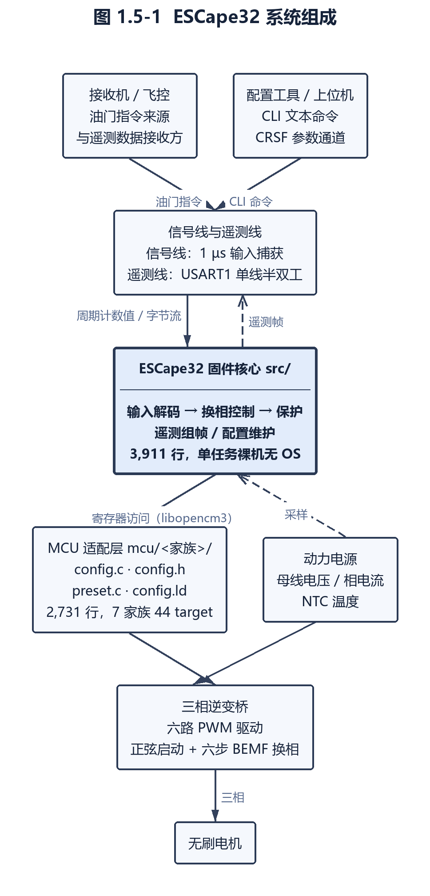

图 1.5-1 ESCape32 系统组成

### 1.5.3 功能概要

固件行为划分为 11 个功能域，各域在正文中的位置与需求标识段如下。功能域划分与需求块数即第 3 章的写作骨架，3.1 节给出同一划分的分解表。

| 域 | 名称 | 正文节 | 需求标识段 | 块数 |
| --- | --- | --- | --- | ---: |
| D1 | 输入与信号解码 | 3.2 | `ESC-FREQ1-*` | 19 |
| D2 | 电机启动与换相 | 3.3 | `ESC-FREQ2-*` | 15 |
| D3 | 运行控制 | 3.4 | `ESC-FREQ3-*` | 14 |
| D4 | 遥测 | 3.5 | `ESC-FREQ4-*` | 16 |
| D5 | 保护 | 3.6 | `ESC-FREQ5-*` | 14 |
| D6 | 配置与存储 | 3.7 | `ESC-FREQ6-*` | 10 |
| D7 | 配置接口与编程器 | 3.8 | `ESC-FREQ7-*` | 12 |
| D8 | 音频与指示 | 3.9 | `ESC-FREQ8-*` | 6 |
| D9 | MCU 适配与硬件接口 | 3.10 | `ESC-FREQ9-*` | 16 |
| D10 | 系统基础设施 | 3.11 | `ESC-FREQ10-*` | 8 |
| D11 | 构建与交付 | 3.12 | `ESC-FREQ11-*` | 8 |
| — | 量化指标（性能、可靠性与安全性） | 3.13、3.14 | `ESC-PREQ*`、`ESC-SREQ*` | — |

表 1.5-2 功能域划分与需求标识段

### 1.5.4 运行形态概要

- **上电**：复位来源被判别为掉电或看门狗（`src/main.c:619`）；从 Flash 的 `.cfg` 段把配置复制到 SRAM 运行副本，做窄域收敛与合法性校验后进入主循环；未通过校验时按缺省配置运行（`src/util.c:532-571`、`src/main.c:559`）。
- **解锁**：默认要求 250 ms 连续零油门方可解锁，任何非零油门都会重启计时（`src/main.c:631-645`）；配置为不需要解锁（`arm` 关闭）或经看门狗复位后可直接运行（`src/main.c:631`）。
- **运行**：启动阶段按正弦表驱动，达到切换条件后转入六步无感换相，换相时刻由反电动势过零中断判定（`src/main.c:266-355`、`src/main.c:377-388`）。
- **保护**：过温、过流、低压、堵转与信号丢失均触发**软动作**（降额、削减、切断或复位），固件不输出故障码、无故障枚举；仅霍尔异常走不可恢复故障路径（LED 常亮并触发看门狗复位）（`src/main.c:445-459`、`src/main.c:487-498`、`src/main.c:848-855`）。
- **配置**：经 CLI（信号线串行命令）或 CRSF 配置协议读写配置参数，保存时擦除、写回并回读校验（`src/prog.c`、`src/util.c:532-571`）。

---

# 2 运行环境规定

本章规定本软件的运行方案、硬件环境、支持软件环境、对外接口与存储布局。凡属编译期由 target 与家族决定的环境事实，均在对应条目中给出判定依据；`boot/` 引导程序不在本次逆向范围内，仅在存储分区与启动链处作边界交代。

## 2.1 运行方案与场景（任务书、需求规格）

### 2.1.1 运行形态

- 需求标识：ESC-IREQ1
- 功能描述：本软件为跑在电调本机 MCU 上的**单任务裸机固件**，不依赖操作系统、不使用动态内存分配；时序敏感工作由中断承担，其余工作在主循环中按固定节拍推进（任务模型）。
- 调用条件：上电复位后进入 `main()`，直到复位为止不退出。
- 输入：中断事件（换相定时器、BEMF 比较器捕获、输入捕获、串口收发、系统节拍）。
- 输出：外设寄存器写入与引脚电平变化；主循环中的状态推进、遥测组帧与配置维护。
- 处理：
- （1）`main()` 完成配置装载、外设初始化与定时器启动后进入无限主循环，循环内不返回；
- （2）系统节拍由 SysTick 以 16 kHz 产生，节拍中断内只累计计数与伺服延时计时，不做长耗时工作（`src/main.c:464-476`、`src/main.c:608-610`）；
- （3）主循环以 `__WFI()` 挂起等待中断唤醒，并在 1 kHz 分频上与节拍同步推进（`src/main.c:478`、`src/main.c:839`）；
- （4）换相输出刷新、BEMF 过零检测、输入捕获与串口收发各自在独立中断中完成，中断优先级在家族 `init()` 中固定设定；
- （5）不使用堆分配，全部缓冲为静态数组（如遥测收发共用的 128 字节缓冲 `iobuf`，`src/telem.c:84-88`）。

> 证据：`src/main.c:464-476`、`src/main.c:608-610`、`src/main.c:478`、`src/main.c:839`、`src/telem.c:84-88`。

### 2.1.2 上电与启动链

- 需求标识：ESC-IREQ2
- 功能描述：上电后按固定顺序完成「配置装载 → 配置收敛 → 外设初始化 → 传感器就绪等待 → 复位来源判别 → 提示音/播报 → 解锁与运行」的启动链（启动链需求，范围含本固件；上游引导程序不在范围）。
- 调用条件：上电复位、看门狗复位或外部复位后由启动代码进入 `main()`。
- 输入：复位来源寄存器 `RCC_CSR`；Flash 配置段内容；编译期宏与家族初始化宏。
- 输出：SRAM 中的运行配置副本；已初始化的外设；可闻提示音或电芯数播报。
- 处理：
- （1）把 Flash 配置段复制到 SRAM 运行副本 `_cfg_start`，随即调用 `checkcfg()` 做窄域收敛与合法性校验（`src/main.c:559-560`）；
- （2）用收敛后的配置初始化运行变量（有刷标志、直控油门、拖刹、锁死占空比、遥测模式与物理 ID）（`src/main.c:561-566`）；
- （3）依次执行 `init()`（家族外设）、`initgpio()`（拓扑引脚）、`initled()`（指示灯）、`inittelem()`（遥测口）、`initio()`（输入捕获前端）（`src/main.c:570-576`）；
- （4）启动电机 PWM 定时器 TIM1、BEMF 捕获定时器 IFTIM 与 SysTick；有霍尔且有感/混合模式下另启霍尔输入定时器 TIM3（`src/main.c:577-610`）；
- （5）当编译期启用传感器采集时，等待 ADC 首次数据就绪（`while (!ready) __WFI();`），并据此求电芯数（`src/main.c:614-615`）；
- （6）读 `RCC_CSR` 判别复位来源并清标志：**仅当上一次复位不是看门狗复位时**视为上电，播放开机音效或音乐并按要求播报电芯数（`src/main.c:617-625`）；
- （7）进入主循环，按解锁判据决定是否进入可运行状态（见 3.3）。

> 证据：`src/main.c:559-560`、`src/main.c:561-566`、`src/main.c:570-576`、`src/main.c:577-610`、`src/main.c:614-615`、`src/main.c:617-625`。

### 2.1.3 运行场景

- 需求标识：ESC-IREQ3
- 功能描述：本软件在「航模/多旋翼动力系统」场景下作为电调固件运行，接受上位机（接收机或飞控）的油门指令驱动电机，可选地回传遥测，并可由配置工具就地读写参数（使用场景）。
- 调用条件：电调已烧录本固件并接入动力电源，信号线与（可选的）遥测线连接到位。
- 输入：油门信号（伺服脉宽 / Oneshot125 / DShot，或模拟、串行总线）、配置命令、辅助刹车通道。
- 输出：三相 PWM 驱动输出、遥测帧、可闻提示音与指示灯状态。
- 处理：
- （1）**独立电调场景**：油门来自接收机，油门通道与辅助通道（拖刹调节）分别由 `input_ch1`/`input_ch2` 指定（默认 0 = 关闭，官方 wiki：Settings.md）；遥测按 `telem_mode` 经独立遥测线回传（`src/telem.c:43-88`）；
- （2）**飞控集成场景**：油门与遥测可共用同一信号线（双向 DShot，`src/io.c:479-486`、`src/io.c:878`）；串行总线输入模式下由同一 USART2 接收（`src/io.c:556`）；
- （3）**配置场景**：经信号线进入 CLI 或经 CRSF 配置通道读写参数，保存时擦写 Flash 配置段并回读校验（`src/prog.c`、`src/util.c:532-571`）；电机运行期间禁止保存（`savecfg()` 在 `ertm || busy` 时返回 0）；
- （4）**维护场景**：CLI 行首收到字节序列 `0x00 0xff` 时立即软复位并把控制权交给引导区，用于固件升级（`src/io.c:959-961`、`src/io.c:1019-1021`；引导程序本身不在本次范围内）；
- （5）**安全场景**：未解锁时电机不输出；解锁要求 250 ms 连续零油门，任何非零油门重置计时（`src/main.c:631-645`）。

> 证据：`src/telem.c:43-88`、官方 wiki：Settings.md、`src/io.c:479-486`、`src/io.c:878`、`src/io.c:556`、`src/util.c:532-571`、`src/io.c:959-961`、`src/io.c:1019-1021`、`src/main.c:631-645`。

## 2.2 硬件环境（计算机使用说明、需求规格）

### 2.2.1 处理器与家族矩阵

- 需求标识：ESC-IREQ4
- 功能描述：本软件面向 7 个 MCU 家族，均为 ARM Cortex-M 内核的 32 位微控制器；每个家族由一个 3 行的 `config.cmake` 声明内核编译选项、libopencm3 外设库名与平台宏，使同一份 `src/` 核心代码在全部家族上编译（目标处理器约束）。
- 调用条件：CMake 配置阶段 `add_target()` 内 include 家族 `config.cmake`。
- 输入：家族目录名（`STM32G431`、`STM32G071`、`STM32L431`、`STM32F051`、`AT32F421`、`GD32F350`、`GD32E230`）。
- 输出：编译选项、链接库与平台宏注入到每个 target。
- 处理：
- （1）按家族选择内核选项：Cortex-M4（G431、AT32F421、GD32F350）、Cortex-M4F（L431）、Cortex-M0+（G071）、Cortex-M0（F051）、Cortex-M23（GD32E230）；
- （2）按家族链接 libopencm3 外设库：STM32 家族各用本系列库（f0/g0/g4/l4），三个国产家族（AT32F421、GD32E230、GD32F350）经寄存器兼容路径复用 `opencm3_stm32f0`，不引入厂商库（`mcu/AT32F421/config.cmake`（第 1-3 行）、`mcu/GD32E230/config.cmake`（第 1-3 行）、`mcu/GD32F350/config.cmake`（第 1-3 行））；
- （3）按家族注入平台宏：`STM32F0`（F051、GD32F350、GD32E230）、`STM32F0 AT32F4`（AT32F421）、`STM32G0`、`STM32G4`、`STM32L4`；
- （4）G431 与 L431 启用硬浮点（`-mfloat-abi=hard -mfpu=fpv4-sp-d16`），其余家族软浮点。

| 家族 | 内核 / 外设库 | Flash 档 | COMP2 | OPAMP | 霍尔 | 特色外设 |
| --- | --- | --- | --- | --- | --- | --- |
| STM32G431 | cortex-m4+FPU / `opencm3_stm32g4` | 64K | 支持（`COMP1_CSR`/`COMP2_CSR` 双寄存器） | 无 | 无 target 启用 | 双 ADC + DMAMUX + boost 模式（`PWR_CR5`）；WS2812 TIM16+DMA2 ch1 |
| STM32G071 | cortex-m0plus / `opencm3_stm32g0` | 64K | 支持（双寄存器） | 无 | 3 个 target（ESCAPE1/4/5） | DMAMUX；WS2812 TIM16+DMA1 ch6；第二输入通道（`IO_AUX`）；IFTIM 双捕获 |
| STM32L431 | cortex-m4+FPU / `opencm3_stm32l4` | 64K | 支持（`USE_COMP2` 换基址） | 支持（PGA ×16） | 无 | DMA `CSELR`；USART1 挂 DMA2；IFTIM 用 TIM2 IC4 + `TIM2_OR1` 重映射 |
| STM32F051 | cortex-m0 / `opencm3_stm32f0` | **32K（全部 10 个 target 均传 `SMALL_DEVICE`）** | 代码有路径、无 target 启用 | 无 | 无 target 启用 | SRAM 映射 0x0 + 向量表拷贝 + 192 B `vec` 段；ADC 用 `CHSELR` 位掩码 |
| AT32F421 | cortex-m4 / `opencm3_stm32f0`（`AT32F4`） | 64K | 不支持 | 无 | 无 | F1 风格 ADC 寄存器；WS2812 TIM17_CH1N 与 ADC 共用 DMA1 ch1 |
| GD32F350 | cortex-m4 / `opencm3_stm32f0` | 64K | 支持（`COMP_SHIFT=16`） | 无 | 无 | 恒软件消隐；ADC 用 IRC28M/HSI14；`init()` 切时钟但不写 `FLASH_ACR` |
| GD32E230 | cortex-m23 / `opencm3_stm32f0` | 64K | 不支持 | 无 | 无 | 恒软件消隐；IFTIM 固定 TIM3；消隐接 TIM3_IC1 |

表 2.2-1 MCU 家族与硬件能力矩阵

证据：`mcu/STM32G431/config.cmake`（第 1-3 行）、`mcu/STM32G071/config.cmake`（第 1-3 行）、`mcu/STM32L431/config.cmake`（第 1-3 行）、`mcu/STM32F051/config.cmake`（第 1-3 行）、`mcu/AT32F421/config.cmake`（第 1-3 行）、`mcu/GD32F350/config.cmake`（第 1-3 行）、`mcu/GD32E230/config.cmake`（第 1-3 行）、`mcu/STM32G431/config.c:40-41`、`mcu/STM32G071/config.c:54-55`、`mcu/STM32L431/config.c:40-45`、`mcu/STM32L431/config.c:106-112`、`mcu/STM32F051/config.c:44-49`、`mcu/GD32F350/config.c:43-47`、`mcu/STM32F051/config.ld（第 5-9 行）`

> 证据：`mcu/STM32G431/config.c:40-41`、`mcu/STM32G071/config.c:54-55`、`mcu/STM32L431/config.c:40-45`、`mcu/STM32L431/config.c:106-112`、`mcu/STM32F051/config.c:44-49`、`mcu/GD32F350/config.c:43-47`、`mcu/STM32F051/config.ld（第 5-9 行）`。

### 2.2.2 系统时钟

- 需求标识：ESC-IREQ5
- 功能描述：每个家族在 `config.h` 中声明唯一的系统时钟频率 `CLK`；其中 4 个家族的 `init()` 内完成时钟树切换，另 3 个家族的 `init()` 内**不含时钟树配置**，沿用启动链上游余留的时钟（时钟环境约束）。
- 调用条件：`init()` 早期（外设复位脉冲与时钟使能之后）；仅在实现了切换的 4 个家族内实际发生。
- 输入：家族 `config.h` 的 `CLK`、可选 `USE_HSE`（外部晶振频率）。
- 输出：系统时钟达到家族标称频率；由 `CLK` 派生的 `CLK_MHZ`/`CLK_KHZ`/`CLK_CNT()` 供全仓使用（`src/common.h:40-42`）。
- 处理：
- （1）实现了切换的 4 个家族先切回内部 RC 或 HSE 并关闭 PLL，等待时钟源与 PLL 就绪；
- （2）写 PLL 配置寄存器得到标称频率；AT32F421 与 GD32E230 另写 `FLASH_ACR` 等待周期（分别 3WS、2WS），G431 另置 `PWR_CR5 = 0` 进入 boost 模式（`mcu/STM32G431/config.c:97`、`mcu/AT32F421/config.c:68`、`mcu/GD32E230/config.c:59`）；
- （3）切换系统时钟源到 PLL 并等待生效；
- （4）GD32F350 只写 `RCC_CFGR`/`RCC_CR`（PLLMUL = ×26），**不写 `FLASH_ACR`**（`mcu/GD32F350/config.c:62-69`）；
- （5）G071 的时钟配置代码整体位于 `#ifdef USE_HSE` 分支内，而本仓无 G071 target 传 `USE_HSE`，故该分支不参与编译；
- （6）定义 `USE_HSE=<MHz>` 的家族先试外部晶振，10 ms 内未起振则回退内部 RC 路径（唯一使用者 PHOTONDRIVE1 传 8）（`mcu/STM32G431/config.c:75-104`、`CMakeLists.txt（第 93 行）`）。

| 家族 | 系统时钟 | `init()` 内是否切换时钟树 | 依据 |
| --- | ---: | --- | --- |
| STM32G431 | 168 MHz | 是（HSI16 + PLL，置 `PWR_CR5` 进 boost） | `mcu/STM32G431/config.h:20`、`mcu/STM32G431/config.c:71-104` |
| STM32G071 | 64 MHz | 否（时钟配置仅在 `#ifdef USE_HSE` 内，本仓无 target 传该宏） | `mcu/STM32G071/config.h:20`、`mcu/STM32G071/config.c:63-105` |
| STM32L431 | 80 MHz | 否（`init()` 内无 PLL/CFGR/`FLASH_ACR` 写入） | `mcu/STM32L431/config.h:20`、`mcu/STM32L431/config.c:51-143` |
| STM32F051 | 48 MHz | 否（同上） | `mcu/STM32F051/config.h:20`、`mcu/STM32F051/config.c:54-129` |
| AT32F421 | 120 MHz | 是（HSI ×30，写 `FLASH_ACR` 3WS） | `mcu/AT32F421/config.h:20`、`mcu/AT32F421/config.c:64-72` |
| GD32F350 | 104 MHz | 是（HSI ×26，不写 `FLASH_ACR`） | `mcu/GD32F350/config.h:20`、`mcu/GD32F350/config.c:62-69` |
| GD32E230 | 72 MHz | 是（HSI ×18，写 `FLASH_ACR` 2WS） | `mcu/GD32E230/config.h:20`、`mcu/GD32E230/config.c:55-63` |

表 2.2-2 家族系统时钟与时钟树处置

> **边界说明**：G071、L431、F051 三家族的系统时钟由启动链上游（`boot/` 引导程序）设定，本次范围的代码中不存在其时钟树配置；`boot/` 不在本范围内，故「引导程序设定 → 本固件沿用」的完整链条未闭合，本表按实测口径记录（`boot/mcu/STM32G0/config.c:25-29` 为范围外旁证）。

> 证据：`src/common.h:40-42`、`mcu/STM32G431/config.c:97`、`mcu/AT32F421/config.c:68`、`mcu/GD32E230/config.c:59`、`mcu/GD32F350/config.c:62-69`、`mcu/STM32G431/config.c:75-104`、`CMakeLists.txt（第 93 行）`、`mcu/STM32G431/config.h:20`、`mcu/STM32G431/config.c:71-104`、`mcu/STM32G071/config.h:20`、`mcu/STM32G071/config.c:63-105`、`mcu/STM32L431/config.h:20`、`mcu/STM32L431/config.c:51-143`、`mcu/STM32F051/config.h:20`、`mcu/STM32F051/config.c:54-129`、`mcu/AT32F421/config.h:20`、`mcu/AT32F421/config.c:64-72`、`mcu/GD32F350/config.h:20`、`mcu/GD32E230/config.h:20`、`mcu/GD32E230/config.c:55-63`、`boot/mcu/STM32G0/config.c:25-29`。

### 2.2.3 三相 PWM 与逆变桥接口

- 需求标识：ESC-IREQ6
- 功能描述：本软件以 TIM1 的互补 PWM 通道驱动三相逆变桥，默认占用 A7/A8/A9/A10 与 B0，第三相下桥臂引脚按家族选择；死区时间由编译期 `DEAD_TIME` 编码后写入 TIM1 死区寄存器（逆变桥驱动约束）。
- 调用条件：`init()` 的 GPIO 默认态配置阶段写入引脚复用；运行期由换相路径写比较寄存器。
- 输入：`DEAD_TIME`（本仓实测取值 0、26、35、40、44、50、57、60、66、96、155）、封装变体宏、`IO_PA2`/`IO_PA6`。
- 输出：`GPIOA`/`GPIOB`/`GPIOF` 的模式与复用寄存器位域；`TIM_DTG` 供上层写 `TIM1_BDTR`。
- 处理：
- （1）配置 A7（CH1N）、A8（CH1）、A9（CH2）、A10（CH3）、B0（CH2N）的复用功能与模式（`src/defs.h:20-28`、各家族 `config.c`）；
- （2）第三相下桥臂 CH3N：G431 默认 F0（`USE_48PIN` 时改 B1，该宏全仓未定义、分支不可达）、G071 默认 B1（`IO_PA6` 时改 B15）、其余家族固定 B1；
- （3）`TIM_DTG` 按 `DEAD_TIME` 落点分四段（<128、<256、<512、<1024）做不同移位与掩码编码后由 `main()` 写入 `TIM1_BDTR`（`src/defs.h:20-28`、`src/main.c:577`）；
- （4）TIM1 计数基准为 `CLK_KHZ / 24 - 1`，即基础 PWM 频率 24 kHz，运行期按转速分档改写 `TIM1_ARR` 实现可变 PWM 频率（`src/main.c:578`、`src/main.c:743`）；
- （5）互补输出用于主动续流/阻尼，通道配置与死区一并生效（见 3.4）。

> 证据：`src/defs.h:20-28`、`src/main.c:577`、`src/main.c:578`、`src/main.c:743`。

### 2.2.4 反电动势比较器与捕获资源

- 需求标识：ESC-IREQ7
- 功能描述：反电动势过零由片内比较器 + 捕获定时器（`IFTIM`）组合判定；编译期 `COMP_MAP` 把逻辑比较器输入 1/2/3 映射到物理比较器编号，运行期 `compctl()` 按换相阶段选择输入并可翻转极性（比较器与定时器资源约束）。
- 调用条件：`init()` 建立 TIM1 与 `IFTIM` 的触发互连并配置比较器基址；运行期每次换相按需调用 `compctl()`。
- 输入：`COMP_MAP` ∈ {123, 231, 312, 132, 321, 213}（由端口宏 `COMP_IN1/2/3` 派生）；`compctl()` 参数低 2 位选输入、bit2 选极性；家族 `config.h` 的 `IFTIM` 资源宏。
- 输出：`COMP1_CSR`/`COMP2_CSR`（G431、G071）或 `COMP_CSR`（其余家族）被写入；G431/G071 另写 `TIM2_TISEL` 把比较器输出接到捕获输入；`IFTIM` 三档滤波档位在运行期按转速写入。
- 处理：
- （1）`src/defs.h` 把 `COMP_MAP` 展开为 `COMP_IN1/2/3`（`src/defs.h:30-54`）；
- （2）`init()` 写 TIM1 的触发输入选择与 `IFTIM` 的触发输出源，并按家族注册固定优先级后使能中断（`mcu/STM32G071/config.c:193-200`、`mcu/STM32G431/config.c:190-194`）；
- （3）运行期换相路径按电气周期时间分档写 `IFTIM_ICMR = IFTIM_ICM1/ICM2/ICM3` 之一（滤波长度切换的写入点在 `init()` 之外，`src/main.c:285-321`）；
- （4）BEMF 测量的窗口消隐按家族分三套实现：**硬件形态**（TIM1 比较通道直连捕获，在未定义 `SW_BLANKING` 的家族成立：G431、G071、AT32F421 及 L431 非 `USE_COMP2` 时；其中定义 `TIM1_CCR5` 的 G431、L431 走第 5 通道 OC5，未定义的 G071、AT32F421 走第 4 通道 OC4）、**F0 系软件形态**（定时器中断内开关比较器输出到捕获输入的连接，F051/GD32F350 与 GD32E230 恒定义 `SW_BLANKING`）、**L431 的 `USE_COMP2` 软件形态**（在 COMP1_OUT 与 COMP2_OUT 之间切换）（`mcu/STM32G431/config.h:53-54`、`src/main.c:181-187`、`mcu/STM32F051/config.c:174-186`、`mcu/GD32E230/config.c:168-187`、`mcu/STM32L431/config.c:206-216`）；
- （5）三套消隐形态在功能上是否等价**尚未判定**，各家族按上述实测口径分别记录。

> 证据：`src/defs.h:30-54`、`mcu/STM32G071/config.c:193-200`、`mcu/STM32G431/config.c:190-194`、`src/main.c:285-321`、`mcu/STM32G431/config.h:53-54`、`src/main.c:181-187`、`mcu/STM32F051/config.c:174-186`、`mcu/GD32E230/config.c:168-187`、`mcu/STM32L431/config.c:206-216`。

### 2.2.5 模拟采样通道

- 需求标识：ESC-IREQ8
- 功能描述：电压、电流与温度经 ADC 扫描序列采集，序列由 `SENS_MAP` 翻译的通道掩码、可选模拟油门通道、温度通道与参考电压通道拼成，并由 DMA 搬入静态缓冲区（模拟前端约束）。
- 调用条件：`init()` 末段构造序列并完成 ADC 上电校准；运行期每次采样前由 `adctrig()` 按长度重装 DMA。
- 输入：`SENS_MAP`、`ANALOG_CHAN`、`TEMP_CHAN`、`TEMP_SHIFT`、`IO_ANALOG`。
- 输出：`ADC_SQR1/2`（G431、L431）、`ADC_CHSELR`（G071、F051）或 `ADC1_SQR3`+`ADC1_SQR1`（AT32F421、GD32F350、GD32E230）被写入；DMA `CPAR`/`CMAR` 指向 ADC 数据寄存器与缓冲区。
- 处理：
- （1）ADC 上电与校准按家族寄存器风格实现：STM32G431/L431 走「稳压器使能 → 等待 → 校准 → 使能 → 等就绪」，G071/F051 为简化序列（F051 无稳压器使能与等待），三个国产家族走「ADON + 温度/参考使能 → 校准 → 扫描模式」，校准等待分别 3 µs / 1 µs / 1 µs（`mcu/STM32G431/config.c:196-248`、`mcu/AT32F421/config.c:118-139`、`mcu/GD32F350/config.c:121-143`、`mcu/GD32E230/config.c:101-123`）；
- （2）把采样通道串入序列寄存器：基础长度由 `SENS_CNT` 决定，模拟油门通道与温度通道各 +1，参考电压占最后 2 个槽位后 `len += 2`（各家族约定一致）；
- （3）DMA 路由按家族能力实现：G431 独有双 ADC（ADC1 搬 `buf + len2`、ADC2 搬 `buf`，两个通道完成中断互等后统一换算）并逐通道绑定 DMAMUX；G071 亦用 DMAMUX；L431 用 DMA `CSELR` 选请求源；F0/AT32/GD32 系用固定通道号（`mcu/STM32G431/config.c:196-248`、`mcu/STM32L431/config.c:119-143`）；
- （4）温度通道与换算按家族给出默认值：STM32 系用厂家标定常量线性式，基准 3000 mV（G431）或 3300 mV（F051）；AT32F421、GD32F350、GD32E230 三族用各自独立的自写线性式，参考电压换算统一用常数 4914000（`mcu/AT32F421/config.c:40-43`、`mcu/GD32F350/config.c:36-39`、`mcu/GD32E230/config.c:34-37`）；
- （5）各家族的温度换算式各家族不等价，按实测式分列记录；
- （6）外部温度传感器（未定义 `TEMP_CHAN` 时由 `TEMP_SENS` 选择）默认使用 `NTC10K3455UP2K` 曲线，四种 NTC 曲线均为分段一次拟合 + 定点缩放（`src/defs.h:85`、`src/common.h:162-176`）。

> 证据：`mcu/STM32G431/config.c:196-248`、`mcu/AT32F421/config.c:118-139`、`mcu/GD32F350/config.c:121-143`、`mcu/GD32E230/config.c:101-123`、`mcu/STM32L431/config.c:119-143`、`mcu/AT32F421/config.c:40-43`、`mcu/GD32F350/config.c:36-39`、`mcu/GD32E230/config.c:34-37`、`src/defs.h:85`、`src/common.h:162-176`。

### 2.2.6 拓扑引脚映射与家族专有外设

- 需求标识：ESC-IREQ9
- 功能描述：硬件拓扑由一组编译期映射宏描述（霍尔、BEC 档位、指示灯、ERPM 输出、WS2812），宏值以「端口字母 + 引脚号」串编码；WS2812 与霍尔为家族专有实现，仅部分家族/target 启用（引脚拓扑约束）。
- 调用条件：宏由 target 行传入或由 `src/defs.h` 给缺省；WS2812 需家族 `config.c` 提供 `initled()`/`ledctl()`。
- 输入：`HALL_MAP` ∈ {0xAFB35, 0xB357, 0xB358, 0xB450}、`BEC_MAP` ∈ {0xA45, 0xB35, 0xCEF, 0xADE}、`BEC_MIN`/`BEC_MAX`、`LED_MAP`、`ERPM_PIN`/`ERPM_PORT`、`LED_WS2812`/`LED_STAT`。
- 输出：霍尔引脚的上拉与输入态、BEC 档位引脚电平、ERPM 输出引脚、指示灯位掩码或 WS2812 颜色时序。
- 处理：
- （1）`src/util.c` 顶部把 `HALL_MAP` 展开为端口/引脚宏：`0xAFB35` 分支定义 5 个宏（含 `HALL2_PORT`，该分支自洽），其余三个分支定义 `HALL_PORT`/`HALL_PIN1..3`（`src/util.c:20-42`）；
- （2）`initgpio()` 消费上述宏配置霍尔引脚，按 `cfg.bec - BEC_MIN` 把 BEC 档位写到对应端口（`0xADE` 为 SWD 引脚 A13/A14 的特例分支），并把 ERPM 引脚配成通用输出（`src/util.c:126-143`、`src/util.c:145-183`）；
- （3）ERPM 引脚的运行期翻转由正弦步路径在固定换相步完成：步 1 拉低（BSRR 高 16 位 = 复位）、步 181 拉高（BSRR 低 16 位 = 置位）（`src/main.c:137-140`）；
- （4）WS2812 由家族 `config.c` 的 `initled()`/`ledctl()` 实现，三条资源路径：G431（TIM16 + DMA2 ch1）、G071（TIM16 + DMA1 ch6）、AT32F421（TIM17_CH1N 与 ADC 共用 DMA1 ch1，故 ADC 的 `CPAR`/`CMAR` 改为每次 `adctrig()` 前重设）（`mcu/STM32G431/config.c:251-279`、`mcu/STM32G071/config.c:231-259`、`mcu/AT32F421/config.c:142-176`）；
- （5）霍尔能力仅 3 个 G071 target（ESCAPE1/4/5）启用，其余 target 走无感路径（`CMakeLists.txt`（第 64、67、68 行））；
- （6）源码中存在但全仓无定义的宏所保护的路径（`ANALOG`、`PWM_ENABLE`、`PARK_PIN`、`USE_XOR`、`USE_48PIN`、`USE_SPIN32`、`USE_32PIN`、`ANALOG_LAST`、`ANALOG_ADC2`、`DISABLE_EXBUS`、`LED4_PORT`、`USE_PB1` 共 12 个）以及三引脚霍尔预留分支（`HALL1_PIN2`）一律记为「官方声明未落地／预留能力」，按当前构建不可达记录（分支成因与消费点见附录 1 附表 6）。

> 证据：`src/util.c:20-42`、`src/util.c:126-143`、`src/util.c:145-183`、`src/main.c:137-140`、`mcu/STM32G431/config.c:251-279`、`mcu/STM32G071/config.c:231-259`、`mcu/AT32F421/config.c:142-176`。

## 2.3 支持软件环境（计算机使用说明、需求规格）

### 2.3.1 工具链与编译选项

- 需求标识：ESC-IREQ10
- 功能描述：构建固定使用 GNU Arm 嵌入式工具链，并以固定的编译、告警与链接选项集产出目标文件（工具链约束）。
- 调用条件：CMake 配置与编译阶段。
- 输入：`arm-none-eabi-gcc`、`arm-none-eabi-objcopy` 及配套 binutils/newlib。
- 输出：`-Os -g` 优化的目标文件与最终 ELF。
- 处理：
- （1）设定 `CMAKE_SYSTEM_NAME Generic` 与 `CMAKE_C_COMPILER_WORKS 1`（交叉编译无宿主运行环境）（`CMakeLists.txt（第 1-7 行）`）；
- （2）默认 `CMAKE_C_FLAGS = "-Os -g"`，调试档为 `-Og`（`CMakeLists.txt（第 18-21 行）`）；
- （3）编译选项含 `-ffreestanding -ffunction-sections -fdata-sections -fsingle-precision-constant`，使无语义无关函数/数据可被链接期回收（`CMakeLists.txt（第 47-55 行）`）；
- （4）告警集为 `-Wall -Wextra -Wpedantic -Wundef -Wshadow -Wredundant-decls -Wstrict-prototypes -Wmissing-prototypes`，并按 target 追加 3 个 `-Wno-*`（`SMALL_DEVICE` 时追加 `-Wno-unused-variable -Wno-unused-function`）；
- （5）链接选项为 `-nostartfiles -Wl,--gc-sections`，库为 `c_nano gcc nosys`。

> 证据：`CMakeLists.txt（第 1-7 行）`、`CMakeLists.txt（第 18-21 行）`、`CMakeLists.txt（第 47-55 行）`。

### 2.3.2 第三方库与家族外设库映射

- 需求标识：ESC-IREQ11
- 功能描述：全部外设寄存器访问经第三方库 libopencm3 的宏定义完成；库路径可由 `LIBOPENCM3_DIR` 指定，也可经 `CMAKE_INSTALL_PREFIX` 作为替代系统根（第三方依赖约束）。
- 调用条件：CMake 配置阶段；链接阶段按家族取库名。
- 输入：`LIBOPENCM3_DIR`（可选）、`CMAKE_INSTALL_PREFIX`（仅 UNIX 且非默认时）。
- 输出：`include_directories`/`link_directories` 指向 libopencm3 的 `include` 与 `lib`。
- 处理：
- （1）定义 `LIBOPENCM3_DIR` 时把其 `include` 与 `lib` 目录加入搜索路径（`CMakeLists.txt（第 8-17 行）`）；
- （2）UNIX 且安装前缀为初始化默认值时，用 `GNUInstallDirs` 把前缀当作替代系统根；
- （3）链接阶段按家族取 `opencm3_stm32f0`（F051、GD32F350、GD32E230、AT32F421）、`opencm3_stm32g0`（G071）、`opencm3_stm32g4`（G431）、`opencm3_stm32l4`（L431），并统一链 `c_nano gcc nosys`（`CMakeLists.txt（第 47 行）`）；
- （4）三个国产 MCU 家族复用 STM32F0 库（见 2.2.1），因此构建只需准备 4 个 STM32 系列库即可覆盖全部 7 个家族。

> 证据：`CMakeLists.txt（第 8-17 行）`、`CMakeLists.txt（第 47 行）`。

### 2.3.3 构建流程、产物与烧写

- 需求标识：ESC-IREQ12
- 功能描述：构建流程为「配置 → 编译 → 生成 bin/hex → 可选烧写」，产物名含固件版本号，并提供逐 target 的烧写便利目标（构建与交付约束）。
- 调用条件：开发者或 CI 在仓库根执行构建命令。
- 输入：`LIBOPENCM3_DIR`（可选）、`CMakeLists.txt（第 60-103 行）`中的 target 定义行。
- 输出：`<target>-rev17[.3].elf`、`.bin`、`.hex` 三份产物。
- 处理：
- （1）配置命令为 `cmake -B build -D LIBOPENCM3_DIR=libopencm3`，随后在 `build` 目录执行 `make`（`README.md（第 46-66 行）`）；
- （2）源文件集合由 `file(GLOB)` 收集 `src/*.c` 与 `mcu/<家族>/*.c`，不逐文件列举（`CMakeLists.txt（第 23-35 行）`）；
- （3）产物名中的版本号由正则从 `src/main.c` 的 `REVISION`/`REVPATCH` 读得，即 `<name>-rev17.3.bin`（`CMakeLists.txt（第 54-55 行）`）；
- （4）`objcopy -O binary` 生成 `.bin`、`objcopy -O ihex` 生成 `.hex`，并为每个 target 建立 `add_custom_target(${name} ALL DEPENDS ${hex})`；
- （5）烧写便利目标 `flash-<target>` 调用 `st-flash --reset --connect-under-reset --format ihex write`，即需 ST-LINK 类调试器（`CMakeLists.txt（第 47-55 行）`）。

> 证据：`CMakeLists.txt（第 60-103 行）`、`README.md（第 46-66 行）`、`CMakeLists.txt（第 23-35 行）`、`CMakeLists.txt（第 54-55 行）`、`CMakeLists.txt（第 47-55 行）`。

### 2.3.4 持续集成环境

- 需求标识：ESC-IREQ13
- 功能描述：仓库自带一套 GitHub Actions 工作流，**仅手动触发**，在 Ubuntu 环境安装 ARM 工具链、现场构建 libopencm3 的 4 个系列、再构建全部 target 并上传 `.bin` 产物（交付环境约束）。
- 调用条件：在 GitHub Actions 页面手动运行 `Build ESCape32` 工作流（`workflow_dispatch`，非 push/PR 触发）。
- 输入：仓库源码；公开 Action `carlosperate/arm-none-eabi-gcc-action@v1`、`actions/checkout@v4`、`actions/upload-artifact@v4`。
- 输出：名为 `escape32-build` 的构建产物，路径 `build/**/*.bin`，保留 7 天。
- 处理：
- （1）检出仓库后克隆 libopencm3 并执行 `make -C libopencm3 TARGETS='stm32/f0 stm32/g0 stm32/g4 stm32/l4'`——四个系列即覆盖全部 7 个家族（国产三族复用 f0 库）；
- （2）执行 `cmake -B build -D LIBOPENCM3_DIR=libopencm3`；
- （3）执行 `cd build && make` 构建全部 target；
- （4）上传 `build/**/*.bin` 为构建产物（`.github/workflows/build.yml（第 1-19 行）`）。

> 证据：`.github/workflows/build.yml（第 1-19 行）`。

## 2.4 对外接口（用户需求、需求规格）

### 2.4.1 信号输入线

- 需求标识：ESC-IREQ14
- 功能描述：本软件提供一条**信号输入线**，同一引脚以定时器输入捕获方式测量两个上升沿之间的周期，从而在同一物理接口上兼容伺服脉宽、Oneshot125、DShot 及多种串行总线输入（对外接口需求，接口契约见下）。
- 调用条件：`initio()` 在上电初始化时配置一次；运行期中断持续测量。
- 输入：信号线数字电平边沿；引脚由家族 `config.h` 的 `IOTIM_IDR` 指定（`IO_PA2`/`IO_PA6`/缺省三种映射）。
- 输出：`TIM_CCR1(IOTIM)` 的周期计数值（1 计数 = 1 µs）与 `TIM_CCR2`（伺服脉宽）；输入中断函数指针 `ioirq`（初值 `entryirq`）。
- 处理：
- （1）输入捕获定时器置 1 µs 分辨率（`PSC = CLK_MHZ - 1`）、全量程自动重装、单脉冲更新（`src/io.c:83-94`）；
- （2）通道配置为 TI1 输入 + 8 次采样数字滤波，由 TI1 上升沿复位计数器，并使能更新与捕获中断（`src/io.c:83-94`）；
- （3）引脚映射：STM32G071 下 `IO_PA2` → TIM15/A2（`IOTIM_DMA=1`）、`IO_PA6` → TIM3/A6、缺省 TIM3/B4；AT32F421、GD32E230、STM32L431、STM32G431 固定 TIM15/A2（`mcu/STM32G071/config.h:42-56`、`mcu/AT32F421/config.h:21`、`mcu/GD32E230/config.h:22`）；
- （4）上电后先按「存活判定」自动辨识输入类型（伺服/Oneshot125、DShot、串行、模拟），辨识逻辑见 3.2；
- （5）输入模式可经配置选择（默认 0 = 伺服/Oneshot125/DShot 自动），可选模式见下表；
- （6）非法信号存在硬处置：伺服脉宽越界（>2200 µs 或 <800 µs）且电机静止（`ertm == 0`）时触发窗口看门狗复位，运行中越界只被忽略（`src/io.c:297-300`）；串口帧错/噪声错或接收缓冲将满同样触发复位（`src/io.c:953`）。

| 编号 | 输入模式 | 说明 |
| ---: | --- | --- |
| 0 | servo / Oneshot125 / DShot | 默认值，按输入自动辨识 |
| 1 | analog | 需 PA2/PA6 输入引脚；油门单向；低于 `analog_min` 视为零油门 |
| 2 | serial | 需 PA2 输入引脚；原生串行协议 |
| 3 | iBUS（FlySky） | — |
| 4 | SBUS/SBUS2（FrSky/Futaba） | AT32F421 上为 uninverted |
| 5 | CRSF（TBS/ELRS） | 配合 `telem_mode` = CRSF 可用 CRSF 配置 |
| 6 | EXBUS（Jeti） | rel16 起支持 |
| 7 | HoTT（Graupner） | rel16 起支持，可被 `DISABLE_HOTT` 裁掉 |

表 2.4-1 信号输入线支持的输入模式

证据：官方 wiki：Settings.md、`src/io.c:167-221`、`src/util.c:457-480`

> 证据：`src/io.c:83-94`、`mcu/STM32G071/config.h:42-56`、`mcu/AT32F421/config.h:21`、`mcu/GD32E230/config.h:22`、`src/io.c:297-300`、`src/io.c:953`、`src/io.c:167-221`、`src/util.c:457-480`、官方 wiki：Settings.md。

### 2.4.2 遥测线

- 需求标识：ESC-IREQ15
- 功能描述：本软件提供一条**独立遥测线**，固定使用 USART1，按 `telem_mode` 选择协议与波特率；该口**恒为单线半双工**（对外接口需求）。
- 调用条件：上电初始化调用 `inittelem()`；运行期由 1 kHz 节拍与接收中断驱动。
- 输入：`cfg.telem_mode`、`cfg.telem_phid`、`CLK`；来自上位机的请求帧。
- 输出：USART1 波特率寄存器与 DMA 通道绑定；遥测帧字节流。
- 处理：
- （1）按模式表写波特率，并对需应答的协议登记应答函数 `iofunc`（`src/telem.c:43-76`）；
- （2）USART1 恒置半双工位；`iofunc` 非空时同时开启收发 DMA 与接收中断允许位，`iofunc` 为空（KISS、CRSF）时只保留发送 DMA 与发送使能（`src/telem.c:77-83`）；
- （3）把 128 字节缓冲同时挂到接收/发送 DMA 的存储器地址，接收计数装 `sizeof iobuf`（`src/telem.c:84-88`）；
- （4）应答型协议用接收超时/空闲检测判帧尾：S.Port 模式把超时改为约 450 µs 并追加收发反相与 B6 下拉，AT32F4 平台改用空闲中断分支替代超时中断（`src/telem.c:39-42`、`src/telem.c:52-60`、`src/telem.c:96-101`）；
- （5）模式号越界被钳位到 0..6；`DISABLE_MSB`/`DISABLE_HOTT` 生效时对应模式直接归 0（`src/util.c:474-480`）。

| 模式号 | 名称 | 波特率 | 应答函数 | 物理层特殊设置 |
| ---: | --- | ---: | --- | --- |
| 0 | KISS | 115200 | 无（请求式） | — |
| 1 | KISS auto | 115200 | 无（周期式） | — |
| 2 | iBUS | 115200 | `ibusfunc` | — |
| 3 | S.Port | 57600 | `sportfunc` | 超时约 450 µs、收发反相、B6 下拉 |
| 4 | CRSF | 416666 | 无（周期式 + 配置通道） | — |
| 5 | MSB | 38400 | `msbfunc` | 可被 `DISABLE_MSB` 裁掉 |
| 6 | HoTT | 19200 | `hottfunc` | 可被 `DISABLE_HOTT` 裁掉 |

表 2.4-2 遥测模式与物理层参数

证据：`src/telem.c:43-88`、`src/io.c:214-221`

> 证据：`src/telem.c:43-76`、`src/telem.c:77-83`、`src/telem.c:84-88`、`src/telem.c:39-42`、`src/telem.c:52-60`、`src/telem.c:96-101`、`src/util.c:474-480`、`src/telem.c:43-88`、`src/io.c:214-221`。

### 2.4.3 串行输入线

- 需求标识：ESC-IREQ16
- 功能描述：串行总线输入与非默认信号线配置使用**独立于遥测口的第二个串口**（USART2），与遥测口为不同外设、可同时工作（对外接口需求）。
- 调用条件：`input_mode` 取串行类模式（2..7）时由 `initio()` 的串行分支配置。
- 输入：USART2 字节流（经接收 DMA 落入 `iobuf`）。
- 输出：`USART2_BRR`/`CR1`/`CR3` 配置；解析后的油门与辅助通道值；配置命令帧。
- 处理：
- （1）按输入模式写波特率并登记解析函数，各模式授权按协议实现（`src/io.c:167-213`）；
- （2）USART2 置单线半双工、开启收发 DMA，并使能空闲中断（`src/io.c:214-215`）；
- （3）接收与发送 DMA 分别绑定到 `iobuf`，接收计数装缓冲长度（`src/io.c:216-221`）；
- （4）数据错误（帧错误/噪声错误）或缓冲写满时触发窗口看门狗复位（`src/io.c:953`、`src/io.c:1002`、`src/io.c:1011`）；
- （5）原生串行协议的收发帧格式与命令集见 3.8 与官方 wiki：SerialProtocol.md（`（用户需求）`）。

> 证据：`src/io.c:167-213`、`src/io.c:214-215`、`src/io.c:216-221`、`src/io.c:953`、`src/io.c:1002`、`src/io.c:1011`、官方 wiki：SerialProtocol.md（`（用户需求。

### 2.4.4 配置与编程接口

- 需求标识：ESC-IREQ17
- 功能描述：对外提供两条配置通路——**经信号线的 CLI**（文本命令读写参数、播放声音、直控油门）与**CRSF 参数通道**（在 CRSF 输入/遥测模式下复用同一信号线）；另提供进入引导程序的编程入口（对外接口需求）。
- 调用条件：CLI 需在信号线上维持高电平达判定时间后进入（进入判据见 3.8）；CRSF 配置需 `input_mode` = 5 且 `telem_mode` = 4。
- 输入：CLI 命令文本；CRSF 参数帧；字节序列 `0x00 0xff`（编程入口）。
- 输出：命令应答文本、参数值、声音/提示音；写入 Flash 的配置；软复位并移交引导程序。
- 处理：
- （1）CLI 有两套物理层实现（伺服信号线与串行线），两者独立实现同一命令逻辑（`src/io.c:556+`、`src/prog.c`）；
- （2）CLI 行首收到 `0x00 0xff` 时立即软复位进入引导区，不按普通命令解析，也不产生应答（`src/io.c:959-961`、`src/io.c:1019-1021`）；
- （3）CRSF 配置通道以参数化条目暴露配置项，读写走与 CLI 相同的收敛与保存路径（`src/prog.c`）；
- （4）所有写入最终经同一配置段保存流程落盘（见 2.5.2）；电机运行期间保存请求被拒绝；
- （5）接口连接关系见图 2.4-1（信号线、遥测线、动力电源与电机、配置工具）。

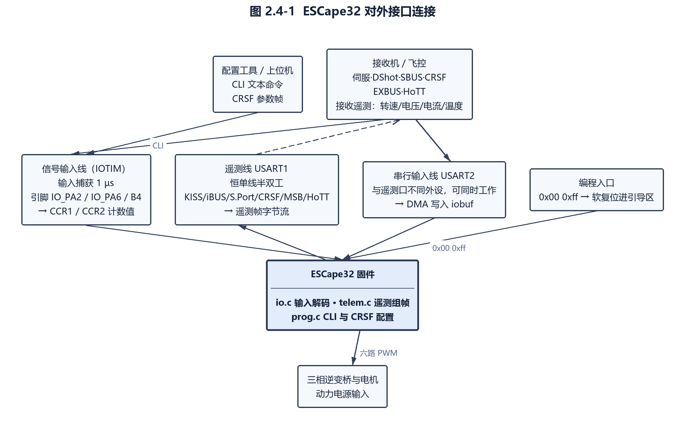

图 2.4-1 ESCape32 对外接口连接

> 证据：`src/io.c:959-961`、`src/io.c:1019-1021`。

## 2.5 存储布局与 Flash 分区（需求规格）

### 2.5.1 存储分区与链接脚本

- 需求标识：ESC-IREQ18
- 功能描述：Flash 按「引导区 + 配置区 + 固件区」三段划分，配置区被链接为独立的 `.cfg` 段（装载在 Flash 配置区、运行在 SRAM）；RAM 统一从 `0x20000000` 起算（存储环境约束）。
- 调用条件：链接阶段注入两份链接脚本，家族脚本在前、公共脚本在后；`FLASH_SIZE` 由链接选项注入。
- 输入：`SMALL_DEVICE`（定义 ⇒ 32K，否则 64K）、家族 `config.ld`。
- 输出：`.elf`/`.bin`/`.hex` 的各段长度；符号 `_boot`、`_cfg`、`_rom`、`_ram`、`_eod`、`_cfg_start`、`_cfg_end`（STM32F051 另有 `_vec`）供 C 代码引用。
- 处理：
- （1）家族 `config.ld` 按 `FLASH_SIZE - LENGTH(boot) - LENGTH(cfg)` 计算固件区长度，引导区固定 4K，RAM 统一 8K（`mcu/STM32G071/config.ld（第 1-6 行）`）；
- （2）配置区容量分两档：G431、G071、L431 为 2K，F051、AT32F421、GD32F350、GD32E230 为 1K；
- （3）公共脚本定义 `.cfg` 段为 `>ram AT >cfg`（运行在 RAM、装载在 Flash 配置区），段内导出 `_cfg_start`/`_cfg_end` 并在段尾 8 字节对齐（`mcu/common.ld（第 1-16 行）`）；
- （4）符号 `_boot`/`_cfg`/`_rom`/`_ram` 取各自存储区原点，`_eod` 取已初始化数据段末址（`mcu/common.ld（第 10-14 行）`）；
- （5）**家族例外**：STM32F051 单独划出 192 字节 `vec` 段并把 RAM 改为 `8K - LENGTH(vec)`，同时导出 `_vec`，配合其「向量表复制到 SRAM 并把 SRAM 映射到 `0x00000000`」的做法（`mcu/STM32F051/config.ld（第 5-9 行）`、`mcu/STM32F051/config.c:62-63`）；
- （6）`FLASH_SIZE` 由 CMake 以 `-Wl,--defsym,FLASH_SIZE=<size>` 注入（`CMakeLists.txt（第 46 行）`）。

| 存储区 | 起址 | 容量 | 用途 |
| --- | --- | --- | --- |
| `boot` | `0x08000000` | 4K | 上游引导程序（**不在本次范围**，仅在边界处交代） |
| `cfg` | `boot` 末尾 | 2K（G431/G071/L431）或 1K（其余四族） | 配置段 `.cfg` 的 Flash 装载区 |
| `rom` | `cfg` 末尾 | `FLASH_SIZE - 4K - cfg` | 固件代码与常量 |
| `ram` | `0x20000000` | 8K（STM32F051 为 `8K - 192B`） | 数据、栈与 `.cfg` 段运行副本 |

表 2.5-1 Flash 与 RAM 分区

证据：`mcu/common.ld（第 1-16 行）`、`mcu/STM32G071/config.ld（第 1-6 行）`、`mcu/STM32G431/config.ld（第 1-6 行）`、`mcu/STM32L431/config.ld（第 1-6 行）`、`mcu/STM32F051/config.ld（第 1-9 行）`、`mcu/AT32F421/config.ld（第 1-6 行）`、`mcu/GD32F350/config.ld（第 1-6 行）`、`mcu/GD32E230/config.ld（第 1-6 行）`、`CMakeLists.txt（第 37-42 行）`、`CMakeLists.txt（第 46 行）`

> 证据：`mcu/STM32G071/config.ld（第 1-6 行）`、`mcu/common.ld（第 1-16 行）`、`mcu/common.ld（第 10-14 行）`、`mcu/STM32F051/config.ld（第 5-9 行）`、`mcu/STM32F051/config.c:62-63`、`CMakeLists.txt（第 46 行）`、`mcu/STM32G431/config.ld（第 1-6 行）`、`mcu/STM32L431/config.ld（第 1-6 行）`、`mcu/STM32F051/config.ld（第 1-9 行）`、`mcu/AT32F421/config.ld（第 1-6 行）`、`mcu/GD32F350/config.ld（第 1-6 行）`、`mcu/GD32E230/config.ld（第 1-6 行）`、`CMakeLists.txt（第 37-42 行）`。

### 2.5.2 配置段读写与上电装载

- 需求标识：ESC-IREQ19
- 功能描述：上电时把 Flash 配置区的 `.cfg` 段复制到 SRAM 运行副本并做合法性收敛；保存时擦除配置区、写回内容并回读校验；电机运行期间禁止保存（存储访问约束）。
- 调用条件：上电装载在 `main()` 起始处无条件执行；保存由 CLI/CRSF/编程命令触发。
- 输入：Flash 配置区原始内容；待保存的配置结构。
- 输出：SRAM 运行副本 `_cfg_start`；Flash 配置区的新内容；保存结果（成功/被拒绝）。
- 处理：
- （1）`main()` 起始即 `memcpy(_cfg_start, _cfg, _cfg_end - _cfg_start)`，把 Flash 配置区内容整体复制到 SRAM（`src/main.c:559`）；
- （2）随即调用 `checkcfg()` 对全部字段做窄域收敛与合法性校验，非法值被钳位到实际生效域（`src/main.c:560`、`src/util.c:415-530`）；
- （3）保存流程为「擦除配置区 → 写回新内容 → 回读并逐字节比较」，比较不一致视为保存失败（`src/util.c:532-571`）；
- （4）`savecfg()` 在电机电气周期时间有效或系统忙（`ertm || busy`）时直接返回 0，即**运行中不落盘**（`src/util.c:532-571`）；
- （5）恢复出厂设置由 `resetcfg()` 把 SRAM 运行副本复位为编译期缺省值，是否需要落盘由调用方决定（`src/util.c:415-530`）；
- （6）保存成功后才喂独立看门狗，即擦写过程本身受看门狗约束（`src/util.c:532-571`）。

> 证据：`src/main.c:559`、`src/main.c:560`、`src/util.c:415-530`、`src/util.c:532-571`。

### 2.5.3 Flash 容量档与功能裁剪

- 需求标识：ESC-IREQ20
- 功能描述：按 target 是否定义 `SMALL_DEVICE` 选择 32K/64K 两种 Flash 档；并提供 `DISABLE_HOTT`、`DISABLE_MSB` 两个协议裁剪开关与 `SMALL_DEVICE` 隐含的能力裁剪（容量约束）。
- 调用条件：target 定义行传入；编译期生效。
- 输入：`SMALL_DEVICE`、`DISABLE_HOTT`、`DISABLE_MSB`。
- 输出：链接期 `FLASH_SIZE` 取值；被裁掉的输入/遥测模式在配置收敛时归零；二进制体积下降。
- 处理：
- （1）定义 `SMALL_DEVICE` 时容量取 32K 并追加两个 `-Wno-unused-*` 告警抑制；否则 64K（`CMakeLists.txt（第 37-42 行）`）；
- （2）本仓定义 `SMALL_DEVICE` 的 10 个 target 全部是 STM32F051（AIRBOT2、EMAX1、FLYCOLOR1、HAKRC1、HGLRC1、HOBBYWING1、IFLIGHT1、RHINO1、TMOTOR1、TMOTOR2），即 F051 是唯一 32K 档家族（`CMakeLists.txt`（第 62、63、69、75、78、80、83、94、99、100 行））；
- （3）`DISABLE_HOTT` 使 HoTT 输入模式（7）与遥测模式（6）不参与编译，并把对应配置值归 0（`src/util.c:457-480`、`src/telem.c:64-75`、`src/io.c:806-816`）；
- （4）`DISABLE_MSB` 使 MSB 遥测模式（5）不参与编译并归 0（`src/telem.c:64-75`、`src/util.c:475-480`）；
- （5）`SMALL_DEVICE` 还包裹 CRSF 配置通道的 `0x28/0x2c/0x2d` 命令处理块，构成 F051 target 与其余 target 的隐含能力差异（`src/io.c:806-816`）。

> **自述差异**：上游 rel17 发布说明称本版本「使固件超出了部分 32KB Flash 器件的容量，为继续支持这些 MCU，已按 target 的容量需求禁用部分功能」（官方 wiki：Releases，rel17 条）。实测该裁剪并非通用开关，而是「`SMALL_DEVICE` 容量档 + 两个显式协议裁剪宏 + CRSF 命令块条件编译」的组合，具体被裁能力以本条与 3.12 为准。

# 3 软件详细需求

> 证据：`CMakeLists.txt（第 37-42 行）`、`src/util.c:457-480`、`src/telem.c:64-75`、`src/io.c:806-816`、`src/util.c:475-480`、官方 wiki：Releases。

## 3.1 功能分解

本条按「对外可观测行为 + 代码结构边界」两个维度把 ESCape32 固件划分为 11 个功能域。划分依据有三条：其一，一个功能域内的需求块共用同一套对外接口（同一条信号线、同一个定时器或同一条串口），接口不同的行为不并入同一域；其二，域边界落在源码的模块边界上——输入解码集中在 `src/io.c`，启动与换相集中在 `src/main.c` 的换相路径，配置存读集中在 `src/prog.c`/`src/util.c` 的 `savecfg()`/`resetcfg()` 路径，构建交付集中在根 `CMakeLists.txt` 与 target 注入宏；其三，与运行环境规定（第 2 章 `ESC-IREQ` 段）和性能、可靠性需求（3.13、3.14）分离：凡描述「某个行为在什么条件下做什么」的落功能域，凡描述「做得多快、多稳、失败了怎么办」的落 3.13/3.14，避免同一事实在两个域内重复立块。11 个功能域合计 138 个功能需求块，块数与需求标识段一一对应，见下表。

| 功能域 | 子功能 | 需求标识段 | 来源块数 | 主要对外接口 |
| --- | --- | --- | --- | --- |
| 3.2 输入与信号解码 | 输入捕获前端与类型自动辨识；伺服脉宽解码与油门映射；辅助刹车输入；信号存活判定与命令行进入；DShot 速率自适应、帧解码、命令与双向遥测；串行协议骨架与原生协议；iBUS/SBUS/CRSF/EXBUS/HoTT 五种外购协议 | ESC-FREQ1-1 … -19 | 19 | 信号输入引脚（PWM/伺服/DShot 单线输入）、USART2、TIM3 软件 UART、辅助输入定时器 `IOTIM2` |
| 3.3 电机启动与换相 | 解锁进入判据与 250 ms 零油门窗口；重新解锁回路；上电初始化顺序与传感器就绪等待；无刷与有刷启动序列；正弦启动区间判定、相角步进与正弦→六步切换；六步换相序列、霍尔混合模式、BEMF 过零与高速采样分档；正弦阶段转速上限 | ESC-FREQ2-1 … -15 | 15 | TIM1 三相桥与死区寄存器、IFTIM（BEMF 捕获）、TIM3 霍尔捕获、TIM6 解锁计时器 |
| 3.4 运行控制 | 油门仲裁与运行/停止双态；占空比映射与限幅、变化率限制；制动与滑行；方向反转；有刷/无刷分支 | ESC-FREQ3-1 … -14 | 14 | TIM1 占空比寄存器、内部油门设定点 `throt` |
| 3.5 遥测 | 各协议遥测帧组帧；周期式与请求式两种触发；双向 DShot 遥测回帧 | ESC-FREQ4-1 … -16 | 16 | 串行 TX DMA、DShot 回帧通道、SBUS2/EXBUS/CRSF 遥测载荷 |
| 3.6 保护 | 过温、过流、低压、堵转、丢信号、停车与故障锁存 | ESC-FREQ5-1 … -14 | 14 | 比较器与 ADC 采样、独立看门狗、故障停机路径 |
| 3.7 配置与存储 | `Cfg` 47 字段语义；`savecfg()`/`resetcfg()`；`.cfg` 链接段与校验 | ESC-FREQ6-1 … -10 | 10 | Flash 配置区 `_cfg`/`_cfg_start`、`.cfg` 段 |
| 3.8 配置接口与编程器 | 原生串行命令；`exp2` 元表与读写路径；命令行语法；编程器握手 | ESC-FREQ7-1 … -12 | 12 | 命令行终端串口、编程器串口、配置字段访问 |
| 3.9 音频与指示 | 音乐语法解析、提示音、LED 与 WS2812 数据输出 | ESC-FREQ8-1 … -6 | 6 | 蜂鸣输出引脚、LED 数据线 |
| 3.10 MCU 适配与硬件接口 | 家族矩阵与 target 覆盖；时钟；PWM 与捕获；比较器与软件消隐；ADC 与温度换算；看门狗；Flash 分区 | ESC-FREQ9-1 … -16 | 16 | `mcu/<家族>/config.h`、各家族外设寄存器与引脚映射 |
| 3.11 系统基础设施 | 主循环与 1 kHz 节拍；状态机与调度；`checkcfg()` 参数收敛；喂狗 | ESC-FREQ10-1 … -8 | 8 | 主循环节拍、IWDG 喂狗点、全局状态量 |
| 3.12 构建与交付 | target 矩阵；工具链；CMake 拓扑；target 注入宏总表；交付物 | ESC-FREQ11-1 … -8 | 8 | 根 `CMakeLists.txt`、toolchain 文件、固件产物 |

表 3.1-1 功能域分解与需求标识段对照

需求标识前缀按证据来源分层，见下表。功能需求以「节号 + 节内序号」构成，节号 1..11 依次对应 3.2..3.12。

| 前缀 | 含义 | 承担章节 | 数量 |
| --- | --- | --- | --- |
| `ESC-IREQ` | 接口需求 | 第 2 章 运行环境规定 | 20 |
| `ESC-FREQ` | 功能需求 | 3.2–3.12 | 138 |
| `ESC-PREQ` | 性能需求 | 3.13 | 16 |
| `ESC-SREQ` | 可靠性和安全性需求 | 3.14 | 14 |

表 3.1-2 需求标识前缀总览

> 范围边界：本说明书覆盖 `src/`、`mcu/`、`target/`、根 `CMakeLists.txt` 与 `boot/CMakeLists.txt` 所述的固件构建，`boot/` 引导程序自身的实现不在本范围内；正文仅在必须交代复位继承关系时说明「由 bootloader 设定」，不为其立需求块。

## 3.2 输入与信号解码

本节描述固件如何从单一信号输入引脚取得遥控指令：先用同一个输入捕获定时器测量边沿间隔，再按周期量级自动辨识输入类型，最后分别交给伺服、DShot 或串行协议解码路径。三种路径共用同一引脚与同一组 DMA 通道，切换是运行期行为，不需要重新上电。

### 3.2.1 PWM 与伺服输入捕获（需求规格）

本节的四个需求块覆盖伺服通道的完整链路：捕获前端建立时基与测量机制，解码块把脉宽还原为脉宽值并识别遥测请求，越界帧有确定处置，最后由映射块把脉宽线性换算为内部油门量。所有周期与脉宽均以 1 us 为计数单位；输入捕获前端在辨识阶段可被降档复用，降档过程见 3.2.2。

- 需求标识：ESC-FREQ1-1
- 功能描述：把信号输入引脚配置为定时器输入捕获通道，以固定 1 us 时间分辨率测量两个上升沿之间的周期。（需求规格）
- 调用条件：上电初始化时由 `initio()` 执行一次；引脚、定时器与 DMA 通道在编译期由 `IO_PA2`、`IO_PA6` 或默认三种映射选定。
- 输入：信号线上的数字电平边沿（引脚由家族 `mcu/*/config.h` 的 `IOTIM_IDR` 指定）；定时器计数率取自家族 `mcu/*/config.h` 的 `CLK`（48/64/72/80/104/120/168 MHz，例如 STM32G071 为 64 MHz），`CLK_CNT(rate)` 按该频率换算计数。
- 输出：`TIM_CCR1(IOTIM)` 中的周期计数值（1 计数 = 1 us）、伺服脉宽用的 `TIM_CCR2`，以及全局函数指针 `ioirq`，其初值为 `entryirq`。
- 处理：
- （1）把 IO 定时器置为 1 us 分辨率（`PSC = CLK_MHZ - 1`）、`ARR = -1` 取 0xFFFF 全量程，并置 `URS` 单脉冲更新以避免重复的更新事件；
- （2）配置捕获通道 `CCMR1 = CC1S_IN_TI1 | IC1F_CK_INT_N_8`，即 TI1 输入加 8 次采样数字滤波，配置从模式 `SMCR = SMS_RM | TS_TI1FP1`，使计数器由 TI1 上升沿复位，并使能 `CCER = CC1E`、`DIER = UIE | CC1IE`；
- （3）置 `BDTR = MOE`、`EGR = UG` 后使能 `CEN | ARPE`，启动时基；
- （4）按编译期选定的映射接入引脚：STM32G071 下 `IO_PA2` 映射到 TIM15/A2 并置 `IOTIM_DMA = 1`，`IO_PA6` 映射到 TIM3/A6，默认映射 TIM3/B4；AT32F421、GD32E230、STM32L431、STM32G431 固定使用 TIM15/A2。

> 证据：`src/io.c:83-94`、`src/io.c:159`、`mcu/STM32G071/config.h:42-56`、`mcu/STM32F051/config.h:35-43`、`mcu/AT32F421/config.h:21`、`mcu/AT32F421/config.h:35-37`、`mcu/STM32G431/config.h:21`、`mcu/GD32E230/config.h:22`。

- 需求标识：ESC-FREQ1-5
- 功能描述：测量伺服脉宽，并识别遥控器发来的遥测请求脉冲。（需求规格）
- 调用条件：`ioirq == servoirq`（已判定为 Servo 或 Oneshot125）时，在每个 IC2 下降沿中断内执行。
- 输入：`TIM_CCR2(IOTIM)` 的脉宽值，单位为 1 us。
- 输出：全局标志 `telreq = 1`（遥测请求），或对油门量 `throt` 的更新（经 ESC-FREQ1-7 映射得出）。
- 处理：
- （1）从 `TIM_CCR2(IOTIM)` 读取本帧脉宽 `x`；
- （2）脉宽落在 28..32 us 时判为遥测请求，此时喂一次独立看门狗、置 `telreq = 1` 后返回，不更新油门；
- （3）其余脉宽交由合法性判定与油门映射处理，分别见 ESC-FREQ1-6 与 ESC-FREQ1-7。

> 证据：`src/io.c:283-303`、`src/io.c:290-296`。

- 需求标识：ESC-FREQ1-6
- 功能描述：对越界脉宽给出确定性处置：电机停止时触发窗口看门狗复位请求，电机运行时忽略该帧。（需求规格）
- 调用条件：伺服解码路径中脉宽越界；判据与电周期时间 `ertm` 相关，`ertm` 非 0 表示电机正在转动。
- 输入：脉宽 `x`（us）、电周期时间 `ertm`。
- 输出：写 `WWDG_CR = WWDG_CR_WDGA` 请求窗口看门狗复位，或直接返回。
- 处理：
- （1）`x < 800` 或 `x > 2200` 时判为无效信号（Invalid signal）；
- （2）`ertm != 0` 即电机正在运行时直接返回，本帧既不更新 `throt` 也不喂独立看门狗；
- （3）`ertm == 0` 即电机停止时写 `WWDG_CR = WWDG_CR_WDGA` 请求复位，该分支不返回，写完后仍继续执行步骤（4）；
- （4）脉宽落在 800..2200 us 内时继续喂独立看门狗并调用 `setthrot(x)` 更新油门，因此电机停止时的一次越界帧既请求复位又照常更新油门。

> 证据：`src/io.c:297-302`。

> **实现说明（缺陷）**：越界帧在电机停止时同时产生「复位请求」与「油门更新」两种效果（`src/io.c:297-302`），复位是否真正发生取决于窗口看门狗当前是否处于允许刷新窗口，属实现层面的非确定性，此处按实测行为记录，不作为设计意图主张。

- 需求标识：ESC-FREQ1-7
- 功能描述：把输入脉宽线性映射为内部油门量 `throt`（-2000..2000），并支持单向与双向（3D）两种模式。（计算机使用说明）
- 调用条件：由伺服解码路径调用，`cfg.throt_mode` 决定分支：0 为单向，1/2/3 为双向；实际可用取值受 `checkcfg()` 收敛，`IO_ANALOG` 时上限压为 0，`cfg.duty_lock` 非 0 时压为 1。
- 输入：脉宽 `x`（us）、`cfg.throt_min`/`throt_mid`/`throt_max`（us，分别钳位在 900..1900、`min + 100`..`max - 100`、`min + 200`..2100）。
- 输出：全局油门量 `throt`，取值 -2000..2000，映射为纯线性、不含指数曲线。
- 处理：
- （1）脉宽为负（`x < 0`）时直接返回，不更新油门；
- （2）`cfg.throt_mode != 0` 的双向模式下，`x < mid - 50` 时按 `scale(x, min, mid - 50, -2000, 0)` 映射到负半区，`x > mid + 50` 时按 `scale(x, mid + 50, max, 0, 2000)` 映射到正半区，中位 ±50 us 死区内输出 0；
- （3）`cfg.throt_mode == 0` 的单向模式下，`x > min + 50` 时按 `scale(x, min + 50, max, 0, 2000)` 映射，否则输出 0；
- （4）映射由 `scale()` 完成，为端点包含式整数线性插值并向零取整，输入越界即钳位到相应端点值。

> 证据：`src/io.c:48-54`、`src/util.c:387-391`、`src/util.c:444-452`。

### 3.2.2 输入类型自动辨识与时钟校准（需求规格、计算机使用说明）

固件不要求用户预先声明接的是 PWM 舵机信号、模拟电压还是数字协议，缺省配置下完全依靠输入捕获测得的周期量级自行判定。辨识过程的载体是全局函数指针 `ioirq`：每判定出一种输入形态就把指针切到对应的解码函数。判定为 Servo/Oneshot125 之前，固件还会用伺服周期对内部 HSI 时钟做微调，以消除长时间运行中的累积漂移。辨识与降档的整体流转见下图。

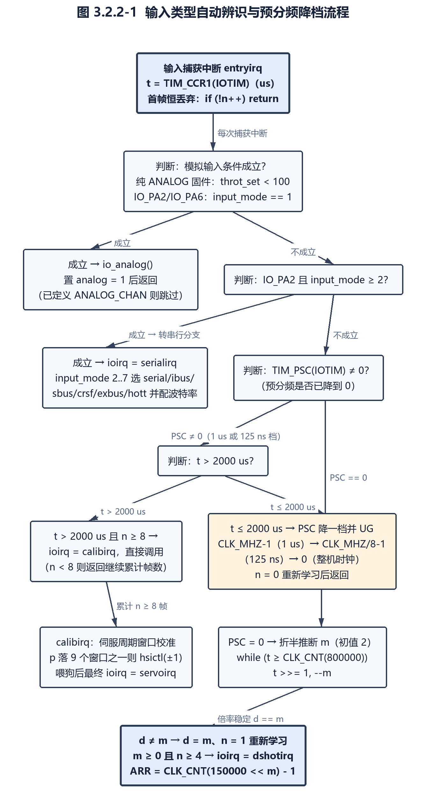

图 3.2.2-1 输入类型自动辨识与预分频降档流程

- 需求标识：ESC-FREQ1-2
- 功能描述：不依赖配置项，按周期量级自动判定输入是 Servo/Oneshot125、模拟电压、串行协议族还是 DShot。（计算机使用说明）
- 调用条件：每次输入捕获中断；`cfg.input_mode` 只影响串行与模拟分支，`input_mode == 0`（缺省）时完全依靠自动辨识。
- 输入：捕获周期计数值 `t`、引脚电平 `IOTIM_IDR`、`cfg.input_mode`（0..7）。
- 输出：状态机指针 `ioirq`（取 `calibirq`、`servoirq`、`dshotirq`、`serialirq`、`cliirq` 之一），以及全局标志 `analog`。
- 处理：
- （1）满足模拟输入条件时调用 `io_analog()` 完成引脚模拟复用，置 `analog = 1` 后返回；该条件为纯 `ANALOG` 固件下 `cfg.throt_set < 100`，或 `IO_PA2`/`IO_PA6`/`ANALOG_CHAN` 固件下 `cfg.input_mode == 1`；已定义 `ANALOG_CHAN` 的固件跳过该调用；
- （2）在 `IO_PA2` 且 `cfg.input_mode >= 2` 时转入串行协议分支，见 ESC-FREQ1-13；
- （3）其余情况按周期辨识：预分频非 0 且 `t > 2000`（1 us 单位即大于 2000 us）时累计帧数 `n`，`n >= 8` 后转入 `calibirq`，判定为 Servo/Oneshot125；
- （4）`t <= 2000` 时按单向阶梯降档并清零 `n` 重新学习：先由 `CLK_MHZ - 1`（1 us）降到 `CLK_MHZ / 8 - 1`（125 ns），再降到 0（整机时钟），每档触发一次 `UG` 后返回；
- （5）预分频降到 0 后进入速率推断分支，判定为 DShot，见 ESC-FREQ1-9。

> 证据：`src/io.c:113-258`、`src/io.c:224-245`、`src/common.h:44-50`、`src/util.c:455-473`、官方 wiki：`Settings.md`。

- 需求标识：ESC-FREQ1-4
- 功能描述：判定伺服 PWM 周期是否为标准频率之一，并用其累计误差微调内部 HSI 时钟。（计算机使用说明）
- 调用条件：`cfg.throt_cal` 为使能时（缺省为 1）；仅在从辨识态转入伺服解码之前执行。
- 输入：`TIM_CCR1(IOTIM)` 的周期值 `p`（us）、`cfg.throt_cal`。
- 输出：以 `hsictl(±1)` 对 HSI 校准值增减 1（钳位在 0..31），最终使 `ioirq = servoirq`。
- 处理：
- （1）`cfg.throt_cal` 有效且 `p` 落入 9 个窗口之一时视为合法伺服 PWM；9 个窗口依次为 22880~21120、20800~19200、11440~10560、10400~9600、8320~7680、5200~4800、4160~3840、3120~2880、2080~1920 us，源码注释声明的容差为 8%；
- （2）判定合法时喂一次独立看门狗，并把「周期对 1 ms 取整后的残差」累加到误差量 `q`；
- （3）每 4 帧采样一次误差（`++n & 3`）：`q > x` 时走源码注释标注的 `// Slow down` 分支，置 `y = -q`、`q = 0` 后调用 `hsictl(-1)`；`q < y` 时走 `// Speed up` 分支，置 `x = -q`、`q = 0` 后调用 `hsictl(1)`；
- （4）不满足窗口条件或 `throt_cal` 关闭时直接转入伺服解码：`CCMR1` 改为 IC1 与 IC2 双通道，`CCER = CC2E | CC2P` 取 IC2 下降沿，`DIER = CC2IE`。

> 证据：`src/io.c:260-288`、`src/util.c:311-316`、官方 wiki：`Settings.md`。

> **自述差异**：源码注释在同一分支内声明 7 档标准伺服频率并用「within 8% margin」概括容差（`src/io.c:264-266`），而该条件实际列出 9 个周期窗口，两者档数不一致；正文按代码实测的 9 个窗口书写，注释 7 档口径记入附录差异表。

### 3.2.3 信号存活判定与命令行进入（计算机使用说明）

信号输入引脚在无有效信号时被复用为命令行终端，这是配置与检修的唯一入口，不需要额外的调试接口。是否进入终端由输入捕获的更新事件超时计数决定：引脚保持低电平视为「有信号但边沿未到」（模拟输入情形），只有持续高电平才被解释为「信号线空闲」。判定成立后，同一引脚与同一定时器被改配为串口。

- 需求标识：ESC-FREQ1-3
- 功能描述：判定输入信号是否存活；无有效信号时把同一定时器与引脚资源切换为 38400 波特的命令行终端。（计算机使用说明）
- 调用条件：IO 定时器的更新事件（超时约 66 ms）与捕获事件；命令行切换对所有目标生效。
- 输入：引脚电平、更新超时计数 `c`、首次捕获计数 `n`。
- 输出：`ioirq = cliirq`；USART2（38400、8N1、半双工）或 TIM3 软件 UART 被启用；同时喂独立看门狗。
- 处理：
- （1）更新超时（源码注释约 66 ms）到来时清除 `UIF`；若引脚为低电平，模拟输入走 analog 分支，其余情况清零 `n` 并返回，不累加 `c`；
- （2）引脚为高电平时执行 `++c`，累计达到 16 次后置 `ioirq = cliirq` 并返回，该判据等价于累计 16 个约 66 ms 的高电平超时周期；
- （3）切换时复用同一引脚：`IO_PA2` 平台调用 `io_serial()` 复用引脚并启用 USART2（`BRR = CLK_CNT(38400)`、`HDSEL` 半双工、`RXNEIE`）；`IO_RXTX` 目标先用 TIM15 单次 20 ms 判 A15 是否被拉低，以决定是否走 50 us 高电平握手；
- （4）非 `IO_PA2` 平台改由 TIM3 软件 UART 承担命令行，配置 `PSC = 0`、位时 `CLK_CNT(38400)`、半位 `CLK_CNT(76800)`、`SMS_RM | TS_TI1F_ED` 任意沿复位、IC2 下降沿捕获；
- （5）首次捕获恒被丢弃（`if (!n++) return;`），此后每次捕获中断先写 `IWDG_KR = IWDG_KR_START`；进入任一解码状态后按「每成功解出一帧才喂狗」处理，各协议函数内写 `IWDG_KR = IWDG_KR_RESET`，协议不匹配的帧不喂狗；
- （6）喂狗规则存在唯一例外 HoTT：CRC16/XMODEM 通过后即喂狗，其后才用 `2 * a != len - 5` 判长度自洽，长度不自洽时仍返回 0。

> 证据：`src/io.c:115-123`、`src/io.c:122-156`、`src/io.c:168-169`、`src/io.c:625`、`src/io.c:701`、`src/io.c:767`、`src/io.c:799`、`src/io.c:893`、`src/io.c:914`、`mcu/STM32G071/config.c:325-336`、官方 wiki：`Configuration.md`。

> **自述差异**：官方文档表述为「启动时信号线保持高电平 2 秒」进入命令行（官方 wiki：`Configuration.md`），实测实现为累计 16 个约 66 ms 的高电平超时周期，计数器 `c` 无复位路径（`src/io.c:115-123`），实际时长约 1.06 s；自述口径记入附录差异表。

### 3.2.4 辅助刹车输入（计算机使用说明）

第二路 PWM 输入用于「拖刹」力度控制，仅在带辅助输入定时器的目标上编译与运行。当前仓库中仅有 VWING1 目标定义 `IO_AUX`，其余目标该整段代码不参与构建，属源码存在但不可达。

- 需求标识：ESC-FREQ1-8
- 功能描述：在带辅助输入定时器的目标上测量第二路 PWM 通道脉宽，并映射为拖刹力度。（计算机使用说明）
- 调用条件：仅在定义 `IO_AUX` 时参与编译与运行，当前仓库中仅 VWING1 目标定义 `IO_AUX`；`IOTIM2` 由 `IO_AUX` 取值决定，取 0xB8 时为 TIM16、取 0xB9 时为 TIM17、其他取值为 TIM3。
- 输入：辅助通道的脉宽或周期计数值 `x`，单位为 1 us。
- 输出：全局拖刹量 `brake = scale(x, 1100, 1900, 0, cfg.duty_drag)`，并清除标志 `auxup`。
- 处理：
- （1）TIM16/TIM17 只有单通道捕获，中断内由软件翻转 `CC1P` 交替取上升沿与下降沿时刻，以 `x = t2 - t1` 得到完整周期；
- （2）其他定时器用 IC1 上升沿复位加 IC2 下降沿捕获，`x = TIM_CCR2(IOTIM2)` 即为脉宽；
- （3）两条路径都调用同一个 `setbrake(x)`：`x < 0` 时返回，否则按固定端点 1100..1900 us 线性映射到 `0..cfg.duty_drag`，并清除 `auxup`；`duty_drag` 经 `checkcfg()` 钳位在 0..100。

> 证据：`src/io.c:56-81`、`src/io.c:95-110`、`src/util.c:442`、官方 wiki：`Settings.md`。

### 3.2.5 DShot 解码与双向遥测（需求规格）

DShot 是一条单线双向协议：固件先用输入捕获测出位时间以推断速率档位，同步后改用 DMA 批量搬运 32 个脉宽采样，把 32 个脉宽还原为 16 bit 载荷，校验通过后解释为油门帧或命令帧；双向模式下还需在帧间以 PWM 波形回发遥测值。速率档位不依赖配置项，按编译期自动探测到的档位解析，各档速率数值见附录并标注「待实测」。帧同步与重同步的流转见下图。

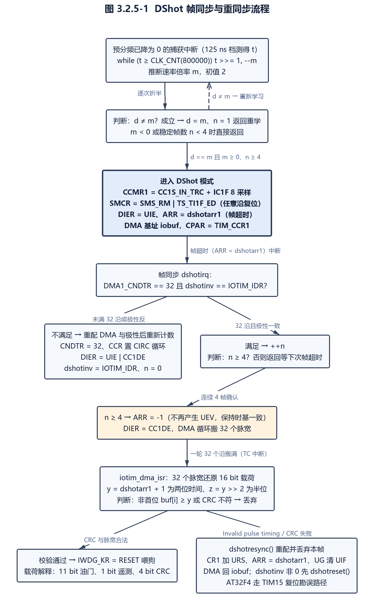

图 3.2.5-1 DShot 帧同步与重同步流程

- 需求标识：ESC-FREQ1-9
- 功能描述：自动推断 DShot 速率档位，据此配置帧复位超时与位时间，并建立帧同步。（需求规格）
- 调用条件：预分频已降为 0 且测得周期不满足 Servo 判定时，承接 ESC-FREQ1-2 的步骤（4）与（5）。
- 输入：125 ns 档测得的周期 `t`（计数值）、家族时钟常量 `CLK`。
- 输出：`dshotarr1 = CLK_CNT(150000 << m) - 1`（帧复位超时，装入 `TIM_ARR`）、`dshotarr2 = CLK_CNT(375000 << m) - 1`（位时间）、`ioirq = dshotirq`，以及把 DMA 指向 `TIM_CCR1` 到 `iobuf` 的搬运方向。
- 处理：
- （1）以 `int m = 2; while (t >= CLK_CNT(800000)) t >>= 1, --m;` 逐次折半推断速率倍率 `m`，即按编译期自动探测到的速率档位解析；
- （2）倍率发生变化（`d != m`）时重置 `d = m`、`n = 1` 并返回重新学习；`m < 0` 或稳定帧数 `n < 4` 时直接返回；
- （3）条件满足后进入 DShot 模式：捕获改为「任意沿复位加任意沿捕获」（`CC1S_IN_TRC`、`SMS_RM | TS_TI1F_ED`）、只保留 `UIE`，`ARR = dshotarr1` 作为帧超时，DMA 基址设为 `iobuf`；
- （4）帧同步在 `dshotirq` 内完成：仅当 DMA 已完成 32 个沿（`DMA1_CNDTR == 32`）且引脚极性与上一帧一致（`dshotinv == IOTIM_IDR`）时计数，连续 4 次确认后才把 `ARR = -1`，此后不再产生更新事件以保持时基一致，并切到 `CC1DE` 由 DMA 搬运 32 个脉宽，`CNDTR = 32` 且通道置 `CIRC` 循环模式，一轮搬满后自动重装；
- （5）同步失败或极性异常时由 `dshotreset()`/`dshotresync()` 重配 DMA 与捕获并恢复 `dshotarr1` 帧超时，AT32F4 走 TIM15 复位勘误路径。

> 证据：`src/io.c:233-258`、`src/io.c:305-354`、`src/common.h:40-42`。

- 需求标识：ESC-FREQ1-10
- 功能描述：把 32 个捕获脉宽还原为 16 bit DShot 载荷，并做完整性与脉宽合法性校验。（需求规格）
- 调用条件：DMA 传输完成中断 `iotim_dma_isr` 内，且不处于失同步态；若 `TIM_DIER(IOTIM) & TIM_DIER_UIE` 为真则直接返回（判为 Bad sync），随后按当前传输方向分派，`DMA1_CCR & DMA_CCR_DIR` 为假表示接收方向。
- 输入：`iobuf` 中的 32 个 16 bit 脉宽采样、`dshotarr1`（帧超时值，用作位宽门限）。
- 输出：16 bit 载荷 `x`（11 bit 油门、1 bit 遥测请求、4 bit CRC），或触发重同步丢弃本帧。
- 处理：
- （1）取 `y = dshotarr1 + 1` 视为两个位时间、`z = y >> 2` 视为半个位时间，按 `buf[i+1] >= z` 逐位判 1 或 0；
- （2）非首位若 `buf[i] >= y` 则判为 Invalid pulse timing，调用 `dshotresync()` 后丢弃本帧；
- （3）CRC 由 `dshotcrc(x, inv)` 把 `x` 循环折半异或压缩到 4 bit，双向模式（`dshotinv` 非 0）时取反；校验失败同样调用 `dshotresync()` 丢弃；
- （4）校验通过才写 `IWDG_KR = IWDG_KR_RESET` 喂狗，并把载荷交给载荷解释处理，见 ESC-FREQ1-11。

> 证据：`src/io.c:356-361`、`src/io.c:409-424`。

- 需求标识：ESC-FREQ1-11
- 功能描述：区分 DShot 载荷是油门帧还是命令帧，执行命令，并在解码出错时重同步。（需求规格）
- 调用条件：CRC 校验通过之后；命令帧额外要求遥测位置位且电机停止（`ertm == 0`）。
- 输入：16 bit 载荷、`cfg.throt_mode`、`ertm`、`LED_CNT`。
- 输出：油门量 `throt`、遥测请求标志 `telreq`、命令去抖状态 `cmd`/`cnt`，以及各配置字段或蜂鸣值 `beepval`。
- 处理：
- （1）取 `tlm = x & 0x10` 后 `x >>= 5`；`!x || x > 47` 视为油门帧，`tlm` 置位时置 `telreq = 1`，并按 `throt = x ? (throt_mode ? (x > 1047 ? x - 1047 : 47 - x) << 1 : x - 47) : 0` 换算油门，同时清零 `cmd`；
- （2）3D 分支的 `47 - x` 段只能取到 `x = 48..1047`，对应油门 -2..-2000，即反向半区随油门值增大而加深，在 `x = 1047 → 1048` 处由 -2000 跳变到 +2；
- （3）命令帧前提为 `!tlm || ertm`，不满足即直接返回，即必须带遥测位且电机已停止；
- （4）命令去抖：`cmd` 变化即置 `cnt = 0`，之后 `cnt < 10` 时自增；除 BEACON 与 LED 命令外的每条命令都要求 `cnt == 6` 才生效；
- （5）已实现命令按码值分派：1~5 为 BEACON（置全局 `beacon`，无 6 帧要求）、7/8 写 `cfg.revdir`、9/10 写 `cfg.throt_mode`、12 令 `beepval = savecfg()`、13/14 置 `dshotext` 与 `dshotval = 0xe00/0xeff` 并配 `rep = 10`、20/21 调 `flipdir`、22~29 写 `cfg.led` 位（受 `LED_CNT` 条件编译限制）、40 写 `cfg.timing`（档位 8..15，取值 `x << 1`）、41 写 `cfg.freq_min = x << 2` 与 `cfg.freq_max = x << 3`（档位 6..12）、42 写 `cfg.duty_ramp`（0..10 的十倍）、43 写 `cfg.duty_rate`（1..10 的十倍）、47 令 `beepval = resetcfg()`；
- （6）未列入 `switch` 的命令码无任何动作，源码无 default 分支；BEACON 写全局 `beacon`，命令 12、40~43、47 通过 `beepval` 回蜂鸣。

> 证据：`src/io.c:425-438`、`src/io.c:439-548`、`src/util.c:533`、`src/util.c:573-581`、官方 wiki：`Configuration.md`。

- 需求标识：ESC-FREQ1-12
- 功能描述：在双向 DShot 下于帧间以 PWM 波形回发 20 bit GCR 编码的遥测值。（计算机使用说明）
- 调用条件：`dshotinv` 非 0（上一帧被判为双向）；电机停止时才产生遥测值；扩展遥测值由 DShot 命令 13/14 触发重复发送。
- 输入：电周期时间 `ertm`（us）、待回发值 `dshotval`、重复次数 `rep`、位时间 `dshotarr2`。
- 输出：从 `iobuf + 64` 起的 23 个 16 bit 波形项，经 DMA 单次搬出（存储到外设、半字宽度、地址自增）。
- 处理：
- （1）函数入口先滤除失同步态，`TIM_DIER(IOTIM) & TIM_DIER_UIE` 为真即返回；此后 `DMA1_CCR & DMA_CCR_DIR` 为真表示当前帧为发送方向，先调 `dshotreset()` 复位捕获侧；
- （2）若 `dshotval` 为 0，则以 `ertm`（限幅 65408）做指数编码生成遥测值：`while (a > 511) a >>= 1, ++b; dshotval = a | b << 9`；
- （3）把 `dshotval << 4 | dshotcrc(dshotval, 1)` 经 16 项 `gcr[]` 表做 4→5 编码展开为 20 bit，再转为 23 项脉宽波形，首项为 -1、末两项为 0；
- （4）以 `if (!rep || !--rep) dshotval = 0;` 控制扩展遥测值的重复次数，其中命令 13/14 置 `rep = 10`；
- （5）时序按源码注释「30us output delay」实现为 `TIM_ARR = max(CLK_CNT(33333) - TIM_CNT(IOTIM) - 1, 19)`，随后以 `ARR = dshotarr2` 装载位时间、以 `CR2 = CCDS` 令 CC1 的 DMA 请求由更新事件触发（与捕获方向共用同一 DMA 通道），关中断保护后使能 `CC1E` 输出。

> 证据：`src/io.c:368-407`、`src/io.c:467-478`。

> **实现说明（缺陷）**：DShot 油门帧的入口门限为 `!x || x > 47`，`x` 为 1..47 的载荷一律按命令帧处理而不进入油门换算式（`src/io.c:427-432`），因此 3D 分支中 `47 - x` 的代数零点 `x == 47` 不可达，正负半区之间在 `x = 1047 → 1048` 处直接跳变，无连续过零区。

### 3.2.6 串行协议骨架与原生协议（需求规格、计算机使用说明）

除原生协议外，固件还支持 iBUS、SBUS/SBUS2、CRSF、EXBUS、HoTT 五种外购遥控协议。六种协议共用一套 USART2 加 DMA 的收发骨架与同一组通道解析工具，协议差异只体现在帧校验、通道打包方式与遥测应答格式上；协议由 `cfg.input_mode` 选择，`input_mode >= 2` 时才走本路径。

- 需求标识：ESC-FREQ1-13
- 功能描述：为所有串行协议提供统一的 DMA 收发骨架、输入模式配置域，以及 11 bit 与 16 bit 两种通道解析工具。（需求规格）
- 调用条件：`IO_PA2` 且 `cfg.input_mode >= 2`；经 `checkcfg()` 收敛后 `input_mode` 取 0..7（定义 `DISABLE_EXBUS`/`DISABLE_HOTT` 时 6/7 被压回 0），`input_ch1` 取 1..32（`input_mode < 3` 时强制为 0），`input_ch2` 取 0..32（同一条件下强制为 0）。
- 输入：USART2 的空闲中断（IDLE/ORE/RXNE）与 DMA 接收长度；`cfg.input_mode`、`cfg.input_ch1`、`cfg.input_ch2`。
- 输出：解码函数的返回长度语义——大于 0 表示需要回发并启动 TX DMA、等于 0 表示继续接收、小于 0 表示本次直接返回且不重开接收；通道值经 `getchan1`/`getchan2` 转为 880 起的伺服量纲。
- 处理：
- （1）`serialirq` 先识别 TX 完成（`TCIE`）以切回接收态，否则清 `RXNE`/`IDLE`/`ORE` 后停 RX DMA，取 `len = iofunc(已收字节数)` 并按上述返回语义分派；
- （2）需要回发时清 `TC` 标志、置 `TCIE`、装载 TX DMA（8 bit、MINC、DIR 方向）；否则在 `reading` 处重装 RX DMA（8 bit、MINC、长度为 `sizeof iobuf`）；
- （3）初始化顺序固定：先置 `USART2_CR3 = HDSEL | DMAT | DMAR` 与 `CR1 |= UE | TE | RE | IDLEIE`，再写 DMA 的 `CPAR`（RX 指向 `USART2_RDR`、TX 指向 `USART2_TDR`）、`CMAR`（均指向 `iobuf`）与 `CNDTR = sizeof iobuf`；该处不写 DMA 的 `CCR`，通道使能发生在首次 `serialirq` 的接收重装处；
- （4）`getchan1(buf, n)` 供 SBUS 与 CRSF 使用，解 11 bit 紧凑打包（`i = n * 11 >> 3`、位偏移 `a`/`b` 跨 2~3 字节），`n >= 16` 时返回 -1，输出 `(x * 5 >> 3) + 880`；
- （5）`getchan2(buf, m, n, s)` 供 EXBUS 与 HoTT 使用，解 16 bit 大小端（`s` 选端序与偏移），越界返回 -1，输出值右移 3 位。

> 证据：`src/io.c:170-221`、`src/io.c:560-578`、`src/io.c:580-609`、`src/util.c:455-473`、`src/prog.c:48-50`、官方 wiki：`Settings.md`。

- 需求标识：ESC-FREQ1-14
- 功能描述：实现原生双向串行协议：一帧可携带多条命令，帧首为长度、末字节为 CRC8，遥测请求在同一帧内应答。（计算机使用说明）
- 调用条件：`cfg.input_mode == 2`；波特率为 `SERIAL_BR`（缺省 460800，可由编译期覆盖）。
- 输入：`iobuf` 中已收字节与长度 `len`，其中 Byte0 为总长、Byte1..N-2 为描述符与值、ByteN-1 为 CRC8。
- 输出：油门量 `throt`、拖刹量 `brake`、方向标志 `flipdir`、`cfg.led`，或 4 字节与 12 字节两种应答帧（把长度写入 `iobuf[0]`，返回待发字节数）。
- 处理：
- （1）帧合法性判据为 `len >= 2` 且 `iobuf[0] == len` 且 `crc8(iobuf, len) == 0`，不满足时返回 0 且不喂狗，满足时喂独立看门狗；
- （2）按描述符循环解析：`0x00` 为油门（小端 int16、符号扩展，越界 ±2000 时丢弃该条）、`0x01` 为拖刹（`min(byte, 100) * cfg.duty_drag * 41 >> 12`，并清 `auxup`）、`0x02`/`0x03` 置 `flipdir`、`0x04` 写 `cfg.led`（掩码为 `(1 << LED_CNT) - 1`）；
- （3）请求 `0x80` 时立即组帧返回 12 字节组合遥测：长度 12、`temp1`、`temp2`、`volt`（16 bit）、`curr`（16 bit）、`csum`（16 bit）、`min(ertm, 0xffff)`（16 bit）与 CRC8；
- （4）请求 `0x81`~`0x85` 时返回 4 字节单项遥测：依次为电周期时间（us）、温度、电压（V/100）、电流（A/100）、消耗（mAh），每帧格式为 `[4][值低][值高][CRC8]`；
- （5）遇到未定义描述符时立即返回 0，不再继续解析本帧剩余内容。

> 证据：`src/io.c:611-621`、`src/io.c:623-679`、`src/defs.h:87-88`、官方 wiki：`SerialProtocol.md`。

### 3.2.7 外购遥控协议解码（需求规格、计算机使用说明）

五种外购协议按 `cfg.input_mode` 取 3..7 分派，各自实现帧长与校验判定、通道取用和遥测应答。除 CRSF 的设备命令转发外，各协议的通道值最终都经 `setthrot()` 与 `setbrake()` 写入同一组油门与拖刹量。分派关系见下表。

| `cfg.input_mode` | 协议 | 波特率与物理层 | 帧判据 | 通道取用 | 证据 |
| --- | --- | --- | --- | --- | --- |
| 2 | 原生双向串行 | `SERIAL_BR`（缺省 460800） | `iobuf[0] == len` 且 CRC8 为 0 | 描述符 `0x00`/`0x01` | `src/io.c:611-621` |
| 3 | FlySky iBUS | 115200 | 32 字节，头 `0x20 0x40`，末字校验和为 `0xff9f` | 第 1~14 个 16 bit 字取低 12 bit | `src/io.c:681-705` |
| 4 | SBUS/SBUS2 | 100000、偶校验、2 停止位 | 25 字节，首字节 `0x0f` | 11 bit 紧凑打包，`getchan1` | `src/io.c:707-716` |
| 5 | CRSF | 416666 | 逐帧 `crc8dvbs2` 为 0，单帧上限 128 字节 | 类型 `0x16` 载荷经 `getchan1` | `src/io.c:793-822` |
| 6 | Jeti EXBUS | 125000，空闲时与 250000 交替等待同步 | `a == b + 8` 且 CRC16/CCITT 为 0 | 类型 `0x31`，16 bit 小端 `getchan2` | `src/io.c:824-885` |
| 7 | Graupner HoTT | 115200 | 首字节 `0xa8`，CRC16/XMODEM 与末两字节相符且 `2 * a == len - 5` | SUMDv1 大端 `getchan2`；SUMDv3 按功能码修正 | `src/io.c:912-936` |

表 3.2.7-1 串行协议分派与帧判据

- 需求标识：ESC-FREQ1-15
- 功能描述：解析 FlySky iBUS 的 32 字节帧，并取出油门与辅助通道。（需求规格）
- 调用条件：`cfg.input_mode == 3`，波特率 115200。
- 输入：32 字节帧，头两字节为 `0x20 0x40`，其后为第 1~14 个 16 bit 通道值，末字为校验和。
- 输出：油门量 `throt`（取自 ch1）与拖刹量 `brake`（取自 ch2）。
- 处理：
- （1）长度必须为 32 且前两字节为 `0x20`、`0x40`，否则返回 0 且不喂狗；
- （2）以 `u = 0xff9f` 为初值对第 1~14 个 16 bit 字逐字做减法，末字必须等于 `u`，否则判为校验失败并返回 0；
- （3）通道值取低 12 bit（`v & 0xfff`）后分别经 `setthrot(x1)` 与 `setbrake(x2)` 消费，通道号由 `cfg.input_ch1`/`cfg.input_ch2` 选定，取不到时 `x` 为 -1、映射函数直接返回。

> 证据：`src/io.c:179-182`、`src/io.c:681-705`。

- 需求标识：ESC-FREQ1-16
- 功能描述：解析 SBUS 的 25 字节帧取通道，并在开启后按 SBS-01T/01C/01R 传感器语义回发 SBUS2 遥测。（计算机使用说明）
- 调用条件：`cfg.input_mode == 4`，100000 波特、偶校验、2 停止位；非 AT32F4 时收发反相并把 A2 置下拉；`telem_mode` 与 `telem_phid` 决定是否回发遥测。
- 输入：25 字节帧，首字节为 `0x0f`，Byte1..22 为 11 bit 紧凑打包通道，末字节低 4 bit 表示遥测位。
- 输出：油门量 `throt` 与拖刹量 `brake`，或 6 个 3 字节遥测 slot 经 TX DMA 发出。
- 处理：
- （1）物理层配置为 `CR1 = PCE | M0`、`CR2 = STOPBITS_2`，非 AT32F4 时追加 `RXINV | TXINV` 并把 A2 置下拉；TIM15 取 125 ns 分辨率并启动以承载时序；
- （2）帧判定为 `len == 25` 且 `iobuf[0] == 0x0f`，否则返回 0 且不喂狗；通过后喂独立看门狗，并按 `cfg.input_ch1`/`input_ch2` 减 1 后作下标，用 `getchan1` 取通道；
- （3）末字节低 4 bit 不为 `0x4` 时视为无遥测请求，返回继续接收；
- （4）遥测位为 `0x4` 后分两路：不需要本机回发时（全局 `telmode` 为 2..5，或帧内实例号 `a >> 4 != telphid - 1`）禁收 7160 us（`TIM15_ARR = 57279 - TIM15_CNT`）后回到接收态，不发任何 slot；需要回发时延时 3200 us（`25599 - TIM15_CNT`），预装 slot 间隔 5279 ticks 后进入发送态；
- （5）发送态按 `telem_phid` 选择 slot 区间（`slot[n + (telphid - 1) * 6]`），依次发 6 项：ESC 温度、电机温度（均加 +100 偏置并含 `0x80` 标志）、电流（含 `0x40` 标志）、电压、消耗、`erpm / (telem_poles * 3)`（限幅 0xffff），发完 6 项后回到接收态。

> 证据：`src/io.c:183-196`、`src/io.c:707-716`、`src/io.c:718-762`、`src/io.c:764-791`、`src/util.c:481-487`、官方 wiki：`Settings.md`（AT32F421。

- 需求标识：ESC-FREQ1-17
- 功能描述：解析 CRSF 帧取通道数据，并把 CRSF 设备命令转发给配置层后回包。（计算机使用说明）
- 调用条件：`cfg.input_mode == 5`，416666 波特；设备命令转发仅在 `telem_mode == 4` 且未定义 `SMALL_DEVICE` 时参与编译。
- 输入：CRSF 帧流，格式为 `[地址][长度][类型][载荷][CRC8/DVB-S2]`，单帧物理层上限 128 字节。
- 输出：油门量 `throt` 与拖刹量 `brake`，或 `0xc8` 开头的应答帧交由 `sendtelemdata()` 发送。
- 处理：
- （1）整段长度大于 128 时直接返回 0，不满足物理层要求；
- （2）逐帧解析：取 `a = buf[1]`、`b = a + 2`，要求 `a >= 2`、`b <= 64` 且剩余长度足够，并满足 `crc8dvbs2(buf + 2, a) == 0`，否则跳出解析；每帧校验通过即喂独立看门狗；
- （3）类型 `0x16`（通道数据）要求载荷 `a >= 24`，用 `getchan1(buf + 3, ...)` 按 `cfg.input_ch1`/`input_ch2` 取通道；
- （4）类型 `0x28`/`0x2c`/`0x2d`（Ping/Read/Write）转发给 `execcrsfcmd()`，返回长度限幅 61 字节后组帧：`res[0] = 0xc8`、`res[1] = a + 1`，CRC 覆盖 `res + 2` 起的 a 字节，再交由 `sendtelemdata()` 发送；
- （5）帧尾不足 4 字节的剩余数据被丢弃并结束本次解析。

> 证据：`src/io.c:197-201`、`src/io.c:793-822`、`src/util.c:474-480`、`src/main.c:565-566`、官方 wiki：`Configuration.md`。

- 需求标识：ESC-FREQ1-18
- 功能描述：解析 Jeti EXBUS 帧取通道数据，并按描述符序列应答遥测请求。（需求规格）
- 调用条件：`cfg.input_mode == 6`（定义 `DISABLE_EXBUS` 时该值被压回 0），125000 波特；空闲时在 250000 与 125000 之间交替等待同步。
- 输入：帧流格式为 `[.][.][len a][.][type][b][载荷]`，要求 `a == b + 8` 且 `crc16ccitt(buf, a) == 0`。
- 输出：油门量 `throt` 与拖刹量 `brake`，或 38 字节遥测响应（含 ESC 名称与 6 项量的描述字符串）。
- 处理：
- （1）帧校验中 `a != b + 8`、剩余长度不足或 CRC16/CCITT 不为 0 即跳出循环，通过则喂独立看门狗；
- （2）类型 `0x31`（通道数据）用 `getchan2(buf + 6, b >> 1, ...)` 按 16 bit 小端解析，取 `cfg.input_ch1`/`input_ch2` 通道并复位空闲计数器 `n`；
- （3）类型 `0x3a`（遥测请求）要求本帧已到尾部且 `b == 0`，以 `buf[3]` 为请求序号调用 `exbusresp()`；
- （4）`exbusresp()` 前 7 次应答为描述帧（"ESCape32"、Temp1、Temp2、Volt、Curr、Csum、RPM 及单位串），长度 `a + 18`，采用描述区 CRC8 与整帧 CRC16/CCITT 双重校验；第 8 次起为难遥测值帧，依次为 `temp1`、`temp2`、`volt`（含 `0x40` 标志）、`curr`（含 `0x40` 标志）、`csum`、`erpm / (telem_poles >> 1)`，共 38 字节，CRC8 覆盖 `iobuf + 7` 起的 28 字节、CRC16 覆盖前 36 字节；
- （5）无有效命令时按 `--n & 1 ? 250000 : 125000` 交替改写 `USART2_BRR`，`n` 递减到 0 后停止切换。

> 证据：`src/io.c:202-206`、`src/io.c:824-885`、`src/io.c:887-910`。

- 需求标识：ESC-FREQ1-19
- 功能描述：解析 Graupner HoTT 帧，并按 SUMDv1 与 SUMDv3 两种子类型取通道。（需求规格）
- 调用条件：`cfg.input_mode == 7`（定义 `DISABLE_HOTT` 时该值被压回 0），115200 波特。
- 输入：帧流，首字节为 `0xa8`、`iobuf[1] & 0x7f` 为类型、`iobuf[2]` 为通道数 `a`。
- 输出：油门量 `throt` 与拖刹量 `brake`。
- 处理：
- （1）基本校验为 `len >= 5` 且首字节为 `0xa8` 且 `crc16xmodem(iobuf, len - 2)` 等于末两字节，不满足时返回 0 且不喂狗；通过即喂独立看门狗，本协议的喂狗发生在长度自洽判定之前，与其它协议「整帧有效才喂狗」不同；
- （2）长度自洽判据为 `2 * a == len - 5`，不满足时返回 0；
- （3）类型 1（SUMDv1）按 16 bit 大端、右移 3 位解析，用 `getchan2(iobuf + 3, a, ch - 1, 0)` 取通道；
- （4）类型 3（SUMDv3）取最后一个通道字节作功能码 `c`，`c > 5` 时放弃本帧；否则用映射表 `{0x60, 0x61, 0x80, 0x82, 0x84, 0x60}` 修正有效通道数（`d >> 3`，且在 `a -= 2` 后不超过它）与字节偏移（`(d & 7) << 2`），再取通道。

> 证据：`src/io.c:207-212`、`src/io.c:912-936`。

## 3.3 电机启动与换相

本节描述从「上电等待解锁」到「电机持续换相」的完整控制链：解锁窗口与重新解锁回路属用户可见的安全行为，启动序列区分无刷与有刷两种驱动形态，正弦启动负责低速段，六步换相负责闭环段，两者之间有一次显式切换。本节不重复保护域内容：失步判定与 BEMF/霍尔超时导致的同步复位由 3.6 节建块，本节只引用其结果。

### 3.3.1 解锁进入与等待窗口（用户需求、需求规格）

解锁是电机能够转动的先决条件：上电后固件不立即响应油门，而是等待一段持续的零油门窗口；窗口内出现任何非零油门都会重新计时。运行期若发生需要人工干预的事件（低压切断、恢复出厂配置），固件通过置位 `rearm` 请求重新解锁，使电机在停止后回到同一段等待流程。解锁与重新解锁的回路见下图。

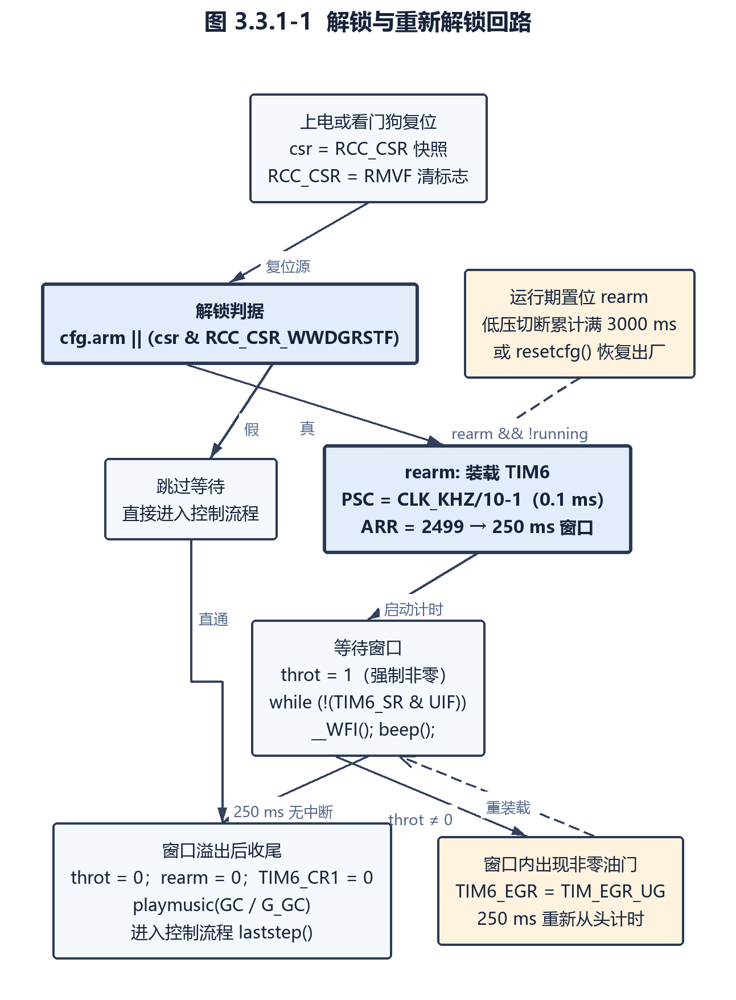

图 3.3.1-1 解锁与重新解锁回路

- 需求标识：ESC-FREQ2-1
- 功能描述：上电复位后，仅当配置要求解锁或上次复位源为窗口看门狗（WWDG）时进入等待解锁流程，否则直接进入控制流程。（用户需求）
- 调用条件：`main()` 初始化末尾、`laststep()` 之前（`src/main.c:631`），整段位于 `#ifndef ANALOG` 内。
- 输入：`cfg.arm`（0/1）、`RCC_CSR` 复位标志快照 `csr`（判据位为 `RCC_CSR_WWDGRSTF`）。
- 输出：无返回值；决定是否跳入 `rearm:` 等待块。
- 处理：
- （1）先取 `csr = RCC_CSR`，再写 `RCC_CSR = RCC_CSR_RMVF` 清除复位标志；
- （2）以复位标志快照判断 `cfg.arm || (csr & RCC_CSR_WWDGRSTF)`，为真则进入等待解锁，为假则跳过等待直接进入控制流程；
- （3）`checkcfg()` 在板级模拟输入标志 `IO_ANALOG` 为真时强制 `cfg.arm = 1` 以保证上电处于低电平，在编译开关 `ANALOG` 下强制 `cfg.arm = 0`。

> 证据：`src/main.c:631`、`src/main.c:611-619`、`src/util.c:416-424`、官方 wiki：`Settings.md`。

- 需求标识：ESC-FREQ2-2
- 功能描述：解锁须在 250 ms 窗口内持续零油门；窗口内出现任何非零油门都重新装载计时器，窗口从头计时。（用户需求）
- 调用条件：由 ESC-FREQ2-1 的判据成立后进入；同一代码块也是重新解锁（ESC-FREQ2-4）的落点。
- 输入：全局油门设定点 `throt`（-2000..2000）、TIM6 溢出标志。
- 输出：无返回值；副作用为 TIM6 计数器被重新装载，仅在 250 ms 内无中断时自然溢出退出。
- 处理：
- （1）TIM6 置 0.1 ms 分辨率（`PSC = CLK_KHZ / 10 - 1`）、`ARR = 2499`，即 250 ms 窗口；
- （2）进入等待前强制 `throt = 1`，使「零油门」必须由输入路径主动写回；
- （3）等待循环 `while (!(TIM6_SR & TIM_SR_UIF))` 内以 `__WFI()` 挂起并持续调用 `beep()`；
- （4）循环内 `throt` 非零即写 `TIM6_EGR = TIM_EGR_UG` 重新装载计数器，任何非零油门都令 250 ms 窗口重新开始。

> 证据：`src/main.c:633-645`、官方 wiki：`Settings.md`；窗口重计时机制为（需求规格。

- 需求标识：ESC-FREQ2-3
- 功能描述：250 ms 窗口走完后必须清零油门、清除重新解锁标志、停掉解锁计时器并播放解锁提示音。（需求规格）
- 调用条件：等待循环自然退出（TIM6 溢出）后立即执行。
- 输入：霍尔换相间隔 `hall`（启用霍尔时非零）、`cfg.volume`。
- 输出：`throt = 0`、`rearm = 0`、TIM6 停止，并播放 `"GC"` 或 `"G_GC"` 提示音。
- 处理：
- （1）执行 `throt = 0; rearm = 0;`，把油门归零并解除重新解锁请求；
- （2）写 `TIM6_CR1 = 0` 停止解锁计时器；
- （3）调用 `playmusic(hall ? "G_GC" : "GC", cfg.volume)` 播放提示音，启用霍尔时多一个音。

> 证据：`src/main.c:646-649`。

- 需求标识：ESC-FREQ2-4
- 功能描述：运行期一旦置位 `rearm`，电机停止后必须回到等待解锁流程；`rearm` 有效期间油门被强制视为零。（用户需求）
- 调用条件：1 kHz 节拍上判据 `if (rearm && !running) goto rearm;`（`src/main.c:842`），位于 `#ifndef ANALOG` 内。
- 输入：`rearm`（置位源为低压切断累计满 3000 ms 与恢复出厂 `resetcfg()` 两条）、`running`。
- 输出：跳转到 `rearm:` 标号重新执行 250 ms 计时；油门输入量 `input` 被置 0。
- 处理：
- （1）主循环每拍先算 `input = rearm ? 0 : throt`，重新解锁期间不响应任何油门；
- （2）仅当 `rearm && !running` 同时成立才跳回等待块，避免在运行中打断换相；
- （3）跳回后复用同一段 TIM6 计时与提示音逻辑，流程完成后自动清除 `rearm`。

> 证据：`src/main.c:842`、`src/main.c:662`、`src/main.c:848-849`、`src/util.c:573-581`。

### 3.3.2 上电初始化顺序与传感器就绪等待（需求规格）

控制流程开始之前，固件必须按固定顺序完成配置载入、外设与定时器初始化，并阻塞等待电流零点标定完成。顺序不可交换：配置必须先于 `checkcfg()` 收敛，标定标志必须来自已经启动的 ADC 数据入口，否则首个 PWM 周期会基于未标定的电流零点计算。

- 需求标识：ESC-FREQ2-5
- 功能描述：控制流程启动前必须按固定顺序完成配置载入、外设与定时器初始化、可选霍尔混合模式配置、节拍配置，并阻塞等待传感器（电流零点）标定就绪。（需求规格）
- 调用条件：`main()` 入口顺序执行至 `laststep()`（`src/main.c:558-652`）。
- 输入：Flash 配置区（`_cfg`/`_cfg_start`）、标定完成标志 `ready`（由 ADC 数据入口置位）。
- 输出：运行期配置副本 `cfg`、各全局状态量初值、TIM1 与 IFTIM 与 TIM3 与 SysTick 就绪，以及电芯数 `cells`。
- 处理：
- （1）以 `memcpy(_cfg_start, _cfg, ...)` 把 Flash 配置拷入 SRAM 副本，随后由 `checkcfg()` 收敛全部参数；
- （2）取运行期副本 `brushed`/`throt`/`brake`/`lock`/`telmode`/`telphid`，执行 `init/initgpio/initled/inittelem/initio`，配置 TIM1 死区与刹车寄存器、TIM1 的 24 kHz 时基与 IFTIM 时基；
- （3）在启用霍尔的目标上可选配置 TIM3 捕获（见 ESC-FREQ2-12），随后配置 PendSV 优先级与 16 kHz SysTick；
- （4）以 `while (!ready) __WFI();` 阻塞等待电流零点标定完成；未配置电芯数时按每节最高 4.4 V 估算 `cells = (volt + 439) / 440`。

> 证据：`src/main.c:558-652`、`src/main.c:558-615`。

### 3.3.3 电机启动序列（需求规格）

电机从静止到转动由「有油门需求但当前无换相步」这一条件触发，无刷与有刷两条分支的驱动形态完全不同：无刷分支恢复停机前的换相步并进入六步闭环，有刷分支直接以固定相序加 PWM 驱动，不进行换相。两条分支都复用了停机时保存的状态，因此重启后相序不会突变。

- 需求标识：ESC-FREQ2-6
- 功能描述：无刷模式收到有效油门且当前无换相步时，须恢复停机前换相步、把时基与转速量置为无效起始值、生成首步输出、使能换相中断并重置堵转控制环。（需求规格）
- 调用条件：`running && !step` 且 `!brushed`（`src/main.c:766`、`src/main.c:804`）。
- 输入：停机时保存的换相步 `oldstep`、方向标志 `reverse`、输出形态宏。
- 输出：换相步 `step`、换相间隔 `ival`、电周期时间 `ertm`、TIM1 的 CCMR 与 CCER、TIM1 DIER、IFTIM 的 ARR 与 OCR、堵转 PID 状态 `bpid`、补偿量 `boost`。
- 处理：
- （1）关中断后以 `step = oldstep` 恢复停机前的换相步，`oldstep` 由 `laststep()` 在停机时保存；
- （2）置 `ival = 10000 << IFTIM_XRES`、`ertm = 100000000`（1e8）作为无效起始值；
- （3）调用 `nextstep()` 生成首个换相步输出，并触发 `TIM1_EGR = TIM_EGR_UG | TIM_EGR_COMG`；
- （4）使能换相中断，定义 `SW_BLANKING` 时追加 `UIE`/`CC4IE`，IFTIM 的 `ARR = OCR = (1 << (IFTIM_XRES + 16)) - 1` 并复位时基；
- （5）开中断后调用 `initpid(&bpid, 10000 << IFTIM_XRES)` 重置堵转 PID，并清除 `boost`。

> 证据：`src/main.c:766`、`src/main.c:804`、`src/main.c:804-819`、`src/main.c:351`。

- 需求标识：ESC-FREQ2-7
- 功能描述：有刷模式启动不进入六步换相，而是按方向直接配置两相 PWM 驱动形态、固定换相步并预置电周期时间后跳过换相中断。（需求规格）
- 调用条件：`running && !step` 且 `brushed`（`src/main.c:766-767`）。
- 输入：方向标志 `reverse`、`cfg.damp`、输出形态宏 `PWM_ENABLE` 与 `INVERTED_HIGH`。
- 输出：TIM1 的 CCMR1、CCMR2、CCER，以及换相步 `step` 与电周期时间 `ertm`。
- 处理：
- （1）在未定义 `PWM_ENABLE` 的形态（当前仓库唯一可达路径）下按方向配置两相：正向 OC1 与 OC3 为 PWM1、OC2 强制高；反向 OC1 与 OC3 均强制高、OC2 为 PWM1；
- （2）`cfg.damp` 有效时使能对应的互补通道，定义 `INVERTED_HIGH` 时追加三路极性位；
- （3）写回 CCMR1、CCMR2、CCER 并触发 `TIM1_EGR = TIM_EGR_UG | TIM_EGR_COMG`；
- （4）置 `step = reverse + 1`、`ertm = 600`（源码注释约 100K ERPM），随后 `goto tick` 跳过六步换相中断的使能。

> 证据：`src/main.c:766-767`、`src/main.c:767-802`、官方 wiki：`Settings.md`。

> **不可达分支**：定义 `PWM_ENABLE` 的驱动形态（`src/main.c:770-778`，反向时 OC1/OC3 强制低）在当前仓库全部 target 中均未定义，源码存在但不可达，不作为可用特性主张；有刷模式另有 `freq_min`/`duty_spup`/`duty_ramp` 三项不生效，见 `src/main.c:801`。

> **机制说明**：启动限幅项 `duty_spup` 与 `duty_ramp` 只在占空比上限计算中生效，实现为 `scale(erpm, 0, cfg.duty_ramp * 1000, cfg.duty_spup * 20, 2000)`（`src/main.c:746-747`）。当 `duty_ramp` 取缺省值 0 时该式两端点重合，`duty_spup` 仅在静止点（`erpm == 0`）生效，其余转速一律回落到 2000，故缺省配置等价于关闭启动限幅（`src/util.c:387-391`）。

### 3.3.4 正弦启动与六步切换（需求规格、用户需求）

低速段固件不采用六步换相，而是以三相正弦调制驱动，原因是低速下反电动势幅值过小，过零检测不可靠。正弦启动的进入与退出都由油门量决定：油门落在 `sine_range` 区段内维持在正弦通道，一旦出现占空比需求即切换到六步闭环。切换过程在临界区内完成，相角被反推回最近的六步相位，因此切换瞬间的相电流相位连续。启动区间、相角步进与切换的关系见下图。

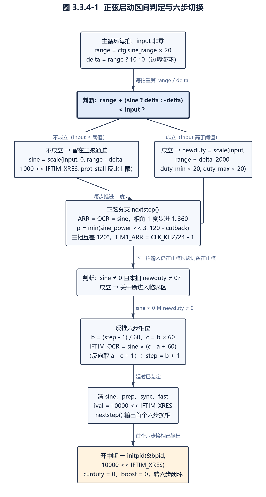

图 3.3.4-1 正弦启动区间判定与六步切换

- 需求标识：ESC-FREQ2-8
- 功能描述：油门落入 `sine_range` 定义的区段时进入正弦启动，超出即进入六步占空比通道；边界带 10 单位滞环防抖。（用户需求）
- 调用条件：主循环每拍、输入非零时（`src/main.c:709-710`）。
- 输入：油门输入量 `input`（-2000..2000）、`cfg.sine_range`（0..25 %）、标志 `sine`（表示当前是否已在正弦阶段）。
- 输出：六步占空比需求 `newduty`（为 0 表示留在正弦通道），或正弦换相间隔 `sine`。
- 处理：
- （1）以 `range = cfg.sine_range * 20` 把百分数换算到油门量纲，并取 `delta = range ? 10 : 0` 作为滞环宽度；
- （2）判据 `range + (sine ? delta : -delta) < input` 成立时计算 `newduty = scale(input, range + delta, 2000, cfg.duty_min * 20, cfg.duty_max * 20)`；
- （3）判据不成立时改写 `sine`，滞环方向由当前是否已处于正弦阶段决定；
- （4）`sine_range == 0` 时判据退化为 `0 < input`，正弦通道被完全旁路；`checkcfg()` 在非有刷配置下把 `sine_range` 收敛为 0 或 5..25，有刷配置强制为 0。

> 证据：`src/main.c:709-710`、`src/main.c:663-664`、`src/util.c:433`、官方 wiki：`Settings.md`。

- 需求标识：ESC-FREQ2-9
- 功能描述：正弦阶段以 1 度为单位推进相角（1..360 循环），三相占空比取自相差 120/240 度的正弦表元素，载波固定 24 kHz，功率由 `sine_power` 决定并与过温降额取小。（需求规格）
- 调用条件：`nextstep()` 内 `sine` 非零时（`src/main.c:118`），由 IFTIM 事件或主循环切换点调用；每次换相都重算功率系数。
- 输入：正弦换相间隔 `sine`（每步 IFTIM 周期）、相角 `step`、方向标志 `reverse`、正弦表 `sinedata[]`、`cfg.sine_power`（1..15）、过温降额量 `cutback`（0..60）。
- 输出：IFTIM 的 ARR 与 OCR、TIM1 的 ARR、TIM1 的 CCR1/CCR2/CCR3、相角 `step`、准备标志 `prep`、同步计数 `sync`、功率系数 `p`。
- 处理：
- （1）置 `TIM_ARR(IFTIM) = IFTIM_OCR = sine`；由六步切入且尚未准备时以 `step = step * 60 - 59` 把 1..6 步映射到 1/61/121/181/241/301 度，随后按方向每步推进 1 度并在 1..360 之间回绕；
- （2）三相索引取 `a = step - 1`、`b = a < 120 ? a + 240 : a - 120`、`c = a < 240 ? a + 120 : a - 240`，即三相互差 120 度；
- （3）功率系数取 `p = min(cfg.sine_power << 3, 120 - cutback)`，标称上限为 `sine_power * 8`（`sine_power` 为 15 时即 120），`cutback` 满值 60 时上限降为 60，即 50% 降额，与源码注释 "50% cutback at 15C above prot_temp" 一致；
- （4）置 `TIM1_ARR = CLK_KHZ / 24 - 1`（载波固定 24 kHz，与 `freq_min`/`freq_max` 无关），三相比较值取 `CCR1/2/3 = DEAD_TIME + (sinedata[x] * p >> 7)`，并以 `UDIS` 包裹使用预装载；
- （5）过温降额的温度按 `prot_sens` 在 ESC 温度、电机温度或两者取大之间选择；
- （6）正弦表为家族常量 `sinedata[]`，7 个家族实测均为 360 个元素（24 行 × 15 值），下标 0..359 全部被使用、无未用尾段，各家族元素幅度不同；`checkcfg()` 把 `sine_power` 收敛到 1..15。

> 证据：`src/main.c:118`、`src/main.c:118-136`、`src/main.c:445-459`、`src/util.c:434`、`mcu/STM32G071/preset.c:20-45`、官方 wiki：`TipsAndTricks.md`、官方 wiki：`Settings.md`。

> **机制说明**：定义 `ERPM_PIN` 的目标在正弦阶段以相角驱动转速指示输出，相角为 1 度时拉低（写 `BSRR` 高 16 位即复位位），相角为 181 度时拉高（`src/main.c:138-139`）；六步阶段改由换相步驱动，步为 1 时拉低、步为 4 时拉高（`src/main.c:326-327`）。

- 需求标识：ESC-FREQ2-10
- 功能描述：正弦阶段一旦出现占空比需求，须在临界区内把相角换算为六步相位、装定换相延时，再清正弦状态、复位同步量并输出首个六步换相。（需求规格）
- 调用条件：`sine != 0` 且本拍 `newduty != 0`（`src/main.c:711-712`）；依赖上一步已在正弦分支置位 `prep`（`src/main.c:141-158`）。
- 输入：相角 `step`、正弦换相间隔 `sine`、方向标志 `reverse`、堵转 PID 状态 `bpid`。
- 输出：IFTIM 的 OCR 与 ARR、相角 `step`，并清除 `sine` 与 `prep`、复位 `sync`/`fast`/`ival`/`curduty`/`boost`、重置堵转 PID。
- 处理：
- （1）关中断进入临界区；
- （2）`prep` 为真（三相输出已配置为六步所需 PWM 形态）时反推六步相位：取 `b = (step - 1) / 60`、`c = b * 60`，置 `IFTIM_OCR = sine * (reverse ? 回绕后 (b+1) 对应的 a - c + 1 : c - a + 60)`，IFTIM 的 ARR 置满量程，并置 `step = b + 1`；
- （3）清除 `sine`、`prep`、`sync`、`fast`，并把 `ival` 复位为 `10000 << IFTIM_XRES`；
- （4）调用 `nextstep()` 生成首个六步换相，开中断后调用 `initpid(&bpid, 10000 << IFTIM_XRES)` 重置堵转 PID，并清 `curduty = 0`、`boost = 0`。

> 证据：`src/main.c:711-712`、`src/main.c:141-158`、`src/main.c:711-738`、官方 wiki：`Settings.md`。

- 需求标识：ESC-FREQ2-15
- 功能描述：正弦阶段的换相间隔上限由 `prot_stall` 反比决定，等效于把正弦阶段最大转速限制为配置值；未配置时回落到约 2298 ERPM 的默认上限。（用户需求）
- 调用条件：输入落入正弦区段时求正弦间隔上限（`src/main.c:710`）；由间隔推算转速（`src/main.c:714-715`）。
- 输入：油门输入量 `input`、区间量 `range` 与滞环 `delta`、`cfg.prot_stall`（0 或 1500..3500）。
- 输出：正弦换相间隔 `sine`、电周期时间 `ertm`、转速 `erpm`。
- 处理：
- （1）正弦间隔上限按 `sine = scale(input, 0, range - delta, 1000 << IFTIM_XRES, cfg.prot_stall ? (333333 << IFTIM_XRES) / cfg.prot_stall : 145 << IFTIM_XRES)` 求得；
- （2）正弦阶段由间隔推算 `ertm = sine * (180 >> IFTIM_XRES)`、`erpm = 60000000 / ertm`；
- （3）代入上限后正弦阶段的 ERPM 上限在 ±0.25% 内近似等于 `prot_stall`，整数取整使 `sine_max` 偏小、转速系统性偏高（`prot_stall` 为 1500 得 1501、为 3000 得 3003、为 3500 得 3508）；未配置时 `145` 对应 2298 ERPM，与官方口述的 2300 ERPM 相差 2 ERPM；
- （4）`checkcfg()` 在非有刷配置下把 `prot_stall` 收敛为 0 或 1500..3500，有刷配置强制为 0；
- （5）正弦阶段不读取 `freq_min`/`freq_max`，载波固定 24 kHz，与官方自述两项「在 sine startup 无效」一致。

> 证据：`src/main.c:710`、`src/main.c:714-715`、`src/main.c:709-715`、`src/util.c:498`、官方 wiki：`Settings.md`（sine_range。

### 3.3.5 六步换相与换相时序（需求规格）

闭环段采用六步（梯形波）换相：每一拍由「正相导通、负相导通、第三相浮空」构成，浮空相的反电动势过零点用于推算下一次换相时刻。固件同时支持无传感器与霍尔辅助两种模式，霍尔可用时换相步直接由霍尔码决定，霍尔不可用时由 BEMF 过零中断决定。相序推进、过零判定与换相延时装定的关系见下图。

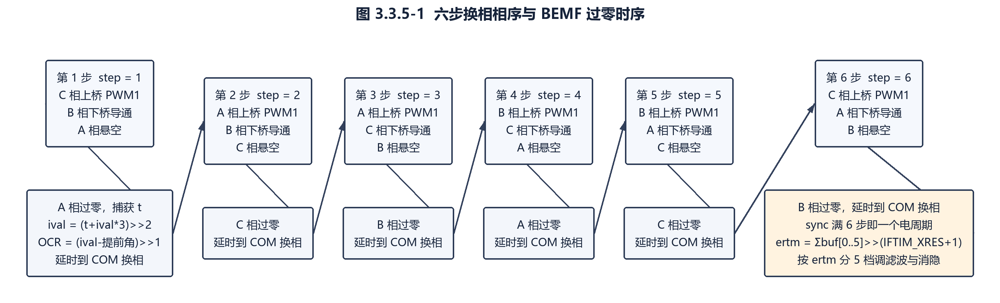

图 3.3.5-1 六步换相相序与 BEMF 过零时序

- 需求标识：ESC-FREQ2-11
- 功能描述：六步闭环须按固定的 6 组「正相/负相/浮空相」编码循环换相，并支持正反两个方向。（需求规格）
- 调用条件：`nextstep()` 的六步分支，由 `tim1_com_isr`（换相延时到）或霍尔事件触发（`src/main.c:355-375`、`src/main.c:402-420`）。
- 输入：换相步 `step`（1..6）、方向标志 `reverse`、`cfg.damp`、`cfg.throt_ztc`。
- 输出：TIM1 的 CCMR1、CCMR2、CCER，比较器通道 `compctl(pcc)`，间隔缓存 `buf[step - 1]`，电周期时间 `ertm`。
- 处理：
- （1）相序表取 `seq[] = {0x175, 0xd9, 0x1ab, 0x72, 0x1de, 0xac}`，与源码注释表中的 6 组编码一一对应；
- （2）从编码中拆出导通相掩码 `m = x >> 3`、正相 `p = x & m`、负相 `n = ~x & m`、浮空相 `cc = m >> 3 ^ reverse << 2`；
- （3）按方向每拍推进 ±1 步并在 1..6 之间回绕；
- （4）逐相装配输出：正相为 PWM1，负相置强制电平并使能互补通道，浮空相按极性置静态电平，写回寄存器后切换比较器通道。

> 证据：`src/main.c:355-375`、`src/main.c:402-420`、`src/main.c:106-115`、`src/main.c:168-179`、`src/main.c:189-265`、`src/main.c:322-324`、官方 wiki：`TipsAndTricks.md`。

- 需求标识：ESC-FREQ2-12
- 功能描述：非有刷且上电时霍尔码不为 7 时启用 TIM3 霍尔捕获形成混合模式；换相步由霍尔码查表决定，霍尔码非法须进入不可恢复故障。（需求规格）
- 调用条件：初始化判据为 `!brushed && getcode() != 7`（`src/main.c:591`）；运行期在 `nextstep()` 内 `hall > 4000`（`src/main.c:162`）与 `tim3_isr`（`src/main.c:402`）中执行。
- 输入：`hallcode()` 取得的原始霍尔码、`TIM3_CCR1` 捕获值、方向标志 `reverse`、标志 `sine`、换相步 `step`。
- 输出：换相步 `step`、霍尔间隔 `hall`、换相间隔 `ival`，并触发 `TIM1_EGR = TIM_EGR_COMG`、累加 `sync`；霍尔码非法时调用 `hard_fault_handler()` 且不返回。
- 处理：
- （1）TIM3 配为 TI1 任意沿复位、8 次采样数字滤波、500 ns 分辨率、ARR 满量程，定义 `USE_XOR` 时以 `TI1S` 选择异或输入；`hall` 初值与无效值均取 `0x10000`；
- （2）霍尔码 1..6 经 `map[][2]` 映射为换相步（第二列供反向使用），`code < 1 || code > 6` 时调用 `hard_fault_handler()`；霍尔码健壮性检查（连续 4 次同值方通过、累计 20 次电平变化才报 `Unstable signal` 硬故障）属保护域，见 3.6 节 ESC-FREQ5-6，本块不重复取证；
- （3）霍尔变化中断内以 `hall = (TIM3_CCR1 + hall * 3) >> 2` 做四分之一平滑；`hall < 5000`、处于正弦阶段或停机时直接返回不换相；
- （4）否则置 `ival = hall << IFTIM_XRES`，触发 COM 换相并关闭 IFTIM 中断，`sync` 未满 6 时累加；
- （5）霍尔功能仅在 ESCAPE1、ESCAPE4、ESCAPE5 三个 STM32G071 target 上定义 `HALL_MAP` 后可用（`CMakeLists.txt（第 64 行）`、`CMakeLists.txt（第 67-68 行）`）。

> 证据：`src/main.c:591`、`src/main.c:162`、`src/main.c:402`、`CMakeLists.txt（第 64 行）`、`CMakeLists.txt（第 67-68 行）`、`src/main.c:88-103`、`src/main.c:160-167`、`src/main.c:590-606`、`src/main.c:401-420`。

- 需求标识：ESC-FREQ2-13
- 功能描述：BEMF 过零中断须算出新的换相间隔（四分之一平滑）、判定快速加/减速、装定带提前角的换相延时并累加同步计数。（需求规格）
- 调用条件：IFTIM 捕获中断被使能且本次不是更新中断（`src/main.c:377`、`src/main.c:389`、`src/main.c:321`）。
- 输入：`IFTIM_ICR`（距上次过零的时间 `t`）、换相间隔 `ival`、电周期时间 `ertm`、`cfg.timing`（1..31）。
- 输出：快速变化标志 `fast`、换相间隔 `ival`、IFTIM 的 OCR；并复位 IFTIM 时基、关闭 IFTIM 中断、累加 `sync`。
- 处理：
- （1）`t < ival >> 1` 时直接返回，忽略过早出现的过零事件；
- （2）取 `u = ival * 3`，置 `fast = (t < u >> 2 || t > u >> 1) && ertm < 2000`，即仅在中高速且间隔突变时置位；
- （3）更新 `ival = (t + u) >> 2`，新间隔为本帧时间与上次三倍间隔之和的四分之一；
- （4）装定带提前角的换相延时 `IFTIM_OCR = max((ival - (ival * cfg.timing >> 5)) >> 1, 1)`，即取间隔一半并按 `timing/32` 的比例提前，最小为 1；
- （5）写 `TIM_EGR(IFTIM) = TIM_EGR_UG` 复位时基并关闭 IFTIM 中断，`sync < 6` 时执行 `++sync`。

> 证据：`src/main.c:377`、`src/main.c:389`、`src/main.c:321`、`src/main.c:377-399`、官方 wiki：`Settings.md`。

- 需求标识：ESC-FREQ2-14
- 功能描述：须按转速（`ertm`）分 5 档切换 BEMF 输入捕获的滤波强度、时钟分频与浮空相消隐，并在同步满 6 步后用六步间隔之和求电周期时间。（需求规格）
- 调用条件：每次六步换相末尾（`src/main.c:279-324`）。
- 输入：电周期时间 `ertm`、IFTIM 捕获值、霍尔间隔 `hall`、时基分辨率宏 `IFTIM_XRES`（125/250/500 ns）。
- 输出：IFTIM 的 ICMR 与 CR1（含 CKD 分频）、浮空相消隐通道 CCR5/CCR4、间隔缓存 `buf[6]`、电周期时间 `ertm`、IFTIM 中断使能。
- 处理：
- （1）分档阈值依次为 `ertm < 100`（600K+ ERPM）、`< 200`（300K+）、`< 1000`（60K+）、`< 2000`（30K+）与其余（最低 PWM 频率档）；
- （2）前 4 档把浮空相消隐通道（`TIM1_CCR5` 或 `TIM1_CCR4`）置 0，末档置 `IFTIM_ICFL << 2` 用于软件消隐；
- （3）滤波档依次取 ICM3、ICM2、ICM1、ICM1、ICM1；时钟分频在 30K+ 档乘 2、最低档乘 4；
- （4）先清 IFTIM 事件标志再使能 `UIE | ICIE`，避免使能瞬间产生的伪事件；
- （5）间隔缓存按 `buf[step - 1] = hall > 4000 ? hall << IFTIM_XRES : ival` 写入，`sync` 已达 6 时以 `ertm = (buf[0] + … + buf[5]) >> (IFTIM_XRES + 1)` 求电周期时间。

> 证据：`src/main.c:279-324`、`src/main.c:585`。

## 3.4 运行控制

### 3.4.1 油门仲裁、运行/停止双态与停机序列（需求规格）

运行控制在主循环内按固定次序推进：先仲裁油门并判定 `running`，再由 `running` 与 `step` 的组合触发启动或停止动作，最后装配输出。

- 需求标识：ESC-FREQ3-1
- 功能描述：主循环每拍先对油门仲裁，重新解锁期间把油门视为零，再据仲裁结果写 `running`；`running` 与 `step` 的组合是唯一启停判据，运行状态不以枚举形式表示；由运行转停止时关闭换相与 BEMF 中断、复位三相输出并清空转速状态量。
- 调用条件：仲裁与 `running` 判定在主循环每拍执行（`src/main.c:660-708`）；启停动作在每拍尾部的 `skipduty:` 处执行（`src/main.c:766`、`src/main.c:820`）。
- 输入：`throt`（-2000..2000）、`rearm`、`step`、`curduty`、`SW_BLANKING`。
- 输出：`input`、`running`、`curduty`；停止时写 TIM1 DIER、IFTIM DIER/ARR、三相输出形态、`sync`/`fast`/`ertm`/`erpm`、`oldstep`/`step`。
- 处理：
- （1）按 `input = rearm ? 0 : throt` 取仲裁后的油门，并在 `!running` 时把 `curduty` 清零（`src/main.c:662-666`）；
- （2）中性分支写 `running = 0`，反向分支写 `running = 1`，正向分支写 `running = 1` 并清 `braking`（`src/main.c:683`、`src/main.c:703`、`src/main.c:706-707`）；
- （3）以 `running && !step` 触发启动、以 `!running && step` 触发停止，两个分支互斥（`src/main.c:766`、`src/main.c:820`）；
- （4）停止动作在关闭中断的状态下清除 TIM1 换相中断（`SW_BLANKING` 时追加 UIE/CC4IE）、关闭 IFTIM 中断并把 ARR 归零，随后复位时基（`src/main.c:821-829`）；
- （5）`laststep()` 复位输出，`resetcom()` 把三相输出置为静态电平并按 `lock` 决定三相形态，触发 `TIM1_EGR = UG | COMG`，保存 `oldstep = step` 后清 `step = 0`（`src/main.c:830`、`src/main.c:331-353`、`src/util.c:583-598`）；
- （6）停止序列收尾清 `sync`/`fast`/`ertm`/`erpm` 并重新开中断（`src/main.c:831-835`）。

> 证据：`src/main.c:660-708`、`src/main.c:766`、`src/main.c:820`、`src/main.c:662-666`、`src/main.c:683`、`src/main.c:703`、`src/main.c:706-707`、`src/main.c:821-829`、`src/main.c:830`、`src/main.c:331-353`、`src/util.c:583-598`、`src/main.c:831-835`。

本节以 `running` 与 `step` 的组合描述状态，源码与官方 wiki：`Settings.md` 均未定义“运行/停止”的枚举状态名，官方文档只给出 LED 状态码。

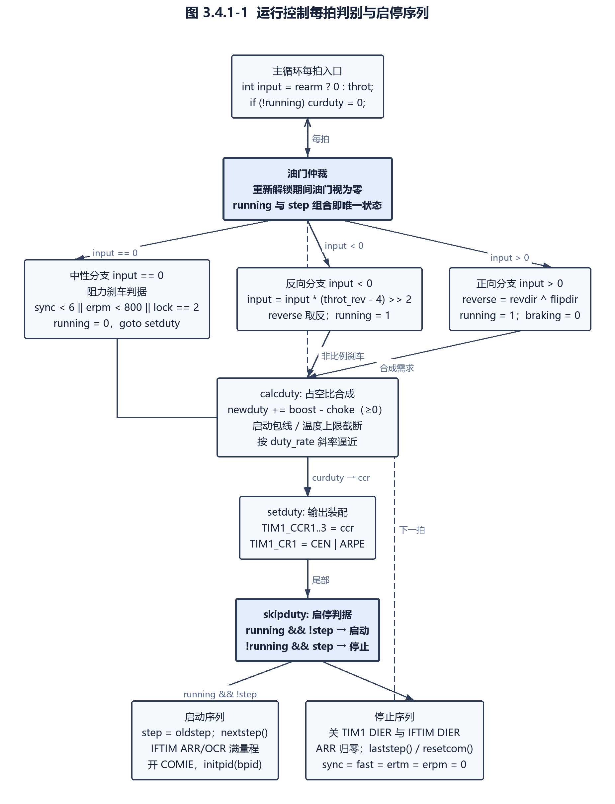

图 3.4.1-1 运行控制每拍判别与启停序列

### 3.4.2 占空比合成、下限保护与斜率限制（用户需求）

占空比需求在每拍的 `calcduty:` 通道上合成：基准需求加堵转补偿、减过流削减，随后经启动包线与温度上限截断，最后按斜率限制逼近目标值。

- 需求标识：ESC-FREQ3-2
- 功能描述：占空比需求由基准需求加堵转补偿、减过流削减得到且不得为负；其变化率受 `duty_rate`（0.1%/ms）限制，但快速加/减速或尚未同步的减速须允许直接到位。
- 调用条件：`calcduty:` 通道每拍执行（`src/main.c:739-752`）。
- 输入：`newduty`、`boost`（0..160）、`choke`（0..2000）、`cfg.duty_rate`（1..100）、`fast`、`sync`、`curduty`、`n`。
- 输出：`newduty`（≥0）、`curduty`、相位计数 `n`。
- 处理：
- （1）按 `if ((newduty += boost - choke) < 0) newduty = 0;` 合成净需求并做下限保护（`src/main.c:741`）；
- （2）`boost` 由堵转 PID 在 1kHz 节拍按目标 `20000000 / cfg.prot_stall - 800` 累加并限幅到 0..160，`choke` 由过流 PID 限幅到 0..2000（`src/main.c:852-854`）；
- （3）`boost` 所依据的 `prot_stall` 同时决定正弦启动的换相间隔上限 `(333333 << IFTIM_XRES) / cfg.prot_stall`，未配置时取 `145 << IFTIM_XRES`，该上限近似等效于覆盖最大转速，未配置时对应 2298 ERPM（官方口述 2300 ERPM）（`src/main.c:710`）；
- （4）取 `a = fast ? 0 : cfg.duty_rate`、`b = a >> 3`，再按 `n < (a & 7)` 每拍补 1，使每 8 拍的总步长恰为 `a`（`src/main.c:748-751`）；
- （5）按 `if (curduty > newduty ? sync < 6 || (curduty -= b) < newduty : (curduty += b) > newduty) curduty = newduty;` 逼近目标，减速且未同步时直接到位、其余越界即钳到目标，`fast` 时 `b = 0` 立即到位（`src/main.c:752`）；
- （6）阻力刹车与比例刹车分支不经本通道，直接跳转 `setduty`（`src/main.c:684`、`src/main.c:699`）。

> 证据：`src/main.c:739-752`、`src/main.c:741`、`src/main.c:852-854`、`src/main.c:710`、`src/main.c:748-751`、`src/main.c:752`、`src/main.c:684`、`src/main.c:699`。

斜率量纲由官方 wiki：`Settings.md` 给出；`fast` 由过零检测路径置位（`src/main.c:392-393`）。

### 3.4.3 可变 PWM 频率（用户需求）

- 需求标识：ESC-FREQ3-3
- 功能描述：运行期 PWM 载波频率须在 `freq_min`..`freq_max` 之间随转速线性变化，过渡区间为 1000..2000µs 电周期（约 30..60 kERPM）。
- 调用条件：`ertm` 非零即电机转动时每拍执行（`src/main.c:742`）。
- 输入：`ertm`、`cfg.freq_min`（16..48 kHz）、`cfg.freq_max`（∈[`freq_min`, 96] kHz）。
- 输出：TIM1 重装载值 `arr`、`erpm`。
- 处理：
- （1）按 `arr = scale(ertm, 1000, 2000, CLK_KHZ / cfg.freq_max, CLK_KHZ / cfg.freq_min)` 取重装载值，`ertm < 1000` 取 `freq_max` 对应值、`ertm > 2000` 取 `freq_min` 对应值、中间线性插值（`src/main.c:743`）；
- （2）在同一拍由 `erpm = 60000000 / ertm` 更新电气转速（`src/main.c:744`）；
- （3）停机（`ertm == 0`）时保持默认 `arr = CLK_KHZ / cfg.freq_min`，该值不再被改写（`src/main.c:661`）；
- （4）有刷模式下不改写 `arr`，只在 `setduty` 处把比较值的标定上限端点改为 `arr - (CLK_MHZ * 3 >> 1)`（`src/main.c:757`）。

> 证据：`src/main.c:742`、`src/main.c:743`、`src/main.c:744`、`src/main.c:661`、`src/main.c:757`。

官方 wiki：`Settings.md` 表述为在 [30..60] kERPM 区间变化，与代码端点一致。

### 3.4.4 启动占空比包线与温度上限（用户需求）

- 需求标识：ESC-FREQ3-4
- 功能描述：启动期占空比上限须从 `duty_spup` 随转速线性爬升到 100%，并与温度降额上限取小后截断当拍需求。
- 调用条件：`calcduty:` 通道每拍执行（`src/main.c:746`）。
- 输入：`erpm`、`cfg.duty_ramp`（0..100 kERPM）、`cfg.duty_spup`（1..100 %）、`cutback`。
- 输出：`maxduty`（0..2000 量纲）；`newduty` 被截断到该上限。
- 处理：
- （1）按 `maxduty = min(scale(erpm, 0, cfg.duty_ramp * 1000, cfg.duty_spup * 20, 2000), 2000 - cutback * 25)` 同时求包线上限与温度上限（`src/main.c:746`）；
- （2）`scale()` 语义为 `x <= a1` 取 `b1`、`x >= a2` 取 `b2`，区间内线性（`src/util.c:387-391`）；
- （3）`duty_ramp == 0`（编译期缺省 `DUTY_RAMP = 0`）时两端点重合，`erpm <= 0` 取 `duty_spup * 20`、`erpm > 0` 立即取 2000，即 `duty_spup` 仅在静止点生效，默认配置等价于转速一旦非零即无启动限幅（`src/defs.h:141-143`、`src/main.c:746`）；
- （4）`duty_ramp = 100` 时包线在 100 kERPM 处爬到 100%（`src/main.c:746`）；
- （5）温度项满值 60 时为 `2000 - 1500 = 500`，即最多 75% 降额（`src/main.c:746`、`src/main.c:445-459`）；
- （6）按 `if (newduty > maxduty) newduty = maxduty;` 把当拍需求截断到上限（`src/main.c:747`）。

> 证据：`src/main.c:746`、`src/util.c:387-391`、`src/defs.h:141-143`、`src/main.c:445-459`、`src/main.c:747`。

官方 wiki：`Settings.md` 给出 `duty_spup`/`duty_ramp` 的参数语义。

### 3.4.5 占空比输出、死区偏移与 TIM_DTG 编码（计算机使用说明、需求规格）

- 需求标识：ESC-FREQ3-5
- 功能描述：写 TIM1 比较值时须按“拖刹或阻尼运行”叠加死区偏移，并以预装载方式分两次写 CR1 后写 ARR/CCR；编译期 `DEAD_TIME` 须按硬件 DTG 字段的四段编码写入 BDTR。
- 调用条件：`setduty:` 标号每拍执行并接收刹车分支的直接跳入（`src/main.c:753-764`）；初始化阶段写 BDTR（`src/main.c:577`）。
- 输入：`curduty`（0..2000）、`arr`、`lock`、`running`、`cfg.damp`、`DEAD_TIME`（0..1023）、`brushed`。
- 输出：TIM1 ARR、CCR1/CCR2/CCR3、CR1、BDTR。
- 处理：
- （1）按 `lock || (running && cfg.damp) ? DEAD_TIME : 0` 取死区偏移，比较值按 `scale(curduty, 0, 2000, 偏移, 上限端点)` 折算（`src/main.c:755`、`src/main.c:757`）；
- （2）非 `FULL_DUTY` 时有刷把上限端点改为 `arr - (CLK_MHZ * 3 >> 1)`，`FULL_DUTY` 分支写作 `scale(..., arr--)`，端点取自减 1 之前的 `arr`，被减 1 的是随后写入的 `TIM1_ARR`，以此允许 100% 占空比（`src/main.c:754-758`、`src/main.c:760`）；
- （3）写序为先写 `TIM1_CR1 = CEN | ARPE | UDIS`，再写 `TIM1_ARR` 与三路 `CCRx`，最后写 `TIM1_CR1 = CEN | ARPE`，使新值在下一更新事件整体生效（`src/main.c:759-764`）；
- （4）`DEAD_TIME` 按四段编码写入 `TIM_DTG`：`< 128` 直接取值，`< 256` 取 `((x - 128) >> 1) | 0x80`，`< 512` 取 `((x - 256) >> 3) | 0xc0`，`< 1024` 取 `((x - 512) >> 4) | 0xe0`，对应分辨率依次为 1/2/8/16 个时钟周期（`src/defs.h:20-28`）；
- （5）初始化时按 `TIM1_BDTR = TIM_DTG | TIM_BDTR_OSSR | TIM_BDTR_MOE` 使能死区、互补输出与主输出（`src/main.c:577`）。

> 证据：`src/main.c:753-764`、`src/main.c:577`、`src/main.c:755`、`src/main.c:757`、`src/main.c:754-758`、`src/main.c:760`、`src/main.c:759-764`、`src/defs.h:20-28`。

`DEAD_TIME` 取值域 [0..1023] 由官方 wiki：`BuildOptions.md` 给出，编码与写序属需求规格。

### 3.4.6 有源续流/阻尼（互补 PWM）（用户需求）

- 需求标识：ESC-FREQ3-6
- 功能描述：`damp` 使能时被驱动相的上下桥须互补开关以实现有源续流，关闭时只驱动单侧、另一侧保持静态电平。
- 调用条件：每次六步换相装配输出时执行（`src/main.c:189-254`）；`PWM_ENABLE` 形态下由 `checkcfg` 强制 `cfg.damp = 1`（`src/util.c:425-429`）。
- 输入：`cfg.damp`、相掩码 `p`/`n`、`PWM_ENABLE`、`INVERTED_HIGH`。
- 输出：TIM1 CCMR1/CCMR2/CCER 的通道模式位与使能位。
- 处理：
- （1）正相通道置 `OCxM_PWM1`，并按 `cfg.damp ? CCxE | CCxNE : CCxE` 决定是否同时使能互补输出（`src/main.c:189-195`、`src/main.c:211-217`、`src/main.c:233-239`）；
- （2）负相通道置强制电平并使能互补通道（`src/main.c:196-210`、`src/main.c:218-232`、`src/main.c:240-254`）；
- （3）未被驱动相走“浮空相”分支，只置强制电平并使能互补通道，使其不参与换流（`src/main.c:203-210`）；
- （4）`PWM_ENABLE` 形态下三路互补位与 `INVERTED_HIGH` 极性位在换相末尾统一追加（`src/main.c:255-260`）。

> 证据：`src/main.c:189-254`、`src/util.c:425-429`、`src/main.c:189-195`、`src/main.c:211-217`、`src/main.c:233-239`、`src/main.c:196-210`、`src/main.c:218-232`、`src/main.c:240-254`、`src/main.c:203-210`、`src/main.c:255-260`。

官方 wiki：`Settings.md` 原文为“damp: 1 Damped mode (complementary PWM, active freewheeling)”。

### 3.4.7 零油门滑行（ZTC）（用户需求）

- 需求标识：ESC-FREQ3-7
- 功能描述：`throt_ztc` 使能且油门为零时，六步换相须清除正相与负相掩码，使三相不再有被驱动相。
- 调用条件：六步分支内、相掩码算出之后执行（`src/main.c:188`）。
- 输入：`cfg.throt_ztc`、全局 `throt`、相掩码 `p`、相掩码 `n`。
- 输出：`p = n = 0`，三相全部按“浮空相”形态装配输出。
- 处理：
- （1）按 `if (cfg.throt_ztc && !throt) p = n = 0;` 清除相掩码（`src/main.c:188`）；
- （2）掩码清零后 `p & bit` 与 `n & bit` 全部不成立，三个相位均走浮空相分支（`src/main.c:203-210`、`src/main.c:225-232`、`src/main.c:247-254`）；
- （3）占空比仍由 3.4.5 所述通道统一写入，滑行只改变相掩码而不改变比较值（`src/main.c:753-764`）；
- （4）该开关的作用点仅在六步分支，正弦启动阶段不使用它（`src/main.c:118-158`）。

> 证据：`src/main.c:188`、`src/main.c:203-210`、`src/main.c:225-232`、`src/main.c:247-254`、`src/main.c:753-764`、`src/main.c:118-158`。

官方 wiki：`Settings.md` 原文为“throt_ztc: 0 Zero-throttle coasting”。

### 3.4.8 阻力刹车与辅助刹车超时恢复（用户需求、需求规格）

- 需求标识：ESC-FREQ3-8
- 功能描述：零油门时若尚未同步、转速过低或处于硬拖刹，须施加阻力刹车而非滑行；辅助刹车通道给出的刹车量在约 100ms 无更新后须恢复为标称阻力刹车值。
- 调用条件：中性分支满足 `sync < 6 || erpm < 800 || lock == 2`（`src/main.c:673`）；1kHz 节拍上的超时检查（`src/main.c:843`，位于 `#ifndef ANALOG` 内 `src/main.c:841`）。
- 输入：`sync`、`erpm`、`lock`、`brake`、`cutback`、`auxup`、`cfg.duty_drag`。
- 输出：`curduty`、`running = 0`、`brake`、`auxup`。
- 处理：
- （1）拖刹态取 `curduty = min(brake, 100 - cutback)`，非拖刹态取 `curduty = brake * 20`，把百分比折算到 0..2000 量纲（`src/main.c:682`）；
- （2）随后写 `running = 0` 并跳转 `setduty`，绕过启动包线与斜率限制（`src/main.c:683-684`）；
- （3）不满足刹车判据时写 `boost = 0` 并跳转 `calcduty`，即真正的零油门滑行（`src/main.c:686-687`）；
- （4）`brake` 初值取 `cfg.duty_drag`，辅助通道输入以 1100..1900µs 映射到 `0..duty_drag` 并清 `auxup`（`src/main.c:563`、`src/io.c:57-61`）；
- （5）按 `if (++auxup == 100) { brake = cfg.duty_drag; auxup = 0; }` 在 1kHz 节拍达到 100 次即约 100ms 后恢复标称值（`src/main.c:843-846`）。

> 证据：`src/main.c:673`、`src/main.c:843`、`src/main.c:841`、`src/main.c:682`、`src/main.c:683-684`、`src/main.c:686-687`、`src/main.c:563`、`src/io.c:57-61`、`src/main.c:843-846`。

官方 wiki：`Settings.md` 给出 `duty_drag` 语义；100ms 超时值属需求规格。

### 3.4.9 主动拖刹强度与运行中热切换（用户需求）

- 需求标识：ESC-FREQ3-9
- 功能描述：`duty_lock` 定义主动拖刹档位（0 关闭、1 软拖刹、2 硬拖刹），运行中改变须立即生效；改变且电机停止时须重新初始化三相输出形态。
- 调用条件：中性分支内检测到 `lock != cfg.duty_lock && !brushed`（`src/main.c:669`）。
- 输入：`cfg.duty_lock`（0..2）、运行期副本 `lock`、`running`、`brake`、`cutback`。
- 输出：`lock`；必要时重新调用 `laststep()`；`curduty`。
- 处理：
- （1）运行期副本初值取 `lock = cfg.duty_lock`（`src/main.c:564`），后续每拍比对并检出差异即更新 `lock`（`src/main.c:669-671`）；
- （2）检出差异时若 `!running`，调用 `laststep()` 按新的 `lock` 重配三相静态输出（`src/main.c:671`、`src/main.c:339-348`）；
- （3）`lock` 非零时拖刹量取 `min(brake, 100 - cutback)`，满降额时为标称值的 40%（`src/main.c:682`）；
- （4）`lock == 2` 同时是阻力刹车的触发条件（`src/main.c:673`）；
- （5）`checkcfg` 把 `duty_lock` 收敛为 0..2、有刷强制 0，并据此限制 `throt_mode` 的上限（`src/util.c:443-444`）。

> 证据：`src/main.c:669`、`src/main.c:564`、`src/main.c:669-671`、`src/main.c:671`、`src/main.c:339-348`、`src/main.c:682`、`src/main.c:673`、`src/util.c:443-444`。

官方 wiki：`Settings.md` 给出 `duty_lock` 三档语义。

### 3.4.10 比例刹车（throt_mode 2/3）（用户需求）

- 需求标识：ESC-FREQ3-10
- 功能描述：比例刹车模式下反向油门区间须映射为按 `throt_brk` 限幅、下限为当前刹车量的刹车力；模式 2 在刹车完成之后才允许真正反向。
- 调用条件：`input < 0` 且（`throt_mode == 3` 或（`throt_mode == 2` 且 `braking != 2`））（`src/main.c:695`）。
- 输入：`input`（-2000..0）、`cfg.throt_brk`（0..100）、`brake`、`braking`。
- 输出：`curduty`、`running = 0`、`braking = 1`，并跳转 `setduty`。
- 处理：
- （1）按 `curduty = scale(input, -2000, 0, cfg.throt_brk * 20, brake * 20)` 求刹车力，故 `input = -2000`（反向满舵）对应 `throt_brk * 20` 的最大刹车，`input = 0` 对应当前刹车量 `brake * 20` 作为下限（`src/main.c:696`、`src/util.c:387-391`）；
- （2）随后写 `running = 0`、`braking = 1` 并跳转 `setduty`，直接输出而不经启动包线与斜率限制（`src/main.c:697-699`）；
- （3）中性分支内若 `braking == 1` 则置 `braking = 2`，表示刹车已完成，后续反向油门走真正的反向分支（`src/main.c:668`、`src/main.c:695`）；
- （4）`checkcfg` 把 `throt_brk` 钳位到 `[duty_drag, 100]`（`src/util.c:446`）。

> 证据：`src/main.c:695`、`src/main.c:696`、`src/util.c:387-391`、`src/main.c:697-699`、`src/main.c:668`、`src/util.c:446`。

官方 wiki：`Settings.md` 给出 `throt_brk` 与 `throt_mode` 的语义。

### 3.4.11 反向油门限幅与运行方向合成（用户需求、需求规格）

- 需求标识：ESC-FREQ3-11
- 功能描述：真正的反向运转须按 `throt_rev` 限幅为 100/75/50/25%；最终方向由配置方向 `revdir`、翻转位 `flipdir` 与油门符号共同决定，并作用于六步推进、比较器通道、有刷驱动与停车换向。
- 调用条件：`input < 0` 且未走比例刹车分支（`src/main.c:701`）；正向分支（`src/main.c:705`）。
- 输入：`input`、`cfg.throt_rev`（0..3）、`cfg.revdir`、`flipdir`。
- 输出：`input`（缩放后）、`reverse`、`running = 1`。
- 处理：
- （1）按 `input = input * (cfg.throt_rev - 4) >> 2` 缩放，档位 0/1/2/3 对应系数 -4/-3/-2/-1 的四分之一，即 100/75/50/25%（`src/main.c:701`；`checkcfg` 钳位 0..3 见 `src/util.c:445`）；
- （2）反向时取 `reverse = !cfg.revdir ^ flipdir`，正向时取 `reverse = cfg.revdir ^ flipdir`（`src/main.c:702`、`src/main.c:705`）；
- （3）`flipdir` 由 DShot 命令 20/21 直接置位，也可由串口命令 0x02/0x03 改写（`src/io.c:479-486`、`src/io.c:644-649`）；
- （4）`reverse` 的消费点包括六步方向与浮空相比较器（`src/main.c:168-172`、`src/main.c:179`）、有刷驱动形态（`src/main.c:772-791`）、正弦相角方向（`src/main.c:122-126`）与停车换向（`src/main.c:550`）。

> 证据：`src/main.c:701`、`src/main.c:705`、`src/util.c:445`、`src/main.c:702`、`src/io.c:479-486`、`src/io.c:644-649`、`src/main.c:168-172`、`src/main.c:179`、`src/main.c:772-791`、`src/main.c:122-126`、`src/main.c:550`。

`throt_rev` 档位语义由官方 wiki：`Settings.md` 给出，方向合成属需求规格。

### 3.4.12 停车/换向状态机（prot_park）（用户需求、需求规格）

- 需求标识：ESC-FREQ3-12
- 功能描述：`PARK_PIN` 机型上零油门停稳后可执行停车例程：以 `prot_park` 定义的速度做正弦换相，读取单向霍尔停车传感器的三段电平序列，第三段成功后翻转运行方向；序列不稳定即放弃。
- 调用条件：中性分支满足阻力刹车判据、`running` 为真且 `cfg.prot_park` 非 0 时调用 `park()`（`src/main.c:675`）；代码仅在 `#ifdef PARK_PIN` 下编译（`src/main.c:521`）。
- 输入：`cfg.prot_park`（0..4）、PARK 引脚电平、内部状态 `park1`/`park2`/`park3`。
- 输出：`sine`、`ertm`、`erpm`、`reverse`、`park1`/`park2`/`park3`。
- 处理：
- （1）`park()` 返回真时置 `sine = (1000 << IFTIM_XRES) / cfg.prot_park`（停车相位速度）、`ertm = 1e8`、`erpm = 0`，并跳转 `skipduty` 不输出占空比（`src/main.c:676-679`、`src/main.c:525-526`）；
- （2）每次调用先递减 `park3`，归零即放弃；阶段未到 3 且 `park2` 累计不足 800 次时返回 1 继续等待（`src/main.c:526-527`、`src/main.c:549`）；
- （3）电平判定要求连续 4 次采样同值方通过，累计 20 次电平变化即返回 0 放弃（源码注释为 "Unstable signal"）（`src/main.c:528-535`）；
- （4）三段状态机为：阶段 0 读到高电平 → 阶段 1 读到低电平并重设 `park3` → 阶段 2 再读到高电平则置阶段 3、`park3 = (0xffff - park3) >> 1`、`reverse = !reverse`（`src/main.c:536-552`）；
- （5）非零油门时三段状态全部复位（`src/main.c:689-693`）；
- （6）`checkcfg` 把 `prot_park` 收敛为 0..4，非 `PARK_PIN` 机型强制 0（`src/util.c:517-521`）。

> 证据：`src/main.c:675`、`src/main.c:521`、`src/main.c:676-679`、`src/main.c:525-526`、`src/main.c:526-527`、`src/main.c:549`、`src/main.c:528-535`、`src/main.c:536-552`、`src/main.c:689-693`、`src/util.c:517-521`。

上述路径在当前仓库源码中存在但不可达：无 target 定义 `PARK_PIN`，`checkcfg` 因而把 `prot_park` 恒置 0，停车分支不会被编译进产物（`src/util.c:517-521`）。

### 3.4.13 有刷模式的两相驱动与参数失效（用户需求）

- 需求标识：ESC-FREQ3-13
- 功能描述：有刷模式下电机以两相 PWM 驱动、换相步固定为方向值；方向配置变化须通过把换相步清零并重新启动来生效。
- 调用条件：`cfg.brushed` 非零，涉及启动分支与运行期方向检查（`src/main.c:767`、`src/main.c:740`）。
- 输入：启动时快照 `brushed`、`reverse`、`step`。
- 输出：TIM1 CCMR/CCER、`step`、`ertm`、`arr`、`ccr`。
- 处理：
- （1）运行期按 `if (brushed && step != reverse + 1) step = 0;` 判断方向与当前步是否一致，不一致即清步，使同拍后续的启动分支按新方向重配输出（`src/main.c:740`、`src/main.c:766-802`）；
- （2）启动时置 `step = reverse + 1`、`ertm = 600`，注释锚点注明 `freq_min`、`duty_spup`、`duty_ramp` 不生效（`src/main.c:800-801`）；
- （3）有刷下 `arr` 由 `ertm` 分支取 `CLK_KHZ / cfg.freq_max`，故 `freq_max` 实际生效（`src/main.c:743`）；
- （4）有刷另有占空比修正，把比较值标定上限端点改为 `arr - (CLK_MHZ * 3 >> 1)`（`src/main.c:757`）；
- （5）`checkcfg` 下有刷被强制失效的参数为 `sine_range`、`duty_lock`、`prot_stall`（`src/util.c:433`、`src/util.c:443`、`src/util.c:498`）；
- （6）`timing`、`sine_power`、`freq_min`、`duty_spup`/`duty_ramp`、`throt_ztc` 未被 `checkcfg` 强制，其失效仅由代码路径不读取造成（注释锚点 `src/main.c:801`）。

> 证据：`src/main.c:767`、`src/main.c:740`、`src/main.c:766-802`、`src/main.c:800-801`、`src/main.c:743`、`src/main.c:757`、`src/util.c:433`、`src/util.c:443`、`src/util.c:498`、`src/main.c:801`。

> **自述差异**：官方 wiki：`Settings.md` 列举有刷模式下 9 项设置 "no effect"，实测其中仅 3 项被 `checkcfg` 强制失效，其余靠路径不读取；且 `freq_max` 既不在官方失效清单内、也不失效（`src/util.c:431-443`、`src/main.c:743`）。

### 3.4.14 3D 双向模式（DShot 油门中位置换）（用户需求）

- 需求标识：ESC-FREQ3-14
- 功能描述：`throt_mode` 非零时 DShot 油门须按中位分界双向解释：`x >= 1048` 为正向前进，取 `(x - 1047) << 1`；`x <= 1047` 且不在命令区 `1..47` 时为非正反向，取 `(47 - x) << 1`，在 `x = 1047` 处达到 -2000；反向半区随油门值增大而加深，边界 `x = 1047 → 1048` 处由 -2000 跳至 +2。
- 调用条件：DShot 帧解码出油门值之后（`src/io.c:427-429`）；命令通道（`src/io.c:433-438`、`src/io.c:455-462`）。
- 输入：DShot 11 位油门值 `x`、`cfg.throt_mode`、遥测位 `tlm`、`ertm`。
- 输出：`throt`、`cfg.throt_mode`；命令 9/10 分支不写 `beepval`，故不列为输出。
- 处理：
- （1）按 `throt = x ? cfg.throt_mode ? (x > 1047 ? x - 1047 : 47 - x) << 1 : x - 47 : 0;` 解码，以 1047/1048 为分界，`x = 1048 → +2`、`x = 1047 → -2000`、`x = 48 → -2`，不存在中位死区（`src/io.c:427-429`）；
- （2）`x ∈ [1, 47]` 属 DShot 命令区，不写 `throt`（`src/io.c:427-429`）；
- （3）命令 9/10 分别写 `cfg.throt_mode = 0/1`，完成 3D 模式的关闭与开启（`src/io.c:455-462`）；
- （4）命令仅在遥测位被置位且电机停止（`!ertm`）时受理，命令字变化时去抖计数清零，连续保持到第 6 帧才执行一次（`src/io.c:433-438`）；
- （5）解码所得 `throt` 的方向合成与限幅见 3.4.11（`src/main.c:702`、`src/main.c:705`）。

> 证据：`src/io.c:427-429`、`src/io.c:433-438`、`src/io.c:455-462`、`src/main.c:702`、`src/main.c:705`。

3D 方向约定与主流 DShot 3D 的差异记入附录差异表；本节按源码事实描述。

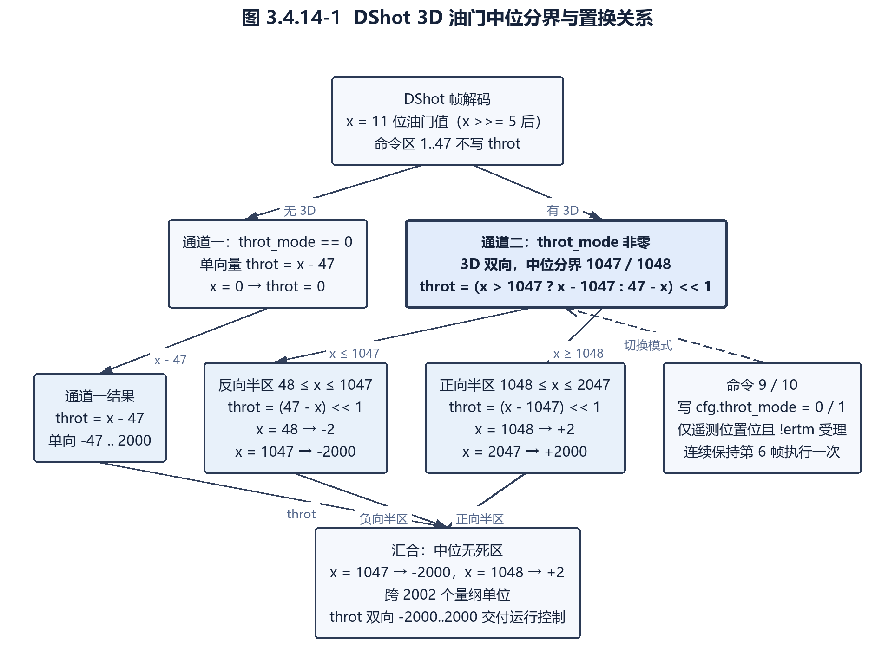

图 3.4.14-1 DShot 3D 油门中位分界与置换关系

## 3.5 遥测

### 3.5.1 遥测端口与物理层配置（用户需求）

- 需求标识：ESC-FREQ4-1
- 功能描述：固件提供专用遥测串口，固定使用 USART1；串行输入协议固定使用 USART2，两者为不同外设，可同时工作。
- 调用条件：启动初始化阶段调用 `inittelem()`（初始化顺序见 `src/main.c:558-584`）。
- 输入：`cfg.telem_mode`、`cfg.telem_phid`、`CLK`。
- 输出：`USART1_BRR`/`CR1`/`CR3` 与两条 DMA 通道的绑定关系。
- 处理：
- （1）按模式表选定的波特率写 `USART1_BRR`，并对需要应答的协议登记 `iofunc`（`src/telem.c:43-76`）；
- （2）USART1 恒定置单线半双工位 `USART_CR3_HDSEL`（`src/telem.c:77-83`）；
- （3）`iofunc` 非空时同时开 `DMAT|DMAR`、`TE|RE` 与接收中断允许位；`iofunc` 为空（KISS、CRSF）时只留 `HDSEL|DMAT` 与 `UE|TE`（`src/telem.c:77-83`）；
- （4）把 128 字节 `iobuf` 同时挂到 RX/TX DMA 的存储器地址，并把 RX 计数装载为 `sizeof iobuf`（`src/telem.c:84-88`）；
- （5）串行输入链路固定使用 USART2，其 `CR3` 同样置 `HDSEL|DMAT|DMAR`、`CR1` 置 `UE|TE|RE|IDLEIE`，与遥测口互不占用（`src/io.c:214-221`）。

> 证据：`src/main.c:558-584`、`src/telem.c:43-76`、`src/telem.c:77-83`、`src/telem.c:84-88`、`src/io.c:214-221`。

遥测口与串行输入口分属 USART1 与 USART2，两条链路各自绑定 DMA 通道，可同时收发（`src/telem.c:84-88`、`src/io.c:216-220`）。

### 3.5.2 接收超时与半双工收发切换（用户需求）

- 需求标识：ESC-FREQ4-2
- 功能描述：应答型协议按“收完一帧即转发送”的方式工作，并以接收超时或空闲检测判定帧尾。
- 调用条件：`telem_mode` ∈ {2, 3, 5, 6} 使 `iofunc` 非空；AT32F4 平台走空闲中断分支（`src/telem.c:91-124`）。
- 输入：USART1 接收字节流（经 RX DMA 落入 `iobuf`）、接收超时标志。
- 输出：应答长度大于 0（回包）、等于 0（不应答）或小于 0（延迟发送）。
- 处理：
- （1）非 AT32F4 平台初始化时置 `USART1_RTOR = 10` 并使能 `RTOEN`；S.Port 模式把 `RTOR` 改为 26（约 450µs）并追加 `RXINV|TXINV` 与 B6 下拉（`src/telem.c:39-42`、`src/telem.c:52-60`）；
- （2）中断服务内先清 RXNE/IDLE/ORE/RTO 并停 RX DMA，再用 DMA 剩余计数反算本帧长度并调用 `iofunc(len)`（`src/telem.c:96-115`）；
- （3）`len > 0` 时清 TC、置 `TCIE` 并启动 TX DMA 后返回；`len < 0` 直接返回并把延迟发送交给发送节拍；`len == 0` 重装 RX DMA 并重开接收（`src/telem.c:104-123`）；
- （4）AT32F4 平台以读 `USART1_RDR` 清标志，并以 `USART_CR1_IDLEIE` 代替 `RTOIE`（`src/telem.c:96-101`、`src/telem.c:117-121`）。

> 证据：`src/telem.c:91-124`、`src/telem.c:39-42`、`src/telem.c:52-60`、`src/telem.c:96-115`、`src/telem.c:104-123`、`src/telem.c:96-101`、`src/telem.c:117-121`。

半双工方向切换由 `HDSEL` 位下的 `TE`/`RE` 组合实现，接收与发送不同时使能（`src/telem.c:77-83`、`src/telem.c:111`）。

### 3.5.3 遥测模式表与编译期裁剪（用户需求、数据字典里找）

- 需求标识：ESC-FREQ4-3
- 功能描述：遥测模式取 0..6 共 7 档，越界值被钳位；MSB 与 HoTT 两档可在编译期整体移除，移除后对应配置值归零。
- 调用条件：启动装载配置后由 `checkcfg()` 收敛（`src/main.c:560`）。
- 输入：`cfg.telem_mode`、编译宏 `DISABLE_MSB` / `DISABLE_HOTT`。
- 输出：模式号到波特率与应答函数的映射，以及模式 5/6 是否可用。
- 处理：
- （1）初始化按 `telmode` 分支填写波特率与 `iofunc`（`src/telem.c:43-76`）；
- （2）`DISABLE_MSB` 生效时 `case 5`、`DISABLE_HOTT` 生效时 `case 6` 不参与编译（`src/telem.c:64-75`）；
- （3）`checkcfg()` 先把 `telem_mode` 钳到 0..6，再在裁剪宏生效时把 5/6 直接归 0（`src/util.c:474-480`）；
- （4）模式默认值由编译期宏 `TELEM_MODE` 给出，缺省为 0（KISS）（`src/defs.h:199-201`）。

> 证据：`src/main.c:560`、`src/telem.c:43-76`、`src/telem.c:64-75`、`src/util.c:474-480`、`src/defs.h:199-201`。

| 模式号 | 名称 | 波特率 | 应答函数 `iofunc` | 特殊物理层设置 | 证据 |
| --- | --- | --- | --- | --- | --- |
| 0 | KISS | 115200 | 无（请求式） | — | `src/telem.c:44-47` |
| 1 | KISS auto | 115200 | 无（周期式） | — | `src/telem.c:44-47` |
| 2 | iBUS | 115200 | `ibusfunc` | — | `src/telem.c:48-51` |
| 3 | S.Port | 57600 | `sportfunc` | `RTOR=26`（约 450µs）、`RXINV` + `TXINV`、B6 下拉 | `src/telem.c:52-60` |
| 4 | CRSF | 416666 | 无（周期式 + 配置通道） | — | `src/telem.c:61-63` |
| 5 | MSB | 38400 | `msbfunc` | 可被 `DISABLE_MSB` 裁掉 | `src/telem.c:64-69` |
| 6 | HoTT | 19200 | `hottfunc` | 可被 `DISABLE_HOTT` 裁掉 | `src/telem.c:70-75` |

表 3.5.3-1 遥测模式与物理层配置表

### 3.5.4 遥测数据源、量纲与标定（用户需求）

- 需求标识：ESC-FREQ4-4
- 功能描述：全部协议共享同一组运行期量，包括 ESC 温度、电机温度、电压、电流、消耗电量与电气转速；各协议只做各自的量纲换算。
- 调用条件：ADC 采样完成回调 `adcdata()`，由 1kHz 节拍经 `adctrig()` 触发（`src/main.c:478-485`）。
- 输入：ADC 原始通道值 `t`（ESC 温度）、`u`（电机温度）、`v`（电压）、`c`（电流）、`a`（模拟油门）。
- 输出：全局量 `temp1`、`temp2`、`volt`、`curr`、`csum`、`erpm`。
- 处理：
- （1）ESC 温度按 `temp1 = max(smooth(&st, t, 10) >> 2, 0)` 换算（`src/main.c:430`）；
- （2）电机温度仅在霍尔存在或 `prot_sens` 非 0 时按 `TEMP_SENS(u)` 换算，否则恒为 0（`src/main.c:431`）；缺省换算式为 `NTC10K3455UP2K`（`src/defs.h:84-86`、`src/common.h:162-176`）；
- （3）电压与电流分别按 `volt = smooth(&sv, v * VOLT_MUL * (cfg.telem_volt + 164) >> 14, 7)`（量纲 V/100）与 `curr = smooth(&sc, c * CURR_MUL * (cfg.telem_curr + 205) >> 11, 4)`（量纲 A/100）换算（`src/main.c:434-438`）；
- （4）消耗电量对电流积分并折算为 mAh：`csum = (q += i >> 10) * 91 >> 15`，每 `tick & 0x3ff0` 拍结算一次（`src/main.c:439-443`）；
- （5）电气转速按 `erpm = 60000000 / ertm` 求得，`ertm` 为六个换相间隔之和（`src/main.c:324`、`src/main.c:744`）；
- （6）采样通道缺失时相应标定被归零：`SENS_CNT < 1` 强制 `telem_volt = 0`，`SENS_CNT < 2` 强制 `telem_curr = 0`（`src/util.c:488-497`）。

> 证据：`src/main.c:478-485`、`src/main.c:430`、`src/main.c:431`、`src/defs.h:84-86`、`src/common.h:162-176`、`src/main.c:434-438`、`src/main.c:439-443`、`src/main.c:324`、`src/main.c:744`、`src/util.c:488-497`。

官方 wiki：`Settings.md` 给出 `telem_volt`/`telem_curr` 的标定系数语义；换算式属需求规格。

### 3.5.5 发送节拍：16 kHz → 1 kHz 字节泵 → 32 ms 周期帧（用户需求）

- 需求标识：ESC-FREQ4-5
- 功能描述：遥测发送由 SysTick 后续任务驱动，按三级分频推进：每 16kHz 拍处理请求式发送，每 1kHz 拍推进一个字节，每 32ms 拍产生一个周期帧。
- 调用条件：`pend_sv_handler()` 每拍调用 `sendtelem()`（`src/main.c:478-485`）。
- 输入：`tick`、`telreq`、`iopos`/`ioend` 游标、`telmode`、`dshotext`。
- 输出：USART1 字节流与 `dshotval` 写入。
- 处理：
- （1）`telreq` 置位且 `telmode` 为零时立即发送一帧 KISS 并清 `telreq`，构成请求式通道（`src/telem.c:359-362`）；
- （2）按 `if (tick & 0xf) return;` 把节拍降到 1kHz，该拍上若 `iopos < ioend` 则先递减 `iocnt`（HoTT 输出延时）再逐字节写 `USART1_TDR`，写完置 `TCIE` 收尾（`src/telem.c:363-371`）；
- （3）按 `if (tick & 0x1f0) return;` 把周期帧降到约 32ms（约 31Hz），模式 1（KISS auto）与模式 4（CRSF）在此分支发帧（`src/telem.c:372-380`）；
- （4）`dshotext` 置位时在同一 32ms 拍上继续轮转产生扩展 DShot 遥测项并写 `dshotval`（`src/telem.c:381-402`）。

> 证据：`src/main.c:478-485`、`src/telem.c:359-362`、`src/telem.c:363-371`、`src/telem.c:372-380`、`src/telem.c:381-402`。

三级分频分别对应 16kHz 的 `& 0xf`、`& 0x1f0` 两级掩码，因此字节泵速率为 1kB/s 量级，周期帧间隔约 32ms（`src/telem.c:363-372`）。

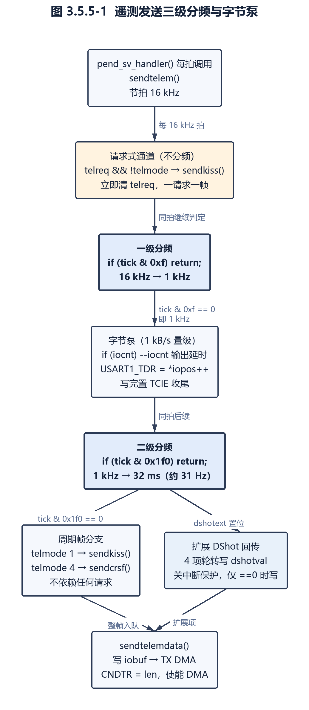

图 3.5.5-1 遥测发送三级分频与字节泵

### 3.5.6 请求式与应答式触发源（用户需求）

- 需求标识：ESC-FREQ4-6
- 功能描述：KISS 为请求式，一次请求发一帧；iBUS、S.Port 与 MSB 为请求-应答式；KISS auto 与 CRSF 为 32ms 周期式。
- 调用条件：伺服或 Oneshot125 输入、DShot 输入收到遥测请求；或模式为 1/4 且到达周期拍。
- 输入：伺服脉宽 `TIM_CCR2`、DShot 帧的 telemetry request 位。
- 输出：`telreq` 标志，或直接调用 `sendkiss()` / `sendcrsf()`。
- 处理：
- （1）伺服脉宽落在 28..32µs 区间即判为遥测请求：喂 IWDG、置 `telreq = 1` 并直接返回，不更新油门（`src/io.c:290-296`）；
- （2）DShot 帧取出 `tlm = x & 0x10`，当解释值满足 `x == 0`（零油门）或 `x > 47`（命令）且 `tlm` 置位时置 `telreq = 1`（`src/io.c:424-432`）；
- （3）KISS 在 `sendtelem()` 首行响应 `telreq` 并立即清标志，保证一次请求只发一帧（`src/telem.c:359-362`）；
- （4）周期式两档在 32ms 分频分支内无条件发帧，不依赖任何请求（`src/telem.c:372-380`）。

> 证据：`src/io.c:290-296`、`src/io.c:424-432`、`src/telem.c:359-362`、`src/telem.c:372-380`。

同一拍内请求式与周期式共用发送通道：请求式先于分频判定执行，周期式在其后的 32ms 分支执行（`src/telem.c:359-380`）。

### 3.5.7 KISS 遥测帧（用户需求）

- 需求标识：ESC-FREQ4-7
- 功能描述：KISS 模式输出固定 10 字节的无头无尾帧：温度 1 字节、电压/电流/消耗/转速各 2 字节大端，末字节为 CRC-8。
- 调用条件：模式 0 收到遥测请求；或模式 1 每 32ms 到达周期拍。
- 输入：`temp1`、`volt`、`curr`、`csum`、`erpm`。
- 输出：10 字节帧，经 TX DMA 发出。
- 处理：
- （1）若 TX DMA 仍处于使能状态（上一帧未发完）则直接丢弃本次发送（`src/telem.c:287`）；
- （2）转速字段按 `erpm * 41 >> 12`（约 eRPM/100）编码，不使用极数（`src/telem.c:288`）；
- （3）按偏移依次写 `temp1`、`volt` 大端、`curr` 大端、`csum` 大端、转速大端，第 10 字节写 `crc8(iobuf, 9)`（`src/telem.c:289-298`、`src/util.c:318-340`）；
- （4）装载 TX DMA 计数为 10 并使能，由 DMA 完成中断收尾（`src/telem.c:299-300`、`src/telem.c:126-140`）。

> 证据：`src/telem.c:287`、`src/telem.c:288`、`src/telem.c:289-298`、`src/util.c:318-340`、`src/telem.c:299-300`、`src/telem.c:126-140`。

KISS 帧不含帧头与帧尾，长度与字段布局固定，接收端按固定偏移解析（`src/telem.c:286-301`）。

### 3.5.8 iBUS 遥测帧（用户需求、数据字典里找）

- 需求标识：ESC-FREQ4-8
- 功能描述：iBUS 模式对 4 字节请求回 6 字节应答，按 6 槽传感器表输出，槽块基址由物理 ID 决定。
- 调用条件：`telem_mode == 2`，USART1 收到 4 字节请求。
- 输入：`iobuf[0..3]`（长度、地址、值低、值高）、`telphid`、`cfg.telem_poles`。
- 输出：6 字节应答 `[0x06, a, x低, x高, u低, u高]`。
- 处理：
- （1）请求合法性要求长度必须为 4 且 `iobuf[0] == 4`，和校验满足 `a + (iobuf[2] | iobuf[3] << 8) == 0xfffb`，不满足即丢弃（`src/telem.c:156-158`）；
- （2）传感器序号按 `n = (a & 0xf) - (telphid - 1) * 6 - 1` 求出，即每个物理 ID 独占 6 个连续传感器槽，序号越界即丢弃（`src/telem.c:159-160`）；
- （3）按命令高半字节分派：`0x8` 探测回 4 字节、`0x9` 回类型码、`0xa` 回测量值（`src/telem.c:161-173`）；
- （4）应答帧的校验字段取 `u = 0xfff9 - a - b - c`，帧长固定为 6 字节（`src/telem.c:142-152`）。

> 证据：`src/telem.c:156-158`、`src/telem.c:159-160`、`src/telem.c:161-173`、`src/telem.c:142-152`。

| 槽 n | 物理量 | 类型码 | 取值表达式 | 证据 |
| --- | --- | --- | --- | --- |
| 0 | ESC 温度 | 0x201 | `(temp1 + 40) * 10` | `src/telem.c:155`、`src/telem.c:166` |
| 1 | 电机温度 | 0x201 | `(temp2 + 40) * 10` | `src/telem.c:155`、`src/telem.c:167` |
| 2 | 电压 | 0x203 | `volt`（V/100） | `src/telem.c:155`、`src/telem.c:168` |
| 3 | 电流 | 0x205 | `curr`（A/100） | `src/telem.c:155`、`src/telem.c:169`、`src/main.c:438` |
| 4 | 消耗 | 0x206 | `csum`（mAh） | `src/telem.c:155`、`src/telem.c:170` |
| 5 | 转速 | 0x202 | `min(erpm / (poles >> 1), 0xffff)` | `src/telem.c:155`、`src/telem.c:171` |

表 3.5.8-1 iBUS 传感器六槽映射表

### 3.5.9 S.Port 遥测帧（用户需求、数据字典里找）

- 需求标识：ESC-FREQ4-9
- 功能描述：S.Port 模式按“一次请求一个传感器”轮转 6 槽，应答帧带字节填充与累加校验。
- 调用条件：`telem_mode == 3`，USART1 收到 2 字节请求。
- 输入：请求的两个字节、`telphid`、`cfg.telem_poles`。
- 输出：8 字节应答 `[0x10, 类型低, 类型高, 32 位值小端(4 字节), 0xff-crc]`，经字节填充后实际长度可达 13 字节（`src/telem.c:181-185`）。
- 处理：
- （1）请求判定只检查长度为 2、首字节为 `0x7e` 且 `(iobuf[1] & 0x1f) == telphid - 1`，不包含任何校验（`src/telem.c:204`）；
- （2）轮转状态机在 `n` 到 6 时归零，依次输出 6 个类型码及其对应字段（`src/telem.c:201-215`）；
- （3）逐字节写帧，校验式取 `crc += b; crc += crc >> 8; crc &= 0xff`，帧尾发 `0xff - crc`；数据字节为 `0x7d` 或 `0x7e` 时先发 `0x7d` 再发清除 bit5 的字节（`src/telem.c:177-185`、`src/telem.c:197`）；
- （4）电流按 `curr * 205 >> 11`（约 A/10）转为 0.1 单位，电压直接按原值（V/100）输出，转速取 `erpm / (poles >> 1)`（`src/telem.c:210-213`）；
- （5）应答逻辑长度为 8 字节，经字节填充后最长 13 字节，函数返回值即为填充后的实际长度（`src/telem.c:188-198`）。

> 证据：`src/telem.c:181-185`、`src/telem.c:204`、`src/telem.c:201-215`、`src/telem.c:177-185`、`src/telem.c:197`、`src/telem.c:210-213`、`src/telem.c:188-198`。

| 轮转序 n | 类型 `t` | 值 | 证据 |
| --- | --- | --- | --- |
| 0 | 0xb70 | `temp1` | `src/telem.c:202`、`src/telem.c:208` |
| 1 | 0x400 | `temp2` | `src/telem.c:202`、`src/telem.c:209` |
| 2 | 0x210 | `volt` | `src/telem.c:202`、`src/telem.c:210` |
| 3 | 0x200 | `curr * 205 >> 11` | `src/telem.c:202`、`src/telem.c:211` |
| 4 | 0xb30 | `csum` | `src/telem.c:202`、`src/telem.c:212` |
| 5 | 0x500 | `erpm / (poles >> 1)` | `src/telem.c:202`、`src/telem.c:213` |

表 3.5.9-1 S.Port 传感器轮转与类型码表

实现说明（缺陷）：请求判定不校验任何字节，长度正确、首字节为 `0x7e` 且地址低 5 位匹配的任意字节流都会被正常应答，噪声帧不会被丢弃（`src/telem.c:204`）。

### 3.5.10 CRSF 遥测帧（用户需求、数据字典里找）

- 需求标识：ESC-FREQ4-10
- 功能描述：CRSF 模式每 32ms 发一帧，三轮一循环：温度帧、电池帧或电压/电流帧、转速帧，帧尾为 CRC-8/DVB-S2。
- 调用条件：`telem_mode == 4`，到达 32ms 周期拍。
- 输入：`temp1`、`temp2`、`volt`、`curr`、`csum`、`erpm`、`telphid`、`cfg.telem_poles`。
- 输出：载荷长度为 6、4、9 或 5 字节并另加 3 字节开销的 CRSF 帧。
- 处理：
- （1）公共帧头为 `buf[0] = 0xc8`、`buf[1] = 载荷长度 + 1`、`buf[2]` 为帧类型（`src/telem.c:306`、`src/telem.c:353`）；
- （2）0x0d 温度帧的载荷为 `temp1 * 10` 与 `temp2 * 10`（各 16 位大端，共 6 字节），目标地址 `telphid - 1`（`src/telem.c:308-318`）；
- （3）0x0e 电池帧仅在 `telphid > 1` 时发出，电压值取 `min(volt * 10, 0xffff)`，目标地址 `0x80 + telphid - 2`（`src/telem.c:320-327`）；
- （4）0x08 电压/电流帧仅在 `telphid <= 1` 时发出，电压值取 `volt * 205 >> 11`、电流值取 `curr * 205 >> 11`，随后是 24 位 `csum` 与 1 字节保留 0（`src/telem.c:329-340`）；
- （5）0x0c 转速帧的载荷为 `erpm / (poles >> 1)` 的 24 位值，目标地址 `telphid - 1`，第三步之后轮转序号归零（`src/telem.c:342-351`）；
- （6）末字节写 `crc8dvbs2(buf + 2, a)`，随后交 `sendtelemdata()` 排队并由 TX DMA 发出（`src/telem.c:354-355`、`src/telem.c:404-417`）。

> 证据：`src/telem.c:306`、`src/telem.c:353`、`src/telem.c:308-318`、`src/telem.c:320-327`、`src/telem.c:329-340`、`src/telem.c:342-351`、`src/telem.c:354-355`、`src/telem.c:404-417`。

0x0e 帧与 0x08 帧的电压标定式不同（`volt * 10` 与 `volt * 205 >> 11`），两式不可能同为 0.1V 单位，对照行见附录。

| 轮转 n | 帧类型 | 目标地址 `buf[3]` | 载荷（`a` 字节） | 证据 |
| --- | --- | --- | --- | --- |
| 0 | 0x0d 温度 | `telphid - 1` | `temp1*10`、`temp2*10`（各 16 位大端，共 6 字节） | `src/telem.c:308-318` |
| 1（`telphid > 1`） | 0x0e 电池 | `0x80 + telphid - 2` | `min(volt*10, 0xffff)`（16 位，共 4 字节） | `src/telem.c:320-327` |
| 1（`telphid <= 1`） | 0x08 电压/电流 | 无独立地址字段 | `volt*205>>11`、`curr*205>>11`、24 位 `csum`、保留 0（共 9 字节） | `src/telem.c:329-340` |
| 2 | 0x0c 转速 | `telphid - 1` | `erpm / (poles>>1)`（24 位，共 5 字节） | `src/telem.c:342-351` |

表 3.5.10-1 CRSF 帧轮转与载荷表

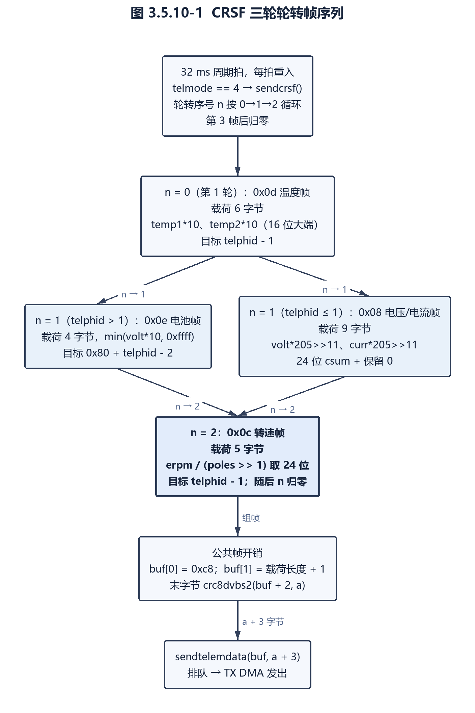

图 3.5.10-1 CRSF 三轮轮转帧序列

### 3.5.11 MSB 遥测帧（用户需求、数据字典里找）

- 需求标识：ESC-FREQ4-11
- 功能描述：MSB 模式对单字节请求回 3 字节应答，`0x5a` 为清空消耗的特殊命令。
- 调用条件：`telem_mode == 5`，USART1 收到单字节请求。
- 输入：请求字节、`telphid`、`cfg.telem_poles`。
- 输出：3 字节 `[地址, 值 bit0..6, 值 bit7..]`。
- 处理：
- （1）请求长度必须为 1，否则不应答（`src/telem.c:227`）；
- （2）`a == 0x5a` 时把 `csum` 清零并返回 0 即不应答（`src/telem.c:229-232`）；
- （3）传感器序号按 `n = a - (telphid - 1) * 6 - 4` 求出，越界即丢弃（`src/telem.c:233-234`）；
- （4）应答地址字节取 `a = a << 4 | type[n]`，类型表为 `{6, 6, 1, 2, 11, 5}`；值的打包为 `x << 1` 与 `x >> 7` 两字节，帧内不含独立校验字段（`src/telem.c:218-223`、`src/telem.c:226`、`src/telem.c:235`）。

> 证据：`src/telem.c:227`、`src/telem.c:229-232`、`src/telem.c:233-234`、`src/telem.c:218-223`、`src/telem.c:226`、`src/telem.c:235`。

| 槽 n | 物理量 | 类型码 | 取值表达式 | 证据 |
| --- | --- | --- | --- | --- |
| 0 | ESC 温度 | 6 | `temp1 * 10` | `src/telem.c:226`、`src/telem.c:237` |
| 1 | 电机温度 | 6 | `temp2 * 10` | `src/telem.c:226`、`src/telem.c:238` |
| 2 | 电压 | 1 | `volt * 205 >> 11` | `src/telem.c:226`、`src/telem.c:239` |
| 3 | 电流 | 2 | `curr * 205 >> 11` | `src/telem.c:226`、`src/telem.c:240` |
| 4 | 消耗 | 11 | `csum` | `src/telem.c:226`、`src/telem.c:241` |
| 5 | 转速 | 5 | `erpm / (poles * 50)` | `src/telem.c:226`、`src/telem.c:242` |

表 3.5.11-1 MSB 传感器六槽映射表

实现说明（缺陷）：MSB 与 iBUS 的每物理 ID 槽基址相差 3，iBUS 序号式为减 1、MSB 为减 4，同一物理 ID 在两个协议下映射到的槽序号不一致（`src/telem.c:159`、`src/telem.c:233-234`）。

### 3.5.12 HoTT 遥测帧（用户需求）

- 需求标识：ESC-FREQ4-12
- 功能描述：HoTT 模式对固定 2 字节请求回 45 字节帧，帧内除当前值还携带电压、电流、转速与温度的运行极值。
- 调用条件：`telem_mode == 6`，USART1 收到 `0x80 0x8c`。
- 输入：请求两字节与全部运行量。
- 输出：45 字节帧，帧头为 `7c 8c 00 c0 00 00`，尾字节为前 44 字节的算术和。
- 处理：
- （1）请求必须恰为 `0x80 0x8c`，否则不应答；随后写 6 字节固定帧头（`src/telem.c:248`、`src/telem.c:251-256`）；
- （2）按序写 `volt * 205 >> 11` 与电压运行最小值、`csum * 205 >> 11`、`temp1 + 20` 与温度运行最大值、`curr * 205 >> 11` 与电流运行最大值、`min(erpm / (poles * 5), 0xffff)` 与转速运行最大值、`temp2 + 20` 与电机温度运行最大值（`src/telem.c:257-274`）；
- （3）字节 `[24..42]` 填 0，`[43]` 固定为 `0x7d`，`[44]` 为前 44 字节的算术和（`src/telem.c:275-278`）；
- （4）置 `iocnt = 5` 作为输出延时并把发送游标指向本帧，`USART1_CR1 = UE | TE` 关闭接收并返回 -1，实际逐字节发送由发送节拍在 5 个 1kHz 拍之后执行（`src/telem.c:279-283`、`src/telem.c:364-371`）。

> 证据：`src/telem.c:248`、`src/telem.c:251-256`、`src/telem.c:257-274`、`src/telem.c:275-278`、`src/telem.c:279-283`、`src/telem.c:364-371`。

运行极值由函数内静态量 `t`、`u`、`v`、`c`、`r` 在每次应答时更新，掉电或复位后重新起算（`src/telem.c:249`、`src/telem.c:259-274`）。

### 3.5.13 扩展 DShot 遥测回传（用户需求）

- 需求标识：ESC-FREQ4-13
- 功能描述：扩展遥测开启后，轮转产生 4 个扩展项写入 `dshotval`，由双向 DShot 回传编码逻辑发出；DShot 命令 13/14 开关该功能。
- 调用条件：DShot 输入模式下已收到 DShot 命令 13 或 14。
- 输入：`temp1`、`temp2`、`volt`、`curr`、`dshotext`、`dshotval`、`ertm`。
- 输出：`dshotval` 编码值，以及命令 13/14 的回发确认值。
- 处理：
- （1）命令 13 置 `dshotext = 1`、`dshotval = 0xe00`、`rep = 10`；命令 14 置 `dshotext = 0`、`dshotval = 0xeff`、`rep = 10`（`src/io.c:467-478`）；
- （2）两者均要求命令已连续去抖 6 帧，`cnt != 6` 时忽略，即同一命令需连续 6 帧才生效（`src/io.c:434-438`、`src/io.c:463-478`）；
- （3）发送节拍上按 4 项轮转：`0x200 | (temp1 & 0xff)`、`0x800 | (temp2 & 0xff)`、`0x400 | ((volt * 41 >> 10) & 0xff)`、`0x600 | ((curr * 41 >> 12) & 0xff)`，第 4 项之后轮转序号归零（`src/telem.c:384-397`）；
- （4）扩展项仅在 `dshotval == 0` 时写入，写入过程用 `__disable_irq()` 与 `__enable_irq()` 保护（`src/telem.c:399-401`）；
- （5）回传时若没有待发数据，用 `ertm` 限幅到 65408 后做指数编码填充，再经 GCR 编码与 CRC 发出（`src/io.c:370-388`）。

> 证据：`src/io.c:467-478`、`src/io.c:434-438`、`src/io.c:463-478`、`src/telem.c:384-397`、`src/telem.c:399-401`、`src/io.c:370-388`。

命令 13/14 的确认值通过同一回传通道重复发送 `rep` 次（`src/io.c:376-387`）。

### 3.5.14 极数换算与转速量纲（用户需求、数据字典里找）

- 需求标识：ESC-FREQ4-14
- 功能描述：`telem_poles` 表示电机极数，用于把电气 RPM 换算成各协议所需的转速量纲；该值被强制为偶数并限幅到 2..100，各协议采用不同分母。
- 调用条件：`checkcfg()` 在每次配置装载或写入之后执行；各协议换算在构造应答或发送帧时执行。
- 输入：`cfg.telem_poles`。
- 输出：收敛后的参数值与各协议帧中的转速字段。
- 处理：
- （1）按 `cfg.telem_poles = clamp(cfg.telem_poles & ~1, 2, 100)` 先清最低位强制为偶数、再限幅到 2..100（`src/util.c:487`）；
- （2）iBUS、S.Port 与 CRSF 使用 `erpm / (poles >> 1)`，其中 iBUS 另有 0xffff 上限（`src/telem.c:171`、`src/telem.c:213`、`src/telem.c:343`）；
- （3）MSB 使用 `erpm / (poles * 50)`，HoTT 使用 `min(erpm / (poles * 5), 0xffff)`（`src/telem.c:242`、`src/telem.c:269`）；
- （4）KISS 不使用极数，采用固定近似系数 `erpm * 41 >> 12`（`src/telem.c:288`）；
- （5）SBUS2 与 EXBUS 的同类换算实现在输入侧完成，分别取 `erpm / (poles * 3)`（上限 0xffff）与 `erpm / (poles >> 1)`（`src/io.c:750`、`src/io.c:878`）。

> 证据：`src/util.c:487`、`src/telem.c:171`、`src/telem.c:213`、`src/telem.c:343`、`src/telem.c:242`、`src/telem.c:269`、`src/telem.c:288`、`src/io.c:750`、`src/io.c:878`。

| 协议 | 转速换算表达式 | 证据 |
| --- | --- | --- |
| KISS | `erpm * 41 >> 12`（约 eRPM/100，不用极数） | `src/telem.c:288` |
| iBUS | `min(erpm / (poles >> 1), 0xffff)` | `src/telem.c:171` |
| S.Port | `erpm / (poles >> 1)` | `src/telem.c:213` |
| CRSF | `erpm / (poles >> 1)`（24 位） | `src/telem.c:343` |
| MSB | `erpm / (poles * 50)` | `src/telem.c:242` |
| HoTT | `min(erpm / (poles * 5), 0xffff)` | `src/telem.c:269` |
| SBUS2（`src/io.c`） | `erpm / (poles * 3)`，上限 0xffff | `src/io.c:750` |
| EXBUS（`src/io.c`） | `erpm / (poles >> 1)` | `src/io.c:878` |

表 3.5.14-1 各协议转速换算表

### 3.5.15 物理 ID（phid）取值域与寻址作用（用户需求）

- 需求标识：ESC-FREQ4-15
- 功能描述：`telem_phid` 是多机总线上的物理 ID，取值域随遥测模式或输入模式变化，并决定各协议的传感器地址块基址或目标地址。
- 调用条件：`checkcfg()` 收敛该值；各协议构造应答时读取 `telphid`。
- 输入：`cfg.telem_mode`、`cfg.input_mode`、`cfg.telem_phid`。
- 输出：收敛后的参数值与各协议帧的地址字段。
- 处理：
- （1）按模式钳位：模式 2/5 为 1..2、模式 3 为 1..28、模式 4 为 1..8、`input_mode == 4`（SBUS/SBUS2）为 0..4，其余情形恒为 0（`src/util.c:481-486`）；
- （2）iBUS 与 MSB 用 `(telphid - 1) * 6` 划分每个 ID 的 6 个传感器槽（`src/telem.c:159`、`src/telem.c:233`）；
- （3）S.Port 用 `(iobuf[1] & 0x1f) == telphid - 1` 匹配请求地址的低 5 位（`src/telem.c:204`）；
- （4）CRSF 用 `telphid` 填写温度帧与转速帧的目标地址 `telphid - 1`，`telphid > 1` 时电池帧改用 `0x80 + telphid - 2`（`src/telem.c:312`、`src/telem.c:323`、`src/telem.c:345`）；
- （5）SBUS2 用 `telphid` 选择遥测槽区间，槽号按 `slot[n + (telphid - 1) * 6]` 取出（`src/io.c:754`）。

> 证据：`src/util.c:481-486`、`src/telem.c:159`、`src/telem.c:233`、`src/telem.c:204`、`src/telem.c:312`、`src/telem.c:323`、`src/telem.c:345`、`src/io.c:754`。

物理 ID 为 0 时表示不参与多机寻址，各协议按 0 号槽块或默认地址应答（`src/util.c:481-486`）。

### 3.5.16 发送缓冲、DMA 链式发送与超长丢弃（用户需求）

- 需求标识：ESC-FREQ4-16
- 功能描述：遥测收发共用 128 字节缓冲；待发包排队之后由 TX DMA 分段链式发出，超出缓冲容量的包整体丢弃。
- 调用条件：任一协议构造出完整帧并调用 `sendtelemdata()`，或 KISS 直接装载 DMA。
- 输入：待发帧指针与长度、`iopos`/`ioend` 游标。
- 输出：TX DMA 上的连续字节流。
- 处理：
- （1）缓冲为 `static char iobuf[128] __attribute__((aligned(2)))`，由 RX/TX DMA 与各协议帧构造共用（`src/telem.c:34-36`、`src/telem.c:84-88`）；
- （2）`sendtelemdata()` 在关中断状态下计算 `pos + len > iobuf + sizeof iobuf`，超出时把 `len` 置 0，实现整包丢弃（`src/telem.c:404-408`）；
- （3）`pos == iobuf`（缓冲空闲）时同步推进 `ioend`，否则只推进 `iopos` 并等待上一段发完（`src/telem.c:409-413`）；
- （4）TX DMA 完成中断中若 `iopos > ioend` 则续发下一段并更新 `ioend`，否则把两个游标一起归零（`src/telem.c:126-140`）。

> 证据：`src/telem.c:34-36`、`src/telem.c:84-88`、`src/telem.c:404-408`、`src/telem.c:409-413`、`src/telem.c:126-140`。

缓冲指针在 `sendtelemdata()` 中先于拷贝推进，因此排队期间的新帧按到达顺序拼接，尾段由 DMA 完成中断接力发出（`src/telem.c:404-417`）。

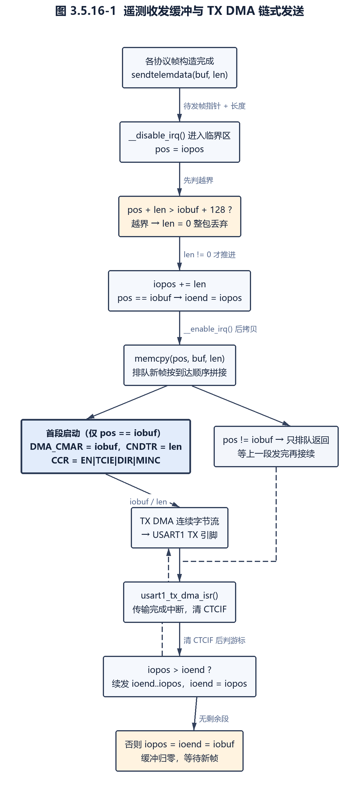

图 3.5.16-1 遥测收发缓冲与 TX DMA 链式发送

## 3.6 保护

本功能域把运行时风险量（温度、电流、电压、转速、信号、霍尔码）统一折算为对占空比、功率上限与运行状态的约束：过温产生降额量 `cutback`，堵转产生补偿量 `boost`，过流产生削减量 `choke`，三者同处 1kHz 节拍并由占空比计算点合并消费（`src/main.c:741`、`src/main.c:746`、`src/main.c:852`、`src/main.c:854`）；低压、霍尔异常、失步与超时则不修改控制量，而是置位标志或复位同步状态，由主循环的启动／刹车分支接管（`src/main.c:842`、`src/main.c:673`）。唯一不可恢复的出口是硬故障处理函数（`src/main.c:487-498`）。

### 3.6.1 过温降额（需求规格）

- 需求标识：ESC-FREQ5-1
- 功能描述：所选温度源超过 `prot_temp` 时按线性比例产生 0..60 的降额量 `cutback`，同时作用于六步占空比上限、正弦启动功率上限与主动拖刹上限。
- 调用条件：`cfg.prot_temp != 0`；每次 ADC 采样回调（1kHz 拍）执行。
- 输入：`t`（ESC 温度原值）、`u`（电机温度原值）、`cfg.prot_temp`、`cfg.prot_sens`。
- 输出：全局量 `cutback`（0..60）。
- 处理：
- （1）按 `prot_sens` 选温度源：0 用 `t`、1 用 `u`、2 取 `max(t, u)`（`src/main.c:447-457`）；
- （2）以 `x = -(cfg.prot_temp << 2)` 为基准加上所选温度原值，得到超出阈值的差值（`src/main.c:446`、`src/main.c:449`）；
- （3）`cutback = clamp(x, 0, 60)`，阈值以下为 0、最多 60；温度量纲为摄氏度的 4 倍（`src/main.c:430` 的 `>> 2`），故 `cutback` 等于超温摄氏度乘 4，上限 60 对应超温 15℃（`src/main.c:446`、`src/main.c:458`）；
- （4）降额消费点一：正弦启动功率 `p = min(cfg.sine_power << 3, 120 - cutback)`（`src/main.c:130`）；
- （5）降额消费点二：主动拖刹 `curduty = lock ? min(brake, 100 - cutback) : brake * 20`（`src/main.c:682`）；
- （6）降额消费点三：占空比上限 `maxduty = min(scale(...), 2000 - cutback * 25)`（`src/main.c:746`）；
- （7）三处同行尾注释均写作 `at 15C above prot_temp`，与官方 wiki 的降额口径逐项对应（`src/main.c:130`、`src/main.c:682`、`src/main.c:746`，官方 wiki：Settings.md）。

> 证据：`src/main.c:447-457`、`src/main.c:446`、`src/main.c:449`、`src/main.c:430`、`src/main.c:458`、`src/main.c:130`、`src/main.c:682`、`src/main.c:746`、官方 wiki：Settings.md。

三处消费点在「超温 15℃」这一同一工作点上的降额比例如下表。

| 消费点 | 表达式 | 超温 15℃时的取值 | 降额比例 | 证据 |
| --- | --- | --- | --- | --- |
| 正弦启动功率 | `min(cfg.sine_power << 3, 120 - cutback)` | 上限由 120 降至 60 | 50% | `src/main.c:130` |
| 主动拖刹 | `min(brake, 100 - cutback)` | 上限由 100 降至 40 | 60% | `src/main.c:682` |
| 六步占空比上限 | `2000 - cutback * 25` | 上限由 2000 降至 500 | 75% | `src/main.c:746` |

表 3.6.1-1 过温降额消费点比例表

### 3.6.2 堵转补偿（需求规格）

- 需求标识：ESC-FREQ5-2
- 功能描述：启用堵转保护后，用 PID 检测换相间隔是否长于阈值，按输出提升占空比，补偿量上限 160（约 +8%）。
- 调用条件：`cfg.prot_stall != 0`；每次 1kHz 节拍执行一次。
- 输入：换相间隔 `hall > 4000 ? hall : ival >> IFTIM_XRES`、`cfg.prot_stall`、PID 状态 `bpid`。
- 输出：全局量 `boost`（0..160）。
- 处理：
- （1）PID 参数固定 `{.Kp = 50, .Ki = 0, .Kd = 1000}`（`src/main.c:656`）；
- （2）在正弦切六步时以 `initpid(&bpid, 10000 << IFTIM_XRES)` 重置 PID（`src/main.c:735`）；
- （3）目标值为 `20000000 / cfg.prot_stall - 800`，量纲为输入捕获计数值（`src/main.c:852`）；
- （4）`boost = cfg.prot_stall ? clamp(boost + (calcpid(...) >> 16), 0, 160) : 0`，配置为 0 时恒 0（`src/main.c:852`）；
- （5）补偿量在占空比计算中加回：`if ((newduty += boost - choke) < 0) newduty = 0;`（`src/main.c:741`）；
- （6）该参数同时决定正弦启动最低转速上限：`(333333 << IFTIM_XRES) / cfg.prot_stall`；配置为 0 时不启用该分支、取 `145 << IFTIM_XRES`（`src/main.c:710`）。

> 证据：`src/main.c:656`、`src/main.c:735`、`src/main.c:852`、`src/main.c:741`、`src/main.c:710`。

`prot_stall` 与正弦启动转速上限的对应关系如下式，量纲为 ERPM：

```
转速上限（ERPM） = 60000000 / (333333 / prot_stall) = 180 * prot_stall / 1000
```

该分支在正弦启动阶段设定「最低转速」的上限：未配置（`prot_stall = 0`）时用固定常量 `145`，即 `ertm = 145 << IFTIM_XRES`，对应 `60000000 / 145`，即 **2298 ERPM**；配置后改用 `333333 / prot_stall`，`prot_stall = 1500` 时约 270 ERPM、`prot_stall = 3500` 时约 630 ERPM（`src/main.c:710`）。由于 `checkcfg()` 把该参数收敛到 1500..3500 或 0（`src/util.c:498`），所有可配置取值给出的上限都低于未配置时的 2298 ERPM，参数取得越大上限越高、越晚退出正弦启动，故 `prot_stall` 的作用**近似等效于覆盖最大转速**。

### 3.6.3 过流削减（需求规格）

- 需求标识：ESC-FREQ5-3
- 功能描述：启用过流保护后，用 PID 把电流压制到 `prot_curr * 100`（A/100 量纲），按输出削减占空比，削减量上限 2000。
- 调用条件：`cfg.prot_curr != 0` 且 `SENS_CNT >= 2`；每次 1kHz 节拍执行一次。
- 输入：`curr`（A/100）、`cfg.prot_curr`、PID 状态 `cpid`。
- 输出：全局量 `choke`（0..2000）。
- 处理：
- （1）PID 参数固定 `{.Kp = 80, .Ki = 0, .Kd = 600}`（`src/main.c:658`）；
- （2）`choke = cfg.prot_curr ? clamp(choke + (calcpid(&cpid, curr, cfg.prot_curr * 100) >> 10), 0, 2000) : 0`（`src/main.c:854`）；
- （3）削减量在占空比计算中扣除，因占空比已有下限 0，实际可被压到零（`src/main.c:741`）；
- （4）`SENS_CNT < 2` 时 `checkcfg()` 把 `prot_curr` 强制归 0，功能整体不可用（`src/util.c:512-516`）。

> 证据：`src/main.c:658`、`src/main.c:854`、`src/main.c:741`、`src/util.c:512-516`。

### 3.6.4 低压切断与重新解锁（需求规格）

- 需求标识：ESC-FREQ5-4
- 功能描述：单节电压低于 `prot_volt`（V/10）时按毫秒累计，持续 3 s 触发后锁存 `rearm`，只能经 `rearm` 流程解除。
- 调用条件：`cfg.prot_volt != 0`、`SENS_CNT >= 1`、非纯模拟固件；每次 1kHz 节拍执行。
- 输入：`volt`（V/100）、`cfg.prot_volt`、`cells`、静态累加量 `cutoff`。
- 输出：`cutoff` 累加值与 `rearm` 标志。
- 处理：
- （1）电芯数在启动时确定：`cfg.prot_cells` 非 0 时直接使用，否则 `cells = (volt + 439) / 440`，即按每节最高 4.4 V 假定（`src/main.c:613-615`）；
- （2）阈值比较 `volt < cfg.prot_volt * cells * 10`，成立则 `cutoff + 1`，不成立则归 0（`src/main.c:848`）；
- （3）`cutoff` 达 3000（1kHz 拍计数，约 3 s）后置 `rearm = 1`，此后不再更新 `cutoff`（`src/main.c:848-849`）；
- （4）`cutoff` 只增不减的判据使触发状态被**锁存**：`if (cutoff < 3000)` 不成立后，电压恢复也不再清零 `cutoff`，`rearm` 保持置位（`src/main.c:848-849`）；
- （5）主循环在 1kHz 节拍上 `if (rearm && !running) goto rearm;` 跳回解锁标签（`src/main.c:842`）；
- （6）解锁流程置 `throt = 1`、用 TIM6 计时 250 ms，期间任何非零油门重置定时器，结束后 `throt = 0; rearm = 0;` 并播解锁提示音（`src/main.c:631-650`）；
- （7）解锁期间的油门输入被旁路：`int input = rearm ? 0 : throt;`（`src/main.c:662`）。

> 证据：`src/main.c:613-615`、`src/main.c:848`、`src/main.c:848-849`、`src/main.c:842`、`src/main.c:631-650`、`src/main.c:662`。

> **实现说明（缺陷）**：低压触发的解除唯一途径是 `rearm` 解锁流程；`rearm` 只在解锁窗口正常结束时被清零（`src/main.c:647`），因此切断后必须让油门回到零并等待 250 ms 才能恢复输出，不存在按电压回升自动恢复的路径。

### 3.6.5 电芯数自动识别与播报（需求规格）

- 需求标识：ESC-FREQ5-5
- 功能描述：`prot_cells` 为 0 时按电压自动推算电芯数；启用低压保护时开机以蜂鸣播报电芯数。
- 调用条件：`SENS_CNT >= 1`、非纯模拟固件；启动阶段执行一次。
- 输入：`volt`（V/100）、`cfg.prot_cells`、`cfg.prot_volt`。
- 输出：局部量 `cells` 与全局量 `beepval`。
- 处理：
- （1）启动时等待传感器就绪 `while (!ready) __WFI();`，`ready` 由电流零点标定完成产生（`src/main.c:425-428`、`src/main.c:614`）；
- （2）`if (!cells) cells = (volt + 439) / 440;`，即按每节 4.4 V 上取整（`src/main.c:615`）；
- （3）仅在非看门狗复位（掉电开机）时播报：先读 `RCC_CSR` 再写 `RMVF` 清标志（`src/main.c:617-619`）；
- （4）`cfg.prot_volt` 非 0 时 `beepval = cells`，延时 4000 个 tick 后执行 `beep()` 播报（`src/main.c:623-628`）；
- （5）`beep()` 把 `beepval` 按十进制各位逐位转成数字曲调播放，播完置 −1（`src/main.c:511-519`）。

> 证据：`src/main.c:425-428`、`src/main.c:614`、`src/main.c:615`、`src/main.c:617-619`、`src/main.c:623-628`、`src/main.c:511-519`。

### 3.6.6 霍尔信号健壮性检查（需求规格）

- 需求标识：ESC-FREQ5-6
- 功能描述：读霍尔码时对「采样值连续 20 次发生变化（抖动）」判为信号不稳定（源码同行尾注释 `// Unstable signal`）；换相时霍尔码不在 1..6 范围同样判为异常。两者均进入硬故障。
- 调用条件：目标板定义 `HALL_MAP`（当前仅 ESCAPE1/ESCAPE4/ESCAPE5），且非有刷且霍尔码非 7。
- 输入：`hallcode()` 的连续采样结果。
- 输出：合法霍尔码，或调用 `hard_fault_handler()`（不返回）。
- 处理：
- （1）`getcode()` 连续采样：采样值与前次相同则 `continue` 且不推进计数，一旦累计出现过 20 次「值发生变化」即 `hard_fault_handler()`（`src/main.c:93-103`）；
- （2）内层计数 `j` 计满 4 时返回当前码，即**连续 4 次同值通过**；两个判据方向相反，不得对调（`src/main.c:95-101`）；
- （3）混合模式判定使用同一函数：`if (!brushed && getcode() != 7)` 才启用 TIM3 霍尔捕获（`src/main.c:591-605`）；
- （4）六步换相时若 `hall > 4000` 则取码，`code < 1 || code > 6` 即 `hard_fault_handler()`（`src/main.c:162-166`）。

> 证据：`src/main.c:93-103`、`src/main.c:95-101`、`src/main.c:591-605`、`src/main.c:162-166`。

### 3.6.7 硬故障统一动作（需求规格）

- 需求标识：ESC-FREQ5-7
- 功能描述：硬故障处理函数是固件唯一的不可恢复故障出口：关断三相输出、LED 常亮、等待 1 s 后触发 WWDG 复位、永不返回。
- 调用条件：霍尔信号不稳定、霍尔码非法，以及任何调用 `hard_fault_handler()` 的路径。
- 输入：无。
- 输出：TIM1 刹车事件、LED 状态、WWDG 复位。
- 处理：
- （1）`ledctl(1)` 点亮第 0 位 LED 作故障指示，`TIM1_EGR = TIM_EGR_BG` 产生刹车事件关断三相输出（`src/main.c:488-489`）；
- （2）用 TIM6 单脉冲产生 1 s 延时：`PSC = CLK_KHZ/10 - 1`（0.1 ms 分辨率）、`ARR = 9999`，等待计数结束（`src/main.c:490-495`）；
- （3）`WWDG_CR = WWDG_CR_WDGA` 触发看门狗复位，随后 `for (;;);` 永不返回（`src/main.c:496-497`）。

> 证据：`src/main.c:488-489`、`src/main.c:490-495`、`src/main.c:496-497`。

> **实现说明（缺陷）**：该路径不写任何可供外部读取的状态位或故障码，故障成因（霍尔抖动或霍尔码非法）在复位后不可区分。

### 3.6.8 失步检测与同步状态复位（需求规格）

- 需求标识：ESC-FREQ5-8
- 功能描述：每 6 次换相比较换相间隔，偏差超过 50% 判为失步，复位同步与转速估计并回落启动／刹车流程，不产生外停机动作。
- 调用条件：六步闭环运行中，每 6 次换相触发一次比较。
- 输入：上次平滑值 `val`、本次换相间隔 `ival`。
- 输出：`sync`、`fast`、`ival`、`ertm` 四个状态量。
- 处理：
- （1）每次换相若 `ival > 1000 << IFTIM_XRES` 则把 `val` 归到该上限、`cnt` 清零（`src/main.c:266-268`）；
- （2）否则 `cnt` 累加到 6 时比较：`abs(val - ival) > ival >> 1` 判为失步（`src/main.c:269-270`）；
- （3）失步动作 `sync = 0; fast = 0; ival = 5000 << IFTIM_XRES; ertm = 100000000;`（`src/main.c:271-275`）；
- （4）无论是否失步都更新 `val = ival` 并清 `cnt`（`src/main.c:276-277`）；
- （5）该保护不计重试次数、不主动停机，后续行为由主循环按油门与 `sync` 重建情况决定（`src/main.c:266-278`）。

> 证据：`src/main.c:266-268`、`src/main.c:269-270`、`src/main.c:271-275`、`src/main.c:276-277`、`src/main.c:266-278`。

### 3.6.9 BEMF 与霍尔超时保护（需求规格）

- 需求标识：ESC-FREQ5-9
- 功能描述：BEMF 过零捕获定时器溢出或霍尔捕获定时器溢出时，清同步与加速标志并把转速状态量置为「无转速」，使电机退回启动／刹车判定。
- 调用条件：六步闭环运行中定时器更新中断发生。
- 输入：定时器更新标志 `UIF`。
- 输出：`sync`、`fast`、`ival`、`ertm`，霍尔路径另置 `hall = 0x10000`。
- 处理：
- （1）BEMF 路径：关该定时器中断、`sync = 0`、`fast = 0`、`ival = 10000 << IFTIM_XRES`、`ertm = 100000000`（`src/main.c:380-388`）；
- （2）霍尔路径：置 `hall = 0x10000` 表示霍尔超时（`src/main.c:403-405`）；
- （3）霍尔路径在正弦或停机状态下直接返回，其余情形做同样的状态复位（`src/main.c:406-411`）；
- （4）两条路径均不停机，由主循环中性分支的阻力刹车条件 `sync < 6 || erpm < 800 || lock == 2` 接管（`src/main.c:673`）。

> 证据：`src/main.c:380-388`、`src/main.c:403-405`、`src/main.c:406-411`、`src/main.c:673`。

### 3.6.10 非法输入信号处置（需求规格）

- 需求标识：ESC-FREQ5-10
- 功能描述：伺服／Oneshot125 输入模式下脉宽超出 800..2200 us 判为非法：电机运行时忽略该帧，电机停止时立即触发 WWDG 复位。
- 调用条件：伺服输入模式下每次捕获完成中断。
- 输入：`TIM_CCR2` 测得的脉宽 `x`。
- 输出：油门更新（合法时）或 WWDG 复位（非法且停机时）。
- 处理：
- （1）28..32 us 先按遥测请求处理并返回，同时喂狗（`src/io.c:292-296`）；
- （2）`x < 800 || x > 2200` 时若 `ertm` 非 0（电机在转）直接返回，既不更新油门也不喂 IWDG（`src/io.c:297-300`）；
- （3）否则置 `WWDG_CR = WWDG_CR_WDGA` 立即复位（`src/io.c:299`）；
- （4）合法脉宽统一喂 IWDG 后调用 `setthrot(x)` 更新油门（`src/io.c:301-302`）。

> 证据：`src/io.c:292-296`、`src/io.c:297-300`、`src/io.c:299`、`src/io.c:301-302`。

### 3.6.11 看门狗策略与喂狗点（需求规格）

- 需求标识：ESC-FREQ5-11
- 功能描述：IWDG 由输入信号首次有效捕获启动，此后只在有效输入到达时喂狗；WWDG 不作常规喂狗对象，仅在异常路径被主动触发复位。
- 调用条件：`init()` 阶段各家族只使能 WWDG 时钟；首帧有效捕获启动 IWDG。
- 输入：有效输入帧（伺服脉宽、DShot 帧、各串行协议帧、CLI 数据）。
- 输出：`IWDG_KR_RESET`（喂狗）或 `WWDG_CR_WDGA`（复位）。
- 处理：
- （1）7 个家族的 `config.c` 只置 WWDG 时钟使能位，不在 `init()` 内启动看门狗（`mcu/STM32G071/config.c:72`，其余家族同构）；
- （2）首帧有效输入捕获启动 IWDG：`IWDG_KR = IWDG_KR_START`（`src/io.c:169`）；
- （3）喂狗点共 10 处，全部位于「成功解码一帧」之后：`src/io.c:267`、`src/io.c:293`、`src/io.c:301`、`src/io.c:424`、`src/io.c:625`、`src/io.c:701`、`src/io.c:767`、`src/io.c:799`、`src/io.c:893`、`src/io.c:914`；
- （4）喂狗语义为「校验通过才喂」，解码失败的帧不产生喂狗动作（`src/io.c:267`、`src/io.c:424`、`src/io.c:625`）；
- （5）异常复位触发点 5 处：非法且停机的伺服信号 `src/io.c:299`、CLI 帧错／噪声错／缓冲将满 `src/io.c:953`、`src/io.c:1002`、`src/io.c:1011`、硬故障 `src/main.c:496`。

> 证据：`mcu/STM32G071/config.c:72`、`src/io.c:169`、`src/io.c:267`、`src/io.c:293`、`src/io.c:301`、`src/io.c:424`、`src/io.c:625`、`src/io.c:701`、`src/io.c:767`、`src/io.c:799`、`src/io.c:893`、`src/io.c:914`、`src/io.c:299`、`src/io.c:953`、`src/io.c:1002`、`src/io.c:1011`、`src/main.c:496`。

### 3.6.12 解锁窗口与看门狗复位后的强制解锁（需求规格）

- 需求标识：ESC-FREQ5-12
- 功能描述：需要解锁时（配置要求，或上次为 WWDG 复位）必须完成 250 ms 持续零油门窗口；窗口内任何非零油门都重新计时。
- 调用条件：`cfg.arm` 为真，或 `RCC_CSR` 显示上次为 WWDG 复位；以及低压切断置 `rearm` 后。
- 输入：`cfg.arm`、`RCC_CSR` 复位标志、`throt`。
- 输出：`rearm` 标志、`throt` 强制归零、解锁提示音。
- 处理：
- （1）`if (cfg.arm || (csr & RCC_CSR_WWDGRSTF))` 进入解锁分支；进入前先读 `RCC_CSR` 再写 `RMVF` 清标志（`src/main.c:617-618`、`src/main.c:631`）；
- （2）TIM6 配置 `PSC = CLK_KHZ/10 - 1`、`ARR = 2499`，即 250 ms（`src/main.c:633-637`）；
- （3）循环内 `throt = 1` 作哨兵并等待 `UIF`，若 `throt` 被非零输入改写则 `TIM6_EGR = TIM_EGR_UG` 重新计时（`src/main.c:639-645`）；
- （4）窗口结束后 `throt = 0; rearm = 0;` 关闭 TIM6 并播提示音，有霍尔时用 `"G_GC"`、无霍尔时用 `"GC"`（`src/main.c:646-649`）；
- （5）运行中 `input = rearm ? 0 : throt`，保证重新解锁期间油门视为零（`src/main.c:662`）；
- （6）该分支与低压切断共用同一入口标签 `rearm:`，故两条触发路径的解除方式完全一致（`src/main.c:632`、`src/main.c:842`）。

> 证据：`src/main.c:617-618`、`src/main.c:631`、`src/main.c:633-637`、`src/main.c:639-645`、`src/main.c:646-649`、`src/main.c:662`、`src/main.c:632`、`src/main.c:842`。

### 3.6.13 保护阈值的参数域收敛（需求规格）

- 需求标识：ESC-FREQ5-13
- 功能描述：全部 `prot_*` 阈值与其可用性由 `checkcfg()` 按采样路数、驱动形态与硬件宏强制收敛，不满足条件的保护项归零而不是报错。
- 调用条件：每次配置装载或写入后（启动阶段见 `src/main.c:559-560`，CLI／CRSF 写入路径亦调用）。
- 输入：各 `prot_*` 字段、`SENS_CNT`、`cfg.brushed`、`ANALOG`、`PARK_PIN`。
- 输出：收敛后的 `cfg` 字段。
- 处理：
- （1）堵转：`cfg.prot_stall && !cfg.brushed ? clamp(..., 1500, 3500) : 0`，有刷机型强制关闭（`src/util.c:498`）；
- （2）过温：`cfg.prot_temp ? clamp(..., 60, 140) : 0`，允许 0 关闭（`src/util.c:499`）；
- （3）温度源档：`SENS_CNT >= 3 ? clamp(cfg.prot_sens, 0, 2) : 0`（`src/util.c:500-504`）；
- （4）低压：`SENS_CNT >= 1 && !ANALOG ? (cfg.prot_volt ? clamp(..., 28, 38) : 0) : 0`，同时 `prot_cells` 钳 0..24（`src/util.c:505-511`）；
- （5）过流：`SENS_CNT >= 2 ? clamp(cfg.prot_curr, 0, 999) : 0`（`src/util.c:512-516`）；
- （6）停车：`PARK_PIN ? clamp(cfg.prot_park, 0, 4) : 0`（`src/util.c:517-521`）。

> 证据：`src/main.c:559-560`、`src/util.c:498`、`src/util.c:499`、`src/util.c:500-504`、`src/util.c:505-511`、`src/util.c:512-516`、`src/util.c:517-521`。

| 参数 | 缺省（`defs.h`） | 生效范围（`checkcfg`） | 生效前置条件 | 证据 |
| --- | --- | --- | --- | --- |
| `prot_stall` | 0 | 0（关闭）或 1500..3500 | 非有刷 | `src/defs.h:214-216`、`src/util.c:498` |
| `prot_temp` | 0 | 0（关闭）或 60..140 | — | `src/defs.h:217-219`、`src/util.c:499` |
| `prot_sens` | 0 | 0..2 | `SENS_CNT >= 3` | `src/defs.h:220-222`、`src/util.c:500-504` |
| `prot_volt` | 0 | 0（关闭）或 28..38 | `SENS_CNT >= 1` 且非 `ANALOG` | `src/defs.h:223-225`、`src/util.c:505-511` |
| `prot_cells` | 0 | 0..24 | 同上 | `src/defs.h:226-228`、`src/util.c:507` |
| `prot_curr` | 0 | 0..999 | `SENS_CNT >= 2` | `src/defs.h:229-231`、`src/util.c:512-516` |
| `prot_park` | 0 | 0..4 | `PARK_PIN` 已定义 | `src/defs.h:232-234`、`src/util.c:517-521` |

表 3.6.13-1 保护参数域收敛表

其中 `prot_stall` 与 `prot_temp` 的收敛式含布尔前置项，参数取 0 表示关闭、非 0 才钳到下限；`prot_temp` 的取值 1..59 会被静默改写为 60，`prot_volt` 的取值 1..27 会被静默改写为 28（`src/util.c:499`、`src/util.c:506`）。

> **不可达与预留**：`PARK_PIN` 在锚定提交中无任何 target 定义，`cfg.prot_park` 实际恒为 0，停车保护**源码存在但不可达**；该分支被编译期宏整体排除，成因是硬件拓扑未提供驻车引脚（`src/util.c:517-521`）。

### 3.6.14 温度传感器换算（NTC 函数族）（需求规格）

- 需求标识：ESC-FREQ5-14
- 功能描述：温度通道的原始 ADC 值由编译期选定的 NTC 分段一次拟合函数换算为摄氏度，供 ESC 温度、电机温度与过温保护共用。
- 调用条件：`TEMP_SENS` 在编译期被定义为四个 NTC 函数之一；电机温度路径仅在霍尔存在或 `prot_sens` 非 0 时参与换算。
- 输入：温度通道原始值 `t`（ESC）、`u`（电机，经 `TEMP_SENS(u)`）。
- 输出：摄氏温度量 `temp1`、`temp2`。
- 处理：
- （1）默认函数为 `NTC10K3455UP2K`，可被 target 宏覆盖（`src/defs.h:84-86`）；
- （2）函数族共 4 个 inline 分段线性拟合，均在 `>> 8` 前按两段一次式取值（`src/common.h:162-176`）；
- （3）ESC 温度 `temp1 = max((t = smooth(&st, t, 10)) >> 2, 0)`，即先 10 阶平滑再右移 2 位得到摄氏度（`src/main.c:430`）；
- （4）电机温度 `temp2 = hall || cfg.prot_sens ? max((u = smooth(&su, TEMP_SENS(u), 10)) >> 2, 0) : 0`，条件不满足时恒 0（`src/main.c:431`）；
- （5）换算结果同时是过温保护的判据输入：`temp1`／`temp2` 与 `prot_temp << 2` 比较产生 `cutback`（`src/main.c:445-459`）。

> 证据：`src/defs.h:84-86`、`src/common.h:162-176`、`src/main.c:430`、`src/main.c:431`、`src/main.c:445-459`。

| 函数 | 分段式（`x` 为原始值，结果再 `>> 8`） | 证据 |
| --- | --- | --- |
| `NTC10K3455LO2K` | `x < 2338 ? (x-1650)*46 + 74841 : (x-2640)*83 + 132044` | `src/common.h:162-164` |
| `NTC10K3455UP2K`（默认） | `x > 961 ? (x-1650)*-46 + 74841 : (x-660)*-83 + 132044` | `src/common.h:166-168` |
| `NTC10K3455LO10K` | `x < 2762 ? (x-1650)*36 + 25600 : (x-3036)*151 + 107130` | `src/common.h:170-172` |
| `NTC10K3455UP10K` | `x > 537 ? (x-1650)*-36 + 25600 : (x-264)*-151 + 107130` | `src/common.h:174-176` |

表 3.6.14-1 NTC 函数族分段式表

上表为外接 NTC 探头的换算路径。MCU 内置温度通道使用另一套按家族分列的换算式：STM32 系（G431/G071/L431）与 F051 以 3000 mV／3300 mV 的基准电压按两点标定常数换算（`mcu/STM32G431/config.c:37`、`mcu/STM32F051/config.c:41`），GD32F350、GD32E230 与 AT32F421 为各家族自写的线性式（`mcu/GD32F350/config.c:38`、`mcu/GD32E230/config.c:36`、`mcu/AT32F421/config.c:42`）；各家族基准电压与斜率互不相同，各家族之间不存在等价关系，精度须按具体家族核定。

| 家族 | 内置温度换算式 | 基准 | 证据 |
| --- | --- | --- | --- |
| STM32G431 | `((x)/3000 - CAL1_30C) * 400 / (CAL2_130C - CAL1_30C) + 120` | 3000 mV | `mcu/STM32G431/config.c:37`、`mcu/STM32G431/config.c:373` |
| STM32G071 | 同上式 | 3000 mV | `mcu/STM32G071/config.c:51`、`mcu/STM32G071/config.c:386` |
| STM32L431 | `((x)/3000 - CAL1_30C) * 400 / (CAL2_110C - CAL1_30C) + 120` | 3000 mV | `mcu/STM32L431/config.c:37`、`mcu/STM32L431/config.c:236` |
| STM32F051 | `((x)/3300 - CAL1_30C) * 320 / (CAL2_110C - CAL1_30C) + 120` | 3300 mV | `mcu/STM32F051/config.c:41`、`mcu/STM32F051/config.c:212` |
| GD32F350 | `((1440 - x) * 2000 >> 11) + 100` | 自写线性式 | `mcu/GD32F350/config.c:38` |
| GD32E230 | `((1450 - x) * 3800 >> 12) + 100` | 自写线性式 | `mcu/GD32E230/config.c:36` |
| AT32F421 | `(((x) - 1280) * 3800 >> 12) + 100` | 自写线性式 | `mcu/AT32F421/config.c:42` |

表 3.6.14-2 各家族内置温度通道换算式表

表中 GD32F350 与 GD32E230 的斜率为负、AT32F421 的斜率为正，三者的偏置与量程也不相同；上表只陈述各家族实测式，不对家族间的数值一致性作主张。

## 3.7 配置与存储

本功能域以单一 `Cfg` 结构体承载全部运行参数，编译期由 `defs.h` 的缺省宏块生成只读镜像 `cfgdata`，镜像经链接器放入 `.cfg` 段并随固件烧写；上电时镜像被整体拷入 SRAM 形成可写副本，此后所有读写均作用于该副本。副本的合法域由 `checkcfg()` 唯一决定，写入路径只有经过它才能得到生效值；持久化则由 `savecfg()` 以「擦页—写回—回读比对」流程把副本写回 `.cfg`（`src/util.c:415-530`、`src/util.c:532-571`、`src/main.c:23-78`）。

### 3.7.1 配置段构成、默认值来源与上电装载（需求规格）

- 需求标识：ESC-FREQ6-1
- 功能描述：全部运行参数以单一 `Cfg` 结构体承载；默认值来自编译期宏，镜像放入链接器段 `.cfg`，上电整体装载为 SRAM 运行副本。
- 调用条件：编译期生成默认值镜像；每次上电复位后，在 `main()` 最开始（早于 `checkcfg()` 与外设初始化）执行装载。
- 输入：`defs.h` 的 `#ifndef` 保护宏块（可被目标板文件覆盖）；Flash 中 `.cfg` 的加载镜像（符号 `_cfg`）。
- 输出：只读常量 `cfgdata`；SRAM 中可写副本（边界符号 `_cfg_start`、`_cfg_end`）。
- 处理：
- （1）以 `__attribute__((__section__(".cfg"))) Cfg cfg = cfgdata;` 把默认配置实例放入 `.cfg` 段（`src/main.c:77-78`）；
- （2）链接脚本把 `.cfg` 段声明为 `>ram AT >cfg`，即运行地址在 RAM、加载镜像在配置区，并导出 `_cfg_start`、`_cfg_end`、`_cfg` 三个符号（`mcu/common.ld（第 2-11 行）`）；
- （3）配置区在 Flash 中占据 boot 区之后的独立区块（`mcu/STM32G071/config.ld（第 2-3 行）`）；
- （4）`cfgdata` 逐字段引用默认值宏，并写入只读标识 `id = 0x32ea`、`revision = 17`、`revpatch = 3`、`name = TARGET_NAME`（`src/main.c:20-27`）；
- （5）结构体前部为 5 个只读字段（`id`、`revision`、`revpatch`、`name`、`_null`），其后为可写参数字段，其中 `music` 为 256 字节字符数组（`src/common.h:56-109`）；
- （6）上电执行 `memcpy(_cfg_start, _cfg, _cfg_end - _cfg_start)` 完成装载，此后所有读写均作用于 SRAM 副本（`src/main.c:559`）。

> 证据：`src/main.c:77-78`、`mcu/common.ld（第 2-11 行）`、`mcu/STM32G071/config.ld（第 2-3 行）`、`src/main.c:20-27`、`src/common.h:56-109`、`src/main.c:559`。

### 3.7.2 参数收敛的唯一合法域与必调性（需求规格）

- 需求标识：ESC-FREQ6-2
- 功能描述：`checkcfg()` 是运行参数唯一合法域来源；上电装载后必须无条件执行一次，此后每次参数写入亦必须执行，收敛结果即最终生效值。
- 调用条件：`main()` 中装载之后、运行期副本读取之前；CLI `set`、CRSF Write 的每次写入之后。
- 输入：SRAM 中的 `cfg`（来源任意，可能含越界值）。
- 输出：就地钳位／归一化后的 `cfg`；CLI 与 CRSF 应答中回读的是收敛后的值。
- 处理：
- （1）逐字段 `clamp()` 与布尔归一化，越界值改为边界值，全程无报错、无拒绝（`src/util.c:415-530`）；
- （2）执行参数间联动约束：`freq_max >= freq_min`、`duty_max >= duty_min`、`throt_brk >= duty_drag`、`throt_max >= throt_min + 200`、`throt_mid >= throt_min + 100`（`src/util.c:436`、`src/util.c:438`、`src/util.c:446`、`src/util.c:451-452`）；
- （3）按编译期条件把不具备硬件能力或该机型不支持的参数强制归零（见 ESC-FREQ6-4），并同步被 `main()` 复制到运行期副本的 `brushed`／`telmode`／`telphid`／`lock`／`brake`（`src/util.c:488-521`、`src/main.c:560-566`）；
- （4）CLI 写入路径在赋值后立即调用 `checkcfg()` 再回读字段（`src/prog.c:230-236`）；
- （5）CRSF 写入路径同样在赋值后立即调用 `checkcfg()` 再回填收敛值（`src/prog.c:331-334`）。

> 证据：`src/util.c:415-530`、`src/util.c:436`、`src/util.c:438`、`src/util.c:446`、`src/util.c:451-452`、`src/util.c:488-521`、`src/main.c:560-566`、`src/prog.c:230-236`、`src/prog.c:331-334`。

### 3.7.3 实际生效域窄于元表描述（需求规格）

- 需求标识：ESC-FREQ6-3
- 功能描述：`prog.c` 的 `CFG_MAP` 元表所列范围宽于实际收敛域；落入窄区间的值被静默改写（无错误码、无提示），对外应以收敛后范围为准。
- 调用条件：任何写入路径（CLI `set`、CRSF Write、保存后重新上电）均经过 `checkcfg()`。
- 输入：元表范围内但收敛域外的取值。
- 输出：收敛域内的替代值，回读可见。
- 处理：
- （1）`sine_range` 元表声明 0..25，实际为 0 或 5..25，`1..4` 被改写为 5，有刷机型强制 0（`src/prog.c:26`、`src/util.c:433`）；
- （2）`prot_temp` 元表声明 0..140，实际为 0 或 60..140，`1..59` 被改写为 60（`src/prog.c:57`、`src/util.c:499`）；
- （3）`prot_stall` 元表声明 0..3500，实际为 0 或 1500..3500，`1..1499` 被改写为 1500，且仅无刷可用（`src/prog.c:56`、`src/util.c:498`）；
- （4）`prot_volt` 元表声明 0..38，实际为 0 或 28..38，`1..27` 被改写为 28（`src/prog.c:59`、`src/util.c:506`）；
- （5）`telem_poles` 先强制偶数（`& ~1`）再钳位 2..100，奇数极数被静默改为小一位偶数（`src/prog.c:53`、`src/util.c:487`）；
- （6）`throt_rev` 元表声明 0..3、`throt_mid` 与 `throt_max` 元表给出的固定上下界，实际下界随 `throt_min`、上界随 `throt_max` 浮动（`src/prog.c:38`、`src/prog.c:44-45`、`src/util.c:451-452`）。

> 证据：`src/prog.c:26`、`src/util.c:433`、`src/prog.c:57`、`src/util.c:499`、`src/prog.c:56`、`src/util.c:498`、`src/prog.c:59`、`src/util.c:506`、`src/prog.c:53`、`src/util.c:487`、`src/prog.c:38`、`src/prog.c:44-45`、`src/util.c:451-452`。

| 参数 | 元表声明范围 | 实际收敛域 | 窄区间改写结果 | 证据 |
| --- | --- | --- | --- | --- |
| `sine_range` | 0..25 | 0 或 5..25（有刷恒 0） | `1..4` → 5 | `src/prog.c:26`、`src/util.c:433` |
| `prot_temp` | 0..140 | 0 或 60..140 | `1..59` → 60 | `src/prog.c:57`、`src/util.c:499` |
| `prot_stall` | 0..3500 | 0 或 1500..3500（仅无刷） | `1..1499` → 1500 | `src/prog.c:56`、`src/util.c:498` |
| `prot_volt` | 0..38 | 0 或 28..38 | `1..27` → 28 | `src/prog.c:59`、`src/util.c:506` |
| `telem_poles` | 2..100 | 偶数 2..100 | 奇数 → 小一位偶数 | `src/prog.c:53`、`src/util.c:487` |

表 3.7.3-1 元表范围与实际收敛域对照表

上述改写均在 `checkcfg()` 内就地完成，CLI 与 CRSF 的回读值即为改写后的值，**因此对外可观测的合法域一律以收敛后范围为准**（`src/prog.c:233-234`、`src/prog.c:331-334`）。

### 3.7.4 参数域随编译配置与硬件能力变化（需求规格）

- 需求标识：ESC-FREQ6-4
- 功能描述：同一参数在不同编译配置下的合法域不同；无相应硬件能力的目标上，参数被强制归零而非报错，判定机型行为必须结合目标板宏。
- 调用条件：`checkcfg()` 每次执行时按已定义的条件编译宏分支。
- 输入：`SENS_CNT`（由 `SENS_MAP` 推导）、`IO_ANALOG`、`ANALOG`、`PARK_PIN`、`BEC_MAP`、`IO_PA2`／`IO_PA6`、`DISABLE_EXBUS`／`DISABLE_HOTT`／`DISABLE_MSB`。
- 输出：按机型分化的生效域。
- 处理：
- （1）采样路数：`SENS_CNT = 0` 时 `telem_volt`、`telem_curr`、`prot_volt`、`prot_cells`、`prot_curr` 全归零（`src/util.c:488-496`、`src/util.c:505-516`）；
- （2）`prot_sens` 需 `SENS_CNT >= 3` 才保留 0..2，否则归零（`src/util.c:500-504`）；
- （3）纯模拟固件（`ANALOG`）另把 `arm` 强制 0、`prot_volt`／`prot_cells` 归零（`src/util.c:422-424`、`src/util.c:508-511`）；
- （4）引脚能力：无 `PARK_PIN` 时 `prot_park` 归零（`src/util.c:517-521`）；无 `BEC_MAP` 时 `bec` 归零，有则收敛到 `BEC_MIN..BEC_MAX`（`src/util.c:524-528`）；
- （5）平台与裁剪：非 `IO_PA2` 平台 `input_mode` 收窄为 0..1 或强制 0、`input_ch1`／`input_ch2` 强制 0（`src/util.c:465-473`）；
- （6）`DISABLE_EXBUS`／`DISABLE_HOTT` 把 `input_mode` 6／7 改判 0，`DISABLE_MSB`／`DISABLE_HOTT` 把 `telem_mode` 5／6 改判 0（`src/util.c:457-462`、`src/util.c:475-480`）。

> 证据：`src/util.c:488-496`、`src/util.c:505-516`、`src/util.c:500-504`、`src/util.c:422-424`、`src/util.c:508-511`、`src/util.c:517-521`、`src/util.c:524-528`、`src/util.c:465-473`、`src/util.c:457-462`、`src/util.c:475-480`。

### 3.7.5 启动安全态（需求规格）

- 需求标识：ESC-FREQ6-5
- 功能描述：收敛过程强制保证上电安全：模拟输入机型必须有解锁等待窗口且不允许双向油门；未解锁时不允许预置非零油门。
- 调用条件：`checkcfg()` 执行过程中，无条件生效。
- 输入：`IO_ANALOG`、`cfg.arm`、`cfg.duty_lock`、`cfg.throt_set`。
- 输出：安全化后的 `arm`、`throt_mode`、`throt_set`。
- 处理：
- （1）`IO_ANALOG` 为真（纯模拟机型或 `input_mode == 1`）时 `cfg.arm` 强制为 1，保证上电必须经过零油门等待（`src/util.c:418`）；
- （2）`ANALOG` 宏目标下相反地强制为 0（`src/util.c:422-424`）；
- （3）`throt_mode` 上限压为 `IO_ANALOG ? 0 : (duty_lock ? 1 : 3)`，模拟输入不得双向、主动拖刹开启时不得用比例刹车（`src/util.c:444`）；
- （4）`throt_set` 上限压为 `cfg.arm ? 0 : 100`，解锁开启时不得预置非零油门（`src/util.c:447`）；
- （5）其余布尔字段统一按 `!!` 归一化为 0 或 1（`src/util.c:430-431`、`src/util.c:448-449`）。

> 证据：`src/util.c:418`、`src/util.c:422-424`、`src/util.c:444`、`src/util.c:447`、`src/util.c:430-431`、`src/util.c:448-449`。

### 3.7.6 保存的前提、流程与回读校验（需求规格）

- 需求标识：ESC-FREQ6-6
- 功能描述：电机运行中或音频播放中禁止保存；保存采用「擦页 → 逐字写回 → 上锁 → 回读比对」流程，完整性判据是 `memcmp` 一致而非校验和。
- 调用条件：CLI `save`、CRSF Save 条目、DShot 命令 12；`resetcfg()` 使用同一前提判据。
- 输入：`ertm`（非 0 表示电机在转）、`busy`（发声互斥标志）、SRAM 副本 `_cfg_start.._cfg_end`。
- 输出：返回 1 表示成功，返回 0 表示失败（前提不满足、Flash 错误或回读不一致）。
- 处理：
- （1）入口判断 `if (ertm || busy) return 0;`，任一满足即放弃且不做任何 Flash 操作（`src/util.c:533`）；
- （2）关中断、写双密钥解锁、清 `FLASH_SR`（`src/util.c:534-537`）；
- （3）按页擦除 `_cfg` 所在页：STM32F0 走 `FLASH_AR`，其余按 `_cfg - _boot` 推算页号写 `PNB`，随后等 `BSY`（`src/util.c:538-545`）；
- （4）置 `FLASH_CR = FLASH_CR_PG`，按 16 位（STM32F0）或 32 位双字（其余）把副本逐字写回 `_cfg`，每字后等 `BSY`（`src/util.c:546-562`）；
- （5）重新上锁并开中断（`src/util.c:563-564`）；
- （6）检查 `PGERR`／`WRPRTERR`（F0）或 `PROGERR`／`WRPERR`（其余），有错返回 0（`src/util.c:565-569`）；
- （7）最后执行 `memcmp(_cfg, _cfg_start, _cfg_end - _cfg_start)`，一致才返回 1（`src/util.c:570`）。

> 证据：`src/util.c:533`、`src/util.c:534-537`、`src/util.c:538-545`、`src/util.c:546-562`、`src/util.c:563-564`、`src/util.c:565-569`、`src/util.c:570`。

### 3.7.7 恢复出厂设置（需求规格）

- 需求标识：ESC-FREQ6-7
- 功能描述：把运行配置整体恢复为编译期默认值并立即持久化；恢复后必须重新走一遍解锁流程。
- 调用条件：CLI `reset`、CRSF Reset 条目（需二次确认）、DShot 命令 47。
- 输入：常量 `cfgdata`。
- 输出：`cfg` 被覆写并收敛，`rearm` 置位，返回 `savecfg()` 的结果。
- 处理：
- （1）入口执行与保存相同的前提判断，`ertm || busy` 时返回 0（`src/util.c:574`）；
- （2）关中断后以 `memcpy(&cfg, &cfgdata, sizeof cfgdata)` 整体覆盖运行配置，再开中断（`src/util.c:575-577`）；
- （3）调用 `checkcfg()`，使默认值也经过同一收敛路径（`src/util.c:578`）；
- （4）置 `rearm = 1`，注释语义为「确保油门模式切换安全」（`src/util.c:579`）；
- （5）以 `savecfg()` 写入 Flash 并回读校验，返回其结果（`src/util.c:580`）。

> 证据：`src/util.c:574`、`src/util.c:575-577`、`src/util.c:578`、`src/util.c:579`、`src/util.c:580`。

> **实现说明（缺陷）**：`rearm` 是独立运行期全局量而非 `Cfg` 成员（`src/main.c:81`），`resetcfg()` 置位后随即被 `savecfg()` 的写回流程越过，复位后不再保留；恢复出厂带来的重新解锁只在本次运行期内有效（`src/util.c:579-580`）。

### 3.7.8 参数元数据表与协议子地址映射（需求规格）

- 需求标识：ESC-FREQ6-8
- 功能描述：对外可配置参数共 47 项，编号 0..46，与 CRSF 子地址 1..47 一一对应；CLI 参数名表与 CRSF 分派表由同一张元表宏展开生成。
- 调用条件：CLI `get`／`set`／`show` 查名，CRSF Read／Write 子地址分派。
- 输入：`CFG_MAP(XX)` 的 47 行定义。
- 输出：`PARAM_CNT = 47`；CLI 名字串数组；CRSF 子地址 `idx + 1`；CRSF 条目总数 `PARAM_CNT + 3`。
- 处理：
- （1）`CFG_MAP` 以 X 宏声明 47 行，`PARAM_CNT` 定义为 47（`src/prog.c:20-69`）；
- （2）CLI 侧展开为 `keys[]` 并由 `getidx()` 做大小写不敏感匹配（`src/prog.c:83-88`、`src/prog.c:215`）；
- （3）CRSF 侧展开为 `case idx + 1:`，1..47 为参数（`src/prog.c:394-399`、`src/prog.c:433-438`）；
- （4）48／49／50 保留给 Save／Reset／Info（`src/prog.c:400-414`）；
- （5）Ping 应答声明条目总数 `PARAM_CNT + 3`（`src/prog.c:378`）；
- （6）Root 文件夹列出条目号 `for (a = 0; a < PARAM_CNT + 3; appendbyte(&pos, ++a));`，因先自增后写入，实际为 1..50 共 50 个条目号（`src/prog.c:391`、`src/prog.c:394-397`）。

> 证据：`src/prog.c:20-69`、`src/prog.c:83-88`、`src/prog.c:215`、`src/prog.c:394-399`、`src/prog.c:433-438`、`src/prog.c:400-414`、`src/prog.c:378`、`src/prog.c:391`、`src/prog.c:394-397`。

### 3.7.9 元表列语义与写入副作用位（需求规格）

- 需求标识：ESC-FREQ6-9
- 功能描述：元表每列语义固定；`exp2` 列声明「写入后需重新解锁」的副作用，但当前写入路径显式丢弃该位，副作用不生效。
- 调用条件：任何经 CLI／CRSF 的参数写入。
- 输入：元表行的 `exp1`（扩展编码形态）、`exp2`（副作用表达式）。
- 输出：`exp1` 参与 CRSF 描述编码（翻转命令字节最高位）；`exp2` 无任何效果。
- 处理：
- （1）列序为 `idx, 类型(val|str), 字段名, 默认值宏, 枚举文本, dec, min, max, step, exp1, exp2`（`src/prog.c:20-67`）；
- （2）`dec = -1` 为枚举型，`dec > 0 || step > 0` 为带小数／步进整型，`str` 仅 `music` 一行（`src/prog.c:34`、`src/prog.c:63`）；
- （3）仅 `throt_mode`、`input_mode`、`input_ch1` 三行把副作用位写为 `rearm = 1`（`src/prog.c:37`、`src/prog.c:48-49`）；
- （4）CRSF Write 展开处显式 `(void)(exp2);` 丢弃该位（`src/prog.c:436`）；
- （5）CLI 展开处完全不引用它（`src/prog.c:230-236`）。

> 证据：`src/prog.c:20-67`、`src/prog.c:34`、`src/prog.c:63`、`src/prog.c:37`、`src/prog.c:48-49`、`src/prog.c:436`、`src/prog.c:230-236`。

因此经 CLI／CRSF 修改 `throt_mode`／`input_mode`／`input_ch1` **当前不触发重新解锁**：写入后只经过 `checkcfg()` 与回读，不动 `rearm`，与元表列自述的副作用不符，属**疑似遗漏**（`src/prog.c:230-236`、`src/prog.c:436`）。

### 3.7.10 固件版本标识的持久化（需求规格）

- 需求标识：ESC-FREQ6-10
- 功能描述：主版本 17、补丁号 3 作为只读字段随配置结构体持久化并可对外查询；实现中不存在任何基于版本号的配置迁移逻辑。
- 调用条件：编译期写入 `cfgdata`；运行期由 CLI `info` 与 CRSF Info 条目读出。
- 输入：`REVISION`、`REVPATCH` 编译期常量。
- 输出：文本 `ESCape32 rev17.3 [<TARGET_NAME>]`。
- 处理：
- （1）`REVISION` 定义为 17、`REVPATCH` 定义为 3（`src/main.c:20-21`）；
- （2）`cfgdata.revision = REVISION`、`cfgdata.revpatch = REVPATCH`，与其余字段一并进入 `.cfg` 段（`src/main.c:25-26`、`src/main.c:77-78`）；
- （3）CLI `info` 输出 `rev<revision>.<revpatch> [<name>]` 并把 `revision` 送 `setbeepval()` 参与蜂鸣（`src/prog.c:184-190`）；
- （4）CRSF Info 条目输出 `<name>rev<revision>.<revpatch>`（`src/prog.c:406-414`）；
- （5）全仓不存在 `cfg.revision < REVISION` 之类的比较分支，也无参数重排／单位换算迁移代码，版本号仅作标识（`src/main.c:25-26`、`src/prog.c:406-414`）。

> 证据：`src/main.c:20-21`、`src/main.c:25-26`、`src/main.c:77-78`、`src/prog.c:184-190`、`src/prog.c:406-414`。

## 3.8 配置接口与编程器

本功能域提供两条互为补充的配置通路：一条是本机命令行终端（CLI），由信号线复用而来，提供命令名与参数名两级文本接口（`src/io.c:113-157`、`src/prog.c:155-181`）；另一条是 CRSF 设备命令，以「地址 + 命令字 + 子地址」结构对外提供参数描述、读写、持久化与版本回显（`src/prog.c:363-449`）。两条通路共用同一张 `CFG_MAP` 元表与同一个 `checkcfg()` 收敛入口，故写入语义一致：先写字段、再收敛、再回读生效值。

### 3.8.1 CLI 物理层双实现与进入条件（需求规格、任务书）

- 需求标识：ESC-FREQ7-1
- 功能描述：命令行终端在两类平台上以互斥的两套实现提供（USART2 硬件串口／TIM3 软件 UART），复用输入信号线；输入线约 1 s 无有效信号即自动进入 CLI。
- 调用条件：输入捕获超时（`UIF`，周期约 66 ms）持续 16 次后自动切换，无需外部命令。
- 输入：信号线电平串（或 USART2 字节流）、输入定时器更新事件计数。
- 输出：`ioirq` 指针改为 `cliirq`，同一引脚改配为终端物理层；以半双工回送应答。
- 处理：
- （1）超时中断内先判电平，低电平直接返回且清零计数（`src/io.c:115-121`）；
- （2）`++c >= 16`（累计 16 个约 66 ms 的周期，约 1 s）时把输入状态机入口换成 `cliirq`（`src/io.c:122-123`）；
- （3）`IO_PA2` 平台把引脚复用给 USART2，`BRR = CLK_CNT(38400)`、使能 `RXNEIE`，并置半双工位（`src/io.c:124-143`）；
- （4）其余平台交给 TIM3 软件 UART，半位时间 `CLK_CNT(76800)`、位时间 `ARR = CLK_CNT(38400)-1`（`src/io.c:145-155`）；
- （5）两版共用同一个 1024 字节 `iobuf` 作行缓冲与发送缓冲，状态量各自 static，条件编译保证同时只保留一份（`src/io.c:45`、`src/io.c:938-939`、`src/io.c:968-970`）；
- （6）切换后 CLI 与输入协议共用同一条信号线，互不并行（`src/io.c:123`、`src/io.c:157`）。

> 证据：`src/io.c:115-121`、`src/io.c:122-123`、`src/io.c:124-143`、`src/io.c:145-155`、`src/io.c:45`、`src/io.c:938-939`、`src/io.c:968-970`、`src/io.c:123`、`src/io.c:157`。

> **自述差异**：上游自述为「启动时信号线保持高电平 2 秒」进入 CLI（官方 wiki：CLI.md），实测进入条件是输入捕获超时中断连续累加至 `c >= 16`，即累计 16 个约 66 ms 周期、约 1 s（`src/io.c:115`、`src/io.c:122`）。

### 3.8.2 CLI 行解析与异常处置（需求规格）

- 需求标识：ESC-FREQ7-2
- 功能描述：CLI 以换行为行结束符、支持退格编辑、行满即拒绝；解析结果作为待发送长度交给发送侧，异常直接触发看门狗复位。
- 调用条件：每收到一个字节。
- 输入：单个字符（含 `\n`、`\b`、`0x7f`）。
- 输出：行缓冲 `iobuf`；`execcmd()` 返回长度即要回发的字节数，返回 0 则不回发。
- 处理：
- （1）收到 `\b` 或 `0x7f` 时删除末字符并返回（`src/io.c:955-958`、`src/io.c:1015-1018`）；
- （2）其余字节追加进 `iobuf`；仅在收到 `\n` 时补 `'\0'`、复位索引并调用 `execcmd()`（`src/io.c:961-964`、`src/io.c:1021-1024`）；
- （3）USART2 版在帧错／噪声错或缓冲将满时直接写 `WWDG_CR = WWDG_CR_WDGA` 复位（`src/io.c:953`）；
- （4）软件 UART 版在起始位电平错、停止位电平错或缓冲满时同样直接复位，不做容错续收（`src/io.c:1002`、`src/io.c:1011`）；
- （5）发送期间由 `TXEIE/TCIE` 把返回缓冲整段发出（`src/io.c:941-951`）；
- （6）软件 UART 版由 `UIE` 把返回缓冲整段移出（`src/io.c:1025-1029`）。

> 证据：`src/io.c:955-958`、`src/io.c:1015-1018`、`src/io.c:961-964`、`src/io.c:1021-1024`、`src/io.c:953`、`src/io.c:1002`、`src/io.c:1011`、`src/io.c:941-951`、`src/io.c:1025-1029`。

### 3.8.3 CLI 命令集与应答格式（需求规格、用户需求）

- 需求标识：ESC-FREQ7-3
- 功能描述：终端提供 10 条命令，逐条按参数个数严格校验；成功应答以 `OK` 结束，失败应答以 `ERROR` 结束。
- 调用条件：一行命令到达且参数个数合法。
- 输入：命令行字符串（空白／制表／回车／换行分隔，最多切出 10 个参数）。
- 输出：写入调用方缓冲的应答文本，返回写入长度。
- 处理：
- （1）以 `split()` 切参数后按命令名做大小写不敏感匹配（`src/prog.c:162-167`）；
- （2）命令表为 `help/info/show/get/set/save/reset/play/throt/beep`（`src/prog.c:156`）；
- （3）`help` 输出用法清单（`src/prog.c:168-181`）；
- （4）`info` 输出版本、板名、温度、电压、电流、电量、转速（`src/prog.c:182-205`）；
- （5）每条命令先校验参数个数，不符即 `goto error`（`src/prog.c:183`、`src/prog.c:207`、`src/prog.c:214`、`src/prog.c:228`、`src/prog.c:244`、`src/prog.c:250`、`src/prog.c:256`、`src/prog.c:261`）；
- （6）正常路径末尾统一追加 `"OK\n"`、错误路径追加 `"ERROR\n"`，两者都以写入位置减缓冲首址作为返回值（`src/prog.c:268-272`）。

> 证据：`src/prog.c:162-167`、`src/prog.c:156`、`src/prog.c:168-181`、`src/prog.c:182-205`、`src/prog.c:183`、`src/prog.c:207`、`src/prog.c:214`、`src/prog.c:228`、`src/prog.c:244`、`src/prog.c:250`、`src/prog.c:256`、`src/prog.c:261`、`src/prog.c:268-272`。

### 3.8.4 CLI 参数查询与写入（需求规格）

- 需求标识：ESC-FREQ7-4
- 功能描述：`show` 倾倒全部 47 个参数，`get <param>` 输出单个参数，`set <param> <value>` 写入后必须立即收敛并回读实际生效值；查询与写入结果均进入蜂鸣播报通道。
- 调用条件：`show` 无参数；`get`／`set` 分别要求 2／3 个参数。
- 输入：参数名（大小写不敏感）与文本值。
- 输出：`名称: 值\n` 形式文本；整型 `set` 后回读的是收敛值，并写入 `beepval`。
- 处理：
- （1）`show` 以 `CFG_MAP` 展开对 47 个字段逐一 `appendpair()`（`src/prog.c:206-212`）；
- （2）`get`／`set` 以 `getidx()` 反查下标，未命中 `goto error`（`src/prog.c:215`、`src/prog.c:229`、`src/prog.c:83-88`）；
- （3）`set` 整型经 `getval()`（`strtol`，尾随非数字即失败）解析（`src/prog.c:143-145`、`src/prog.c:90-92`）；
- （4）字符串型以 `strlcpy` 限长拷入 `cfg.music`（`src/prog.c:141`）；
- （5）写入后立即调用 `checkcfg()`，再以 `appendpair()` 回读 `cfg.key`（`src/prog.c:232-234`）；
- （6）回读值经 `setbeepval()` 播报，字符串型展开为空宏、不播报（`src/prog.c:147`、`src/prog.c:149-153`、`src/prog.c:235`）。

> 证据：`src/prog.c:206-212`、`src/prog.c:215`、`src/prog.c:229`、`src/prog.c:83-88`、`src/prog.c:143-145`、`src/prog.c:90-92`、`src/prog.c:141`、`src/prog.c:232-234`、`src/prog.c:147`、`src/prog.c:149-153`、`src/prog.c:235`。

### 3.8.5 CLI 持久化与播放命令（需求规格、任务书）

- 需求标识：ESC-FREQ7-5
- 功能描述：`save` 与 `reset` 无参数，直接调用持久化函数并以返回码驱动蜂鸣反馈；`play <music> [<volume>]` 按乐谱即时播放，音量缺省取 `cfg.volume`。
- 调用条件：`save`／`reset` 无参数；`play` 参数个数 2 或 3。
- 输入：可选乐谱字符串与音量。
- 输出：`OK`／`ERROR`；成功时蜂鸣播报返回值；`play` 经三相桥发声。
- 处理：
- （1）`save` 调用 `savecfg()`，返回值经 `setbeepval()` 进入蜂鸣通道，返回 0 时 `goto error`（`src/prog.c:243-245`）；
- （2）`reset` 调用 `resetcfg()`，判据与 `save` 相同（`src/prog.c:246-248`）；
- （3）`play` 缺省音量取 `cfg.volume`（`src/prog.c:251`）；
- （4）显式音量经 `getval()` 解析且必须落在 1..100，否则 `goto error`（`src/prog.c:252`）；
- （5）调用 `playmusic()`，返回 0（音量 0、电机在转或播放忙）即判失败（`src/prog.c:253`、`src/util.c:610-670`）；
- （6）乐谱字符串中不允许空白，否则会被 `split()` 切分为多个参数（`src/prog.c:163`、`src/prog.c:250`）。

> 证据：`src/prog.c:243-245`、`src/prog.c:246-248`、`src/prog.c:251`、`src/prog.c:252`、`src/prog.c:253`、`src/util.c:610-670`、`src/prog.c:163`、`src/prog.c:250`。

### 3.8.6 CLI 直控油门（需求规格、任务书）

- 需求标识：ESC-FREQ7-6
- 功能描述：`throt <value>` 把油门设定点直接注入运行期全局量，取值必须落在 -2000..2000，并同时停用模拟输入接管。
- 调用条件：恰一个参数。
- 输入：整数油门值。
- 输出：`OK`／`ERROR`；电机可能立即起动。
- 处理：
- （1）解析整数并要求 `-2000 <= val <= 2000`，否则 `goto error`（`src/prog.c:256`）；
- （2）写全局 `throt = val`（`src/prog.c:257`）；
- （3）置 `analog = 0`，防止模拟通道在同一循环内覆盖该值（`src/prog.c:258`、`src/main.c:460`）；
- （4）该路径不经过解锁等待，解锁开启时需先 `throt 0` 完成解锁（`src/prog.c:255-259`、`src/main.c:631-650`）。

> 证据：`src/prog.c:256`、`src/prog.c:257`、`src/prog.c:258`、`src/main.c:460`、`src/prog.c:255-259`、`src/main.c:631-650`。

### 3.8.7 CLI 听觉反馈模式（需求规格、任务书）

- 需求标识：ESC-FREQ7-7
- 功能描述：`beep` 开启听觉反馈：此后 `get`／`set`／`save`／`reset` 的结果值以蜂鸣次数播报；重复调用会重播上一次的值。
- 调用条件：无参数。
- 输入：无。
- 输出：`OK`；蜂鸣序列。
- 处理：
- （1）参数个数校验为 1（`src/prog.c:261`）；
- （2）静态标志 `beep` 初值 -1，首次调用时置 0 表示「已开启」（`src/prog.c:71`、`src/prog.c:262`）；
- （3）把 `beep` 写入 `beepval`，由主循环的 `beep()` 消费并清零（`src/prog.c:263`、`src/main.c:511-518`）；
- （4）此后 `setbeepval()` 在 `beep >= 0 && val >= 0` 时同时更新 `beep` 与 `beepval`，实现「记住并播报」（`src/prog.c:149-153`）；
- （5）重复调用时 `beep` 已非负、不再被重置，故重播上一次的值（`src/prog.c:262-263`）。

> 证据：`src/prog.c:261`、`src/prog.c:71`、`src/prog.c:262`、`src/prog.c:263`、`src/main.c:511-518`、`src/prog.c:149-153`、`src/prog.c:262-263`。

### 3.8.8 经 CLI 进入 Bootloader（需求规格）

- 需求标识：ESC-FREQ7-8
- 功能描述：CLI 行首两字节收到 `0x00 0xff` 时立即软复位进入引导区，不再按普通命令解析。
- 调用条件：CLI 收字节过程中，行缓冲长度刚满 2 且内容匹配。
- 输入：字节序列 `0x00`、`0xff`。
- 输出：`scb_reset_system()` 复位，控制权移交引导区。
- 处理：
- （1）每收一字节先做退格判断，再入缓冲（`src/io.c:955-959`、`src/io.c:1015-1019`）；
- （2）若 `i == 2` 且 `iobuf[0] == 0x00 && iobuf[1] == 0xff`，直接调用 `scb_reset_system()`（`src/io.c:960`、`src/io.c:1020`）；
- （3）该分支不等待换行、不产生应答，也不进入 `execcmd()`（`src/io.c:960-961`、`src/io.c:1020-1021`）；
- （4）两种 CLI 物理层各自独立实现同一逻辑（`src/io.c:959-961`、`src/io.c:1019-1021`）；
- （5）复位后由引导区接管，本调用侧语义止于软复位动作（`mcu/STM32G071/config.ld（第 2 行）`）。

> 证据：`src/io.c:955-959`、`src/io.c:1015-1019`、`src/io.c:960`、`src/io.c:1020`、`src/io.c:960-961`、`src/io.c:1020-1021`、`src/io.c:959-961`、`src/io.c:1019-1021`、`mcu/STM32G071/config.ld（第 2 行）`。

### 3.8.9 CRSF 参数协议寻址与命令字（需求规格、用户需求）

- 需求标识：ESC-FREQ7-9
- 功能描述：CRSF 设备命令按「地址 + 命令字」分派：地址必须为广播 0 或等于本机物理 ID 推导值，命令字分 Ping／Read／Write 三类。
- 调用条件：输入为 CRSF 且帧类型为 0x28／0x2c／0x2d 时由输入层转发本函数。
- 输入：`buf[0]` 命令字、`buf[1]` 地址、`buf[2]` 源地址、`buf[3]` 子地址、`buf[4]` 页号及后续数据。
- 输出：应答帧（`res[0]` 命令字、`res[1]` 回填源地址、`res[2]` 回填本机地址），返回帧长度；返回 0 表示丢弃不回。
- 处理：
- （1）长度小于 3 直接返回 0（`src/prog.c:364`）；
- （2）地址 `buf[1]` 必须为 0 或等于 `0x90 + telphid - 1`，且源地址 `buf[2]` 不得为 0，任一不满足即返回 0（`src/prog.c:365-367`）；
- （3）随后回填应答回程寻址字段 `res[2] = b`（`src/prog.c:368`）；
- （4）0x28 Ping 回 `0x29`，载荷 `"ESCape32 ID:<phid>"`，并声明条目总数与参数项数 `PARAM_CNT + 3`（`src/prog.c:371-381`）；
- （5）0x2c Read 回 `0x2b`，进入条目分派（`src/prog.c:382-387`）；
- （6）0x2d Write 回 `0x2d`，进入写入分派（`src/prog.c:428-431`）。

> 证据：`src/prog.c:364`、`src/prog.c:365-367`、`src/prog.c:368`、`src/prog.c:371-381`、`src/prog.c:382-387`、`src/prog.c:428-431`。

### 3.8.10 CRSF 参数描述编码与分页（需求规格、用户需求）

- 需求标识：ESC-FREQ7-10
- 功能描述：参数描述按类型、范围与小数位自动选择最紧凑的编码形态；描述载荷按 56 字节分页，支持按页读取并回报末页号。
- 调用条件：CRSF Read 的子地址落在 0（Root）或 1..47（参数项）。
- 输入：子地址、请求页号 `buf[4]`。
- 输出：带类型字节的描述块序列；`res[4]` 为「总页数 − 请求页」。
- 处理：
- （1）字符串型编码 `0x0a/0x8a`，枚举型（`dec < 0`）编码 `0x09/0x89`（`";"` 分隔枚举文本 + 当前值 + min/max/def）（`src/prog.c:63`、`src/prog.c:34`）；
- （2）带小数或步进（`dec > 0 || step > 0`）编码 `0x08/0x88`（4 字节值/min/max/def + 小数位 + 4 字节 step + 单位）（`src/prog.c:34`、`src/prog.c:44-45`）；
- （3）其余整型按范围选 1／2／4 字节：`0x01/0x81`、`0x03/0x83`、`0x05/0x85`（`src/prog.c:275-325`）；
- （4）`exp1` 为真时命令字节最高位置 1 表示「扩展」形式（`src/prog.c:25`、`src/prog.c:396`）；
- （5）载荷长度按 56 字节整除得末页号 `b`，请求页超过末页号即返回 0（`src/prog.c:418-419`）；
- （6）回填 `res[4] = b - a`，并用 `memmove` 把目标页搬到应答头部（`src/prog.c:420-426`）。

> 证据：`src/prog.c:63`、`src/prog.c:34`、`src/prog.c:44-45`、`src/prog.c:275-325`、`src/prog.c:25`、`src/prog.c:396`、`src/prog.c:418-419`、`src/prog.c:420-426`。

### 3.8.11 CRSF Root／Save／Reset／Info 条目（需求规格、用户需求）

- 需求标识：ESC-FREQ7-11
- 功能描述：Root 文件夹列出全部条目号与 `ROOT` 名称；Save、Reset、Info 三个保留条目分别执行持久化、恢复出厂与版本回显，其中 Reset 要求二次确认。
- 调用条件：CRSF Read（0x2c）的子地址为 0（Root）、`PARAM_CNT+1`（Save 条目描述）、`PARAM_CNT+2`（Reset 条目描述）、`PARAM_CNT+3`（Info）；Write（0x2d）仅支持 `PARAM_CNT+1`（Save）与 `PARAM_CNT+2`（Reset），无 `PARAM_CNT+3` 写分支。
- 输入：子地址与写入数据（值 1 表示发起、值 4 表示确认执行）。
- 输出：条目列表、回执文本（`Done!`／`Failed!`／`Reset to defaults?`）、状态字节。
- 处理：
- （1）子地址 0 输出 `0x0b` + `ROOT` + 条目号 1..50 与结尾 `0xff`（`src/prog.c:388-392`）；
- （2）子地址 `PARAM_CNT+1`／`PARAM_CNT+2` 经 `processcrsfcmd()` 回 `0x0d` + `Save`／`Reset` 条目名与状态字节（`src/prog.c:400-405`、`src/prog.c:336-359`）；
- （3）子地址 `PARAM_CNT+3` 输出 `0x0c` + 板名 + `rev<revision>.<revpatch>`（`src/prog.c:406-414`）；
- （4）Save 条目调用 `savecfg()`（`src/prog.c:440-442`）；
- （5）Reset 条目带提示文本，首次请求（参数值 1）返回确认文本与状态 3，收到值 4 才真正执行 `resetcfg()`（`src/prog.c:443-445`、`src/prog.c:344-353`）；
- （6）两者均以返回值选择 `Done!` 或 `Failed!` 回执（`src/prog.c:352`）。

> 证据：`src/prog.c:388-392`、`src/prog.c:400-405`、`src/prog.c:336-359`、`src/prog.c:406-414`、`src/prog.c:440-442`、`src/prog.c:443-445`、`src/prog.c:344-353`、`src/prog.c:352`。

### 3.8.12 CRSF 参数写入的收敛与回读（需求规格、用户需求）

- 需求标识：ESC-FREQ7-12
- 功能描述：CRSF 写入参数时按类型限长或大端解析后写字段，并立即收敛、回读实际生效值；写入路径同样不触发重新解锁。
- 调用条件：CRSF Write 的子地址落在 1..47。
- 输入：子地址后的大端整数或字符串数据。
- 输出：回填收敛后新值的应答帧。
- 处理：
- （1）字符串型（`music`）以 `strlcpy(cfg.key, buf, min(len, sizeof cfg.key))` 限长拷贝并回填当前值（`src/prog.c:327-329`）；
- （2）整型以 `getint()` 按大端解析后写字段（`src/prog.c:331-332`）；
- （3）随即调用 `checkcfg()`，再以 `appendint()` 回填收敛后的值（`src/prog.c:333-334`）；
- （4）写入展开处以 `(void)(exp2);` 丢弃副作用位，故三个声明了 `rearm = 1` 的参数经 CRSF 写入也不会触发重新解锁（`src/prog.c:436`、`src/prog.c:37`、`src/prog.c:48-49`）；
- （5）子地址不在 1..50 范围内时返回 0，整帧丢弃不回（`src/prog.c:446-447`）。

> 证据：`src/prog.c:327-329`、`src/prog.c:331-332`、`src/prog.c:333-334`、`src/prog.c:436`、`src/prog.c:37`、`src/prog.c:48-49`、`src/prog.c:446-447`。

## 3.9 音频与指示

音频输出复用三相功率桥，指示复用可配置的 GPIO 灯位，两者共用 1kHz 处理拍与全局音量子系统。本节共 6 个需求块，覆盖乐谱语法与速度（3.9.1）、音高与音量实现（3.9.2）、数字蜂鸣播报（3.9.3）、信标音与开机提示音（3.9.4）、PCM 播放与输出恢复（3.9.5）、LED 状态指示与命令通道（3.9.6）。

### 3.9.1 乐谱语法与速度（需求规格、任务书）

- 需求标识：ESC-FREQ8-1
- 功能描述：以文本字符串描述曲调，支持音名、休止、升号、八度升降与时值；可选前导数字定义速度（BPM）。
- 调用条件：CLI `play`、开机音乐、数字蜂鸣播报、信标音等凡以字符串形式发声的路径。
- 输入：乐谱字符串 `str` 与播放音量 `vol`。
- 输出：三相 PWM 上的方波音序列；函数以末字符是否被消费判定是否完整播放。
- 处理：
- （1）先以 `strtol()` 读取前导十进制数作 tempo，无数字时取缺省 2000（注释标注 120 BPM），有数字时须落在 10..999，否则直接返回失败；
- （2）把 tempo 换算为每步时值基准 `240000 / tempo`，作为后续 `delay()` 的节拍数来源；
- （3）逐字符解析乐谱，认 `a..g` 为低八度音、`A..G` 为高八度音、`_` 为休止（两桥占空比清零）、`+`/`-` 增减八度计数器 `c`、音名后的 `#` 升半音、音名或休止后的十进制时值 1..99（缺省 1）；
- （4）遇非法字符立即中断解析，已播出的音符不回收；
- （5）每步写入 `TIM1_ARR` 与占空比寄存器后触发 `UG|COMG` 更新事件，再调用 `delay(tmp * a, delayf)` 等待一个时值；
- （6）`delay()` 以 SysTick 的 `tick`/`tickv` 忙等超时，其回调 `delayf()` 在其中翻转 `TIM1_CCR1`/`TIM1_CCR3` 完成两桥换向，并复位 TIM6 解锁超时语义，TIM6 不参与该等待计时；
- （7）函数返回时以解析指针是否到达字符串末字符作为完整播放的判据。

> 证据：`src/util.c:610-663`、`src/util.c:600-608`、`src/main.c:470-476`、`src/main.c:505-517`、`src/main.c:649`。


### 3.9.2 音高与音量实现（需求规格）

- 需求标识：ESC-FREQ8-2
- 功能描述：音高由 13 项频率分频表经移位得到；音量以「死区基线 + 音量值」叠加到比较寄存器实现。
- 调用条件：`playmusic()` 处理每个音符时。
- 输入：音符下标、八度偏移 `b + c`、音量 `vol`。
- 输出：`TIM1_ARR`（音高）与 `TIM1_CCR1`（占空比，等价于音量）、`TIM1_CCR3`（置 0）。
- 处理：
- （1）音名归一为 0..12 下标：`a = (a + 7) % 7 << 1`，结果大于 4 再减 1，遇升号再 +1；
- （2）写 `TIM1_ARR = arr[a] >> (b + c)`，频率分频表为 `{15287, 14429, 13619, 12856, 12133, 11452, 10810, 10203, 9630, 9090, 8579, 8097, 7643}`，共 13 项；
- （3）时基按 `TIM1_PSC = CLK_MHZ / 8 - 1` 设定，对应 125 ns 计数分辨率；
- （4）音量项按 `TIM1_CCR1 = (DEAD_TIME + CLK_MHZ / 8 - 1) * 8 / CLK_MHZ + vol` 计算，使有效导通时间不低于死区与最小脉宽之和；
- （5）`TIM1_CCR3` 置 0，两桥交替导通由 `delayf()` 的翻转完成；
- （6）音高与音量均以寄存器直写方式生效，不经过上层占空比限幅路径。

> 证据：`src/util.c:611`、`src/util.c:636`、`src/util.c:649-654`。


### 3.9.3 数字蜂鸣播报（需求规格）

- 需求标识：ESC-FREQ8-3
- 功能描述：把待播报整数按十进制逐位转为曲调播报，位间插入固定静音，且播报音量设有 25% 下限。
- 调用条件：主循环每 1kHz 拍调用 `beep()`；`beepval` 非负时执行播报段。
- 输入：`beepval`（由 CLI、CRSF、DShot 等路径写入）。
- 输出：自高位到低位的曲调序列；播完后 `beepval` 复位为 −1。
- 处理：
- （1）`beepval` 为负时直接返回，不占用音频资源；
- （2）把 `beepval` 逐位取模 10 存入局部数组（低位在前，最多 10 位），音量取 `max(cfg.volume, 25)`；
- （3）自最高位开始逐位播放，除首位外每播放一位前先以 `delay(8000, delayf)` 插入固定静音间隔；
- （4）每位按固定曲调表 `values[10]` 的对应项调用 `playmusic()`，数字 0..9 各有专用曲调；
- （5）全部播完后把 `beepval` 清为 −1，避免重复播报。

> 证据：`src/main.c:504-519`、`src/main.c:512`、`src/main.c:856`。


### 3.9.4 信标音与开机提示音（需求规格、任务书）

- 需求标识：ESC-FREQ8-4
- 功能描述：支持 5 段固定信标音（按 `cfg.beacon` 音量）；仅在非看门狗复位的上电场合播放开机提示音，`music` 首字符为 `~` 时改播固件镜像尾部的 `.au` 音频数据。
- 调用条件：`beacon` 全局量为 1..5（由 DShot 命令 1..5 置位）；开机提示音在传感器就绪后、读 `RCC_CSR` 判定复位原因非 IWDGRSTF/WWDGRSTF 时执行。
- 输入：`beacon` 序号、`cfg.music`、`cfg.volume`、`cfg.beacon`，以及追加在固件已初始化数据加载镜像之后的自定义音频数据（起始符号 `_eod`）。
- 输出：信标曲调或开机音频；低压保护开启时随后蜂鸣播报识别到的电芯数。
- 处理：
- （1）`beacon` 非 0 时取 `beacons[beacon - 1]` 以 `cfg.beacon` 为音量播放，并立即把 `beacon` 清零；
- （2）信标处理先于数字蜂鸣播报，同一拍内两者可先后发声；
- （3）开机流程先读 `RCC_CSR` 判定复位原因，判定后写 `RCC_CSR_RMVF` 清标志位；
- （4）复位原因为 IWDGRSTF/WWDGRSTF 时跳过开机提示音，避免看门狗复位后反复发声；
- （5）`cfg.music` 首字符为 `~` 时，把其后的数字解析为音量并钳位到 0..100，再调用 `playsound(_eod, vol)` 播放追加音频；
- （6）否则以 `cfg.volume` 为音量调用 `playmusic(cfg.music, cfg.volume)` 播放内置开机曲；
- （7）若 `cfg.prot_volt` 非 0，则把自动识别的电芯数写入 `beepval`，延时后调用 `beep()` 播报。

> 证据：`src/main.c:504-510`、`src/main.c:617-630`、`mcu/common.ld（第 14 行）`、官方 wiki：StartupSFX.md。

`_eod` 由公共链接脚本定义为已初始化数据加载镜像结束后的首个 Flash 地址，追加音频即从该地址起被读取；信标曲调表如下。

| 序号 | 曲调串 | 证据 |
| --- | --- | --- |
| 1 | `EG` | `src/main.c:505` |
| 2 | `FA` | `src/main.c:505` |
| 3 | `GB` | `src/main.c:505` |
| 4 | `AB#` | `src/main.c:505` |
| 5 | `aDGE` | `src/main.c:505` |

表 3.9.4-1 信标曲调表


### 3.9.5 PCM 播放格式、发声互斥与输出恢复（需求规格、任务书）

- 需求标识：ESC-FREQ8-5
- 功能描述：`playsound()` 只接受 AU（`.snd`）格式 8 位线性 PCM 单声道数据，头字段不符即静默返回；发声与电机运行、配置保存互斥，播放结束后恢复 24kHz 载波与三相安全输出。
- 调用条件：`cfg.music` 以 `~` 开头且音量非 0；`playmusic()`/`playsound()` 入口判断 `!vol || ertm || busy` 三者均不成立。
- 输入：`_eod` 处的 AU 数据（头为 32 位大端字段，含魔数、数据偏移、样本数、采样率、格式、声道数）；`ertm`（电气周期时间，非 0 表示电机运行中）、`busy`。
- 输出：经三相桥推挽输出的音频；`busy` 置位与清零；播放结束后 TIM1 恢复 24kHz 载波。
- 处理：
- （1）校验头字段 `hdr[0] == 0x646e732e`（".snd"）、`hdr[3] == 0x2000000`（8 位线性 PCM）、`hdr[5] == 0x1000000`（单声道），任一不符即静默返回；
- （2）校验通过后置 `busy = 1` 并调用 `resetcom()` 把六路输出置静态电平；
- （3）以 `hdr[4]` 设定 TIM6 采样间隔、以 `hdr[1]` 为数据偏移、以 `hdr[2]` 为样本数；
- （4）每样本写 `TIM1_CCR1 = DEAD_TIME + ((x + 128) * vol * CLK_MHZ >> 13)`、`TIM1_CCR3 = DEAD_TIME + ((127 - x) * vol * CLK_MHZ >> 13)`，两桥反向推挽；
- （5）整段播放期间 `busy` 保持置位，电机控制路径与配置保存路径因互斥判据不进入；
- （6）播放结束后恢复 `TIM1_PSC = 0` 与 `TIM1_ARR = CLK_KHZ / 24 - 1`，即回到 24kHz 载波；
- （7）再次调用 `resetcom()` 并清 `busy`，恢复三相安全输出。

> 证据：`src/util.c:672-712`、`src/util.c:674`、`src/util.c:620-622`、`src/util.c:663-668`、`src/util.c:583-598`、`src/util.c:533`、`mcu/common.ld（第 14 行）`、官方 wiki：StartupSFX.md。

追加音频长度按 `L = 采样率 × 时长`（字节）计算，须落在器件可用 Flash 容量内（`_eod` 之后的剩余空间），超出容量的音频不会被链接进镜像。


### 3.9.6 LED 状态指示、映射驱动与命令通道（需求规格、任务书）

- 需求标识：ESC-FREQ8-6
- 功能描述：运行时以闪烁与常亮组合反映「运行、刹车、降额与切断」三类状态，用户可把 `led` 配置为固定亮灯掩码覆盖状态指示；灯位映射、反相与开漏由编译期宏决定，并提供 DShot 与串口两条改写通道。
- 调用条件：状态位图计算整段受编译期宏 `LED_STAT` 保护（未定义时该段不参与编译，`cfg.led` 命令通道仍有效）；状态指示每 1kHz 拍刷新；映射与驱动在 GPIO 初始化与每次刷新时生效。
- 输入：`running`、`curduty`、`lock`、`sine`、`throt`、`cutback`、`cutoff`、`choke`、`cfg.led` 与位宽宏 `LED_CNT`。
- 输出：`ledctl(位掩码)` 调用与灯位电平变化；`cfg.led` 可被命令通道改写。
- 处理：
- （1）运行中判 `(tick << (throt < 0) & 0x1fff) < (sine ? 0x1800 : 0x1000)`，按 `tick` 相位闪烁，反向油门（`throt < 0`）时相位左移一位，掩码 `0x1fff` 限定闪烁周期，正弦段阈值 0x1800、六步段阈值 0x1000，亮位取 `LED_CNT >= 2 ? 2 : 1`；
- （2）制动期（`curduty` 非 0）判 `(tick & (lock ? 0x2fff : 0x3fff)) < 0x400`，锁定时缩短掩码以加快闪烁，亮位取 `LED_CNT >= 3 ? 4 : LED_CNT`；
- （3）`cutback || cutoff || choke` 任一非 0 时按位或强制点亮第 0 位，作为降额与切断的统一指示；
- （4）`cfg.led` 非 0 时直接以其值取代计算得到的位图，且仅在灯值变化时才调用 `ledctl()`，避免无谓写入；
- （5）`initled()`/`ledctl()` 按 `LED_MAP` 的 8 种取值配置最多 3 路灯，`LED_INV`/`LED_OD` 决定整体反相与开漏驱动；
- （6）`ledctl()` 以一次 `BSRR` 写入同时完成置位与复位，不读改写 ODR；
- （7）DShot 命令 22..29 与串口命令 0x04 直接改写 `cfg.led`；
- （8）`checkcfg()` 以 `cfg.led &= (1 << LED_CNT) - 1` 按硬件灯数掩码，超出硬件灯数的位被丢弃。

> 证据：`src/main.c:857-866`、`src/main.c:482-485`、`src/util.c:59-118`、`src/util.c:186-224`、`src/util.c:279-309`、`src/util.c:529`、`src/io.c:487-518`、`src/io.c:650-653`、官方 wiki：Settings.md。

`LED_MAP` 的合法取值与灯路数如下；源码另预留第 4 路分支，但 `LED_MAP` 未定义 `LED4_PORT`，该分支源码存在但不可达。

| `LED_MAP` 取值 | 灯路数 | 证据 |
| --- | --- | --- |
| `0xAF` | 1 | `src/util.c:59-118` |
| `0xB8` | 1 | `src/util.c:59-118` |
| `0xF2AF` | 2 | `src/util.c:59-118` |
| `0xAFB3B4` | 3 | `src/util.c:59-118` |
| `0xAFB5B3` | 3 | `src/util.c:59-118` |
| `0xB5B3AF` | 3 | `src/util.c:59-118` |
| `0xB5B4B3` | 3 | `src/util.c:59-118` |
| `0xB8B5B3` | 3 | `src/util.c:59-118` |

表 3.9.6-1 LED 映射取值与灯路数表

## 3.10 MCU 适配与硬件接口

本节描述架构无关核心代码与 7 个 MCU 家族之间的适配层：家族选型与统一初始化骨架（3.10.1、3.10.2）、时钟体系（3.10.3–3.10.5）、定时器与 PWM 资源（3.10.6、3.10.7）、比较器与 BEMF 消隐（3.10.8、3.10.9、3.10.11）、模拟量采集与温度换算（3.10.10、3.10.13）、家族专有外设与引脚映射（3.10.12、3.10.14）、存储分区与看门狗（3.10.15、3.10.16），末节给出跨家族能力差异对照。全部结论只对锚定提交 `rel17` 负责。

### 3.10.1 家族支持与家族选型接口（需求规格）

- 需求标识：ESC-FREQ9-1
- 功能描述：固件支持 7 个 MCU 家族，并通过每家族一个 `config.cmake`（3 行）声明该家族的内核编译选项、外设库名与平台宏，使 `src/` 架构无关核心代码在全部家族上以同一套源码编译。
- 调用条件：CMake 配置阶段，`add_target()` 内执行 `include(mcu/${mcu}/config.cmake)`。
- 输入：`add_target()` 的第二个参数（家族目录名，如 `STM32G071`）。
- 输出：CMake 变量 `opts`（内核选项）、`libs`（外设库）、`defs`（平台宏），随后分别进入编译选项、链接库与编译宏。
- 处理：
- （1）`add_target()` 用家族名拼出 `mcu/<家族>/config.cmake` 并 include；
- （2）`opts` 经 `target_compile_options` 加入编译选项，`libs` 经 `target_link_libraries` 加入链接库；
- （3）`defs` 与家族名、target 名、`TARGET_NAME` 一并经 `target_compile_definitions` 注入编译命令；
- （4）7 个家族的 `config.cmake` 均恰好 3 行，结构一致，差异仅在具体取值；
- （5）家族目录同时提供 `config.h`（家族常量与资源宏）与 `config.ld`（存储布局），与 `config.cmake` 构成该家族的完整适配三元组。

> 证据：`CMakeLists.txt（第 24 行）`、`CMakeLists.txt（第 44-45 行）`、`CMakeLists.txt（第 47 行）`。


### 3.10.2 家族统一初始化骨架（需求规格）

- 需求标识：ESC-FREQ9-2
- 功能描述：每个家族的 `init()` 按同一顺序完成 6 个阶段（内部细分共 10 项：外设复位脉冲、时钟使能、向量表基址、GPIO 默认态、NVIC 优先级与使能、定时器互连、ADC 上电校准与扫描序列构造、ADC DMA 搬运配置等），以保证上层 `main.c` 无需家族分支即可运行。
- 调用条件：上电复位后由启动流程调用 `init()`。
- 输入：编译期宏（`SENS_MAP`、`IO_ANALOG`、`TEMP_CHAN`、`IO_PA2`/`IO_PA6`/`IO_AUX`、`HALL_MAP`、`LED_WS2812` 等）。
- 输出：各外设寄存器完成初始化；静态缓冲区 `buf[6]`（`uint16_t`）与 `len`/`len1`/`len2` 就绪；NVIC 中断使能。
- 处理：
- （1）把各 `RCC_*RSTR` 全写 −1 再写 0，产生外设复位脉冲；
- （2）使能 DMA/FLASH/GPIO/定时器 2 与 6/WWDG/USART1/TIM1/SYSCFG/ADC 的时钟；
- （3）写 `SCB_VTOR = (uint32_t)_rom` 设定向量表基址；
- （4）配置三相 PWM、CHxN、USART1_TX（B6 上拉）的 MODER/AFR，其余引脚保持模拟输入；
- （5）配置输入捕获定时器时钟、GPIO 复用与上拉，按固定优先级调用 `nvic_set_priority()` 后再 `nvic_enable_irq()`；
- （6）把 BEMF 捕获定时器的 TRGO 接为 TIM1 的 TRGI，并由 IFTIM 的 OC 比较事件产生 TRGO；
- （7）ADC 上电：ADVREGEN → 20 us 等待 → ADCAL → ADEN → 等 ADRDY；
- （8）拼接扫描序列并算出 DMA 长度，配置 ADC 的 DMA `CPAR`/`CMAR`；
- （9）家族例外：STM32F051 不做全量 `RCC_*RSTR` 复位脉冲（只复位 APB2/APB1），并把向量表复制到 SRAM 后把 SRAM 映射到 0x00000000。

> 证据：`mcu/STM32G431/config.c:51-249`、`mcu/STM32G071/config.c:63-229`、`mcu/STM32L431/config.c:51-143`、`mcu/AT32F421/config.c:54-140`、`mcu/GD32F350/config.c:52-143`、`mcu/GD32E230/config.c:45-123`、`mcu/STM32F051/config.c:54-129`、`mcu/STM32F051/config.c:55-58`、`mcu/STM32F051/config.c:62-63`。


### 3.10.3 家族时钟树与频率档（需求规格）

- 需求标识：ESC-FREQ9-3
- 功能描述：7 个家族各自在 `config.h` 中声明唯一的系统时钟频率 `CLK`；其中 4 个家族（G431、AT32F421、GD32F350、GD32E230）在 `init()` 内完成时钟树切换，另 3 个家族（STM32G071、STM32L431、STM32F051）的 `init()` 内不含任何时钟树配置，其系统时钟由 bootloader 设定。
- 调用条件：`init()` 早期（复位脉冲与时钟使能之后）；仅在实现了切换的 4 个家族内实际发生。
- 输入：`config.h` 的 `CLK` 与可选的 `USE_HSE`。
- 输出：系统时钟达到该家族标称频率；`CLK_MHZ`/`CLK_KHZ`/`CLK_CNT()` 等派生量可供全仓使用。
- 处理：
- （1）先切回内部 RC（HSI/HSI16）或 HSE 并关 PLL，等待 SWS/PLLRDY 稳定；
- （2）写 PLL 配置寄存器得到标称频率，AT32F421 以 3WS、GD32E230 以 2WS 另写 `FLASH_ACR` 等待周期，G431 另置 `PWR_CR5 = 0` 进入 boost 模式；
- （3）切换系统时钟源到 PLL 并等待生效；
- （4）G431 在切换前后用 TIM6 单脉冲保证 1 us 的 HCLK/2 过渡时序；
- （5）GD32F350 只写 `RCC_CFGR`/`RCC_CR`（PLLMUL = ×26），不写 `FLASH_ACR`，全仓写 `FLASH_ACR` 的仅 AT32F421 与 GD32E230；
- （6）G071 的时钟配置代码整体位于 `#ifdef USE_HSE` 分支内，本仓无 G071 target 传 `USE_HSE`，该分支不参与编译，其 64 MHz 由 bootloader 侧 `RCC_PLLCFGR`（HSI16×8、PLLR=2）设定；
- （7）L431 与 F051 的 `init()` 内无任何 PLL、`RCC_CFGR`、`FLASH_ACR` 写入，频率完全沿用 bootloader 余留的时钟设置；
- （8）对 G071、L431、F051 三族，boot 侧证据在本范围外，本需求块只主张「固件不重配时钟、依赖 bootloader 设定」，该结论的完整链条未闭合。

> 证据：`mcu/STM32G431/config.h:20`、`mcu/STM32G071/config.h:20`、`mcu/STM32L431/config.h:20`、`mcu/STM32F051/config.h:20`、`mcu/AT32F421/config.h:20`、`mcu/GD32F350/config.h:20`、`mcu/GD32E230/config.h:20`、`mcu/STM32G431/config.c:71-104`、`mcu/AT32F421/config.c:64-72`、`mcu/GD32F350/config.c:62-69`、`mcu/GD32E230/config.c:55-63`、`mcu/AT32F421/config.c:68`、`mcu/GD32E230/config.c:59`、`mcu/STM32G071/config.c:63-105`、`mcu/STM32L431/config.c:51-143`、`mcu/STM32F051/config.c:54-129`。

| 家族 | `CLK` | `init()` 内是否切换时钟树 | 实测注记（等待周期等） |
| --- | --- | --- | --- |
| STM32G431 | 168 MHz | 是 | HSI16+PLL，另置 `PWR_CR5` 进 boost |
| STM32G071 | 64 MHz | 否 | 由 bootloader 设定（HSI16×8、PLLR=2） |
| STM32L431 | 80 MHz | 否 | 由 bootloader 设定 |
| STM32F051 | 48 MHz | 否 | 由 bootloader 设定 |
| AT32F421 | 120 MHz | 是 | HSI×30，写 `FLASH_ACR` 3WS |
| GD32F350 | 104 MHz | 是 | HSI×26，不写 `FLASH_ACR` |
| GD32E230 | 72 MHz | 是 | HSI×18，写 `FLASH_ACR` 2WS |

表 3.10.3-1 家族系统时钟档与切换行为表


> **范围边界**：G071/L431/F051 三族时钟由 bootloader 设定的结论，其 boot 侧证据（`boot/mcu/STM32G0/config.c:25-29`）位于本次工作范围之外（`boot/` 整体不在范围内），故该链条未闭合，本块不对 bootloader 的时钟配置提出需求。

### 3.10.4 时钟微调接口 `hsictl()`（需求规格）

- 需求标识：ESC-FREQ9-4
- 功能描述：提供 `hsictl(int)` 接口，按参数微调内部 RC 振荡器的微调位（HSITRIM），供上层根据伺服输入周期累计误差自动校准时基；7 个家族全部具备该接口，其中 4 个家族给出强实现，另 3 个家族由 weak 缺省实现兜底。
- 调用条件：运行期由伺服周期校准路径周期调用，调用点为全家族共用的同一处路径。
- 输入：微调增量（有符号）。
- 输出：承载微调位的寄存器被改写——G431/G071/L431 写 `RCC_ICSCR` 微调字段，AT32F421 写 `RCC_CR` 的 bit2-7，F051/GD32F350/GD32E230 走缺省实现写 `RCC_CR` 的 bit3-7。
- 处理：
- （1）读出该家族承载微调位的寄存器（`RCC_ICSCR`，或 AT32F421 与 weak 缺省实现的 `RCC_CR`），取出微调字段当前值；
- （2）按家族位域位置取字段：G431/L431 用 `0x7f000000 >> 24`、G071 用 `0x7f00 >> 8`、AT32F421 用 `0xfc >> 2`、weak 缺省实现用 `0xf8 >> 3`；
- （3）把 `tv + x` 用 `clamp()` 限幅到该家族字段宽度，G431/G071/L431 与 AT32F421 为 0..0x7f（其中 AT32F421 实际字段 6 位，限幅 0..0x3f），weak 缺省实现为 0..0x1f；
- （4）把限幅后的值左移回字段位置并写回寄存器，未涉及的同字段保持原值；
- （5）G431、G071、L431、AT32F421 四族在家族 `config.c` 中给出强实现，覆盖 weak 缺省；
- （6）F051、GD32F350、GD32E230 三族不提供家族实现，链接时采用 `src/util.c:311-316` 的 `__attribute__((__weak__))` 缺省实现，功能可用但微调位宽为 5 位；
- （7）伺服校准路径在周期偏差偏慢时调用 `hsictl(-1)`、偏快时调用 `hsictl(1)`，两处调用点位于全家族共用的输入处理代码中。

> 证据：`src/util.c:311-316`、`mcu/STM32G431/config.c:282-286`、`mcu/STM32G071/config.c:262-266`、`mcu/STM32L431/config.c:145-149`、`mcu/AT32F421/config.c:178-182`、`src/common.h:132`、`src/io.c:273`、`src/io.c:279`。

| 家族 | `hsictl()` 实现 | 承载寄存器与位宽 | 证据 |
| --- | --- | --- | --- |
| STM32G431 | 强实现 | `RCC_ICSCR`，7 位 | `mcu/STM32G431/config.c:282-286` |
| STM32G071 | 强实现 | `RCC_ICSCR`，7 位 | `mcu/STM32G071/config.c:262-266` |
| STM32L431 | 强实现 | `RCC_ICSCR`，7 位 | `mcu/STM32L431/config.c:145-149` |
| AT32F421 | 强实现 | `RCC_CR` bit2-7，6 位 | `mcu/AT32F421/config.c:178-182` |
| STM32F051 | weak 缺省 | `RCC_CR` bit3-7，5 位 | `src/util.c:311-316` |
| GD32F350 | weak 缺省 | `RCC_CR` bit3-7，5 位 | `src/util.c:311-316` |
| GD32E230 | weak 缺省 | `RCC_CR` bit3-7，5 位 | `src/util.c:311-316` |

表 3.10.4-1 家族 `hsictl()` 实现与微调位宽表


### 3.10.5 外部晶振可选（`USE_HSE`）与超时回退（需求规格、任务书）

- 需求标识：ESC-FREQ9-5
- 功能描述：定义 `USE_HSE=<MHz>` 的家族在先尝试外部晶振，成功后以 HSE 作 PLL 源；若 10 ms 内未起振则自动回退到内部 RC 路径，保证无晶振板仍可启动。
- 调用条件：编译期定义 `USE_HSE`；运行期还要求 `cfg.throt_cal` 为 0，即关闭自动油门校准时才启用 HSE。
- 输入：`USE_HSE` 的 MHz 数值（本仓唯一使用者 PHOTONDRIVE1 传 8）。
- 输出：PLL 源与倍频系数被设定为 HSE 路径或内部 RC 路径。
- 处理：
- （1）用 TIM6 单脉冲构造 10 ms 超时窗口，置 `RCC_CR_HSEON` 并等待 `HSERDY`；
- （2）超时则清 `HSEON` 并跳转到内部 RC 的 PLL 配置段；
- （3）起振成功则按 `336 / USE_HSE`（G431）或 `128 / USE_HSE`（G071）计算 PLLN 后启动 PLL；
- （4）两条路径最终都进入统一的系统时钟切换流程，故外晶振缺失不导致启动失败。

> 证据：`mcu/STM32G431/config.c:75-104`、`mcu/STM32G071/config.c:80-104`、`CMakeLists.txt（第 93 行）`、官方 wiki：BuildOptions.md。

> **自述差异**：官方文档把 `USE_HSE` 描述为可按参数泛化启用的构建选项（官方 wiki：BuildOptions.md），实测本仓仅在 STM32G431 与 STM32G071 两族的 `config.c` 中存在该分支，G071 无任何 target 传入该宏，实际生效者只有 PHOTONDRIVE1（G431）。


### 3.10.6 定时器资源与家族互连（需求规格）

- 需求标识：ESC-FREQ9-6
- 功能描述：每家族以 `config.h` 宏声明 BEMF 捕获定时器（`IFTIM` 及其时钟细分、滤波长度、三档滤波、捕获与比较寄存器、ISR 名）、输入捕获定时器（`IOTIM`/`IOTIM_IDR`/`IOTIM_DMA`/ISR）与可选辅助输入定时器（`IOTIM2`）；TIM1 与 IFTIM 的 TRGI/TRGO 互连在 `init()` 中建立，三档滤波档位的选择由运行期换相路径按 ERPM 分档写入。
- 调用条件：`init()` 建立互连；`IOTIM2` 仅在定义 `IO_AUX` 时配置；滤波档位在运行期每次换相时按测速结果写入。
- 输入：家族 `config.h` 宏、`IO_PA2`/`IO_PA6`/`IO_AUX` 取值、运行期 `ertm`（电气周期时间）。
- 输出：`TIM1_SMCR` 的 TS 位选定内部触发源；IFTIM 的 `CR2` 置为 `MMS_COMPARE_OC1REF`/`OC3REF`；相关 NVIC 中断使能；运行期 `IFTIM_ICMR` 被写入 `IFTIM_ICM1/ICM2/ICM3` 之一。
- 处理：
- （1）按家族宏使能 IFTIM、IOTIM 与可选 IOTIM2 的时钟，并配置引脚复用与上拉；
- （2）写 TIM1 的 TRGI 选择位与 IFTIM 的 TRGO 输出源；
- （3）按家族注册固定优先级并调用 `nvic_enable_irq()`；
- （4）定义 `IO_AUX` 时补配第二路辅助输入（G071 取 0xB8/0xB9 等取值、AT32F421 用 TIM16、G431 用 TIM8）；
- （5）运行期在 `init()` 之外，由换相路径按 `ertm` 分档写 `IFTIM_ICMR = IFTIM_ICM1/ICM2/ICM3`；
- （6）同一路径在 `TIM_DIER(IFTIM)` 中使能 `IFTIM_ICIE` 指定的捕获中断源；
- （7）滤波档位与捕获中断源的写入点位于 `init()` 之外，滤波器长度、时钟细分等静态参数由家族宏在编译期确定。

> 证据：`mcu/STM32G431/config.h:23-46`、`mcu/STM32G071/config.h:22-76`、`mcu/STM32L431/config.h:23-47`、`mcu/STM32F051/config.h:23-53`、`mcu/AT32F421/config.h:23-49`、`mcu/GD32F350/config.h:23-53`、`mcu/GD32E230/config.h:24-47`、`mcu/STM32G431/config.c:190-194`、`mcu/STM32G071/config.c:193-194`、`mcu/STM32G071/config.c:198-200`、`mcu/STM32L431/config.c:113-117`、`mcu/STM32F051/config.c:108-112`、`mcu/AT32F421/config.c:111-116`、`mcu/GD32F350/config.c:114-119`、`mcu/GD32E230/config.c:94-99`、`src/main.c:285-321`。


### 3.10.7 三相 PWM 引脚、死区与封装变体（需求规格）

- 需求标识：ESC-FREQ9-7
- 功能描述：默认三相 PWM 引脚为 A7/A8/A9/A10（TIM1_CH1N/CH1/CH2/CH3）与 B0（CH2N）加第三路 CH3N，第三路 CH3N 的引脚按家族与宏选择；死区时间由编译期 `DEAD_TIME` 经四段编码为 `TIM_DTG` 喂入 TIM1 的 DTG 字段。
- 调用条件：`init()` 中 GPIO 默认态配置阶段；`DEAD_TIME` 由每个 target 行必传。
- 输入：`DEAD_TIME`（本仓实测取值 0/26/35/40/44/50/57/60/66/96/155）、`IO_PA2`/`IO_PA6`、封装变体宏。
- 输出：`GPIOA_MODER`/`AFRL`/`AFRH`、`GPIOB_*`、`GPIOF_*` 的位域被设定；`TIM_DTG` 供上层写 TIM1 死区寄存器。
- 处理：
- （1）按家族写 A7/A8/A9/A10 与 B0 的复用功能与 MODER 位；
- （2）第三路 CH3N 按家族选择：G431 默认 F0、G071 默认 B1、其余五个家族固定 B1；
- （3）`TIM_DTG` 按 `DEAD_TIME` 落在 <128、<256、<512、<1024 四段做不同移位与掩码编码，分别取原值、`((x-128)>>1)|0x80`、`((x-256)>>3)|0xc0`、`((x-512)>>4)|0xe0`；
- （4）引脚复用与死区编码均在编译期确定，运行期不再改动。

> 证据：`src/defs.h:20-28`、`mcu/STM32G431/config.c:106-136`、`mcu/STM32G071/config.c:106-119`、`mcu/STM32L431/config.c:70-77`、`mcu/STM32F051/config.c:65-71`、`mcu/AT32F421/config.c:74-80`、`mcu/GD32F350/config.c:71-77`、`mcu/GD32E230/config.c:65-71`。

> **不可达分支**：STM32G431 的 `USE_48PIN` 变体把第三路 CH3N 从 F0 改到 B1，但该宏在本仓从未被 `#define`（无 target 传入），源码存在但不可达；G071 的 `IO_PA6` 变体把 CH3N 改到 B15，该宏由 target 行传入、可达。上述封装变体与「官方声明未落地／预留能力」宏族一并按预留能力记录，实际可达的引脚配置见本表与 3.10。


### 3.10.8 比较器输入映射与极性控制（需求规格）

- 需求标识：ESC-FREQ9-8
- 功能描述：编译期 `COMP_MAP` 用三位十进制数字把逻辑比较器输入 1/2/3 映射到物理比较器编号，共 6 种合法组合；运行期 `compctl(int)` 按所选输入写比较器 CSR，并在参数 bit2 置位时翻转输出极性。
- 调用条件：`COMP_MAP` 由端口宏 `COMP_IN1/2/3` 派生；`compctl()` 在运行期按换相阶段与极性需求调用。
- 输入：`COMP_MAP` 取值于 {123, 231, 312, 132, 321, 213}；`compctl()` 的参数低 2 位选输入、bit2 选极性。
- 输出：`COMP1_CSR`/`COMP2_CSR`（G431、G071）或 `COMP_CSR`（L431、F051、F350、E230、AT32F421）被写入；G431/G071 另写 `TIM2_TISEL` 把 COMPx_OUT 接到捕获输入。
- 处理：
- （1）`defs.h` 把 `COMP_MAP` 展开为 `COMP_IN1/2/3` 三个宏；
- （2）`compctl()` 用 `switch (x & 3)` 选到对应物理比较器的配置常量，各家族的输入对与寄存器编码不同；
- （3）参数 bit2 置位时置比较器输出极性位，实现 BEMF 过零判据的极性翻转；
- （4）F0/L4 系家族按 `COMP_SHIFT` 左移写入同一 SYSCFG 寄存器，或直接写比较器基址（L431、AT32F421、GD32E230）；
- （5）全部映射组合在编译期解析，运行期只做寄存器写入，不查表。

> 证据：`src/defs.h:30-54`、`mcu/STM32G431/config.c:288-321`、`mcu/STM32G071/config.c:268-323`、`mcu/STM32L431/config.c:151-178`、`mcu/STM32F051/config.c:131-146`、`mcu/GD32F350/config.c:145-160`、`mcu/GD32E230/config.c:125-140`、`mcu/AT32F421/config.c:184-199`。


### 3.10.9 BEMF 消隐的三种家族形态（需求规格）

- 需求标识：ESC-FREQ9-9
- 功能描述：BEMF 测量的窗口消隐按家族分三套实现：①硬件形态（TIM1 比较通道生成消隐窗）；②软件形态（TIM1 中断内开关比较器输出到捕获输入的连接）；③STM32L431 在 `USE_COMP2` 下改用另一套软件形态。三套形态的时序等价性未判定。
- 调用条件：硬件形态在未定义 `SW_BLANKING` 的家族成立（G431、G071、AT32F421，以及 L431 非 `USE_COMP2` 时）；软件形态在定义 `SW_BLANKING` 时成立（F051、GD32F350、GD32E230 恒定义，L431 在 `USE_COMP2` 时定义）。
- 输入：`SW_BLANKING`、`USE_COMP2`、`TIM1_CCR5`/`TIM_CCER_CC5E` 宏、运行期电气周期时间 `ertm`。
- 输出：比较器输出在 PWM 周期的消隐窗口内被断开，窗口结束后重新接入捕获定时器。
- 处理：
- （1）硬件形态统一由 TIM1 的比较通道生成消隐窗，通道号按家族编译期选择：定义 `TIM1_CCR5`/`TIM_CCER_CC5E` 的家族走第 5 通道（`TIM1_CCMR3 = 0x68`，OC5PE + PWM1），未定义的家族走第 4 通道（`TIM1_CCMR2` 置 OC4PE 与 OC4M_PWM1、`TIM1_CCER` 置 CC4E）；
- （2）硬件形态下换相路径按 `ertm` 分档写比较值：600K+ ERPM 至 30K+ ERPM 各档写 0，最低频档写 `IFTIM_ICFL << 2`，以拉开消隐窗口；
- （3）F051/GD32F350 软件形态在 `tim1_brk_up_trg_com_isr()` 的 UIF 上把 COMP_OUT 断开（清 `COMP_CSR` 相应字段），在 `tim1_cc_isr()` 的 CC4 事件上把 COMP_OUT 接到 TIM2_IC4；
- （4）GD32E230 软件形态同样在 UIF 上断开 COMP_OUT，在 CC4 事件上把 COMP_OUT 接到 TIM3_IC1（写 `0x600`）；
- （5）L431 的 `USE_COMP2` 形态在其 TIM1 中断服务程序中改写 `TIM2_OR1`，在 COMP1_OUT 与 COMP2_OUT 之间切换，比较值非 0 时断开连接；
- （6）三套形态消隐窗口的时间基准分别来自 TIM1 的第 4/第 5 通道、CC4 事件与 `TIM2_OR1`，本块只按家族陈述实现方式，三者时序不构成等价关系。

> 证据：`src/main.c:181-187`、`src/main.c:279-318`、`mcu/STM32G431/config.h:53-54`、`mcu/STM32G431/config.c:189`、`mcu/STM32L431/config.h:51-55`、`mcu/STM32L431/config.c:106-112`、`mcu/STM32L431/config.c:206-216`、`mcu/STM32F051/config.c:174-186`、`mcu/GD32F350/config.c:188-207`、`mcu/GD32E230/config.c:168-187`、`mcu/AT32F421/config.c:113`。

各家族消隐形态及其实现要素如下，等价性未判定。

| 家族 | 消隐形态 | 实现要素 | 证据 |
| --- | --- | --- | --- |
| STM32G431 | 硬件（TIM1 第 5 通道） | `TIM1_CCMR3 = 0x68`、`TIM1_CCR5` | `mcu/STM32G431/config.c:189` |
| STM32G071 | 硬件（TIM1 第 4 通道） | 无 `TIM1_CCR5`，走 `TIM1_CCR4` 与 `TIM1_CCER` 的 CC4E | `src/main.c:185-186` |
| STM32L431 | 硬件（第 5 通道）或软件（`USE_COMP2`） | `TIM2_OR1` 在 COMP1/COMP2_OUT 间切换 | `mcu/STM32L431/config.c:206-216` |
| STM32F051 | 软件 | UIF 关 COMP_OUT，CC4 接 TIM2_IC4 | `mcu/STM32F051/config.c:174-186` |
| GD32F350 | 软件 | UIF 关 COMP_OUT，CC4 接 TIM2_IC4 | `mcu/GD32F350/config.c:188-207` |
| GD32E230 | 软件 | UIF 关 COMP_OUT，CC4 接 TIM3_IC1（`0x600`） | `mcu/GD32E230/config.c:168-187` |
| AT32F421 | 硬件（TIM1 第 4 通道） | 无 `TIM1_CCR5`，走 `TIM1_CCR4`；IFTIM 为 TIM3 | `src/main.c:185-186`、`mcu/AT32F421/config.h:23` |

表 3.10.9-1 家族 BEMF 消隐形态表


### 3.10.10 ADC 扫描序列、DMA 搬运与双 ADC 家族（需求规格）

- 需求标识：ESC-FREQ9-10
- 功能描述：`init()` 把 `SENS_CHAN`（由 `SENS_MAP` 翻译得到的通道掩码）、可选模拟油门通道、温度通道与参考电压通道拼成 ADC 扫描序列，算出 DMA 长度，并把 ADC 数据寄存器绑定到静态缓冲区；ADC 上电与校准流程按家族寄存器风格实现。
- 调用条件：`init()` 末段建立序列；`adctrig()` 每次采样前按长度重装 DMA。
- 输入：`SENS_MAP`、`ANALOG_CHAN`、`TEMP_CHAN`、`TEMP_SHIFT`、`IO_ANALOG`。
- 输出：`ADC_SQR1/2`（G431、L431）、`ADC_CHSELR`（G071、F051）、`ADC1_SQR3` + `ADC1_SQR1`（AT32F421、F350、E230）被写入；`len`（或 `len1`/`len2`）与 `buf[]` 就绪；DMA 的 `CPAR`/`CMAR` 分别指向 `ADC_DR` 与 `buf`。
- 处理：
- （1）G431/L431 上电流程为 ADVREGEN → 20 us 等待 → ADCAL → ADEN → 等 ADRDY；
- （2）G071/F051 走 ADVREGEN/ADCAL → ADEN → 等 ADRDY，其中 F051 无 ADVREGEN 且无等待；
- （3）AT32F421/F350/E230 走 ADON + TSVREFE → 校准 → SCAN 模式，校准等待时间分别为 3 us / 1 us / 1 us，均由 TIM6 单脉冲计时；
- （4）把采样通道串进序列寄存器，`SENS_CNT` 决定基础长度，模拟油门与温度各 +1，vref 占最后 2 个槽位，各家族一致，`TEMP_CHAN` 复用槽位后 `len += 2`；
- （5）写 DMA 的 `CPAR`/`CMAR`，F0/AT32/GD32 系使用固定通道号；
- （6）G431 独有双 ADC：ADC1 搬 `buf + len2`、ADC2 搬 `buf`，两通道完成中断互等后统一换算；
- （7）G431 与 G071 使用 DMAMUX 逐通道绑定请求源，L431 用 DMA `CSELR` 选请求源；
- （8）AT32F421 因与 WS2812 共用 DMA1 ch1，其 ADC 的 `CPAR`/`CMAR` 改为每次 `adctrig()` 前重设。

> 证据：`mcu/STM32G431/config.c:196-248`、`mcu/STM32G431/config.c:355-389`、`mcu/STM32G431/config.c:183-187`、`mcu/STM32G071/config.c:203-229`、`mcu/STM32L431/config.c:119-143`、`mcu/STM32F051/config.c:114-129`、`mcu/AT32F421/config.c:118-139`、`mcu/AT32F421/config.c:220-229`、`mcu/GD32F350/config.c:121-143`、`mcu/GD32E230/config.c:101-123`。


### 3.10.11 第二比较器（COMP2）能力与家族差异（需求规格）

- 需求标识：ESC-FREQ9-11
- 功能描述：`USE_COMP2` 表示使用第二个比较器，代码路径存在但各家族实现机制不同（同寄存器高 16 位与独立基址两种），且仅 L431 与 GD32F350 的 target 实际启用。
- 调用条件：编译期由 target 行传入 `USE_COMP2`（本仓仅 NEUTRON3 与 HOLYBRO1）。
- 输入：`USE_COMP2`。
- 输出：比较器写地址或写值偏移改变；L431 同时切换到软件消隐形态。
- 处理：
- （1）F051/F350 形态把 `COMP_SHIFT` 由 0 改为 16，`compctl()` 的写入值整体左移 16 位，选中同一 SYSCFG 寄存器内的第二个比较器字段；
- （2）L431 形态把 `COMP_CSR` 基址由 `COMP_BASE + 0x0` 改为 `COMP_BASE + 0x4`，并定义 `SW_BLANKING` 改走软件消隐；
- （3）G431/G071 天然同时定义 `COMP1_CSR` 与 `COMP2_CSR`，由 `compctl()` 按 `COMP_MAP` 结果选择，无需 `USE_COMP2`；
- （4）AT32F421/GD32E230 无 COMP2 分支，为其定义该宏不产生任何编译期效果；
- （5）F051 虽有代码路径，但本仓无 target 传入 `USE_COMP2`，该路径源码存在但不可达。

> 证据：`mcu/STM32F051/config.c:44-49`、`mcu/STM32F051/config.c:145`、`mcu/GD32F350/config.c:43-47`、`mcu/GD32F350/config.c:159`、`mcu/STM32L431/config.c:40-45`、`mcu/STM32L431/config.h:51-55`、`mcu/STM32G431/config.c:40-41`、`mcu/STM32G071/config.c:54-55`、`mcu/AT32F421/config.c:46`、`mcu/GD32E230/config.c:40`、`CMakeLists.txt（第 82 行）`、`CMakeLists.txt（第 91 行）`。


### 3.10.12 片内运放（OPAMP）作为电流采样放大（需求规格）

- 需求标识：ESC-FREQ9-12
- 功能描述：仅 STM32L431 提供 `USE_OPAMP` 支持：使能 OPAMP 时钟并把 OPAMP1 配成 PGA 模式、增益 16，用于电流采样放大。
- 调用条件：编译期同时定义 `USE_COMP2` 与 `USE_OPAMP`（本仓仅 NEUTRON3）；代码位于 `init()` 的 `USE_COMP2` 分支内。
- 输入：`USE_OPAMP`。
- 输出：`RCC_APB1ENR1` 的 OPAMPEN 置位；`OPAMP1_CSR = 0x39`（OPAEN=1、OPAMODE=PGA、PGA_GAIN=16）。
- 处理：
- （1）未定义 `USE_COMP2` 时走硬件 OC5 消隐分支，OPAMP 代码不参与编译；
- （2）定义 `USE_COMP2` 且定义 `USE_OPAMP` 时，先置 OPAMPEN 使能时钟；
- （3）随后写 `OPAMP1_CSR = 0x39`，一次写入完成使能、PGA 模式与 16 倍增益选择；
- （4）仅定义 `USE_COMP2` 而未定义 `USE_OPAMP` 时不配置运放，直接进入软件消隐路径；
- （5）其它家族无 OPAMP 代码路径，为其定义该宏不产生任何效果。

> 证据：`mcu/STM32L431/config.c:106-112`、`CMakeLists.txt（第 91 行）`。


### 3.10.13 温度与参考通道、家族换算函数（需求规格）

- 需求标识：ESC-FREQ9-13
- 功能描述：每家族给出默认 ADC 温度通道号与默认温度换算函数；STM32 系使用厂家标定常量线性式，三个国产系列使用各自独立的自写线性式；参考电压换算基准与常数家族间不同，互不等价。
- 调用条件：未定义 `TEMP_CHAN` 时使用家族默认通道与默认函数；定义后由外部覆盖，`TEMP_SHIFT` 同步置 12。
- 输入：`TEMP_CHAN`、`TEMP_FUNC`、`TEMP_ADC2`（仅 G431）、`ST_VREFINT_CAL` 与 `ST_TSENSE_CAL*` 标定常量。
- 输出：`TEMP_SHIFT` 与 `TEMP_CHAN` 生效；`adcdma()`/`dma1_channel1_isr()` 中温度换算结果经 `adcdata()` 输出。
- 处理：
- （1）未定义 `TEMP_CHAN` 的家族给出默认通道并定义 `TEMP_FUNC`：G431 取 `0x10`、G071 取 `0xc`、L431 取 `0x11`、F051 取 `0x10000`，AT32F421/GD32F350/GD32E230 均取 `0x10`；
- （2）STM32 系换算使用 `ST_TSENSE_CAL1_30C` 与 `ST_TSENSE_CAL2_130C`（G431、G071）或 `CAL2_110C`（L431、F051），基准取 3000 mV 或 3300 mV；
- （3）AT32F421 用 `(((x) - 1280) * 3800 >> 12) + 100`，GD32F350 用 `(((1440 - x)) * 2000 >> 11) + 100`，GD32E230 用 `(((1450 - x)) * 3800 >> 12) + 100`；
- （4）参考电压换算：F051 用 `ST_VREFINT_CAL * 3300`，G431 用 `ST_VREFINT_CAL * 3000`，AT32F421、GD32F350、GD32E230 三族统一使用常数 4914000；
- （5）温度与参考电压的换算结果由 DMA 完成中断中的换算路径统一产出，供遥测与保护模块消费；
- （6）各家族式子的基准电压、标定常量与斜率均不同，本块按家族分列，互不等价。

> 证据：`mcu/STM32G431/config.c:32-38`、`mcu/STM32G071/config.c:46-52`、`mcu/STM32L431/config.c:32-38`、`mcu/STM32F051/config.c:36-42`、`mcu/AT32F421/config.c:40-43`、`mcu/GD32F350/config.c:36-39`、`mcu/GD32E230/config.c:34-37`、`mcu/STM32F051/config.c:212`、`mcu/STM32G431/config.c:373`、`mcu/AT32F421/config.c:263`、`mcu/GD32F350/config.c:224`、`mcu/GD32E230/config.c:204`。


### 3.10.14 引脚映射宏族与家族专有外设（需求规格）

- 需求标识：ESC-FREQ9-14
- 功能描述：硬件拓扑由一组编译期映射宏描述（`HALL_MAP`、`BEC_MAP`/`BEC_MIN`/`BEC_MAX`、`LED_MAP`、`ERPM_PIN`/`ERPM_PORT`、`LED_WS2812`/`LED_STAT`），宏值以「端口字母 + 引脚号」串编码；WS2812 与霍尔属家族专有实现，仅部分家族与 target 启用。
- 调用条件：宏由 target 行传入或由 `defs.h` 给缺省值；`LED_WS2812` 需家族 `config.c` 提供 `initled()`/`ledctl()` 实现。
- 输入：`HALL_MAP` 取值于 {0xAFB35, 0xB357, 0xB358, 0xB450}；`BEC_MAP` 取值于 {0xA45, 0xB35, 0xCEF, 0xADE}；`LED_MAP`、`ERPM_PIN`。
- 输出：`initgpio()` 配置霍尔引脚上拉与输入态、BEC 档位引脚、ERPM 输出引脚；`hallcode()` 读出霍尔码；LED 位掩码与 WS2812 颜色时序。
- 处理：
- （1）`util.c` 顶部把 `HALL_MAP` 展开为端口与引脚宏：`0xAFB35` 分支定义 `HALL1_PORT`/`HALL1_PIN1`/`HALL2_PORT`/`HALL2_PIN2`/`HALL2_PIN3` 共 5 个宏，其余三个分支定义 `HALL_PORT`/`HALL_PIN1..3`；
- （2）`initgpio()` 消费上述宏配置霍尔 PUPDR/MODER；
- （3）`BEC_MAP` 分支按 `cfg.bec - BEC_MIN` 把档位展开写到 BEC 端口的 ODR/MODER，`0xADE` 为 SWD 引脚 A13/A14 的特例分支；
- （4）`ERPM_PIN` 分支把 ERPM 引脚配成通用输出；
- （5）WS2812 由家族 `config.c` 的 `initled()`/`ledctl()` 实现，三条资源路径分别为 G431 的 TIM16 + DMA2 ch1 + DMAMUX ch9、G071 的 TIM16 + DMA1 ch6、AT32F421 的 TIM17_CH1N 与 ADC 共用 DMA1 ch1；
- （6）ERPM 引脚的运行期翻转由正弦步路径在固定换相步写 BSRR 完成：步 1 拉低（BSRR 高 16 位为复位）、步 181 拉高（BSRR 低 16 位为置位）；
- （7）`ERPM_PORT`、`BEC_MAX` 等宏在本仓无任何 target 注入，仅有 `defs.h` 缺省值，属官方声明未落地的预留能力。

> 证据：`src/util.c:20-42`、`src/util.c:126-143`、`src/util.c:145-176`、`src/util.c:177-183`、`src/defs.h:84-101`、`mcu/STM32G431/config.c:251-279`、`mcu/STM32G071/config.c:231-259`、`mcu/AT32F421/config.c:142-176`、`mcu/AT32F421/config.c:220-229`、`src/main.c:137-140`、`CMakeLists.txt（第 64 行）`、`CMakeLists.txt（第 67 行）`、`CMakeLists.txt（第 68 行）`、`CMakeLists.txt（第 96-97 行）`。

> **实现说明（缺陷）**：与硬件拓扑相关的官方声明宏共 12 个未落地，其中 `ANALOG`、`PWM_ENABLE`、`PARK_PIN`、`LED4_PORT`、`USE_XOR`、`USE_48PIN`、`USE_SPIN32`、`USE_32PIN`、`ANALOG_LAST`、`ANALOG_ADC2`、`DISABLE_EXBUS` 在代码中被引用但从未 `#define`，`USE_PB1` 虽由 PHOTONDRIVE1 注入却无任何消费点而悬空。这些宏统一记为「官方声明未落地／预留能力」，正文只主张可达能力；其可达性核查点落在 `src/util.c:425-429`、`src/main.c:521-556` 与 target 注入行。


### 3.10.15 Flash 容量、链接脚本与存储分区（需求规格）

- 需求标识：ESC-FREQ9-15
- 功能描述：每家族一个 `config.ld` 声明存储布局（boot 4K + cfg 1K/2K + rom 余量 + RAM 8K），公共 `mcu/common.ld` 定义 `.cfg` 段（装载于 ROM 的 cfg 区、运行于 RAM）并导出链接符号；Flash 容量由 CMake 按 `SMALL_DEVICE` 注入 `FLASH_SIZE`。
- 调用条件：链接阶段，两份链接脚本按 `config.ld` 在前、`common.ld` 在后注入，`FLASH_SIZE` 由 `-Wl,--defsym` 注入。
- 输入：`SMALL_DEVICE`（定义即取 32K，否则取 64K）。
- 输出：`.elf`/`.bin`/`.hex` 中 rom 区长度正确；符号 `_boot`/`_cfg`/`_rom`/`_ram`/`_eod`/`_cfg_start`/`_cfg_end`（以及 F051 的 `_vec`）可被 C 代码引用。
- 处理：
- （1）`config.ld` 以 `FLASH_SIZE - LENGTH(boot) - LENGTH(cfg)` 计算 rom 长度，RAM 统一为 `0x20000000 + 8K`；
- （2）`common.ld` 定义 `.cfg : { _cfg_start; *(.cfg); ALIGN(8); _cfg_end } >ram AT >cfg` 并导出相关符号，随后 `INCLUDE cortex-m-generic.ld`；
- （3）cfg 段容量按家族二选一：G431/G071/L431 为 2K，F051/AT32F421/GD32F350/GD32E230 为 1K；
- （4）STM32F051 单独划出 192 B 的 `vec` 段并把 RAM 改为 `8K - LENGTH(vec)`，同时导出 `_vec`，配合其「向量表复制到 SRAM」的做法；
- （5）本仓定义 `SMALL_DEVICE` 的 10 个 target 全部是 STM32F051（AIRBOT2、EMAX1、FLYCOLOR1、HAKRC1、HGLRC1、HOBBYWING1、IFLIGHT1、RHINO1、TMOTOR1、TMOTOR2），故 F051 是唯一的 32K 家族；
- （6）CMake 在 `add_target()` 中按是否定义 `SMALL_DEVICE` 选择容量符号值，并把两份脚本与容量一并注入链接命令。

> 证据：`mcu/common.ld（第 1-16 行）`、`mcu/STM32G071/config.ld（第 1-6 行）`、`mcu/STM32G431/config.ld（第 1-6 行）`、`mcu/STM32L431/config.ld（第 1-6 行）`、`mcu/STM32F051/config.ld（第 1-9 行）`、`mcu/AT32F421/config.ld（第 1-6 行）`、`mcu/GD32F350/config.ld（第 1-6 行）`、`mcu/GD32E230/config.ld（第 1-6 行）`、`CMakeLists.txt（第 37-42 行）`、`CMakeLists.txt（第 46 行）`。


### 3.10.16 看门狗策略（需求规格）

- 需求标识：ESC-FREQ9-16
- 功能描述：`init()` 只使能 WWDG 时钟而不在初始化阶段启动看门狗；运行期由合法输入喂独立看门狗（IWDG），异常条件（信号超范围、串口错误、硬故障）触发窗口看门狗（WWDG）复位。
- 调用条件：`init()` 使能 `RCC_*WWDGEN`；运行期在合法输入路径喂狗，在异常路径触发复位。
- 输入：合法输入事件（伺服、DShot、串口帧）与异常事件。
- 输出：写 `IWDG_KR = IWDG_KR_RESET` 喂狗；异常时写 `WWDG_CR = WWDG_CR_WDGA` 触发复位。
- 处理：
- （1）7 个家族的 `config.c` 均在时钟使能段置 WWDGEN，`init()` 内不启动任何看门狗；
- （2）运行期在合法输入处清 IWDG，喂狗点分布在输入处理代码各协议分支；
- （3）异常时置 `WWDG_CR_WDGA` 强制复位，重启后由复位原因判定跳过开机提示音；
- （4）初始化阶段不启动看门狗，意味着从复位到首次有效输入之间不设硬件超时保护；
- （5）运行期的具体喂狗与触发条件属系统基础设施范畴，见 3.11.3。

> 证据：`mcu/STM32G431/config.c:66`、`mcu/STM32G071/config.c:72`、`mcu/STM32L431/config.c:66`、`mcu/STM32F051/config.c:61`、`mcu/AT32F421/config.c:61`、`mcu/GD32F350/config.c:59`、`mcu/GD32E230/config.c:52`、`src/io.c:267`、`src/io.c:299`、`src/io.c:301`、`src/main.c:496`、`mcu/STM32G431/config.c:51-398`、`mcu/STM32G071/config.c:63-388`、`mcu/STM32L431/config.c:51-238`、`mcu/STM32F051/config.c:54-214`、`mcu/AT32F421/config.c:54-265`、`mcu/GD32F350/config.c:52-226`、`mcu/GD32E230/config.c:45-206`。

本块全部证据落在 `mcu/*/config.c` 与 `src/io.c`，与 3.11.3「看门狗策略」为同一机制的两个侧面：本块只主张家族初始化侧的时钟使能事实，运行期语义以 3.11.3 为准。


#### 3.10.16.1 家族能力差异对照（需求规格）

本子节汇总 3.10.3、3.10.5、3.10.11 至 3.10.15 各块的家族差异，不另立需求块。

| 差异项 | G431 | G071 | L431 | F051 | AT32F421 | GD32F350 | GD32E230 |
| --- | --- | --- | --- | --- | --- | --- | --- |
| 系统时钟 / `init()` 内是否切换时钟树 | 168 MHz；是（HSI16+PLL，置 `PWR_CR5` 进 boost） | 64 MHz；否（时钟配置仅存在于 `#ifdef USE_HSE` 内，本仓无 target 传该宏，频率由 boot 侧设定） | 80 MHz；否 | 48 MHz；否 | 120 MHz；是（HSI×30，写 `FLASH_ACR` 3WS） | 104 MHz；是（HSI×26，不写 `FLASH_ACR`） | 72 MHz；是（HSI×18，写 `FLASH_ACR` 2WS） |
| `hsictl()` 接口 | 强实现（`RCC_ICSCR` 7 位） | 强实现（`RCC_ICSCR` 7 位） | 强实现（`RCC_ICSCR` 7 位） | weak 缺省（`RCC_CR` bit3-7，5 位） | 强实现覆盖（`RCC_CR` bit2-7，6 位） | weak 缺省（5 位） | weak 缺省（5 位） |
| COMP2 | 支持（双 CSR） | 支持（双 CSR） | 支持（`USE_COMP2` 换基址） | 代码有路径、无 target 启用 | 无 | 支持（`COMP_SHIFT = 16`，HOLYBRO1） | 无 |
| OPAMP | 无 | 无 | 支持（PGA×16，NEUTRON3） | 无 | 无 | 无 | 无 |
| `USE_HSE` | 支持（PHOTONDRIVE1 传 8） | 支持但无 target 使用，分支不参与编译 | 无 | 无 | 无 | 无 | 无 |
| 消隐形态 | 硬件（TIM1 第 5 通道） | 硬件（TIM1 第 4 通道） | 硬件（第 5 通道）或软件 | 软件 | 硬件（TIM1 第 4 通道） | 软件 | 软件 |
| ADC 数量 | 2 | 1 | 1 | 1 | 1 | 1 | 1 |
| DMA 路由 | DMAMUX1 | DMAMUX1 | CSELR | 固定通道 | 固定通道 | 固定通道 | 固定通道 |
| WS2812 | TIM16 + DMA2 ch1 | TIM16 + DMA1 ch6 | — | — | TIM17_CH1N 与 ADC 共用 DMA1 ch1 | — | — |
| 全量 `RCC_*RSTR` 复位 | 有 | 有 | 有 | 无 | 有 | 有 | 有 |
| 向量表 | `SCB_VTOR` | `SCB_VTOR` | `SCB_VTOR` | 复制到 SRAM 并重映射（另有 192 B `vec` 段） | `SCB_VTOR` | `SCB_VTOR` | `SCB_VTOR` |
| cfg 段容量 | 2K | 2K | 2K | 1K | 1K | 1K | 1K |

表 3.10.16-1 家族能力差异对照表

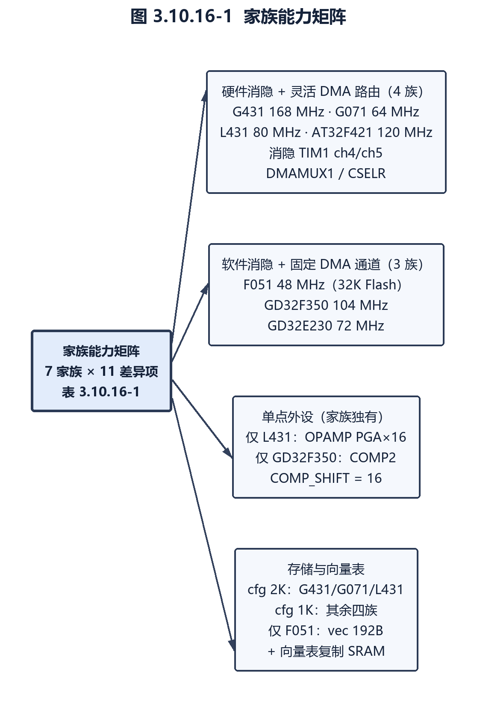

图 3.10.16-1 家族能力矩阵

## 3.11 系统基础设施

本节描述与具体外设协议无关的运行时基础设施：节拍与调度（3.11.1、3.11.2）、异常与超时路径（3.11.3、3.11.4、3.11.5）、可复用算法库（3.11.6、3.11.7）以及错误状态上报能力的现状（3.11.8）。

### 3.11.1 系统节拍与降负载调度（需求规格）

- 需求标识：ESC-FREQ10-1
- 功能描述：以 SysTick 建立 16kHz 全局节拍，作为延时、状态刷新、遥测与保护计算的统一时基；遥测发送与 LED 刷新等非实时工作绑定到最低优先级的 PendSV。
- 调用条件：初始化阶段启动 SysTick；此后每个 SysTick 中断与每次 PendSV 调度。
- 输入：`STK_RVR = CLK_KHZ / 16 - 1`、`STK_CSR` 使能位、`NVIC_PENDSV_IRQ` 优先级设置。
- 输出：全局 `tick` 自增；`tickf` 清零；PendSV 中执行 `sendtelem()` 与 1kHz 的 ADC/LED 刷新。
- 处理：
- （1）初始化阶段设 SysTick 重载值为 1/16 ms，置 SysTick 使能、中断与 AHB 时钟源，并把 PendSV 优先级设为 0x80 即最低档；
- （2）SysTick 中断把 PendSV 置为待处理（写 `SCB_ICSR = SCB_ICSR_PENDSVSET`），清 `SCB_SCR` 唤醒主循环；
- （3）同一中断内令 `tick` 自增，并在 `tick == tickv` 时清 `tickf` 结束当前延时；
- （4）PendSV 中先调用 `sendtelem()`，使遥测发送不占用高优先级中断时间；
- （5）再以 `tick & 0xf` 判断是否到达 1kHz，到达则触发 `adctrig()`；
- （6）1kHz 档内比较灯值，仅在变化时调用 `ledctl()`，避免重复写 GPIO。

> 证据：`src/main.c:607-610`、`src/main.c:464-468`、`src/main.c:478-485`。


### 3.11.2 主循环休眠与 1kHz 分频（需求规格）

- 需求标识：ESC-FREQ10-2
- 功能描述：主循环每个节拍尾部挂起 CPU 直到下一个中断，并由 16kHz 节拍分频出 1kHz 处理拍，使状态刷新与保护计算以毫秒级进行。
- 调用条件：主循环每次迭代末尾。
- 输入：`tick` 的低 4 位。
- 输出：CPU 进入睡眠；`tick & 0xf` 为 0 时继续执行 1kHz 处理段。
- 处理：
- （1）置 `SCB_SCR = SCB_SCR_SLEEPONEXIT`，使中断返回后立即再次睡眠；
- （2）执行 `__WFI()` 挂起 CPU 至下一个中断，由 SysTick 中断清 `SCB_SCR` 恢复主循环；
- （3）唤醒后判断 `if (tick & 0xf) continue;`，即每 16 个 16kHz 节拍（1 ms）才向下执行；
- （4）1kHz 段内完成重新解锁判定与辅助刹车超时恢复；
- （5）随后完成低压累计、堵转与过流 PID 计算；
- （6）末段完成鸣叫与 LED 刷新，之后回到休眠点。

> 证据：`src/main.c:837-840`、`src/main.c:841-866`。


### 3.11.3 看门狗策略（需求规格）

- 需求标识：ESC-FREQ10-3
- 功能描述：正常运行依赖「有效输入喂独立看门狗」，异常路径主动触发窗口看门狗复位；初始化阶段只使能 WWDG 时钟。
- 调用条件：每成功解析一帧有效输入即复位 IWDG；致命故障、非法脉宽、CLI 帧错等异常立即触发 WWDG。
- 输入：输入侧协议解析结果与故障条件。
- 输出：IWDG 计数复位（继续运行）或 WWDG 复位（重启）。
- 处理：
- （1）每个成功解码的输入帧（伺服合法脉宽、serial、iBUS、SBUS、CRSF、EXBUS、HoTT 等）执行 `IWDG_KR = IWDG_KR_RESET`；
- （2）协议帧不匹配或舵机脉宽非法时不喂狗，使 IWDG 自然溢出复位；
- （3）伺服脉宽非法且电机已停止（`ertm == 0`）时直接写 `WWDG_CR = WWDG_CR_WDGA` 立即复位；
- （4）电机运行中收到非法脉宽仅忽略该帧，不立即复位，以免飞行中掉电；
- （5）CLI/USART 帧错、噪声错、缓冲将满，以及软件 UART 起始位/停止位电平错同样直接触发 WWDG；
- （6）喂狗语义为「校验通过才喂」，因此持续无有效输入的运行状态最终会被 IWDG 终止。

> 证据：`src/io.c:267`、`src/io.c:293`、`src/io.c:297-301`、`src/io.c:953`、`src/io.c:1002`、`src/io.c:1011`、`mcu/STM32G071/config.c:72`。


### 3.11.4 致命故障处理路径（需求规格）

- 需求标识：ESC-FREQ10-4
- 功能描述：致命故障（霍尔信号抖动或不稳定、霍尔码非法）统一进入唯一处理路径：点亮指示灯、关闭功率输出、延时 1 秒、触发看门狗复位且永不返回。
- 调用条件：霍尔采样值在连续采样中累计 20 次变化（抖动）即判为不稳定信号；或 `getcode()` 返回的霍尔码不落在 1..6 即判为非法码。
- 输入：故障触发调用。
- 输出：LED 常亮、TIM1 刹车、1 秒后 WWDG 复位。
- 处理：
- （1）`getcode()` 每次采样值与上一次不同时递增计数器 `i`，`i` 达到 20 即调用 `hard_fault_handler()`；连续 4 次同值则正常返回该码，不告警；
- （2）霍尔码判据在 `hall > 4000` 的霍尔输入分支内执行，判 `code < 1 || code > 6` 时调用 `hard_fault_handler()`；
- （3）故障处理先 `ledctl(1)` 点亮第 0 路指示灯作为错误指示；
- （4）随后写 `TIM1_EGR = TIM_EGR_BG` 触发刹车事件，关闭功率输出；
- （5）再配置 TIM6 为 0.1 ms 分辨率、`ARR = 9999` 的单次模式并启动，忙等直至计数结束，即约 1 秒；
- （6）写 `WWDG_CR = WWDG_CR_WDGA` 触发窗口看门狗复位；
- （7）随后执行无限循环 `for (;;);`，确保故障处理不返回。

> 证据：`src/main.c:487-498`、`src/main.c:93-103`、`src/main.c:162-166`。


### 3.11.5 延时工具（需求规格）

- 需求标识：ESC-FREQ10-5
- 功能描述：提供以 16kHz 节拍为基准的忙等延时，延时期间以回调函数承载实际工作（如播报、刷新）。
- 调用条件：需要定长等待且不能阻塞关键中断时。
- 输入：节拍数 `x` 与回调函数指针 `f`。
- 输出：`f()` 被反复调用直至超时；全局 `tickv`/`tickf` 被占用。
- 处理：
- （1）关中断把 `tickv` 置为 `tick + x`、`tickf` 置 1，随后开中断，保证设置过程不被 SysTick 打断；
- （2）在 `while (tickf) f();` 中忙等，回调在此期间反复执行；
- （3）由 SysTick 中断在 `tick == tickv` 时清 `tickf`，等待结束；
- （4）`tickv`/`tickf` 为全局单实例，同一时刻只允许一个活动延时，重入会覆盖前一延时的终止条件。

> 证据：`src/main.c:470-476`、`src/main.c:86-87`、`src/main.c:467`。


### 3.11.6 校验算法族（需求规格）

- 需求标识：ESC-FREQ10-6
- 功能描述：提供四种校验算法供各协议复用：CRC-8 与 CRC-8/DVB-S2 为 256 项查表实现，CRC-16/CCITT 与 CRC-16/XMODEM 为逐位实现，初值均为 0。
- 调用条件：协议帧解析与组帧时按协议要求选择。
- 输入：缓冲指针与长度。
- 输出：8 位或 16 位校验值。
- 处理：
- （1）`crc8()` 使用 256 项查表、初值 0、无终值异或，供自定义串行协议使用；
- （2）`crc8dvbs2()` 使用 256 项查表、初值 0，供 CRSF 帧校验使用；
- （3）`crc16ccitt()` 逐位计算并以 4 bit 折叠、初值 0，供 EXBUS 使用；
- （4）`crc16xmodem()` 逐位计算、初值 0，供 HoTT 使用；
- （5）四种算法均为无状态函数，可被任意协议上下文并发复用。

> 证据：`src/util.c:318-340`、`src/util.c:342-364`、`src/util.c:366-374`、`src/util.c:376-385`。


### 3.11.7 数值与滤波工具（需求规格）

- 需求标识：ESC-FREQ10-7
- 功能描述：提供端点包含式线性映射、定点一阶低通滤波与带积分限幅的位置式 PID，供油门映射、模拟滤波、堵转与过流补偿复用。
- 调用条件：各运行控制与保护计算点调用。
- 输入：`scale(x,a1,a2,b1,b2)`、`smooth(&s,x,n)`、`initpid`/`calcpid` 及其状态结构。
- 输出：映射值、滤波值与 PID 输出。
- 处理：
- （1）`scale()` 按 `b1 + (x-a1)*(b2-b1)/(a2-a1)` 计算，整数除法向零取整；
- （2）`x ≤ a1` 返回 `b1`、`x ≥ a2` 返回 `b2`，映射自带端点钳位，调用方无需额外限幅；
- （3）`smooth()` 实现 `*s = x + q - (q >> n)` 并返回 `*s >> n`，其中 `q` 为滤波状态；
- （4）`x < 0` 时 `smooth()` 直接返回 0；状态量以负值作「未初始化」哨兵，首次使用时置 `*s = x << n`；
- （5）`calcpid()` 计算 P 为测量减目标、I 为限幅累加、D 为测量值差分，输出 `Kp*p + Ki*i + Kd*d`；
- （6）PID 状态结构为整型 `{Kp, Ki, Kd, Li, i, x}`，积分限幅 `Li` 由调用方按被控对象设定。

> 证据：`src/util.c:387-391`、`src/util.c:393-398`、`src/util.c:400-413`、`src/common.h:111-113`。


### 3.11.8 故障码与错误状态上报路径缺失（需求规格）

- 需求标识：ESC-FREQ10-8
- 功能描述：当前实现没有任何故障码、故障标志或错误状态的上报路径；对外可见的异常信息仅为 CLI `info` 的运行量与灯光指示。
- 调用条件：致命故障、失步、超时、非法输入等异常发生后。
- 输入：无（无故障登记点）。
- 输出：仅 LED 常亮或闪烁与看门狗复位；`info` 输出板名、版本、温度、电压、电流、电量与转速，不含故障字段。
- 处理：
- （1）`hard_fault_handler()` 不写任何寄存器状态位或全局标志供外部读取，异常状态无法在复位后被检索；
- （2）失步、BEMF 与霍尔超时仅复位同步状态量（`sync`/`fast`/`ival`/`ertm`），不产生可查询状态；
- （3）CLI `info` 与 CRSF Info 的输出字段集固定为运行量，无故障码位；
- （4）异常的唯一持久痕迹是复位本身，而复位原因寄存器在开机读取后被 `RCC_CSR_RMVF` 清除；
- （5）因此本块描述的是能力缺口而非可用特性，上位机无法据固件输出区分故障类型。

> 证据：`src/main.c:487-498`、`src/prog.c:182-204`、`src/main.c:617-618`、`src/main.c:266-278`。

> **自述差异**：官方文档亦未定义「故障」状态或故障码（官方 wiki：Settings.md），与源码实测一致，即该缺口同时存在于实现与对外文档。

## 3.12 构建与交付

本节描述从源码到可烧录镜像的构建体系：目标矩阵与命名（3.12.1）、家族到工具链的映射（3.12.2）、编译期宏注入（3.12.3）、容量与链接脚本（3.12.4）、编译链接选项与产物（3.12.5）、外部依赖与构建命令（3.12.6）、持续集成（3.12.7）与功能裁剪（3.12.8）。

### 3.12.1 目标矩阵、命名与家族分布（需求规格、任务书）

- 需求标识：ESC-FREQ11-1
- 功能描述：顶层 `CMakeLists.txt` 通过 44 行 `add_target(<名称> <家族> <宏…>)` 定义 44 个固件 target，覆盖 7 个 MCU 家族；另有 8 个 bootloader target 定义在 boot 目录的构建脚本中。
- 调用条件：CMake 配置阶段逐行求值。
- 输入：target 名称（厂商与型号命名，如 `AIRBOT1`、`ESCAPE1`、`NEUTRON3`）、家族名与宏列表。
- 输出：44 个可执行目标；家族分布为 STM32G071×16、AT32F421×12、STM32F051×10、GD32E230×2、GD32F350×2、STM32G431×1、STM32L431×1。
- 处理：
- （1）`add_target()` 用正则从 `src/main.c` 中读出 `REVISION`/`REVPATCH`，拼出 `<name>-rev17[.3].elf/.bin/.hex` 产物名；
- （2）以 `file(GLOB)` 收集 `src/*.c` 与 `mcu/<家族>/*.c` 作为源文件集合；
- （3）为每个 target 建立 `add_custom_target(${name} ALL DEPENDS ${hex})` 与 `flash-<target>` 便利目标；
- （4）44 个 target 的家族分布合计与 `CMakeLists.txt` 中 `add_target` 行数一致，其中 STM32G071 与 AT32F421 两族合计占 28 个；
- （5）家族名同时作为编译期宏注入，供 `src/` 侧按家族分支。

> 证据：`CMakeLists.txt（第 23-35 行）`、`CMakeLists.txt（第 54-55 行）`、`CMakeLists.txt（第 60-103 行）`、官方 wiki：Targets.md。

| 家族 | 固件 target 数 | 备注 |
| --- | --- | --- |
| STM32G071 | 16 | 含唯一使用霍尔的 3 个 target |
| AT32F421 | 12 | 复用 libopencm3 的 f0 库 |
| STM32F051 | 10 | 全部定义 `SMALL_DEVICE`，32K 档 |
| GD32E230 | 2 | 复用 f0 库，内核为 Cortex-M23 |
| GD32F350 | 2 | 含 HOLYBRO1（`USE_COMP2`） |
| STM32G431 | 1 | PHOTONDRIVE1（传 `USE_HSE=8`） |
| STM32L431 | 1 | NEUTRON3（`USE_COMP2` + `USE_OPAMP`） |
| 合计 | 44 | — |

表 3.12.1-1 固件 target 家族分布表

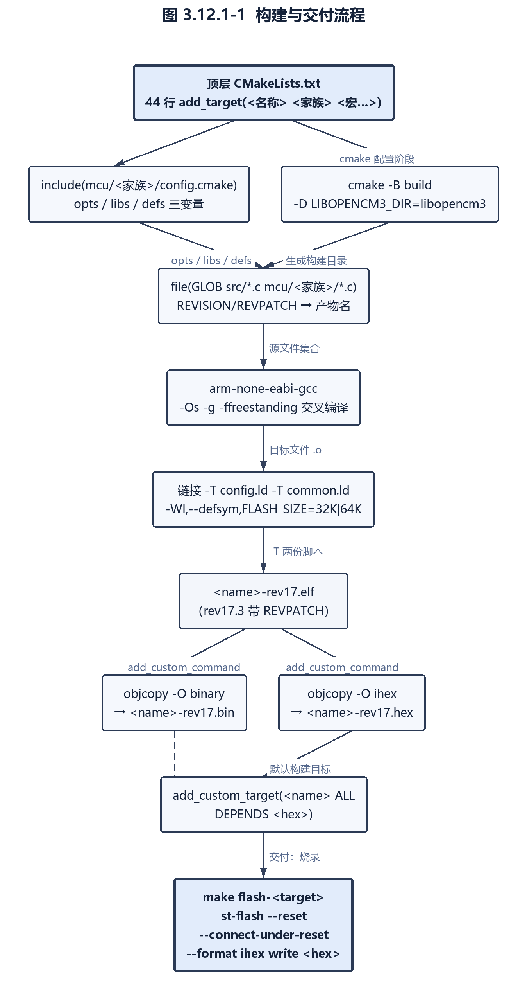

图 3.12.1-1 构建与交付流程

> **口径差异**：任务描述给出的可构建目标规模为 53，实测根构建脚本的 `add_target` 调用为 44 行（`CMakeLists.txt（第 60-103 行）`），另有 8 个 bootloader target 位于 boot 目录构建脚本中（范围外）；53 与 44 + 8 = 52 的差无法从本范围文件解释，记为口径差异而不断言。


### 3.12.2 家族到工具链与外设库的映射（需求规格）

- 需求标识：ESC-FREQ11-2
- 功能描述：每家族以 3 行 `config.cmake` 指定内核编译选项、libopencm3 外设库与平台宏；非 ST 的国产 MCU（AT32F421、GD32E230、GD32F350）通过寄存器兼容路径复用 STM32 外设库，而不引入厂商库。
- 调用条件：`add_target()` 内 `include(mcu/<家族>/config.cmake)`。
- 输入：家族名。
- 输出：`opts`/`libs`/`defs` 三个 CMake 变量；链入库名分别为 `opencm3_stm32f0`（F051、F350、E230、AT32F421）、`opencm3_stm32g0`（G071）、`opencm3_stm32g4`（G431）、`opencm3_stm32l4`（L431）。
- 处理：
- （1）AT32F421 用 `-mcpu=cortex-m4 -mthumb`，链 `opencm3_stm32f0`，平台宏为 `STM32F0 AT32F4`；
- （2）GD32E230 用 `-mcpu=cortex-m23 -mthumb`，链 `opencm3_stm32f0`，平台宏为 `STM32F0`；
- （3）GD32F350 用 `-mcpu=cortex-m4 -mthumb`，链 `opencm3_stm32f0`，平台宏为 `STM32F0`；
- （4）G071 用 `-mcpu=cortex-m0plus -mthumb`，链 `opencm3_stm32g0`，平台宏为 `STM32G0`；
- （5）G431 与 L431 在通用选项之外加 `-mfloat-abi=hard -mfpu=fpv4-sp-d16`，分别链 `opencm3_stm32g4` 与 `opencm3_stm32l4`；
- （6）复用策略使同一份 STM32F0 外设库同时服务于 4 个家族，构建只需准备 4 个 STM32 系列的库。

> 证据：`CMakeLists.txt（第 24 行）`、`CMakeLists.txt（第 44 行）`、`CMakeLists.txt（第 47 行）`。


### 3.12.3 target 宏注入与编译期配置体系（需求规格、任务书）

- 需求标识：ESC-FREQ11-3
- 功能描述：每个 target 行上的 `<宏>=值` 经 `target_compile_definitions` 注入，覆盖 `src/defs.h` 中的缺省值，从而实现「同一源码、按 target 生成不同硬件配置」。
- 调用条件：编译阶段。
- 输入：每个 `add_target` 行尾部的宏、家族平台宏 `defs`、家族名与 target 名。
- 输出：编译命令中的 `-D` 宏集合，含家族名（如 `STM32G431`）、target 名（如 `PHOTONDRIVE1`）、`TARGET_NAME="PHOTONDRIVE1"` 及全部硬件宏。
- 处理：
- （1）`add_target()` 把 `${mcu}`、`${name}`、`defs`、`TARGET_NAME="${name}"` 与行尾宏（`${ARGN}`）一并注入 `target_compile_definitions`；
- （2）`src/main.c` 的 `cfgdata` 逐字段取这些宏作默认值，宏缺省集中在 `src/defs.h`；
- （3）`src/defs.h` 再用这些宏派生 `TIM_DTG`、`COMP_IN1/2/3`、`SENS_CNT`、`LED_CNT` 等计算结果宏，此类派生宏不允许外部直接定义；
- （4）target 行实测注入 40 个宏，其中硬件拓扑与功能开关 33 个、配置类 7 个（`ARM`、`VOLUME`、`INPUT_MODE`、`PROT_TEMP`、`DUTY_MIN`、`DUTY_SPUP`、`DUTY_RATE`）；
- （5）`ERPM_PORT`、`PARK_PORT`、`BEC_MAX`、`TEMP_SENS`、`SERIAL_BR` 五个宏在全部 target 行中零注入，仅存在 `src/defs.h` 的缺省值，属官方声明未落地的预留能力。

> 证据：`CMakeLists.txt（第 45 行）`、`CMakeLists.txt（第 60-103 行）`、`src/defs.h:20-101`、`src/defs.h:84-101`、`src/defs.h:105-249`、`src/main.c:23-75`、官方 wiki：BuildOptions.md。

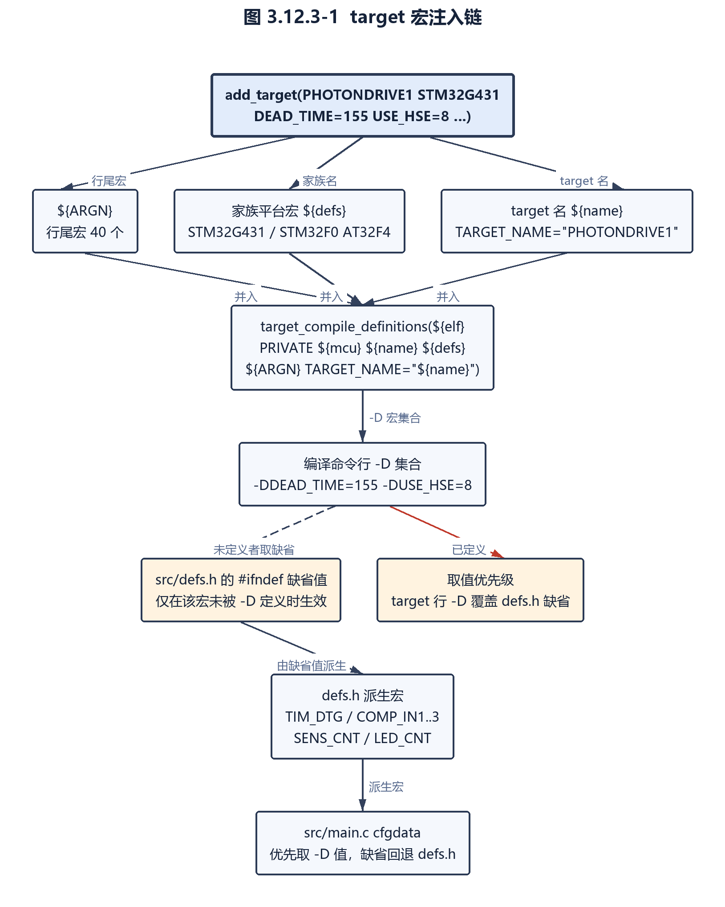

图 3.12.3-1 target 宏注入链


### 3.12.4 Flash 容量二选一与链接脚本注入（需求规格、任务书）

- 需求标识：ESC-FREQ11-4
- 功能描述：按 target 是否带 `SMALL_DEVICE` 选择 32K 或 64K 两种 Flash 档，并把容量与两份链接脚本注入链接命令。
- 调用条件：`add_target()` 中判断 `"SMALL_DEVICE" IN_LIST ARGN`。
- 输入：`SMALL_DEVICE`。
- 输出：容量符号 `size` 取 `32K` 或 `64K`；链接参数 `-Wl,--defsym,FLASH_SIZE=<size>` 与 `-T mcu/<家族>/config.ld -T mcu/common.ld`。
- 处理：
- （1）定义 `SMALL_DEVICE` 时追加 `-Wno-unused-variable -Wno-unused-function` 并把容量设为 32K；
- （2）未定义时容量取 64K；
- （3）两份链接脚本按 `config.ld`（家族内存布局）在前、`common.ld`（`.cfg` 段与符号）在后注入；
- （4）容量符号最终由 `config.ld` 用于计算 rom 区长度，使 32K 器件上的链接在容量不足时直接报错；
- （5）本仓定义 `SMALL_DEVICE` 的 10 个 target 全部为 STM32F051，其余 34 个 target 走 64K 档。

> 证据：`CMakeLists.txt（第 37-42 行）`、`CMakeLists.txt（第 46 行）`、`mcu/common.ld（第 1-16 行）`。

> **自述差异**：上游发布说明称 rel17 起因 Flash 不足而按 target 尺寸裁剪功能（自述出处：官方 wiki：Releases，本地摘录 `_analysis/_A3_wiki.md（第 672 行）`），实测容量档只有 32K/64K 两种，且仅 STM32F051 一族使用 32K 档，自述的「按尺寸裁剪」在构建脚本层面即二选一。


### 3.12.5 编译与链接选项、产物格式（需求规格）

- 需求标识：ESC-FREQ11-5
- 功能描述：固定工具链、固定编译与链接选项集，并把 ELF 转成 bin 与 hex 两种交付格式，同时提供 `flash-<target>` 便利目标。
- 调用条件：编译与链接阶段；`add_custom_command` 在 elf 更新后触发。
- 输入：工具链 `arm-none-eabi-gcc` 与 `objcopy`、烧录工具 `st-flash`。
- 输出：`<name>-rev17[.3].elf`、`.bin`（`objcopy -O binary`）与 `.hex`（`objcopy -O ihex`）。
- 处理：
- （1）工具链与优化取 `CMAKE_C_FLAGS = "-Os -g"`，调试档改用 `-Og`；
- （2）目标系统设为 `Generic` 并把 `CMAKE_C_COMPILER_WORKS` 置 1，以支持无操作系统的交叉编译；
- （3）编译选项含 `-ffreestanding -ffunction-sections -fdata-sections -fsingle-precision-constant`；
- （4）告警选项含 `-Wall -Wextra -Wpedantic -Wundef -Wshadow -Wredundant-decls -Wstrict-prototypes -Wmissing-prototypes` 及 3 个 `-Wno-*` 抑制项；
- （5）链接选项为 `-nostartfiles -Wl,--gc-sections`，链接库为 `c_nano gcc nosys`；
- （6）`flash-<target>` 调用 `st-flash --reset --connect-under-reset --format ihex write` 完成烧录。

> 证据：`CMakeLists.txt（第 1-7 行）`、`CMakeLists.txt（第 18-21 行）`、`CMakeLists.txt（第 47-55 行）`。


### 3.12.6 外部依赖与构建命令（需求规格、任务书）

- 需求标识：ESC-FREQ11-6
- 功能描述：构建依赖 libopencm3，可由 `LIBOPENCM3_DIR` 指定路径，也可经 `CMAKE_INSTALL_PREFIX` 作为替代系统根；构建命令为 `cmake -B build -D LIBOPENCM3_DIR=libopencm3` 后 `make`。
- 调用条件：CMake 配置阶段。
- 输入：`LIBOPENCM3_DIR`（可选）与 `CMAKE_INSTALL_PREFIX`（UNIX 且非默认时）。
- 输出：`include_directories` 与 `link_directories` 指向 libopencm3 的 `include`/`lib` 目录。
- 处理：
- （1）定义 `LIBOPENCM3_DIR` 时把其 `include` 与 `lib` 目录加入搜索路径；
- （2）UNIX 平台且 `CMAKE_INSTALL_PREFIX_INITIALIZED_TO_DEFAULT` 为假时，用 `GNUInstallDirs` 把安装前缀当作替代系统根；
- （3）链接阶段按家族取对应 `opencm3_*` 库名，并统一链 `c_nano gcc nosys`；
- （4）构建流程为 `cmake -B build -D LIBOPENCM3_DIR=libopencm3` 完成配置，随后在 `build` 目录执行 `make` 生成全部 target。

> 证据：`CMakeLists.txt（第 8-17 行）`、`CMakeLists.txt（第 47 行）`。

> **自述差异**：官方 README 给出的依赖与命令清单与实测一致（自述出处：`README.md（第 32-52 行）`），但 README 未说明部分系列库可被多个家族复用（AT32F421、GD32E230、GD32F350 共用 f0 库）。


### 3.12.7 持续集成工作流（需求规格）

- 需求标识：ESC-FREQ11-7
- 功能描述：仓库自带一套 GitHub Actions 工作流，仅手动触发，在 `ubuntu-latest` 上安装 ARM 工具链、现场克隆并构建 libopencm3 的 4 个系列，再构建全部 target 并上传 `.bin` 产物。
- 调用条件：`workflow_dispatch` 触发，即仅手动执行，非 push 或 PR 触发。
- 输入：无外部密钥；使用 `carlosperate/arm-none-eabi-gcc-action@v1`、`actions/checkout@v4`、`actions/upload-artifact@v4`。
- 输出：artifact 名 `escape32-build`，路径 `build/**/*.bin`，保留 7 天。
- 处理：
- （1）工作流先克隆 libopencm3，并执行 `make -C libopencm3 TARGETS='stm32/f0 stm32/g0 stm32/g4 stm32/l4'`；
- （2）四个系列库即覆盖全部 7 个家族，因为 AT32F421、GD32E230、GD32F350 复用 f0 库；
- （3）随后执行 `cmake -B build -D LIBOPENCM3_DIR=libopencm3`；
- （4）再执行 `cd build && make` 构建全部 44 个固件 target；
- （5）最后上传 `build/**/*.bin` 作为构建产物，不产出 hex 或 elf 制品；
- （6）工作流不校验产物尺寸，也不做烧录或在线测试。

> 证据：`.github/workflows/build.yml（第 1-19 行）`。


### 3.12.8 编译期功能裁剪与尺寸约束（需求规格、任务书）

- 需求标识：ESC-FREQ11-8
- 功能描述：提供编译期裁剪开关以适配小容量器件与特定硬件：`DISABLE_HOTT`、`DISABLE_MSB` 裁掉对应协议；`SMALL_DEVICE` 除容量与告警选项外，还会移除 CRSF 配置通道代码。
- 调用条件：由 target 行传入；`DISABLE_HOTT` 见 AIRBOT2、FLYCOLOR1、HGLRC1 等，`SMALL_DEVICE` 见全部 F051 小容量 target。
- 输入：`SMALL_DEVICE`、`DISABLE_HOTT`、`DISABLE_MSB`。
- 输出：被裁掉的模式在配置钳位时归零；二进制体积下降。
- 处理：
- （1）`DISABLE_HOTT` 使模式 6/7 不被注册，并把 `input_mode == 7` 与 `telem_mode == 6` 归 0；
- （2）`DISABLE_MSB` 使 `telem_mode == 5` 归 0；
- （3）`SMALL_DEVICE` 追加两个 `-Wno-unused-*` 并把 `FLASH_SIZE` 设为 32K；
- （4）`SMALL_DEVICE` 还包裹 CRSF 的 `0x28`/`0x2c`/`0x2d` 命令处理块，构成隐含能力差异，即同一固件在 32K 档上提供的 CRSF 配置通道少于 64K 档；
- （5）裁剪均发生在编译期，运行期不提供动态降级路径。

> 证据：`CMakeLists.txt（第 37-42 行）`、`CMakeLists.txt（第 62 行）`、`CMakeLists.txt（第 69 行）`、`CMakeLists.txt（第 78 行）`、`src/util.c:457-480`、`src/telem.c:64-75`、`src/io.c:806-816`。

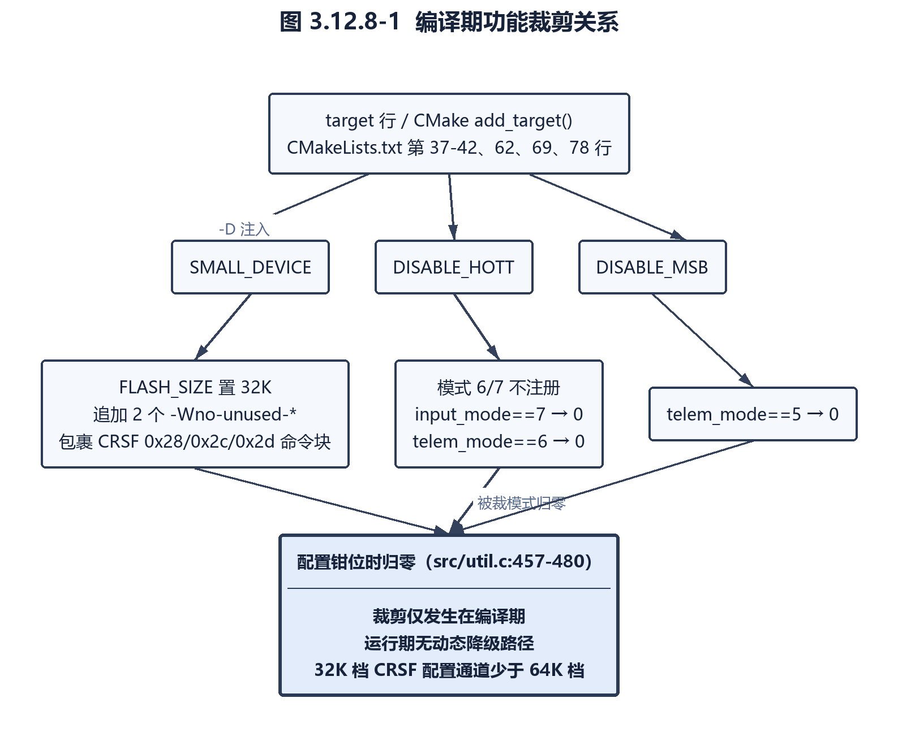

图 3.12.8-1 编译期功能裁剪关系

## 3.13 性能需求（需求规格、数据字典里找）

本节给出 ESCape32 在锚定版本（tag `rel17` = `1d718c143380c3eb7e6581478990e1496632e5b8`）上可观测的时间与速率指标。全部数值由源码常量、编译期宏与整数算式反推，凡依赖家族时钟（`CLK`、`CLK_KHZ`、`CLK_MHZ`）者均注明取值来源与适用范围。

### 3.13.1 时基与调度节拍（需求规格）

- 需求标识：ESC-PREQ1
- 功能描述：系统以 SysTick 16 kHz 节拍作为全局时基，并用挂起/唤醒机制使主循环与节拍对齐（需求规格）
- 调用条件：`main()` 完成外设与时钟初始化、SysTick 使能后持续运行，直至复位
- 输入：家族时钟 `CLK`（由 `CLK_KHZ = CLK / 1000` 折算）、SysTick 计数溢出事件
- 输出：全局 `tick` 计数递增、`PENDSVSET` 异常置位、被挂起的主循环恢复执行
- 处理：
- （1）初始化阶段按 `STK_RVR = CLK_KHZ / 16 - 1` 写入 SysTick 重装值，时钟源选择 AHB，得到 16 kHz 节拍（`src/main.c:608-610`、`src/common.h:41`）；
- （2）每个节拍在 `sys_tick_handler()` 中置位 `SCB_ICSR_PENDSVSET` 并清除 `SCB_SCR` 的 SLEEPONEXIT 位，使上一轮被挂起的主循环恢复运行（`src/main.c:464-467`）；
- （3）主循环每轮末尾置 `SCB_SCR_SLEEPONEXIT` 后执行 `__WFI()`，无节拍到来自行休眠，不占用 CPU 时间（`src/main.c:838-839`）；
- （4）节拍间隔与家族时钟挂钩，7 个家族的 `CLK` 取值与重装值见表 3.13.1-1，重装值在各家族上均为精确整数，故节拍周期恒为 62.5 µs（16 kHz）；
- （5）STM32G071、STM32L431、STM32F051 三族的系统时钟由 bootloader 设定，`CLK` 只是编译期假定值，boot 侧证据在范围外，链条未闭合，上述三族的节拍周期以 bootloader 实际配置为准。

> 证据：`src/main.c:608-610`、`src/common.h:41`、`src/main.c:464-467`、`src/main.c:838-839`。

| 家族 | `CLK`/Hz | `CLK_KHZ / 16 - 1` | 证据 |
| --- | --- | --- | --- |
| STM32G431 | 168000000 | 10499 | `mcu/STM32G431/config.h:20` |
| STM32G071 | 64000000 | 3999 | `mcu/STM32G071/config.h:20` |
| STM32L431 | 80000000 | 4999 | `mcu/STM32L431/config.h:20` |
| STM32F051 | 48000000 | 2999 | `mcu/STM32F051/config.h:20` |
| AT32F421 | 120000000 | 7499 | `mcu/AT32F421/config.h:20` |
| GD32F350 | 104000000 | 6499 | `mcu/GD32F350/config.h:20` |
| GD32E230 | 72000000 | 4499 | `mcu/GD32E230/config.h:20` |

表 3.13.1-1 各家族时钟与 SysTick 重装值

- 需求标识：ESC-PREQ2
- 功能描述：主循环与 PendSV 以 16 kHz 节拍分频出 1 kHz 有效节拍，控制逻辑、ADC 触发与 LED 刷新只在该节拍上执行（需求规格）
- 调用条件：每轮主循环被节拍唤醒后、以及每个 PendSV 异常进入时判定
- 输入：全局 `tick` 计数的低 4 位
- 输出：1 kHz 的控制回路执行时机、ADC 触发、LED 状态刷新与遥测发送时机
- 处理：
- （1）主循环在 `__WFI()` 返回后判定 `tick & 0xf`，非零即 `continue` 跳过本轮，使有效逻辑降为 16 kHz / 16 = 1 kHz（`src/main.c:840`）；
- （2）`pend_sv_handler()` 先执行遥测发送，再用同一判据 `tick & 0xf` 分频，在 1 kHz 上触发 ADC 采样并刷新 LED 输出（`src/main.c:478-485`）；
- （3）1 kHz 有效节拍同时是油门映射、堵转/过流 PID 补偿更新与蜂鸣调度的公共时基，各保护的补偿量每 1 ms 更新一次（`src/main.c:852-856`、`src/main.c:840`）。

> 证据：`src/main.c:840`、`src/main.c:478-485`、`src/main.c:852-856`。

### 3.13.2 PWM 载波与占空比性能（需求规格）

- 需求标识：ESC-PREQ3
- 功能描述：PWM 载波由 TIM1 重装值决定，缺省为 24 kHz，运行期在 `freq_min`..`freq_max` 区间内随实测电周期线性过渡（需求规格）
- 调用条件：初始化完成后、正弦启动每一步、音频播放结束返回时，以及每个 1 kHz 控制拍重算输出时
- 输入：家族时钟 `CLK_KHZ`、`cfg.freq_min`（16..48 kHz）、`cfg.freq_max`（`freq_min`..96 kHz）、实测电周期 `ertm`
- 输出：`TIM1_ARR` 载波重装值与三相占空比比较值
- 处理：
- （1）初始化阶段写入 `TIM1_ARR = CLK_KHZ / 24 - 1`，缺省载波为 24 kHz（`src/main.c:578`）；
- （2）正弦启动每步重设同一表达式，保证正弦调制期间载波频率不变（`src/main.c:132`）；
- （3）音乐播放结束时由播放例程恢复 `TIM1_PSC = 0` 与 `TIM1_ARR = CLK_KHZ / 24 - 1`，载波回到 24 kHz（`src/util.c:665-666`）；
- （4）运行期载波初值取 `arr = CLK_KHZ / cfg.freq_min`，在 `ertm` 由 2000 µs 降到 1000 µs（约 30..60 kERPM）的区间内线性过渡到 `CLK_KHZ / cfg.freq_max`，电周期大于 2000 µs 时维持 `freq_min` 对应载波（`src/main.c:661`、`src/main.c:743`）；
- （5）`freq_min` 收敛到 16..48 kHz，`freq_max` 收敛到 `[freq_min, 96]` kHz，缺省值见表 3.13.2-1（`src/util.c:435-436`、`src/defs.h:127`、`src/defs.h:130`）；
- （6）有刷模式下直接以 100 kERPM（`ertm = 600`）进入固定输出，`freq_min`、`duty_spup`、`duty_ramp` 在该路径均不生效（`src/main.c:801`）；
- （7）载波频率由 `CLK_KHZ` 折算，STM32G071、STM32L431、STM32F051 三族的 `CLK` 由 bootloader 设定，boot 侧证据在范围外，链条未闭合，这三族的实际载波以 bootloader 配置的时钟为准。

> 证据：`src/main.c:578`、`src/main.c:132`、`src/util.c:665-666`、`src/main.c:661`、`src/main.c:743`、`src/util.c:435-436`、`src/defs.h:127`、`src/defs.h:130`、`src/main.c:801`。

- 需求标识：ESC-PREQ4
- 功能描述：占空比按 1 kHz 控制拍做斜率限幅，8 ms 窗口内的合计步进等于 `duty_rate`，并由快速加/减速标志决定是否旁路（需求规格）
- 调用条件：每个 1 kHz 有效控制拍计算出目标占空比 `newduty` 之后、写入比较值之前
- 输入：`cfg.duty_rate`（1..100）、快速加/减速标志 `fast`、当前占空比 `curduty`、目标占空比 `newduty`（量纲 0..2000 对应 0..100%）
- 输出：本拍实际生效的占空比 `curduty`
- 处理：
- （1）每拍先取斜率除数 `a`：`fast` 置位时取 0，否则取 `cfg.duty_rate`（`src/main.c:748`）；
- （2）以 8 拍为一组分配步长：`b = a >> 3`，组内前 `a & 7` 拍各额外加 1，每满 8 拍组计数 `n` 归零，故 8 拍累计步进恰为 `duty_rate`（`src/main.c:749-751`）；
- （3）按 `curduty += b` 逼近目标值（减速时递减），越过目标即直接取目标值，不产生溢出（`src/main.c:752`）；
- （4）`duty_rate` 收敛到 1..100，缺省 30（`src/util.c:441`、`src/defs.h:145`）；
- （5）占空比量纲 0..2000 对应 0..100%，斜率折合 `0.00625 × duty_rate` %/ms，即 `duty_rate = 16` 时等价 0.1 %/ms；0→100% 全量程耗时 `16000 / duty_rate` ms，缺省 30 时为约 533 ms（`src/main.c:752`、`src/main.c:755-757`）；
- （6）`fast` 置位时 `a` 取 0、`b` 亦为 0，该分支的实际输出行为见块后实现说明（`src/main.c:748-752`）。

> 证据：`src/main.c:748`、`src/main.c:749-751`、`src/main.c:752`、`src/util.c:441`、`src/defs.h:145`、`src/main.c:755-757`、`src/main.c:748-752`。

> **实现说明（缺陷）**：`fast` 置位使 `a = 0`、`b = 0`，此时 `curduty` 在需要加速（`curduty < newduty`）时既不递增也不赋值，占空比被冻结在当前值；只有在需要减速（`curduty > newduty`）且 `sync < 6`（未锁相）时才直接跳到目标值。故「快速加/减速时占空比立即到位」只对未锁相时的减速方向成立，加速方向实际表现为斜率旁路失效（`src/main.c:748-752`）。

- 需求标识：ESC-PREQ5
- 功能描述：占空比上限由转速包线与温度折返两条限制取小得到，缺省配置下启动限幅只在静止点生效（需求规格）
- 调用条件：每个 1 kHz 有效控制拍，在斜率限幅之前
- 输入：实测转速 `erpm`、`cfg.duty_ramp`（0..100 kERPM）、`cfg.duty_spup`（1..100 %）、温度折返量 `cutback`（0..60）
- 输出：本拍允许的最大占空比 `maxduty`（量纲 0..2000）
- 处理：
- （1）按 `scale(erpm, 0, cfg.duty_ramp * 1000, cfg.duty_spup * 20, 2000)` 计算转速相关包线上限（`src/main.c:746`）；
- （2）与温度折返上限 `2000 - cutback * 25` 取小值，`cutback` 最大 60，对应最大折返 1500/2000 = 75%（`src/main.c:746`、`src/main.c:458`）；
- （3）目标占空比超过 `maxduty` 时截断到 `maxduty`，不报错也不停机（`src/main.c:747`）；
- （4）`duty_ramp` 收敛到 0..100，`duty_spup` 收敛到 1..100，缺省值见表 3.13.2-1（`src/util.c:439-440`、`src/defs.h:139`、`src/defs.h:142`）；
- （5）`duty_ramp = 0`（缺省）时输入区间退化为 0..0，`erpm ≤ 0` 返回 `duty_spup * 20`、`erpm ≥ 0` 返回 2000，即 `duty_spup` 仅在静止点生效，缺省等价于关闭启动限幅（`src/util.c:387-391`、`src/main.c:746`）；
- （6）`duty_ramp > 0` 时上限在 `erpm` 由 0 升到 `duty_ramp × 1000` kERPM 的过程中由 `duty_spup × 20` 线性升到 2000（100%）（`src/main.c:746`、`src/util.c:387-391`）。

> 证据：`src/main.c:746`、`src/main.c:458`、`src/main.c:747`、`src/util.c:439-440`、`src/defs.h:139`、`src/defs.h:142`、`src/util.c:387-391`。

- 需求标识：ESC-PREQ6
- 功能描述：互补 PWM 的死区长度按编译期宏编码进 `TIM_DTG`，并作为占空比量纲下界参与比较值计算（需求规格）
- 调用条件：初始化配置 `TIM1_BDTR` 时一次写入；每个控制拍计算比较值时按运行状态施加偏移
- 输入：编译期宏 `DEAD_TIME`（0..1023，target 实际取值 0..155）、运行状态 `lock`、`running`、`cfg.damp`、`cfg.brushed`、`CLK_MHZ`
- 输出：`TIM_DTG` 编码值、三相比较值 `ccr` 与重装值 `arr`
- 处理：
- （1）`DEAD_TIME` 按四段线性编码折叠为 `TIM_DTG`：小于 128 时直接取值，128..255 每 2 计数 1 步，256..511 每 8 计数 1 步，512..1023 每 16 计数 1 步（`src/defs.h:20-28`）；
- （2）`DEAD_TIME` 由 target 注入，取值随家族与板卡不同，实测区间 0（AART1）至 155（PHOTONDRIVE1）（`CMakeLists.txt（第 60-103 行）`）；
- （3）初始化时写入 `TIM1_BDTR = TIM_DTG | TIM_BDTR_OSSR | TIM_BDTR_MOE`，一次完成死区、关闭状态输出选择与主输出使能（`src/main.c:577`）；
- （4）比较值量纲下界按 `lock || (running && cfg.damp) ? DEAD_TIME : 0` 偏移，锁定或运行中开放续流时抬到死区值，其余情况从 0 起（`src/main.c:755`、`src/main.c:757`）；
- （5）未定义 `FULL_DUTY`（缺省）时比较值上界与重装值同为 `arr`，有刷模式下上界再扣 `CLK_MHZ * 3 >> 1` 个计数；定时器时钟为 `CLK`，该扣除量等价 1.5 µs，故最高占空比略低于 100%（`src/main.c:757`、`src/main.c:760`）；
- （6）定义 `FULL_DUTY` 时比较值上界取自减前的 `arr`、重装值取自减后的 `arr - 1`，使比较值可大于重装值从而实现 100% 占空比（`src/main.c:755`、`src/main.c:760`）；
- （7）正弦启动阶段三相比较值同样以 `DEAD_TIME + (sinedata[] * p >> 7)` 合成，死区在整个正弦调制期间保持不变（`src/main.c:133-135`）。

> 证据：`src/defs.h:20-28`、`CMakeLists.txt（第 60-103 行）`、`src/main.c:577`、`src/main.c:755`、`src/main.c:757`、`src/main.c:760`、`src/main.c:133-135`、官方 wiki：BuildOptions.md。

| 参数 | 取值域 | 缺省 | 含义 | 证据 |
| --- | --- | --- | --- | --- |
| `freq_min` | 16..48 kHz | 24 kHz | 低转速段载波频率 | `src/util.c:435`、`src/defs.h:127` |
| `freq_max` | `freq_min`..96 kHz | 48 kHz | 高转速段载波频率 | `src/util.c:436`、`src/defs.h:130` |
| `duty_rate` | 1..100 | 30 | 8 ms 窗口内合计步进 | `src/util.c:441`、`src/defs.h:145` |
| `duty_spup` | 1..100 % | 15 | 启动限幅的占空比上限 | `src/util.c:439`、`src/defs.h:139` |
| `duty_ramp` | 0..100 kERPM | 0 | 启动限幅撤销拐点 | `src/util.c:440`、`src/defs.h:142` |

表 3.13.2-1 载波与占空比相关参数的取值域与缺省值

### 3.13.3 BEMF 捕获与换相时序性能（需求规格）

- 需求标识：ESC-PREQ7
- 功能描述：BEMF 过零捕获定时器的计数分辨率由家族时钟与编译期分频位宽共同决定，并按电周期分四档切换滤波与采样时钟（需求规格）
- 调用条件：初始化阶段设定预分频；每次换相处理时按实测电周期重新选择捕获档位
- 输入：家族时钟 `CLK_MHZ`、家族编译期宏 `IFTIM_XRES`、实测电周期 `ertm`
- 输出：捕获定时器预分频值、输入捕获滤波档 `IFTIM_ICMR` 与时钟分频位 `TIM_CR1_CKD`、消隐比较值 `TIM1_CCR4`／`TIM1_CCR5`
- 处理：
- （1）初始化按 `TIM_PSC(IFTIM) = (CLK_MHZ >> (IFTIM_XRES + 1)) - 1` 设定捕获定时器预分频（`src/main.c:585`）；
- （2）`IFTIM_XRES` 由家族给定：STM32G431、STM32G071、STM32L431、STM32F051、GD32F350 取 2，AT32F421、GD32E230 取 0（`mcu/STM32G431/config.h:24`、`mcu/STM32G071/config.h:23`、`mcu/STM32L431/config.h:24`、`mcu/STM32F051/config.h:24`、`mcu/GD32F350/config.h:24`、`mcu/AT32F421/config.h:24`、`mcu/GD32E230/config.h:25`）；
- （3）`IFTIM_XRES = 2` 的五族预分频后计数时钟均为 8 MHz，分辨率 125 ns；`IFTIM_XRES = 0` 的两族计数时钟均为 2 MHz，分辨率 500 ns，逐家族取值见表 3.13.3-1；
- （4）捕获档位随电周期切换：`ertm < 100 µs`（600 kERPM 以上）与 `ertm < 200 µs`（300 kERPM 以上）关闭消隐通道并分别使用 `IFTIM_ICM3`、`IFTIM_ICM2` 滤波，`ertm < 1000 µs`（60 kERPM 以上）使用 `IFTIM_ICM1`，`ertm < 2000 µs`（30 kERPM 以上）使用 `IFTIM_ICM1` 并置 `TIM_CR1_CKD_CK_INT_MUL_2`，其余情况使用 `IFTIM_ICM1`、`TIM_CR1_CKD_CK_INT_MUL_4` 与消隐长度 `IFTIM_ICFL << 2`（`src/main.c:279-318`）；
- （5）计数分辨率依赖 `CLK_MHZ`，STM32G071、STM32L431、STM32F051 三族的系统时钟由 bootloader 设定，boot 侧证据在范围外，链条未闭合，这三族的实际分辨率以 bootloader 配置的时钟为准。

> 证据：`src/main.c:585`、`mcu/STM32G431/config.h:24`、`mcu/STM32G071/config.h:23`、`mcu/STM32L431/config.h:24`、`mcu/STM32F051/config.h:24`、`mcu/GD32F350/config.h:24`、`mcu/AT32F421/config.h:24`、`mcu/GD32E230/config.h:25`、`src/main.c:279-318`。

> **自述差异**：`src/main.c:585` 的注释自述分辨率为「125/250/500ns」，实测 rel17 七个家族只落到 125 ns（`IFTIM_XRES = 2` 的五族）与 500 ns（`IFTIM_XRES = 0` 的两族）两档；250 ns 对应 `IFTIM_XRES = 1`，全仓各家族配置文件中该宏只取 0 与 2，无任何家族采用 1，故该档不可达（`src/main.c:585`、`mcu/STM32G431/config.h:24`、`mcu/AT32F421/config.h:24`）。

| 家族 | `CLK_MHZ` | `IFTIM_XRES` | 预分频值 | 计数时钟 | 分辨率 | 证据 |
| --- | --- | --- | --- | --- | --- | --- |
| STM32G431 | 168 | 2 | 20 | 8 MHz | 125 ns | `mcu/STM32G431/config.h:20`、`mcu/STM32G431/config.h:24` |
| STM32G071 | 64 | 2 | 7 | 8 MHz | 125 ns | `mcu/STM32G071/config.h:20`、`mcu/STM32G071/config.h:23` |
| STM32L431 | 80 | 2 | 9 | 8 MHz | 125 ns | `mcu/STM32L431/config.h:20`、`mcu/STM32L431/config.h:24` |
| STM32F051 | 48 | 2 | 5 | 8 MHz | 125 ns | `mcu/STM32F051/config.h:20`、`mcu/STM32F051/config.h:24` |
| GD32F350 | 104 | 2 | 12 | 8 MHz | 125 ns | `mcu/GD32F350/config.h:20`、`mcu/GD32F350/config.h:24` |
| AT32F421 | 120 | 0 | 59 | 2 MHz | 500 ns | `mcu/AT32F421/config.h:20`、`mcu/AT32F421/config.h:24` |
| GD32E230 | 72 | 0 | 35 | 2 MHz | 500 ns | `mcu/GD32E230/config.h:20`、`mcu/GD32E230/config.h:25` |

表 3.13.3-1 BEMF 捕获分辨率与家族分频取值

- 需求标识：ESC-PREQ8
- 功能描述：过零确认后按配置的提前角参数计算换相延时，延时以捕获计数为单位并在高转速下设下限（需求规格）
- 调用条件：捕获中断确认一次有效过零事件、且该事件不早于半个换相间隔时
- 输入：平滑后的换相间隔 `ival`（捕获计数）、`cfg.timing`（1..31）
- 输出：换相延时寄存器 `IFTIM_OCR`，并触发一次定时器更新事件
- 处理：
- （1）按 `IFTIM_OCR = max((ival - (ival * cfg.timing >> 5)) >> 1, 1)` 计算换相延时（`src/main.c:395`）；
- （2）该式等价于 `ival / 2 × (1 - timing / 32)`：`timing = 0` 时延时为 `ival / 2`（过零后 30° 电角度，无提前），`timing = 31` 时延时约为 `ival / 64`，相当于提前约 29°（`src/main.c:395`）；
- （3）下限固定为 1 个捕获计数，保证高转速下延时不为 0（`src/main.c:395`）；
- （4）写入后发出 `TIM_EGR_UG` 更新并用 `TIM_DIER(IFTIM) = 0` 关闭捕获中断，换相完成后重新使能，避免换相窗口内的伪过零被采信（`src/main.c:396-397`）；
- （5）`timing` 收敛到 1..31，缺省 16，对应延时 `ival / 4`，即相对过零后 30° 的理论换相点提前约 15° 电角度（`src/util.c:432`、`src/defs.h:118`）；
- （6）正弦启动切换为六步换相时，首个换相延时按 `sine * (a - c + 1)` 或 `sine * (c - a + 60)` 设定，量纲与六步阶段的 `IFTIM_OCR` 一致（`src/main.c:723`）。

> 证据：`src/main.c:395`、`src/main.c:396-397`、`src/util.c:432`、`src/defs.h:118`、`src/main.c:723`。

- 需求标识：ESC-PREQ9
- 功能描述：换相间隔按 1:3 加权平滑，过早的过零事件被丢弃，并按本次与上次间隔的倍率判定快速加/减速（需求规格）
- 调用条件：每进入一次 BEMF 捕获中断、完成事件有效性筛选之后
- 输入：本次过零距上次过零的计数 `t`、上次平滑间隔 `ival`、电周期 `ertm`
- 输出：更新后的平滑间隔 `ival`、下次换相延时基准、快速加/减速标志 `fast`
- 处理：
- （1）读取自上次过零以来的计数 `t`，`t < ival >> 1`（早于半个间隔）的事件直接丢弃，不更新间隔（`src/main.c:391`）；
- （2）取 `u = ival * 3` 后按 `ival = (t + u) >> 2` 更新间隔，即本次测量占 1/4、上次间隔占 3/4 的加权平滑（`src/main.c:392`、`src/main.c:394`）；
- （3）按 `fast = (t < u >> 2 || t > u >> 1) && ertm < 2000` 判定快速加/减速：本次间隔小于上次的 0.75 倍或大于上次的 1.5 倍时置位（`src/main.c:393`）；
- （4）判据附带条件 `ertm < 2000`（电周期低于 2000 µs，即转速高于 30 kERPM），低速段 `fast` 恒为 0，不做快速加/减速判定（`src/main.c:393`）；
- （5）`fast` 标志同时供占空比斜率旁路使用，并在失步、正弦切六步与停机路径上被清零（`src/main.c:272`、`src/main.c:731`、`src/main.c:832`）。

> 证据：`src/main.c:391`、`src/main.c:392`、`src/main.c:394`、`src/main.c:393`、`src/main.c:272`、`src/main.c:731`、`src/main.c:832`。

- 需求标识：ESC-PREQ10
- 功能描述：以每 6 次换相为一周期比较实测与平滑间隔，偏差超过 50% 判为失步；捕获超时同样按失步处置并改写间隔值（需求规格）
- 调用条件：每完成 6 次换相时比较一次；捕获定时器更新事件（超时）发生时另行处置
- 输入：本周期实测间隔 `val`、平滑间隔 `ival`、捕获计数位宽 `IFTIM_XRES`
- 输出：失步标志 `sync = 0`、快速标志 `fast = 0`、改写后的 `ival` 与无效电周期 `ertm`
- 处理：
- （1）比较前先做低速屏蔽：`ival > 1000 << IFTIM_XRES` 时把 `val` 截到该值并清零计数器 `cnt`，该门限在七个家族上均等价 500 µs（约 120 kERPM 以下），故低速段不参与失步比较（`src/main.c:266-268`）；
- （2）每 `++cnt == 6` 比较一次 `abs(val - ival) > ival >> 1`，实测与平滑间隔偏差超过 50% 即判定失步（`src/main.c:269-270`）；
- （3）判定失步后置 `sync = 0`、`fast = 0`，并把间隔改写为 `ival = 5000 << IFTIM_XRES`，该值在七族上均等价 2500 µs；同时置 `ertm = 100000000` 表示电周期无效（`src/main.c:271-274`）；
- （4）捕获超时（更新事件）时置 `sync = 0`、`fast = 0`、`ival = 10000 << IFTIM_XRES`（七族均等价 5000 µs）、`ertm = 100000000`，关闭捕获中断后返回（`src/main.c:380-387`）；
- （5）无效电周期参与换算时 `erpm = 60000000 / 100000000` 整数截断为 0，转速遥测随之下零（`src/main.c:744`）。

> 证据：`src/main.c:266-268`、`src/main.c:269-270`、`src/main.c:271-274`、`src/main.c:380-387`、`src/main.c:744`。

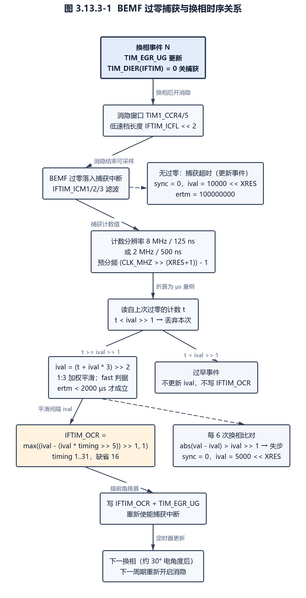

图 3.13.3-1 BEMF 过零捕获与换相时序关系

### 3.13.4 转速量程与电机上限（需求规格）

- 需求标识：ESC-PREQ11
- 功能描述：电周期由 6 个换相区间累加换算为微秒，转速按电周期反推，六步运行的观测转速按电周期分四档（需求规格）
- 调用条件：每次换相写入区间缓存后；锁相达到 6 次（`sync == 6`）时才做整周换算
- 输入：区间缓存 `buf[0..5]`（捕获计数或霍尔值）、霍尔标志、`IFTIM_XRES`
- 输出：电周期 `ertm`（µs）与转速 `erpm`
- 处理：
- （1）每次换相把本次计数写入 `buf[step - 1]`，`hall > 4000` 时写入霍尔值左移 `IFTIM_XRES` 的结果，否则写入平滑间隔 `ival`（`src/main.c:322`）；
- （2）锁相次数不足 6 时直接返回，不做换算（`src/main.c:323`）；
- （3）锁相达到 6 次后按 `ertm = (buf[0] + buf[1] + buf[2] + buf[3] + buf[4] + buf[5]) >> (IFTIM_XRES + 1)` 求电周期，单位为微秒（`src/main.c:324`）；
- （4）转速按 `erpm = 60000000 / ertm` 反推，结果为整数截断；`ertm` 取无效值时结果为 0（`src/main.c:744`）；
- （5）六步运行的观测转速量程按电周期分四档：`ertm < 100 µs`（600 kERPM 以上）、`ertm < 200 µs`（300 kERPM 以上）、`ertm < 1000 µs`（60 kERPM 以上）、`ertm < 2000 µs`（30 kERPM 以上），四档对应不同的捕获滤波与采样时钟配置（`src/main.c:279-318`）；
- （6）正弦启动阶段的电周期与转速换算共用同一口径，见 ESC-PREQ12（`src/main.c:714-715`）。

> 证据：`src/main.c:322`、`src/main.c:323`、`src/main.c:324`、`src/main.c:744`、`src/main.c:279-318`、`src/main.c:714-715`。

- 需求标识：ESC-PREQ12
- 功能描述：正弦启动阶段每步推进 1 度电角度，间隔值决定该阶段覆盖的转速上限，上限近似等于堵转保护配置的 ERPM 值（需求规格）
- 调用条件：正弦启动阶段每次换相定时器更新时推进相角；每个 1 kHz 控制拍按油门落在正弦区间时重设间隔上限
- 输入：油门映射结果 `input`、正弦区间宽度 `range` 与其步进容差 `delta`、`cfg.prot_stall`（0 或 1500..3500）、`IFTIM_XRES`
- 输出：相角 `step`（1..360）、正弦间隔 `sine`、电周期 `ertm` 与转速 `erpm`
- 处理：
- （1）每次更新推进 1 度：正向运行时 `step` 自增并在超过 360 时回到 1，反向运行时自减并在低于 1 时回到 360，相角取值 1..360 循环（`src/main.c:122-126`）；
- （2）1 度对应的间隔统一由 `TIM_ARR(IFTIM) = IFTIM_OCR = sine` 设定，即相角每步耗时 `sine` 个捕获计数（`src/main.c:119`）；
- （3）正弦阶段电周期按 `ertm = sine * (180 >> IFTIM_XRES)` 计算，转速按 `erpm = 60000000 / ertm` 反推；代入化简后 `erpm ≈ 333333 / sine`（`IFTIM_XRES = 0`）或 `≈ 1333333 / sine`（`IFTIM_XRES = 2`）（`src/main.c:714-715`）；
- （4）油门落在正弦区间时按 `sine = scale(input, 0, range - delta, 1000 << IFTIM_XRES, cfg.prot_stall ? (333333 << IFTIM_XRES) / cfg.prot_stall : 145 << IFTIM_XRES)` 求间隔上限（`src/main.c:710`、`src/main.c:663-664`）；
- （5）由于 `180 >> IFTIM_XRES` 与 `333333 << IFTIM_XRES` 随同一档位同步缩放，代入得等效转速上限 `erpm ≈ 60000000 × prot_stall / (180 × 333333) ≈ prot_stall`，即 `prot_stall` 数值近似等效于该阶段覆盖的最大转速，七个家族一致（`src/main.c:710`、`src/main.c:714-715`）；
- （6）`prot_stall` 非零时收敛到 1500..3500；以 `prot_stall = 3500` 为例，间隔上限取整为 95，代入得 3508 ERPM，与配置值偏差 0.23%，落在 ±0.25% 内（`src/util.c:498`、`src/main.c:710`、`src/main.c:714-715`）；
- （7）`prot_stall` 未配置（缺省 0）时间隔上限取 `145 << IFTIM_XRES`，等效转速上限为 2298 ERPM，七个家族一致（`src/main.c:710`、`src/defs.h:215`）。

> 证据：`src/main.c:122-126`、`src/main.c:119`、`src/main.c:714-715`、`src/main.c:710`、`src/main.c:663-664`、`src/util.c:498`、`src/defs.h:215`。

> **自述差异**：官方口述未配置 `prot_stall` 时覆盖转速为 2300 ERPM，与整数取整后实测的 2298 ERPM 相差 2 ERPM（约 0.09%），系取整口径差异（自述出处：官方口述的缺省堵转覆盖转速），实测以 2298 ERPM 为准（`src/main.c:710`、`src/main.c:714-715`）。

### 3.13.5 延时与响应性能（需求规格）

- 需求标识：ESC-PREQ13
- 功能描述：解锁、提示音、运行期保护与硬故障各自的时限由 TIM6 定时器计数和 SysTick 节拍计数实现，构成 100 ms 至 3 s 的固定时延集合（需求规格）
- 调用条件：分别在上电初始化、解锁请求、数字电量提示音播放、低压检测与硬故障进入时生效
- 输入：TIM6 计数（0.1 ms 分辨率）、16 kHz 节拍计数 `tick`、1 kHz 有效节拍计数、电压比较结果、油门是否为零
- 输出：解锁许可、提示音数字位之间的静音间隔、`rearm` 重解锁标志、辅助刹车恢复、看门狗复位
- 处理：
- （1）解锁等待窗口用 TIM6 实现：`TIM6_PSC = CLK_KHZ / 10 - 1` 得 0.1 ms 计数分辨率，`TIM6_ARR = 2499` 得 250 ms 窗口；窗口内只要油门非零就用 `TIM6_EGR = TIM_EGR_UG` 重新装载计时，直到连续 250 ms 零油门才解锁（`src/main.c:633-634`、`src/main.c:640-645`）；
- （2）数字电量提示音的数字位之间插入 `delay(8000, delayf)` 静音，按 16 kHz 节拍折算为 500 ms（`src/main.c:515`、`src/main.c:470-476`）；
- （3）开机蜂鸣前插入 `delay(4000, delayf)`，按 16 kHz 节拍折算为 250 ms（`src/main.c:626`、`src/main.c:470-476`）；
- （4）低压切断按 1 kHz 有效节拍计数：电压低于 `prot_volt × cells × 10` 时 `cutoff` 每毫秒加 1，累计到 3000（约 3 s）置 `rearm = 1`，进入重解锁流程（`src/main.c:848-849`、`src/main.c:840`）；
- （5）辅助刹车恢复按 1 kHz 有效节拍计数：`auxup` 累计到 100（100 ms）后把刹车量恢复为标称值 `cfg.duty_drag` 并清零计数（`src/main.c:843-846`、`src/main.c:840`）；
- （6）硬故障停机延时用 TIM6 实现：同样 0.1 ms 分辨率，`TIM6_ARR = 9999` 得 1 s，以单次模式等待期满后写 `WWDG_CR = WWDG_CR_WDGA` 触发看门狗复位，且不返回（`src/main.c:490-497`）。

> 证据：`src/main.c:633-634`、`src/main.c:640-645`、`src/main.c:515`、`src/main.c:470-476`、`src/main.c:626`、`src/main.c:848-849`、`src/main.c:840`、`src/main.c:843-846`、`src/main.c:490-497`。

| 用途 | 计时基准 | 计数值 | 折算时延 | 证据 |
| --- | --- | --- | --- | --- |
| 解锁零油门窗口 | TIM6，0.1 ms | 2499 | 250 ms | `src/main.c:633-634` |
| 提示音数字位之间静音 | SysTick，16 kHz | 8000 | 500 ms | `src/main.c:515` |
| 开机蜂鸣前延时 | SysTick，16 kHz | 4000 | 250 ms | `src/main.c:626` |
| 低压切断 | 1 kHz 有效节拍 | 3000 | 约 3 s | `src/main.c:848-849` |
| 辅助刹车恢复 | 1 kHz 有效节拍 | 100 | 100 ms | `src/main.c:843-846` |
| 硬故障停机 | TIM6，0.1 ms | 9999 | 1 s | `src/main.c:490-496` |

表 3.13.5-1 计时门限一览

- 需求标识：ESC-PREQ14
- 功能描述：停车流程的阶段推进次数与相角间隔由内部计数器与 `prot_park` 决定，该流程仅在定义 `PARK_PIN` 时编译，源码存在但不可达（需求规格）
- 调用条件：`cfg.prot_park` 非零、电机处于运行态且位置检测判定稳定时；rel17 各 target 均不满足编译条件
- 输入：`cfg.prot_park`（0..4）、位置检测信号、内部计数器 `park1`／`park2`／`park3`
- 输出：停车阶段的相角间隔 `sine`、阶段标志与转速归零
- 处理：
- （1）停车流程整体位于 `#ifdef PARK_PIN` 内，`PARK_PIN` 全仓从未 `#define`，故源码存在但不可达（`src/main.c:521`、`src/main.c:674-681`）；
- （2）进入流程时把阶段计数 `park3` 置为 `-1`（`uint16_t` 下的 0xFFFF），每次调用先自减，减到 0 结束流程（`src/main.c:526`、`src/main.c:692`）；
- （3）阶段切换要求 `park2` 累计达到 800 次调用，未达到时保持当前阶段（`src/main.c:527`）；
- （4）停车相角间隔取 `sine = (1000 << IFTIM_XRES) / cfg.prot_park`，`1000 << IFTIM_XRES` 个捕获计数在七个家族上均等价 500 µs，故间隔为 500 µs／`prot_park`，`prot_park` 越大停车转速越高（`src/main.c:676`）；
- （5）`prot_park` 收敛到 0..4；未定义 `PARK_PIN` 时 `checkcfg()` 直接把它归零，故该功能在全部交付 target 上均关闭（`src/util.c:517-521`）。

> 证据：`src/main.c:521`、`src/main.c:674-681`、`src/main.c:526`、`src/main.c:692`、`src/main.c:527`、`src/main.c:676`、`src/util.c:517-521`。

- 需求标识：ESC-PREQ15
- 功能描述：堵转与过流保护各用一组固定 PID 系数在 1 kHz 上更新补偿量，并对补偿量设上限（需求规格）
- 调用条件：堵转保护在 `cfg.prot_stall` 非零时每 1 kHz 有效节拍更新；过流保护在 `SENS_CNT >= 2` 且 `cfg.prot_curr` 非零时同节拍更新
- 输入：堵转 PID 系数 `{Kp = 50, Ki = 0, Kd = 1000}`、过流 PID 系数 `{Kp = 80, Ki = 0, Kd = 600}`、实测区间值或电流值、`cfg.prot_stall`、`cfg.prot_curr`
- 输出：堵转补偿 `boost`（0..160）、过流补偿 `choke`（0..2000），并入目标占空比
- 处理：
- （1）堵转 PID 系数固定为 `{Kp = 50, Ki = 0, Kd = 1000}`，初始化后不再变化（`src/main.c:656`）；
- （2）堵转补偿按 `boost = clamp(boost + (calcpid(&bpid, hall > 4000 ? hall : ival >> IFTIM_XRES, 20000000 / cfg.prot_stall - 800) >> 16), 0, 160)` 更新，上限 160（约 8% 占空比）（`src/main.c:852`）；
- （3）过流 PID 系数固定为 `{Kp = 80, Ki = 0, Kd = 600}`（`src/main.c:658`）；
- （4）过流补偿按 `choke = clamp(choke + (calcpid(&cpid, curr, cfg.prot_curr * 100) >> 10), 0, 2000)` 更新，上限为满量程 2000（`src/main.c:854`）；
- （5）两项补偿在目标占空比处合并：`newduty += boost - choke`，结果不小于 0（`src/main.c:741`）；
- （6）两组 PID 均以主循环 1 kHz 有效节拍更新，与 ESC-PREQ2 的分频判据一致（`src/main.c:852-854`、`src/main.c:840`）；
- （7）由正弦切换到六步时以 `initpid(&bpid, 10000 << IFTIM_XRES)` 重置堵转 PID 状态，避免切换瞬间的补偿突跳（`src/main.c:735`、`src/main.c:818`）。

> 证据：`src/main.c:656`、`src/main.c:852`、`src/main.c:658`、`src/main.c:854`、`src/main.c:741`、`src/main.c:852-854`、`src/main.c:840`、`src/main.c:735`、`src/main.c:818`。

- 需求标识：ESC-PREQ16
- 功能描述：DShot 状态类命令须连续保持到第 6 帧才执行一次，且仅在遥测位有效、电机停止时受理（需求规格）
- 调用条件：每收到一帧 DShot 帧并通过校验后
- 输入：解码后的命令字 `x`（1..47）、遥测请求位 `tlm`、电周期 `ertm`（为 0 表示电机停止）
- 输出：命令的一次性执行、去抖计数 `cnt` 与待执行命令 `cmd`
- 处理：
- （1）命令受理前置条件为遥测位置位且 `ertm == 0`，不满足时直接返回，本帧命令被丢弃（`src/io.c:433`）；
- （2）命令值与上次不同时清零去抖计数并把当前值记为新的待执行命令（`src/io.c:434-437`）；
- （3）去抖计数每帧递增且上限为 10，状态类命令以 `cnt != 6` 为门槛，故同一命令字连续保持时只在计数到达 6 的那一帧执行一次，之后的帧不再重复执行（`src/io.c:438`、`src/io.c:448`、`src/io.c:464`、`src/io.c:520`）；
- （4）信标类与 LED 类命令不设 `cnt != 6` 门槛，收到即生效（`src/io.c:440-446`、`src/io.c:488-493`）；
- （5）帧速率按编译期自动探测的速率档位解析，各档位对应的速率数值不在本节给出（`src/io.c:238-248`）；
- （6）校验失败的帧由 `dshotresync()` 丢弃并重新同步，不进入命令去抖与分派（`src/io.c:420-423`）。

> 证据：`src/io.c:433`、`src/io.c:434-437`、`src/io.c:438`、`src/io.c:448`、`src/io.c:464`、`src/io.c:520`、`src/io.c:440-446`、`src/io.c:488-493`、`src/io.c:238-248`、`src/io.c:420-423`。

## 3.14 可靠性和安全性需求（需求规格）

本节规定 ESCape32 在故障、异常输入、并发访问与复位场景下的可靠性和安全性行为。所有结论均按锚定版本 tag `rel17`（`1d718c143380c3eb7e6581478990e1496632e5b8`）的源码实测得出。

本节的安全性结论一律区分两类**动作对象**：

1. **软动作**——绝大多数保护只修改三个限幅量（`cutback`、`boost`、`choke`）与一个标志位（`rearm`），不直接操作三相输出，对外的可观测效果是占空比上限与刹车强度被压缩、或进入重新解锁流程。
2. **硬动作**——唯一直接关断三相输出的路径是硬故障处理，走 TIM1 刹车（`TIM1_EGR = TIM_EGR_BG`），随后等待 1 s 触发 WWDG 复位且不返回。

因此本节不采用「所有保护都会关断输出」的表述：三相直接关断只出现在硬故障路径。

### 3.14.1 看门狗与故障收敛（需求规格）

系统初始化阶段只使能 WWDG 的时钟，不作任何看门狗配置；IWDG 在输入捕获路径首次进入时启动，此后所有喂狗动作都位于「一帧输入被成功解码并通过校验」之后。由此形成两条互相独立的收敛路径：输入中断则停止喂狗，由 IWDG 收敛为复位；输入数据异常则由软件主动写 `WWDG_CR = WWDG_CR_WDGA` 立即触发复位。

- 需求标识：ESC-SREQ1
- 功能描述：系统初始化只使能窗口看门狗（WWDG）的时钟，不在 `init()` 内配置或启动任何看门狗（需求规格）。
- 调用条件：MCU 家族 `config.c` 的 `init()` 执行外设时钟使能阶段。
- 输入：无（常量赋值）。
- 输出：RCC 中的 WWDG 时钟使能位被置位；WWDG 与 IWDG 的控制、预分频、重装载寄存器均未被写入。
- 处理：
- （1）在 RCC 外设时钟使能寄存器中与 TIM2/TIM3、TIM6、USART、ADC 等一同置位 WWDGEN；
- （2）7 个家族（STM32G071、STM32G431、STM32L431、STM32F051、GD32F350、GD32E230、AT32F421）以同构写法实现，仅寄存器名与位名随家族不同；
- （3）初始化阶段不写 `IWDG_PR`、`IWDG_RLR`，也不置 `WWDG_CR` 的 `WDGA` 使能位；
- （4）看门狗的实际启用推迟到输入捕获路径与异常处理路径，由这两条路径分别决定启动与触发。

> 证据：mcu/STM32G071/config.c:72、mcu/STM32G431/config.c:66、mcu/STM32L431/config.c:66、mcu/STM32F051/config.c:61、mcu/GD32F350/config.c:59、mcu/GD32E230/config.c:52、mcu/AT32F421/config.c:61

- 需求标识：ESC-SREQ2
- 功能描述：独立看门狗（IWDG）由输入捕获路径启动，此后只在一帧输入被成功解码并通过校验之后喂狗（需求规格）。
- 调用条件：输入捕获中断路径到达捕获计时分支；或某协议帧解析完成。
- 输入：定时器捕获事件与已接收到的协议帧缓冲。
- 输出：`IWDG_KR` 写入 `IWDG_KR_START` 或 `IWDG_KR_RESET`。
- 处理：
- （1）捕获路径首次进入时先丢弃首个捕获值（首帧恒判为无效），随后写 `IWDG_KR = IWDG_KR_START` 启动 IWDG；
- （2）伺服／PWM 路径在脉宽落入 28..32（遥测请求帧）或合法脉宽区间之后写 `IWDG_KR = IWDG_KR_RESET`；
- （3）DShot 路径在逐位脉冲时序判定与 CRC 校验均通过之后喂狗，时序非法或校验失败走 `dshotresync()` 且不喂狗；
- （4）原生串行在长度、帧头与 CRC8 通过后喂狗，并在整帧命令处理结束后再次喂狗；
- （5）SBUS、CRSF、HoTT／SUMD 等串行协议各自在长度、帧头与 CRC 校验通过之后喂狗；
- （6）全范围共 10 处喂狗，全部位于成功解码之后，不存在定时喂狗或主循环兜底喂狗。

> 证据：src/io.c:168-169、src/io.c:267、src/io.c:293、src/io.c:301、src/io.c:424、src/io.c:625、src/io.c:701、src/io.c:767、src/io.c:799、src/io.c:893、src/io.c:914

机制总述（喂狗时序的失配风险）：IWDG 的预分频与重装载寄存器在全范围内无任何写入，超时周期取各家族复位缺省值，源码未对其数值作出界定；WWDG 除异常路径写入 `WDGA` 外从不刷新、从不作为超时监控运行。两条路径叠加的结果是：一旦输入源停止发送可解码帧，喂狗即中断，系统只能由 IWDG 缺省超时收敛为复位；而只要输入帧持续且校验通过，即便电机处于运行状态也不会因看门狗超时而停机。

- 需求标识：ESC-SREQ3
- 功能描述：WWDG 在本软件中被用作异常路径的主动立即复位触发器，共 5 个触发点（需求规格）。
- 调用条件：检测到不可继续运行的输入或通信错误。
- 输入：伺服脉宽值、USART 状态寄存器、接收缓冲下标。
- 输出：写入 `WWDG_CR = WWDG_CR_WDGA`，触发看门狗复位。
- 处理：
- （1）伺服信号非法（脉宽小于 800 或大于 2200）且电机已停止（`ertm` 为 0）时立即触发复位；
- （2）串行 CLI 通道检测到帧错误（FE）或噪声错误（NF），或接收下标到达缓冲区末端时立即触发复位；
- （3）单线／位翻转 CLI 通道在起始位电平错误时立即触发复位；
- （4）单线／位翻转 CLI 通道在停止位电平错误或接收下标到达缓冲区末端时立即触发复位；
- （5）硬故障处理在等待 1 s 后触发复位，该点归入 ESC-SREQ4 的故障动作链。

> 证据：src/io.c:297-299、src/io.c:953、src/io.c:1002、src/io.c:1011、src/main.c:496

- 需求标识：ESC-SREQ4
- 功能描述：硬故障处理执行一条固定的、不可返回的关断与复位动作链，直接关断三相输出（需求规格）。
- 调用条件：霍尔信号抖动超限或换相霍尔码非法时由调用点直接调用硬故障处理。
- 输入：无（硬故障处理自身不接收参数）。
- 输出：LED 常亮、TIM1 刹车事件、三相输出关断、1 s 后 WWDG 复位；函数不返回。
- 处理：
- （1）以 `ledctl(1)` 点亮 LED 作为错误指示；
- （2）写 `TIM1_EGR = TIM_EGR_BG` 产生刹车事件，直接关断三相输出，这是全软件唯一直接关断三相的路径；
- （3）把 TIM6 配为 0.1 ms 分辨率、`ARR = 9999` 的单脉冲模式，得到 1 s 等待；
- （4）以 `while (TIM6_CR1 & TIM_CR1_CEN);` 阻塞等待计满；
- （5）写 `WWDG_CR = WWDG_CR_WDGA` 触发看门狗复位；
- （6）以 `for (;;);` 死循环结束，函数永不返回，等待复位生效。

> 证据：src/main.c:487-498

- 需求标识：ESC-SREQ5
- 功能描述：唯一不可恢复的故障触发条件为霍尔信号异常，共两处调用点；其余保护均可自动恢复或退化为重新解锁（需求规格）。
- 调用条件：启用霍尔映射（`HALL_MAP`）且换相运行中使用霍尔检测时。
- 输入：霍尔端口编码采样值与霍尔码映射表。
- 输出：调用硬故障处理（进而执行 ESC-SREQ4 的动作链）。
- 处理：
- （1）`getcode()` 连续采样霍尔编码，每当采样值发生变化即累加计数，累加值达到 20 时判定为不稳定信号并调用硬故障处理，注释标为 `// Unstable signal`；
- （2）同一次调用中若连续 4 次采到同一编码则返回该编码，作为有效霍尔码；
- （3）六步换相时取回霍尔码，若码值不在 1..6 之内即判定为非法霍尔码并调用硬故障处理，注释标为 `// Invalid Hall sensor code`；
- （4）上述两处是全范围仅有的硬故障调用点，其余保护动作不进入该路径。

> 证据：src/main.c:93-103、src/main.c:160-166

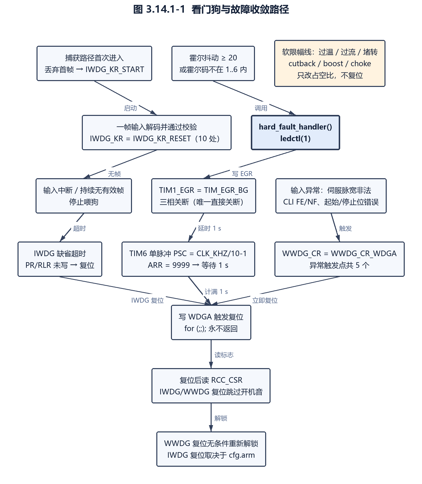

图 3.14.1-1 看门狗与故障收敛路径

### 3.14.2 保护动作与安全性（需求规格）

保护的对外效果分两条通路：限幅量通路（`cutback` 压缩占空比上限与刹车占空比，`boost` 抬升、`choke` 压低当前占空比指令）与解锁通路（`rearm` 标志位把油门输入钳零并强制重新走 250 ms 零油门解锁）。两条通路都不改写三相桥臂状态。

- 需求标识：ESC-SREQ6
- 功能描述：复位来源在上电时被判别并影响启动提示与解锁要求，看门狗复位不得被当作正常上电处理（需求规格）。
- 调用条件：`main()` 完成传感器等待、进入启动提示阶段之前。
- 输入：`RCC_CSR` 复位标志寄存器。
- 输出：开机提示音的播放或跳过、是否强制进入解锁流程。
- 处理：
- （1）在清除复位标志之前先读出 `RCC_CSR` 并保存；
- （2）写 `RCC_CSR_RMVF` 清除复位标志；
- （3）若 IWDG 复位标志与 WWDG 复位标志均未置位（视为上电），按 `cfg.music` 播放开机音乐，并在启用电压保护时以提示音报告电池节数；
- （4）若为 IWDG 或 WWDG 复位，则跳过开机提示音，避免异常复位后的提示被误读为正常启动；
- （5）WWDG 复位无条件要求重新完成解锁流程；IWDG 复位是否要求解锁取决于 `cfg.arm`；
- （6）进入启动流程前以 `while (!ready) __WFI();` 等待传感器采样就绪；
- （7）运行期低压切断置位 `rearm` 后，主循环在电机停止时跳转回解锁入口，复用同一流程。

> 证据：src/main.c:614-631、src/main.c:842

- 需求标识：ESC-SREQ7
- 功能描述：除硬故障外，所有保护的动作对象是三个限幅量与一个标志位，没有任何保护路径直接关断三相输出（需求规格）。
- 调用条件：过温、过流、低压、堵转等任一保护条件成立。
- 输入：温度采样、电流采样、电压采样、换相间隔与霍尔计数值。
- 输出：`cutback`（0..60）、`boost`（0..160）、`choke`（0..2000）、`rearm` 标志位，以及由限幅量间接影响的 PWM 占空比。
- 处理：
- （1）过温保护把 `cutback` 写为 0..60 的钳位值，该值同时压低正弦阶段功率（`120 - cutback`）、锁定／滑行阶段的刹车占空比（`100 - cutback`）与占空比上限（`2000 - cutback * 25`）；
- （2）堵转保护把 PID 输出累加进 `boost` 并钳位到 0..160，`boost` 以正项叠加到新的占空比指令上；
- （3）过流保护把 PID 输出累加进 `choke` 并钳位到 0..2000，`choke` 以负项从新的占空比指令中扣除，扣为负值时截断为 0；
- （4）低压保护不修改任何限幅量，只置位 `rearm`（见 ESC-SREQ8）；
- （5）过温、堵转、过流三路限幅量均以变量形式作用于占空比计算，三相桥臂的使能、刹车与换相状态不因保护而改变；
- （6）唯一直接关断三相的路径是硬故障处理写入 `TIM1_EGR = TIM_EGR_BG`，即 ESC-SREQ4。

> 证据：src/main.c:445-459、src/main.c:852-854、src/main.c:130、src/main.c:682、src/main.c:741、src/main.c:746

- 需求标识：ESC-SREQ8
- 功能描述：低压切断在 1 kHz 控制拍累计达 3000 次（持续约 3 s）后置位并锁存 `rearm`，只能经重新完成 250 ms 零油门解锁流程解除（需求规格）。
- 调用条件：配置了电压采样（`SENS_CNT >= 1`），且每 1 kHz 控制拍执行一次判定。
- 输入：实测电压 `volt`、`cfg.prot_volt`、`cfg.prot_cells` 推导出的电池节数。
- 输出：`cutoff` 累计计数器与 `rearm` 标志位。
- 处理：
- （1）每 1 kHz 拍比较 `volt` 与 `cfg.prot_volt * cells * 10`；低于阈值时 `cutoff` 加 1，否则 `cutoff` 清零；
- （2）`cutoff` 达到 3000 时置 `rearm = 1`，即持续约 3 s（1 kHz 拍累计 3000 次）后触发；
- （3）计数达 3000 后不再执行电压比较、不再自增，`rearm` 标志位在解锁流程中显式清零之前保持锁存，电压回升不会自动解除；
- （4）`rearm` 置位期间主循环把油门输入钳零（`input = rearm ? 0 : throt`），电机不再接受油门；
- （5）`rearm` 置位且电机已停止时跳转至解锁入口，重新完成 250 ms 零油门解锁流程后才解除锁存；
- （6）解锁流程结束后播放解锁提示音并恢复常规控制，电池节数在未配置时按每节 4.4 V 上限反推。

> 证据：src/main.c:847-850、src/main.c:662、src/main.c:842、src/main.c:631-650、src/main.c:613-615

- 需求标识：ESC-SREQ9
- 功能描述：解锁与重新解锁流程要求持续 250 ms 的零油门输入才放行，期间出现非零油门将重新装载计时窗口（需求规格）。
- 调用条件：`cfg.arm` 置位、发生 WWDG 复位、或低压切断置位 `rearm` 后电机停止。
- 输入：油门值 `throt`。
- 输出：计时窗口状态、解锁完成后的 `throt` 清零、解锁提示音。
- 处理：
- （1）把 TIM6 配为 0.1 ms 分辨率并把 `ARR` 设为 2499，即 250 ms 窗口；
- （2）把 `throt` 置为占位值 1 并轮询 TIM6 更新标志，等待期间以 `__WFI()` 挂起且执行蜂鸣调用；
- （3）若节拍内检测到非零油门，则写 `TIM6_EGR = TIM_EGR_UG` 重新装载窗口，要求重新计时；
- （4）窗口计满后把 `throt` 清零、`rearm` 清零并关闭 TIM6；
- （5）按是否为霍尔配置播放不同乐句的解锁提示音；
- （6）该流程同时承担配置复位后的安全过渡：`resetcfg()` 在写完默认值后置 `rearm = 1`，使油门模式切换必须重新解锁。

> 证据：src/main.c:631-650、src/util.c:573-580

- 需求标识：ESC-SREQ10
- 功能描述：过温、过流、堵转三路保护分别以限幅量形式按 1 kHz 更新，各自独立钳位，关闭保护项时的归零行为不一致（需求规格）。
- 调用条件：控制循环运行于 1 kHz 拍（`tick & 0xf` 分频后的节拍）；对应保护项按配置启用。
- 输入：内部／外部温度采样、电流采样 `curr`、霍尔计数 `hall` 或换相间隔 `ival`、配置项 `cfg.prot_temp`、`cfg.prot_curr`、`cfg.prot_stall`。
- 输出：`cutback`、`choke`、`boost` 三个限幅量。
- 处理：
- （1）过温保护按 `cfg.prot_sens` 在内部温度、外部温度与两者取大之间选择输入量，与 `-(cfg.prot_temp << 2)` 相加后钳位到 0..60 写入 `cutback`；
- （2）各家族的温度量纲换算按各家族实测式分列；
- （3）堵转保护使用 `{Kp=50, Ki=0, Kd=1000}` 的 PID，目标值为 `20000000 / cfg.prot_stall - 800`，反馈量在霍尔计数与换相间隔之间选择，增量右移 16 位后钳位到 0..160；
- （4）过流保护使用 `{Kp=80, Ki=0, Kd=600}` 的 PID，目标值为 `cfg.prot_curr * 100`，增量右移 10 位后钳位到 0..2000；
- （5）堵转与过流保护项关闭时对应限幅量被直接写为 0；过温保护项关闭时不重写 `cutback`，该值保持为上一次计算结果；
- （6）三路限幅量均按 1 kHz 更新，更新点位于主循环节拍内、与保护状态指示位同拍计算。

> 证据：src/main.c:445-459、src/main.c:852-854、src/main.c:656、src/main.c:658、src/main.c:864

- 需求标识：ESC-SREQ11
- 功能描述：部分保护相关分支由从未定义的宏守卫，源码存在但在当前构建中不可达；由这些宏守卫的保护主路径恒参与编译（需求规格）。
- 调用条件：编译期预处理。
- 输入：编译期宏定义集合。
- 输出：被选中的分支进入目标代码；未选中分支不产生目标代码。
- 处理：
- （1）`ANALOG` 与 `PWM_ENABLE` 在全仓从未被 `#define`，只作为条件编译判据被消费；
- （2）配置校验中 `#ifndef ANALOG` 分支恒成立，其 `#else` 分支（`cfg.arm = 0`）源码存在但不可达；
- （3）`#ifdef PWM_ENABLE` 分支（`cfg.damp = 1`）源码存在但不可达，实测恒取 `cfg.damp = !!cfg.damp`；
- （4）主循环中 `#ifndef ANALOG` 守卫的低压切断与辅助刹车超时恢复路径恒参与编译，属于可达代码；
- （5）辅助刹车超时在 100 次 1 kHz 拍后把刹车值恢复为 `cfg.duty_drag`，属可达的自动恢复动作；
- （6）同一机制下 `USE_PB1` 仅由构建系统传入且全仓零引用，`HALL1_PIN2` 预留分支因无对应 `HALL_MAP` 取值而恒不可达，均不得视为可用特性。

> 证据：`CMakeLists.txt（第 93 行）`。

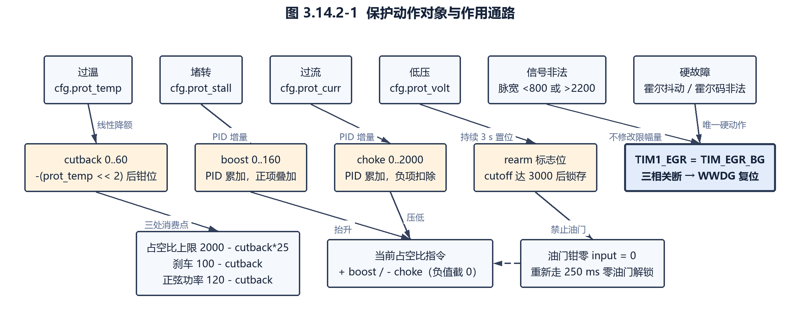

图 3.14.2-1 保护动作对象与作用通路

### 3.14.3 中断与并发安全（需求规格）

共享状态在两类位置上被保护：遥测发送缓冲（`iobuf`、`iopos`、`ioend`、`dshotval`）与定时器重装载窗口（DShot 输出延时、SBUS 收发时序）。共同做法是在多字节或多寄存器更新前后成对使用 `__disable_irq()`／`__enable_irq()`，使中断路径不会看到中间态。

- 需求标识：ESC-SREQ12
- 功能描述：遥测发送端对超长整包与忙占用采取丢弃策略，共享缓冲与响应值的更新处于中断屏蔽临界区内（需求规格）。
- 调用条件：任一模态请求发送遥测数据；或收到需要双向 DShot 响应的请求。
- 输入：待发送的数据块与长度、TX DMA 状态、响应值。
- 输出：发送缓冲下标、DMA 传输参数与响应值。
- 处理：
- （1）写入前判定本次长度是否使写指针越过缓冲末尾，越界时把长度置 0，整包丢弃且不部分写入；
- （2）缓冲写指针的更新与发送结束指针的设置均在 `__disable_irq()`／`__enable_irq()` 之间完成，避免中断路径读到中间态；
- （3）仅当本次写入落在缓冲区起始处时才据结束指针启动首段 DMA，后续数据由完成中断续传；
- （4）TX DMA 完成中断在临界区内比较发送位置与结束指针，续传剩余段或把两个指针复位回缓冲起点；
- （5）KISS 帧发送前检查 TX DMA 的使能位，通道忙时直接返回并跳过该帧，不排队、不重试；
- （6）双向 DShot 响应值的写入同样置于临界区内，且仅当当前无待发响应值时才写入，防止单次响应被后续值覆盖。

> 证据：src/telem.c:404-414、src/telem.c:126-137、src/telem.c:286-287、src/telem.c:399-401

- 需求标识：ESC-SREQ13
- 功能描述：主循环每拍末以 `SLEEPONEXIT` 加 `WFI` 挂起，由 SysTick 节拍唤醒，控制逻辑只在 1 kHz 分频拍上执行（需求规格）。
- 调用条件：每次主循环迭代末尾与 SysTick 中断到达时。
- 输入：SysTick 中断与 16 kHz 节拍计数 `tick`。
- 输出：Cortex-M 睡眠控制寄存器状态、1 kHz 分频后的控制拍处理。
- 处理：
- （1）写 `SCB_SCR = SCB_SCR_SLEEPONEXIT`，使中断退出后直接回到睡眠状态而不返回主循环取指；
- （2）执行 `__WFI()` 挂起 CPU，等待 SysTick 或其他中断唤醒；
- （3）唤醒后以 `if (tick & 0xf) continue;` 把 16 kHz 节拍分频为 1 kHz，限幅量更新、保护判定与指示输出只在 1 kHz 拍执行；
- （4）SysTick 重装载值为 `CLK_KHZ / 16 - 1`，即 16 kHz 节拍，同一节拍以更高频率驱动 ADC 触发与 LED 更新；
- （5）该结构使 CPU 在无事件期间保持挂起，实时响应由中断路径与 16 kHz 节拍共同承担。

> 证据：src/main.c:838-840、src/main.c:608-610、src/main.c:478-485

机制总述（配置参数的校验与持久化边界）：配置在启动时从 `.cfg` 区拷入 SRAM 后先经 `checkcfg()` 收敛，该函数对每个字段做窄域钳位：数值字段用 `clamp()` 收敛到各自合法区间，布尔字段归一到 0/1，互相关联的字段按先后顺序钳位（如 `freq_max` 下限取 `freq_min`、`duty_max` 下限取 `duty_min`、`throt_max` 下限取 `throt_min + 200`）；不可达或受限的取值被就地改写而不是被拒绝（如 `input_mode` 在 `DISABLE_EXBUS`／`DISABLE_HOTT` 时回落为 0）。写盘路径 `savecfg()` 在电机电气周期无效或设备忙时直接返回失败，擦写期间全程关闭中断，并在写完解锁后以逐字节比较校验结果，返回值即校验结论。配置复位 `resetcfg()` 在临界区内用默认表覆盖 `cfg`，随后调用 `checkcfg()` 并把 `rearm` 置 1 以保证油门模式切换必须重新解锁。需要注意的是，CRSF 参数写入路径以 `(void)(exp2)` 显式丢弃了字段表里声明的副作用表达式，因此经 CRSF 修改 `throt_mode`／`input_mode`／`input_ch1` 不会触发重新解锁（疑似遗漏），而经 CLI 修改走的是同一字段表、副作用生效。（对应代码：src/util.c:415-530、src/util.c:532-571、src/util.c:573-581、src/prog.c:433-437、src/main.c:559-560）

### 3.14.4 可观测性与失效模式（需求规格）

- 需求标识：ESC-SREQ14
- 功能描述：软件不设故障枚举、故障标志寄存器或错误状态上报路径，唯一对外信息是 CLI `info` 的运行量与 LED 指示（需求规格）。
- 调用条件：CLI 收到 `info` 命令时；或启用 `LED_STAT` 的节拍指示更新时。
- 输入：运行量 `temp1`／`temp2`、`volt`、`curr`、`csum`、`erpm`，以及 `cutback`、`cutoff`、`choke` 保护状态。
- 输出：CLI 文本响应与 LED 状态值。
- 处理：
- （1）`info` 依次输出固件版本号与修订号、器件名、温度（存在外部温度时附外部温度）、电压、电流、容量与 ERPM；
- （2）不存在故障码字段、故障枚举与错误标志寄存器，硬故障处理也不写任何状态位，故障事后只能经由复位来源标志间接判别；
- （3）保护状态仅以 LED 组合体现：`cutback`、`cutoff`、`choke` 任一非零时把 LED 状态值最低位置 1，构成无上位机条件下唯一的保护指示；
- （4）其余 LED 位由运行状态、锁定状态与油门方向决定，运行中与锁定中分别使用不同的闪烁周期；
- （5）保护本身不产生复位，除硬故障外不产生对外可见的关机事件，其外部表现为限幅与重新解锁两类可观测行为。

> 证据：src/prog.c:182-205、src/main.c:487-498、src/main.c:857-865

# 附录1 数据字典（用户需求）

本附录汇总本规格书正文出现过的数据项，给出可直接用于配置、对接与测试的取值口径。表中数据项名称与取值均为源码实测所得，类型取自结构体或变量声明，取值范围为经 `checkcfg()` 收敛后的实际生效域，而非 `CFG_MAP` 元表或官方文档声明的宽区间；凡源码口径与官方自述不一致处，以源码口径进表，差异登记见附表 1-8。枚举、命令号与家族常量同样以源码实测为准，凡正文以「数据字典里找」表述的内容，均可在本附录定位到具体取值与证据行号。

## 附录1.1 运行状态集合

固件没有状态枚举，也没有状态寄存器；所谓「状态」是若干全局变量的组合所隐含的运行形态。跨状态的主要变量是换相步 `step`（0 表示无换相步）、正弦阶段标志 `sine`、同步计数 `sync`（满 6 表示转速量有效）、电周期时间 `ertm`（`1e8` 为无效值）、运行标志 `running`、制动阶段 `braking`（0 前进、1 已刹车、2 可反向）、锁定量 `lock`、重新解锁标志 `rearm` 与方向标志 `reverse`。主循环是一个无限循环（`for (int curduty = 0, running = 0, braking = 2, boost = 0, choke = 0, n = 0;;)`），状态转移由每拍的判据式决定，不存在集中式的状态机描述（`src/main.c:660`）。启动与停机由 `running` 与 `step` 的组合唯一决定：`running && !step` 触发启动，`!running && step` 触发停机（`src/main.c:766`、`src/main.c:820`）。

| 序号 | 状态名 | 判据（变量与判据式） | 可观测表现 | 进入/退出条件 | 证据 |
| --- | --- | --- | --- | --- | --- |
| 1 | 上电初始化 | `main()` 已进入，外设与定时器尚未全部就绪；无状态变量可判 | 无 PWM 输出、无提示音、无换相 | 进入：上电复位后进入 `main()`；退出：TIM1 24 kHz 时基与 16 kHz SysTick 配置完毕 | `src/main.c:559-610` |
| 2 | 传感器等待 | `ready == 0`，`ready` 由 `adcdata()` 在电流零点标定完成后置 1 | 主循环尚未开始，电机不动、无换相 | 进入：`SENS_CNT >= 1` 时的 `while (!ready) __WFI();`；退出：`ready` 置位 | `src/main.c:425`、`src/main.c:612-616` |
| 3 | 锁定（disarmed） | `cfg.arm` 为真或复位源为 WWDG；等待期间 `throt` 被强制写为 1，只有输入路径主动写回 0 才算零油门 | 响应任何油门刷新 250 ms 窗口；窗口内持续调用 `beep()` | 进入：上电后 `cfg.arm 或 (csr & RCC_CSR_WWDGRSTF)` 成立，或运行期 `rearm && !running` 跳转至 `rearm:`；退出：TIM6 自然溢出（`TIM6_ARR = 2499`） | `src/main.c:631-645`、`src/main.c:842` |
| 4 | 解锁（armed） | 解锁块执行完毕后的取值：`throt == 0`、`rearm == 0`、`TIM6_CR1 == 0` | 播放解锁提示音 `"GC"` 或 `"G_GC"`，此后油门输入生效 | 进入：250 ms 零油门窗口走完；退出：低压切断置位 `rearm`、恢复出厂配置或复位 | `src/main.c:646-649`、`src/util.c:573-580` |
| 5 | 待机滑行 | 零油门（`!input`）且不满足拖刹条件：`sync >= 6 && erpm >= 800 && lock != 2` | 无拖刹力矩、`boost` 被清零、三相按滑行形态输出 | 进入：油门回零且转速仍足够；退出：油门非零进入正弦启动或六步运行 | `src/main.c:667-687` |
| 6 | 正弦启动 | `sine != 0`；`sine` 由 `scale(input, 0, range - delta, 1000 << IFTIM_XRES, ...)` 赋值 | 载波固定 24 kHz；三相占空比由 `sinedata[]` 驱动，相角在 1..360 之间循环 | 进入：油门落入 `sine_range` 定义区段；退出：本拍算出 `newduty != 0`，临界区内反推六步相位后清除 `sine` 与 `prep` | `src/main.c:709-738`、`src/main.c:118-136` |
| 7 | 六步运行（无感） | `sine == 0` 且（未启用 `HALL_MAP` 或 `hall <= 4000`）且 `step != 0` | 由 BEMF 过零中断装定换相延时并推进相序 | 进入：无刷启动分支置 `step = oldstep` 并置位换相中断使能位 `TIM_DIER_COMIE`；退出：`!running && step` 触发停机 | `src/main.c:804-819`、`src/main.c:820-836`、`src/main.c:355-375` |
| 8 | 六步运行（有感混合） | `HALL_MAP` 已定义、`hall > 4000` 且 `step != 0` | 换相步由霍尔码查表 `map[code - 1][reverse]` 直接决定，间隔按 `hall = (TIM3_CCR1 + hall * 3) >> 2` 平滑 | 进入：`!brushed && getcode() != 7` 时配置 TIM3 捕获；退出：霍尔超时把 `hall` 置 `0x10000` 回到无感路径 | `src/main.c:590-606`、`src/main.c:162-166`、`src/main.c:401-420` |
| 9 | 主动拖刹 | `lock != 0`（`lock` 复制自 `cfg.duty_lock`）且满足 `sync < 6 或 erpm < 800 或 lock == 2` | `curduty = lock ? min(brake, 100 - cutback) : brake * 20`，其中 `brake` 复制自 `cfg.duty_drag` | 进入：零油门且转速不足或 `duty_lock == 2`（硬拖刹）；退出：油门非零；运行中改 `duty_lock` 时先执行 `laststep()` | `src/main.c:673-685`、`src/main.c:564`、`src/main.c:669-672` |
| 10 | 比例刹车 | `input < 0` 且（`throt_mode == 3` 或 `throt_mode == 2 && braking != 2`） | `braking = 1`、`running = 0`，`curduty` 在 `throt_brk*20` 与 `duty_drag*20` 之间按油门插值 | 进入：反向油门落入刹车区间；退出：油门回零后 `braking == 1` 被改写为 2，恢复可反向 | `src/main.c:694-700`、`src/main.c:668` |
| 11 | 反向运行 | `input < 0` 且未进入比例刹车，`reverse = !cfg.revdir ^ flipdir` | 相序反向推进；反向油门幅度按 `input * (cfg.throt_rev - 4) >> 2` 缩比 | 进入：反向油门、`revdir` 配置或 DShot 命令 20/21（`flipdir`）；退出：油门回零 | `src/main.c:701-707`、`src/io.c:479-486` |
| 12 | 停车换向（`prot_park`） | `cfg.prot_park` 非零且 `park()` 返回 1（状态机变量 `park1`/`park2`/`park3`） | 停车阶段以 `sine = (1000 << IFTIM_XRES) / cfg.prot_park` 推进相间、`erpm = 0`；换向瞬间翻转 `reverse` | 进入：零油门且 `park()` 状态机推进（`park1` 0→1→2→3）；退出：`park3` 递减到 0。`PARK_PIN` 在锚定提交无任何 target 定义，该状态**源码存在但不可达** | `src/main.c:521-556`、`src/main.c:674-680`、`src/util.c:517-521` |
| 13 | 失步复位 | `step != 0` 时每 6 次换相比较一次：`abs(val - ival) > ival >> 1`（偏差超过 50%） | `sync` 与 `fast` 清零、`ival = 5000 << IFTIM_XRES`、`ertm = 100000000` | 进入：换相间隔突变超过 50%；退出：重新累计 `sync` 满 6 并重算 `ertm` | `src/main.c:266-278` |
| 14 | BEMF/霍尔超时复位 | IFTIM 更新中断置位（`TIM_DIER_UIE && TIM_SR_UIF`）或 TIM3 更新中断置位 | `sync = 0`、`fast = 0`、`ival = 10000 << IFTIM_XRES`、`ertm = 100000000`；霍尔路径另置 `hall = 0x10000` | 进入：过零或霍尔事件超时；退出：重新捕获事件后重算间隔 | `src/main.c:380-387`、`src/main.c:403-411` |
| 15 | 硬故障 | 霍尔码不在 1..6，或 `getcode()` 累计 20 次电平变化（抖动） | `ledctl(1)` 点亮告警、三相刹车、1 s 后触发看门狗复位且不返回 | 进入：`hard_fault_handler()` 被调用；退出：无（末尾 `for (;;);`） | `src/main.c:487-498`、`src/main.c:93-103`、`src/main.c:162-166` |
| 16 | 命令行会话（CLI） | 输入引脚空闲高电平累计 `c >= 16`（约 1 s）后 `ioirq = cliirq`，随后按 38400 波特解析 | 回显并对 `help`、`info`、`show`、`get`、`set`、`save`、`reset`、`play`、`throt`、`beep` 作出应答 | 进入：空闲高电平约 1 s；退出：帧错、噪声错或缓冲将满时写 `WWDG_CR = WWDG_CR_WDGA` 复位；收到 `0x00 0xff` 则 `scb_reset_system()` 进入 bootloader | `src/io.c:113-143`、`src/io.c:953-964`、`src/prog.c:155-167` |
| 17 | 编程器会话（CRSF 参数读写） | `telmode == 4` 且收到 0x2c（Read）或 0x2d（Write）帧 | 经 `execcrsfcmd()` 读写 `CFG_MAP` 列出的 47 个可写字段，写入后立即 `checkcfg()` 并回填收敛值 | 进入：`src/io.c:801-810` 的分支成立；退出：帧结束 | `src/io.c:801-810`、`src/prog.c:363`、`src/prog.c:331-334` |
| 18 | 音乐与提示音播放 | `busy` 标志为 0 且调用方给出非零音量；`playmusic()` 以 `busy = 1` 独占，播放结束复位 `busy = 0` | 开机音乐、解锁提示音、`beep()` 数字播报与 DShot 信标均经此状态；播放结束后把载波恢复为 `TIM1_ARR = CLK_KHZ / 24 - 1` | 进入：`playmusic()`/`playsound()` 调用且 `!vol 或 ertm 或 busy` 不成立；退出：乐句解析完毕或非法字符中断 | `src/util.c:610-670`、`src/util.c:672-712`、`src/main.c:504-519`、`src/main.c:620-627` |

附表 1-1 运行状态集合

上表所列「状态」之间没有互斥的状态字，多个状态可在同一拍同时成立（例如正弦启动期间 `running` 已为 1，拖刹期间 `step` 仍非 0）；判据列给出的是该形态成立的最小变量组合，可观测表现列给出的是对外可见的结果。第 12 项所列停车换向的整条路径由 `PARK_PIN` 守卫，该宏在锚定提交中无任何 target 定义，因此 `cfg.prot_park` 经 `checkcfg()` 后恒为 0，其分支不参与编译。

## 附录1.2 保护项、阈值与动作

固件对外的保护动作只有两类载体：三个限幅量（`cutback` 0..60、`boost` 0..160、`choke` 0..2000）与一个标志位 `rearm`。限幅量都以变量形式进入占空比计算，不改变三相桥臂的使能、刹车与换相状态；`rearm` 把油门输入钳零并强制重走 250 ms 零油门解锁流程。阈值均由 `checkcfg()` 按采样路数、驱动形态与硬件宏收敛，不满足前置条件的保护项归于 0（关闭）而不报错。

| 序号 | 保护项 | 配置字段 | 触发判据与阈值 | 动作对象 | 动作性质 | 恢复条件 | 证据 |
| --- | --- | --- | --- | --- | --- | --- | --- |
| 1 | 过温降额 | `prot_temp`（0 关闭，或 60..140 ℃）、`prot_sens`（0 ESC / 1 电机 / 2 取大） | `x = -(cfg.prot_temp << 2) + {(t 或 u 或 max(t,u))}`，`cutback = clamp(x, 0, 60)`；`cutback` 满 60 相当于超出阈值 15 ℃ 时降额 50% | `cutback` 同时压低正弦功率（`120 - cutback`）、锁定/滑行阶段刹车占空比（`min(brake, 100 - cutback)`）与占空比上限（`2000 - cutback * 25`） | 软限幅 | 温度回落到阈值以下时 `x < 0`，`cutback` 归 0；`prot_temp == 0` 时不重写 `cutback`，该量保持上次取值（初值 0） | `src/main.c:445-459`、`src/main.c:130`、`src/main.c:682`、`src/main.c:746`、`src/util.c:499`、`src/util.c:500-504` |
| 2 | 堵转补偿 | `prot_stall`（0 关闭，或 1500..3500 ERPM，仅无刷） | PID `{Kp=50, Ki=0, Kd=1000}`，目标值 `20000000 / cfg.prot_stall - 800`，反馈量 `hall > 4000 ? hall : ival >> IFTIM_XRES`，增量右移 16 位后 `clamp(..., 0, 160)` | `boost`，以正项叠加到新占空比指令 `newduty += boost - choke` 上（上限约 8%） | 软限幅（抬升补偿） | `prot_stall == 0` 时 `boost` 直接写 0；否则 PID 每 1 kHz 拍持续收敛 | `src/main.c:852`、`src/main.c:656`、`src/main.c:741`、`src/util.c:498` |
| 3 | 过流削减 | `prot_curr`（0..999 A，需 `SENS_CNT >= 2`） | PID `{Kp=80, Ki=0, Kd=600}`，目标值 `cfg.prot_curr * 100`，反馈量 `curr`，增量右移 10 位后 `clamp(..., 0, 2000)` | `choke`，以负项从新占空比指令中扣除，扣为负值时截断为 0 | 软限幅（压低） | `prot_curr == 0` 时 `choke` 直接写 0；否则每 1 kHz 拍持续收敛 | `src/main.c:854`、`src/main.c:658`、`src/main.c:741`、`src/util.c:512-516` |
| 4 | 低压切断 | `prot_volt`（0 关闭，或 28..38，单位 0.1 V）、`prot_cells`（0 自动，或 1..24） | 每 1 kHz 拍比较 `volt < cfg.prot_volt * cells * 10`，成立则 `cutoff` 加 1，达 3000（约 3 s）置 `rearm = 1` | `rearm` 标志位；置位期间 `input = rearm ? 0 : throt` | 重解锁 | 必须重新完成 250 ms 零油门解锁流程；`cutoff` 达 3000 后不再参与比较，电压回升不会自动解除 | `src/main.c:848-849`、`src/main.c:662`、`src/main.c:842`、`src/main.c:631-650`、`src/util.c:505-511` |
| 5 | 电芯数识别与播报 | `prot_cells`、`prot_volt` | `cells = cfg.prot_cells`；为 0 时按每节最高 4.4 V 反推 `cells = (volt + 439) / 440` | `beepval`，经 `beep()` 播报数字提示音 | 软动作（信息播报，非保护） | 不适用；播报后 `beepval = -1` | `src/main.c:613-615`、`src/main.c:624-628`、`src/main.c:504-519` |
| 6 | 外部温度采样启用 | `prot_sens`（仅 `SENS_CNT >= 3`） | `hall 或 cfg.prot_sens` 为真才换算 `temp2`；`prot_sens` 取 0/1/2 决定过温判据取 ESC 温度、电机温度或两者取大 | `temp2`，并作为第 1 项的判据输入 | 软限幅（过温通路的输入选择） | `SENS_CNT < 3` 时 `checkcfg()` 强制 `prot_sens = 0` | `src/main.c:431`、`src/main.c:447-457`、`src/util.c:500-504` |
| 7 | 停车换向 | `prot_park`（0..4，仅 `PARK_PIN`） | `cfg.prot_park` 非零且 `park()` 返回 1；停车间隔 `sine = (1000 << IFTIM_XRES) / cfg.prot_park`，`park2` 每阶段等待 800 次、`park3` 由 `0xFFFF` 递减 | 相间推进间隔 `sine`、`erpm`、`reverse` | 软动作（换向） | `park3` 递减到 0 后回到零油门判定；`PARK_PIN` 无 target 定义，源码存在但不可达，`prot_park` 实际恒 0 | `src/main.c:521-556`、`src/main.c:674-680`、`src/main.c:689-692`、`src/util.c:517-521` |
| 8 | 非法伺服信号 | `input_mode == 0`（伺服/Oneshot125/DShot 通道） | 脉宽 `x < 800` 或 `x > 2200`（us）且电机已停（`ertm == 0`） | `WWDG_CR = WWDG_CR_WDGA` | 复位（经复位间接关断三相） | 无（芯片复位）；电机运行中不触发，直接返回 | `src/io.c:290-302` |
| 9 | 霍尔信号非法与抖动 | `HALL_MAP` 已定义 | 霍尔码 `code < 1 或 code > 6`；或 `getcode()` 累计 20 次电平变化（注释 `Unstable signal`），每次变化后需连续 4 次同值才通过 | `hard_fault_handler()` | 关断三相（硬故障） | 无（不返回） | `src/main.c:162-166`、`src/main.c:93-103` |
| 10 | 失步 | 无配置字段 | 每 6 次换相比较一次：`abs(val - ival) > ival >> 1` | `sync`、`fast`、`ival`、`ertm` | 复位（同步状态） | 重新累计 `sync` 满 6 后由 6 段间隔之和重算 `ertm` | `src/main.c:266-278`、`src/main.c:322-324` |
| 11 | BEMF 与霍尔超时 | 无配置字段 | IFTIM 更新中断置位（`TIM_DIER_UIE && TIM_SR_UIF`）或 TIM3 更新中断置位 | `sync`、`fast`、`ival`、`ertm`；霍尔路径另置 `hall = 0x10000` | 复位（同步状态） | 重新捕获过零事件或霍尔边沿后重算间隔 | `src/main.c:380-387`、`src/main.c:403-411` |
| 12 | 遥测整包超长 | 无配置字段 | `pos + len > iobuf + sizeof iobuf`（发送缓冲 128 字节） | 待发数据长度置 0，整包丢弃 | 软动作（丢弃） | 下一次发送重新组包；已排队内容不受影响 | `src/telem.c:404-411` |
| 13 | KISS 帧发送冲突 | 无配置字段 | TX DMA 处于使能状态（`DMA_CCR_EN` 置位） | 直接跳过本次 KISS 发送 | 软动作（跳过） | TX 空闲后的下一个 32 ms 周期恢复发送 | `src/telem.c:286-301` |
| 14 | DShot 帧非法 | 无配置字段 | 位间隔 `buf[i] >= 2 * 位时间`（脉冲时序非法），或 `dshotcrc()` 校验失败 | `dshotresync()` → `dshotreset()`，重置捕获与 DMA | 软动作（重同步） | 下一帧重新解析；本帧油门与命令均不采纳 | `src/io.c:409-423`、`src/io.c:324-348` |
| 15 | CLI 帧错、噪声与缓冲将满 | 无配置字段 | USART 帧错或噪声错，或接收索引 `i == sizeof iobuf - 1`；位级解码路径下起始位为高、停止位为低同样触发 | `WWDG_CR = WWDG_CR_WDGA` | 复位 | 无（芯片复位） | `src/io.c:953`、`src/io.c:1002`、`src/io.c:1011` |
| 16 | IWDG 独立看门狗 | 无配置字段 | 首帧有效输入启动（`IWDG_KR = IWDG_KR_START`）；此后仅在成功解码一帧后喂狗（`IWDG_KR = IWDG_KR_RESET`） | 芯片复位 | 复位 | 无（复位）；输入持续有效即持续喂狗 | `src/io.c:169`、`src/io.c:267`、`src/io.c:293`、`src/io.c:301`、`src/io.c:424`、`src/io.c:625`、`src/io.c:701`、`src/io.c:767`、`src/io.c:799`、`src/io.c:893`、`src/io.c:914` |
| 17 | 硬故障统一动作 | 无配置字段 | 霍尔码非法或霍尔抖动累计 20 次电平变化 | 先 `ledctl(1)` 指示，再 `TIM1_EGR = TIM_EGR_BG` 刹车关断三相，随后等待 1 s 并触发 WWDG 复位 | 关断三相 + 复位 | 无（`for (;;);` 不返回） | `src/main.c:487-498` |
| 18 | 辅助刹车超时恢复 | `duty_drag` | `++auxup == 100`，即 100 次 1 kHz 拍（100 ms） | `brake` 恢复为 `cfg.duty_drag` | 自动恢复（回到标称刹车量） | 触发即恢复，计数器清零 | `src/main.c:843-846`、`src/main.c:563` |

附表 1-2 保护项、阈值与动作

上表的动作性质一列区分的是「改写限幅量」「改写标志位」「复位芯片」与「关断三相」四种载体。过温、堵转、过流三路都只改写限幅量，其中过温项在关闭时不重写 `cutback`，堵转与过流项在关闭时把对应限幅量直接写 0，这一不一致见正文 3.14.2。低压切断只置位 `rearm`，不改写任何限幅量。失步与超时属于同步状态复位，只影响 `sync`/`fast`/`ival`/`ertm` 四个变量，不产生对外信号。

对固件整体而言：无故障枚举、无故障码；软动作只有 `cutback`/`boost`/`choke` 三个限幅量与 `rearm` 标志；唯一直接关断三相的是硬故障路径，其顺序为 `ledctl(1)` → `TIM1_EGR = TIM_EGR_BG` → TIM6 单脉冲 1 s（`TIM6_PSC = CLK_KHZ / 10 - 1`、`TIM6_ARR = 9999`、`TIM6_CR1 = TIM_CR1_CEN | TIM_CR1_OPM`）→ `WWDG_CR = WWDG_CR_WDGA`，函数末尾 `for (;;);` 不返回。除该路径外，其余保护一律不改变三相桥臂状态，`info` 命令输出的只是运行量，不含任何错误状态位（`src/main.c:487-498`、`src/prog.c:182-205`）。

## 附录1.3 配置字段 `Cfg`

全部运行参数由单一结构体 `Cfg` 承载，头部 5 个只读字段之后是 47 个可写字段；默认值由 `defs.h` 的 `#ifndef` 保护宏块给出，目标板文件可在编译期覆盖。写入路径（CLI `set` 与 CRSF Write）在赋值后立即调用 `checkcfg()`，因此下表「实际生效范围」一列即回读可见的最终取值。类型取自 `Cfg` 声明，量纲取自源码注释与 `CFG_MAP`，两者不一致处在单位列内并列标出。

| 序号 | 字段 | 类型 | 实际生效范围（收敛域） | 默认值 | 单位 | 生效条件 | 证据 |
| --- | --- | --- | --- | --- | --- | --- | --- |
| 1 | `arm` | char | 0/1 | `ARM` = 1 | — | `IO_ANALOG` 为真时强制 1；编译开关 `ANALOG` 下强制 0 | `src/util.c:416-424`、`src/defs.h:105-107` |
| 2 | `damp` | char | 0/1 | `DAMP` = 1 | — | 定义 `PWM_ENABLE` 时强制 1（该宏不可达，实测恒为布尔归一化） | `src/util.c:425-429`、`src/defs.h:108-110` |
| 3 | `revdir` | char | 0/1 | `REVDIR` = 0 | — | 恒做布尔归一化 | `src/util.c:430`、`src/defs.h:111-113` |
| 4 | `brushed` | char | 0/1 | `BRUSHED` = 0 | — | 联动 `sine_range`、`duty_lock`、`throt_mode`、`prot_stall`、`duty_spup`、`duty_ramp` 六项 | `src/util.c:431`、`src/defs.h:114-116` |
| 5 | `timing` | char | 1..31 | `TIMING` = 16 | — | 恒钳位 | `src/util.c:432`、`src/defs.h:117-119` |
| 6 | `sine_range` | char | 0 或 5..25 | `SINE_RANGE` = 0 | % | 有刷强制 0；1..4 被静默改写为 5 | `src/util.c:433`、`src/defs.h:120-122` |
| 7 | `sine_power` | char | 1..15 | `SINE_POWER` = 8 | % | 恒钳位 | `src/util.c:434`、`src/defs.h:123-125` |
| 8 | `freq_min` | char | 16..48 | `FREQ_MIN` = 24 | kHz | 恒钳位 | `src/util.c:435`、`src/defs.h:126-128` |
| 9 | `freq_max` | char | `freq_min`..96 | `FREQ_MAX` = 48 | kHz | 下界随 `freq_min` 浮动 | `src/util.c:436`、`src/defs.h:129-131` |
| 10 | `duty_min` | char | 1..100 | `DUTY_MIN` = 1 | % | 恒钳位；部分 target 编译期覆盖为 100 | `src/util.c:437`、`src/defs.h:132-134`、`CMakeLists.txt（第 60 行）` |
| 11 | `duty_max` | char | `duty_min`..100 | `DUTY_MAX` = 100 | % | 下界随 `duty_min` 浮动 | `src/util.c:438`、`src/defs.h:135-137` |
| 12 | `duty_spup` | char | 1..100 | `DUTY_SPUP` = 15 | % | 恒钳位；有刷模式下该量不生效 | `src/util.c:439`、`src/defs.h:138-140`、`src/main.c:801` |
| 13 | `duty_ramp` | char | 0..100 | `DUTY_RAMP` = 0 | kERPM | 恒钳位；取 0 时启动限幅等效关闭；有刷模式下不生效 | `src/util.c:440`、`src/defs.h:141-143`、`src/main.c:746-747` |
| 14 | `duty_rate` | char | 1..100 | `DUTY_RATE` = 30 | 0.1 %/ms（CLI 元表标为 %/ms） | 恒钳位；每 8 拍步长合计等于该值，`fast` 置位时立即到位 | `src/util.c:441`、`src/defs.h:144-146`、`src/main.c:41`、`src/main.c:748-752`、`src/prog.c:34` |
| 15 | `duty_drag` | char | 0..100 | `DUTY_DRAG` = 0 | % | 恒钳位，同时是 `throt_brk` 的下界 | `src/util.c:442`、`src/util.c:446`、`src/defs.h:147-149` |
| 16 | `duty_lock` | char | 0..2 | `DUTY_LOCK` = 0 | — | 有刷强制 0；决定 `throt_mode` 的上限 | `src/util.c:443-444`、`src/defs.h:150-152` |
| 17 | `throt_mode` | char | 0..(`IO_ANALOG` ? 0 : (`duty_lock` ? 1 : 3)) | `THROT_MODE` = 0 | — | 模拟输入或主动拖刹开启时上限收窄 | `src/util.c:444`、`src/defs.h:153-155` |
| 18 | `throt_rev` | char | 0..3 | `THROT_REV` = 0 | — | 恒钳位；反向油门按 `(throt_rev - 4) / 4` 缩比 | `src/util.c:445`、`src/defs.h:159-161`、`src/main.c:701` |
| 19 | `throt_brk` | char | `duty_drag`..100 | `THROT_BRK` = 100 | % | 下界随 `duty_drag` 浮动 | `src/util.c:446`、`src/defs.h:162-164` |
| 20 | `throt_set` | char | 0..(`arm` ? 0 : 100) | `THROT_SET` = 0 | % | 需要解锁时强制 0 | `src/util.c:447`、`src/defs.h:165-167` |
| 21 | `throt_ztc` | char | 0/1 | `THROT_ZTC` = 0 | — | 恒做布尔归一化 | `src/util.c:448`、`src/defs.h:156-158` |
| 22 | `throt_cal` | char | 0/1 | `THROT_CAL` = 1（`USE_HSE` 时 0） | — | 恒做布尔归一化；置位时伺服脉宽用于 HSI 校准 | `src/util.c:449`、`src/defs.h:168-174`、`src/io.c:264-282` |
| 23 | `throt_min` | uint16_t | 900..1900 | `THROT_MIN` = 1000 | us | 恒钳位 | `src/util.c:450`、`src/defs.h:175-177` |
| 24 | `throt_mid` | uint16_t | `throt_min` + 100..`throt_max` − 100 | `THROT_MID` = 1500 | us | 双向模式下生效；上下界随 `throt_min`/`throt_max` 浮动 | `src/util.c:452`、`src/defs.h:178-180` |
| 25 | `throt_max` | uint16_t | `throt_min` + 200..2100 | `THROT_MAX` = 2000 | us | 下界随 `throt_min` 浮动 | `src/util.c:451`、`src/defs.h:181-183` |
| 26 | `analog_min` | uint16_t | 0..3200 | `ANALOG_MIN` = 100 | mV | 恒钳位；部分 target 编译期覆盖 | `src/util.c:453`、`src/defs.h:184-186`、`CMakeLists.txt（第 60 行）` |
| 27 | `analog_max` | uint16_t | `analog_min` + 200..3400 | `ANALOG_MAX` = 3200 | mV | 下界随 `analog_min` 浮动 | `src/util.c:454`、`src/defs.h:187-189` |
| 28 | `input_mode` | char | `IO_PA2` 平台：0..7（`DISABLE_EXBUS` 把 6 归 0、`DISABLE_HOTT` 把 7 归 0，故 6/7 可被裁剪为 0）；`IO_PA6`/`ANALOG_CHAN` 平台：0..1；其余平台：0 | `INPUT_MODE` = 0 | — | 平台能力决定可选档位；切换后置 `rearm` 要求重新解锁 | `src/util.c:455-473`、`src/defs.h:190-192`、`src/prog.c:48` |
| 29 | `input_ch1` | char | 0 或 1..32。`input_mode < 3` 或非 `IO_PA2` 平台时恒 0；否则下限为 1 | `INPUT_CH1` = 0 | — | 随 `input_mode` 变化；可被裁剪为 0 | `src/util.c:463`、`src/util.c:471`、`src/defs.h:193-195` |
| 30 | `input_ch2` | char | 0..32。非 `IO_PA2` 平台或 `input_mode < 3` 时恒 0 | `INPUT_CH2` = 0 | — | 随 `input_mode` 变化 | `src/util.c:464`、`src/util.c:472`、`src/defs.h:196-198` |
| 31 | `telem_mode` | char | 0..6（`DISABLE_MSB` 把 5 归 0、`DISABLE_HOTT` 把 6 归 0） | `TELEM_MODE` = 0 | — | 编译期裁剪 | `src/util.c:474-480`、`src/defs.h:199-201`、`src/prog.c:51` |
| 32 | `telem_phid` | char | iBUS/MSB 模式 1..2；S.Port 1..28；CRSF 1..8；SBUS 输入 0..4；其余情形 0 | `TELEM_PHID` = 0 | — | 随 `telem_mode` 与 `input_mode` 切换 | `src/util.c:481-486`、`src/defs.h:202-204` |
| 33 | `telem_poles` | char | 偶数 2..100 | `TELEM_POLES` = 14 | — | 先做 `& ~1` 强制偶数，再钳位；奇数被静默改为小一位偶数 | `src/util.c:487`、`src/defs.h:205-207` |
| 34 | `telem_volt` | int16_t | −80..160（`SENS_CNT >= 1`），否则 0 | `TELEM_VOLT` = 0 | 约 0.6%/单位 | 需电压采样通道 | `src/util.c:488-492`、`src/defs.h:208-210` |
| 35 | `telem_curr` | int16_t | −100..200（`SENS_CNT >= 2`），否则 0 | `TELEM_CURR` = 0 | 约 0.5%/单位 | 需电流采样通道 | `src/util.c:493-497`、`src/defs.h:211-213` |
| 36 | `prot_stall` | uint16_t | 0 或 1500..3500 | `PROT_STALL` = 0 | ERPM | 有刷强制 0；非 0 时 1..1499 被改写为 1500 | `src/util.c:498`、`src/defs.h:214-216` |
| 37 | `prot_temp` | char | 0 或 60..140 | `PROT_TEMP` = 0 | ℃ | 1..59 被静默改写为 60 | `src/util.c:499`、`src/defs.h:217-219` |
| 38 | `prot_sens` | char | 0..2（仅 `SENS_CNT >= 3`） | `PROT_SENS` = 0 | — | 需外部温度通道，否则恒 0 | `src/util.c:500-504`、`src/defs.h:220-222` |
| 39 | `prot_volt` | char | 0 或 28..38（`SENS_CNT >= 1` 且未定义 `ANALOG`） | `PROT_VOLT` = 0 | 0.1 V（V/10；CLI 元表标为 V） | 无电压采样即 0；1..27 被改写为 28 | `src/util.c:505-511`、`src/defs.h:223-225`、`src/main.c:66`、`src/prog.c:59` |
| 40 | `prot_cells` | char | 0..24（条件同第 39 项） | `PROT_CELLS` = 0 | — | 0 表示按每节 4.4 V 自动识别 | `src/util.c:505-511`、`src/util.c:507`、`src/defs.h:226-228` |
| 41 | `prot_curr` | uint16_t | 0..999（`SENS_CNT >= 2`） | `PROT_CURR` = 0 | A | 无电流采样即 0 | `src/util.c:512-516`、`src/defs.h:229-231` |
| 42 | `prot_park` | char | 0..4（仅 `PARK_PIN`） | `PROT_PARK` = 0 | — | 无停车引脚即 0；`PARK_PIN` 无 target 定义，实际恒 0 | `src/util.c:517-521`、`src/defs.h:232-234` |
| 43 | `music` | char[256] | 自由字符串，无收敛 | `MUSIC` = `"dfa#"` | — | 首字符为 `~` 时其后十进制数走 PCM 路径，否则按乐句解析 | `src/defs.h:235-237`、`src/main.c:620-622`、`src/util.c:610-670` |
| 44 | `volume` | char | 0..100 | `VOLUME` = 25 | % | 数字播报另有 25 的音量下限 | `src/util.c:522`、`src/defs.h:238-240`、`src/main.c:512` |
| 45 | `beacon` | char | 0..100 | `BEACON` = 50 | % | 恒钳位；DShot 命令 1..5 会装载对应信标曲调 | `src/util.c:523`、`src/defs.h:241-243`、`src/io.c:440-446` |
| 46 | `bec` | char | `BEC_MIN`..`BEC_MAX`（缺省 0..3；无 `BEC_MAP` 时恒 0） | `BEC` = 0 | — | 需 BEC 引脚；`BEC_MIN` 为 1 的 target 收敛域为 1..4 | `src/util.c:524-528`、`src/defs.h:96-101`、`src/defs.h:244-246` |
| 47 | `led` | char | 0..(1 << `LED_CNT`) − 1 | `LED` = 0 | — | 位宽随硬件灯数；非 0 时作为 LED 显示强制值覆盖自动指示 | `src/util.c:529`、`src/defs.h:68-82`、`src/defs.h:247-249`、`src/main.c:483` |

附表 1-3 配置字段 `Cfg`

上表序号与 `Cfg` 结构体字段声明顺序一致（`src/common.h:62-108`），也与 `CFG_MAP` 元表序号一一对应（`CFG_MAP` 索引 0 对应本表第 1 项，`src/prog.c:20-67`）。按此顺序，`telem_poles` 是第 33 个字段，`bec` 是第 46 个字段。结构体头部另有 5 个只读字段：`id` = 0x32ea、`revision` = 17、`revpatch` = 3、`name` = `TARGET_NAME`、`_null`；这 5 个字段不在 `CFG_MAP` 中，因而不存在对应的 CLI 参数名与 CRSF 子地址，**不可经 CLI 或 CRSF 写入**，只随固件镜像生成（`src/common.h:56-61`、`src/main.c:20-27`、`src/prog.c:20-67`）。

表中默认值为 `defs.h` 宏块的缺省，实际镜像会因 target 行覆盖而不同：锚定提交中仅 `AART1` 覆盖 `ARM`、`VOLUME`、`INPUT_MODE`、`ANALOG_MIN`、`ANALOG_MAX`、`DUTY_MIN`、`DUTY_SPUP`，`PHOTONDRIVE1` 覆盖 `DUTY_SPUP`、`DUTY_RATE`、`PROT_TEMP`，去重后共 9 项（`ARM`、`VOLUME`、`INPUT_MODE`、`ANALOG_MIN`、`ANALOG_MAX`、`DUTY_MIN`、`DUTY_SPUP`、`DUTY_RATE`、`PROT_TEMP`），其余 38 项的镜像值等于本表默认值（`CMakeLists.txt（第 60 行）`、`CMakeLists.txt（第 93 行）`、`src/defs.h:105-249`）。`CFG_MAP` 元表声明的范围宽于上表收敛域，凡落入窄区间的值被静默改写且无错误码，差异明细登记于附表 1-8。

## 附录1.4 常量与枚举

本节的取值分四类：输入与遥测通道的档位、DShot 命令号及其实现语义、配置字段的枚举档位、家族时基与 BEMF 捕获常量。输入与遥测档位的字符串名称取自 `CFG_MAP` 元表，通信参数取自各分支的初始化代码；DShot 命令号取自 `dshotirq()` 的 `switch (cmd)`；配置枚举的名称同取自 `CFG_MAP`，实现语义取自消费点。凡「源码存在但不可达」的分支均在实现语义列内标明。

| 序号 | 分组 | 项 | 取值 | 实现语义 | 证据 |
| --- | --- | --- | --- | --- | --- |
| 1 | 输入模式 `input_mode` | 0 | servo / Oneshot125 / DShot | 按脉宽解码：脉宽大于 2000 且满足 8 次采样后转伺服/Oneshot125；否则按位宽落入 DShot 路径 | `src/main.c:55`、`src/io.c:224-258` |
| 2 | 输入模式 `input_mode` | 1 | analog | 模拟电压输入，`throt = scale(smooth(...,5), analog_min, analog_max, throt_set*20, 2000)`；仅 `IO_PA2`/`IO_PA6`/`ANALOG_CHAN` 平台可选 | `src/main.c:55`、`src/main.c:460-461`、`src/io.c:160-166` |
| 3 | 输入模式 `input_mode` | 2 | serial | 通用串口，波特率取 `SERIAL_BR` 缺省 460800 | `src/io.c:175-178`、`src/defs.h:87-89` |
| 4 | 输入模式 `input_mode` | 3 | iBUS | 115200 波特，`ibusfunc` 解析，按 `input_ch1`/`input_ch2` 选择油门与辅助通道 | `src/io.c:179-182`、`src/io.c:681-684` |
| 5 | 输入模式 `input_mode` | 4 | SBUS / SBUS2 | 100000 波特、8E2、收发反相；`telem_phid` 在该模式下取 0..4 作为 SBUS2 遥测物理 ID | `src/io.c:183-196`、`src/util.c:486` |
| 6 | 输入模式 `input_mode` | 5 | CRSF | 416666 波特，支持 0x2c Read 与 0x2d Write 参数读写 | `src/io.c:197-200`、`src/io.c:807-810` |
| 7 | 输入模式 `input_mode` | 6 | EXBUS | 125000 波特；`DISABLE_EXBUS` 定义时该档被改写为 0（宏不可达，仅源码路径存在） | `src/io.c:201-206`、`src/util.c:457-459` |
| 8 | 输入模式 `input_mode` | 7 | HoTT | 115200 波特；`DISABLE_HOTT` 定义时该档被改写为 0，`AART1`/`AIRBOT2` 等 target 已裁剪 | `src/io.c:207-212`、`src/util.c:460-462`、`CMakeLists.txt（第 60、62 行）` |
| 9 | 输入模式 `input_mode` | DShot 速率档位 | 按编译期自动探测的速率档位解析 | 位速率数值：待实测。位宽与帧宽在输入路径上由 `m = 2` 起以 800 kb/s 的整数分频循环判定，档位变化需连续 4 帧稳定后才切换捕获参数 | `src/io.c:238-248`、`src/io.c:305-322` |
| 10 | 遥测模式 `telem_mode` | 0 | KISS | 115200 波特，仅在被请求时（`telreq`）由 `sendkiss()` 发送 10 字节帧 | `src/telem.c:43-47`、`src/telem.c:286-301` |
| 11 | 遥测模式 `telem_mode` | 1 | KISS auto | 115200 波特，每 32 ms 自动发送 KISS 帧 | `src/telem.c:44-47`、`src/telem.c:372-376` |
| 12 | 遥测模式 `telem_mode` | 2 | iBUS | 115200 波特，`ibusfunc` 应答，`telem_phid` 取 1..2 | `src/telem.c:48-51`、`src/telem.c:154-200`、`src/util.c:482-483` |
| 13 | 遥测模式 `telem_mode` | 3 | S.Port | 57600 波特、收发反相、`telem_phid` 取 1..28 | `src/telem.c:52-60`、`src/util.c:484` |
| 14 | 遥测模式 `telem_mode` | 4 | CRSF | 416666 波特，按温度、电压/电池、转速三轮循环组帧 | `src/telem.c:61-63`、`src/telem.c:303-356` |
| 15 | 遥测模式 `telem_mode` | 5 | MSB | 38400 波特，`telem_phid` 取 1..2；`DISABLE_MSB` 定义时该档被改写为 0（宏不可达） | `src/telem.c:64-69`、`src/util.c:475-477` |
| 16 | 遥测模式 `telem_mode` | 6 | HoTT | 19200 波特；`DISABLE_HOTT` 定义时该档被改写为 0 | `src/telem.c:70-75`、`src/util.c:478-480` |
| 17 | DShot 命令 | 1..5 | DSHOT_CMD_BEACON1..5 | 写入 `beacon = cmd`，随后由 `beep()` 播放 `beacons[cmd - 1]` 对应曲调 | `src/io.c:440-446`、`src/main.c:505`、`src/main.c:507-510` |
| 18 | DShot 命令 | 7 | DSHOT_CMD_SPIN_DIRECTION_1 | 置 `cfg.revdir = 0` | `src/io.c:447-450` |
| 19 | DShot 命令 | 8 | DSHOT_CMD_SPIN_DIRECTION_2 | 置 `cfg.revdir = 1` | `src/io.c:451-454` |
| 20 | DShot 命令 | 9 | DSHOT_CMD_3D_MODE_OFF | 置 `cfg.throt_mode = 0` | `src/io.c:455-458` |
| 21 | DShot 命令 | 10 | DSHOT_CMD_3D_MODE_ON | 置 `cfg.throt_mode = 1` | `src/io.c:459-462` |
| 22 | DShot 命令 | 12 | DSHOT_CMD_SAVE_SETTINGS | `beepval = savecfg()`，即刻持久化并回报结果 | `src/io.c:463-466` |
| 23 | DShot 命令 | 13 | DSHOT_CMD_EXTENDED_TELEMETRY_ENABLE | `dshotext = 1`、`dshotval = 0xe00`、`rep = 10` | `src/io.c:467-472` |
| 24 | DShot 命令 | 14 | DSHOT_CMD_EXTENDED_TELEMETRY_DISABLE | `dshotext = 0`、`dshotval = 0xeff`、`rep = 10` | `src/io.c:473-478` |
| 25 | DShot 命令 | 20 | DSHOT_CMD_SPIN_DIRECTION_NORMAL | 置 `flipdir = 0`（运行期方向翻转，不改配置） | `src/io.c:479-482`、`src/main.c:702` |
| 26 | DShot 命令 | 21 | DSHOT_CMD_SPIN_DIRECTION_REVERSED | 置 `flipdir = 1` | `src/io.c:483-486`、`src/main.c:702` |
| 27 | DShot 命令 | 22 | DSHOT_CMD_LED0_ON | `cfg.led` 置位 0；仅 `LED_CNT >= 1` 时编译该分支 | `src/io.c:487-490` |
| 28 | DShot 命令 | 23 | DSHOT_CMD_LED1_ON | `cfg.led` 置位 1；仅 `LED_CNT >= 2` | `src/io.c:495-498` |
| 29 | DShot 命令 | 24 | DSHOT_CMD_LED2_ON | `cfg.led` 置位 2；仅 `LED_CNT >= 3` | `src/io.c:503-506` |
| 30 | DShot 命令 | 25 | DSHOT_CMD_LED3_ON | `cfg.led` 置位 3；仅 `LED_CNT >= 4` | `src/io.c:511-514` |
| 31 | DShot 命令 | 26 | DSHOT_CMD_LED0_OFF | `cfg.led` 清位 0；仅 `LED_CNT >= 1` | `src/io.c:491-493` |
| 32 | DShot 命令 | 27 | DSHOT_CMD_LED1_OFF | `cfg.led` 清位 1；仅 `LED_CNT >= 2` | `src/io.c:499-501` |
| 33 | DShot 命令 | 28 | DSHOT_CMD_LED2_OFF | `cfg.led` 清位 2；仅 `LED_CNT >= 3` | `src/io.c:507-509` |
| 34 | DShot 命令 | 29 | DSHOT_CMD_LED3_OFF | `cfg.led` 清位 3；仅 `LED_CNT >= 4` | `src/io.c:515-517` |
| 35 | DShot 命令 | 40 | Select motor timing | `x = (cfg.timing >> 1) + 1`，超出 8..15 则归 8，写回 `cfg.timing = x << 1`，`beepval = x - 7` | `src/io.c:519-524` |
| 36 | DShot 命令 | 41 | Select PWM frequency | `x = (cfg.freq_min >> 2) + 1`，超出 6..12 则归 6，写回 `freq_min = x << 2`、`freq_max = x << 3` | `src/io.c:525-531` |
| 37 | DShot 命令 | 42 | Select maximum duty cycle ramp | `x = cfg.duty_ramp / 10 + 1`，大于 10 则归 0，写回 `duty_ramp = x * 10` | `src/io.c:532-537` |
| 38 | DShot 命令 | 43 | Select duty cycle slew rate | `x = cfg.duty_rate / 10 + 1`，大于 10 则归 1，写回 `duty_rate = x * 10` | `src/io.c:538-543` |
| 39 | DShot 命令 | 47 | Reset settings | `beepval = resetcfg()`，恢复默认并置 `rearm` | `src/io.c:544-547`、`src/util.c:573-581` |
| 40 | DShot 命令 | 受理条件 | 命令字 1..47 且遥测位已置位、电机停止（`ertm == 0`） | 命令字需连续保持 6 帧才执行一次；`cnt` 上限为 10，`cnt != 6` 时不做动作 | `src/io.c:425-438`、`src/io.c:448` |
| 41 | 枚举 `duty_lock` | 0 / 1 / 2 | off / soft / hard | 0 关闭主动拖刹；1 软拖刹（按 `brake * 20` 与 `100 - cutback` 取小）；2 硬拖刹（零油门即进入拖刹，并阻止滑行） | `src/prog.c:36`、`src/main.c:673-685` |
| 42 | 枚举 `throt_mode` | 0 / 1 / 2 / 3 | fwd / fwd+rev / fwd+brk+rev / fwd+brk | 0 仅正向；1 允许反向油门；2 在正向与反向之间插入比例刹车段；3 只有正向与刹车 | `src/prog.c:37`、`src/main.c:694-708`、`src/main.c:429` |
| 43 | 枚举 `throt_rev` | 0 / 1 / 2 / 3 | 100% / 75% / 50% / 25% | 反向油门按 `input * (cfg.throt_rev - 4) >> 2` 缩比 | `src/prog.c:38`、`src/main.c:701` |
| 44 | 枚举 `prot_park` | 0..4 | 0 关闭，1..4 为停车档位 | 停车间隔 `sine = (1000 << IFTIM_XRES) / cfg.prot_park`；`PARK_PIN` 无 target 定义，源码存在但不可达 | `src/prog.c:62`、`src/main.c:676`、`src/util.c:517-521` |
| 45 | 枚举 `prot_sens` | 0 / 1 / 2 | ESC / motor / both | 决定过温判据取内部温度 `t`、外部温度 `u` 或两者取大 | `src/prog.c:58`、`src/main.c:447-457` |
| 46 | 枚举 `bec` | 0 / 1 / 2 / 3 / 4 | 5.5V / 6.5V / 7.4V / 8.4V / 12V | 实际档位受 `BEC_MIN`..`BEC_MAX` 限制，缺省 0..3；无 `BEC_MAP` 时恒 0 | `src/prog.c:66`、`src/main.c:73`、`src/util.c:524-528` |
| 47 | 枚举 `led` | 0..15 | LED 位掩码 | 位宽为 `LED_CNT`；该值非 0 时作为强制显示值覆盖自动状态指示 | `src/prog.c:67`、`src/main.c:74`、`src/main.c:483` |
| 48 | LED 状态位 | 位 0（值 1） | 告警指示 | LED_STAT 编译时：`cutback`、`cutoff`、`choke` 任一非零即置位 | `src/main.c:864` |
| 49 | LED 状态位 | 位 1（值 2） | 运行指示 | LED_STAT 编译时：`running` 非零时按 `(tick << (throt < 0) & 0x1fff) < (sine ? 0x1800 : 0x1000)` 闪烁；`LED_CNT` 不足 2 时退化为位 0 | `src/main.c:859-860` |
| 50 | LED 状态位 | 位 2（值 4） | 拖刹/非运行占空比指示 | LED_STAT 编译时：非 `running` 且 `curduty` 非零时按 `(tick & (lock ? 0x2fff : 0x3fff)) < 0x400` 闪烁；`LED_CNT` 不足 3 时取 `LED_CNT` | `src/main.c:861-863` |
| 51 | LED 状态位 | 位映射 | 通用 GPIO 按 LED1..LED4 逐位驱动；WS2812 路径映射为位 0 红、位 1 绿、位 2 蓝 | 三色通道的对应关系由家族 `ledctl()` 决定，跨家族颜色不一定一致 | `src/util.c:280-309`、`mcu/STM32G071/config.c:247-259` |
| 52 | 家族时基 | `CLK`（STM32G431） | 168000000 Hz | 内核时钟，`CLK_KHZ`/`CLK_MHZ` 由其派生 | `mcu/STM32G431/config.h:20` |
| 53 | 家族时基 | `CLK`（STM32G071） | 64000000 Hz | 同上 | `mcu/STM32G071/config.h:20` |
| 54 | 家族时基 | `CLK`（STM32L431） | 80000000 Hz | 同上 | `mcu/STM32L431/config.h:20` |
| 55 | 家族时基 | `CLK`（STM32F051） | 48000000 Hz | 同上 | `mcu/STM32F051/config.h:20` |
| 56 | 家族时基 | `CLK`（AT32F421） | 120000000 Hz | 同上 | `mcu/AT32F421/config.h:20` |
| 57 | 家族时基 | `CLK`（GD32F350） | 104000000 Hz | 同上 | `mcu/GD32F350/config.h:20` |
| 58 | 家族时基 | `CLK`（GD32E230） | 72000000 Hz | 同上 | `mcu/GD32E230/config.h:20` |
| 59 | BEMF 捕获 | `IFTIM_XRES` 与分辨率映射 | `TIM_PSC(IFTIM) = (CLK_MHZ >> (IFTIM_XRES + 1)) - 1` | `IFTIM_XRES = 2` 对应 125 ns，`IFTIM_XRES = 0` 对应 500 ns；锚定提交中无 `IFTIM_XRES = 1`（250 ns）的使用者 | `src/main.c:585`、`mcu/STM32G431/config.h:24`、`mcu/AT32F421/config.h:24` |
| 60 | BEMF 捕获 | 125 ns 家族 | `IFTIM_XRES = 2`：G431（TIM2、ICFL 256）、G071（TIM2、ICFL 64）、L431（TIM2、ICFL 128）、F051（TIM2、ICFL 64、`SW_BLANKING`）、GD32F350（TIM2、ICFL 128、`SW_BLANKING`） | 各家族捕获通道分别为 TIM2 的 CCR1/CCR2 或 CCR4，具体映射由家族 `config.h` 给出 | `mcu/STM32G431/config.h:23-32`、`mcu/STM32G071/config.h:22-39`、`mcu/STM32L431/config.h:23-32`、`mcu/STM32F051/config.h:20-32`、`mcu/GD32F350/config.h:20-32` |
| 61 | BEMF 捕获 | 500 ns 家族 | `IFTIM_XRES = 0`：AT32F421（TIM3、ICFL 128）、GD32E230（TIM3、ICFL 64、`SW_BLANKING`） | 两个家族固定使用 TIM3 | `mcu/AT32F421/config.h:23-32`、`mcu/GD32E230/config.h:21-34` |

附表 1-4 常量与枚举

表中的 DShot 命令受理条件单独列在第 40 项：命令字范围是 1..47，且仅在遥测位置位、电机已停止（`ertm == 0`）时受理；命令需连续保持到第 6 帧才生效一次，`cnt` 计数上限为 10，因此短暂的命令抖动不会触发写配置或保存动作（`src/io.c:425-438`）。第 41..47 项的枚举名称取自 `CFG_MAP` 的字符串展开，第 48..51 项的 LED 状态位只在定义 `LED_STAT` 的 target 上产生，未定义时 `led` 变量保持为 0，`cfg.led` 非 0 仍会作为强制显示值写入 `ledctl()`（`src/main.c:483-484`、`src/main.c:857-866`）。

## 附录1.5 温度采样与换算曲线

温度量有两条来源：MCU 内置温度通道（换算函数 `TEMP_FUNC`）与外部 NTC 探头（换算函数 `TEMP_SENS`）。外部探头路径使用 `common.h` 中的四个 NTC 分段一次拟合函数，统一在拟合结果上右移 8 位做定点缩放；内置通道使用各家族 `config.c` 给出的换算式，各家族的基准电压与斜率互不相同。两条路径都在 `adcdata()` 内完成换算，输出量再经 10 阶平滑与右移 2 位得到摄氏度。

| 序号 | 项 | 内容 | 证据 |
| --- | --- | --- | --- |
| 1 | NTC 函数族位置与缩放 | 四个 `static inline` 函数，均为两段一次拟合，结果统一 `>> 8` 做定点缩放 | `src/common.h:162-176` |
| 2 | `NTC10K3455LO2K` 分段式 | `x < 2338 ? (x - 1650) * 46 + 74841 : (x - 2640) * 83 + 132044`，取 `>> 8` | `src/common.h:162-164` |
| 3 | `NTC10K3455UP2K` 分段式（缺省选用） | `x > 961 ? (x - 1650) * -46 + 74841 : (x - 660) * -83 + 132044`，取 `>> 8` | `src/common.h:166-168` |
| 4 | `NTC10K3455LO10K` 分段式 | `x < 2762 ? (x - 1650) * 36 + 25600 : (x - 3036) * 151 + 107130`，取 `>> 8` | `src/common.h:170-172` |
| 5 | `NTC10K3455UP10K` 分段式 | `x > 537 ? (x - 1650) * -36 + 25600 : (x - 264) * -151 + 107130`，取 `>> 8` | `src/common.h:174-176` |
| 6 | 缺省曲线选择 | `TEMP_SENS` 未被 target 覆盖时定义为 `NTC10K3455UP2K` | `src/defs.h:84-86` |
| 7 | 外部探头调用点 | `temp2 = hall 或 cfg.prot_sens ? max((u = smooth(&su, TEMP_SENS(u), 10)) >> 2, 0) : 0`，其中 `u` 为外部温度通道的原始值 | `src/main.c:431` |
| 8 | 唯一按 target 覆盖的曲线 | `PHOTONDRIVE1` 传 `TEMP_FUNC=NTC10K3455UP10K`，该函数用于内置温度通道 `t`（该 target 同时传 `TEMP_CHAN=14` 与 `TEMP_ADC2`） | `CMakeLists.txt（第 93 行）`、`src/main.c:430` |
| 9 | 未被选用的两条曲线 | `NTC10K3455LO2K` 与 `NTC10K3455LO10K` 在锚定提交的 44 个 target 中无任何使用者，其函数体不参与任何目标构建 | `CMakeLists.txt（第 60-103 行）`、`src/common.h:162-164`、`src/common.h:170-172` |
| 10 | `TEMP_SENS` 与 `TEMP_FUNC` 的分工 | `TEMP_FUNC` 作用于内置温度通道的原始值 `t`；`TEMP_SENS` 作用于外部温度通道的原始值 `u`，两者在同一处 `adcdata()` 调用中并列出现 | `mcu/STM32G431/config.c:374`、`src/main.c:430-431` |
| 11 | `TEMP_CHAN` 缺省值 | G431 = 0x10（ADC1_IN16）、G071 = 0xc（ADC_IN12）、L431 = 0x11（ADC_IN17）、F051 = 0x10000（ADC_IN16）、AT32F421 = 0x10、GD32F350 = 0x10、GD32E230 = 0x10 | `mcu/STM32G431/config.c:36`、`mcu/STM32G071/config.c:50`、`mcu/STM32L431/config.c:36`、`mcu/STM32F051/config.c:40`、`mcu/AT32F421/config.c:41`、`mcu/GD32F350/config.c:37`、`mcu/GD32E230/config.c:35` |
| 12 | `TEMP_SHIFT` 的建立条件 | 目标板传入 `TEMP_CHAN` 时 `TEMP_SHIFT = 12`，否则 `TEMP_SHIFT = 0` 并由家族给出缺省通道与内置换算式；G431/G071/L431/F051 四个家族采用该结构 | `mcu/STM32G431/config.c:32-38`、`mcu/STM32G071/config.c:46-52`、`mcu/STM32L431/config.c:32-38`、`mcu/STM32F051/config.c:36-42` |
| 13 | 不使用 `TEMP_SHIFT` 的三个家族 | AT32F421、GD32F350、GD32E230 不在预处理中建立 `TEMP_SHIFT`，而是在调用点直接写死右移 12 位 | `mcu/AT32F421/config.c:40-43`、`mcu/AT32F421/config.c:264`、`mcu/GD32F350/config.c:36-39`、`mcu/GD32F350/config.c:225`、`mcu/GD32E230/config.c:34-37`、`mcu/GD32E230/config.c:205` |
| 14 | 参考电压基准（STM32 系） | G431/G071/L431 取 `r = ST_VREFINT_CAL * 3000 / ...`（3000 mV 基准），F051 取 `ST_VREFINT_CAL * 3300 / ...`（3300 mV 基准）；原始值按 `x * r >> 12` 归一化后再送换算函数 | `mcu/STM32G431/config.c:373-374`、`mcu/STM32G071/config.c:386-387`、`mcu/STM32L431/config.c:236-237`、`mcu/STM32F051/config.c:212-213` |
| 15 | 参考电压基准（AT32 与 GD32 系） | AT32F421、GD32F350、GD32E230 取常数 `r = 4914000 / ...`，不使用 `ST_VREFINT_CAL` | `mcu/AT32F421/config.c:263-264`、`mcu/GD32F350/config.c:224-225`、`mcu/GD32E230/config.c:204-205` |
| 16 | 内置温度换算式（STM32G431） | `((x) / 3000 - ST_TSENSE_CAL1_30C) * 400 / (ST_TSENSE_CAL2_130C - ST_TSENSE_CAL1_30C) + 120`，基准 3000 mV，两点标定区间 30..130 ℃ | `mcu/STM32G431/config.c:37`、`mcu/STM32G431/config.c:374` |
| 17 | 内置温度换算式（STM32G071） | 同 G431 式，基准 3000 mV，标定区间 30..130 ℃ | `mcu/STM32G071/config.c:51`、`mcu/STM32G071/config.c:387` |
| 18 | 内置温度换算式（STM32L431） | `((x) / 3000 - CAL1_30C) * 400 / (CAL2_110C - CAL1_30C) + 120`，基准 3000 mV，标定区间 30..110 ℃ | `mcu/STM32L431/config.c:37`、`mcu/STM32L431/config.c:237` |
| 19 | 内置温度换算式（STM32F051） | `((x) / 3300 - CAL1_30C) * 320 / (CAL2_110C - CAL1_30C) + 120`，基准 3300 mV，标定区间 30..110 ℃ | `mcu/STM32F051/config.c:41`、`mcu/STM32F051/config.c:213` |
| 20 | 内置温度换算式（GD32F350） | `((1440 - x) * 2000 >> 11) + 100`，家族自写线性式，斜率为负 | `mcu/GD32F350/config.c:38`、`mcu/GD32F350/config.c:225` |
| 21 | 内置温度换算式（GD32E230） | `((1450 - x) * 3800 >> 12) + 100`，家族自写线性式，斜率为负 | `mcu/GD32E230/config.c:36`、`mcu/GD32E230/config.c:205` |
| 22 | 内置温度换算式（AT32F421） | `(((x) - 1280) * 3800 >> 12) + 100`，家族自写线性式，斜率为正 | `mcu/AT32F421/config.c:42`、`mcu/AT32F421/config.c:264` |
| 23 | 温度量纲与平滑 | 两条路径的输出均先经 `smooth(..., 10)` 十阶平滑再右移 2 位得到摄氏温度；负值一律截断为 0 | `src/main.c:430-431`、`src/util.c:393-398` |
| 24 | 与过温保护的衔接 | `temp1` 与 `temp2` 与 `-(cfg.prot_temp << 2)` 相加后钳位进 `cutback`，换算结果即降额判据输入 | `src/main.c:445-459` |

附表 1-5 温度采样与换算曲线

本表第 2..5 项的四个 NTC 曲线只描述外部探头路径，第 16..22 项的内置通道换算式只描述各家族 MCU 温度传感器路径，两者不共用常数、不共用基准电压，也不共用标定来源。四条 NTC 曲线的分段点、斜率与截距互不相同，七个家族的内置换算式在基准电压（3000 mV、3300 mV 或常数 4914000）、标定区间（30..110 ℃、30..130 ℃）与斜率符号上也互不相同；`TEMP_CHAN`、`TEMP_FUNC`、`TEMP_SHIFT` 三者只在同一家族内配合生效。故本附录只给出各家族实测式作对照登记，各家族之间不等价，精度与一致性须按具体家族、具体探头与具体基准电压单独核定。`TEMP_ADC2` 仅在 STM32G431 家族被消费，用于把内置温度通道转移到 ADC2 序列（`mcu/STM32G431/config.c:235-239`）。

## 附录1.6 编译期宏总表

本表按宏的来源分五组给出：`(a)` 由 `add_target` 命令行实际注入的宏（实测 40 个：硬件拓扑与功能开关类 33 个 + 配置类 7 个）、`(b)` 由家族 `config.cmake` 与 `mcu/<家族>/config.h` 注入的家族平台宏与家族外设宏、`(c)` 由 `src/defs.h`、`src/common.h` 与家族 `config.c` 计算得到的派生宏、`(d)` 由 `src/defs.h` 以 `#ifndef` 给出缺省值的默认值宏、`(f)` 死宏与不可达分支。「注入来源」列写明该宏在何处被定义；无取值的形式（如 `IO_PA2`、`SMALL_DEVICE`、`LED_WS2812`）由 CMake 以 `-D<名>` 传递，预处理期等价于定义为 1，本表统一按「标志宏」表述。逐族路径宏（`IFTIM`、`IOTIM`、`USART1_*` 等）只记宏名与作用，各族实际取值见第 3.1 节家族能力对照。

| 序号 | 宏名 | 分组 | 注入或定义来源 | 作用与实际取值 | 可达性 | 证据 |
| ---: | --- | --- | --- | --- | --- | --- |
| 1 | `DEAD_TIME` | (a) 硬件拓扑与功能开关 | 全部 44 条 `add_target` 行 | 上下桥死区时间入参，实测集合仅 0..155，经四段重编码为派生宏 `TIM_DTG` | 可达 | `CMakeLists.txt（第 60-103 行）`、`src/defs.h:20-28` |
| 2 | `COMP_MAP` | (a) 硬件拓扑与功能开关 | 全部 44 条 target 行 | 比较器输入映射，实测取值 123/132/213/231/321 五档；`defs.h` 另备 312 一档，本仓无 target 使用 | 可达（312 档不可达） | `CMakeLists.txt（第 60-103 行）`、`src/defs.h:30-54` |
| 3 | `SENS_MAP` | (a) 硬件拓扑与功能开关 | 33 条 target 行 | 采样位图，决定 `SENS_CNT`=1/2/3 与各家族的 ADC 通道掩码 | 可达 | `CMakeLists.txt（第 61-98 行）`、`src/defs.h:56-66` |
| 4 | `HALL_MAP` | (a) 硬件拓扑与功能开关 | 仅 ESCAPE1（0xAFB35）、ESCAPE4（0xB358）、ESCAPE5（0xAFB35） | 霍尔端口/引脚展开；`0xAFB35` 走两端口三引脚分支，其余宏值走单端口分支 | 可达（3 个 target） | `CMakeLists.txt（第 64、67、68 行）`、`src/util.c:20-42` |
| 5 | `BEC_MAP` | (a) 硬件拓扑与功能开关 | 9 条 target 行 | BEC 档位输出端口，实测 0xA45/0xADE/0xB35/0xCEF 四值 | 可达 | `CMakeLists.txt（第 64-68、95-97、103 行）`、`src/util.c:44-57` |
| 6 | `BEC_MIN` | (a) 硬件拓扑与功能开关 | SEQURE1/2/3、VWING1 共 4 条 | BEC 档位下界，实测 0 或 1；同时决定派生宏 `BEC_MAX` | 可达 | `CMakeLists.txt（第 95-97、103 行）`、`src/defs.h:96-101` |
| 7 | `LED_MAP` | (a) 硬件拓扑与功能开关 | 9 条 target 行 | 分立 LED 映射，实测 8 种宏值最多展开 3 路（`LED_CNT` 允许 1..4，第 4 路不可达） | 可达 | `CMakeLists.txt（第 61-98 行）`、`src/util.c:59-106` |
| 8 | `LED_INV` | (a) 硬件拓扑与功能开关 | HAKRC1、HAKRC2、HHOBBIES1、IFLIGHT1 | 三路 LED 统一反相，展开为派生宏 `LED1_INV`/`LED2_INV`/`LED3_INV` | 可达 | `CMakeLists.txt（第 75、76、79、83 行）`、`src/util.c:108-112` |
| 9 | `LED_OD` | (a) 硬件拓扑与功能开关 | HAKRC1、HAKRC2 | 三路 LED 统一开漏，展开为 `LED1_OD`/`LED2_OD`/`LED3_OD` | 可达 | `CMakeLists.txt（第 75、76 行）`、`src/util.c:114-118` |
| 10 | `LED1_INV` | (a) 硬件拓扑与功能开关 | ESCAPE4 | 仅第 1 路 LED 反相 | 可达 | `CMakeLists.txt（第 67 行）`、`src/util.c:189-190` |
| 11 | `VOLT_MUL` | (a) 硬件拓扑与功能开关 | 33 条 target 行 | 电压分压标定系数，实测 74/110/129/210/224/480 六值 | 可达 | `CMakeLists.txt（第 61-103 行）`、`src/main.c:434` |
| 12 | `CURR_MUL` | (a) 硬件拓扑与功能开关 | 15 条 target 行 | 电流采样标定系数，实测 20/30/40/50/60/63/87/125/205 九值 | 可达 | `CMakeLists.txt（第 61-103 行）`、`src/main.c:438` |
| 13 | `TEMP_CHAN` | (a) 硬件拓扑与功能开关 | PHOTONDRIVE1（=14） | 温度 ADC 通道号，覆盖家族缺省值 | 可达 | `CMakeLists.txt（第 93 行）`、`mcu/STM32G431/config.c:32-38` |
| 14 | `TEMP_FUNC` | (a) 硬件拓扑与功能开关 | PHOTONDRIVE1（=NTC10K3455UP10K） | 温度换算曲线选择，覆盖家族缺省函数 | 可达 | `CMakeLists.txt（第 93 行）`、`mcu/STM32G431/config.c:374` |
| 15 | `TEMP_ADC2` | (a) 硬件拓扑与功能开关 | PHOTONDRIVE1 | 温度通道挂到第 2 个 ADC 序列 | 可达 | `CMakeLists.txt（第 93 行）`、`mcu/STM32G431/config.c:235-238` |
| 16 | `ANALOG_CHAN` | (a) 硬件拓扑与功能开关 | AART1（=6） | 模拟输入 ADC 通道号，使 `IO_ANALOG` 判定与输入模式域收窄 | 可达 | `CMakeLists.txt（第 60 行）`、`src/common.h:44-50`、`src/util.c:466-467` |
| 17 | `ANALOG_MIN` | (a) 硬件拓扑与功能开关 | AART1（=270） | 模拟油门下限，同时是「配置类」默认值宏的可覆盖项 | 可达 | `CMakeLists.txt（第 60 行）`、`src/defs.h:184-186` |
| 18 | `ANALOG_MAX` | (a) 硬件拓扑与功能开关 | AART1（=1440） | 模拟油门上限，同时是可覆盖的默认值宏 | 可达 | `CMakeLists.txt（第 60 行）`、`src/defs.h:187-189` |
| 19 | `ERPM_PIN` | (a) 硬件拓扑与功能开关 | SEQURE2、SEQURE3（=5） | 转速脉冲输出引脚，缺省宏为 `ERPM_PORT`（B） | 可达 | `CMakeLists.txt（第 96、97 行）`、`src/defs.h:90-92`、`src/main.c:137-140` |
| 20 | `IO_PA2` | (a) 硬件拓扑与功能开关 | 11 条 target 行 | 标志宏：声明 A2 为输入捕获引脚，决定串行输入与 0..7 输入模式域 | 可达 | `CMakeLists.txt（第 62-103 行）`、`src/util.c:455-473` |
| 21 | `IO_PA6` | (a) 硬件拓扑与功能开关 | IFLIGHT2、IFLIGHT4、TMOTOR3 | 标志宏：A6 为输入引脚，输入模式域收窄到 0..1 | 可达 | `CMakeLists.txt（第 84、86、101 行）`、`src/util.c:466-467` |
| 22 | `IO_RXTX` | (a) 硬件拓扑与功能开关 | AART1 | 标志宏：单线收发复用引脚 | 可达 | `CMakeLists.txt（第 60 行）`、`src/io.c:126` |
| 23 | `IO_AUX` | (a) 硬件拓扑与功能开关 | VWING1（标志宏，无取值） | 标志宏：启用第二输入定时器；因按标志宏传递（值 1），G071 的 `0xB8`/`0xB9` 两个显式值分支不可达，实际落到 `IOTIM2 = TIM3` | 可达（两个显式值分支不可达） | `CMakeLists.txt（第 103 行）`、`mcu/STM32G071/config.h:58-68` |
| 24 | `INVERTED_HIGH` | (a) 硬件拓扑与功能开关 | NEUTRON2 | 标志宏：三相输出极性反相（高电平有效） | 可达 | `CMakeLists.txt（第 90 行）`、`src/util.c:593-596`、`src/main.c:149` |
| 25 | `FULL_DUTY` | (a) 硬件拓扑与功能开关 | AART1 | 标志宏：允许 100% 占空比 | 可达 | `CMakeLists.txt（第 60 行）`、`src/main.c:754` |
| 26 | `LED_WS2812` | (a) 硬件拓扑与功能开关 | 12 条 target 行 | 标志宏：改用家族 `config.c` 的 WS2812 驱动；未定义 `LED_MAP` 时使 `LED_CNT`=3 | 可达 | `CMakeLists.txt（第 64-103 行）`、`src/defs.h:68-82`、`mcu/STM32G431/config.c:251-279` |
| 27 | `LED_STAT` | (a) 硬件拓扑与功能开关 | 12 条 target 行 | 标志宏：启用状态灯指示 | 可达 | `CMakeLists.txt（第 64-103 行）`、`src/main.c:857` |
| 28 | `USE_COMP2` | (a) 硬件拓扑与功能开关 | HOLYBRO1、NEUTRON3 | 标志宏：使用第 2 个比较器（L431 上改为换基址 `COMP_BASE+0x4`） | 可达 | `CMakeLists.txt（第 82、91 行）`、`mcu/STM32L431/config.c:40-45`、`mcu/GD32F350/config.c:43-47` |
| 29 | `USE_OPAMP` | (a) 硬件拓扑与功能开关 | NEUTRON3 | 标志宏：启用运放（PGA 增益 16） | 可达 | `CMakeLists.txt（第 91 行）`、`mcu/STM32L431/config.c:106-112` |
| 30 | `USE_HSE` | (a) 硬件拓扑与功能开关 | PHOTONDRIVE1（=8） | 外部晶振频率，仅 G431 与 G071 的 `config.c` 有该分支，实际启用者仅 PHOTONDRIVE1 | 可达（G071 分支不可达） | `CMakeLists.txt（第 93 行）`、`mcu/STM32G431/config.c:75-104`、`mcu/STM32G071/config.c:80-104` |
| 31 | `USE_PB1` | (a) 硬件拓扑与功能开关 | PHOTONDRIVE1 | 仅被传入，`src/` 与 `mcu/` 全仓零引用，不产生任何编译期效果 | **源码存在但不可达**（死宏，见序号 134） | `CMakeLists.txt（第 93 行）` |
| 32 | `SMALL_DEVICE` | (a) 硬件拓扑与功能开关 | 全部 10 个 STM32F051 target | 标志宏：容量档 32K（否则 64K），并额外裁掉 CRSF 配置通道命令块 | 可达 | `CMakeLists.txt（第 37-42、62-100 行）`、`src/io.c:806-816` |
| 33 | `DISABLE_HOTT` | (a) 硬件拓扑与功能开关 | AIRBOT2、FLYCOLOR1、HGLRC1 | 标志宏：裁掉遥测模式 6 与输入模式 7 | 可达 | `CMakeLists.txt（第 62、69、78 行）`、`src/util.c:460-462`、`src/util.c:478-480` |
| 34 | `ARM` | (a) 配置类 | AART1（=0） | 上电是否需要解锁，可覆盖默认值宏 | 可达 | `CMakeLists.txt（第 60 行）`、`src/defs.h:105-107` |
| 35 | `VOLUME` | (a) 配置类 | AART1（=0） | 音量百分数，可覆盖默认值宏 | 可达 | `CMakeLists.txt（第 60 行）`、`src/defs.h:238-240` |
| 36 | `INPUT_MODE` | (a) 配置类 | AART1（=1） | 输入模式初值，可覆盖默认值宏 | 可达 | `CMakeLists.txt（第 60 行）`、`src/defs.h:190-192` |
| 37 | `PROT_TEMP` | (a) 配置类 | PHOTONDRIVE1（=100） | 过温保护阈值初值（℃） | 可达 | `CMakeLists.txt（第 93 行）`、`src/defs.h:217-219` |
| 38 | `DUTY_MIN` | (a) 配置类 | AART1（=100） | 最低占空比初值 | 可达 | `CMakeLists.txt（第 60 行）`、`src/defs.h:132-134` |
| 39 | `DUTY_SPUP` | (a) 配置类 | AART1（=25）、PHOTONDRIVE1（=5） | 启动占空比初值 | 可达 | `CMakeLists.txt（第 60、93 行）`、`src/defs.h:138-140` |
| 40 | `DUTY_RATE` | (a) 配置类 | PHOTONDRIVE1（=20） | 油门变化率初值（0.1%/ms） | 可达 | `CMakeLists.txt（第 93 行）`、`src/defs.h:144-146` |
| 41 | `STM32F0` | (b) 家族平台宏 | `mcu/STM32F051`、`mcu/GD32F350`、`mcu/GD32E230` 的 `config.cmake` | 选择 `opencm3_stm32f0` 库与 f0 寄存器头 | 可达 | `mcu/STM32F051/config.cmake（第 1-3 行）`、`mcu/GD32F350/config.cmake（第 1-3 行）`、`mcu/GD32E230/config.cmake（第 1-3 行）` |
| 42 | `STM32F0 AT32F4` | (b) 家族平台宏 | `mcu/AT32F421/config.cmake` | 在 f0 库基础上叠加 AT32F4 专有定义 | 可达 | `mcu/AT32F421/config.cmake（第 1-3 行）` |
| 43 | `STM32G0` | (b) 家族平台宏 | `mcu/STM32G071/config.cmake` | 选择 `opencm3_stm32g0` 库 | 可达 | `mcu/STM32G071/config.cmake（第 1-3 行）` |
| 44 | `STM32G4` | (b) 家族平台宏 | `mcu/STM32G431/config.cmake` | 选择 `opencm3_stm32g4` 库 | 可达 | `mcu/STM32G431/config.cmake（第 1-3 行）` |
| 45 | `STM32L4` | (b) 家族平台宏 | `mcu/STM32L431/config.cmake` | 选择 `opencm3_stm32l4` 库 | 可达 | `mcu/STM32L431/config.cmake（第 1-3 行）` |
| 46 | `CLK` | (b) 家族外设宏 | 各家族 `config.h` | 系统时钟 Hz，实测 48000000（F051）、64000000（G071）、72000000（GD32E230）、80000000（L431）、104000000（GD32F350）、120000000（AT32F421）、168000000（G431） | 可达 | `mcu/STM32F051/config.h:20`、`mcu/STM32G071/config.h:20`、`mcu/STM32G431/config.h:20`、`mcu/STM32L431/config.h:20`、`mcu/GD32E230/config.h:20`、`mcu/AT32F421/config.h:20` |
| 47 | `SW_BLANKING` | (b) 家族外设宏 | F051、GD32F350、GD32E230 恒定义；L431 仅在 `USE_COMP2` 时定义 | 选择消隐方式，并决定是否改用 `TIM1_CCR5`/`TIM_CCER_CC5E`；G071、G431、AT32F421 未定义该宏 | 可达 | `mcu/STM32F051/config.h:21`、`mcu/GD32F350/config.h:21`、`mcu/GD32E230/config.h:21`、`mcu/STM32L431/config.h:51-56` |
| 48 | `IFTIM` | (b) 家族外设宏 | 各家族 `config.h` | 换相/反电动势捕获定时器（TIM2 或 TIM3） | 可达 | `mcu/STM32G071/config.h:22`、`mcu/AT32F421/config.h:23`、`mcu/GD32E230/config.h:24` |
| 49 | `IFTIM_XRES` | (b) 家族外设宏 | 各家族 `config.h` | 捕获分辨率指数，实测仅 0 与 2 两档（500 ns / 125 ns）；注释自述的 250 ns 档（值 1）无家族使用 | 可达（值 1 不可达） | `mcu/STM32G071/config.h:23`、`mcu/AT32F421/config.h:24`、`mcu/GD32E230/config.h:25` |
| 50 | `IFTIM_ICFL` | (b) 家族外设宏 | 各家族 `config.h` | 捕获输入滤波常量，实测 64/128/256 | 可达 | `mcu/STM32G071/config.h:24`、`mcu/STM32G431/config.h:25`、`mcu/STM32F051/config.h:25` |
| 51 | `IFTIM_ICMR` | (b) 家族外设宏 | 各家族 `config.h` | 捕获通道模式寄存器地址别名 | 可达 | `mcu/STM32G071/config.h:25`、`mcu/STM32F051/config.h:26`、`mcu/STM32L431/config.h:26` |
| 52 | `IFTIM_ICM1`/`IFTIM_ICM2`/`IFTIM_ICM3` | (b) 家族外设宏 | 各家族 `config.h` | 三档滤波强度对应的捕获配置字；G071 在 `IO_PA2`/`IO_PA6` 时用双捕获 TI1+TI2 | 可达 | `mcu/STM32G071/config.h:26-38`、`mcu/STM32G431/config.h:27-29` |
| 53 | `IFTIM_ICIE` | (b) 家族外设宏 | 各家族 `config.h` | 捕获中断使能位掩码 | 可达 | `mcu/STM32G071/config.h:30`、`mcu/STM32G071/config.h:36`、`mcu/STM32G431/config.h:30` |
| 54 | `IFTIM_ICR` | (b) 家族外设宏 | 各家族 `config.h` | 捕获值读取表达式 | 可达 | `mcu/STM32G071/config.h:31`、`mcu/STM32G071/config.h:37`、`mcu/STM32L431/config.h:31` |
| 55 | `IFTIM_OCR` | (b) 家族外设宏 | 各家族 `config.h` | 换相延时输出比较寄存器 | 可达 | `mcu/STM32G071/config.h:39`、`mcu/STM32F051/config.h:32`、`mcu/STM32L431/config.h:32` |
| 56 | `iftim_isr` | (b) 家族外设宏 | 各家族 `config.h` | 捕获中断服务函数名别名 | 可达 | `mcu/STM32G071/config.h:40`、`mcu/AT32F421/config.h:33`、`mcu/GD32E230/config.h:34` |
| 57 | `IOTIM` | (b) 家族外设宏 | 各家族 `config.h` | 输入捕获/伺服脉宽定时器，随 `IO_PA2` 在 TIM15 与 TIM3 间切换 | 可达 | `mcu/STM32G071/config.h:42-54`、`mcu/STM32F051/config.h:35-45` |
| 58 | `IOTIM_IDR` | (b) 家族外设宏 | 各家族 `config.h` | 输入引脚电平读取表达式 | 可达 | `mcu/STM32G071/config.h:44`、`mcu/STM32G071/config.h:49`、`mcu/STM32G071/config.h:51` |
| 59 | `IOTIM_DMA` | (b) 家族外设宏 | 各家族 `config.h` | 输入 DMA 通道号，实测 1/4/5 | 可达 | `mcu/STM32G071/config.h:55`、`mcu/STM32F051/config.h:38`、`mcu/AT32F421/config.h:37` |
| 60 | `iotim_isr` | (b) 家族外设宏 | 各家族 `config.h` | 输入更新中断服务函数名别名 | 可达 | `mcu/STM32G071/config.h:45`、`mcu/STM32G071/config.h:53`、`mcu/STM32G431/config.h:38` |
| 61 | `iotim_dma_isr` | (b) 家族外设宏 | 各家族 `config.h` | 输入 DMA 中断服务函数名别名 | 可达 | `mcu/STM32G071/config.h:56`、`mcu/STM32G431/config.h:39`、`mcu/STM32L431/config.h:39` |
| 62 | `IOTIM2`/`iotim2_isr` | (b) 家族外设宏 | G071（`IO_AUX` 分支）、G431、AT32F421 | 第二输入定时器及其中断名 | 可达（G071 的 `0xB8`/`0xB9` 值分支不可达） | `mcu/STM32G071/config.h:58-68`、`mcu/STM32G431/config.h:41-42`、`mcu/AT32F421/config.h:41-42` |
| 63 | `USART1_RX_DMA`/`USART1_TX_DMA` | (b) 家族外设宏 | 各家族 `config.h` | 遥测串口 DMA 通道号 | 可达 | `mcu/STM32G071/config.h:70-71`、`mcu/STM32G431/config.h:44-45`、`mcu/STM32L431/config.h:42-43` |
| 64 | `usart1_tx_dma_isr` | (b) 家族外设宏 | F051/GD32E230/AT32F421/G071/G431/L431 | 遥测发送 DMA 中断名别名（L431 因 `USART1_DMA_BASE` 指向 DMA2 而用 `dma2_channel6_isr`） | 可达 | `mcu/STM32G071/config.h:72`、`mcu/STM32L431/config.h:44`、`mcu/AT32F421/config.h:46` |
| 65 | `USART2_RX_DMA`/`USART2_TX_DMA` | (b) 家族外设宏 | 各家族 `config.h` | 第二串口（SBUS2/EXBUS 等）DMA 通道号 | 可达 | `mcu/STM32G071/config.h:74-75`、`mcu/STM32G431/config.h:48-49`、`mcu/STM32F051/config.h:52` |
| 66 | `tim1_com_isr` | (b) 家族外设宏 | 各家族 `config.h` | 换相事件中断名别名 | 可达 | `mcu/STM32G071/config.h:78`、`mcu/STM32G431/config.h:51`、`mcu/AT32F421/config.h:51` |
| 67 | `USART1_DMA_BASE` | (b) 家族外设宏 | 仅 L431 | 遥测串口 DMA 控制器基址（DMA2），其余家族缺省取 DMA1 | 可达（仅 1 个家族） | `mcu/STM32L431/config.h:41` |
| 68 | `TIM1_CCR5`/`TIM_CCER_CC5E` | (b) 家族外设宏 | G431；L431 在未定义 `USE_COMP2` 时 | 第 5 比较通道寄存器与使能位，用于 `SW_BLANKING` 路径 | 可达（L431 上因 NEUTRON3 传 `USE_COMP2` 而不可达） | `mcu/STM32G431/config.h:53-54`、`mcu/STM32L431/config.h:51-56` |
| 69 | `usart2_isr` | (b) 家族外设宏 | G071 | 第二串口中断名别名 | 可达 | `mcu/STM32G071/config.h:76` |
| 70 | `TIM_DTG` | (c) 派生宏 | `src/defs.h:20-28` 由 `DEAD_TIME` 四段编码 | 定时器死区发生器编码值，不允许外部直接定义 | 可达 | `src/defs.h:20-28` |
| 71 | `COMP_IN1`/`COMP_IN2`/`COMP_IN3` | (c) 派生宏 | `src/defs.h:30-54` 由 `COMP_MAP` 三级映射 | 三相比较器输入号，六种映射中 312 档本仓不可达 | 可达（312 档不可达） | `src/defs.h:30-54` |
| 72 | `SENS_CNT` | (c) 派生宏 | `src/defs.h:56-66` 由 `SENS_MAP` 位宽得出 | 采样通道计数 0/1/2/3，是电压/电流/外部温度保护的编译期前提 | 可达 | `src/defs.h:56-66`、`src/util.c:488-521` |
| 73 | `SENS_CHAN` | (c) 派生宏 | 各家族 `config.c` 由 `SENS_MAP` 翻译 | ADC 通道掩码，七族取值互不相同 | 可达 | `mcu/STM32G071/config.c:22-36`、`mcu/STM32G431/config.c:22-30`、`mcu/AT32F421/config.c:22-33` |
| 74 | `LED_CNT` | (c) 派生宏 | `src/defs.h:68-82` 由 `LED_MAP` 位宽或 `LED_WS2812` 得出 | LED 路数 0..4；`LED_MAP` 与 `LED4_PORT` 的现实使 4 路不可达 | 可达（4 路不可达） | `src/defs.h:68-82`、`src/util.c:59-106` |
| 75 | `TEMP_SHIFT` | (c) 派生宏 | G431/G071/L431/F051 的 `config.c`：定义 `TEMP_CHAN` 时为 12，否则 0 | 温度定点缩放右移量；AT32F421、GD32F350、GD32E230 未定义该宏，改在换算式中硬写 `>> 12` | 可达 | `mcu/STM32G431/config.c:32-38`、`mcu/STM32G071/config.c:46-51`、`mcu/STM32F051/config.c:37-39` |
| 76 | `IO_ANALOG` | (c) 派生宏 | `src/common.h:44-50` 三档判定 | 是否为模拟输入的运行期判定；`ANALOG` 下取 `cfg.throt_set < 100`，有 `IO_PA2`/`IO_PA6`/`ANALOG_CHAN` 时取 `input_mode == 1`，否则恒 0 | 可达（`ANALOG` 档不可达） | `src/common.h:44-50` |
| 77 | `CLK_CNT()`/`CLK_KHZ`/`CLK_MHZ` | (c) 派生宏 | `src/common.h:40-42` 由 `CLK` 计算 | 波特率与定时器分频换算常量 | 可达 | `src/common.h:40-42` |
| 78 | `TARGET_NAME` | (c) 派生宏 | `CMakeLists.txt（第 45 行）` 逐 target 注入 | 硬件型号串，装配进 `Cfg.name` | 可达 | `CMakeLists.txt（第 45 行）`、`src/main.c:27` |
| 79 | `ARM` | (d) 默认值宏 | `src/defs.h:105-107` | 缺省 1 | 可达，可被 target 覆盖 | `src/defs.h:105-107`、`CMakeLists.txt（第 60 行）` |
| 80 | `DAMP` | (d) 默认值宏 | `src/defs.h:108-110` | 缺省 1 | 可达 | `src/defs.h:108-110` |
| 81 | `REVDIR` | (d) 默认值宏 | `src/defs.h:111-113` | 缺省 0 | 可达 | `src/defs.h:111-113` |
| 82 | `BRUSHED` | (d) 默认值宏 | `src/defs.h:114-116` | 缺省 0 | 可达 | `src/defs.h:114-116` |
| 83 | `TIMING` | (d) 默认值宏 | `src/defs.h:117-119` | 缺省 16 | 可达 | `src/defs.h:117-119` |
| 84 | `SINE_RANGE` | (d) 默认值宏 | `src/defs.h:120-122` | 缺省 0 | 可达 | `src/defs.h:120-122` |
| 85 | `SINE_POWER` | (d) 默认值宏 | `src/defs.h:123-125` | 缺省 8 | 可达 | `src/defs.h:123-125` |
| 86 | `FREQ_MIN` | (d) 默认值宏 | `src/defs.h:126-128` | 缺省 24 | 可达 | `src/defs.h:126-128` |
| 87 | `FREQ_MAX` | (d) 默认值宏 | `src/defs.h:129-131` | 缺省 48 | 可达 | `src/defs.h:129-131` |
| 88 | `DUTY_MIN` | (d) 默认值宏 | `src/defs.h:132-134` | 缺省 1 | 可达，AART1 传 100 | `src/defs.h:132-134` |
| 89 | `DUTY_MAX` | (d) 默认值宏 | `src/defs.h:135-137` | 缺省 100 | 可达 | `src/defs.h:135-137` |
| 90 | `DUTY_SPUP` | (d) 默认值宏 | `src/defs.h:138-140` | 缺省 15 | 可达，AART1/PHOTONDRIVE1 覆盖 | `src/defs.h:138-140` |
| 91 | `DUTY_RAMP` | (d) 默认值宏 | `src/defs.h:141-143` | 缺省 0 | 可达 | `src/defs.h:141-143` |
| 92 | `DUTY_RATE` | (d) 默认值宏 | `src/defs.h:144-146` | 缺省 30 | 可达，PHOTONDRIVE1 传 20 | `src/defs.h:144-146` |
| 93 | `DUTY_DRAG` | (d) 默认值宏 | `src/defs.h:147-149` | 缺省 0 | 可达 | `src/defs.h:147-149` |
| 94 | `DUTY_LOCK` | (d) 默认值宏 | `src/defs.h:150-152` | 缺省 0 | 可达 | `src/defs.h:150-152` |
| 95 | `THROT_MODE` | (d) 默认值宏 | `src/defs.h:153-155` | 缺省 0 | 可达 | `src/defs.h:153-155` |
| 96 | `THROT_ZTC` | (d) 默认值宏 | `src/defs.h:156-158` | 缺省 0 | 可达 | `src/defs.h:156-158` |
| 97 | `THROT_REV` | (d) 默认值宏 | `src/defs.h:159-161` | 缺省 0 | 可达 | `src/defs.h:159-161` |
| 98 | `THROT_BRK` | (d) 默认值宏 | `src/defs.h:162-164` | 缺省 100 | 可达 | `src/defs.h:162-164` |
| 99 | `THROT_SET` | (d) 默认值宏 | `src/defs.h:165-167` | 缺省 0 | 可达 | `src/defs.h:165-167` |
| 100 | `THROT_CAL` | (d) 默认值宏 | `src/defs.h:168-174` | 缺省 1；定义 `USE_HSE` 时为 0 | 可达 | `src/defs.h:168-174` |
| 101 | `THROT_MIN` | (d) 默认值宏 | `src/defs.h:175-177` | 缺省 1000 | 可达 | `src/defs.h:175-177` |
| 102 | `THROT_MID` | (d) 默认值宏 | `src/defs.h:178-180` | 缺省 1500 | 可达 | `src/defs.h:178-180` |
| 103 | `THROT_MAX` | (d) 默认值宏 | `src/defs.h:181-183` | 缺省 2000 | 可达 | `src/defs.h:181-183` |
| 104 | `ANALOG_MIN` | (d) 默认值宏 | `src/defs.h:184-186` | 缺省 100；AART1 传 270 | 可达 | `src/defs.h:184-186`、`CMakeLists.txt（第 60 行）` |
| 105 | `ANALOG_MAX` | (d) 默认值宏 | `src/defs.h:187-189` | 缺省 3200；AART1 传 1440 | 可达 | `src/defs.h:187-189`、`CMakeLists.txt（第 60 行）` |
| 106 | `INPUT_MODE` | (d) 默认值宏 | `src/defs.h:190-192` | 缺省 0；AART1 传 1 | 可达 | `src/defs.h:190-192` |
| 107 | `INPUT_CH1` | (d) 默认值宏 | `src/defs.h:193-195` | 缺省 0 | 可达 | `src/defs.h:193-195` |
| 108 | `INPUT_CH2` | (d) 默认值宏 | `src/defs.h:196-198` | 缺省 0 | 可达 | `src/defs.h:196-198` |
| 109 | `TELEM_MODE` | (d) 默认值宏 | `src/defs.h:199-201` | 缺省 0 | 可达 | `src/defs.h:199-201` |
| 110 | `TELEM_PHID` | (d) 默认值宏 | `src/defs.h:202-204` | 缺省 0 | 可达 | `src/defs.h:202-204` |
| 111 | `TELEM_POLES` | (d) 默认值宏 | `src/defs.h:205-207` | 缺省 14 | 可达 | `src/defs.h:205-207` |
| 112 | `TELEM_VOLT` | (d) 默认值宏 | `src/defs.h:208-210` | 缺省 0 | 可达 | `src/defs.h:208-210` |
| 113 | `TELEM_CURR` | (d) 默认值宏 | `src/defs.h:211-213` | 缺省 0 | 可达 | `src/defs.h:211-213` |
| 114 | `PROT_STALL` | (d) 默认值宏 | `src/defs.h:214-216` | 缺省 0 | 可达 | `src/defs.h:214-216` |
| 115 | `PROT_TEMP` | (d) 默认值宏 | `src/defs.h:217-219` | 缺省 0；PHOTONDRIVE1 传 100 | 可达 | `src/defs.h:217-219`、`CMakeLists.txt（第 93 行）` |
| 116 | `PROT_SENS` | (d) 默认值宏 | `src/defs.h:220-222` | 缺省 0 | 可达 | `src/defs.h:220-222` |
| 117 | `PROT_VOLT` | (d) 默认值宏 | `src/defs.h:223-225` | 缺省 0 | 可达 | `src/defs.h:223-225` |
| 118 | `PROT_CELLS` | (d) 默认值宏 | `src/defs.h:226-228` | 缺省 0 | 可达 | `src/defs.h:226-228` |
| 119 | `PROT_CURR` | (d) 默认值宏 | `src/defs.h:229-231` | 缺省 0 | 可达 | `src/defs.h:229-231` |
| 120 | `PROT_PARK` | (d) 默认值宏 | `src/defs.h:232-234` | 缺省 0；仅在 `PARK_PIN` 存在时才生效 | 可达但恒被钳为 0 | `src/defs.h:232-234`、`src/util.c:517-521` |
| 121 | `MUSIC` | (d) 默认值宏 | `src/defs.h:235-237` | 缺省字符串 `"dfa#"` | 可达 | `src/defs.h:235-237` |
| 122 | `VOLUME` | (d) 默认值宏 | `src/defs.h:238-240` | 缺省 25；AART1 传 0 | 可达 | `src/defs.h:238-240`、`CMakeLists.txt（第 60 行）` |
| 123 | `BEACON` | (d) 默认值宏 | `src/defs.h:241-243` | 缺省 50 | 可达 | `src/defs.h:241-243` |
| 124 | `BEC` | (d) 默认值宏 | `src/defs.h:244-246` | 缺省 0 | 可达 | `src/defs.h:244-246` |
| 125 | `LED` | (d) 默认值宏 | `src/defs.h:247-249` | 缺省 0 | 可达 | `src/defs.h:247-249` |
| 126 | `TEMP_SENS` | (d) 非配置缺省 | `src/defs.h:84-86` | 缺省 `NTC10K3455UP2K`；本仓无 target 覆盖 | 可达 | `src/defs.h:84-86` |
| 127 | `SERIAL_BR` | (d) 非配置缺省 | `src/defs.h:87-89` | 缺省 460800；本仓无 target 覆盖 | 可达 | `src/defs.h:87-89` |
| 128 | `ERPM_PORT` | (d) 非配置缺省 | `src/defs.h:90-92` | 缺省端口 B，与 `ERPM_PIN` 配合 | 可达 | `src/defs.h:90-92` |
| 129 | `PARK_PORT` | (d) 非配置缺省 | `src/defs.h:93-95` | 缺省端口 B，仅在 `PARK_PIN` 存在时被消费 | 可达但不可达路径 | `src/defs.h:93-95`、`src/util.c:180-183` |
| 130 | `BEC_MAX` | (d) 非配置缺省 | `src/defs.h:99-101` | 定义为 `BEC_MIN + 3`，不单独注入 | 可达 | `src/defs.h:99-101` |
| 131 | `SENS_MAP`/`SENS_CNT`/`SENS_CHAN` 的缺省 | (d) 非配置缺省 | `src/defs.h:56-59` | 三者同时缺省为 0，表示无任何采样通道 | 可达 | `src/defs.h:56-59` |
| 132 | `LED_MAP` 的缺省 | (d) 非配置缺省 | `src/defs.h:68-82` | 未定义 `LED_MAP` 时按 `LED_WS2812` 给 `LED_CNT`=3，否则 0 | 可达 | `src/defs.h:68-82` |
| 133 | `ANALOG` | (f) 死宏 | 全仓从未 `#define` | 被 `src/common.h:44`、`src/main.c:567/574/611/841`、`src/util.c:416/505` 及五族 `config.c` 的 `#ifndef ANALOG` 消费；选择模拟油门整条路径 | **源码存在但不可达** | `src/common.h:44`、`src/main.c:567`、`src/util.c:416`、`mcu/AT32F421/config.c:81` |
| 134 | `PWM_ENABLE` | (f) 死宏 | 全仓从未 `#define` | 被 `src/util.c:425/584/623/677` 与 `src/main.c:144-770` 多处消费；选择互补 PWM/主动续流相位配置 | **源码存在但不可达** | `src/util.c:425`、`src/util.c:623`、`src/main.c:144`、`src/main.c:770` |
| 135 | `PARK_PIN` | (f) 死宏 | 全仓从未 `#define` | 被 `src/util.c:180/517`、`src/main.c:521/674/689` 消费；停车换向保护整块依赖它，故 `prot_park` 实际恒为 0 | **源码存在但不可达** | `src/util.c:180`、`src/util.c:517-521`、`src/main.c:521`、`src/main.c:689` |
| 136 | `USE_XOR` | (f) 死宏 | 全仓从未 `#define` | 被 `src/util.c:127`、`src/main.c:599`、`mcu/STM32G431/config.c:120/139` 消费；对应「三霍尔异或成单路」接线方案 | **源码存在但不可达** | `src/util.c:127`、`src/main.c:599`、`mcu/STM32G431/config.c:120` |
| 137 | `USE_48PIN` | (f) 死宏 | 全仓从未 `#define` | 被 `mcu/STM32G431/config.c:128` 消费；选择 48 脚封装的引脚可用集 | **源码存在但不可达** | `mcu/STM32G431/config.c:128` |
| 138 | `USE_SPIN32` | (f) 死宏 | 全仓从未 `#define` | 被 `mcu/STM32G431/config.c:112` 消费；为单线半双工双向遥测切换引脚模式 | **源码存在但不可达** | `mcu/STM32G431/config.c:112` |
| 139 | `USE_32PIN` | (f) 死宏 | 全仓从未 `#define` | 被 `mcu/STM32G071/config.c:75` 的 `#ifndef` 消费；按 `USE_48PIN`/`USE_32PIN` 芯片型号表排除不可用引脚 | **源码存在但不可达** | `mcu/STM32G071/config.c:75-77` |
| 140 | `ANALOG_LAST` | (f) 死宏 | 全仓从未 `#define` | 被 `mcu/STM32F051/config.c:192/209` 消费；决定模拟输入在 ADC 扫描序列中的位置 | **源码存在但不可达** | `mcu/STM32F051/config.c:192`、`mcu/STM32F051/config.c:209` |
| 141 | `ANALOG_ADC2` | (f) 死宏 | 全仓从未 `#define` | 被 `mcu/STM32G431/config.c:223/366` 消费；把模拟输入挂到第 2 个 ADC | **源码存在但不可达** | `mcu/STM32G431/config.c:223`、`mcu/STM32G431/config.c:366` |
| 142 | `DISABLE_EXBUS` | (f) 死宏 | 全仓从未 `#define` | 被 `src/util.c:457-459`、`src/io.c:201` 消费；用于裁掉 EXBUS 输入模式 6 | **源码存在但不可达** | `src/util.c:457-459`、`src/io.c:201` |
| 143 | `LED4_PORT` | (f) 死宏 | 全仓从未 `#define` | 被 `src/util.c:215-222`、`src/util.c:302-306` 消费；使 `LED_CNT`=4 的四灯配置不可达（实测 `LED_MAP` 最多展开 3 路） | **源码存在但不可达** | `src/util.c:215-222`、`src/util.c:302-306`、`src/util.c:59-106` |
| 144 | `USE_PB1` | (f) 死宏 | PHOTONDRIVE1 传入（标志宏，无取值） | 仅被传入，`src/` 与 `mcu/` 全仓零引用，无任何 `#ifdef` 消费点 | **源码存在但不可达** | `CMakeLists.txt（第 93 行）` |
| 145 | `HALL1_PIN2` 三引脚预留分支 | (f) 不可达分支 | 全仓从未 `#define`（`HALL_MAP=0xAFB35` 定义的是 `HALL1_PORT`/`HALL1_PIN1` 与 `HALL2_PORT`/`HALL2_PIN2`/`HALL2_PIN3`） | 被 `src/util.c:135-138` 与 `src/util.c:247-256` 两处消费；前者位于 `#ifdef HALL1_PORT` 内 `#ifdef HALL2_PIN2` 的 `#else` 分支，后者同理。唯一同时定义 `HALL1_PORT` 的宏值 `0xAFB35` 也定义了 `HALL2_PIN2`，故两处 `#else`（三引脚分配的中间引脚方案）恒不成立 | **源码存在但不可达** | `src/util.c:20-26`、`src/util.c:127-144`、`src/util.c:226-259` |

附表 1-6 编译期宏总表

关于本表的四点确认。

第一，宏分组与总数。`(a)` 组实测 33 + 7 = 40 个宏，与 `add_target` 行的去重结果一致：44 条 target 行合计出现 277 次宏赋值，去重后恰为 40 个不同宏名。`ERPM_PORT`、`PARK_PORT`、`BEC_MAX`、`TEMP_SENS`、`SERIAL_BR` 五个宏从未被任何 target 行注入，只由 `src/defs.h` 给缺省，故不入 `(a)` 组。

第二，`mcu/*/preset.c` 只有一张正弦表，不含任何预置配置参数。七个家族的 `preset.c` 均为 45 行，内容仅 `const uint16_t sinedata[]` 一张正弦表（`mcu/STM32G071/preset.c:20-45`，数组体为第 21-44 行共 24 行、每行 15 个值、合计 360 个元素），文件名「preset」与实际职责不符；`Cfg` 的全部默认值来自 `src/defs.h` 的默认值宏经 `src/main.c:23-75` 的 `cfgdata` 装配。该表的唯一使用点是正弦启动阶段的三相占空比 `TIM1_CCR1/2/3 = DEAD_TIME + (sinedata[a|b|c] * p >> 7)`，其中 `step` 在 1..360 之间循环、`a = step - 1`，故下标取 0..359，360 个元素全部被使用，无未用尾段；家族间差异仅为幅度不同。

第三，死宏与不可达分支的清单与成因。`(f)` 组共 13 行：`USE_PB1` 仅被 target 传入而全仓零引用；`ANALOG`、`PWM_ENABLE`、`PARK_PIN`、`USE_XOR`、`USE_48PIN`、`USE_SPIN32`、`USE_32PIN`、`ANALOG_LAST`、`ANALOG_ADC2`、`DISABLE_EXBUS`、`LED4_PORT` 共 11 个宏在全仓从未被 `#define`，只被 `#ifdef`/`#ifndef` 消费，其中 `USE_XOR`、`USE_32PIN`、`USE_48PIN`、`USE_SPIN32` 四个被官方构建选项文档列为有效选项，属「官方声明未落地」。上述 12 个宏（`USE_PB1` + 11 个从未定义者）即第 1 章列出的预留宏族。除死宏外，另有三类「源码存在但不可达」的编译期分支：`HALL1_PIN2` 三引脚霍尔预留分支（见序号 145，成因是唯一同时定义 `HALL1_PORT` 的 `HALL_MAP` 宏值也定义了 `HALL2_PIN2`，使两处 `#else` 恒不成立）；`LED_MAP` 未使用的宏值与 `LED_CNT`=4（第 7、74、143 行）；`COMP_MAP` 的 312 档、`IFTIM_XRES` 的值 1 档、G071 `IO_AUX` 的 `0xB8`/`0xB9` 两档、L431 的 `TIM1_CCR5`/`TIM_CCER_CC5E`（第 2、23、49、68 行）。这些一律不作为可用特性主张。

第四，与附表 1-3 的关系。`(d)` 组的 47 个默认值宏与 `Cfg` 的 47 个可写字段一一对应（宏名即字段名的大写形式），本表给出的是编译期缺省视角，字段的类型、收敛域与单位见附表 1-3；`(d)` 另收 5 个非配置缺省宏（序号 126-130）与 2 个子项的缺省（序号 131-132）。

> 证据：`CMakeLists.txt（第 37-45 行、第 60-103 行）`、`src/defs.h:20-101`、`src/defs.h:105-249`、`src/common.h:40-50`、`src/util.c:20-42`、`src/util.c:59-119`、`src/util.c:127-144`、`src/util.c:215-259`、`src/util.c:455-521`、`mcu/STM32G071/config.h:20-79`、`mcu/STM32G431/config.h:20-54`、`mcu/STM32L431/config.h:20-56`、`mcu/STM32F051/config.h:20-52`、`mcu/AT32F421/config.h:20-51`、`mcu/GD32E230/config.h:20-49`、`mcu/STM32G071/preset.c:20-45`。

## 附录1.7 音乐与提示音语法

音乐字符串由 `playmusic()` 解析并逐音播放，配置字段为 `Cfg.music`（默认 `"dfa#"`），音量取自 `Cfg.volume`；首字符为 `~` 时改走 `playsound()` 的 8 bit PCM 单声道 AU 数据路径。提示音分三类：信标曲调（DShot 命令 1..5 触发）、数字播报（按十进制逐位取数字曲调，用于电池节数等回读）、解锁提示音。本表逐项给出语法与算式，定点算式一律按源码原样书写。

| 序号 | 语法项 | 取值与算式 | 说明 | 证据 |
| ---: | --- | --- | --- | --- |
| 1 | 速度（可选前导） | 十进制数 10..999，换算 `tmp = 240000 / tempo`；缺省 `tmp = 2000`（注释写 120 BPM） | 位于音乐串最前；越界（小于 10 或大于 999）时函数直接返回 0、不播放 | `src/util.c:613-619` |
| 2 | 音名与休止 | `a`..`g` 低八度、`A`..`G` 高八度；`_` 为休止 | 休止时两桥占空比 `TIM1_CCR1`/`TIM1_CCR3` 清零、只占时值不发声 | `src/util.c:638-643` |
| 3 | 八度与升号 | `+` 升八度、`-` 降八度，用累积计数器 `c`；音名后紧跟 `#` 升半音 | `+`/`-` 只改计数器不占时值；八度叠加进频率移位量 `b + c` | `src/util.c:645-651` |
| 4 | 时值 | 音符或休止后的十进制数 1..99，缺省 1 | 单位约合 1/16 音符；越界（小于 1 或大于 99）时中断播放 | `src/util.c:657-662` |
| 5 | 非法字符 | 非音名、非 `_`、非 `+`/`-` 的字符立即 `break` | 解析即中断播放；函数以 `return !str[-1]` 判定是否播完整串 | `src/util.c:644-648`、`src/util.c:669` |
| 6 | 频率表 | `arr[13] = {15287, 14429, 13619, 12856, 12133, 11452, 10810, 10203, 9630, 9090, 8579, 8097, 7643}` | 索引由音名折叠得出：`a = (a + 7) % 7 << 1`、`if (a > 4) --a`，`#` 再 `++a` | `src/util.c:611`、`src/util.c:649-651` |
| 7 | 周期寄存器 | `TIM1_ARR = arr[a] >> (b + c)`；定时器分频 `TIM1_PSC = CLK_MHZ / 8 - 1`（125 ns 分辨率） | 高八度按位移压缩周期；播放结束后 `TIM1_PSC` 归 0、`TIM1_ARR = CLK_KHZ / 24 - 1` | `src/util.c:636`、`src/util.c:652`、`src/util.c:665-666` |
| 8 | 音量算式 | `TIM1_CCR1 = (DEAD_TIME + CLK_MHZ / 8 - 1) * 8 / CLK_MHZ + vol`，`TIM1_CCR3 = 0` | 音量以占空比增量的形式叠加在死区之上；`vol` 由调用方传入 `cfg.volume` | `src/util.c:653-654` |
| 9 | 播放前置条件 | `if (!vol \|\| ertm \|\| busy) return 0;` 后置 `busy = 1` | 音量 0、电机转动中或已有声音在播时拒绝播放，保证提示音不与换相抢占定时器 | `src/util.c:620-622` |
| 10 | PCM 数据路径 | 首字符 `~` 时 `playsound(_eod, clamp(atoi(str + 1), 0, 100))` | 音量取 `~` 之后的数字并钳到 0..100，不再使用 `cfg.volume` | `src/main.c:620-622` |
| 11 | PCM 头校验 | 要求 `hdr[0] == 0x646e732e`、`hdr[3] == 0x2000000`、`hdr[5] == 0x1000000` | 即 8 bit 线性 PCM、单声道；长度、采样率、数据偏移均取自 AU 头 | `src/util.c:672-674`、`src/util.c:698` |
| 12 | PCM 幅度算式 | `TIM1_CCR1 = DEAD_TIME + ((x + 128) * vol * CLK_MHZ >> 13)`；`TIM1_CCR3 = DEAD_TIME + ((127 - x) * vol * CLK_MHZ >> 13)` | `x` 为 `int8_t` 采样值；两桥互补，符号位由 `+128` 与 `127-x` 的对称式体现 | `src/util.c:703-706` |
| 13 | 数字曲调表 | `values[] = {"c6","C2","D2C2","E2D2C2","F#2E2D2C2","G#A#G#A#G#2","G#A#G#A#F#2G#2","G#A#G#A#E2F#2G#2","G#A#G#A#D2E2F#2G#2","G#A#G#A#C2D2E2F#2G#2", 0}` | 数字 0..9 各一条，末尾 0 为终止符（共 10 条曲调）；播放前有 8000 拍延时间隔 | `src/main.c:506`、`src/main.c:512-517` |
| 14 | 数字播报音量 | `vol = max(cfg.volume, 25)` | 数字播报另有 25 的音量下限，与音乐播放使用 `cfg.volume` 不同 | `src/main.c:512` |
| 15 | 信标曲调表 | `beacons[5] = {"EG", "FA", "GB", "AB#", "aDGE"}` | 由 DShot 命令 1..5 置 `beacon`，随后以 `cfg.beacon` 音量播放一次并清零 | `src/main.c:505`、`src/main.c:507-510` |
| 16 | 解锁提示音 | 有霍尔时 `"G_GC"`，否则 `"GC"`，以 `cfg.volume` 播放 | 在 250 ms 零油门解锁窗口结束后播放 | `src/main.c:649` |

附表 1-7 音乐与提示音语法

关于本表的四点补充。

第一，速度项的两级含义。前导数字只在解析阶段被换算成**延时拍数** `tmp`：给出 10..999 时 `tmp = 240000 / tempo`，未给出时 `tmp` 保持 2000，即 120 BPM 对应的拍数；缺省值与显式写 120 等价。

第二，时值与音高是两个独立的解析步骤。音高决定 `TIM1_ARR`，时值决定 `delay(tmp * a, delayf)` 的等待长度，休止符只参与后者。

第三，PCM 路径与曲调路径互斥，共用 `busy` 标志与 `resetcom()`：PCM 播放期间 `TIM6` 作为采样时钟（`TIM6_ARR` 由 AU 头采样率换算），两桥占空比逐样本改写。

第四，音量算式中的 `DEAD_TIME` 来自编译期宏（附录1.6 序号 1），因此同一音量在不同 target 上的实际占空比增量并不相同。

> 证据：`src/util.c:600-712`、`src/main.c:500-519`、`src/main.c:620-622`、`src/main.c:649`、`src/defs.h:235-237`。

## 附录1.8 上游自述与实现差异登记表

本表登记上游自述（官方 wiki、`README.md`、发布说明）与锚定提交实现的差异，给出实现事实与判定。判定列取六种取值：「差异」「自述不全，补登」「文档缺口」「一致」「等价性无法判定」「官方声明未落地」，其中「一致」用于经回源核对确认逐项等价的条目。

| 序号 | 主题 | 上游自述 | 实现（源码）事实 | 判定 | 证据 |
| ---: | --- | --- | --- | --- | --- |
| 1 | CLI 进入条件 | 官方 wiki：`Configuration.md`、`CLI.md`：启动时信号线「保持高电平 2 秒」 | 输入更新超时约 66 ms，引脚为高电平时累计 `++c` 满 16 次（约 1.06 s）即转入 CLI；不判定「保持」，且计数器 `c` 无复位路径 | 差异 | `src/io.c:113-123`、官方 wiki：Configuration.md |
| 2 | turtle 模式 | 官方仓库 `README.md` 声明支持 `DSHOT 3D mode, turtle mode` | `src/` 全域无 `turtle` 标识、无配置项、无分支；最接近的两项能力是 3D 模式与 `prot_park` 停车换向，而后者所依赖的 `PARK_PIN` 为死宏，`prot_park` 实际恒为 0 | 官方声明未落地 | `src/main.c:521`、`src/main.c:674-703`、`src/util.c:517-521`、`README.md` |
| 3 | DShot 命令 20/21 语义 | 官方 wiki：`Configuration.md`：20/21 = Turtle mode off/on | 实现为运行期方向翻转标志 `flipdir = 0/1`，不写配置项、不参与持久化 | 差异 | `src/io.c:479-486`、官方 wiki：Configuration.md |
| 4 | DShot 命令 13/14 | 官方命令表未列该命令 | 实现为扩展遥测使能/禁用：置 `dshotext` 并回发 `0xe00`/`0xeff` 各 10 次 | 差异 | `src/io.c:467-478`、`src/telem.c:381-402` |
| 5 | DShot 命令重复次数 | 官方 wiki：`Configuration.md`：只有非标准命令 40~47 需连续重复至少 6 次 | 除信标 1~5 与 LED 22~29 之外的全部命令都要求 `cnt == 6`，包含标准命令 7/8/9/10/12 与 20/21 | 差异 | `src/io.c:434-438`、`src/io.c:447-486` |
| 6 | LED 命令映射与 `led` 取值 | 官方 wiki：`Configuration.md` 命令表 22-25 = `LED 1-4 on`、26-29 = `LED 1-4 off`；`Settings.md` 写 `led` 取值 0..15 | 命令 22~29 分别对应 LED0..LED3，且按 `LED_CNT` 条件编译逐级裁剪；`cfg.led` 最终被 `(1 << LED_CNT) - 1` 掩码，而 `LED_MAP` 实测最多展开 3 路 | 差异 | `src/io.c:487-518`、`src/util.c:529`、`src/util.c:59-106` |
| 7 | `throt_cal` 伺服频率档位 | 官方 wiki：`Settings.md`：支持 50/100/125/200/250/333/500 Hz、11/22 ms 标准伺服 PWM | 源码注释写同一组标签，但条件实际列出 9 个周期窗口（22880~21120、20800~19200、11440~10560、10400~9600、8320~7680、5200~4800、4160~3840、3120~2880、2080~1920 us），前两个约合 45/52 Hz | 差异 | `src/io.c:264-266` |
| 8 | `rearm` 元表位 | 官方 wiki：`Settings.md` 称 `input_mode`/`input_ch1`/`throt_mode` 变更需重新解锁；另一处称参数改动需断电重启并只列了部分参数 | 元表确为这三项标注 `rearm = 1`，但 `CFG_MAP(XX)` 的各展开点均未把 `rearm` 用于运行期，唯一的显式丢弃在 savecfg 的 CRSF Write 分支 `(void)(exp2);`，故经 CLI/CRSF 改这三项不会触发重新解锁 | 差异 | `src/prog.c:37`、`src/prog.c:48-49`、`src/prog.c:436` |
| 9 | 信号丢失与非法信号处置 | 官方文档（`Settings.md`、`Configuration.md`）未定义「信号丢失」与「非法信号」的处置 | 伺服脉宽越界且电机停止时直接 `WWDG_CR = WWDG_CR_WDGA`；串口帧错/噪声错或缓冲将满同样触发看门狗复位（USART2 路径 1 处，TIM3 软件 UART 路径 2 处） | 文档缺口 | `src/io.c:297-300`、`src/io.c:953`、`src/io.c:1002`、`src/io.c:1011` |
| 10 | `input_ch1` 通道上限 | 官方 wiki：`Settings.md` 参数元表给 0..32，未提 16 通道限制 | 11 bit 紧凑包解码器 `getchan1()` 对 `n >= 16` 返回 −1，故 SBUS/CRSF 输入上 17..32 号通道不可用；`getchan2()` 按帧内通道数放行 | 差异 | `src/io.c:561`、`src/util.c:463-464` |
| 11 | 串行输入引脚归类 | 官方 wiki：`Targets.md` 声明「serial input 需要 PA2 输入引脚」 | `checkcfg()` 对既无 `IO_PA2` 也无 `IO_PA6` 的 target 把输入模式钳到 0..1；但 GD32F350 的 HOLYBRO1/LUMENIER1 未传 `IO_PA2`，官方型号表却按 PB4 归类 | 等价性无法判定 | `src/util.c:455-473`、`CMakeLists.txt（第 82、87 行）` |
| 12 | 输入类型识别与 DShot 速率档位 | 官方仓库 `README.md`：`Servo PWM, Oneshot125` 与 `DSHOT 300/600/1200, bidirectional DSHOT, extended telemetry` | 输入类型为自动辨识，无独立配置项指定 Servo/Oneshot125/DShot；DShot 速率由倍率 `m` 逐级推断，而非按 300/600/1200 三档显式配置 | 差异 | `src/io.c:224-257`、`README.md` |
| 13 | 遥测协议清单 | 官方仓库 `README.md`：`KISS/iBUS/S.Port/CRSF/MSB/HoTT telemetry` | 除 6 档外另有原生串行协议遥测、SBUS2 与 EXBUS 遥测、扩展 DShot 遥测 | 自述不全，补登 | `src/io.c:654-672`、`src/io.c:718-762`、`src/io.c:824-885`、`src/telem.c:381-402` |
| 14 | 协议裁剪宏未文档化 | 官方 Releases 页仅称支持 MSB/EXBUS/HoTT 串行协议；官方 wiki：`BuildOptions.md` 未列裁剪宏 | `DISABLE_MSB` 裁遥测模式 5、`DISABLE_HOTT` 裁遥测模式 6 与输入模式 7、`DISABLE_EXBUS` 裁输入模式 6、`SMALL_DEVICE` 裁 CRSF 配置通道命令块；前三者中的前两个被多个 target 实际启用，`DISABLE_EXBUS` 为从未定义的死宏 | 差异 | `src/telem.c:64-75`、`src/util.c:457-462`、`src/util.c:475-480`、`src/io.c:806-816` |
| 15 | SBUS2 槽位与 `telem_phid` 取值范围 | 官方 wiki：`Settings.md`：`1..4 - SBUS2`，槽位 ID=1..4 对应 slots 2..7/10..15/18..23/26..31 | 24 项 `slot[]` 配合 `telphid` 计算 `slot[n + (telphid-1)*6]`，间隔与官方区间一致；但 `checkcfg()` 仅在 `input_mode == 4` 时把 `telem_phid` 钳到 0..4，下限自述为 1、源码为 0，且 0 值因回发前提 `a >> 4 != telphid - 1` 恒成立而等价于禁用 SBUS2 遥测发送 | 差异 | `src/io.c:719-724`、`src/io.c:754`、`src/io.c:772-778`、`src/util.c:481-486` |
| 16 | `telem_poles` 极数语义 | 官方 wiki：`Settings.md`：`telem_poles: 14  Number of motor poles for RPM telemetry [2..100]` | `checkcfg()` 以 `& ~1` 强制偶数后再钳位，官方未说明奇数会被静默改写 | 差异 | `src/util.c:487` |
| 17 | 转速换算精度 | 官方未给转速换算系数 | KISS 用 `erpm * 41 >> 12`（≈0.0100098，并非精确除以 100）；iBUS 与 S.Port 用整数除法截断 | 自述不全，补登 | `src/telem.c:288`、`src/telem.c:171`、`src/telem.c:213` |
| 18 | CRSF 配置通道前提 | 官方 wiki：`Configuration.md`：`input_mode`（RX）与 `telem_mode`（TX）都须设为 CRSF | 源码条件为收到 0x28/0x2c/0x2d 且 `telmode == 4`，与自述一致；但整块被 `#ifndef SMALL_DEVICE` 包裹，32 KB 器件上被裁而自述未提 | 自述不全，补登 | `src/io.c:806-816` |
| 19 | 原生串行协议约束 | 官方 wiki：`SerialProtocol.md`：460800 8N1、更新率 ≥40 Hz、帧间至少一个空闲字符、只有最后一个描述符可以是请求 | 波特率一项有支撑（可覆盖宏 `SERIAL_BR` 缺省 460800），组合帧格式与自述一致；帧率与「帧间空闲字符」无任何强制或校验；「请求须在最后」由 `switch` 分支直接 `return` 结构性蕴含，而非校核 | 差异 | `src/io.c:177`、`src/defs.h:87-88`、`src/io.c:623-679` |
| 20 | 故障状态、故障码与失步/信号丢失上报 | 官方文档无 fault 枚举、无故障码、无状态机（`Settings.md` 只有 LED 状态码） | 源码存在不可恢复的硬故障路径（三相关断、LED 常亮、TIM6 单脉冲 1 s、看门狗复位且不返回）与失步复位、多处看门狗复位路径，但不产生任何对外故障码或状态上报 | 文档缺口 | `src/main.c:487-498`、`src/main.c:266-278`、`src/io.c:297-300` |
| 21 | 运行状态机 | 官方无状态枚举，仅分散提及 arming / sine startup / trap mode / brake | 状态由 `step`/`sine`/`sync`/`erpm`/`running`/`braking`/`rearm` 的组合隐含，无独立状态变量、无对外状态枚举 | 文档缺口 | `src/main.c:660`、`src/main.c:766`、`src/main.c:820` |
| 22 | 过温降额比例 | 官方 wiki：`Settings.md`：trap 最大降 75%、sine startup 降 50%、主动拖刹高于阈值 15 ℃ 时降 60% | `cutback = clamp(温度 − 4 × prot_temp, 0, 60)`，即每超温 1 ℃ 增 4、上限 60；三个消费式 `2000 - cutback*25`、`120 - cutback`、`100 - cutback` 在超温 15 ℃ 时恰为 75%/50%/60%，源码同行注释即写 `at 15C above prot_temp` | 一致 | `src/main.c:446-458`、`src/main.c:130`、`src/main.c:682`、`src/main.c:746` |
| 23 | `prot_stall` 与 2300 ERPM | 官方 wiki：`Settings.md`：该值覆盖 sine startup 模式默认最大转速 2300 ERPM | 源码为 `(333333 << IFTIM_XRES) / cfg.prot_stall` 的反比式，无常量 2300；整数取整后实测约 2298 ERPM，与自述相差约 0.09% | 等价性无法判定 | `src/main.c:709-710`、`src/main.c:714-715` |
| 24 | 有刷模式失效清单 | 官方 wiki：`Settings.md` 列举有刷模式下 9 项设置 "no effect" | 仅 `sine_range`/`duty_lock`/`prot_stall` 三项被 `checkcfg` 强制失效，其余靠运行路径不读取；其中 `freq_max` 既不在官方清单内、也不失效 | 差异 | `src/util.c:431-443`、`src/util.c:498`、`src/main.c:743` |
| 25 | `duty_rate` 单位 | 官方两页不一致：`Configuration.md` 写 %/ms，`Settings.md` 写 0.1%/ms | 量纲为 0.1%/ms：每 8 拍的占空比步长合计等于 `cfg.duty_rate` | 差异 | `src/main.c:748-751` |
| 26 | 爬行模式调参流程 | 官方 wiki：`TipsAndTricks.md` 给出九步调参流程（重置设置 → `throt_mode=1` → `sine_range` → `sine_power` → `prot_stall` 2200..2800 → `duty_min` → `prot_temp` → `duty_drag`） | 源码无独立实现分支；流程涉及的参数分别落到既有的正弦启动、拖刹与堵转保护代码路径 | 文档缺口 | `src/main.c:663-664`、`src/main.c:130`、`src/main.c:710` |
| 27 | 换相捕获分辨率注释 | 源码注释自述分辨率为「125/250/500ns」 | 实测七个家族只落到 125 ns（`IFTIM_XRES = 2` 的五族）与 500 ns（`IFTIM_XRES = 0` 的两族）两档；250 ns 对应值 1，全仓各家族 `config.h` 中该宏只取 0 与 2 | 差异 | `src/main.c:585`、`mcu/STM32G431/config.h:24`、`mcu/AT32F421/config.h:24` |
| 28 | 参数范围表收敛域 | 官方 wiki：`Settings.md` 参数范围表（如 `sine_range` 0..25） | `checkcfg()` 收敛域更窄：`sine_range` 0 或 5..25、`prot_temp` 0 或 60..140、`prot_stall` 0 或 1500..3500、`prot_volt` 0 或 28..38 | 差异 | `src/util.c:433`、`src/util.c:498-499`、`src/util.c:506`、`src/prog.c:26`、`src/prog.c:56-59` |
| 29 | `music` 速度语法 | 官方 wiki：`Settings.md` 称语法含「可选速度 BPM」 | 前导数字实测范围为 10..999，换算 `240000 / tempo`；缺省 2000（注释写 120 BPM），越界即拒绝播放 | 自述不全，补登 | `src/util.c:613-619` |
| 30 | 自定义开机音效 | 官方 wiki：`StartupSFX.md`（Rev14 起支持自定义开机音效） | 实现为 `music` 首字符 `~` 时播放镜像尾部 AU 数据，格式限 8 bit 线性 PCM 单声道，音量取 `~` 之后的数字并钳到 0..100 | 一致 | `src/main.c:620-622`、`src/util.c:672-674` |
| 31 | 经 CLI 进入 bootloader | 官方 wiki：`Configuration.md` 未提该路径 | 实现有 `0x00 0xff` 两字节触发软复位进 bootloader 的路径 | 自述不全，补登 | `src/io.c:960`、`src/io.c:1020` |
| 32 | CRSF 描述编码与分页 | 官方 wiki：`Configuration.md` 未提描述编码与分页细节 | 实现含多种描述编码形态（`0x0a`/`0x8a` 字符串、`0x09`/`0x89`、`0x08`/`0x88`、`0x01`/`0x81` 等）与 56 字节分页、末页号回填 | 自述不全，补登 | `src/prog.c:275-325`、`src/prog.c:418-426` |
| 33 | target 型号表 | 官方 wiki：`Targets.md` 按 MCU 分组共 44 个固件名与 8 个 bootloader 名 | `CMakeLists.txt` 恰为 44 条 `add_target`；`boot/CMakeLists.txt` 为 8 条（boot 不在本次取证范围内） | 一致 | `CMakeLists.txt（第 60-103 行）` |
| 34 | `DEAD_TIME` 范围与 `VOLT_MUL` 单位 | 官方 wiki：`BuildOptions.md`：`DEAD_TIME` 范围 [0..1023]，`VOLT_MUL` 为 1/10 单位 | 本仓 44 个 target 实测 `DEAD_TIME` 仅 0..155，声明上限远大于实测集合；`defs.h` 把该宏按四段重新编码为 `TIM_DTG` | 差异 | `src/defs.h:20-28`、`CMakeLists.txt（第 60-103 行）` |
| 35 | 官方构建选项六宏 | 官方 wiki：`BuildOptions.md` 把 `ANALOG`、`PWM_ENABLE`、`USE_XOR`、`USE_32PIN`、`USE_48PIN`、`USE_SPIN32` 列为固件构建选项 | 六个宏在全仓从未被任何 target 行或 `config.h` 定义，只在 `src/` 与 `mcu/*/config.c` 中被 `#ifdef`/`#ifndef` 消费，对应分支全部不可达 | 官方声明未落地 | `src/common.h:44`、`src/main.c:567`、`mcu/STM32G431/config.c:112-139`、`mcu/STM32G071/config.c:75-77` |
| 36 | `USE_HSE` 适用家族 | 官方 wiki：`BuildOptions.md`：`USE_HSE=X` 仅适用于 STM32G071、STM32G431 | 家族范围与自述一致（仅这两族的 `config.c` 有该分支），但 G071 无任何 target 传入该宏，实际生效者只有 PHOTONDRIVE1（G431，取值 8） | 自述不全，补登 | `mcu/STM32G431/config.c:75-104`、`mcu/STM32G071/config.c:80-104`、`CMakeLists.txt（第 93 行）` |
| 37 | 容量裁剪白名单 | 发布说明称 rel17 因超出部分 32 KB 器件容量而「按 target 的容量需求禁用部分功能」（官方 wiki：Releases，rel17 条） | 容量档在构建脚本层面只有 32K/64K 二选一且仅 STM32F051 一族使用 32K；源码侧 `SMALL_DEVICE` 只额外裁掉 CRSF 配置通道命令块，裁剪白名单未在任何文档中定义 | 文档缺口 | `CMakeLists.txt（第 37-42 行）`、`src/io.c:806-816`、`_analysis/_A3_wiki.md（第 672 行）` |
| 38 | 参考硬件引脚表覆盖 | 官方 wiki：`ReferenceHardware.md` 给出 8 个 MCU 变体的 Hall_A/B/C 与 Hall_XOR 引脚 | 全仓仅 3 个 G071 target 传 `HALL_MAP`；G431 的 `#ifdef USE_XOR` 霍尔异或分支存在但无 target 启用 | 差异 | `CMakeLists.txt（第 64、67、68 行）`、`mcu/STM32G431/config.c:120-139` |
| 39 | 构建依赖与命令 | 官方仓库 `README.md` 依赖清单含 `arm-none-eabi-binutils`、`arm-none-eabi-newlib`、`stlink`，构建命令 `cmake -B build -D LIBOPENCM3_DIR=libopencm3`、`make flash-<target>` | `CMakeLists.txt` 只用 `arm-none-eabi-gcc` 与 `objcopy`，链 `c_nano gcc nosys`，`flash-<target>` 调用 `st-flash`；binutils/newlib 属工具链组成部分，命令口径一致 | 一致 | `CMakeLists.txt（第 47-55 行）`、`README.md` |

附表 1-8 上游自述与实现差异登记表

本表与正文口径冲突处，以源码为准。


判定分布：全表 39 行中，「差异」19 行、「自述不全，补登」7 行、「文档缺口」5 行、「一致」4 行、「等价性无法判定」2 行、「官方声明未落地」2 行。

> 证据：`README.md`、`_analysis/_A3_wiki.md（第 672 行）`，以及本表各行证据。

# 附录2 软件IP

本附录以锚定提交 `rel17`（`1d718c143380c3eb7e6581478990e1496632e5b8`）中**实际存在的函数定义**作为 IP 单元：IP 标识取源码函数名，行号取源码实测位置。功能分类沿用本规格书 3.1 功能分解的 11 个功能域口径（3.2 输入与信号解码、3.3 电机启动与换相、3.4 运行控制、3.5 遥测、3.6 保护、3.7 配置与存储、3.8 配置接口与编程器、3.9 音频与指示、3.10 MCU 适配与硬件接口、3.11 系统基础设施、3.12 构建与交付），该列表示该 IP 所属的功能域。

两级分类的判据是「是否与目标硬件解耦」：通用 IP 只操作 C 语言基本类型与自身状态，不读写任何家族寄存器，输入输出均以数值或内存缓冲表达，因此可在其它嵌入式项目中直接复用；领域专用 IP 与电调业务强绑定，或必须配合 `mcu/` 下的家族外设配置（时钟树、定时器互连、比较器输入映射、DMA 请求号、`IO_*`/`HALL_MAP` 引脚映射宏）才能工作，脱离本固件的家族层即无法调用。

计数口径有三点需要交代：其一，工具链 newlib 提供的标准库函数（`strtol`、`strsep`、`stpcpy`、`strlcpy`、`strcasecmp`、`strlen`、`memcpy`、`memset`、`memcmp`、`memmove`、`abs`、`itoa`）以及编译器内建函数（`__builtin_bswap32`、`__WFI`）不计入本固件 IP；其二，`min`、`max`、`clamp` 与四个 NTC 换算函数在 `src/common.h` 中为 `static inline` 定义，`initled`、`ledctl`、`hsictl` 在 `src/util.c` 中为 `__attribute__((__weak__))` 弱定义并由家族 `mcu/*/config.c` 覆盖，二者都按真实函数定义计入；其三，同名函数在不同家族 `config.c` 中重复出现时合并为一条，逐家族行号写在证据列，不重复计条。表格列按任务要求固定为序号、IP标识、IP功能、输入参数、输出参数、返回值、依赖其他IP、功能分类共八列，并按本规格书引用规范在末列追加统一的行级 `证据` 列。

## 附录2.1 通用IP

本表收录与目标硬件无关、可跨项目复用的 IP，共 29 条。其中校验算法 4 条、定点数学与滤波 4 条、收敛与位操作 6 条、NTC 换算 4 条、字符串与数值解析 11 条。

| 序号 | IP标识 | IP功能 | 输入参数 | 输出参数 | 返回值 | 依赖其他IP | 功能分类 | 证据 |
| --- | --- | --- | --- | --- | --- | --- | --- | --- |
| 1 | `min` | 二元取小 | `a`、`b`（int） | 无 | 较小者的值 | 无 | 3.11 系统基础设施 | `src/common.h:156` |
| 2 | `max` | 二元取大 | `a`、`b`（int） | 无 | 较大者的值 | 无 | 3.11 系统基础设施 | `src/common.h:157` |
| 3 | `clamp` | 闭区间收敛，把任意整数压入下界与上界之间 | `x`、`a`（下界）、`b`（上界） | 无 | 收敛到 `[a,b]` 的值 | `min`、`max` | 3.11 系统基础设施 | `src/common.h:158`、`src/util.c:315` |
| 4 | `scale` | 五参数线性区间映射，输入越界时钳到端点值而非外推 | `x`、`a1`、`a2`（输入区间）、`b1`、`b2`（输出区间） | 无 | 映射值 | 无 | 3.11 系统基础设施 | `src/util.c:387-391`、`src/io.c:51-52` |
| 5 | `smooth` | 一阶 IIR 数字平滑，状态经指针原地维护，首次调用以 `x << n` 初始化状态 | `s`（状态指针）、`x`（本次样本）、`n`（移位位数） | `*s`（更新后的状态） | 平滑后的样本值 | 无 | 3.11 系统基础设施 | `src/util.c:393-398`、`src/main.c:430` |
| 6 | `initpid` | PID 控制器状态初始化，清零积分项并置历史误差 | `pid`（PID 结构指针）、`x`（历史误差初值） | `pid->i`、`pid->x` | 无 | 无 | 3.11 系统基础设施 | `src/util.c:400-403`、`src/main.c:735` |
| 7 | `calcpid` | 定点 PID 增量计算，积分项按 `Li` 双向限幅，微分项取本次与上次反馈之差 | `pid`、`x`（反馈量）、`y`（目标量） | `pid->i`、`pid->x` | `Kp*p + Ki*i + Kd*d` 的加权和 | `clamp` | 3.11 系统基础设施 | `src/util.c:405-413`、`src/main.c:852` |
| 8 | `crc8` | CRC-8 查表校验（多项式 0x07，初值 0），256 字节常量表内置于函数 | `buf`（字节缓冲）、`len` | 无 | 8 位校验值 | 无 | 3.11 系统基础设施 | `src/util.c:318-340`、`src/io.c:615` |
| 9 | `crc8dvbs2` | CRC-8/DVB-S2 查表校验（多项式 0xD5，初值 0） | `buf`、`len` | 无 | 8 位校验值 | 无 | 3.11 系统基础设施 | `src/util.c:342-364`、`src/io.c:798` |
| 10 | `crc16ccitt` | CRC-16/CCITT 逐位半字节算法，不占常量表 | `buf`、`len` | 无 | 16 位校验值 | 无 | 3.11 系统基础设施 | `src/util.c:366-374`、`src/io.c:852` |
| 11 | `crc16xmodem` | CRC-16/XMODEM 逐位半字节算法，不占常量表 | `buf`、`len` | 无 | 16 位校验值 | 无 | 3.11 系统基础设施 | `src/util.c:376-385`、`src/io.c:913` |
| 12 | `NTC10K3455LO2K` | NTC 10K/B3455（2K 上拉）低温段分段一次拟合定点换算，结果右移 8 位 | `x`（ADC 计数） | 无 | 温度值（定点） | 无 | 3.10 MCU 适配与硬件接口 | `src/common.h:162-164`、`src/defs.h:84-86` |
| 13 | `NTC10K3455UP2K` | NTC 10K/B3455（2K 上拉）高温段分段一次拟合定点换算 | `x`（ADC 计数） | 无 | 温度值（定点） | 无 | 3.10 MCU 适配与硬件接口 | `src/common.h:166-168`、`src/defs.h:84-86` |
| 14 | `NTC10K3455LO10K` | NTC 10K/B3455（10K 上拉）低温段分段一次拟合定点换算 | `x`（ADC 计数） | 无 | 温度值（定点） | 无 | 3.10 MCU 适配与硬件接口 | `src/common.h:170-172` |
| 15 | `NTC10K3455UP10K` | NTC 10K/B3455（10K 上拉）高温段分段一次拟合定点换算 | `x`（ADC 计数） | 无 | 温度值（定点） | 无 | 3.10 MCU 适配与硬件接口 | `src/common.h:174-175`、`CMakeLists.txt（第 93 行）` |
| 16 | `split` | 按分隔符字符集切分字符串到指针向量，跳过空字段并在达到容量时停止 | `str`（可写缓冲）、`vec`（输出向量）、`len`（容量）、`sep`（分隔符集） | `vec` | 切出的元素个数 | 无 | 3.8 配置接口与编程器 | `src/prog.c:73-81`、`src/prog.c:163` |
| 17 | `getidx` | 在字符串常量表中不区分大小写查找，返回首个匹配项下标 | `str`、`vec`（以 0 结尾的字符串表） | 无 | 匹配下标；未命中返回表长 | 无 | 3.8 配置接口与编程器 | `src/prog.c:83-88`、`src/prog.c:167` |
| 18 | `getval` | 十进制字符串转整数，要求整串被消耗完，多余字符判为失败 | `str` | `*val` | 成功 1、失败 0 | 无 | 3.8 配置接口与编程器 | `src/prog.c:90-96`、`src/prog.c:144` |
| 19 | `getint` | 按给定长度以大端字节序合成整数 | `buf`、`len`（字节数） | 无 | 合成后的整数 | 无 | 3.8 配置接口与编程器 | `src/prog.c:98-102`、`src/prog.c:332` |
| 20 | `appendstr` | 向游标追加以空字节结尾的字符串并前移游标 | `pos`（游标指针的指针）、`str` | `*pos` | 无 | 无 | 3.8 配置接口与编程器 | `src/prog.c:104-106`、`src/prog.c:169` |
| 21 | `appendstr0` | 向游标追加字符串并额外保留一个空字节（CRSF 参数名与取值编码用） | `pos`、`str` | `*pos` | 无 | 无 | 3.8 配置接口与编程器 | `src/prog.c:108-110`、`src/prog.c:277` |
| 22 | `appendval` | 以十进制文本追加整数 | `pos`、`val` | `*pos` | 无 | `appendstr` | 3.8 配置接口与编程器 | `src/prog.c:112-115`、`src/prog.c:185` |
| 23 | `appenddec` | 以百分之一为单位追加定点小数，固定输出两位小数并补零 | `pos`、`val`（V/100 或 A/100 之类） | `*pos` | 无 | `appendstr` | 3.8 配置接口与编程器 | `src/prog.c:117-123`、`src/prog.c:197` |
| 24 | `appendint` | 以定长大端字节序追加整数（CRSF 参数表用） | `pos`、`val`、`len`（字节数） | `*pos` | 无 | 无 | 3.8 配置接口与编程器 | `src/prog.c:125-129`、`src/prog.c:294` |
| 25 | `appendbyte` | 向游标追加单个字节 | `pos`、`val` | `*pos` | 无 | 无 | 3.8 配置接口与编程器 | `src/prog.c:131-133`、`src/prog.c:356` |
| 26 | `setbeepval` | 为提示音编号设置一次性回注，`beep` 与 `val` 均为非负时同时写入两个全局量 | `val`（提示音编号） | `beep`、`beepval` | 传入的 `val` | 无 | 3.9 音频与指示 | `src/prog.c:149-153`、`src/prog.c:185` |
| 27 | `dshotcrc` | DShot 帧 4 位半字节校验：对 12 位值做逐 4 位异或归约，可选取反 | `x`（12 位帧值）、`inv`（是否取反） | 无 | 4 位校验值 | 无 | 3.2 输入与信号解码 | `src/io.c:356-361`、`src/io.c:376` |
| 28 | `getchan1` | 从 SBUS/CRSF 式 11 位紧凑位流中取第 n 个通道，并换算为伺服刻度 | `buf`（位流首址）、`n`（0 起通道号） | 无 | 通道刻度 `(x*5>>3)+880`；通道号越界返回 -1 | 无 | 3.2 输入与信号解码 | `src/io.c:560-569`、`src/io.c:768` |
| 29 | `getchan2` | 从 EXBUS/HoTT 式 16 位通道表中取通道，支持大端与小端、支持跳过若干表头字段 | `buf`、`m`（通道总数）、`n`（通道号）、`s`（表头字段数，负值表示小端） | 无 | 通道值；参数越界返回 -1 | 无 | 3.2 输入与信号解码 | `src/io.c:571-578`、`src/io.c:896` |

附表 2-1 通用IP

## 附录2.2 领域专用IP

本表收录与电调业务强绑定、或必须配合家族外设配置才能工作的 IP，共 80 条。按功能域分布为：3.2 输入与信号解码 26 条、3.3 电机启动与换相 7 条、3.4 运行控制 1 条、3.5 遥测 15 条、3.6 保护 4 条、3.7 配置与存储 3 条、3.8 配置接口与编程器 3 条、3.9 音频与指示 5 条、3.10 MCU 适配与硬件接口 13 条、3.11 系统基础设施 3 条。同名函数在多个家族 `config.c` 中重复出现者合并为一条，逐家族行号列在证据列内，用 `、` 分隔。

| 序号 | IP标识 | IP功能 | 输入参数 | 输出参数 | 返回值 | 依赖其他IP | 功能分类 | 证据 |
| --- | --- | --- | --- | --- | --- | --- | --- | --- |
| 1 | `setthrot` | 把手动脉宽映射为内部油门量，支持单向与双向两种映射折线，中点附近留死区 | `x`（脉宽 us） | `throt` | 无 | `scale` | 3.2 输入与信号解码 | `src/io.c:48-54` |
| 2 | `setbrake` | 把辅助通道脉宽映射为拖刹量并清除刹车超时标志 | `x`（脉宽 us） | `brake`、`auxup` | 无 | `scale` | 3.2 输入与信号解码 | `src/io.c:57-61` |
| 3 | `initio` | 输入捕获前端初始化：1 us 分辨率时基、TI1 复位从模式、上升沿捕获与中断使能，并在 `IO_AUX` 下另建辅助输入定时器 | 无 | `ioirq`、`IOTIM`/`IOTIM2` 寄存器组 | 无 | 无 | 3.2 输入与信号解码 | `src/io.c:83-111`、`src/io.c:44` |
| 4 | `entryirq` | 输入类型自动辨识与路径切换：按周期量级在伺服/Oneshot125、串行、DShot 之间迁移 `ioirq`，并建立各路径的 DMA 与波特率 | `TIM_CCR1(IOTIM)`（边沿间隔）、`IOTIM_IDR`（电平）、`cfg.input_mode` | `ioirq`、`iofunc`、`dshotarr1`、`dshotarr2`、`n`/`c`/`d` 静态量 | 无 | `io_analog`、`io_serial`、`calibirq` | 3.2 输入与信号解码 | `src/io.c:113-258` |
| 5 | `calibirq` | 伺服 PWM 周期合法性自动校准：按 8% 容差窗口判定标准周期，累积误差超阈值时调用时钟微调 | `TIM_CCR1(IOTIM)`（周期） | `q`、`x`、`y` 静态状态、`ioirq` | 无 | `hsictl` | 3.2 输入与信号解码 | `src/io.c:260-288` |
| 6 | `servoirq` | 伺服脉宽解码与遥测请求识别，并对越界脉宽给出确定性处置 | `TIM_CCR2(IOTIM)`（脉宽） | `telreq`、`throt` | 无 | `setthrot` | 3.2 输入与信号解码 | `src/io.c:290-303` |
| 7 | `dshotirq` | DShot 帧同步判定：以更新事件与 DMA 计数确认帧边界，建立 32 单元循环 DMA 捕获 | 定时器中断标志、`IOTIM_IDR` | `dshotinv`、DMA 与 TIM 寄存器组 | 无 | 无 | 3.2 输入与信号解码 | `src/io.c:305-322` |
| 8 | `dshotreset` | DShot 捕获通道复位，AT32F421 下按勘误 1.5.1 改用 TIM15 复位寄存器路径 | 无 | DMA 与 TIM 寄存器组 | 无 | 无 | 3.2 输入与信号解码 | `src/io.c:324-345` |
| 9 | `dshotresync` | 帧超时或校验失败后重新同步：按需复位捕获通道、重装超时值并使能更新中断 | `dshotinv`、`dshotarr1` | TIM 寄存器组 | 无 | `dshotreset` | 3.2 输入与信号解码 | `src/io.c:347-354` |
| 10 | `iotim_dma_isr` | DShot 帧解码、命令执行与双向遥测回帧：CRC 校验后解析油门或执行 47 号以内的命令，并对双向 DShot 组帧回发 | 32 个脉宽 DMA 单元 | `throt`、`beepval`、`dshotval`、`dshotext`、`beacon`、`flipdir`、`cfg` 多个字段 | 无 | `dshotcrc`、`dshotreset`、`dshotresync`、`savecfg`、`resetcfg`、`min` | 3.2 输入与信号解码 | `src/io.c:363-549` |
| 11 | `iotim_isr` | 输入定时器中断入口，转派给当前 `ioirq` 指向的处理函数 | 无 | 由 `ioirq` 决定 | 无 | `ioirq` 指向的 IP | 3.2 输入与信号解码 | `src/io.c:551-553` |
| 12 | `iotim2_isr` | 辅助输入定时器的脉宽测量，TIM16/TIM17 下自行做边沿配对，其余家族读 CCR2 | `TIM_CCR1`/`TIM_CCR2`/`TIM_CCER`（`IOTIM2`） | `brake` | 无 | `setbrake` | 3.2 输入与信号解码 | `src/io.c:65-80` |
| 13 | `usart2_isr` | 输入侧串口中断入口，转派给当前 `ioirq` | 无 | 由 `ioirq` 决定 | 无 | `serialirq`、`cliirq` | 3.2 输入与信号解码 | `src/io.c:556-558` |
| 14 | `serialirq` | 原生串行协议 DMA 收发状态机：清标志、按 DMA 剩余计数求帧长、组帧后启动发送 | DMA 计数与状态寄存器 | `iobuf`、DMA 寄存器组 | 无 | `iofunc` 指向的协议函数 | 3.2 输入与信号解码 | `src/io.c:580-609` |
| 15 | `serialresp1` | 原生串行协议两字节响应组帧并附 `crc8` | `a`、`b` | `iobuf` | 帧长 4 | `crc8` | 3.2 输入与信号解码 | `src/io.c:611-617` |
| 16 | `serialresp2` | 原生串行协议 16 位响应组帧，拆为低字节在前 | `x`（16 位值） | `iobuf` | 帧长 4 | `serialresp1` | 3.2 输入与信号解码 | `src/io.c:619-621` |
| 17 | `serialfunc` | 原生串行协议命令解析与遥测响应：油门、拖刹、方向、LED 位可由上位机写入，六类遥测按请求返回 | `len`（接收长度） | `throt`、`brake`、`flipdir`、`cfg.led`、`iobuf` | 响应长度；无响应或非法返回 0 | `crc8`、`serialresp1`、`serialresp2`、`min` | 3.2 输入与信号解码 | `src/io.c:623-679` |
| 18 | `ibusfunc`（输入侧） | iBUS 输入帧校验与双通道提取 | `len` | `throt`、`brake` | 0 | `setthrot`、`setbrake` | 3.2 输入与信号解码 | `src/io.c:681-705` |
| 19 | `sbusirq1` | SBUS 接收窗口结束处理：恢复偶数校验串口与接收 DMA，切回 `serialirq` | 无 | `ioirq`、USART2 与 DMA 寄存器组 | 无 | 无 | 3.2 输入与信号解码 | `src/io.c:707-716` |
| 20 | `sbusirq2` | SBUS2 遥测槽顺序发送：按物理 ID 选择槽字节，六项数据依 SBS-01T/01C/01R 语义组帧并由 DMA 发出 | 无 | `iobuf`、DMA 寄存器组、`n` 静态序号 | 无 | `min` | 3.2 输入与信号解码 | `src/io.c:718-762` |
| 21 | `sbusfunc` | SBUS 帧校验、双通道提取与遥测窗口时序调度：按是否需回发遥测设定 TIM15 延时与下一处理函数 | `len` | `throt`、`brake`、`ioirq`、TIM15 寄存器组 | -1（已接管发送）或 0 | `getchan1`、`setthrot`、`setbrake` | 3.2 输入与信号解码 | `src/io.c:764-791` |
| 22 | `crsffunc` | CRSF 帧解析、通道提取与参数读写转发：按帧长字段逐帧校验，通道帧更新油门与拖刹，读写帧转交编程器接口 | `len` | `throt`、`brake`、`res`（响应缓冲） | 0 | `crc8dvbs2`、`getchan1`、`setthrot`、`setbrake`、`execcrsfcmd`、`sendtelemdata`、`min` | 3.2 输入与信号解码 | `src/io.c:793-822` |
| 23 | `exbusfunc` | EXBUS 帧校验、通道提取与遥测请求响应，并按 250/125 kHz 交替调整波特率 | `len` | `throt`、`brake`、`ioirq` | 遥测响应长度或 0 | `crc16ccitt`、`getchan2`、`setthrot`、`setbrake`、`exbusresp` | 3.2 输入与信号解码 | `src/io.c:887-910` |
| 24 | `exbusresp` | EXBUS 遥测描述帧与数据帧组装，含器件唯一 ID、七项描述与 `crc8`、`crc16ccitt` 双校验 | `x`（请求码） | `iobuf` | 帧长 | `crc8`、`crc16ccitt`、`min` | 3.2 输入与信号解码 | `src/io.c:824-885` |
| 25 | `hottfunc`（输入侧） | HoTT SUMD v1/v3 帧校验与通道提取，v3 另按功能码表计算通道偏移 | `len` | `throt`、`brake` | 0 | `crc16xmodem`、`getchan2`、`setthrot`、`setbrake` | 3.2 输入与信号解码 | `src/io.c:912-936` |
| 26 | `cliirq` | 命令行串口收发与行缓冲：`IO_PA2` 家族走 USART2 中断，其余家族走 TIM3 软件 UART 位时序状态机；均含回退删除、行缓冲溢出保护与 `0x00 0xff` 进入 bootloader | 字符流（UART 或引脚电平） | `iobuf`、USART2 或 TIM3 寄存器组 | 无 | `execcmd` | 3.2 输入与信号解码 | `src/io.c:938-966`、`src/io.c:968-1036` |
| 27 | `getcode` | 霍尔码稳定性判定：要求连续采样点数达到 20 次一致才接受码值，否则进入硬故障路径 | 无 | 无 | 稳定的霍尔码；不稳定时不返回 | `hallcode`、`hard_fault_handler` | 3.3 电机启动与换相 | `src/main.c:93-103`、`src/util.c:227` |
| 28 | `nextstep` | 换相主步进：正弦启动按 1/6 度步进并按正弦表写三相比较值，六步模式按换相序列表写 CCMR/CCER、按霍尔或 BEMF 推进、按 `ertm` 分档切换采样方式，并计算电周期时间 | `step`、`reverse`、`sine`、`hall`、`ival`、`ertm`、`cfg.sine_power`、`cfg.throt_ztc`、`cutback` | TIM1 与 IFTIM 寄存器组、`step`、`sync`、`fast`、`ertm`、`erpm`、ERPM 引脚 | 无 | `sinedata`、`compctl`、`min`、`abs` | 3.3 电机启动与换相 | `src/main.c:117-329` |
| 29 | `laststep` | 停机与正弦转六步时的三相复位：按正弦角换算六步号，重置三相输出为确定电平并清步号 | 无 | TIM1 寄存器组、`step`、`sine`、`prep`、`oldstep` | 无 | `resetcom`、`nextstep`、`compctl` | 3.3 电机启动与换相 | `src/main.c:331-353` |
| 30 | `tim1_com_isr` | 换相事件中断：在非 G4/AT32 家族上把被强制电平的通道恢复为 PWM 模式后推进步序 | 无 | `TIM1_CCMR1`、`TIM1_CCMR2`、`step` | 无 | `nextstep` | 3.3 电机启动与换相 | `src/main.c:355-375` |
| 31 | `iftim_isr` | BEMF 过零中断：超时则判失步，正常则按本次与历史区间估计换相间隔、计算换相延时并按需累加同步计数 | `IFTIM_ICR`（过零间隔）、`cfg.timing` | `ival`、`IFTIM_OCR`、`sync`、`fast`、`ertm` | 无 | `max` | 3.3 电机启动与换相 | `src/main.c:377-399` |
| 32 | `tim3_isr` | 霍尔捕获中断：超时判失步，正常时对霍尔间隔做三点滑动平均并在超过阈值后触发 TIM1 换相事件 | `TIM3_CCR1`、`TIM3_SR` | `hall`、`ival`、`sync`、`fast`、`ertm`、TIM1 与 IFTIM 寄存器组 | 无 | 无 | 3.3 电机启动与换相 | `src/main.c:402-421` |
| 33 | `resetcom` | 三相桥输出复位：按 `PWM_ENABLE` 分支把三路输出置为强制电平，按 `INVERTED_HIGH` 附加极性位并复位 CCER 后产生更新与换相事件 | 无 | `TIM1_CCMR1`、`TIM1_CCMR2`、`TIM1_CCER`、`TIM1_EGR` | 无 | 无 | 3.3 电机启动与换相 | `src/util.c:583-598`、`src/main.c:332` |
| 34 | `main` | 上电初始化序列、解锁等待窗口与运行主循环：油门仲裁与运行/停止双态、占空比映射与限幅、变化率限制、制动与滑行、方向反转、停车换向、有刷分支，逐项写 TIM1 占空比寄存器 | `cfg` 各字段、`throt`、`brake`、`volt`、`curr`、`hall`、`ival`、`tick` | `curduty`、`step`、`reverse`、`running`、`braking`、`boost`、`choke`、`rearm`、`erpm`、TIM1 与 TIM6 寄存器组 | 不返回 | `checkcfg`、`init`、`initgpio`、`initled`、`inittelem`、`initio`、`getcode`、`nextstep`、`laststep`、`park`、`beep`、`playmusic`、`playsound`、`delay`、`delayf`、`initpid`、`calcpid`、`scale`、`min`、`max`、`clamp` | 3.4 运行控制 | `src/main.c:558-868` |
| 35 | `inittelem` | 遥测串口按 `telmode` 初始化：选定波特率、协议处理函数与接收超时，配置半双工、DMA 通道与收发使能 | `telmode` | `iofunc`、USART1 与 DMA 寄存器组 | 无 | 无 | 3.5 遥测 | `src/telem.c:38-89` |
| 36 | `usart1_isr` | 遥测接收中断：按接收超时或空闲事件取帧，交由协议函数处理并按需切换为发送 | DMA 计数与状态寄存器 | `iobuf`、USART1 与 DMA 寄存器组 | 无 | `iofunc` 指向的协议函数 | 3.5 遥测 | `src/telem.c:91-124` |
| 37 | `usart1_tx_dma_isr` | 遥测发送链续传：一次发送完成后接续未发完的载荷，全部发完则复位读写游标 | `iopos`、`ioend` | `iopos`、`ioend`、DMA 寄存器组 | 无 | 无 | 3.5 遥测 | `src/telem.c:126-140` |
| 38 | `ibusresp` | iBUS 遥测响应组帧，附 16 位补码校验 | `a`（类型字节）、`x`（数值） | `iobuf` | 帧长 6 | 无 | 3.5 遥测 | `src/telem.c:142-152` |
| 39 | `ibusfunc`（遥测侧） | iBUS 遥测请求解析：识别探测、类型与取值三类请求，并按物理 ID 与通道号返回六项数据之一 | `len` | `iobuf` | 响应长度；无响应返回 0 | `ibusresp`、`min` | 3.5 遥测 | `src/telem.c:154-175` |
| 40 | `sportbyte` | S.Port 单字节追加：累加式校验、`0x7d`/`0x7e` 字节填充 | `crc`（校验累加器指针）、`pos`（位置指针）、`b`（字节） | `*crc`、`*pos`、`iobuf` | 无 | 无 | 3.5 遥测 | `src/telem.c:177-186` |
| 41 | `sportresp` | S.Port 遥测响应帧组装：类型与 32 位数值逐字节填充并附取反校验 | `t`（类型）、`v`（值） | `iobuf` | 帧长 | `sportbyte` | 3.5 遥测 | `src/telem.c:188-199` |
| 42 | `sportfunc` | S.Port 轮询请求解析：按物理 ID 过滤后对六项数据顺序轮转应答 | `len` | `iobuf`、`n` 静态序号 | 帧长；无响应返回 0 | `sportresp` | 3.5 遥测 | `src/telem.c:201-216` |
| 43 | `msbresp` | MSB 遥测响应组帧：数值按 7 位分段拼接 | `a`（类型）、`x`（数值） | `iobuf` | 帧长 3 | 无 | 3.5 遥测 | `src/telem.c:218-223` |
| 44 | `msbfunc` | MSB 遥测请求解析：支持累计容量清零命令，并按物理 ID 返回六项数据 | `len` | `iobuf`、`csum` | 帧长；无响应返回 0 | `msbresp` | 3.5 遥测 | `src/telem.c:225-245` |
| 45 | `hottfunc`（遥测侧） | HoTT 遥测帧组装：44 字节定长帧内填入电压、容量、温度、电流、转速，并维护电压最小值与温度、电流、转速最大值 | `len` | `iobuf`、`iocnt`、`iopos`、`ioend`、USART1 寄存器 | -1（已接管发送）或 0 | `min`、`max`、`memset` | 3.5 遥测 | `src/telem.c:247-284` |
| 46 | `sendkiss` | KISS 周期遥测帧组帧（温度、电压、电流、容量、转速，10 字节）并启动 DMA 发送 | 无 | `iobuf`、DMA 寄存器组 | 无 | `crc8` | 3.5 遥测 | `src/telem.c:286-301` |
| 47 | `sendcrsf` | CRSF 遥测按温度、电压或电池、转速三类轮转发帧，按物理 ID 选择帧型 | `telphid`、`volt`、`curr`、`csum`、`erpm`、`cfg.telem_poles` | `buf`（栈上帧缓冲）、`n` 静态序号 | 无 | `crc8dvbs2`、`sendtelemdata`、`min` | 3.5 遥测 | `src/telem.c:303-356` |
| 48 | `sendtelem` | 遥测总调度：请求式 KISS、逐字节推进发送链、按 `telmode` 周期呼叫 CRSF 组帧，并在扩展 DShot 遥测开启时填充回帧值 | `telreq`、`telmode`、`dshotext`、`tick` | `dshotval`、`telreq`、`iopos`、USART1 寄存器 | 无 | `sendkiss`、`sendcrsf` | 3.5 遥测 | `src/telem.c:358-402` |
| 49 | `sendtelemdata` | 通用遥测载荷入队与发送启动：使用 `iobuf` 内两指针式缓冲队列，超长载荷直接丢弃 | `buf`、`len` | `iopos`、`ioend`、DMA 寄存器组 | 无 | 无 | 3.5 遥测 | `src/telem.c:404-417` |
| 50 | `adcdata` | 采样值定标与保护量计算：温度平滑换算、上限学习、电压与电流定标、电流积分累计容量、按 `prot_temp`/`prot_sens` 计算过温限幅量、模拟输入模式下换算油门 | `t`、`u`、`v`、`c`、`a`（已定标采样量） | `temp1`、`temp2`、`volt`、`curr`、`csum`、`ready`、`cutback`、`throt` | 无 | `smooth`、`max`、`TEMP_SENS`、`scale`、`clamp` | 3.6 保护 | `src/main.c:423-462` |
| 51 | `pend_sv_handler` | 1 kHz 降负载调度点：调用遥测发送、触发 ADC 采样，并在 LED 状态位变化时刷新指示输出 | `tick`、`cfg.led`、`led` | `ledctl` 调用、`adctrig` 调用、`sendtelem` 调用 | 无 | `sendtelem`、`adctrig`、`ledctl` | 3.6 保护 | `src/main.c:478-485` |
| 52 | `hard_fault_handler` | 硬故障路径：点亮指示、强制关断三相、TIM6 单次 1 s 计时后触发窗口看门狗复位，永不返回 | 无 | `TIM1_EGR`、`TIM6` 寄存器组、`WWDG_CR`、`ledctl` 调用 | 不返回 | `ledctl` | 3.6 保护 | `src/main.c:487-498` |
| 53 | `park` | 停车换向状态机：以连续 20 次采样一致的稳定电平推进三段式判定，第三段翻转方向并重装计时 | `GPIO(PARK_PORT, IDR)`、`park1`、`park2`、`park3` | `park1`、`park2`、`park3`、`reverse` | 1 表示继续等待；0 表示判定结束或信号不稳定 | 无 | 3.6 保护 | `src/main.c:525-555`、`src/main.c:675-680` |
| 54 | `checkcfg` | 47 个字段的编译期与运行期收敛：按家族宏、传感器数量、模式字段与相互约束逐项钳位，并处理不可达取值的回退 | `cfg` 全部字段、`IO_ANALOG`、`SENS_CNT`、`LED_CNT`、各功能宏 | `cfg` 全部字段 | 无 | `clamp`、`min`、`max` | 3.7 配置与存储 | `src/util.c:415-530`、`src/prog.c:233` |
| 55 | `savecfg` | 配置落盘：解锁 Flash、擦除配置页、按字/半字写入并按字节回读比对，期间关中断且拒绝在遥测或发声忙时执行 | 无 | FLASH 寄存器组、`_cfg` 指向区域 | 成功 1、失败或忙 0 | `memcmp` | 3.7 配置与存储 | `src/util.c:532-571`、`src/prog.c:244` |
| 56 | `resetcfg` | 恢复默认配置：从 `cfgdata` 复制到 `cfg`、重新收敛、置清零解锁标志后落盘 | 无 | `cfg`、`rearm` | 落盘结果（1 或 0） | `checkcfg`、`savecfg`、`memcpy` | 3.7 配置与存储 | `src/util.c:573-581`、`src/prog.c:247` |
| 57 | `execcmd` | 命令行解析与执行：识别 help、info、show、get、set、save、reset、play、throt、beep 共 10 条命令，参数表由 `CFG_MAP` 展开，写参数后立即重新收敛 | `str`（命令行缓冲） | `str`（响应文本）、`cfg`、`throt`、`beep`、`beepval`、`analog` | 响应字节数 | `split`、`getidx`、`getval`、`appendstr`、`appendstr0`、`appendval`、`appenddec`、`checkcfg`、`savecfg`、`resetcfg`、`playmusic` | 3.8 配置接口与编程器 | `src/prog.c:155-273`、`src/prog.c:20-69` |
| 58 | `processcrsfcmd` | CRSF 参数写命令（Save/Reset）的确认流程与响应组帧，按命令子码返回执行结果或确认提示 | `pos`、`name`、`buf`、`len`、`res`、`func`（执行函数）、`msg` | `res`、`*pos` | 无 | `getint`、`appendbyte`、`appendstr0` | 3.8 配置接口与编程器 | `src/prog.c:336-361`、`src/prog.c:441` |
| 59 | `execcrsfcmd` | CRSF 参数编程：处理 Ping、Read、Write 三类帧，Read 侧按 56 字节分页构造 ROOT 目录与参数元表，Write 侧按字段类型写值并重新收敛 | `buf`、`len`、`res` | `res`、`cfg` | 响应长度；非法帧返回 0 | `getint`、`appendstr`、`appendstr0`、`appendbyte`、`appendval`、`appendint`、`checkcfg`、`savecfg`、`resetcfg`、`min` | 3.8 配置接口与编程器 | `src/prog.c:363-451`、`src/io.c:810` |
| 60 | `playmusic` | 数字曲调语法解析与播放：解析速度前缀、音名、休止、八度升降、升号与时值，按 13 项频率表设置 TIM1 周期，按音量算式设置比较值，音间用 TIM6 定间隔 | `str`（曲调文本）、`vol` | TIM1 与 TIM6 寄存器组、`busy` | 正常结束 1、参数非法或忙 0 | `resetcom`、`clamp`、`delay` | 3.9 音频与指示 | `src/util.c:610-670`、`src/main.c:622` |
| 61 | `playsound` | AU 格式 8 位线性 PCM 播放：校验文件头，以 TIM6 定采样率逐样本写 TIM1 两通道比较值，用互补幅度形成推挽输出 | `buf`（AU 数据）、`vol` | TIM1 与 TIM6 寄存器组、`busy` | 无 | `resetcom`、`CLK_CNT` | 3.9 音频与指示 | `src/util.c:672-712`、`src/main.c:621` |
| 62 | `beep` | 提示音调度：先播放信标曲调，再把提示音编号按十进制逐位转为预设曲调播放，位间或符号间插入固定间隔 | `beacon`、`beepval`、`cfg.beacon`、`cfg.volume` | `beacon`、`beepval` | 无 | `playmusic`、`delay`、`max` | 3.9 音频与指示 | `src/main.c:504-519` |
| 63 | `initled` | LED 输出初始化：GPIO 直连版本逐路设置反相初始电平、开漏模式与输出方向；WS2812 家族版本另行建立定时器与 DMA 位流输出 | 无 | GPIO 寄存器组；WS2812 家族下为 TIM16/TIM17 与 DMA 寄存器组 | 无 | 无 | 3.9 音频与指示 | `src/util.c:187-224`、`mcu/AT32F421/config.c:143-147`、`mcu/STM32G071/config.c:232-245`、`mcu/STM32G431/config.c:252` |
| 64 | `ledctl` | LED 状态位到输出的转换：GPIO 直连版本逐位写 BSRR 并处理反相；WS2812 家族版本把状态位映射为三色位定时并启动 DMA | `x`（状态位） | GPIO `BSRR`；WS2812 家族下为 `led` 缓冲与 DMA 寄存器组 | 无 | `CLK_CNT` | 3.9 音频与指示 | `src/util.c:280-309`、`mcu/AT32F421/config.c:149-175`、`mcu/STM32G071/config.c:247-259`、`mcu/STM32G431/config.c:267-279` |
| 65 | `init`（家族） | 家族统一初始化骨架：使能时钟、配置 HSI 或 HSE、设引脚复用与 ADC/COMP/运放、建立 NVIC 优先级与使能、按 `IO_ANALOG` 与 `SENS_CNT` 布置采样通道 | 编译期家族宏、`cfg.throt_cal` | RCC、GPIO、TIM、ADC、COMP、DMA、NVIC 寄存器组；`ain`、`buf`、`len` 等静态量 | 无 | `clamp` | 3.10 MCU 适配与硬件接口 | `mcu/AT32F421/config.c:54`、`mcu/GD32E230/config.c:45`、`mcu/GD32F350/config.c:52`、`mcu/STM32F051/config.c:54`、`mcu/STM32G071/config.c:63`、`mcu/STM32G431/config.c:51`、`mcu/STM32L431/config.c:51` |
| 66 | `hsictl`（家族） | HSI 时钟微调：读取家族 trim 位域并加减指定档数后写回，是自动油门校准与时钟误差补偿的执行端 | `x`（增减档，正为升频） | RCC `CR`/`ICSCR` 寄存器 | 无 | `clamp` | 3.10 MCU 适配与硬件接口 | `src/util.c:311-316`、`mcu/AT32F421/config.c:178-182`、`mcu/STM32G071/config.c:262-266`、`mcu/STM32G431/config.c:282`、`mcu/STM32L431/config.c:145` |
| 67 | `compctl`（家族） | 比较器输入选择与极性控制：按 `COMP_IN1..3` 映射选通道与参考，`x` 的第 2 位翻转极性，并在无比较器时复位相关寄存器 | `x`（低 2 位选输入，bit2 为极性） | `COMP_CSR`/`COMPn_CSR`、`TIM2_TISEL` | 无 | 无 | 3.10 MCU 适配与硬件接口 | `mcu/AT32F421/config.c:184-199`、`mcu/GD32E230/config.c:125`、`mcu/GD32F350/config.c:145`、`mcu/STM32F051/config.c:131`、`mcu/STM32G071/config.c:268-323`、`mcu/STM32G431/config.c:288`、`mcu/STM32L431/config.c:151` |
| 68 | `io_serial`（家族） | 串口输入引脚与 DMA 请求映射建立：复位输入定时器、清除挂起中断、使能 USART2 时钟、设定复用引脚，并在 DMAMUX 家族下绑定收发请求号 | 无 | RCC、GPIO、DMAMUX 寄存器组 | 无 | 无 | 3.10 MCU 适配与硬件接口 | `mcu/AT32F421/config.c:201`、`mcu/GD32E230/config.c:142`、`mcu/GD32F350/config.c:162`、`mcu/STM32F051/config.c:148`、`mcu/STM32G071/config.c:325-336`、`mcu/STM32G431/config.c:323`、`mcu/STM32L431/config.c:180` |
| 69 | `io_analog`（家族） | 模拟输入切换：复位接管输入引脚的定时器、清除其中断挂起、把引脚置为模拟输入并解除上下拉 | 无 | RCC、GPIO、NVIC 寄存器组 | 无 | 无 | 3.10 MCU 适配与硬件接口 | `mcu/AT32F421/config.c:212`、`mcu/GD32E230/config.c:153`、`mcu/GD32F350/config.c:173`、`mcu/STM32F051/config.c:159`、`mcu/STM32G071/config.c:339-353`、`mcu/STM32G431/config.c:336`、`mcu/STM32L431/config.c:191` |
| 70 | `adctrig`（家族） | ADC 触发：在通道空闲时重装搬运长度、启动带传输完成中断的 DMA 并启动 ADC 转换 | 无 | DMA 与 ADC 寄存器组 | 无 | 无 | 3.10 MCU 适配与硬件接口 | `mcu/AT32F421/config.c:220`、`mcu/GD32E230/config.c:161`、`mcu/GD32F350/config.c:181`、`mcu/STM32F051/config.c:167`、`mcu/STM32G071/config.c:356-361`、`mcu/STM32G431/config.c:344`、`mcu/STM32L431/config.c:199` |
| 71 | `adcdma` | 双 ADC DMA 完成后的样本重排与定标：按 `SENS_CNT`、`TEMP_ADC2`、`ANALOG_ADC2` 顺序取值，用内部参考电压校准比例后转交采样处理 | 无 | 无 | 无 | `adcdata` | 3.10 MCU 适配与硬件接口 | `mcu/STM32G431/config.c:355-376` |
| 72 | `tim1_cc_isr`（家族） | TIM1 捕捉比较中断：承担软件消隐窗口推进与过流采样触发，完成搬运后调用采样处理 | 无 | TIM1 与 DMA 寄存器组 | 无 | `adcdata` | 3.10 MCU 适配与硬件接口 | `mcu/AT32F421/config.c:231`、`mcu/GD32E230/config.c:177`、`mcu/GD32F350/config.c:197`、`mcu/STM32F051/config.c:183`、`mcu/STM32L431/config.c:212` |
| 73 | `tim1_brk_up_trg_com_isr` 与 `tim1_up_tim16_isr`（家族） | TIM1 更新类中断：由 PWM 周期更新事件触发一次 ADC 采样搬运，构成电流采样节拍 | 无 | ADC 与 DMA 寄存器组 | 无 | 无 | 3.10 MCU 适配与硬件接口 | `mcu/GD32E230/config.c:168`、`mcu/GD32F350/config.c:188`、`mcu/STM32F051/config.c:174`、`mcu/STM32L431/config.c:207` |
| 74 | `dma1_channel1_isr`（家族） | DMA1 通道 1 传输完成中断：终止通道、读取 ADC 缓冲并调用定标处理；AT32F421 下该通道与 WS2812 输出共用，需按方向字段分派，且在本帧结束后续发上一次缓存的 LED 状态 | 无 | DMA 寄存器组 | 无 | `adcdata`、`ledctl` | 3.10 MCU 适配与硬件接口 | `mcu/AT32F421/config.c:237-265`、`mcu/GD32E230/config.c:189`、`mcu/GD32F350/config.c:209`、`mcu/STM32F051/config.c:188`、`mcu/STM32L431/config.c:222` |
| 75 | `dma1_channel6_isr`（STM32L431） | DMA1 通道 6 传输完成中断，读取 ADC 缓冲并调用定标处理 | 无 | DMA 寄存器组 | 无 | `adcdata` | 3.10 MCU 适配与硬件接口 | `mcu/STM32L431/config.c:218` |
| 76 | `dma1_channel4_7_dmamux_isr`（STM32G071） | DMAMUX 家族下 ADC 搬运与 WS2812 位流共用中断号时的分派：先判 WS2812 通道完成并停机，再处理 ADC 通道并定标 | 无 | DMA、TIM16 寄存器组 | 无 | `adcdata` | 3.10 MCU 适配与硬件接口 | `mcu/STM32G071/config.c:363-388` |
| 77 | `dma1_channel4_isr`、`dma1_channel5_isr` 与 `dma2_channel1_isr`（STM32G431） | 双 ADC 各自 DMA 完成中断在另一通道仍忙时让出、否则统一定标；WS2812 输出有独立通道中断并在完成后停表停时基 | 无 | DMA、TIM16 寄存器组 | 无 | `adcdma` | 3.10 MCU 适配与硬件接口 | `mcu/STM32G431/config.c:377-395` |
| 78 | `sys_tick_handler` | 16 kHz 系统节拍：置 PendSV 挂起以降优先级执行遥测与采样、撤销休眠、累加节拍并按 `tickv` 清零超时标志 | 无 | `SCB_ICSR`、`SCB_SCR`、`tick`、`tickf` | 无 | 无 | 3.11 系统基础设施 | `src/main.c:464-468`、`src/main.c:608` |
| 79 | `delay` | 基于节拍的忙等延时，等待期间周期性执行传入回调以维持看门狗与超时复位 | `x`（节拍数）、`f`（回调） | `tickv`、`tickf` | 无 | 由调用方传入的回调 | 3.11 系统基础设施 | `src/main.c:470-476`、`src/main.c:626` |
| 80 | `delayf`（同名两处实现） | 短延时回调：`src/main.c` 版本用于重置解锁超时定时器 TIM6；`src/util.c` 版本另在 TIM1 更新事件时交换 CCR1 与 CCR3，使音乐播放期间比较值抖动 | 无 | `TIM6_EGR`；TIM1 `CCR1`、`CCR3` | 无 | 无 | 3.11 系统基础设施 | `src/main.c:500-502`、`src/util.c:600-608` |

附表 2-2 领域专用IP

3.12 构建与交付在源码中不产生可调用接口：该功能域的载体是根 `CMakeLists.txt` 的 `add_target()` 函数与 44 行 `add_target(...)` 调用、`mcu/*/config.cmake` 的三行内核/库/平台宏、`.github/workflows/build.yml` 的工作流，以及各源文件中的条件编译宏，均不是 C 语言函数，因此不进入附表 2-1 与附表 2-2；与交付相关的工具链与依赖信息归入附录2.3。`mcu/*/preset.c` 只包含正弦表常量 `sinedata[]`（`mcu/STM32G071/preset.c:20`），不含函数定义，其中正弦表作为 `nextstep()` 的数据依赖在附表 2-2 第 28 行列出。

> 证据：`CMakeLists.txt（第 23-56 行）`、`CMakeLists.txt（第 60-103 行）`、`mcu/STM32G071/config.cmake（第 1-3 行）`、`.github/workflows/build.yml（第 1-19 行）`、`mcu/STM32G071/preset.c:20`。

## 附录2.3 第三方组件与许可证

本表登记本固件构建、烧录与交付链路涉及的组件及其许可证。本仓内有许可证文件或声明者按本仓文件判定；外部依赖与工具在本仓内无许可证文件、无版本号、无提交号可查者记为「不在本仓取证范围内，按上游项目自身声明为准」；本仓内的构建脚本与工作流随本仓许可证交付，文件自身不含独立许可头。

libopencm3 的许可证无法在本仓核验：全仓只有一份许可证文件，即本仓根 `LICENSE`（GPL 第 3 版全文）；`.gitmodules` 不存在，libopencm3 不是本仓的子模块，其源码既不随本仓分发，也不在锚定提交内，构建时由 `LIBOPENCM3_DIR` 指向外部已构建库，CI 中由 `git clone https://github.com/libopencm3/libopencm3.git` 现场取得默认分支。因此本说明书不对 libopencm3 的许可证名称或版本作任何断言。工具链（`arm-none-eabi-gcc`、`objcopy`、newlib）与烧录工具（stlink）同属外部工具，本仓内同样没有其许可证文件，按外部工具处理。

另需说明两点事实边界。其一，本仓 `README.md` 全文 80 行内不含任何许可证或版权声明，仅在「Dependencies」列表中以纯文本列出 cmake、arm-none-eabi-gcc、arm-none-eabi-binutils、arm-none-eabi-newlib、libopencm3、stlink 六个依赖名，仓库的许可证事实只由 `LICENSE` 与各源文件头部声明承载。其二，`LICENSE` 第 672 行出现「GNU Lesser General Public License」字样，该行属于 GPL 第 3 版标准附录「How to Apply These Terms to Your New Programs」中关于库的例行说明，不表示本仓采用 LGPL，本仓许可判定仍以 `LICENSE` 第 1-2 行与各源文件头部的 GPL 第 3 版声明为准。

| 序号 | 组件 | 版本/引入方式 | 用途 | 许可证 | 证据 |
| --- | --- | --- | --- | --- | --- |
| 1 | ESCape32 固件本体 | 锚定提交 rel17 = `1d718c143380c3eb7e6581478990e1496632e5b8`；由仓库内 `src/`、`mcu/`、`boot/`、根 `CMakeLists.txt` 引入 | 电调固件全部功能；`boot/` 引导程序仅由根构建脚本纳入构建，其实现不在本说明书范围内 | GPL-3.0-or-later。本仓 `LICENSE` 为 GPL 第 3 版全文（共 674 行，第 1-2 行为版本标题，第 621 行为条款结束）；源码侧共 28 个文件头部带 GPL 第 3 版或更新版本的声明，即 7 个 `src/` 文件（`common.h`、`defs.h`、`io.c`、`main.c`、`prog.c`、`telem.c`、`util.c`）与 7 个家族的 `config.c`、`config.h`、`preset.c` 各一份 | `LICENSE（第 1-2 行）`、`LICENSE（第 621 行）`、`src/main.c:1-16`、`src/util.c:1-16`、`src/io.c:1-16`、`src/telem.c:1-16`、`src/prog.c:1-16`、`src/common.h:1-16`、`src/defs.h:1-16`、`mcu/STM32G071/config.c:1-16`、`mcu/STM32G071/config.h:1-16`、`mcu/STM32G071/preset.c:1-16`、`CMakeLists.txt（第 58 行）` |
| 2 | libopencm3 | 外部依赖，版本未固定：构建时使用 `LIBOPENCM3_DIR` 指向的已构建库，CI 中克隆上游默认分支 HEAD，本仓内无版本号或提交号 | 提供 STM32 系列外设寄存器定义与启动支持；固件以 `opencm3_stm32f0`、`opencm3_stm32g0`、`opencm3_stm32g4`、`opencm3_stm32l4` 四个库名链接，CI 现场构建 `stm32/f0 stm32/g0 stm32/g4 stm32/l4` 四个系列 | 不在本仓取证范围内，按上游项目自身声明为准（无法在本仓核验）。本仓无对应文件 | `CMakeLists.txt（第 14-17 行）`、`CMakeLists.txt（第 47 行）`、`README.md（第 39 行）`、`README.md（第 46-51 行）`、`.github/workflows/build.yml（第 10-11 行）`、`src/common.h:23-36`、`mcu/AT32F421/config.c:18-19`、`mcu/STM32G071/config.c:18-19`、`mcu/STM32G431/config.c:18-19`、`mcu/STM32L431/config.c:18-19`、本仓无对应文件 |
| 3 | libopencmsis | 外部依赖，与 libopencm3 同源取得，版本未固定 | 提供 Cortex-M 内核寄存器与内核接口（固件使用其 `scb_reset_system`、`nvic_set_priority`、`nvic_clear_pending_irq`、`STK_*`、`SCB_*`、`__WFI` 等） | 不在本仓取证范围内，按上游项目自身声明为准（无法在本仓核验）。本仓无对应文件 | `src/common.h:22`、`mcu/STM32G071/config.c:328`、`src/io.c:960`、`src/main.c:607-610`、本仓无对应文件 |
| 4 | cmake | 外部构建工具，最低版本 3.15（由 `cmake_minimum_required` 声明） | 生成构建系统；以 `add_target()` 函数展开 44 个 target，注入家族宏与链接脚本 | 外部工具，不在本仓取证范围。本仓无对应文件 | `CMakeLists.txt（第 1 行）`、`CMakeLists.txt（第 23-56 行）`、`README.md（第 35 行）`、本仓无对应文件 |
| 5 | arm-none-eabi-gcc | 外部交叉编译器，版本未固定（CI 由第三方 Action 安装） | 编译 `src/*.c` 与 `mcu/<家族>/*.c`；全局选项 `-Os -g` 与告警集由根构建脚本给出，内核与浮点选项由 `mcu/*/config.cmake` 的 `opts` 给出 | 外部工具，不在本仓取证范围。本仓无对应文件 | `CMakeLists.txt（第 3 行）`、`CMakeLists.txt（第 5 行）`、`CMakeLists.txt（第 18-20 行）`、`.github/workflows/build.yml（第 7 行）`、`README.md（第 36 行）`、`mcu/STM32G071/config.cmake（第 1 行）`、本仓无对应文件 |
| 6 | arm-none-eabi-binutils（`objcopy`） | 外部工具链组件，版本未固定 | 由 ELF 产物生成 `-rev17.3.bin` 与 `-rev17.3.hex` 两种交付格式 | 外部工具，不在本仓取证范围。本仓无对应文件 | `CMakeLists.txt（第 48-53 行）`、`README.md（第 37 行）`、本仓无对应文件 |
| 7 | arm-none-eabi-newlib（`c_nano`、`gcc`、`nosys`） | 外部运行库，版本未固定 | 提供 C 运行库与系统调用桩；链接顺序为 `c_nano gcc nosys`，配合 `-nostartfiles` 与 `--gc-sections` | 外部工具，不在本仓取证范围。本仓无对应文件 | `CMakeLists.txt（第 21 行）`、`CMakeLists.txt（第 47 行）`、`README.md（第 38 行）`、本仓无对应文件 |
| 8 | stlink（`st-flash`） | 外部烧录工具，版本未固定 | `flash-<target>` 目标以 `--reset --connect-under-reset --format ihex` 把 hex 写入芯片 | 外部工具，不在本仓取证范围。本仓无对应文件 | `CMakeLists.txt（第 55 行）`、`README.md（第 40 行）`、`README.md（第 68-72 行）`、本仓无对应文件 |
| 9 | GitHub Actions 工作流 `Build ESCape32` | 本仓文件，引入方式为仓库内 YAML，触发方式为 `workflow_dispatch` 手动触发 | 在 ubuntu-latest 上现场克隆并构建 libopencm3 四个系列，随后 cmake 构建全部 target，并把 `build/**/*.bin` 作为产物上传，保留 7 天 | 本仓文件，随本仓 `LICENSE` 的 GPL-3.0-or-later 交付；文件自身不含独立许可声明 | `.github/workflows/build.yml（第 1-19 行）`、`LICENSE（第 1-2 行）` |
| 10 | `actions/checkout@v4`、`carlosperate/arm-none-eabi-gcc-action@v1`、`actions/upload-artifact@v4` | 外部 Action，按主版本标签引用，未固定到提交号 | 检出本仓源码、安装 arm-none-eabi 工具链、上传构建产物 | 不在本仓取证范围内，按上游项目自身声明为准（无法在本仓核验）。本仓无对应文件 | `.github/workflows/build.yml（第 7-8 行）`、`.github/workflows/build.yml（第 15-19 行）`、本仓无对应文件 |

附表 2-3 第三方组件与许可证

> 证据：`LICENSE（第 1-2 行）`、`LICENSE（第 621-674 行）`、`README.md（第 32-41 行）`、`CMakeLists.txt（第 1-56 行）`、`mcu/*/config.cmake（第 1-3 行）`、`.github/workflows/build.yml（第 1-19 行）`。
