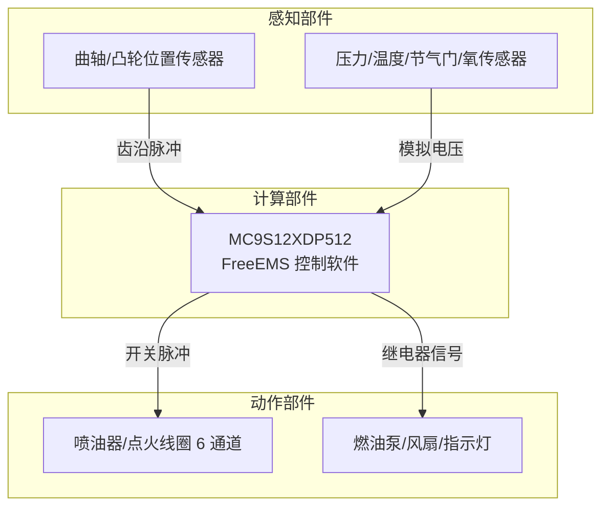
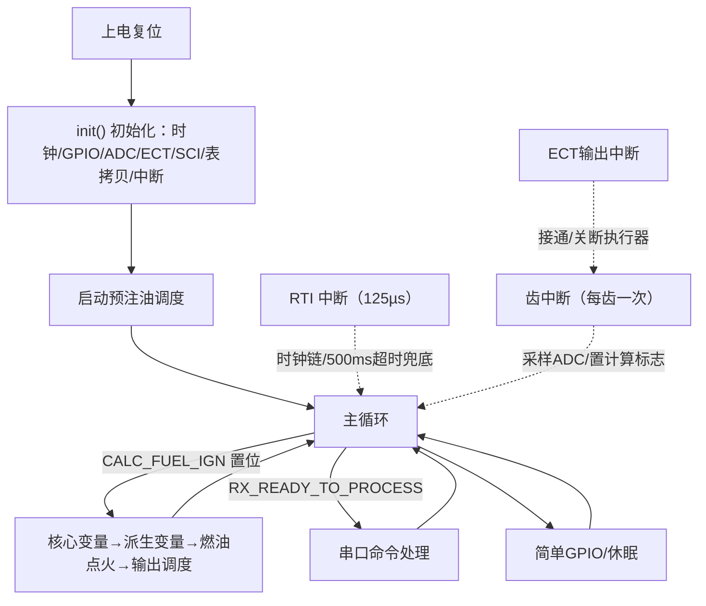
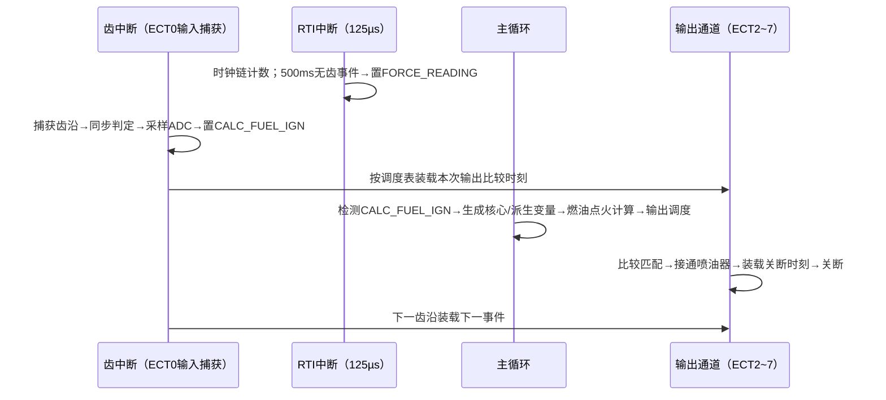
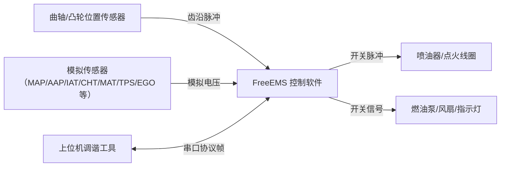
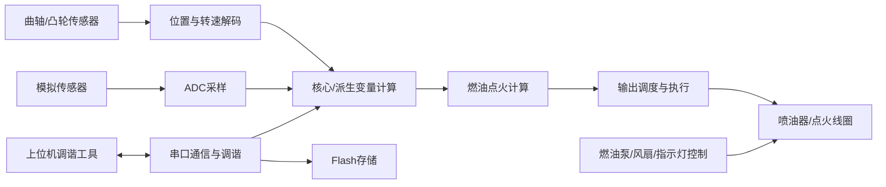
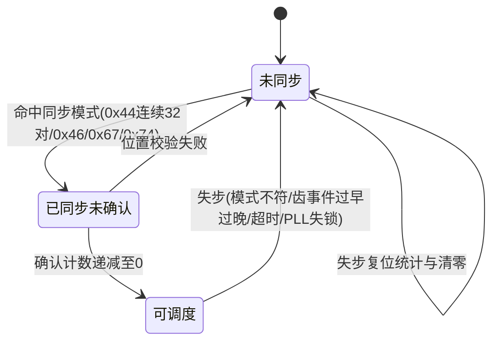

# FreeEMS 发动机管理系统软件需求规格说明

> 本文档由代码仓库逆向生成。生成日期：2026-10-18；代码仓库：C:\ECNU\502\freeems-vanilla-master（FreeEMS vanilla，开源发动机管理系统固件）。
> 全文需求标识前缀：FE（FreeEMS）。
> 标注约定：（文件名）为代码出处；[待确认] 为代码中无法确定、需人工确认的内容。

# 1 概述

## 1.1 软件概述（README.md、main.c）

FreeEMS 控制软件是开源发动机管理系统（ECU）的核心固件，实时采集发动机曲轴位置、进气压力、进气温度、冷却液温度、节气门位置、氧传感器等信号，按转速与负荷查表计算喷油脉宽与点火提前角，通过定时器输出比较通道驱动喷油器与点火线圈，使发动机在各种工况下获得正确的燃油供给与点火时刻；同时提供串口在线调谐、数据记录与 Flash 参数烧写能力，供上位机调谐工具（MTX、FreeEMS-Loader）使用。

软件工作过程分为以下阶段：

- 上电初始化阶段：配置时钟（PLL 至 40MHz 总线）、GPIO、PWM、ADC、ECT 定时器、SCI 串口、Flash 模块与中断，并将 VE 表、点火提前角表、λ 表等标定数据从 Flash 拷贝到分页 RAM 供快速查表；
- 启动预注油阶段：初始化完成后按冷却液温度查表计算预注油脉宽，向全部已配置喷油通道调度一次启动喷油；
- 正常运行阶段：以曲轴齿事件为节拍驱动计算流水线——齿沿中断内同步采样 ADC 并置计算标志，主循环按"核心变量计算→派生变量计算→燃油点火计算→输出调度"顺序执行，随后由齿中断把喷油/点火事件装载进定时器输出比较通道执行；
- 失步恢复阶段：曲轴信号异常（噪声、丢齿、转速突变）时进入失步状态，停止全部输出，按同步确认规则重新建立曲轴同步；
- 特殊运行模式：BenchTest 台架测试模式（无曲轴信号时由串口命令驱动输出测试序列）与 Listener 监听模式（不进行计算，专用于逻辑分析仪记录）。

图1.1-1 FreeEMS 软件示意图

图中软件以发动机传感器信号与上位机串口帧为输入，实时计算后输出执行器控制信号，并通过串口返回响应帧与数据记录流。

## 1.2 系统组成（memory.x、init.c、FixedConfigs.h）

系统由感知部件、动作部件、计算部件三部分组成，软件在计算部件内运行。

> 1）感知部件（敏感器）：曲轴位置传感器、凸轮位置传感器（VR/Hall/光电式，信号接入 ECT 定时器通道 0/1 输入捕获）；模拟传感器 11 路，经 ATD0/ATD1 两路 8 通道 10 位 ADC 采集——歧管压力 MAP、大气压力 AAP、进气温度 IAT、冷却液温度 CHT、歧管温度 MAT、节气门位置 TPS、氧传感器 EGO/EGO2、中间冷却压力 IAP、空气流量计 MAF、电池电压 BRV，各传感器支持真实采集、预设值、线性换算三种数据来源配置。
>
> 2）动作部件（执行器）：6 路喷油/点火输出通道（ECT 定时器通道 2~7 输出比较，按配置分配给喷油器或点火线圈，喷油支持每循环多次喷射与分级喷射扩展）；燃油泵继电器（PORTA 第 7 位）、散热风扇继电器（PORTK 第 4 位，可配置）、故障指示灯 CEL（PORTA 第 6 位）。
>
> 3）计算部件（控制器）：Freescale MC9S12XDP512 单片机，16MHz 外部晶振，PLL 倍频后总线频率 40MHz；片内 Flash 512KB（32KB 线性 + 480KB 分页）、片内 RAM 12KB、片内 EEPROM 2KB。

图1.2-1 系统组成图

图中感知部件信号进入计算部件，经软件解算后驱动动作部件，构成完整的发动机闭环控制系统。

# 2 运行环境规定

## 2.1 运行方案和场景（main.c、realtimeISRs.c、interrupts.c）

软件采用主程序加中断的方式运行：上电后主程序调用 init() 完成全部初始化，随后进入无限循环执行低优先级非实时代码；所有实时性要求高的处理在中断服务程序中完成。

1. 主程序功能：调用 init() 初始化系统；执行启动预注油调度；在无限循环中检查计算标志与通信标志——当 ADC 超时强制采样标志置位时采样 ADC 并置计算标志；当计算标志置位时按顺序执行生成核心变量、生成派生变量、燃油点火计算、输出调度四步；当串口帧收齐时调用命令解码与响应处理，否则按配置异步发送数据记录流；每轮循环末尾执行简单 GPIO 滞回输出与 PWM 调整；无计算任务时休眠约 3ms（sleepMicro(3000)）。
2. 中断服务程序功能：RTI 实时中断每 125µs 触发一次，分频产生 1ms/0.1s/1s/1min 时钟链，承担 ADC 采样超时检测（500ms）、燃油泵控制与故障灯翻转；ECT0/ECT1 输入捕获中断（曲轴/凸轮位置中断）捕获齿沿、执行同步判定与 ADC 采样、置计算标志并装载输出事件；ECT2~7 输出比较中断执行喷油器/点火线圈的接通与关断；ECT 溢出中断扩展 32 位时间戳（每 52.43ms 一次）；SCI0 串口中断完成协议帧的字节收发与转义处理；另有 PLL 失锁、自时钟模式、低压检测等保护性中断。

计算节拍的产生方式：主循环计算由曲轴齿事件驱动——每个齿沿中断置 CALC_FUEL_IGN 标志，主循环检测到标志后完成一次完整计算；当发动机停机或转速过低导致齿事件长时间缺失时，RTI 时钟链在 500ms 无齿事件后置 FORCE_READING 标志，强制主循环采样 ADC 并计算（此时转速为 0，用于停机状态下的数据记录与故障诊断）。

图2.1-1 主程序与中断示意图

图2.1-2 周期任务时序图

关键时序点：齿事件到达时，解码器中断先完成采样与标志置位（耗时受解码器最大代码时间约束，36-1 解码器为 250 tick 即 200µs），再装载输出事件；主循环计算在相邻两次齿事件之间完成，无固定周期，计算完成后调度结果在下一次齿中断时生效。

## 2.2 硬件环境（memory.x、hc9s12xdp512elfb.x、init.c）

### 2.2.1 宿主计算机

宿主计算机为 Freescale MC9S12XDP512 单片机（S12X 内核，112 引脚封装）：外部晶振 16MHz；经 PLL 倍频（REFDV=0x03、SYNR=0x09，即 16MHz/(3+1)×(9+1)）后总线频率 40MHz、内核频率 80MHz；片内 Flash 512KB（32KB 线性寻址 + 480KB 经 PPAGE 分页访问）；片内 RAM 12KB（线性寻址，其中 0x1000~0x1FFF 为 4KB 分页窗口）；片内 EEPROM 2KB（4KB 需分页）。另含 XGATE 协处理器（本版本固件默认不启用）。

### 2.2.2 中断设置

软件使用的中断如下表所示。S12X 中断优先级由向量地址决定（地址低者优先），软件不另行配置优先级；中断向量基址寄存器 IVBR=0xF7，向量表物理地址 0xF710~0xF7FF。

表2.2-1 中断信息表

| 中断源 | 优先级 | 中断源（名称） | 触发方式 |
|-------|-------|--------------|---------|
| ECT0 输入捕获 | 高（向量 0xFFEE） | 曲轴位置中断 PrimaryRPMISR | 上升沿（解码器配置 TCTL4） |
| ECT1 输入捕获 | 高（向量 0xFFEC） | 凸轮位置中断 SecondaryRPMISR | 上升沿 |
| ECT2~7 输出比较 | 高（向量 0xFFE0~EA） | 输出通道 1~6 中断 Injector1~6ISR | 比较匹配 |
| ECT 溢出 | 中（向量 0xFFDE） | 定时器溢出中断 TimerOverflow | 周期 52.43ms |
| RTI | 中（向量 0xFFF0） | 实时中断 RTIISR | 周期 125µs |
| SCI0 | 中（向量 0xFFD6） | 串口收发中断 SCI0ISR | 字节收发完成 |
| LVI | 低（向量 0xFF80） | 低压检测中断 LowVoltageISR | 电压低于阈值 |
| CRG PLL | 低（向量 0xFFC6） | PLL 锁定状态中断 PLLLockISR | 状态变化 |
| CRG 自时钟 | 低（向量 0xFFC4） | 自时钟模式中断 SelfClockISR | 状态变化 |
| 端口 H/J/P | 低（向量 0xFFCC/CE/8E） | 外部端口中断 PortH/J/PISR | 引脚下降沿 |
| RAM 访问违例 | 低（向量 0xFF60） | RAM 违例中断 RAMViolationISR | 访问受保护 XGATE RAM |

初始化操作：中断向量基址 IVBR（地址 0x0121）写 0xF7；RTICTL（地址 0x003B）写 0x81，十进制分频 2000，产生 125µs RTI 周期；CRGINT（地址 0x0038）写 0x92，使能 RTI、PLL 锁定、自时钟模式中断；ECT 侧 TIE 写 0x03（仅通道 0/1 捕获中断使能，输出通道由调度按需使能）、TSCR1 写 0x88（定时器使能+精确定时器）、TSCR2 写 0x87（溢出中断使能）、PTPSR 写 0x1F（32 分频，1 tick=0.8µs）；RAMWPC 置 AVIE 使能 XGATE RAM 访问违例中断；VREGCTRL 写 0x02 使能低压检测。

### 2.2.3 存储器

存储器信息如下表所示（全部为片内资源，无外部存储器）。地址分配依据链接脚本 memory.x 与 regions.x。

表2.2-2 存储器信息表

| 属性 | 代码存储器 Flash（线性） | 代码存储器 Flash（分页） | 数据存储器 RAM | 数据存储器 EEPROM |
|------|--------------|---------------|--------------|---------------|
| 组成 | 片内 Flash | 片内 Flash | 片内 RAM | 片内 EEPROM |
| 总容量 | 32K×8bits | 480K×8bits | 12K×8bits | 2K×8bits |
| 数据宽度 | 16bit | 16bit | 16bit | 16bit |
| 地址分配 | 0x4000~0x7FFF（14K 程序+2×1K 固定配置）、0xC000~0xFFFF（14K 程序+向量） | PPAGE 0xE0~0xFF 各 16K，其中 FA/FB/FC 页存放标定表 | 0x1000~0x3FFF（含 4K 分页窗口 0x1000~0x1FFF） | 0x0800~0x0FFF |
| 用途 | 中断与非分页代码、固定配置 fixedConfigs1/2 | 各解码器、调谐表、一般代码 | 运行变量、2K 发送缓冲 0x2000、2K 接收缓冲 0x2820、分页窗口 | 未使用（保留） |

## 2.3 支持软件环境（Makefile、make/paths.mk、make/options.mk）

### 2.3.1 编程语言

编程语言：C 语言（含少量汇编：flashBurn.s Flash 烧写发射子程序、xgate.s XGATE 协处理器代码）。

### 2.3.2 编译调试工具

> 编译器：m68hc11-gcc（GNU GCC 针对 68HC11/68HC12 的移植版），编译选项 -O -m68hcs12 -mshort -ffunction-sections -fomit-frame-pointer 等（16 位 int、带符号 char）；XGATE 汇编器 mc9xgate-as。
> 链接器：m68hc11-ld，链接脚本 hc9s12xdp512elfb.x（含 memory.x、regions.x），向量表地址 0xF710。
> 构建系统：GNU Make，多级构建（预处理→编译→汇编→链接→objcopy 生成 S19），产物为 Motorola S-record 格式固件（*.s19）。
> 固件加载工具：FreeEMS Loader 或 MTX 自带 mtxloader（串口加载）。
> 调试手段：串口单元测试命令（payload ID 0x6666）、BenchTest 台架测试模式、解码器基准调试引脚（编译宏 DECODER_BENCHMARKS）。

## 2.4 接口（init.c、commsCore.c、FixedConfigs.h）

图2.4-1 接口关系图

### 2.4.1 与其他软件接口

与上位机调谐工具（MTX 调谐软件、FreeEMS Loader 加载器、串口监视器）之间的串口协议接口：物理层为 SCI0 异步串口，波特率约 115200（SCI0BD=22，40MHz/(16×22)≈113.6kbaud），9 位数据+奇校验；数据链路层为 FreeEMS 串口协议帧（帧头 0xAA/转义 0xBB/帧尾 0xCC，8 位累加和校验，详见 3.2.6）；应用层支持调谐数据块读写（locationID 寻址）、Flash 烧写、BenchTest 台架测试命令、数据记录（datalog）、单元测试、软/硬复位等命令。方向为双向。

### 2.4.2 硬件接口

表2.4-1 硬件接口信息表

| 序号 | 编号 | 描述 | 接口类型 | 数据 |
|------|------|------|---------|------|
| 1. | FE-IREQ1 | 与曲轴位置传感器接口 | 输入捕获（ECT0，引脚 PT0） | Input: 曲轴齿沿脉冲（每齿一脉冲，缺齿轮型含缺齿间隙） |
| 2. | FE-IREQ2 | 与凸轮位置传感器接口 | 输入捕获（ECT1，引脚 PT1） | Input: 凸轮齿沿脉冲 |
| 3. | FE-IREQ3 | 与模拟传感器组接口 | AD采集（ATD0/ATD1 各 8 通道，10 位） | Input: MAP/AAP/IAT/CHT/MAT/TPS/EGO/EGO2/IAP/MAF/BRV 共 11 路电压信号（0~5V） |
| 4. | FE-IREQ4 | 与喷油器/点火线圈驱动电路接口 | 输出比较（ECT2~7，引脚 PT2~PT7） | Output: 6 路开关脉冲（高电平接通执行器，脉宽可配置） |
| 5. | FE-IREQ5 | 与燃油泵继电器接口 | GPIO 输出（PORTA 第 7 位） | Output: 开关信号（高电平吸合） |
| 6. | FE-IREQ6 | 与散热风扇继电器接口 | GPIO 输出（PORTK 第 4 位，可配置） | Output: 开关信号（滞回控制） |
| 7. | FE-IREQ7 | 与故障指示灯（CEL）接口 | GPIO 输出（PORTA 第 6 位） | Output: 每秒翻转的方波信号 |
| 8. | FE-IREQ8 | 与上位机调谐工具接口 | 串口（SCI0 TX=PTS1、RX=PTS0） | Input: 调谐命令帧 Output: 响应帧、数据记录流 |
# 3 软件详细需求

## 3.1 功能分解（main.c、init.c）

对软件功能进行分解，软件顶层数据流图如下。软件以曲轴齿事件为节拍，将传感器输入经解码、采集、变量生成、燃油点火计算、输出调度后驱动执行器，串口链路承担调谐与遥测数据的双向传输。

图3.1-1 软件顶层数据流图

表3.1-1 功能清单

| 序号 | 功能名称 | 一句话描述 | 主要证据文件 |
|------|---------|-----------|-------------|
| 1 | 初始化 | 上电后完成时钟、外设、变量与标定表的初始化 | init.c |
| 2 | 曲轴位置与转速解码 | 捕获曲轴/凸轮齿沿，识别缺齿建立同步，计算转速与每度 tick 数 | decoders/*、decoderInterface.c |
| 3 | 数据采集与变量计算 | ADC 采样、传感器物理量换算、派生变量计算 | utils.c、coreVarsGenerator.c、derivedVarsGenerator.c |
| 4 | 燃油与点火计算 | 计算充气量、基础脉宽与修正，实施断油断火保护 | fuelAndIgnitionCalcs.c |
| 5 | 输出调度与执行 | 将喷油/点火事件按曲轴角调度并驱动定时器输出 | outputScheduler.c、decoderInterface.c、injectionISRs.c |
| 6 | 串口通信与调谐协议 | 串口帧收发、命令处理、数据记录与 Flash 烧写指令 | commsCore.c、commsISRs.c |
| 7 | Flash 非易失存储管理 | 标定数据的擦除、写入与整块烧写 | flashWrite.c |
| 8 | 辅助控制 | 实时时钟链、燃油泵与简单 GPIO 滞回输出 | realtimeISRs.c、simpleGPIO.c |

## 3.2 功能需求

### 3.2.1 初始化（init.c）

a. 需求标识：FE-FREQ1

b. 功能描述：上电或复位后完成时钟、GPIO、PWM、ADC、ECT 定时器、SCI 串口、Flash 模块、分页 RAM 与中断的初始化，并预计算运行常数

c. 调用条件：上电或复位时 main() 中调用一次；串口收到重新初始化命令（payload ID 0x000C）时再次调用

d. 输入：固定配置结构 fixedConfigs1（发动机参数、串口、调度、断油断火、简单 GPIO 配置）、fixedConfigs2（传感器、算法、输入输出、解码器配置）；Flash 中的 VE/点火/λ/小表等标定数据；无运行时外部输入

e. 输出：全部外设寄存器配置值；运行变量初值与双缓冲指针；分页 RAM 中的标定表镜像；预计算常数 bootFuelConst（基础燃油常数）与 TPSADCRange（节气门 ADC 量程）；coreStatusA 初值（置燃油泵预注标志）

f. 处理：

1. 关全部中断，按序执行以下初始化子函数；
2. 时钟初始化：CLKSEL 切回外部晶振，PLLCTL 关 PLL，REFDV=0x03、SYNR=0x09（16MHz/(3+1)×(9+1)=40MHz 总线、80MHz 内核），等 PLL 锁定标志后切回 PLL 时钟；
3. GPIO 初始化：按配置装载各端口初值与方向，其中 PORTA 强制第 6/7 位为输出并拉高（燃油泵继电器与故障指示灯），DDRT=0xFC（ECT 通道 0/1 输入捕获、2~7 输出比较），DDRS 第 0 位保持输入（SCI0 接收）；
4. PWM 初始化：按配置装载 8 个通道的周期、初始占空比、时钟与预分频，最后使能；
5. ADC 初始化：ATD0/ATD1 均按 8 通道序列、连续扫描、右对齐配置并启动转换；
6. 分页 RAM 初始化：将 Flash 中第 1 套 VE/点火/λ/小表按页拷贝到分页 RAM（RPAGE_FUEL/TIME/TUNE），并选通第 1 套页；
7. 变量初始化：双缓冲指针指向第 0 组（CoreVars0/DerivedVars0/ADCBuffers0），ECT 时间与控制寄存器指针表装载（TC2~TC7 与 TCTL1/TCTL2），置燃油泵预注标志，24 个输出事件全部置 0xFF（禁用）；
8. Flash 初始化：FCLKDIV=0x4A（16MHz 晶振经 8 预分频再除 10，Flash 时钟 200kHz，位于 150~200kHz 安全区间），FPROT=0xFF 解除保护，清 FSTAT 错误位；
9. ECT 定时器初始化：按寄存器设置表配置（表3.2-1），并调用解码器初始化；
10. SCI 初始化与配置计算：SCI0BD=22（约 115200 波特），SCI0CR1=0x13（9 位数据+奇校验），SCI0CR2=0x24（接收中断使能、接收使能）；bootFuelConst=(masterFuelConstant/injectorFlow)×perCylinderVolume/stoichiometricAFR（masterFuelConstant=139371764）；TPSADCRange=|TPSMaximumADC−TPSMinimumADC|；
11. 中断初始化：IVBR=0xF7；RTICTL=0x81（125µs RTI）；CRGINT 使能 RTI/PLL 锁定/自时钟中断并清标志；RAMWPC 置 AVIE；端口 H 全部引脚下降沿中断使能；VREGCTRL=0x02 使能低压检测；
12. 开中断，结束初始化。

表3.2-1 初始化主要寄存器设置表

| 序号 | 寄存器（地址） | 写入值 | 作用 |
|------|--------------|--------|------|
| 1 | REFDV / SYNR | 0x03 / 0x09 | PLL 分频与倍频：16MHz/4×10=40MHz 总线 |
| 2 | ATD0CTL2~5 / ATD1CTL2~5 | 0xC0/0x40/0x73/0xB0 | 两 ADC 均 8 通道连续扫描、右对齐、自动清标志 |
| 3 | FCLKDIV / FPROT | 0x4A / 0xFF | Flash 时钟 200kHz；解除全部 Flash 保护 |
| 4 | TSCR1 / TSCR2 / PTPSR | 0x88 / 0x87 / 0x1F | 定时器使能+精确定时器；溢出中断使能；32 分频（1 tick=0.8µs） |
| 5 | TIOS / TIE / TCTL4 | 0xFC / 0x03 / 0x0F | 通道 0/1 输入捕获、2~7 输出比较；仅捕获中断使能；双沿捕获初值 |
| 6 | SCI0BD / SCI0CR1 / SCI0CR2 | 22 / 0x13 / 0x24 | 约 115200 波特；9 位+奇校验；接收中断使能 |
| 7 | IVBR | 0xF7 | 中断向量基址（向量表 0xF710~0xF7FF） |
| 8 | RTICTL | 0x81 | RTI 十进制分频 2000 → 周期 125µs |
| 9 | CRGINT | 0x92 | 使能 RTI、PLL 锁定、自时钟模式中断 |

证据位置：init.c（init、initPLL、initGPIO、initADC、initAllPagedRAM、initVariables、initFlash、initECTTimer、initSCIStuff、initConfiguration、initInterrupts）、memory.x

### 3.2.2 曲轴位置与转速解码（decoders/*、decoderInterface.c）

a. 需求标识：FE-FREQ2

b. 功能描述：捕获曲轴/凸轮传感器齿沿脉冲，识别轮型建立曲轴同步，实时计算转速与每度曲轴角的 tick 数，为输出调度提供位置与时间基准

c. 调用条件：ECT0/ECT1 输入捕获中断触发（每个齿沿一次）；解码器初始化在上电初始化时调用

d. 输入：ECT 捕获寄存器 TC0/TC1（0.8µs/tick 时间戳）、端口 T 引脚状态 PTIT、定时器溢出扩展计数 timerExtensionClock、解码器配置 decoderSettings（同步确认次数、缺齿容差、加/减速容差）、串口命令（BenchTest 模式）

e. 输出：currentEvent（当前齿事件号）、每度 tick 数 ticksPerDegree（双缓冲）、同步状态标志 decoderFlags（含 OK_TO_SCHEDULE）、计算标志 coreStatusA 的 CALC_FUEL_IGN 位、同步 ADC 采样结果、失步统计与失步原因码 syncLostWithThisID、输出事件装载（调用输出调度）

f. 处理：由各解码器实现，框架如下：

1. 清输入捕获中断标志，读捕获时间戳并组装 32 位时间（低 16 位为捕获值，高 16 位为溢出计数，溢出标志与捕获值最高位的组合做补偿）；
2. 按解码器类型执行齿沿处理（单沿或双沿、缺齿识别、分电器窗口计数等）；
3. 计算相邻齿间周期与每度 tick 数，执行加/减速容差检查；
4. 执行同步状态机（见 3.2.2.2），失步时调用复位处理；
5. 同步有效且可调度时，对绑定到当前齿的输出事件执行装载（见 3.2.5.2）；
6. 同步 ADC 采样，置计算标志 CALC_FUEL_IGN，清零 ADC 超时时钟。

固件采用每构建选一个解码器的结构：每个解码器为独立源文件，与公共代码分别链接，生成专用固件。支持的解码器清单见表3.2-2。

表3.2-2 支持的解码器清单

| 序号 | 解码器 | 适用轮型 | 齿事件数（实/虚） | 状态 |
|------|--------|---------|------------------|------|
| 1 | EvenTeeth-Cam-24and1/16and1/6and1/4and1 | 凸轮均布齿 24/16/6/4 齿+单第二输入 | 24/16/6/4 | 可用 |
| 2 | EvenTeeth-Distributor-4of6and1 | 早期 4AGE 分电器（4 缸，6 事件/圈） | 24 | 可用 |
| 3 | MissingTeeth-Crank-8minus1/12minus1/30minus2/36minus1/36minus2/60minus2 | 曲轴缺齿轮（8-1、12-1、30-2、36-1、36-2、60-2） | 齿数−缺齿数 | 36-1 可用，其余测试级 |
| 4 | MissingTeeth-Cam-6minus2/12minus1/24minus1 | 凸轮缺齿轮（本田 J 系列 6-2、12-1、改装丰田 24-1） | 同左 | 测试级 |
| 5 | HallOrOptical-Distributor-4of90/4of64 | 4 缸霍尔/光电分电器（90°/64° 槽宽） | 2/8 | 4 缸可用 |
| 6 | MitsiAndMazda-CAS-4and1/4and2 | 三菱/马自达 CAS（外槽 69.74°+内槽 140°/70°） | 10/12 | 可用但不完整 |
| 7 | GM-LT1-CAS-360and8 | GM LT1 Optispark（360 脉冲窗口+8 槽） | 16 | 可用但不完整 |
| 8 | JSeries-12CrankWith6-2Cam | 本田 J 系列（12 曲轴齿+6-2 凸轮） | 24 | 可用 |
| 9 | R18A1-13CrankWith5Cam | 本田 R18A1（13 曲轴齿+5 凸轮） | 26 | 可用 |
| 10 | NipponDenso-24and1and1 | Nippon Denso 24/2 传感器 | 24 | 开发中 |
| 11 | BenchTest | 无外部信号，串口命令驱动台架测试 | 1/1 | 台架测试 |
| 12 | Listener | 纯监听，不计算，逻辑分析用 | 1/1 | 测试专用 |

证据位置：decoders/（各解码器源文件）、decoders/README.md、decoders/STATUS.md、decoderInterface.c、inc/decoderInterface.h

#### 3.2.2.1 齿事件捕获与缺齿识别（decoders/code/MissingTeeth-Either-XminusY.c）

a. 需求标识：FE-FREQ2-1

b. 功能描述：捕获曲轴齿沿，通过相邻齿间周期的比值分类识别缺齿位置

c. 调用条件：ECT0 输入捕获中断（上升沿，TCTL4=0x01 由解码器初始化配置）触发，每齿一次

d. 输入：TC0 捕获值、PTIT 引脚状态、timerExtensionClock、TFLGOF 溢出标志、缺齿容差 missingToothTolerance（默认 2048，即 50%）

e. 输出：currentEvent、thisInterEventPeriod（齿间周期）、thisTicksPerDegree（每度 tick 数）、lastTicksPerDegree、32 位时间戳、CALC_FUEL_IGN 标志、ADC 采样结果、失步调用

f. 处理：以 MissingTeeth-Crank-36minus1 为例（其余缺齿解码器同构）：

1. 清 ECT0 中断标志，读捕获时间戳；仅当引脚为高（上升沿）时继续处理；
2. 组装 32 位时间戳：低字为捕获值，高字为 timerExtensionClock，若定时器溢出标志置位且捕获值最高位为 0 则高字加 1；
3. 计算齿间周期 thisInterEventPeriod=本次时间戳−上次时间戳；
4. 相邻周期比较并分类：容差 tolerance=较小值×缺齿数×missingToothTolerance/4096（36-1 轮默认即较小值的 50%），按表3.2-3 分类；
5. 按当前同步状态推进 currentEvent（到达齿数上限回绕到 0），并按预期模式校验位置，不符则调用失步复位；
6. 计算每度 tick 数：thisTicksPerDegree=(500×齿间周期)/齿间角度（普通齿间 500 单位=10°，跨缺齿 1000 单位=20°）；
7. 加/减速保护：与上次值的比值 ratio=lastTicksPerDegree×1000/thisTicksPerDegree，大于减速容差（默认 1500，即周期变长超 50%）按"事件到达太晚"失步，小于加速容差（默认 666，即周期变短超 33%）按"事件到达太早"失步；
8. 执行输出事件装载（见 3.2.5.2），采样 ADC，置 CALC_FUEL_IGN，清零 ADC 超时时钟。

表3.2-3 齿对模式分类表

| 序号 | 分类名 | 判定条件 | 含义 |
|------|--------|---------|------|
| 1 | MatchedPair | 大周期 < 小周期+容差 | 相邻两齿周期基本相等（约 1:1） |
| 2 | NarrowWide / WideNarrow | 大周期与 2×小周期的差 < 容差 | 缺 1 齿（36-1 轮）：小周期在前为 NarrowWide，反之为 WideNarrow |
| 3 | NarrowBackward / BackwardNarrow | 大周期与 1.5×小周期的差 < 容差 | 反向旋转或齿型异常 |
| 4 | NarrowTooWide / TooWideNarrow | 大周期 > 2×小周期+容差 | 传感器接触不良或噪声，失步 |
| 5 | FellThrough | 介于 1.5 倍与 2 倍理想值之间 | 容差设置过紧，失步 |

证据位置：decoders/code/MissingTeeth-Either-XminusY.c（PrimaryRPMISR）、decoders/inc/MissingTeeth.h、inc/syncLossIDs.h、initialisers/FixedConfig2.c（容差默认值）

#### 3.2.2.2 同步状态管理与失步恢复（decoderInterface.c）

a. 需求标识：FE-FREQ2-2

b. 功能描述：管理曲轴同步状态机，从齿对模式组合中识别同步点，失步时停止输出并按确认规则恢复

c. 调用条件：齿中断内调用（同步判定与确认）；超时、PLL 失锁、自时钟模式时由其他模块调用失步复位

d. 输入：齿对模式组合字节（高 4 位为上一对模式、低 4 位为本对模式）、同步确认配置（运行中 syncConfirmationsRunning=10、启动 syncConfirmationsStarting=0）、失步原因码

e. 输出：decoderFlags（COMBUSTION/CRANK/CAM_SYNC、OK_TO_SCHEDULE 等位）、失步统计（Flaggables 三个计数器）、syncLostWithThisID、每度 tick 双缓冲清零

f. 处理：

1. 未同步状态下搜索同步模式（36-1 轮）：连续 32 对 MatchedPair+MatchedPair（0x44）判定曲轴位置为第 34 齿并同步；MatchedPair+NarrowWide（0x46）判定为缺齿后第 1 齿；NarrowWide+WideNarrow（0x67）判定为缺齿后第 2 齿（最可靠的同步模式）；WideNarrow+MatchedPair（0x74）判定为缺齿后第 3 齿；其余组合失步；
2. 同步后按确认机制验证：每通过一次位置校验且尚未可调度时递减确认计数器，启动阶段计数器为 0（首个同步模式即确认）、运行中失步后计数器为 10+1=11（需连续 11 个确认点），计数归零置 OK_TO_SCHEDULE，此前不装载任何喷油/点火输出；
3. 同步后位置校验：事件 0 必须为 0x46、事件 1 必须为 0x67、事件 2 必须为 0x74、其余必须为 0x44，任一不符即失步复位（错误码为模式组合+0x05）；
4. 失步复位 resetToNonRunningState：记录失步原因码与失步位置，按失步前状态分别累计"运行中失步/未确认失步/从未同步清零"三类统计，清零每度 tick 双缓冲与全部同步标志，调用解码器级复位；
5. 恢复过程：回到步骤 1 重新搜索同步模式。

图3.2-1 曲轴同步状态机

表3.2-4 主要失步原因码

| 序号 | 原因码 | 含义 |
|------|--------|------|
| 1 | 0 | 事件到达超时（ADC 采样超时兜底路径） |
| 2 | 1 / 2 | 主齿事件到达太晚（减速超容差）/ 太早（加速超容差） |
| 3 | 64~147 | 缺齿模式组合异常（64=容差过紧，65/66=传感器接触不良或噪声，68=同步容差过松，其余为模式组合+0x05 校验失败） |
| 4 | 0xFE / 0xFD | PLL 失锁预防性失步 / 自时钟模式预防性失步 |
| 5 | 0xFF | 到达不可达代码（程序错误） |

证据位置：decoderInterface.c（resetToNonRunningState）、inc/decoderInterface.h（SET_SYNC_LEVEL_TO）、decoders/code/MissingTeeth-Either-XminusY.c、inc/syncLossIDs.h、initialisers/FixedConfig2.c（syncConfirmationsRunning=10、syncConfirmationsStarting=0）
### 3.2.3 数据采集与变量计算（utils.c、coreVarsGenerator.c、derivedVarsGenerator.c）

a. 需求标识：FE-FREQ3

b. 功能描述：采集 ADC 传感器信号并换算为物理量，基于传感器值与查表结果生成燃油点火计算所需的全部核心变量与派生变量

c. 调用条件：启动时主程序调用一次；运行中每个计算周期（CALC_FUEL_IGN 置位）按序调用

d. 输入：ADC 结果寄存器（ATD0/ATD1 各 8 通道）、解码器每度 tick 数、传感器来源与量程配置（fixedConfigs2.sensorSources/sensorRanges）、标定表（温度转换表、λ 表、喷油器死区表、点火闭合时间表、温度富集表、点火提前角表）

e. 输出：CoreVars（IAT/CHT/TPS/EGO/MAP/AAP/BRV/MAT/EGO2/IAP/MAF/DMAP/DTPS/RPM/DRPM/DDRPM）、DerivedVars（LoadMain/Lambda/IDT/Dwell/Advance/ETE 等）

f. 处理：分为 ADC 采样、核心变量计算、派生变量计算三步，见子功能。

证据位置：utils.c（sampleEachADC）、coreVarsGenerator.c（generateCoreVars）、derivedVarsGenerator.c（generateDerivedVars）

#### 3.2.3.1 ADC 采样（utils.c）

a. 需求标识：FE-FREQ3-1

b. 功能描述：同步读取两路 ADC 模块的全部通道结果，形成一组时间一致的采样值

c. 调用条件：齿中断内同步采样（每齿一次）；主循环检测到 FORCE_READING 时兜底采样（发动机停机/超低转速时）；启动时采样一次

d. 输入：ATD0 结果寄存器 ATD0DR0~7（基址 0x02D0）、ATD1 结果寄存器 ATD1DR0~7（基址 0x0090），均为 10 位右对齐（0~1023）

e. 输出：ADCBuffer 双缓冲结构（16 个 16 位值），按通道映射表排列；超时采样时另存 ADCBuffersRecord 并累计超时采样计数

f. 处理：

1. 依序读 ATD0DR0~ATD0DR7 存入缓冲前 8 字，读 ATD1DR0~ATD1DR7 存入后 8 字；
2. 采样在关中断原子段内完成，保证 16 个通道为一组时间一致的读数；
3. 主循环计算前交换双缓冲指针（ADCBuffers 与 ADCBuffersRecord 互换），使计算使用最新一组稳定数据。

表3.2-5 ADC 通道映射表

| 寄存器 | 变量 | 传感器 |
|--------|------|--------|
| ATD0DR0~7 | IAT/CHT/TPS/EGO/MAP/AAP/BRV/MAT | 进气温度/冷却液温度/节气门位置/氧传感器/歧管压力/大气压力/电池电压/歧管空气温度 |
| ATD1DR0~7 | EGO2/IAP/MAF/Spare×5 | 第二氧传感器/中间冷却压力/空气流量计/备用通道 |

证据位置：utils.c（sampleEachADC、sampleLoopADC）、inc/containerTypes.h（ADCBuffer 结构）

#### 3.2.3.2 核心变量计算（coreVarsGenerator.c）

a. 需求标识：FE-FREQ3-2

b. 功能描述：将 ADC 原始码值按各自配置换算为物理量，并计算转速

c. 调用条件：主循环每个计算周期调用 generateCoreVars()

d. 输入：ADCBuffers（10 位码值）、每度 tick 数、传感器来源配置（SOURCE_NORMAL 真实采集/SOURCE_PRESET 预设值/SOURCE_LINEAR 线性换算）、量程与预设/故障安全值配置、温度/MAF 转换表

e. 输出：CoreVars 全部字段（物理量定标值）

f. 处理：

1. 各传感器按表3.2-6 换算；温度类（CHT/IAT/MAT）用 1024 项转换表直接按下标查表（NTC 热敏电阻特性，默认 Denso 2k7 偏置数据）；TPS 先按正/反斜率限幅到 0~TPSADCRange 再折算百分比；
2. RPM=degreeTicksPerMinute/ticksPerDegree（degreeTicksPerMinute=4166667，结果单位为 0.5rpm，即变量值为实际转速 2 倍；每度 tick 数为 0 时 RPM=0，防止除零）；DRPM 存每度 tick 数[待确认]：DRPM 的代码注释称单位为 0.5 RPM/Second，与实际存放每度 tick 数不符；
3. EGO2/IAP 直接存原始 ADC 值（本版本未参与计算）。

表3.2-6 传感器换算表

| 序号 | 变量 | 换算方式 | 默认量程/参数 | 单位（LSB） |
|------|------|---------|--------------|-------------|
| 1 | BRV 电池电压 | (ADC×BRVRange)/1023+BRVMinimum | 0~24.5V（3.9k+1k 分压） | 1mV |
| 2 | CHT 冷却液温度 | CHTTransferTable[ADC] 查表 | Denso 2k7 偏置曲线 | 0.01K |
| 3 | IAT 进气温度 | IATTransferTable[ADC] 查表 | 同上 | 0.01K |
| 4 | MAT 歧管温度 | IATTransferTable[ADC] 查表（复用 IAT 表） | 同上 | 0.01K |
| 5 | TPS 节气门位置 | 限幅后×PERCENT(100)/TPSADCRange | 0~1023 ADC → 0~100% | 640=100% |
| 6 | EGO 氧传感器 | (ADC×EGORange)/1023+EGOMinimum | LC1 宽域：λ0.5~1.5 | 32768=λ1.0 |
| 7 | MAP 歧管压力 | (ADC×MAPRange)/1023+MAPMinimum | MPX4250A：8~260kPa | 0.01kPa |
| 8 | AAP 大气压力 | (ADC×AAPRange)/1023+AAPMinimum | MPXA6115A：10~120kPa | 0.01kPa |
| 9 | MAF 空气流量 | MAFTransferTable[ADC] 查表 | 1024 项单调表 | 原始单位 |

证据位置：coreVarsGenerator.c（generateCoreVars）、initialisers/FixedConfig2.c（默认量程）、data/thermistors/Denso-2k7Bias.h

#### 3.2.3.3 派生变量计算（derivedVarsGenerator.c）

a. 需求标识：FE-FREQ3-3

b. 功能描述：基于核心变量与查表生成负荷、目标 λ、喷油器死区时间、点火闭合时间、点火提前角、温度富集等派生变量

c. 调用条件：主循环每个计算周期调用 generateDerivedVars()，位于核心变量计算之后

d. 输入：CoreVars、算法配置（负荷类型、闭合时间类型）、各二维/主表（λ 表、死区时间表、闭合时间表、富集表、点火提前角表）

e. 输出：DerivedVars 的 LoadMain/Lambda/IDT/Dwell/Advance/ETE/TFCTotal

f. 处理：

1. 负荷计算：按配置取 MAP（默认）、TPS 或 MAP×AAP/100kPa 作为 LoadMain；
2. 目标 λ：Lambda=lookupMainTable(RPM, LoadMain, λ 表)，双线性插值；
3. 喷油器死区时间：IDT=lookupTwoDTableUS(死区时间表, BRV)，16 点电压曲线线性插值（默认 6.0~24.5V 对应 2.91~0.40ms）；
4. 点火闭合时间 Dwell：按配置取电压曲线（默认 14.55~2.00ms）、转速曲线或固定值（3ms）；HOTEL 配置下钳位到 3/4 工作循环可用时间（DRPM×13.5）以内；
5. 点火提前角：Advance=50×lookupMainTable(RPM, LoadMain, 点火提前角表)/1024，结果单位为 0.02°；
6. 温度富集 ETE：按 CHT 查 16 点富集曲线（默认 −30°C→250%、80°C→100%、120°C→130%，W(x) 定标，16384=100%）；
7. 瞬态燃油修正 TFCTotal：本版本为占位实现，恒为 0（TPS 加速富集/减速稀薄等功能未实现）。

证据位置：derivedVarsGenerator.c（generateDerivedVars）、inc/containerTypes.h（DerivedVar）、constantsLibrary.h（默认曲线值）

### 3.2.4 燃油与点火计算（fuelAndIgnitionCalcs.c）

a. 需求标识：FE-FREQ4

b. 功能描述：按充气模型计算进气流量，依理想气体方程折算基础喷油脉宽，施加温度富集等修正，并实施超速/超压断油断火保护

c. 调用条件：主循环每个计算周期调用 calculateFuelAndIgnition()，位于派生变量计算之后

d. 输入：CoreVars（RPM/MAP/TPS/IAT/MAF/CHT）、DerivedVars（Lambda/TFCTotal/ETE/IDT）、bootFuelConst、算法配置（algorithmType/loadType）、断油断火阈值配置、VE/空气流量/混合比例表

e. 输出：DerivedVars（VEMain/AirFlow/densityAndFuel/BasePW/EffectivePW/RefPW）、全局 masterPulseWidth、断油断火标志 injectionCutFlags/ignitionCutFlags（经 KeyUserDebugs 记录）

f. 处理：分为充气量与基础脉宽、喷油修正链、断油断火保护三步，见子功能。

证据位置：fuelAndIgnitionCalcs.c（calculateFuelAndIgnition）、inc/fuelAndIgnitionCalcs.h（理论公式推导）

#### 3.2.4.1 充气量与基础脉宽计算（fuelAndIgnitionCalcs.c）

a. 需求标识：FE-FREQ4-1

b. 功能描述：按进气模型计算单循环进气量，由理想气体方程与喷油器/气缸参数折算基础喷油脉宽

c. 调用条件：calculateFuelAndIgnition() 内首先执行

d. 输入：CoreVars、VE/空气流量/混合比例表、bootFuelConst、algorithmType

e. 输出：VEMain/AirFlow/densityAndFuel/BasePW

f. 处理：

1. 按 algorithmType 计算进气量 AirFlow（4 种模型）：速度密度式（默认）AirFlow=(MAP×VEMain)/51200，VEMain 由 RPM×MAP 双线性查表；α-N 式直接查 RPM×TPS 空气流量表；MAF 式直接取 MAF 表值（进气温度暂固定 20°C）；混合式按转速查混合比例表对两者加权（默认 1500rpm 以下纯 α-N、3500rpm 以上纯速度密度，其间线性过渡）；
2. 计算 densityAndFuel=(进气温度×Lambda/32768)×燃油密度/32000（进气温度 0.01K、Lambda λ×32768 定标，结果约 7500~60000）；
3. 计算基础脉宽 BasePW=(bootFuelConst×AirFlow)/densityAndFuel，单位为脉宽 tick（÷1250 为 ms）。例：20°C、λ=1、720g/l 汽油、100kPa、VE=100% 时约 6.12ms。

证据位置：fuelAndIgnitionCalcs.c（calculateFuelAndIgnition）、inc/fuelAndIgnitionCalcs.h（公式推导）、tableLookup.c（lookupMainTable）

#### 3.2.4.2 喷油修正链（fuelAndIgnitionCalcs.c）

a. 需求标识：FE-FREQ4-2

b. 功能描述：在基础脉宽上依次施加瞬态修正、温度富集修正与死区补偿，得到参考喷油脉宽

c. 调用条件：calculateFuelAndIgnition() 内，基础脉宽计算之后

d. 输入：BasePW、TFCTotal、ETE、IDT、每缸修正表 perCylinderFuelTrims、每循环喷射次数配置

e. 输出：EffectivePW/RefPW/masterPulseWidth

f. 处理：

1. 加性修正：EffectivePW=safeTrim(BasePW, TFCTotal)（TFC 可正可负，饱和到 0~65535；本版本 TFCTotal 恒为 0）；
2. 乘性修正：EffectivePW=safeScale(EffectivePW, ETE, 16384)（ETE/16384 为百分比，32 位中间运算防溢出）；
3. 每缸修正（配置表存在但本版本未启用）；
4. 零脉宽一致性：EffectivePW 为 0 时 IDT 同步置 0，保证零喷油时总脉宽为零；
5. 参考脉宽：RefPW=safeAdd(EffectivePW, IDT)（饱和加法防溢出）；
6. 名义总脉宽：masterPulseWidth=safeAdd(EffectivePW/每循环喷射次数, IDT)。

证据位置：fuelAndIgnitionCalcs.c（calculateFuelAndIgnition）、utils.c（safeAdd、safeTrim、safeScale）

#### 3.2.4.3 断油断火保护（fuelAndIgnitionCalcs.c）

a. 需求标识：FE-FREQ4-3

b. 功能描述：转速超限或增压超限时切断喷油与点火输出，恢复正常后按迟滞阈值恢复

c. 调用条件：calculateFuelAndIgnition() 内执行；PLL 失锁/自时钟中断内另行置位

d. 输入：CoreVars 的 RPM 与 MAP、阈值配置（cutsEnabled 使能与 disable/reenable 阈值）

e. 输出：injectionCutFlags/ignitionCutFlags（InjectionRPM、IgnitionRPM、OverBoost、LostPLL、SelfClock 位），经调度模块生效为输出禁用

f. 处理：

1. 阈值防呆：若恢复阈值大于等于切断阈值，将恢复阈值强制置为切断阈值的一半，保证迟滞有效；
2. 超速断油：RPM 变量值 > RPM(5850)（内部单位，即实际 5850rpm）置位，< RPM(5800) 清除；
3. 超速断火：> RPM(5800) 置位，< RPM(5750) 清除（断火迟滞小于断油，保证恢复时先喷油后点火，防止稀燃回火）；
4. 超压断油断火：MAP > KPA(250)（250kPa）置位，< KPA(105)（105kPa）清除；
5. 切断标志在输出调度中生效：置位时对应事件号写 0xFF，调度不再装载该通道输出。

表3.2-7 断油断火阈值表

| 序号 | 保护项 | 切断阈值 | 恢复阈值 | 使能默认值 |
|------|--------|---------|---------|-----------|
| 1 | 超速断油 | RPM(5850)=11700（5850rpm） | RPM(5800)=11600 | 使能 |
| 2 | 超速断火 | RPM(5800)=11600 | RPM(5750)=11500 | 使能 |
| 3 | 超压断油 | KPA(250)=25000 | KPA(105)=10500 | 使能 |
| 4 | 超压断火 | KPA(250)=25000 | KPA(105)=10500 | 使能 |
| 5 | PLL 失锁断油/断火 | PLL 失锁中断置位 | PLL 重新锁定中断清除 | 始终生效 |
| 6 | 自时钟模式断油/断火 | 进入自时钟置位 | 退出自时钟清除 | 始终生效 |

证据位置：fuelAndIgnitionCalcs.c（calculateFuelAndIgnition 阈值段）、initialisers/FixedConfig1.c（默认阈值）、miscISRs.c（PLLLockISR、SelfClockISR）、inc/containerTypes.h（cut 标志结构）

### 3.2.5 输出调度与执行（outputScheduler.c、decoderInterface.c、injectionISRs.c）

a. 需求标识：FE-FREQ5

b. 功能描述：将计算得到的喷油脉宽与点火时刻换算为曲轴齿基准上的定时器装载值，由齿中断装载、输出比较中断执行接通与关断

c. 调用条件：调度计算在主循环每个计算周期调用；装载在齿中断内执行；执行在 ECT 输出比较中断内完成

d. 输入：masterPulseWidth、DerivedVars 的 Dwell/Advance、每度 tick 数、输出事件配置（事件类型、引脚号、TDC 角度、解码器偏移）、解码器事件角度表、断油断火标志

e. 输出：outputEventInputEventNumbers/DelayFinalPeriod/PulseWidthsMath 等调度数组、ECT 输出比较寄存器装载值、喷油器/点火线圈引脚电平

f. 处理：分为调度计算、事件装载、中断执行三步，见子功能。

证据位置：outputScheduler.c（scheduleOutputs）、decoderInterface.c（schedulePortTPin）、inc/injectorISR.c、injectionISRs.c

#### 3.2.5.1 输出时刻调度计算（outputScheduler.c）

a. 需求标识：FE-FREQ5-1

b. 功能描述：把点火提前角/喷油角度换算为相对最近参考齿的延迟 tick 数，并处理超长延迟的拆分

c. 调用条件：主循环 scheduleOutputs() 调用

d. 输入：每度 tick 数、事件 TDC 角度与解码器偏移、点火提前角/脉宽、解码器最大代码时间（36-1 轮 250 tick）、事件角度表

e. 输出：各输出事件的绑定齿号、延迟、脉宽、重复扩展参数、跳过事件标志

f. 处理：

1. 入口检查：解码器偏移超过整圈角度或输出事件数超上限（24）时不调度；被断油断火标志命中的事件直接禁用；
2. 点火/喷油参数确定：点火事件用 Dwell 作脉宽、Advance 作脉冲结束时刻；喷油事件用 masterPulseWidth 作脉宽、结束角度为固定值；脉宽小于最小代码时间 250 tick 的事件禁用；
3. 点火位置换算：codeAngleOfIgnition=事件 TDC 角−(解码器偏移+点火提前角)，跨圈时加整圈角度 36000 单位回绕；
4. 寻找参考齿：取事件角度表中小于点火位置的最大齿（点火位置为 0 时取最后一个齿）；
5. 角度转 tick：ticksBetweenEventAndSpark=(每度 tick 数×角度差)/500（角度差为 1/50 度单位），并校验该延迟大于脉宽+解码器最大代码时间，不满足则向更早的齿回退重试；
6. 计算延迟 potentialDelay=ticksBetweenEventAndSpark−脉宽，即在参考齿后延迟此值接通（点火为通电闭合、喷油为开阀），再经脉宽后关断，关断时刻恰为期望角度；
7. 超过 65535 tick（52.4ms）的延迟拆分为重复扩展段（numberOfRepeats 与 finalPeriod），末段过短时从各段借时补偿；
8. 在关中断原子段内写入调度数组，绑定齿号=参考齿对真实事件数取模。

证据位置：outputScheduler.c（scheduleOutputs）、inc/decoderInterface.h（角度标度常量）、globalConstants.c（ectSwitchOnCodeTime=250）

#### 3.2.5.2 输出事件装载（decoderInterface.c）

a. 需求标识：FE-FREQ5-2

b. 功能描述：齿中断内将绑定到当前齿的输出事件装载进对应 ECT 输出比较通道

c. 调用条件：齿中断内执行 SCHEDULE_ECT_OUTPUTS() 宏（仅 OK_TO_SCHEDULE 时）；启动预注油时主程序直接调用

d. 输入：齿事件时间戳、调度数组（延迟/脉宽/重复扩展/绑定齿号）、输出引脚配置、跳过事件标志

e. 输出：ECT 比较寄存器 TCn、TIE/TFLG 使能位、TCTL 动作位（置高/置低/无动作）、实时脉宽缓冲、各类调度计数

f. 处理：

1. 遍历已配置输出事件，绑定齿号等于当前齿的（或跳过标志命中且为上一齿的）执行装载；
2. 计算开始时刻=齿时间戳低字+延迟（跳过事件用解码器最大代码时间作延迟，保证在下一齿前装载成功）；
3. 目标 ECT 通道空闲时：置"比较时拉高"动作位，TCn=开始时刻，使能通道中断，存实时脉宽；
4. 通道忙时按五态处理：即将拉高→保持不动；即将拉低且新开始时刻足够晚→改由该通道中断自调度（自调度标志置位，存保持参数）；即将拉低且时间不足→重调度保持导通；其他异常状态分别计数；
5. 有重复扩展时先装载首段重复周期，由中断后续处理。

证据位置：decoderInterface.c（schedulePortTPin）、inc/decoderInterface.h（SCHEDULE_ECT_OUTPUTS、SCHEDULE_ONE_ECT_OUTPUT）、globalConstants.c（通道掩码表）

#### 3.2.5.3 输出比较中断执行（injectionISRs.c）

a. 需求标识：FE-FREQ5-3

b. 功能描述：在输出比较匹配时刻接通或关断喷油器/点火线圈，装载下一次比较时刻，完成一个完整脉冲输出

c. 调用条件：ECT2~7 输出比较中断触发（每个通道独立）

d. 输入：比较时刻 TCn、引脚状态 PTIT、实时脉宽缓冲、重复扩展参数、自调度保持参数

e. 输出：执行器引脚电平、TCn 下一次比较装载值、TCTL 动作位、TIE 通道使能位、运行统计（接通/关断/自调度/延展计数、代码延迟测量）

f. 处理：以通道 N 为例：

1. 清本通道比较标志，记录进入中断时刻；
2. 引脚为高（刚发生"接通"比较）：脉宽下限钳位到 250 tick+该通道代码延迟；先改动作位为"下次比较拉低"，再 TCn+=脉宽（硬件在脉宽结束后自动拉低引脚=关断执行器），累计接通计数；
3. 引脚为低（刚发生"关断"比较）：有剩余重复扩展段时装载下一段重复周期；已置自调度标志时装载保持参数并置"比较拉高"进入下一次事件；否则关本通道中断并置无动作，完成本次脉冲；
4. 记录代码延迟（进入中断相对比较时刻的滞后）与开/关运行时间，供性能评估。

表3.2-8 输出通道与 ECT 资源映射表

| 输出事件 | 引脚 | ECT 通道 | 比较寄存器 | 动作控制位 | 中断 |
|---------|------|---------|-----------|-----------|------|
| 1 | PT2 | 2 | TC2（0x0054） | TCTL2 D[5:4] | Injector1ISR（向量 0xFFEA） |
| 2 | PT3 | 3 | TC3（0x0056） | TCTL2 D[7:6] | Injector2ISR（0xFFE8） |
| 3 | PT4 | 4 | TC4（0x0058） | TCTL1 D[1:0] | Injector3ISR（0xFFE6） |
| 4 | PT5 | 5 | TC5（0x005A） | TCTL1 D[3:2] | Injector4ISR（0xFFE4） |
| 5 | PT6 | 6 | TC6（0x005C） | TCTL1 D[5:4] | Injector5ISR（0xFFE2） |
| 6 | PT7 | 7 | TC7（0x005E） | TCTL1 D[7:6] | Injector6ISR（0xFFE0） |

证据位置：inc/injectorISR.c（InjectorNISR 模板）、injectionISRs.c、init.c（initVariables 寄存器指针表）、globalConstants.c（掩码表）、interrupts.c（向量表）
### 3.2.6 串口通信与调谐协议（commsCore.c、commsISRs.c）

a. 需求标识：FE-FREQ6

b. 功能描述：通过 SCI0 串口与上位机交换调谐协议帧，支持调谐数据块读写、Flash 烧写、台架测试命令、数据记录与系统控制命令

c. 调用条件：串口字节收发在 SCI0 中断内处理；帧解析与响应在主循环检测到 RX_READY_TO_PROCESS 时执行

d. 输入：SCI0 接收字节流、发送缓冲 TXBuffer、各调谐块（locationID 寻址）、固件版本/编译器信息串

e. 输出：SCI0 发送字节流、响应帧（ack/数据/NACK+错误码）、异步数据记录流、对 Flash/RAM/运行变量的写操作、复位/重初始化动作

f. 处理：分为帧收发与命令处理两步，见子功能。

证据位置：commsCore.c（decodePacketAndRespond、finaliseAndSend）、commsISRs.c（SCI0ISR）、inc/commsCore.h（帧常量）

#### 3.2.6.1 串口帧收发（commsISRs.c）

a. 需求标识：FE-FREQ6-1

b. 功能描述：按转义定界规则完成协议帧的逐字节接收与发送，校验和校验，维护接收状态机

c. 调用条件：SCI0 收发中断触发（每字节一次）；发送启动由命令处理调用

d. 输入：SCI0 接收数据寄存器、接收缓冲 RXBuffer（2064 字节）、接收状态标志 RXStateFlags、发送缓冲 TXBuffer（2080 字节）

e. 输出：RX_READY_TO_PROCESS 标志（整帧收齐）、发送字节流（含转义与定界）、各类串口错误计数

f. 处理：

1. 帧定界与转义：帧头 0xAA、转义前缀 0xBB、帧尾 0xCC；数据中出现的 0xAA/0xBB/0xCC 分别转义为 0xBB 后跟 0x55/0x44/0x33；帧格式见表3.2-9；
2. 接收：收到帧头开新包（包内再现帧头按错误计数）；转义字节后的下一字节按映射还原，映射不符则丢弃半包并计数；收到帧尾时关接收中断、置 RX_READY_TO_PROCESS；缓冲溢出时丢弃并计数；
3. 硬件错误处理：噪声、帧错误、奇偶错误、溢出分别计数并复位接收；
4. 发送：命令处理填充发送缓冲后，先发帧头 0xAA 并使能发送中断，中断内逐字节发送并转义，缓冲发完先发帧尾 0xCC，下一中断再关发送中断并清占用标志（两步收尾）；
5. 校验和：除校验和字节外全部字节的 mod-256 累加和（8 位），接收端不符则丢弃并计数，不响应。

表3.2-9 串口协议帧格式表

| 字节序号 | 参数含义 | 数据类型 | 备注 |
|---------|---------|---------|------|
| 0 | 帧头 START_BYTE | 原码 | 0xAA（包内再现视为错误） |
| 1 | 头标志 flags | 原码 | D0=带长度字段；D1=NACK 错误响应；D2=带序号字段；D3~D7 保留 |
| 2~3 | payload ID | 原码，高字节在前 | 请求为偶数，响应=请求+1 |
| 4 | 序号（可选） | 原码 | 仅 flags D2 置位时存在 |
| 5~6 | 长度（可选） | 原码，高字节在前 | 仅 flags D0 置位时存在，为载荷长度 |
| … | 载荷数据 | 原码 | 各命令不同；NACK 时末尾附 2 字节错误码 |
| 末字节 | 校验和 | 原码 | 之前全部字节的 mod-256 累加和 |
| — | 帧尾 STOP_BYTE | 原码 | 0xCC（不入缓冲，收齐即置处理标志） |

证据位置：commsISRs.c（SCI0ISR、resetReceiveState）、inc/commsCore.h（START/ESCAPE/STOP_BYTE 及转义映射）、utils.c（checksum）

#### 3.2.6.2 命令处理（commsCore.c）

a. 需求标识：FE-FREQ6-2

b. 功能描述：解析收到的请求帧并按 payload ID 分派处理，构造响应帧；支持异步数据记录流发送

c. 调用条件：主循环检测到 RX_READY_TO_PROCESS 后调用 decodePacketAndRespond()

d. 输入：RXBuffer 中的帧数据、调谐块寻址表（locationID→blockDetails）、固件信息串、校验函数、Flash 烧写接口

e. 输出：TXBuffer 响应帧（经 finaliseAndSend 发出）、RAM/Flash 数据修改、复位/重初始化动作、台架测试启动、数据记录流

f. 处理：

1. 帧合法性检查：长度不足 4 字节、校验和不符、长度字段与实际不符，分别计数并复位；奇数 payload ID 回 invalidPayloadID（0x4006），未识别的偶数 ID 回 unrecognisedPayloadID（0x4007）；
2. 按 payload ID 分派（见表3.2-10），每类处理完成后统一 finaliseAndSend（出错时置 NACK 位并附 2 字节错误码）+复位接收；所有请求必有响应（复位类除外）；
3. 块读写：按 locationID 查块属性表（RAM 页/Flash 页/地址/大小/读写属性），执行越界、对齐、只读、整表校验等检查，通过后读写；RAM 写后回读比较，失败回 MEMORY_WRITE_ERROR（0x3009）；Flash 写经烧写流程处理（见 3.2.7）；
4. Flash 烧写：updateBlockInFlash 直接烧写带数据块，burnBlockFromRamToFlash 把 RAM 中已有块烧到 Flash（烧写流程见 3.2.7），主表与二维表先经结构校验；
5. 台架测试：仅 BenchTest 固件响应，按模式启动测试序列（停机/迭代/循环提升），装载测试参数后使能 ECT0 中断并置台架测试标志；
6. 系统控制：软复位（跳转复位入口）、硬复位（COP 看门狗非法喂狗）、重初始化、计数器清零、信息串查询（接口版本/固件版本/解码器名/编译器等）；
7. 数据记录：请求一次或配置异步周期发送（datalogStreamType），异步发送在主循环 TX 空闲时执行，填充 CoreVars/DerivedVars/调试结构后发出；
8. 侦察命令：遍历全部 65536 个 locationID 返回可用列表，或返回单个 ID 的块属性[待确认]：任意内存读取命令（retrieveArbitraryMemory）的地址越界检查条件按代码字面与注释意图相反（疑似比较方向反转），越界地址可能被放行。

表3.2-10 主要 payload ID 分类表

| 序号 | 类别 | payload ID | 用途 |
|------|------|-----------|------|
| 1 | 接口信息 | 0x0000/0x0002/0x0004/0x0006 | 接口版本/固件版本/最大包长/回显 |
| 2 | 系统控制 | 0x0008/0x000A/0x000C | 软复位/硬复位/重初始化 |
| 3 | 块操作 | 0x0100/0x0102/0x0104/0x0106/0x0108 | RAM 写/Flash 写/RAM 读/Flash 读/RAM 烧入 Flash |
| 4 | 数据记录 | 0x0190/0x0191、0x0194 | 请求数据记录/数据记录包/配置异步类型 |
| 5 | 信息查询 | 0x0258、0xEEEE、0xEEF0~0xEEF8 | 任意内存读、解码器名、构建日期/编译器/系统/构建者/支持邮箱 |
| 6 | 侦察命令 | 0xDA5E、0xF8E0 | locationID 全列表、单 ID 块属性 |
| 7 | 测试 | 0x6666、0x8888 | 串口单元测试、台架测试启动 |
| 8 | 维护 | 0xFFF0 | 计数器与标志清零 |

证据位置：commsCore.c（decodePacketAndRespond、populateBasicDatalog）、inc/packetTypes.h（payload ID 枚举）、inc/locationIDs.h、inc/errorDefines.h（错误码）

### 3.2.7 Flash 非易失存储管理（flashWrite.c）

a. 需求标识：FE-FREQ7

b. 功能描述：对片内 Flash 执行扇区擦除、字写入与整块烧写，支持调谐参数的非易失保存

c. 调用条件：串口烧写命令（updateBlockInFlash、burnBlockFromRamToFlash）触发

d. 输入：目标 Flash 页与地址、数据源（RAM 页/缓冲）、数据长度

e. 输出：Flash 存储内容、操作结果错误码（对齐/越界/擦除失败/回读校验失败等）

f. 处理：

1. 入口检查：长度不为 0；小于 1 扇区（1024 字节）的数据不得跨扇区边界，先拼装完整扇区镜像（前后从 Flash 读取、中间为待写数据）再整扇区写；不小于 1 扇区的长度必须为 1024 整数倍；
2. 扇区擦除：目标地址必须 1024 对齐，切到目标 Flash 页，清 FSTAT 错误位，对目标扇区首字做哑写，装载扇区擦除命令码 0x40，调用堆栈发射程序执行；
3. 字写入：地址必须偶对齐，清 FSTAT 错误位，写入数据，装载字编程命令码 0x20，调用堆栈发射程序执行；
4. 堆栈发射程序（汇编实现）：Flash 命令执行期间 Flash 不可读，故把"置命令位→等待完成"子程序逐字复制到堆栈（RAM）上执行，写命令位 CBEIF 后等待 CCIF 完成标志，期间关中断；
5. 逐扇区循环完成整块烧写，恢复页寄存器；
6. 烧写完成后由命令处理回读比较校验。

表3.2-11 Flash 操作表

| 序号 | 操作 | 命令码 | 约束 |
|------|------|--------|------|
| 1 | 扇区擦除 | 0x40 | 地址 1024 对齐；每扇区 1024 字节 |
| 2 | 字编程 | 0x20 | 地址偶对齐；最小写单位 2 字节 |
| 3 | Flash 时钟 | FCLKDIV=0x4A | 200kHz，必须在 150~200kHz 区间，否则可能损坏 Flash 模块 |

证据位置：flashWrite.c（eraseSector、writeWord、writeSector、writeBlock）、assemblyhand/flashBurn.s（StackBurner）、inc/flashWrite.h（命令码）、commsCore.c（烧写调用与回读校验）

### 3.2.8 辅助控制（realtimeISRs.c、simpleGPIO.c）

a. 需求标识：FE-FREQ8

b. 功能描述：提供实时时钟链、燃油泵控制与通用滞回 GPIO 输出等辅助功能

c. 调用条件：时钟链与燃油泵控制在 RTI 中断内执行；GPIO 滞回输出在主循环内执行

d. 输入：RTI 中断节拍、coreStatusA 状态、CoreVars 的 RPM/CHT、简单 GPIO 输出配置表

e. 输出：时钟变量 Clocks、燃油泵引脚、风扇等 GPIO 引脚、故障指示灯

f. 处理：分为实时时钟链、燃油泵控制、简单 GPIO 滞回输出三部分，见子功能。

证据位置：realtimeISRs.c（RTIISR）、simpleGPIO.c（performSimpleGPIO）

#### 3.2.8.1 实时时钟链（realtimeISRs.c）

a. 需求标识：FE-FREQ8-1

b. 功能描述：由 RTI 125µs 节拍分频产生 1ms/0.1s/1s/1min 时钟，并在各周期执行对应任务

c. 调用条件：RTI 中断触发（周期 125µs）

d. 输入：RTI 中断标志、时钟计数器 Clocks

e. 输出：Clocks 各字段（主 tick 计数、毫秒、百毫秒、秒、分钟）、FORCE_READING 标志、CEL 灯翻转

f. 处理：

1. 清 RTI 标志，主 tick 计数加 1（125µs 单位）；
2. 每 8 个 tick（1ms）：毫秒计数加 1；ADC 超时时钟递增，超过 readingTimeout（默认 500）时置 FORCE_READING 并清零该时钟（发动机停机兜底）；转速非零时保持燃油泵开启；
3. 每 100ms：百毫秒计数加 1，端口 H 消抖计数递减；
4. 每 1s：秒计数加 1，翻转故障指示灯 CEL（方波），执行燃油泵控制（见 3.2.8.2）；
5. 每 60s：分钟计数加 1（最大 65535 分钟）。

证据位置：realtimeISRs.c（RTIISR）、inc/counterTypes.h（Clock 结构）、init.c（RTICTL=0x81）

#### 3.2.8.2 燃油泵控制（realtimeISRs.c、init.c）

a. 需求标识：FE-FREQ8-2

b. 功能描述：上电预注燃油泵 4 秒后停止，发动机运转（转速非零）期间保持油泵开启，停机即关

c. 调用条件：上电初始化置预注标志；RTI 中断的 1ms 与 1s 周期任务执行控制

d. 输入：coreStatusA 的 FUEL_PUMP_PRIME 位、Clocks 秒计数、CoreVars 的 RPM

e. 输出：PORTA 第 7 位（燃油泵继电器引脚）

f. 处理：

1. 上电初始化：引脚配置为输出并拉高（油泵开启），置 FUEL_PUMP_PRIME 标志；
2. 预注计时：每秒检查预注标志，秒计数达到 fuelPumpPrimePeriod（默认 4 秒）时清预注标志并关油泵；
3. 运行保持：1ms 任务中转速非零即置位油泵引脚；
4. 停机保护：预注阶段结束后，每秒检查转速，转速为 0 时关油泵。

证据位置：init.c（initGPIO、initVariables）、realtimeISRs.c（RTIISR）、initialisers/FixedConfig2.c（fuelPumpPrimePeriod=4）

#### 3.2.8.3 简单 GPIO 滞回输出（simpleGPIO.c）

a. 需求标识：FE-FREQ8-3

b. 功能描述：按变量阈值上下限对通用输出引脚执行滞回开关控制

c. 调用条件：主循环每轮调用 performSimpleGPIO()

d. 输入：简单 GPIO 输出配置表（变量指针、上限、下限、端口、掩码、极性标志，最多 8 项）

e. 输出：配置指定的端口位（散热风扇继电器、可编程指示输出等）

f. 处理：

1. 遍历已配置输出项；
2. 变量值大于等于上限：按极性标志置位或清零端口位；
3. 变量值小于等于下限：反向操作；
4. 变量值介于上下限之间：保持现状（滞回区）；
5. 位操作在关中断原子段内执行，避免与 ECT 输出冲突。

默认配置：冷却液温度大于等于 100°C 开启散热风扇（PORTK 第 4 位），小于等于 90°C 关闭；转速大于等于 5000rpm 置位指示输出（PORTK 第 3 位），小于等于 4000rpm 清除。

证据位置：simpleGPIO.c（performSimpleGPIO）、initialisers/FixedConfig1.c（默认输出配置表）
## 3.3 性能需求

### 3.3.1 精度需求（scalerDefines.h、utils.c）

软件不采用浮点运算，全部物理量用 16/32 位整数定标表示，定标体系如下：温度 0.01K/LSB（DEGREES_C(x)=(x+273.15)×100）；压力 0.01kPa/LSB；电压 1mV/LSB；λ 值 ×32768/LSB；转速 0.5rpm/LSB（变量值为实际转速 2 倍）；曲轴角 0.02°/LSB（ANGLE(x)=x×50）；喷油脉宽 0.8µs/LSB（tick）；百分比 ×640/LSB。ADC 为 10 位（0~1023，满量程 5V），最小码位对应满量程的 1/1023。ECT 定时器 tick 分辨率 0.8µs（40MHz/32），16 位自由计数器加溢出扩展可表达 52.43ms 级周期。查表采用线性/双线性插值（16 点一维表、24×19 主表），传感器温度换算采用 1024 项全码值查表（无插值误差）。

### 3.3.2 空间需求（memory.x、make/options.mk）

表3.3-1 空间需求

| 序号 | 编号 | 描述 |
|------|------|------|
| 1 | FE-PREQ1 | 程序与数据总容量不得超过片内 Flash 512KB（32KB 线性区+480KB 分页区），链接产物按 memory.x 分区放置，超区即链接失败 |
| 2 | FE-PREQ2 | 运行变量与堆栈不得超过片内 RAM 12KB（0x1000~0x3FFF），其中发送缓冲 0x2000 起 2KB、接收缓冲 0x2820 起 2KB、分页窗口 0x1000~0x1FFF 4KB 为固定占用 |
| 3 | FE-PREQ3 | 固定配置 fixedConfigs1/fixedConfigs2 各不得超过 1KB（位于 0x7800/0x7C00） |
| 4 | FE-PREQ4 | 串口单包载荷不得超过 TX_MAX_PAYLOAD_SIZE=2048 字节（发送缓冲 2080−32） |

### 3.3.3 时间需求（init.c、realtimeISRs.c、outputScheduler.c）

表3.3-2 时间需求

| 序号 | 编号 | 描述 |
|------|------|------|
| 5 | FE-PREQ5 | RTI 中断周期 125µs（16MHz 晶振十进制分频 2000），时钟链按 8×125µs=1ms、100×1ms=0.1s、10×0.1s=1s、60×1s=1min 分频 |
| 6 | FE-PREQ6 | 齿中断（输入捕获）响应与解码处理时长受解码器最大代码时间约束（36-1 解码器 250 tick=200µs），超过将导致输出事件错过参考齿而回退 |
| 7 | FE-PREQ7 | 主循环完整计算（核心变量+派生变量+燃油点火+调度）必须在相邻两次齿事件间隔内完成；无计算任务时主循环休眠约 3ms |
| 8 | FE-PREQ8 | 输出事件的最小执行脉宽为 250 tick=200µs（ectSwitchOnCodeTime），调度计算与中断执行代码延迟之和不得超过该下限 |
| 9 | FE-PREQ9 | 单次输出延迟超过 65535 tick（52.4ms）时必须拆分为重复扩展段装载 |
| 10 | FE-PREQ10 | 无齿事件 500ms（readingTimeout）后必须强制采样 ADC 并计算（停机兜底）；燃油泵预注时长 4s；端口 H 消抖周期 200ms |
| 11 | FE-PREQ11 | Flash 擦写时钟必须处于 150~200kHz（本配置 200kHz），单扇区 1024 字节擦除加写入在堆栈发射程序死等完成标志期间不得被中断打断 |

## 3.4 可靠性和安全性需求（commsCore.c、miscISRs.c、fuelAndIgnitionCalcs.c）

软件为发动机控制软件，直接控制燃油供给与点火时刻，异常输出可能导致发动机损坏或安全事故；软件未声明正式安全关键等级，但代码中设置了以下防护措施，评审按 A 级控制软件的可靠性要求对待。

表3.4-1 可靠性需求

| 序号 | 编号 | 描述 |
|------|------|------|
| 1 | FE-SREQ1 | 串口帧必须通过帧头/帧尾定界、转义映射合法性、长度与校验和（mod-256 累加和）检查，非法帧丢弃并计数，不得进入命令处理 |
| 2 | FE-SREQ2 | 调谐写入的主表/二维表必须通过结构校验（轴长度上限、轴值严格递增、尺寸上限），校验失败拒绝写入 |
| 3 | FE-SREQ3 | RAM 写操作与 Flash 烧写完成后必须回读比较，不一致时回报 MEMORY_WRITE_ERROR（0x3009），不得静默接受 |
| 4 | FE-SREQ4 | 脉宽与比例的加减乘运算必须使用饱和运算函数（safeAdd/safeTrim/safeScale），16 位运算不得回绕溢出 |
| 5 | FE-SREQ5 | 转速计算必须做除零防护（每度 tick 数为 0 时转速取 0） |
| 6 | FE-SREQ6 | 曲轴同步必须经确认机制（启动 0 次、运行中失步后 11 次连续确认）方可允许调度输出，防止噪声齿信号造成误同步输出 |
| 7 | FE-SREQ7 | 全部未使用/异常中断必须登记计数（UISR、伪中断、未实现指令、RAM 违例、XGATE 错误等），供故障诊断 |

注：查表函数（lookupTwoDTableUS、lookupMainTable）在查询值超出轴范围时按代码字面存在除零风险（上下界退化为同一边界值），设计注释表明应取边界值，实际行为[待确认]。

表3.4-2 安全性需求

| 序号 | 编号 | 描述 |
|------|------|------|
| 8 | FE-SREQ8 | PLL 失锁时必须立即复位解码同步并切断点火与喷油输出，PLL 重新锁定后恢复 |
| 9 | FE-SREQ9 | 进入自时钟模式（外部晶振失效）时必须切断点火与喷油输出，退出时重新启用 PLL 后恢复 |
| 10 | FE-SREQ10 | 转速超过 5850rpm 切断喷油、超过 5800rpm 切断点火，转速回落至 5800/5750rpm 以下恢复（断火迟滞小于断油，保证恢复时先喷油后点火防稀燃） |
| 11 | FE-SREQ11 | 增压压力超过 250kPa 切断喷油与点火，回落至 105kPa 以下恢复；切断与恢复阈值防呆（恢复值大于等于切断值时强制折半） |
| 12 | FE-SREQ12 | 发动机停机（转速为 0）时关闭燃油泵，防止油泵干转与安全风险；预注阶段 4 秒超时自动关泵 |
| 13 | FE-SREQ13 | 输出事件必须满足最小脉宽检查（低于 250 tick 的事件不调度），中断执行时脉宽下限钳位到 250 tick+代码延迟，防止执行器驱动电流不足或误触发 |
| 14 | FE-SREQ14 | 失步、PLL 失锁、自时钟、超速、超压任一条件存在时解码器不得装载输出事件（事件号置 0xFF 禁用） |
| 15 | FE-SREQ15 | 低压检测（LVI）与 RAM 访问违例中断必须使能并计数，作为供电异常与内存保护的诊断手段 |

# 附录1 数据字典（inc/containerTypes.h、inc/freeEMS.h、inc/decoderInterface.h）

| 序号 | 变量名 | 物理含义 | 取值说明 | 备注 |
|------|-------|---------|---------|------|
| 1. | CoreVars->IAT / CHT / MAT | 进气温度/冷却液温度/歧管温度 | 查表值 | 单位 0.01K，1024 项转换表 |
| 2. | CoreVars->TPS | 节气门位置 | 0~64000 | 640=1%，64000=100% |
| 3. | CoreVars->EGO | 氧传感器 λ 值 | λ×32768 | 0=λ0，32768=λ1.0 |
| 4. | CoreVars->MAP / AAP / IAP | 歧管压力/大气压力/中冷压力 | kPa×100 | 0.01kPa/LSB |
| 5. | CoreVars->BRV | 电池电压 | mV | 0~24500 |
| 6. | CoreVars->MAF | 空气流量 | 查表原始值 | 单位未定义 |
| 7. | CoreVars->RPM | 发动机转速 | 0~65535 | 0.5rpm/LSB，即实际 rpm×2 |
| 8. | CoreVars->DRPM | 每度曲轴角 tick 数 | 0~65535 | 由解码器 ISR 写入 |
| 9. | DerivedVars->LoadMain | 主负荷（MAP/TPS/AAP 修正） | kPa×100 或 % | 按负荷类型 |
| 10. | DerivedVars->Lambda | 目标 λ | λ×32768 | 主表插值 |
| 11. | DerivedVars->IDT | 喷油器死区时间 | tick（0.8µs） | 电压曲线查表 |
| 12. | DerivedVars->Dwell | 点火线圈闭合时间 | tick（0.8µs） | 电压/转速曲线或固定值 |
| 13. | DerivedVars->Advance | 点火提前角 | 0.02° | 50=1° |
| 14. | DerivedVars->ETE | 温度富集修正 | 16384=100% | 0~65535 对应 0~400% |
| 15. | DerivedVars->TFCTotal | 瞬态燃油修正 | 带符号 tick | 本版本恒为 0 |
| 16. | DerivedVars->BasePW / EffectivePW / RefPW | 基础/有效/参考喷油脉宽 | tick（0.8µs） | ÷1250 为 ms |
| 17. | masterPulseWidth | 名义喷油总脉宽 | tick（0.8µs） | 每循环喷射次数折算后 |
| 18. | coreStatusA | 核心状态字节 | D0=燃油泵预注；D1=分级喷射请求；D2=需计算；D3=强制采样；D4=台架测试；D7=串口发送收尾 | 各模块置位/清除 |
| 19. | decoderFlags | 解码同步标志 | D0=燃烧同步；D1=曲轴同步；D2=凸轮同步；D7=可调度 | 失步时整字节清零 |
| 20. | currentEvent | 当前齿事件号 | 0~齿数−1 | 同步基准 |
| 21. | ticksPerDegree | 每度 tick 数（×10） | 双缓冲指针 | 500×齿周期/齿间角度 |
| 22. | timerExtensionClock | 定时器溢出扩展计数 | 每 52.43ms 加 1 | 32 位时间戳高字 |
| 23. | injectionCutFlags / ignitionCutFlags | 断油/断火标志 | 各位：超速、超压、PLL 失锁、自时钟 | 置位禁止输出 |
| 24. | RXStateFlags | 串口接收状态 | D1=帧收齐待处理；D2=转义等待 | 其余位保留 |
| 25. | bootFuelConst | 基础燃油常数 | 启动时计算 | =(139371764/喷油嘴流量)×单缸容积/理论空燃比 |
| 26. | syncConfirmationsRunning / Starting | 同步确认计数 | 10 / 0 | 失步后需 11 次确认 |
| 27. | missingToothTolerance | 缺齿容差 | 2048 | 2048/4096=50% |
| 28. | Counters.calculationsPerformed | 燃油点火计算次数 | 递增 | 诊断用 |
| 29. | Clocks.realTimeClockMillis | 毫秒时钟 | 0~65535 | 8×125µs |
| 30. | Flaggables.decoderSyncLosses | 运行中失步计数 | 递增 | 失步复位时累计 |

> 注：本表收录正文引用的主要跨模块变量；传感器换算量程与断油断火阈值等配置项已在正文各表中给出，此处不重复。

