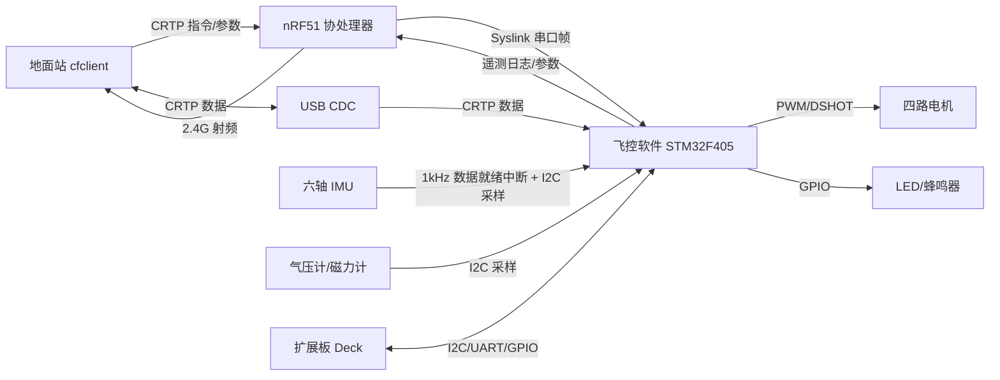
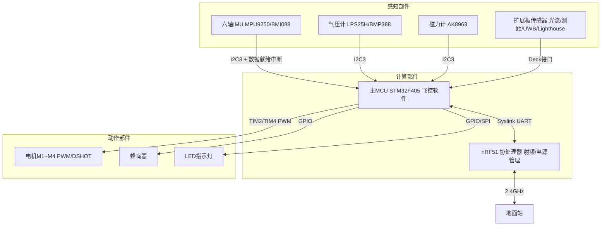
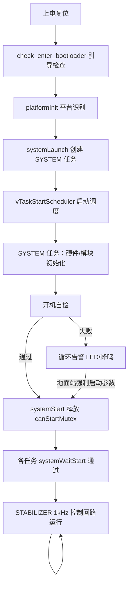
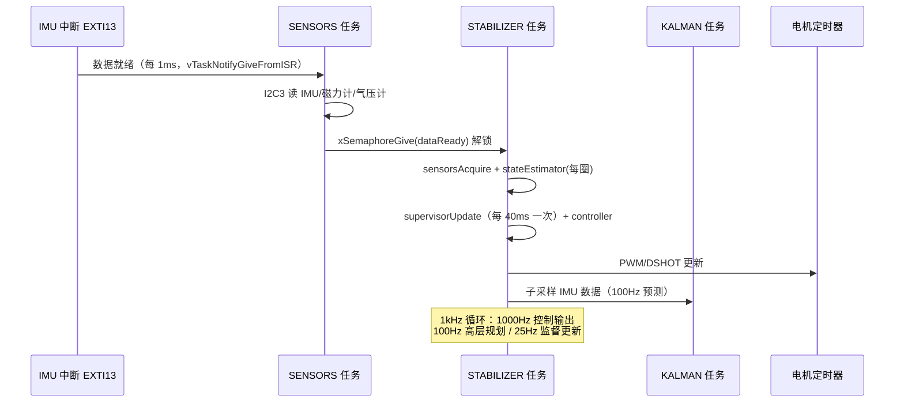
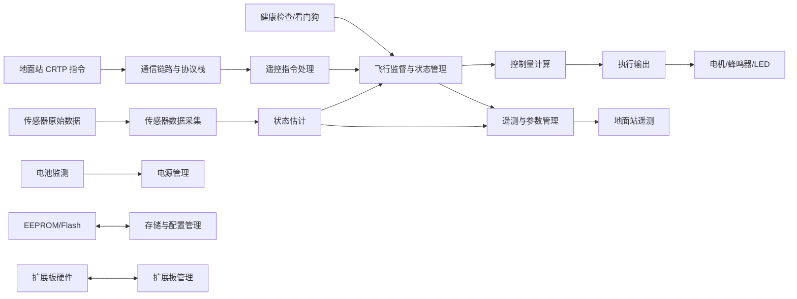
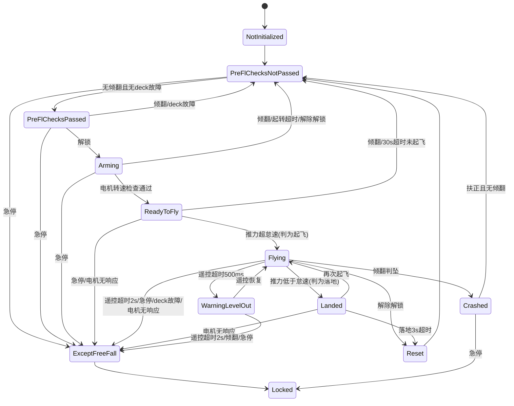

# Crazyflie 固件软件需求规格说明

> 本文档由代码仓库逆向生成。生成日期：2026-10-15；代码仓库：C:\ECNU\502\crazyflie-firmware-master（Bitcraze crazyflie-firmware）。
> 全文需求标识前缀：CF（Crazyflie）。
> 标注约定：（文件名）为代码出处；[待确认] 为代码中无法确定、需人工确认的内容。
> 数值换算约定：FreeRTOS 系统节拍为 1ms（configTICK_RATE_HZ=1000），M2T(X)=X 毫秒（src/config/FreeRTOSConfig.h:77、125）。

# 概述

## 软件概述（README.md、src/init/main.c、src/modules/src/system.c）

Crazyflie 固件是 Crazyflie 系列微型飞行平台（Crazyflie 2.0/2.1、Bolt、Roadrunner、Flapper、Tag 等）的机载飞行控制软件。软件采集六轴 IMU、气压计、磁力计等传感器数据，通过状态估计器解算飞行器姿态、位置与速度；接收地面站（cfclient）经 2.4GHz 射频（nRF51 协处理器）或 USB 链路发送的 CRTP 遥控指令与参数；由飞行监督状态机管理飞行阶段与安全条件，经控制器解算控制量并输出四路电机 PWM/DSHOT 驱动信号，实现稳定悬停与轨迹飞行；同时经 CRTP 日志与参数通道向地面站回传遥测数据，支持扩展板（Deck）加载外部传感器与执行器（README.md；src/modules/src/stabilizer.c:289-388）。



图1.1-1 Crazyflie 固件示意图

软件的工作过程按飞行监督状态机划分为以下阶段（src/modules/interface/supervisor.h:29-43；src/modules/src/supervisor_state_machine.c:39-52）：

- **上电初始化与自检（NotInitialized→PreFlChecksNotPassed）**：平台识别、各模块初始化、开机自检，自检失败时循环告警并可强制启动（system.c:294-327）；
- **起飞前检查（PreFlChecksPassed）**：传感器标定完成、无倾翻、无扩展板故障，等待解锁（supervisor_state_machine.c:91-120）；
- **解锁与预备（Arming→ReadyToFly）**：电机解锁（DSHOT 平台须通过电机转速检查），等待起飞指令（supervisor_state_machine.c:121-192）；
- **正常飞行（Flying）**：控制回路全速运行，执行遥控/规划指令（supervisor_state_machine.c:193-245）；
- **改平告警（WarningLevelOut）**：遥控指令超时 500ms 时自动水平改平、保持高度悬停（supervisor_state_machine.c:226-234）；
- **着陆与复位（Landed→Reset）**：着陆后 3s 超时回到起飞前检查（supervisor_state_machine.c:246-284）；
- **异常自由落体与锁定（ExceptFreeFall→Locked）**：遥控超时 2s、急停、扩展板故障等异常时立即停电机并锁定，仅复位可解锁（supervisor_state_machine.c:286-334）；
- **坠机恢复（Crashed）**：倾翻判坠后待扶正恢复或经地面站指令复位（supervisor_state_machine.c:337-355）。

## 系统组成（src/platform/、src/drivers/、src/hal/src/sensors.c）

软件运行于 Crazyflie 双 MCU 硬件平台上，系统由感知部件、动作部件、计算部件三部分组成。

> 1）感知部件（敏感器）：
> - 六轴 IMU 1 只：Crazyflie 2.0 为 MPU9250（陀螺量程 ±2000°/s、加速度计量程 ±16g，采样率 1000Hz），Crazyflie 2.1 为 BMI088+BMP388 组合（sensors_mpu9250_lps25h.c:62-65、392；sensors_bmi088_bmp3xx.c）；
> - 气压计 1 只：LPS25H（采样率 25Hz）或 BMP388，用于海拔测量（lps25h.c:118）；
> - 三轴磁力计 1 只：AK8963（16bit、100Hz），用于航向修正（sensors_mpu9250_lps25h.c:409）；
> - 扩展板传感器（可选，经 Deck 接口）：光流（PMW3901）、激光/红外测距（VL53L0X/VL53L1X）、UWB 定位（Loco）、Lighthouse 光学定位、GPS 等（src/deck/drivers/src/）。
>
> 2）动作部件（执行器）：
> - 直流电机 4 只：M1=PA1、M2=PB11、M3=PA15、M4=PB9（有刷，PWM 约 328kHz、8bit 分辨率；无刷为 DSHOT150/300/600 协议），承担滚转/俯仰/偏航三轴力矩与总推力输出（motors_def.c:735-741；motors.h:45-50）；
> - 压电蜂鸣器 1 只：播放启动、标定、低电量等音效（sound_cf2.c:301-330）；
> - LED 指示灯：系统状态指示（充电/低电量/自检结果），支持 WS2812 扩展灯带（led.c、ws2812_cf2.c）。
>
> 3）计算部件（控制器）：
> - 主控 MCU：STM32F405RGT6（Cortex-M4F），主频 168MHz，Flash 1MB，SRAM 128KB + CCM 64KB（config.h:56；tools/make/F405/linker/DEF.ld:13-15）；
> - 射频协处理器：nRF51822 1 只，负责 2.4GHz 射频收发与电源按键管理，经 UART（1Mbaud Syslink 协议）与主 MCU 通信（uart_syslink.c:196-202）。



图1.2-1 系统组成图

# 运行环境规定

## 运行方案和场景（src/init/main.c、src/modules/src/system.c、src/config/FreeRTOSConfig.h）

软件采用 FreeRTOS 抢占式多任务方式运行（configUSE_PREEMPTION=1），系统节拍由 SysTick 产生、频率 1000Hz（1 个节拍=1ms），共 6 个任务优先级（0~5，数值越大优先级越高），任务栈与队列使用静态内存分配（configSUPPORT_STATIC_ALLOCATION=1），堆总容量 30000 字节（src/config/FreeRTOSConfig.h:73-93；src/config/config.h:52-56）。

**启动过程：** 上电复位后 main() 依次执行：检查 bootloader 进入标志（bootloader.c:check_enter_bootloader，见 3.2 第 3.2.14 节）→ 平台识别与硬件初始化 platformInit()（识别失败则死循环停机，main.c:49-56）→ 创建 SYSTEM 任务 systemLaunch()（system.c:100-103）→ 启动调度器 vTaskStartScheduler()（main.c:59）。SYSTEM 任务完成全部模块初始化与开机自检后，通过释放互斥量 canStartMutex 允许其余任务运行（system.c:111-112、343-349）；各任务通过 systemWaitStart() 阻塞等待该互斥量（system.c:352-360），保证所有模块就绪后才进入正常运行。

**任务功能：**

1. 主控制任务（STABILIZER，优先级 5）：以 1000Hz 频率运行飞行控制回路——等待传感器数据就绪→采集→状态估计→取遥控指令→监督器更新→避障→控制器解算→电机输出（stabilizer.c:289-388）；
2. 传感器采集任务（SENSORS，优先级 4）：由 IMU 数据就绪中断唤醒，读传感器并广播数据（sensors_mpu9250_lps25h.c:215-271）；
3. 控制回路速率监督任务（RATE_SUPERVISOR，优先级 5）：校验主控制回路频率偏离（stabilizer.c:263-283）；
4. 通信类任务（CRTP-TX/CRTP-RX、SYSLINK、LOG、PARAM、MEM、SUPERVISOR、CMDHL、PLATFORM、CRTP-SRV 等）：处理与地面站/协处理器的协议交互，事件驱动（crtp.c:94-95、syslink.c:118、log.c:229 等）；
5. 状态估计任务（KALMAN，优先级 2）：以 100Hz 执行卡尔曼滤波预测（estimator_kalman.c:119-120、207）；
6. 电源管理任务（PWRMGNT，优先级 0）：以 10Hz 周期处理电池状态（pm_stm32f4.c:126-138、420-422）。

表2.1-1 主要任务信息表

| 任务名 | 优先级 | 功能 | 周期/触发方式 | 证据 |
|--------|-------|------|--------------|------|
| SYSTEM | 2 | 模块初始化与开机自检、启动门控 | 上电执行一次 | system.c:90-103 |
| STABILIZER | 5 | 飞行控制回路 | 1000Hz（IMU 数据就绪信号量同步） | stabilizer.c:189、317-387 |
| RATE_SUPERVISOR | 5 | 控制回路速率监督 | 由 STABILIZER 每圈释放信号量触发 | stabilizer.c:263-283、311 |
| SENSORS | 4 | IMU/磁力计/气压计数据采集 | IMU 数据就绪中断（1000Hz）唤醒 | sensors_mpu9250_lps25h.c:215-271、498 |
| SYSLINK | 3 | nRF51 协处理器协议包路由 | 队列事件驱动 | syslink.c:67-75、118 |
| CRTP-TX / CRTP-RX | 2 | CRTP 协议收发与端口分发 | 队列事件驱动 | crtp.c:94-95 |
| CMDHL | 2 | 高层飞行指令与轨迹规划 | 指令事件驱动，规划输出 100Hz | crtp_commander_high_level.c:312、345-349 |
| KALMAN | 2 | 卡尔曼滤波状态估计 | 100Hz 预测（IMU 子采样） | estimator_kalman.c:119-120、207 |
| LOG | 1 | 日志块管理 | 块定时器/指令事件驱动 | log.c:229、541-559 |
| PARAM | 1 | 参数读写 | 指令事件驱动 | param_task.c:66、76-120 |
| MEM | 1 | 存储设备读写 | 指令事件驱动 | crtp_mem.c:93 |
| SUPERVISOR | 1 | 监督指令处理（急停/解锁/复位） | 指令事件驱动 | crtp_supervisor.c:72 |
| PWRMGNT | 0 | 电池监测与电源状态管理 | 100ms 周期 | pm_stm32f4.c:126-138、420-422 |
| WORKER | 1 | 异步日志块执行等工作队列 | 队列事件驱动 | worker.c:59 |
| PLATFORM | 0 | 平台服务（版本/固件信息） | 指令事件驱动 | platformservice.c:85 |
| CRTP-SRV | 0 | 链路测试服务（回声/识别） | 指令事件驱动 | crtpservice.c:59-88 |
| EXTRX | 2 | 外部接收机（CPPM）指令 | 事件驱动 | extrx.c:139 |
| PASSTHROUGH | 5 | USB 虚拟串口透传 | 事件驱动 | vcp_esc_passthrough.c:77 |

**中断服务程序功能：** 系统中断分为两级——调用 FreeRTOS API 的中断（优先级数值 ≥5，即 NVIC_SYSLINK_UART_PRI=5 及以上）与不调用 RTOS 的"软设备级"中断（优先级 0~4，如 I2C 中断）。主要中断功能：SysTick 产生 1ms 系统节拍（FreeRTOSConfig.h:118）；IMU 数据就绪 EXTI 中断（PC13 上升沿）记录时间戳并经 vTaskNotifyGiveFromISR 唤醒传感器任务，从而产生 1000Hz 控制节奏（sensors_mpu9250_lps25h.c:852-862）；USART6 收发中断完成与 nRF51 的 Syslink 帧传输（uart_syslink.c:635-650）；电机定时器 DMA 中断完成 PWM/DSHOT 输出（motors.c:63-94）。

**控制周期产生：** 主控制周期由 MPU9250 内部 1000Hz 采样速率（SMPLRT_DIV=0，即 1000/(1+0)=1000Hz）及其数据就绪中断直接驱动——传感器任务每中断一次采集一组数据并释放 dataReady 信号量，稳定器任务阻塞等待该信号量，天然同步于 1000Hz（sensors_mpu9250_lps25h.c:392-393、273-276；stabilizer.c:314-319）。低于 1000Hz 的子频率由 RATE_DO_EXECUTE(RATE, step) 宏分频产生：卡尔曼预测 100Hz、监督器更新 25Hz、高层规划输出 100Hz（stabilizer_types.h:363-377；supervisor.c:589-591；estimator_kalman.c:119-120）。



图2.1-1 启动与运行示意图



图2.1-2 控制周期时序图

## 硬件环境（src/config/config.h、tools/make/F405/linker/DEF.ld、src/config/nvicconf.h）

### 宿主计算机

软件运行于 Crazyflie 飞行平台：主控 MCU 为 STM32F405RGT6（ARM Cortex-M4F 内核，含单精度 FPU），主频 168MHz（FREERTOS_MCU_CLOCK_HZ=168000000，config.h:56）；片内 Flash（代码存储器）容量 1MB（DEF.ld:15）；片内 SRAM 128KB（0x20000000 起）+ 紧密耦合存储器 CCMRAM 64KB（0x10000000 起）（DEF.ld:13-14）。射频协处理器 nRF51822 承担 2.4GHz 射频与电源管理（uart_syslink.c:196-202 波特率配置；syslink.h 协议定义）。

### 中断设置

软件处理的中断与优先级配置见下表（优先级数值越小优先级越高，0 为最高；软件约定 4 档：NVIC_LOW_PRI=13、NVIC_MID_PRI=10、NVIC_HIGH_PRI=7、NVIC_VERY_HIGH_PRI=7）：

表2.2-1 中断信息表

| 中断源 | 优先级 | 中断源（名称） | 触发方式 |
|--------|-------|---------------|---------|
| SysTick | 系统异常 | 1ms 系统节拍（FreeRTOS tick） | 内部定时，1000Hz |
| EXTI13（PC13） | 10（NVIC_MID_PRI） | IMU 数据就绪中断 | 上升沿触发（MPU9250 INT 引脚） |
| EXTI15_10 其余线 | 10（NVIC_MID_PRI） | 扩展板/传感器外部中断 | 边沿触发 |
| EXTI9_5 | 13（NVIC_LOW_PRI） | 通用外部中断 | 边沿触发 |
| EXTI0~3 | 13（NVIC_LOW_PRI） | 通用外部中断 | 边沿触发 |
| EXTI4 | 4 | Syslink 流控（nRF51 TXEN） | 边沿触发，暂停/恢复 DMA |
| USART6 | 5 | Syslink 串口收发（与 nRF51 通信） | 收发中断+DMA |
| ADC | 12 | 电池/外接电压采样 | 转换完成中断 |
| TIM2/TIM4 DMA | 10（NVIC_MOTORS_PRI） | 电机 PWM/DSHOT 输出 DMA | DMA 传输中断 |
| SPI | 7（NVIC_HIGH_PRI） | SPI 外设（Lighthouse/副 IMU 等） | 收发中断 |
| I2C | 3/4（NVIC_I2C_PRI_HIGH/LOW） | I2C 传感器总线 | 收发中断 |
| USART1 | 10 | 调试/扩展串口 | 收发中断 |
| USART2 | 6 | CPX（ESP32）/扩展串口 | 收发中断 |
| USB | 10 | USB 设备（CDC） | 端点中断 |
| 调试跟踪定时器 | 4 | 运行时统计计数（usecTimer） | 内部定时 |

优先级使用约定：数值小于 configMAX_SYSCALL_INTERRUPT_PRIORITY=5 的中断（I2C、Syslink 流控、跟踪定时器）不允许调用任何 FreeRTOS API，按"软设备"方式运行在操作系统之上（nvicconf.h:24-31、43-45）；其余中断可调用 FromISR 系列函数。各外设中断初始化时按上表设置 NVIC 优先级（nvicconf.h:73-107）。

### 存储器

表2.2-2 存储器信息表

| 属性 | 代码存储器 FLASH | 数据存储器 SRAM | 紧密耦合存储器 CCMRAM | 外部 EEPROM |
|------|----------------|----------------|---------------------|------------|
| 组成 | 1 片 STM32F405 片内 Flash | 1 片 STM32F405 片内 SRAM | 1 片 STM32F405 片内 CCMRAM | 1 片 I2C EEPROM（24LC64 类） |
| 单片容量 | 1024KB | 128KB | 64KB | 8KB（EEPROM_SIZE=0x1FFF） |
| 数据宽度 | 8bit | 8bit | 8bit | 8bit |
| 片选信号 | — | — | — | I2C 从机地址 EEPROM_I2C_ADDRESS |
| 总容量 | 1024KB | 128KB | 64KB | 8KB |
| 地址分配 | 0x08000000~0x080FFFFF（0x00000000 起别名可访问）；CF bootloader 占 0x08000000~0x08003FFF，应用固件自 0x08004000 起（Makefile:189-190 烧录地址） | 0x20000000~0x2001FFFF（栈顶 _estack=0x2001FFFF） | 0x10000000~0x1000FFFF | 0x0000~0x1FFF |

EEPROM 中 1024~8191 字节划为 KVE 键值存储分区（KVE_PARTITION_START=1024、KVE_PARTITION_LENGTH=7×1024，storage.c:54-55），用于参数持久化；配置块（config block，含射频通道/速率/地址、安装角标定值）亦存于 EEPROM（src/utils/src/Kbuild:3 默认链接 configblockeeprom.o；configblockeeprom.c:41-73）。EEPROM 起始 1024 字节用于射频地址等出厂信息 [待确认：起始区内容由出厂工具写入，固件内未见写入代码]。

## 支持软件环境（Makefile、pixi.toml、tools/make/）

### 编程语言

编程语言：C 语言（Cortex-M4 汇编用于启动与底层切换，startup_stm32f40xx.S）。

### 编译调试工具

> 交叉编译器：arm-none-eabi-gcc 13.3.1（xpack-gcc-arm-none-eabi 工具链，pixi.toml:22），编译选项 -mcpu=cortex-m4 -mthumb -mfloat-abi=hard -mfpu=fpv4-sp-d16 -g3（Makefile:28）。
> 构建系统：Make + Linux Kbuild（Kconfig 菜单配置，各子系统 Kconfig 文件控制功能编译开关），Python 3 用于版本生成等构建脚本（Makefile:11、224-225）。
> 烧录调试：OpenOCD（SWD 调试）、dfu-util（DFU 升级，固件写入 0x08004000，Makefile:2、20、174-191）。
> 运行支撑：FreeRTOS 内核（vendor 目录，GCC/ARM_CM4F 移植，Makefile:35）、STM32F4 标准外设库（src/lib，第三方，本软件仅调用其 API）。

## 接口（src/modules/interface/crtp.h、src/hal/interface/syslink.h、src/hal/src/）

```mermaid
flowchart LR
    GS[地面站 cfclient] <-->|CRTP 协议<br>2.4GHz 射频 / USB CDC| SW[飞控软件]
    NRF[nRF51 协处理器] <-->|Syslink 帧<br>USART6 1Mbaud| SW
    IMU[IMU/气压计/磁力计] <-->|I2C3 400kHz| SW
    DECK[扩展板 Deck] <-->|I2C1/UART/GPIO/1-wire| SW
    ESP[ESP32 AI deck] <-->|CPX 协议<br>UART2| SW
    SW -->|PWM/DSHOT| MOT[四路电机]
    SW -->|GPIO| LEDB[LED/蜂鸣器]
    BAT[电池分压] -->|ADC| SW
```



图2.4-1 接口关系图

### 与其他软件接口

1. **地面站软件（cfclient 等）——CRTP 协议（v12）**：双向。固件接收地面站的遥控指令（setpoint）、参数读写、日志配置、存储读写、监督命令；固件向地面站发送遥测日志、参数值、console 文本。物理承载为 2.4GHz 射频链路（默认，经 nRF51 协处理器）或 USB CDC 虚拟串口链路（VID 0x0483、PID 0x5740，usbd_desc.c:59-61）。CRTP 帧：1 字节头（高 4 位端口号、低 4 位通道号）+ 数据（最长 30 字节），端口定义见 3.2.2 节（crtp.h:33-53）。
2. **nRF51 协处理器固件——Syslink 协议**：双向。主 MCU 经 USART6（默认波特率 1000000）与 nRF51 交换射频数据（SYSLINK_RADIO_RAW）、电源管理状态（SYSLINK_PM_BATTERY_STATE）、单总线读写（SYSLINK_OW_*）、版本查询（SYSLINK_SYS_NRF_VERSION）等（syslink.h:38-79）。帧格式见下表（表2.4-2）。
3. **ESP32 AI 扩展板——CPX 协议**：双向，编译开关 CONFIG_ENABLE_CPX 启用。经 UART2 传输，传输层帧为 2 字节头 + 1 字节 CRC + 路由数据（cpx_uart_transport.c:58-67）。

表2.4-2 Syslink 帧格式表（与 nRF51 协处理器接口）

| 字节序号 | 参数含义 | 数据类型 | 备注 |
|---------|---------|---------|------|
| 0~1 | 帧起始标志 | 原码 | 0xBC 0xCF（syslink.h:34-36） |
| 2 | 包类型 type | 原码 | 高 4 位为分组（0x0=射频、0x1=电源管理、0x2=单总线、0x3=系统、0xF=调试） |
| 3 | 数据长度 length | 原码 | ≤SYSLINK_MTU=64（syslink.h:32） |
| 4~4+length-1 | 数据 data | 原码 | 内容随 type 定义 |
| 末 2 字节 | 校验和 | 原码 | 双累加：cksum[0]=全部字节和，cksum[1]=cksum[0] 的再次累加（syslink.c:155-159） |

### 硬件接口

表2.4-1 硬件接口信息表

| 序号 | 编号 | 描述 | 接口类型 | 数据 |
|------|------|------|---------|------|
| 1. | CF-IREQ1 | 与六轴 IMU（MPU9250/BMI088）接口 | I2C 总线读取、中断输入 | Input: 三轴加速度（±16g）、三轴角速度（±2000°/s）、磁力计/气压计主模式转接；1000Hz 数据就绪中断<br>Output: 寄存器配置（采样率/量程/低通滤波） |
| 2. | CF-IREQ2 | 与气压计（LPS25H/BMP388）、磁力计（AK8963）接口 | I2C 总线读取 | Input: 气压（25Hz）、温度、三轴磁场（100Hz、16bit）<br>Output: 寄存器配置 |
| 3. | CF-IREQ3 | 与四路电机接口 | PWM/DSHOT 输出 | Output: M1~M4 占空比（0~65535 输入当量，有刷 8bit PWM、无刷 DSHOT150/300/600）；双向 DSHOT 时 Input: 电机转速遥测 |
| 4. | CF-IREQ4 | 与 nRF51 协处理器接口 | 串口 USART6（1Mbaud）+ DMA + 流控中断 | Input/Output: Syslink 帧（帧格式见表2.4-2） |
| 5. | CF-IREQ5 | 与地面站 USB 接口 | USB FS 设备（CDC 虚拟串口） | Input/Output: CRTP 帧透传 |
| 6. | CF-IREQ6 | 与扩展板 Deck 接口 | I2C1/SPI/UART/GPIO/单总线 | Input/Output: 按扩展板类型，如光流像素位移、测距值、Lighthouse 角度、UWB 距离 |
| 7. | CF-IREQ7 | 与 LED/蜂鸣器接口 | GPIO | Output: LED 开关/PWM、蜂鸣器驱动 |
| 8. | CF-IREQ8 | 与外接电池监测接口 | AD 采集 | Input: 扩展板电池电压模拟量 |
| 9. | CF-IREQ9 | 与 ESP32（AI 扩展板）接口 | 串口 UART2 | Input/Output: CPX 帧 |

# 软件详细需求

## 功能分解（src/init/main.c、src/modules/src/system.c、src/modules/src/stabilizer.c）

对 Crazyflie 固件软件功能进行分解，软件顶层数据流图如下：



图3.1-1 软件顶层数据流图

各功能经 CRTP 通信链路（FREQ2）与地面站交互：遥控指令经指令处理（FREQ3）进入监督器门控（FREQ6）；传感器采集（FREQ4）与状态估计（FREQ5）构成反馈回路；控制量计算（FREQ7）与执行输出（FREQ8）构成前向通路；遥测（FREQ9）构成上行回路；存储（FREQ11）、扩展板（FREQ12）、电源（FREQ13）、引导（FREQ14）为支撑功能。软件功能清单见下表。

功能清单表如下（"功能编号"列省略前缀，全文需求标识为 CF-FREQn，见 3.2 节各条目）：

| 功能编号 | 功能名称 | 一句话描述 | 主要证据文件 |
|---------|---------|-----------|-------------|
| FREQ1 | 系统初始化与自检 | 平台识别、模块初始化、开机自检与启动门控 | main.c、system.c、platform.c |
| FREQ2 | 通信链路与协议栈 | CRTP 协议收发、射频/USB/Syslink/CPX 链路、外部位姿服务 | crtp.c、comm.c、radiolink.c、syslink.c |
| FREQ3 | 遥控指令处理 | RPYT/Generic/高层三种指令解析、优先级仲裁与轨迹规划 | commander.c、crtp_commander_*.c |
| FREQ4 | 传感器数据采集 | IMU/磁力计/气压计采样、标定与数据广播 | sensors.c、sensors_mpu9250_lps25h.c |
| FREQ5 | 状态估计 | 姿态/位置/速度估计（互补/Kalman/UKF）与越界重置 | estimator_kalman.c、estimator_complementary.c |
| FREQ6 | 飞行监督与状态管理 | 12 态飞行状态机、起飞/降落/急停判定、setpoint 覆盖 | supervisor.c、supervisor_state_machine.c |
| FREQ7 | 控制量计算 | 控制器调度、PID 等控制律、推力分配与限幅 | controller.c、controller_pid.c、power_distribution_quadrotor.c |
| FREQ8 | 执行输出 | 四路电机 PWM/DSHOT、蜂鸣器音效、LED 指示 | motors.c、buzzer.c、led.c |
| FREQ9 | 遥测与参数管理 | 日志块记录回传、参数读写与持久化、console 文本 | log.c、param_logic.c、console.c |
| FREQ10 | 故障诊断与安全保护 | 健康检查、看门狗、回路速率监督、避障 | health.c、watchdog.c、collision_avoidance.c |
| FREQ11 | 存储与配置管理 | EEPROM 存储、配置块、参数持久化、固件升级通道 | mem.c、crtp_mem.c、storage.c |
| FREQ12 | 扩展板（Deck）管理 | Deck 枚举识别、驱动加载与生命周期管理 | deck.c、deck_info.c、deck/drivers/src/ |
| FREQ13 | 电源管理 | 电池监测、低电量告警与关机 | pm_stm32f4.c |
| FREQ14 | 引导与固件升级 | DFU 引导模式进入与跳转 | bootloader.c |

## 功能需求

### 系统初始化与自检（src/init/main.c、src/modules/src/system.c、src/platform/src/platform.c）

a. 需求标识：CF-FREQ1

b. 功能描述：上电后完成 bootloader 检查、平台识别、硬件与各软件模块初始化、开机自检，自检通过后释放启动门控允许飞行任务运行

c. 调用条件：上电或复位时由 main() 与 SYSTEM 任务执行一次

d. 输入：设备类型标识串（OTP 存储）、各模块 Test() 自检返回值、互斥量 canStartMutex

e. 输出：模块就绪状态与自检结果参数 system.selftestPassed、LED 序列与音效、释放 canStartMutex、向 nRF51 发送射频就绪帧（SYSLINK_RADIO_READY）

f. 处理：

1. main() 首先执行 check_enter_bootloader()：检查 SRAM2 基址处引导标志（key=0x5A5）且本次为软件复位（RCC_CSR_SFTRSTF），满足则将内存重映射到系统 Flash 并跳转 DFU 引导程序；随后清除标志（bootloader.c:check_enter_bootloader）；
2. platformInit() 读取设备类型串（OTP 信息块，无则用默认串），与平台配置表逐一匹配（CF2.0 的 "CF20"、CF2.1 的 "CF21"）；匹配失败返回错误，main() 检测到错误后死循环停机（platform.c:33-45；platform_stm32f4.c:53-70；main.c:51-56）；
3. platformInitHardware() 初始化中断控制器（nvicInit）与外部中断（extiInit）（platform_cf2.c:62-68）；
4. systemLaunch() 创建 SYSTEM 任务并启动调度器（system.c:100-103；main.c:59）；
5. SYSTEM 任务按序执行硬件初始化：LED→usecTimer→I2C3/I2C1 总线→透传（system.c:172-186）；
6. systemInit() 按序初始化通信基础（usblink/crtp/console）、配置块、存储、工作队列、ADC、LED 序列、电源管理、蜂鸣器、peer 定位、应用层（system.c:106-153）；
7. commInit() 初始化 Syslink 串口、射频链路并注册为 CRTP 链路，随后初始化 CRTP 服务、平台服务、日志、参数、外部位姿服务（comm.c:46-75）；
8. commanderInit() 注册指令端口回调（system.c:191；crtp_commander.c:40-50）；
9. 按编译开关初始化状态估计器任务（卡尔曼/UKF）（system.c:193-201）；
10. 使能 Syslink 收包、初始化存储访问、扩展板 deckInit()（耗时较长）、按 deck 要求选择估计器、初始化稳定器、低干扰射频模式切换、音效、存储通道（system.c:203-216）；
11. 执行开机自检：依次调用 systemTest()（LED 序列/电源/工作队列/蜂鸣器）、configblockTest()、storageTest()、commTest()、commanderTest()、stabilizerTest()、estimatorKalmanTaskTest()、deckTest()、soundTest()、memTest()、crtpMemTest()、watchdogNormalStartTest()（复位原因检查）、cfAssertNormalStartTest()、peerLocalizationTest()（system.c:155-164、224-292）；
12. 自检通过：置 selftestPassed=1，调用 systemStart() 释放 canStartMutex 并启动硬件看门狗，播放启动音效、执行自检通过 LED 序列（system.c:294-303、343-349）；
13. 自检失败：循环显示失败 LED 序列，地面站可将参数 system.selftestPassed 置 1 强制启动（system.c:305-321）；
14. 启动完成后向 nRF51 发送 SYSLINK_RADIO_READY 帧，允许射频收发（system.c:330-339）。

表3.2-1 模块初始化顺序表（SYSTEM 任务）

| 序号 | 初始化项 | 函数/模块 | 说明 |
|------|---------|----------|------|
| 1 | LED/微秒定时器/I2C 总线 | ledInit/usecTimerInit/i2cdevInit(I2C3、I2C1) | 最早硬件初始化（system.c:172-185） |
| 2 | USB 链路/负载统计/CRTP/console/监督服务 | systemInit 前半段 | 通信基础（system.c:114-124） |
| 3 | 配置块/存储/工作队列/ADC/LED序列/电源/蜂鸣器 | systemInit 后半段 | 数据与资源层（system.c:139-146） |
| 4 | 射频链路与 CRTP 服务/日志/参数 | commInit | 通信注册（comm.c:46-75） |
| 5 | 指令处理 | commanderInit | 遥控入口（system.c:191） |
| 6 | 状态估计器任务 | estimatorKalmanTaskInit 等 | 按编译开关（system.c:193-201） |
| 7 | 扩展板枚举与驱动加载 | deckInit | 耗时最长，其后才能确定估计器类型（system.c:208-209） |
| 8 | 稳定器/音效/存储通道 | stabilizerInit/soundInit/crtpMemInit | 控制回路就绪（system.c:210-216） |

### 通信链路与协议栈（src/modules/src/crtp.c、comm.c、src/hal/src/radiolink.c）

a. 需求标识：CF-FREQ2

b. 功能描述：实现 CRTP 通信协议栈——接收地面站指令并按端口分发到各服务模块，将遥测数据经射频/USB 链路回传；管理 nRF51 协处理器 Syslink 链路与 ESP32 CPX 链路

c. 调用条件：CRTP 收发任务上电初始化后持续运行，事件驱动

d. 输入：射频链路（nRF51 转发）、USB 链路的 CRTP 帧；Syslink 帧

e. 输出：分发到各端口回调的 CRTP 包；发送队列中的回传包

f. 处理：见子功能 3.2.2.1~3.2.2.8。

#### 3.2.2.1 CRTP 收发与端口分发（crtp.c）

a. 需求标识：CF-FREQ2-1

b. 功能描述：CRTP 协议核心栈——协议版本 12，按"端口+通道"两级分发数据包，每个端口可注册一个回调函数，支持阻塞/非阻塞收发与发送队列优先级丢弃

c. 调用条件：crtpInit() 创建 CRTP-TX/CRTP-RX 任务后持续运行；链路实体经 crtpSetLink() 注册

d. 输入：链路层收到的 CRTPPacket（由 radiolink/usblink/cpxlink 提供）；crtpSendPacket() 入队的待发包

e. 输出：端口回调（各服务模块入口）；链路层发送接口

f. 处理：

1. CRTP 帧结构：1 字节头部（高 4 位端口号 port、低 4 位通道号 channel）+ 数据区，数据区最长 CRTP_MAX_DATA_SIZE=30 字节（crtp.h:33-37）；
2. crtpInit() 创建发送队列与 CRTP-TX、CRTP-RX 两个任务（crtp.c:85-97）；
3. 接收任务从链路层取包，按下表按端口号查回调表并调用；端口无回调或为 NULL 包（头字节低 2 位与高 2 位均为 0b11，即 0xF3 掩码判定）时丢弃（crtp.h:39；crtp.c）；
4. 每个端口可经 crtpRegisterPortCB() 注册唯一回调（后注册者覆盖）；亦可经 crtpInitTaskQueue() 建立专用接收队列，由服务任务自行拉取（crtp.h:96-106）；
5. 发送侧：crtpSendPacket() 入队，队满时丢弃最旧的较低优先级包；crtpSendPacketBlock() 队满时阻塞等待（crtp.h:109-122）；
6. 链路实体为 crtpLinkOperations 函数指针结构（setEnable/sendPacket/receivePacket/isConnected/reset），经 crtpSetLink() 切换，切换时先停用旧链路（crtp.h:166-175；crtp.c:243-253）。

表3.2-2 CRTP 端口定义表

| 端口号 | 端口名 | 用途 | 主要服务模块 |
|--------|-------|------|-------------|
| 0x00 | CONSOLE | console 文本输出 | console.c |
| 0x02 | PARAM | 参数读写 | param_task.c |
| 0x03 | SETPOINT | 遥控指令（RPYT） | crtp_commander_rpyt.c |
| 0x04 | MEM | 存储读写/固件升级 | crtp_mem.c |
| 0x05 | LOG | 日志配置与数据 | log.c |
| 0x06 | LOCALIZATION | 外部位姿测量 | crtp_localization_service.c |
| 0x07 | SETPOINT_GENERIC | 通用遥控指令 | crtp_commander_generic.c |
| 0x08 | SETPOINT_HL | 高层飞行指令与轨迹 | crtp_commander_high_level.c |
| 0x09 | SUPERVISOR | 监督命令（急停/解锁/复位） | crtp_supervisor.c |
| 0x0D | PLATFORM | 平台服务（版本等） | platformservice.c |
| 0x0F | LINK | 链路测试服务 | crtpservice.c |

#### 3.2.2.2 无线射频链路（radiolink.c）

a. 需求标识：CF-FREQ2-2

b. 功能描述：经 nRF51 协处理器实现 2.4GHz 无线 CRTP 链路——默认 2Mbps 数据率、通道 80、地址 0xE7E7E7E7E5，采用"收到单播确认后才发下一包"的半双工节流

c. 调用条件：commInit() 时 radiolinkInit() 初始化并注册为 CRTP 链路；收发任务持续运行

d. 输入：CRTP 发送队列中的包；nRF51 经 Syslink 上报的 SYSLINK_RADIO_RAW 接收包

e. 输出：SYSLINK_RADIO_RAW 发送帧（转 nRF51）；CRTP 接收队列

f. 处理：

1. 初始化时读取配置块中的射频通道/数据率/地址（无配置块则用默认值：通道 80、2Mbps、地址 0xE7E7E7E7E5），经 Syslink 命令 SYSLINK_RADIO_CHANNEL/DATARATE/ADDRESS 下发 nRF51（radiolink.c:87-140；config.h:221-223）；
2. 发送 CRTP 包时封装为 SYSLINK_RADIO_RAW 类型 Syslink 帧，数据长 = CRTP 包 size+1，进入深度 1 的发送队列（radiolink.c:234-251）；
3. 发送节流：收到地面站单播确认后才发送下一包；广播包按 best-effort 发送（radiolink.c:178-194）；
4. 接收包解析 RSSI 并计入链路质量，入 CRTP 接收队列（深度 5）（radiolink.c:49、195-198）；
5. 链路活动超时（CONFIG_RADIO_ACTIVITY_TIMEOUT_MS）内无收发则判定断开（radiolink.c:50、75-76）。

#### 3.2.2.3 USB 链路（usblink.c、usb.c）

a. 需求标识：CF-FREQ2-3

b. 功能描述：USB CDC 虚拟串口承载 CRTP 协议，支持地面站经 USB 厂商命令在线切换 CRTP 链路

c. 调用条件：usblinkInit() 后使能；链路切换由 USB 厂商命令触发

d. 输入：USB 端点收到的 CRTP 帧；CRTP 发送队列中的包

e. 输出：USB 端点发送；CRTP 接收队列

f. 处理：

1. usblinkInit() 建立深度 16 的接收队列并初始化 USB 设备（usblink.c:46-48、102-114）；
2. 发送时校验包长（size ≤ CRTP_MAX_DATA_SIZE 且 < SYSLINK_MTU），拒绝超长包（usblink.c:81-82）；
3. 接收等待超时 100ms（usblink.c:69）；
4. USB 厂商命令 0x01 将 CRTP 链路切换到 USB（crtpSetLink(usblinkGetLink())），USB 复位或其他厂商命令切换回射频链路（usb.c:317-357）。

#### 3.2.2.4 nRF51 Syslink 链路（uart_syslink.c、syslink.c）

a. 需求标识：CF-FREQ2-4

b. 功能描述：经 USART6（默认 1Mbaud）与 nRF51 协处理器交换 Syslink 帧，按类型分组路由到射频、电源管理、单总线、系统等处理器；含 DMA 收发与硬件流控

c. 调用条件：SYSLINK 任务初始化后持续运行

d. 输入：USART6 收到的 Syslink 帧（帧格式见表2.4-2）

e. 输出：按 type 高 4 位分组路由后的处理器回调；发往 nRF51 的帧

f. 处理：

1. 发送：组帧（起始 0xBC 0xCF + type + length + data）后计算双字节累加校验和（cksum[0]=字节和，cksum[1]=对 cksum[0] 再次累加），经 DMA 发出（syslink.c:137-168）；
2. 接收：状态机逐字节解析（waitForFirstStart→…→waitForChksum2），校验长度（length ≤ SYSLINK_MTU=64）与校验和，合法包入深度 8 的队列（uart_syslink.c:64、471-573）；
3. SYSLINK 任务阻塞取包，按 type 高 4 位分组（GROUP_MASK=0xF0）分派到对应处理器（syslink.c:67-104）；
4. 流控：nRF51 TXEN 引脚边沿中断（EXTI4）暂停/恢复发送 DMA，防止 nRF51 接收缓冲溢出（uart_syslink.c:220-236）；
5. 调试模式下（UARTSLK_OUTPUT_TRACE_DATA 等宏）波特率切换为 2000000 且仅发送（uart_syslink.c:196-202）。

#### 3.2.2.5 链路测试服务（crtpservice.c）

a. 需求标识：CF-FREQ2-5

b. 功能描述：提供 CRTP LINK 端口的链路质量测试服务——回声、源识别、汇丢弃

c. 调用条件：CRTP-SRV 任务初始化后持续运行

d. 输入：LINK 端口（0x0F）通道 0/1/2 的数据包

e. 输出：回声包/识别串

f. 处理：

1. 通道 0（linkEcho）：将收到的包原样回发；参数可设置回发延时（echoDelay>0 时先延时）（crtpservice.c:77-82）；
2. 通道 1（linkSource）：回发 30 字节识别串 "Bitcraze Crazyflie"（crtpservice.c:83-87）；
3. 通道 2（linkSink）：丢弃（crtpservice.c:88-90）。

#### 3.2.2.6 外部位姿服务（crtp_localization_service.c）

a. 需求标识：CF-FREQ2-6

b. 功能描述：接收地面站/外部系统经 LOCALIZATION 端口上报的位置、位姿测量，转发给状态估计器；管理 Lighthouse 基站几何配置

c. 调用条件：locSrvInit() 注册端口回调后，收到包时触发

d. 输入：LOCALIZATION 端口（0x06）的 EXT_POSITION（通道0）/EXT_POSE（通道1）/EXT_POSITION_PACKED（通道2）测量包

e. 输出：ext_pos 全局变量（供估计器读取）；Lighthouse 基站位置/朝向矩阵

f. 处理：

1. 通道 0（EXT_POSITION）：解析位置测量（x/y/z）并更新时间戳，供卡尔曼估计器作为位置测量使用（crtp_localization_service.c:179-186）；
2. 通道 2（EXT_POSITION_PACKED）：紧凑格式位置测量（crtp_localization_service.c:187-195）；
3. 通道 1（EXT_POSE）：位姿测量（位置+四元数）（crtp_localization_service.c:323-338）；
4. Lighthouse 配置（编译开关 CONFIG_DECK_LIGHTHOUSE）：接收地面站下发的各基站几何（origin/mat）并存储（crtp_localization_service.c:284-300）。

#### 3.2.2.7 CPX 链路（cpx.c、cpxlink.c、cpx_uart_transport.c）

a. 需求标识：CF-FREQ2-7

b. 功能描述：与 ESP32（AI 扩展板）经 UART2 的 CPX 协议通信，作为 CRTP 的备用链路（CONFIG_ENABLE_CPX 编译开关启用）

c. 调用条件：cpxlinkInit() 初始化后持续运行

d. 输入：UART2 收到的 CPX 帧（2 字节头 + 1 字节 CRC + 路由数据）

e. 输出：UART2 发送帧；CRTP 接收队列

f. 处理：

1. 传输层帧：UART_HEADER_LENGTH=2 字节头 + UART_CRC_LENGTH=1 字节 CRC + CPX 路由头 + 数据，受 CPX_UART_TRANSPORT_MTU 限制（cpx_uart_transport.c:58-69）；
2. 内部/外部路由器（cpx_internal_router.c/cpx_external_router.c）按路由表在 CPX 与 CRTP 之间转发（cpx.c:138-141 支持射频链路与 CPX 链路切换）；
3. 发送经 TX 队列（深度 4）与 DMA 发出，含 CTS 流控事件处理（cpx_uart_transport.c:58-59、94-104）。

#### 3.2.2.8 应用通道（app_channel.c、app_handler.c）

a. 需求标识：CF-FREQ2-8

b. 功能描述：为外部应用层（CONFIG_APP_ENABLE 编译开关启用）提供经 CRTP MEM 端口应用通道（0x18）的数据转发

c. 调用条件：appInit() 后随 MEM 端口服务运行

d. 输入：地面站发往应用通道的数据包

e. 输出：应用层回调；应用层回包

f. 处理：

1. appInit() 注册应用通道到 MEM 端口并创建应用任务（app_handler.c:49）；
2. 数据经 appchannel 在 CRTP 与应用层之间桥接（app_channel.c）。

### 遥控指令处理（src/modules/src/commander.c、crtp_commander_rpyt.c）

a. 需求标识：CF-FREQ3

b. 功能描述：接收并解析地面站经 CRTP 发来的遥控指令（RPYT/Generic/高层轨迹三种格式）与外部接收机指令，按优先级仲裁后生成飞行器目标 setpoint（姿态/角速度/位置/速度/推力）

c. 调用条件：commanderInit() 注册端口回调后持续接收；setpoint 由稳定器任务在 1000Hz 循环中每圈消费（stabilizer.c:338）

d. 输入：CRTP SETPOINT 端口（0x03）RPYT 包、SETPOINT_GENERIC 端口（0x07）通用包、SETPOINT_HL 端口（0x08）高层指令、外部接收机（EXTRX）数据

e. 输出：setpoint_t 全局目标值（含时间戳与模式字），供稳定器/监督器/控制器使用

f. 处理：见子功能 3.2.3.1~3.2.3.5。

表3.2-3 setpoint_t 目标值结构表

| 字段 | 类型 | 物理含义 | 单位 |
|------|------|---------|------|
| timestamp | uint32_t | 指令时间戳（写入时取系统 tick） | ms |
| attitude | attitude_t（float×3） | 目标姿态角 roll/pitch/yaw | deg |
| attitudeRate | attitude_t | 目标姿态角速度 | deg/s |
| attitudeQuaternion | quaternion_t | 目标姿态四元数 | — |
| thrust | float | 目标推力 | 0~65535 当量（legacy） |
| position | point_t（float×3+时间戳） | 目标位置 | m |
| velocity | velocity_t | 目标速度 | m/s |
| acceleration | acc_t | 目标加速度 | m/s² |
| jerk | jerk_t | 目标加加速度 | m/s³ |
| velocity_body | bool | 速度为体轴系（true）还是世界系（false） | — |
| mode | setpoint_mode_t | 各轴控制模式（x/y/z/roll/pitch/yaw/quat） | 枚举 |

各轴控制模式枚举 stab_mode_t：modeDisable=0（该轴不控制）、modeAbs=1（绝对值模式）、modeVelocity=2（速度模式）（stabilizer_types.h:245-259）。

#### 3.2.3.1 setpoint 优先级仲裁（commander.c）

a. 需求标识：CF-FREQ3-1

b. 功能描述：维护当前目标 setpoint 与占用优先级，只有优先级不低于当前占用者的新指令才能覆盖；高优先级接管时自动停止高层规划器

c. 调用条件：各指令源解码后调用 commanderSetSetpoint()；稳定器每圈调用 commanderGetSetpoint()

d. 输入：新 setpoint 及提交优先级

e. 输出：当前生效 setpoint 与优先级（commanderGetActivePriority）

f. 处理：

1. 优先级定义：数值越大优先级越高（表3.2-4）；
2. commanderSetSetpoint()：priority ≥ 当前优先级才写入，写入时刷新 timestamp 为当前 tick（commander.c:74-91）；
3. 当新指令优先级 > COMMANDER_PRIORITY_HIGHLEVEL（即 CRTP 或 EXTRX 接管）时，调用 crtpCommanderHighLevelStop() 停止高层规划（commander.c:86-89）；
4. commanderGetSetpoint()：取出当前 setpoint 并缓存状态（commander.c:100-109）；
5. commanderRelaxPriority()：将占用优先级降到最低，使任何来源的新指令均可接管（用于流式指令停止后交还控制权）（commander.c:93-98）；
6. setpoint 新鲜度由监督器看门狗判定：距上次指令 500ms 触发改平警告、2000ms 触发停电机（见 3.2.6 节）（supervisor.c:481-487）。

表3.2-4 指令优先级定义表

| 优先级值 | 宏定义 | 来源 | 说明 |
|---------|-------|------|------|
| 0 | COMMANDER_PRIORITY_DISABLE | — | 禁用（初始值） |
| 1 | COMMANDER_PRIORITY_LOWEST / HIGHLEVEL | 高层规划器 | 最低有效优先级 |
| 2 | COMMANDER_PRIORITY_CRTP | CRTP 遥控（RPYT/Generic） | 流式指令 |
| 3 | COMMANDER_PRIORITY_EXTRX | 外部接收机（CPPM） | 最高，可覆盖一切 |

#### 3.2.3.2 RPYT 遥控指令解析（crtp_commander_rpyt.c）

a. 需求标识：CF-FREQ3-2

b. 功能描述：解析 CRTP SETPOINT 端口通道 0 的 RPYT 包（滚转/俯仰/偏航角 + 推力），含推力解锁互锁与高度保持/位置设定模式

c. 调用条件：收到 SETPOINT 端口通道 0 数据包时

d. 输入：14 字节 RPYT 包（表3.2-5）

e. 输出：以 COMMANDER_PRIORITY_CRTP 提交的 setpoint

f. 处理：

1. 推力互锁：thrust==0 的包解除锁定，此后才允许非零推力（防误启）；当占用优先级为 DISABLE 时重新锁定（crtp_commander_rpyt.c:130-144）；
2. 推力低于 MIN_THRUST=1000 按 0 处理（crtp_commander_rpyt.c:39-44）；
3. althold 模式：thrust 字段解释为 z 轴速度（velocity.z=(thrust-32767)/32767，约 ±1 m/s 量级）（crtp_commander_rpyt.c:146-159）；
4. posSet 模式：roll/pitch 数值直接作为位置 x/y（m），thrust/1000 作为高度 z（m）（crtp_commander_rpyt.c:172-187）；
5. 姿态稳定模式：RATE 模式（枚举 RATE=0）下角度值作为目标角速度（deg/s），ANGLE 模式（=1）下作为目标姿态角（deg）（crtp_commander_rpyt.c:60-64、192-210）；
6. 偏航：RATE 模式下 attitudeRate.yaw 取输入反号（legacy 输入约定）（crtp_commander_rpyt.c:217-223）；YawMode（CAREFREE=0/PLUSMODE=1/XMODE=2）决定偏航指令解算，plusmode 时旋转 45°（crtp_commander_rpyt.c:69-74、116-117）。

表3.2-5 RPYT 数据包格式表（SETPOINT 端口通道 0）

| 字节序号 | 参数含义 | 数据类型 | 备注 |
|---------|---------|---------|------|
| 0~3 | 滚转角 roll | IEEE754 单精度浮点 | 单位 deg；RATE 模式时为目标角速度 deg/s |
| 4~7 | 俯仰角 pitch | IEEE754 单精度浮点 | 单位 deg；RATE 模式时为目标角速度 deg/s |
| 8~11 | 偏航角 yaw | IEEE754 单精度浮点 | 单位 deg；RATE 模式时为角速度 deg/s（取反号） |
| 12~13 | 推力 thrust | 原码 | 0~65535；<1000 视为 0 |

#### 3.2.3.3 Generic 通用遥控指令解析（crtp_commander_generic.c）

a. 需求标识：CF-FREQ3-3

b. 功能描述：解析 CRTP SETPOINT_GENERIC 端口的类型化指令包（12 种类型：stop、速度、高度、悬停、全状态、位置等），支持世界系/体轴系速度、CPPM 仿真

c. 调用条件：收到 SETPOINT_GENERIC 端口数据包时

d. 输入：[类型 1 字节][数据…]，数据最长 29 字节（crtp_commander_generic.c:39-51）

e. 输出：以 COMMANDER_PRIORITY_CRTP 提交的 setpoint

f. 处理：

1. 按首字节类型查 packetDecoders 分发表调用对应解码器（crtp_commander_generic.c:525-558）；
2. 各类型解码后写入 setpoint 对应字段，未提供的轴置 modeDisable；
3. fullState 类型含位置/速度/加速度（int16 毫米单位）、压缩四元数、角速度（int16 millirad/s），解码时除以 1000 换算 SI 单位、角速度乘 180/(π×1000) 换算 deg/s（crtp_commander_generic.c:452-495）；
4. cppmEmu 类型将 1000~2000（中点 1500）的通道值映射为 roll/pitch 角（默认满杆 50°）、角速率（默认 720°/s）、偏航速率（默认 400°/s），可经 cppm.* 参数调整（crtp_commander_generic.c:248-267、342-352）；
5. 端口通道 1 为 meta 指令：收到"setpoint 停止"通知（已废弃的 remainValidMillisecs 数据）时执行 commanderRelaxPriority() 交还控制权（crtp_commander.c:52-55、81-108）。

表3.2-6 Generic 指令类型表

| 类型值 | 名称 | 数据内容 | 说明 |
|-------|------|---------|------|
| 0 | stop | 无 | setpoint 全零（停电机） |
| 1 | legacyVelocityWorld | float vx,vy,vz（世界系 m/s）、float yawrate（deg/s） | 兼容旧版（yawrate 反号） |
| 2 | legacyZDistance | float roll,pitch（deg）、float yawrate、float zDistance（m，世界系绝对高度） | 兼容旧版 |
| 3 | cppmEmu | 1 字节头（低 4 位辅通道数）+4×uint16 主通道+辅通道 | CPPM 接收机仿真 |
| 4 | altHold | float roll,pitch（rad）、float yawrate、float zVelocity | 高度保持 |
| 5 | legacyHover | float vx,vy（体轴系 m/s）、float yawrate、float zDistance | 兼容旧版悬停 |
| 6 | fullState | int16 x,y,z（mm）、vx,vy,vz（mm/s）、ax,ay,az（mm/s²）、int32 压缩四元数、int16 rateRoll/Pitch/Yaw（millirad/s） | 全状态，29 字节 |
| 7 | position | float x,y,z（m）、float yaw（deg） | 位置设定 |
| 8 | velocityWorld | float vx,vy,vz（世界系 m/s）、float yawrate（deg/s） | 世界系速度 |
| 9 | zDistance | float roll,pitch（deg）、float yawrate、float zDistance（m） | 高度+姿态 |
| 10 | hover | float vx,vy（体轴系 m/s）、float yawrate、float zDistance | 悬停 |
| 11 | manual | float roll,pitch（deg 或 deg/s）、float yawrate、uint16 thrust、char rate 标志 | 手动直通 |

#### 3.2.3.4 高层飞行指令与轨迹规划（crtp_commander_high_level.c）

a. 需求标识：CF-FREQ3-4

b. 功能描述：接收地面站高层指令（起飞/降落/悬停/目标点/螺旋/轨迹等 14 种），由规划器按 100Hz 生成平滑 setpoint 序列；支持最多 31 条预定义轨迹（存储 4096 字节）

c. 调用条件：CMDHL 任务阻塞接收指令；规划输出在稳定器循环中每 10 圈执行一次（RATE_HL_COMMANDER=100Hz）

d. 输入：SETPOINT_HL 端口（0x08）指令包（表3.2-7）

e. 输出：以 COMMANDER_PRIORITY_HIGHLEVEL 提交的 setpoint（稳定器内 crtpCommanderHighLevelGetSetpoint 返回 true 时，stabilizer.c:335-337）；指令应答包（4 字节，data[3]=返回值）

f. 处理：

1. CMDHL 任务阻塞收包（crtpReceivePacketBlock），按组掩码过滤（非本组指令忽略），解析指令数据并执行（crtp_commander_high_level.c:298-323、470-484）；
2. 起飞/降落默认速度 0.5 m/s，可经参数 hlCommander.vtoff/vland 调整（crtp_commander_high_level.c:111-113）；
3. 轨迹指令（DEFINE_TRAJECTORY/START_TRAJECTORY_2）将轨迹描述存入轨迹存储区（最多 31 条、共 4096 字节），支持 POLY4D 与 POLY4D_COMPRESSED 两种类型（crtp_commander_high_level.c:49-84）；
4. 规划求值：stabilizer 每圈调用 crtpCommanderHighLevelGetSetpoint()，内部按 RATE_DO_EXECUTE(100, stabilizerStep) 每 10 圈（100Hz）求值一次，输出位置/速度/偏航（deg）/角速度（deg/s）目标（crtp_commander_high_level.c:345-384）；
5. 规划停止态输出 nullSetpoint（全零，停电机）（crtp_commander_high_level.c:359-370）；
6. 被低层指令接管（commander.c:86-89）或飞行被封锁（crtpCommanderBlock）时停止规划并拒绝新轨迹（返回 EBUSY）（crtp_commander_high_level.c:497-514、919-949）；
7. 指令执行结果经应答包返回：0=成功，其余为错误码（EBUSY/ENOEXEC 等）（crtp_commander_high_level.c:470-485）。

表3.2-7 高层指令定义表（包首字节）

| 指令值 | 名称 | 数据内容 | 说明 |
|-------|------|---------|------|
| 0 | SET_GROUP_MASK | groupMask u8 | 弃用 |
| 1 | TAKEOFF | — | 弃用 |
| 2 | LAND | — | 弃用 |
| 3 | STOP | groupMask u8 | 停止规划 |
| 4 | GO_TO | groupMask、relative、x/y/z（m）、yaw（rad）、duration（s） | 弃用 |
| 5 | START_TRAJECTORY | — | 弃用 |
| 6 | DEFINE_TRAJECTORY | trajectoryId u8、location、type、offset u32、nPieces u8 | 定义轨迹 |
| 7 | TAKEOFF_2 | groupMask、height（m）、yaw（rad）、useCurrentYaw、duration（s） | 起飞 |
| 8 | LAND_2 | 同 TAKEOFF_2 | 降落 |
| 9 | TAKEOFF_WITH_VELOCITY | groupMask、height、heightIsRelative、yaw、useCurrentYaw、velocity | 按速度起飞 |
| 10 | LAND_WITH_VELOCITY | 同上 | 按速度降落 |
| 11 | SPIRAL | groupMask、sideways、clockwise、phi、r0、rf、dz、duration | 螺旋轨迹 |
| 12 | GO_TO_2 | groupMask、relative、x/y/z、yaw、duration、linear | 目标点 |
| 13 | START_TRAJECTORY_2 | groupMask、relativePosition、relativeYaw、reversed、trajectoryId、timescale | 启动轨迹 |

#### 3.2.3.5 外部接收机指令（extrx.c）

a. 需求标识：CF-FREQ3-5

b. 功能描述：接收外部接收机（如 CPPM 遥控器信号）生成的 setpoint，以最高优先级提交

c. 调用条件：EXTRX 任务初始化后持续运行（编译开关启用时）

d. 输入：接收机通道数据

e. 输出：以 COMMANDER_PRIORITY_EXTRX（=3，最高）提交的 setpoint（extrx.c:265）

f. 处理：解码接收机通道值并映射为 setpoint 后经 commanderSetSetpoint 提交（extrx.c:139、265）。

### 传感器数据采集（src/hal/src/sensors.c、sensors_mpu9250_lps25h.c、src/drivers/src/mpu6500.c）

a. 需求标识：CF-FREQ4

b. 功能描述：以 1000Hz 采集六轴 IMU 原始数据，周期采集磁力计（100Hz）与气压计（25Hz）数据，完成传感器初始化、标定（陀螺零偏、加速度刻度），并将数据广播给稳定器与估计器

c. 调用条件：SENSORS 任务由 IMU 数据就绪中断唤醒，1000Hz 周期运行；稳定器任务经 sensorsWaitDataReady() 同步

d. 输入：IMU 数据就绪中断（PC13 上升沿）、I2C3 总线读回的传感器寄存器

e. 输出：sensorData_t（加速度[Gs]/角速度[deg/s]/磁场[gauss]/气压[mbar]、温度、海拔、中断时间戳）与各传感器队列

f. 处理：见子功能 3.2.4.1~3.2.4.4。

#### 3.2.4.1 IMU 初始化与数据采集（sensors_mpu9250_lps25h.c、mpu6500.c）

a. 需求标识：CF-FREQ4-1

b. 功能描述：初始化 MPU9250（采样率 1000Hz、陀螺 ±2000°/s、加速度 ±16g、数字低通滤波），在数据就绪中断驱动下经 I2C3 读取三轴加速度与角速度并广播

c. 调用条件：sensorsInit() 初始化；此后每 1ms 中断驱动

d. 输入：MPU9250 寄存器（经 I2C3，地址 MPU6500_ADDRESS_AD0_HIGH）；EXTI13 中断

e. 输出：加速度（±16g 满量程）、角速度（±2000°/s 满量程）、中断时间戳 interruptTimestamp（usecTimestamp）

f. 处理：

1. 初始化：mpu6500Init() 配置采样率寄存器 SMPLRT_DIV=0（采样率=1000/(1+0)=1000Hz，mpu6500.c:140、273-302）、陀螺量程 ±2000°/s、加速度量程 ±16g、陀螺数字低通 98Hz、加速度低通 41Hz、软件二阶低通初始化（sensors_mpu9250_lps25h.c:62-65、388-401）；
2. 使能 MPU9250 I2C 旁路，直连磁力计与气压计；配置主模式从机读取（slave0/1/2，约 100Hz 读取速率，MasterDelay=9），主 I2C 时钟 400kHz（sensors_mpu9250_lps25h.c:382、440-489）；
3. 中断：使能 PC13（EXTI13）上升沿中断，回调中记录 imuIntTimestamp 并经 vTaskNotifyGiveFromISR 唤醒传感器任务（sensors_mpu9250_lps25h.c:501-533、852-862）；
4. 传感器任务每圈经 I2C3 连续读 14+ 字节（加速度 6 字节+陀螺 6 字节+温度 2 字节起始），解析为工程单位后写入各传感器队列（xQueueOverwrite）并释放 dataReady 信号量解锁稳定器（sensors_mpu9250_lps25h.c:215-271）；
5. 软件二阶低通滤波（双二次 IIR）对陀螺与加速度数据滤波（sensors_mpu9250_lps25h.c:397-401）；
6. sensorsWaitDataReady() 阻塞于 dataReady 信号量，实现 1000Hz 解锁（sensors_mpu9250_lps25h.c:273-276）。

#### 3.2.4.2 磁力计与气压计数据采集（sensors_mpu9250_lps25h.c、ak8963.c、lps25h.c）

a. 需求标识：CF-FREQ4-2

b. 功能描述：采集三轴磁力计（AK8963，16bit、100Hz 连续模式）与气压计（LPS25H，25Hz）数据，与 IMU 数据一同广播

c. 调用条件：随 IMU 采集周期运行（磁力计经 MPU9250 主模式从机读取，约 100Hz；气压计 25Hz 更新）

d. 输入：AK8963/LPS25H 寄存器（经 MPU9250 主 I2C 或直连）

e. 输出：磁场三分量（gauss）、气压（mbar）、温度（℃）、海拔 asl（m）

f. 处理：

1. ak8963Init()：16bit 输出、100Hz 连续测量模式（sensors_mpu9250_lps25h.c:409）；
2. lps25hInit()：写 CTRL_REG1 使能（Power on、25Hz ODR、BDU，0b11000110）（lps25h.c:118）；
3. 磁力计/气压计数据经 MPU9250 从机读取通道进入传感器任务数据流，与 IMU 数据合并为 sensorData_t 广播（sensors_mpu9250_lps25h.c:215-271）；
4. 磁力计数据用于航向参考（估计器磁航向更新）；气压计数据用于海拔/高度估计（sensorData_t.baro，stabilizer_types.h:113-117、165-175）。

#### 3.2.4.3 传感器标定（sensors_mpu9250_lps25h.c）

a. 需求标识：CF-FREQ4-3

b. 功能描述：上电后自动完成陀螺零偏标定与加速度计刻度标定，标定完成前稳定器循环阻塞等待；标定成功给出声光提示

c. 调用条件：传感器初始化后自动执行（平台静止时）

d. 输入：连续采样的陀螺/加速度数据

e. 输出：陀螺零偏、加速度刻度；gyroBiasFound 标志（sensorsAreCalibrated 返回）

f. 处理：

1. 陀螺零偏（默认算法）：累计采样并计算方差，方差低于阈值（平台静止）时取均值作为零偏，成功后播放 SND_CALIB 音效并执行标定完成 LED 序列（sensors_mpu9250_lps25h.c:620-689）；
2. 陀螺零偏（GYRO_BIAS_LIGHT_WEIGHT 轻量算法）：累计 SENSORS_BIAS_SAMPLES=1000 个样本求均值（sensors_mpu9250_lps25h.c:71、647-658）；
3. 加速度计刻度标定：累计 SENSORS_ACC_SCALE_SAMPLES 个样本计算刻度（sensors_mpu9250_lps25h.c:600-618）；
4. 安装角标定值（calibPitch/calibRoll）从配置块读取，用于补偿安装误差（sensors_mpu9250_lps25h.c:433-436；configblockeeprom.c）；
5. 标定期间 sensorsAreCalibrated() 返回 false，稳定器循环阻塞等待（stabilizer.c:298-304）。

#### 3.2.4.4 传感器悬挂与恢复（sensors.c）

a. 需求标识：CF-FREQ4-4

b. 功能描述：提供传感器中断悬挂/恢复机制，供扩展板烧写等占用传感器总线的场景使用

c. 调用条件：sensorsSuspend()/sensorsResume() 由 deck 烧写等流程调用

d. 输入：无

e. 输出：sensorsSuspended 状态

f. 处理：

1. sensorsSuspend()：禁止 EXTI15_10 中断（NVIC_DisableIRQ）并置悬挂标志（sensors.c:209-213）；
2. sensorsResume()：恢复中断并清标志（sensors.c:215-219）；
3. 稳定器速率监督在传感器悬挂期间不判阻塞（isSensorsSuspended() 检查，stabilizer.c:275-276）。

### 状态估计（src/modules/src/estimator/estimator.c、estimator_kalman.c）

a. 需求标识：CF-FREQ5

b. 功能描述：融合 IMU、气压计、磁力计及外部测量（UWB/TDOA、测距、光流、Lighthouse 等）解算飞行器姿态、位置、速度，支持互补/卡尔曼/UKF 三种估计器及运行时切换

c. 调用条件：稳定器循环 1000Hz 每圈调用 stateEstimator()（stabilizer.c:329）；卡尔曼预测 100Hz 执行

d. 输入：sensorData_t（加速度/角速度/磁场/气压）、外部位姿测量、测距/光流等 deck 测量

e. 输出：state_t（姿态角[deg]、姿态四元数、位置[m]、速度[m/s]、加速度[Gs]）

f. 处理：见子功能 3.2.5.1~3.2.5.4。

#### 3.2.5.1 估计器选择（estimator.c）

a. 需求标识：CF-FREQ5-1

b. 功能描述：按参数/编译开关/扩展板要求选择估计器（Auto=0 自动选择、Complementary=1、Kalman=2、Ukf=3），支持运行时切换

c. 调用条件：stabilizerInit() 初始化；稳定器循环每圈调用 update 函数

d. 输入：参数 stabilizer.estimator、deck 要求（deckGetRequiredEstimator）、编译开关

e. 输出：选定的估计器函数表（init/test/update/deinit/name）

f. 处理：

1. 估计器函数表 estimatorFunctions[] 登记各估计器入口（estimator.c:59-85）；
2. 自动选择：编译开关可用时选卡尔曼，否则选互补（DEFAULT_ESTIMATOR=StateEstimatorTypeComplementary）（estimator.c:19、120-124）；
3. 扩展板可强制指定估计器（deckGetRequiredEstimator，system.c:209 传入 stabilizerInit）；
4. 参数 stabilizer.estimator 可在运行时切换估计器（stateEstimatorSwitchTo）（stabilizer.c:400；estimator.c:150-156）。

#### 3.2.5.2 卡尔曼状态估计（estimator_kalman.c、kalman_core/）

a. 需求标识：CF-FREQ5-2

b. 功能描述：扩展卡尔曼滤波估计飞行器全状态——100Hz 预测 + 1000Hz IMU 子采样，融合位置/位姿/测距/ToF/高度/光流/航向误差等外部测量，含离群点滤波与状态越界保护

c. 调用条件：KALMAN 任务（优先级 2）创建后持续运行，预测周期 100Hz（PREDICT_RATE=RATE_100_HZ）

d. 输入：IMU 子采样数据（加速度/角速度）、外部测量队列（measurement_t 事件队列）

e. 输出：taskEstimatorState（姿态/位置/速度估计）与 accLatest 供稳定器消费

f. 处理：

1. 任务循环：kalmanCoreDecoupleXY（解耦 X/Y 轴）→ 每 10ms 预测 kalmanCorePredict（IMU 子采样）→ 加入过程噪声 → kalmanCoreFinalize（完成后外推状态 kalmanCoreExternalizeState）（estimator_kalman.c:235-285）；
2. 测量更新：队列中的测量事件按类型调用对应更新函数——TDOA（含鲁棒离群点滤波）、位置、位姿、测距（含鲁棒更新）、ToF、绝对高度、光流、航向误差（estimator_kalman.c:314-345）；
3. 预测速率监督：rateSupervisor 校验预测频率在 99~101Hz 窗口内，偏离仅告警（estimator_kalman.c:222、253-255）；
4. 状态越界保护：kalmanSupervisorIsStateWithinBounds 检查 |位置|≤100m、|速度|≤10m/s（阈值≤0 表示禁用），越界则下一循环 estimatorKalmanInit() 整体重置估计器，告警限频 2000ms 一次（kalman_supervisor.c:34-57；estimator_kalman.c:228-230、268-275）。

#### 3.2.5.3 互补姿态估计（estimator_complementary.c、sensfusion6.c）

a. 需求标识：CF-FREQ5-3

b. 功能描述：基于 Sensfusion6 梯度下降融合算法的互补姿态估计——由角速度积分四元数、加速度/磁场梯度修正，输出欧拉角与去重力垂向加速度

c. 调用条件：稳定器循环 1000Hz 每圈调用（估计器选择为互补时）

d. 输入：三轴角速度（deg/s）、加速度（Gs）、磁场（gauss）

e. 输出：姿态角 roll/pitch/yaw（deg）、姿态四元数、去重力垂向加速度 acc.z（Gs）

f. 处理：

1. sensfusion6Init() 初始化四元数与增益（estimator_complementary.c:54）；
2. 每圈 sensfusion6UpdateQ(gyro, acc, mag, dt) 更新四元数（estimator_complementary.c:92-96）；
3. sensfusion6GetEulerRPY 输出欧拉角、sensfusion6GetQuaternion 输出四元数、sensfusion6GetAccZWithoutGravity 输出去重力垂向加速度（estimator_complementary.c:97-107）；
4. 支持经外部姿态测量修正（Lighthouse 等 deck 姿态注入）[待确认：注入路径在 estimator_complementary.c 外部姿态处理段，具体融合权重未见注释]。

#### 3.2.5.4 高度估计（position_estimator_altitude.c）

a. 需求标识：CF-FREQ5-4

b. 功能描述：仅高度/海拔通道的位置估计——融合气压计海拔与 ToF 测距，IIR 滤波平滑

c. 调用条件：稳定器循环每圈 positionEstimate() 调用

d. 输入：baro_t（气压/温度/asl）、tofMeasurement_t 测距

e. 输出：estimate->position.z 高度估计与垂直速度

f. 处理：

1. 采样新鲜度检查：样本年龄超过 MAX_SAMPLE_AGE=50ms 不更新（position_estimator_altitude.c:77）；
2. 无有效 ToF 时以气压计 asl 经 alpha 系数 IIR 滤波（estAlphaAsl 参数）平滑（position_estimator_altitude.c:97-101）；
3. 有有效 ToF 时按测距修正高度估计 [待确认：具体融合公式见 positionEstimateInternal 测距分支]；
4. 滤波系数可经参数调整（estAlphaAsl 等，position_estimator_altitude.c:131-135）。

### 飞行监督与状态管理（src/modules/src/supervisor.c、supervisor_state_machine.c）

a. 需求标识：CF-FREQ6

b. 功能描述：以 25Hz 维护 12 态飞行状态机，计算 13 个监督条件位（飞行判定、遥控看门狗、急停、倾翻、超时等），在异常条件下覆盖 setpoint 或禁止电机输出，保障飞行安全

c. 调用条件：稳定器循环内每 40 圈执行一次（RATE_SUPERVISOR=RATE_25_HZ，25Hz/40ms，supervisor.c:589-591；stabilizer.c:347）

d. 输入：sensorData_t、当前 setpoint、稳定器步计数 stabilizerStep、地面站监督命令（CRTP SUPERVISOR 端口）

e. 输出：监督状态（supervisorState）、条件位（armed/isFlying 等）、电机运行许可（supervisorAreMotorsAllowedToRun）、setpoint 覆盖（supervisorOverrideSetpoint）

f. 处理：见子功能 3.2.6.1~3.2.6.5。

表3.2-8 监督状态定义表

| 序号 | 状态（枚举值） | 功能 |
|------|--------------|------|
| 0 | NotInitialized | 监督器未初始化 |
| 1 | PreFlChecksNotPassed（起飞前检查未通过） | 等待传感器标定/扶正，不可解锁 |
| 2 | PreFlChecksPassed（起飞前检查通过） | 可解锁（supervisorCanArm 仅此态返回真） |
| 3 | Arming（解锁中） | 电机解锁/起转检查，禁止起飞 |
| 4 | ReadyToFly（待飞） | 可飞行，等待推力指令 |
| 5 | Flying（飞行中） | 正常飞行控制 |
| 6 | Landed（已着陆） | 落地，等待复位 |
| 7 | Reset（复位） | 过渡态，回到起飞前检查 |
| 8 | WarningLevelOut（改平告警） | 遥控短暂失联，水平改平悬停 |
| 9 | ExceptFreeFall（异常自由落体） | 异常态，停电机，下一拍锁定 |
| 10 | Locked（锁定） | 永久锁定，仅复位可解锁 |
| 11 | Crashed（坠机） | 判坠后等待扶正恢复 |



图3.2-1 飞行监督状态切换图

#### 3.2.6.1 监督条件计算（supervisor.c）

a. 需求标识：CF-FREQ6-1

b. 功能描述：每个监督周期（25Hz）计算 13 个监督条件位：armed、isFlying、isTumbled、commanderWdtWarning/Timeout、emergencyStop、isCrashed、preflightTimeout、landingTimeout、deckFault、rpmAtArmingValid、spinupTimeout、motorsNotResponding

c. 调用条件：supervisorUpdate() 25Hz 调用（stabilizer.c:347）

d. 输入：sensorData_t（加速度/角速度）、setpoint 时间戳、deck 状态、电机 RPM（双向 DSHOT）

e. 输出：各条件位（supervisor.h:46-79 位定义）

f. 处理：

1. **isFlying 飞行判定**：任一电机推力（motorType×ratio）> idleThrust（默认 7000，即 7000/65535≈10.7% 占空比）判为飞行；低于 idle 持续 <2s（IS_FLYING_HYSTERESIS_THRESHOLD=2000ms 迟滞）仍视为飞行中（supervisor.c:56、278-301）；
2. **commander 看门狗**：setpoint 年龄 >500ms（COMMANDER_WDT_TIMEOUT_STABILIZE）→ Warning；>2000ms（COMMANDER_WDT_TIMEOUT_SHUTDOWN）→ Timeout（supervisor.c:58-59、481-487）；
3. **emergencyStop 急停**：地面站急停看门狗通知超时（>1000ms）、CRTP 急停命令（置位后仅复位可清除）、参数 stabilizer.stop 置位三者任一（supervisor.c:53、361-370、489-499；crtp_supervisor.c:150-152）；
4. **preflightTimeout**：ReadyToFly 状态内未起飞超过 30000ms（PREFLIGHT_TIMEOUT_MS=30s）（platform_defaults.h:175-176；supervisor.c:174-181）；
5. **landingTimeout**：Landed 状态超过 3000ms（LANDING_TIMEOUT_MS=3s）（platform_defaults.h:180-181；supervisor.c:183-190）；
6. **spinupTimeout**：Arming 状态超过 2000ms（ARMING_SPINUP_TIMEOUT_MS=2s）（platform_defaults.h:185-186；supervisor.c:531-535）；
7. **rpmAtArmingValid**（仅双向 DSHOT 电调平台）：4 个电机转速全部落在 [1000, 3500]RPM 持续 200ms；非 DSHOT 平台恒为真（Kconfig:177-202 默认值；supervisor.c:208-229、527-529）；
8. **motorsNotResponding**：电机上报转速非零、非无效且 <500RPM 持续 200ms（Kconfig:204-211；supervisor.c:231-259）；
9. **isTumbled 倾翻检测**（supervisor.c:311-359）：(a) 加速度模值与 1G 偏差 > crashDetectionGs（默认 CONFIG_SUPERVISOR_CRASH_DETECTION_G=0 即关闭；参数 supervisor.crashDetectGs 可调）直接判倾翻；(b) 倾斜：acc.z<0.5（约 60° 倾角）持续 >1000ms；(c) 倒置：acc.z<-0.2 持续 >100ms；三轴 |acc| 均 <0.1G（自由落体）时不计时；可用参数 supervisor.tmblChckEn 关闭（platform_defaults.h:156-171）；
10. **deckFault**：扩展板驱动 status() 探针报告故障时置位（deck supervisor 轮询）；
11. **armed**：地面站解锁命令（CMD_ARM_SYSTEM，需 CONFIG_MOTORS_REQUIRE_ARMING）置位；未启用该配置时自动解锁（AUTO_ARMING=1）（supervisor.c:61-65、452-456；crtp_supervisor.c:158-169）。

#### 3.2.6.2 状态机切换（supervisor_state_machine.c）

a. 需求标识：CF-FREQ6-2

b. 功能描述：按监督条件位组合执行表驱动状态切换（图3.2-1），每个监督周期求值一次

c. 调用条件：supervisorUpdate() 内调用，25Hz

d. 输入：13 个条件位

e. 输出：新监督状态

f. 处理：

1. 切换关系为表驱动（All/Any/Always/Never 组合语义含取反项），findTransition 匹配条件组合（supervisor_state_machine.c:383-429）；
2. 关键切换（条件编号见 3.2.6.1，全部切换见 图3.2-1 与 supervisor_state_machine.c:73-355）：
   - 条件1（PreFlChecksNotPassed→PreFlChecksPassed）：无倾翻且无 deck 故障；
   - 条件2（PreFlChecksPassed→Arming）：armed 且无倾翻；
   - 条件3（Arming→ReadyToFly）：rpmAtArmingValid 通过；
   - 条件4（ReadyToFly→Flying）：isFlying 置位；
   - 条件5（Flying→WarningLevelOut）：commanderWdtWarning；
   - 条件6（Flying→ExceptFreeFall）：commanderWdtTimeout、急停、deckFault、motorsNotResponding 任一；
   - 条件7（Flying→Crashed）：isTumbled；
   - 条件8（Flying→Landed）：isFlying 清除；
   - 条件9（ExceptFreeFall→Locked）：无条件（下一周期即锁定，Locked 无出边）；
   - 条件10（Crashed→PreFlChecksNotPassed）：恢复成功（非坠机且不再倾翻）。

#### 3.2.6.3 飞行许可与 setpoint 覆盖（supervisor.c、stabilizer.c）

a. 需求标识：CF-FREQ6-3

b. 功能描述：按当前监督状态给出飞行/电机/解锁许可，并在异常状态下覆盖 setpoint——改平告警时强制水平悬停、异常态时清零停电机

c. 调用条件：稳定器循环每圈调用 supervisorCanFly()、supervisorAreMotorsAllowedToRun()、supervisorOverrideSetpoint()（stabilizer.c:332-367）

d. 输入：当前监督状态、setpoint

e. 输出：飞行许可、电机许可、覆盖后的 setpoint

f. 处理：

1. supervisorCanFly()：仅 ReadyToFly/Flying/WarningLevelOut/Landed 四态返回真（supervisor.c:132-140）；
2. supervisorAreMotorsAllowedToRun()：Arming/ReadyToFly/Flying/WarningLevelOut/Landed 五态返回真（即 Arming 可转电机但不可飞）（supervisor.c:644-651）；
3. supervisorCanArm()：仅 PreFlChecksPassed 态返回真（supervisor.c:150-152）；
4. 稳定器每圈硬门控：不可飞时 setpoint 清零（stabilizer.c:340-343）；电机不允许运行时直接 motorsStop()（stabilizer.c:358-367，注释标注"Critical for safety"）；
5. supervisorOverrideSetpoint()：WarningLevelOut 态将 x/y 位置控制禁用、roll/pitch 置绝对值 0、偏航速率置 0（水平改平），保留 Z 轴高度/推力控制；其余异常态输出全零 nullSetpoint 停电机（supervisor.c:612-642）。

#### 3.2.6.4 估计器监督（kalman_supervisor.c）

a. 需求标识：CF-FREQ6-4

b. 功能描述：监视卡尔曼估计状态是否超出物理边界（位置 100m、速度 10m/s），越界时重置估计器防止发散

c. 调用条件：卡尔曼任务每循环调用 kalmanSupervisorIsStateWithinBounds（estimator_kalman.c:268-275）

d. 输入：估计状态位置/速度

e. 输出：越界标志（触发 resetEstimation）

f. 处理：

1. 逐轴检查 |X,Y,Z|≤maxPosition（默认 100m）、|PX,PY,PZ|≤maxVelocity（默认 10m/s），阈值≤0 表示禁用该项（kalman_supervisor.c:37-57）；
2. 越界 → 置 resetEstimation，下一循环 estimatorKalmanInit() 整体重置；告警限频每 2000ms 一次（estimator_kalman.c:228-230、271-274）；
3. 边界阈值可经参数 kalman.maxPos/kalman.maxVel 调整（kalman_supervisor.c:59-70）。

#### 3.2.6.5 监督指令处理（crtp_supervisor.c）

a. 需求标识：CF-FREQ6-5

b. 功能描述：处理地面站经 CRTP SUPERVISOR 端口（0x09）下发的监督指令：急停、解锁、坠机复位

c. 调用条件：SUPERVISOR 任务阻塞接收指令，事件驱动

d. 输入：SUPERVISOR 端口指令包

e. 输出：急停标志、armed 标志、坠机复位

f. 处理：

1. 急停指令：置 emergencyStop 标志，不可复位（仅重启清除）（crtp_supervisor.c:150-152）；
2. 解锁指令（CMD_ARM_SYSTEM）：置 armed（需 CONFIG_MOTORS_REQUIRE_ARMING 配置）（crtp_supervisor.c:158-169）；
3. 坠机复位指令：清除坠机条件使状态机自 Crashed 恢复（crtp_supervisor.c:171-181）。

### 控制量计算（src/modules/src/controller/controller.c、controller_pid.c、power_distribution_quadrotor.c）

a. 需求标识：CF-FREQ7

b. 功能描述：按选定的控制律（PID/Mellinger/INDI/Brescianini/Lee）由目标 setpoint 与估计状态解算控制量（滚转/俯仰/偏航指令与推力），经四旋翼推力分配与限幅后生成四路电机输出

c. 调用条件：稳定器循环 1000Hz 每圈调用 controller()（stabilizer.c:356）

d. 输入：setpoint_t（目标值）、sensorData_t（角速度等）、state_t（估计状态）、stabilizerStep

e. 输出：control_t（roll/pitch/yaw 指令与 thrust，或力/力矩、归一化力）→ 四路电机 PWM

f. 处理：见子功能 3.2.7.1~3.2.7.4。

#### 3.2.7.1 控制器选择与调度（controller.c）

a. 需求标识：CF-FREQ7-1

b. 功能描述：按参数/编译开关选择控制器（Auto=0 自动选择、PID=1、Mellinger=2、INDI=3、Brescianini=4、Lee=5），支持运行时切换

c. 调用条件：stabilizerInit() 初始化；稳定器循环每圈调用 update

d. 输入：参数 stabilizer.controller、编译开关（CONFIG_CONTROLLER_*）

e. 输出：选定的控制器函数表（init/test/update）

f. 处理：

1. 控制器函数表登记 5 种控制器（controller.c:26-32）；
2. 自动选择按编译开关顺序选 PID→INDI→Mellinger→Brescianini→Lee（默认 DEFAULT_CONTROLLER=ControllerTypePID）（controller.c:14、47-56）；
3. 参数 stabilizer.controller 可在运行时切换（stabilizer.c:404）。

#### 3.2.7.2 PID 控制器（controller_pid.c、attitude_pid_controller.c、src/utils/src/pid.c）

a. 需求标识：CF-FREQ7-2

b. 功能描述：级联 PID 控制——位置环（100Hz）解算目标姿态与推力，姿态环（500Hz）解算目标角速度，角速率环（500Hz）解算执行器指令；yaw 角误差按 ±180° 回绕处理，微分项基于测量值（防微分冲击）并可选二阶低通滤波

c. 调用条件：稳定器循环每圈调用，内部按 500Hz（ATTITUDE_RATE）/100Hz（POSITION_RATE）分频执行（stabilizer_types.h:372-373）

d. 输入：setpoint 各轴模式与目标值、估计姿态/角速度/位置、传感器角速度

e. 输出：control->roll/pitch/yaw（执行器指令，int16）、control->thrust

f. 处理：

1. 每 500Hz：yaw 角目标按模式处理（速度模式积分、绝对值模式直取、四元数模式换算，并限幅 yawMaxDelta）（controller_pid.c:85-113）；
2. 每 100Hz：位置控制器解算 actuatorThrust 与 attitudeDesired（controller_pid.c:115-117）；
3. 每 500Hz：z 轴模式 Disable 时推力直通 setpoint->thrust；x/y 模式 Disable 时姿态角直通 setpoint 值（controller_pid.c:119-127）；
4. 姿态环 PID（attitudeControllerCorrectAttitudePID）由姿态误差解算 roll/pitch/yaw 角速度目标；roll/pitch 速度模式时直接采用 setpoint 角速度（controller_pid.c:129-139）；
5. 角速率环 PID（attitudeControllerCorrectRatePID）由角速度误差解算执行器指令，输出限幅为 int16（saturateSignedInt16）（attitude_pid_controller.c:146-153；controller_pid.c:142-149）；
6. 推力为 0 时清零全部指令并重置 PID 状态（controllerPidReinitialize）、重置 yaw 目标为当前 yaw（controller_pid.c:161-179）；
7. PID 增益为可持久化参数（PARAM_PERSISTENT）：pid_attitude.roll/pitch/yaw 的 kp/ki/kd/kff、pid_rate.roll/pitch/yaw 的 kp/ki/kd（attitude_pid_controller.c:318-420）。

**具体算法如下（pid.c:pidUpdate）：**

```
1. 进入条件
   每 500Hz（角速率环）或按设定频率调用 pidUpdate(pid, measured, isYawAngle)
2. 误差计算
   error = desired - measured
   若 isYawAngle（偏航角）：error 超出 ±180° 时回绕（>180 减 360，<-180 加 360）
3. 比例项
   outP = kp * error
4. 微分项（基于测量值差分，避免设定值突变引起的微分冲击）
   delta = -(measured - prevMeasured)        // 偏航角同样做 ±180° 回绕
   deriv = delta / dt
   可选（enableDFilter）：deriv 经二阶低通滤波 lpf2pApply 平滑
   deriv 为 NaN 时置 0
   outD = kd * deriv
5. 积分项
   integ += error * dt                        // 受 iLimit 限制（iLimit≠0 时）
   outI = ki * integ
6. 输出合成
   output = outP + outD + outI（+ kff*desired 前馈项）
   output 限幅在 [-outputLimit, +outputLimit]（DEFAULT_PID_OUTPUT_LIMIT）
```

#### 3.2.7.3 推力分配（power_distribution_quadrotor.c）

a. 需求标识：CF-FREQ7-3

b. 功能描述：将控制器输出的控制量（legacy 指令/力力矩/归一化力三种模式）映射为四路电机推力，四旋翼 X 构型混控

c. 调用条件：稳定器循环每圈 controlMotors() 内调用 powerDistribution()（stabilizer.c:255-261）

d. 输入：control_t（roll/pitch/yaw/thrust 或 torque[3]/thrustSi 或 normalizedForces[4]）

e. 输出：motorThrustUncapped（四路电机未限幅推力）

f. 处理：

1. controlModeLegacy 模式：roll/pitch/yaw 指令与 thrust 按 X 构型线性混控分配至 M1~M4（power_distribution_quadrotor.c:84-93、145-146）；
2. controlModeForceTorque 模式：推力（N）与三轴力矩（Nm）经推力曲线矩阵解算出四路电机力（power_distribution_quadrotor.c:148-151）；
3. controlModeForce 模式：归一化力（0~1，每电机）直接采用（power_distribution_quadrotor.c:151-153）；
4. 电池补偿模式：电机力除以 THRUST_MAX 换算满量程比（motorForce/THRUST_MAX×UINT16_MAX）（power_distribution_quadrotor.c:115）；
5. THRUST_MAX（每电机最大推力参考）：CF2 有刷 0.12N、无刷 0.18N，Roadrunner（cf21bl）0.2N（platform_defaults_cf2.h:74-82、platform_defaults_cf21bl.h:65）。

#### 3.2.7.4 推力限幅与电池补偿（stabilizer.c、power_distribution_quadrotor.c）

a. 需求标识：CF-FREQ7-4

b. 功能描述：对四路电机推力做电池电压补偿与限幅——超限时等量削顶以保持姿态差动量，限幅告警限频输出

c. 调用条件：稳定器循环每圈 controlMotors() 内执行（stabilizer.c:255-261）

d. 输入：motorThrustUncapped、电池电压

e. 输出：motorPwm（四路 uint16 PWM 占空比，0~65535）

f. 处理：

1. batteryCompensation()：按电池电压修正推力（stabilizer.c:208-219）；
2. powerDistributionCap()：取四路最大推力与上限 maxAllowedThrust=UINT16_MAX（65535，满量程）比较，超限部分从所有电机等量扣除（线性限幅保姿态差动）；再经 capMinThrust 抬高到 idleThrust 下限（默认 7000）（power_distribution_quadrotor.c:160-189）；
3. 直接力控制模式下 normalizedForces 按 [0,1] 裁剪（power_distribution_quadrotor.c:126-139）；
4. 限幅发生时告警日志 "Warning: motor thrust saturated" 限频每 3s 一次（stabilizer.c:241-253）；
5. 限幅后经 setMotorRatios() 写入电机驱动（stabilizer.c:221-227、260）。

### 执行输出（src/drivers/src/motors.c、buzzer.c、led.c）

a. 需求标识：CF-FREQ8

b. 功能描述：将四路电机占空比转换为 PWM/DSHOT 波形输出，驱动蜂鸣器播放音效、LED 显示系统状态

c. 调用条件：电机输出在稳定器循环每圈更新（1000Hz）；蜂鸣器/LED 由事件触发

d. 输入：motorPwm（uint16×4）、音效指令、LED 序列指令

e. 输出：TIM2/TIM4 PWM 波形、GPIO 电平

f. 处理：见子功能 3.2.8.1~3.2.8.4。

#### 3.2.8.1 电机 PWM 输出（motors.c、motors_def.c）

a. 需求标识：CF-FREQ8-1

b. 功能描述：初始化电机定时器并按电机映射输出四路驱动信号——有刷电机为高分辨率 PWM，无刷电调为 PWM400/OneShot125/OneShot42/DSHOT 数字协议

c. 调用条件：motorsInit() 初始化；稳定器每圈 setMotorRatios() 更新占空比（stabilizer.c:221-227）

d. 输入：uint16 占空比（0~65535 当量，经参数 motorPowerSet.m1~m4 或稳定器写入）

e. 输出：四路定时器 PWM 波形（表3.2-10 引脚映射）

f. 处理：

1. 有刷 CF2 默认：8bit 分辨率（MOTORS_PWM_BITS=8）、周期 255、预分频 0、定时器时钟 84MHz → 约 328kHz PWM；16bit 输入经 motorsConv16ToBits 转换为 8bit（motors.h:45-50；motors.c:146-149）；
2. 无刷协议参数：PWM400（400Hz 周期、脉宽 1~2ms）、OneShot125（周期 125~250µs）、OneShot42（周期 85µs）、DSHOT150/300/600（周期=定时器时钟/比特率）（motors.h:69-144）；
3. 电机映射按平台配置选择（motorMapDefaultBrushed / motorMapCF21Brushless 等）（motors_def.c:735-813）；
4. 无刷平台初始化时经 PC15 复位电调（ESC reset）（motors.c:247-259、393-405）；
5. 电机数 STABILIZER_NR_OF_MOTORS=4，M1~M4 编号 0~3（motors.h:154-159）。

表3.2-9 电机映射表（CF2 默认）

| 电机 | 引脚 | 定时器通道 | 备注 |
|------|------|-----------|------|
| M1 | PA1 | TIM2_CH2 | 有刷/无刷同（无刷为 DSHOT） |
| M2 | PB11 | TIM2_CH4 | 同上 |
| M3 | PA15 | TIM2_CH1 | 同上 |
| M4 | PB9 | TIM4_CH4 | 有刷；无刷（CF2.1）为 PB10/TIM2_CH3 |

#### 3.2.8.2 DSHOT 输出与双向遥测（motors.c）

a. 需求标识：CF-FREQ8-2

b. 功能描述：无刷平台以 DSHOT 数字协议输出电机油门（16bit 帧、11bit 油门值），双向模式下解码电调遥测（GCR 编码）并换算电机转速供监督器检查

c. 调用条件：CONFIG_MOTORS_ESC_PROTOCOL_DSHOT 编译启用；稳定器每圈 motorsBurstDshot() 突发输出（stabilizer.c:362-364）

d. 输入：四路电机油门值；双向模式下电调回传 GCR 遥测

e. 输出：DMA 波形；电机转速（RPM）

f. 处理：

1. 帧参数：DSHOT_FRAME_SIZE=16 位、DMA 缓冲 17、油门范围 DSHOT_MIN_THROTTLE=48~DSHOT_MAX_THROTTLE=2047；bit 0/1 脉宽 = 周期×0.37425/×0.7485（motors.h:119-124）；
2. 油门值 16bit→11bit 缩放后组帧，经 DMA 突发输出（motors.c:601-697）；
3. 双向模式（CONFIG_MOTORS_ESC_PROTOCOL_DSHOT_BIDIRECTIONAL）：接收电调遥测帧，GCR 解码并换算 RPM（motors.c:525-598）；
4. RPM 遥测供监督器起飞检查（1000~3500RPM 有效）与电机无响应检测（<500RPM）使用（supervisor.c:208-259）。

#### 3.2.8.3 蜂鸣器音效（buzzer.c、sound_cf2.c）

a. 需求标识：CF-FREQ8-3

b. 功能描述：音效引擎驱动压电蜂鸣器播放系统音效（启动/标定完成/电量低/充电完成/USB 连接等）与用户音效，系统音效优先于用户音效

c. 调用条件：soundSetEffect() 由事件触发；音效播放循环周期执行

d. 输入：音效编号（SND_* 枚举）

e. 输出：蜂鸣器 GPIO 波形

f. 处理：

1. 效果表 effects[] 登记各音效回调与旋律（SND_OFF/SND_USB_CONN/SND_USB_DISC/SND_BAT_FULL/SND_BAT_LOW/SND_STARTUP/SND_CALIB 等）（sound_cf2.c:301-330）；
2. 系统音效（sys_effect）优先于用户音效（user_effect）（sound_cf2.c:325-336）；
3. 非法音效编号回退 SND_OFF（sound_cf2.c:334-336）。

#### 3.2.8.4 LED 指示（led.c、ledseq.c、ws2812_cf2.c）

a. 需求标识：CF-FREQ8-4

b. 功能描述：LED 序列引擎驱动板载 LED 显示自检通过/失败、存活心跳、低电量、标定等状态；支持 WS2812 扩展灯带驱动

c. 调用条件：ledseqRun() 注册序列后由 LED 任务/定时器周期执行

d. 输入：LED 序列定义（seq_alive、seq_testPassed、seq_testFailed、seq_calibrated 等）

e. 输出：LED GPIO 电平/PWM

f. 处理：

1. ledseqInit() 初始化序列引擎（system.c:143）；
2. 自检通过后执行 seq_alive（心跳）与 seq_testPassed（system.c:300-302）；自检失败循环 seq_testFailed（system.c:309-311）；
3. 标定完成执行 seq_calibrated（sensors_mpu9250_lps25h.c:678-679）；
4. WS2812 灯带（扩展板）经 ws2812_cf2.c 驱动（优先级 NVIC_WS2812_PRI=13）。

### 遥测与参数管理（src/modules/src/log.c、param_logic.c、console.c）

a. 需求标识：CF-FREQ9

b. 功能描述：按地面站配置周期性记录遥测日志变量（最多 16 个块、每块 128 项）并回传；提供参数表浏览、读写与持久化；提供 console 文本输出通道

c. 调用条件：LOG/PARAM 任务事件驱动持续运行；日志采样由各块独立周期定时器触发

d. 输入：地面站日志配置指令、参数读写指令；被记录的全局变量

e. 输出：日志数据包、参数值包、console 文本包（均经 CRTP 发送）

f. 处理：见子功能 3.2.9.1~3.2.9.3。

#### 3.2.9.1 日志变量记录（log.c）

a. 需求标识：CF-FREQ9-1

b. 功能描述：管理日志块（创建/追加/启动/停止/删除），按块周期经工作队列采样变量并打包回传；日志块 ID 由地面站指定

c. 调用条件：LOG 任务阻塞接收 CRTP LOG 端口（0x05）指令；采样由块定时器触发

d. 输入：LOG 端口指令包；被记录变量

e. 输出：TOC 应答、控制应答、日志数据包

f. 处理：

1. 变量类型与字节长：LOG_UINT8/INT8=1 字节、UINT16/INT16/FP16=2 字节、UINT32/INT32/FLOAT=4 字节（log.h:126-133；log.c:69-78）；
2. 块管理：ID 由创建包指定（p.data[1]），重复 ID 返回 EEXIST，块数满（LOG_MAX_BLOCKS=16）返回 ENOMEM；单块变量项数上限 LOG_MAX_OPS=128（log.c:91-92、363-390）；
3. 控制命令：DELETE=2、START=3、STOP=4、RESET=5、CREATE_V2=6、APPEND_V2=7、START_V2=8；应答包 [cmd][id][ret] 3 字节（log.c:130-136、357-360）；
4. 启动块：period>0 时创建周期定时器（默认 1000ms，随后改为指令指定周期）；period=0 为单次触发（log.c:377-378、512-519）；
5. TOC 浏览：GET_INFO_V2（cmd=3）应答 [3][logCount u16][crc32 u32][MAX_BLOCKS][MAX_OPS]；GET_ITEM_V2（cmd=2）应答 [2][varId u16][type][group\0][name\0]（log.c:264-317）；
6. 采样执行：块定时器到期经 worker 队列执行 logRunBlock——按块内变量顺序逐项取值打包，整数小端、FLOAT 4 字节、FP16 经 single2half 转半精度 2 字节；载荷上限 LOG_MAX_LEN=26 字节（30-4），超限返回 E2BIG（log.c:541-559、680-702）；
7. 连接断开时自动 logReset()+crtpReset()；发送失败丢包计数，每 100 包告警一次（log.c:709-726）。

表3.2-10 日志数据包格式表（CRTP LOG 端口通道 2）

| 字节序号 | 参数含义 | 数据类型 | 备注 |
|---------|---------|---------|------|
| 0 | 日志块 ID | 原码 | 创建时由地面站指定（1~255） |
| 1~3 | 采样时间戳 | 原码，小端 | ms（xTaskGetTickCount()/portTICK_RATE_MS，3 字节） |
| 4~ | 块内变量值序列 | 按变量类型 | 按创建顺序逐项；整数小端；FLOAT 4 字节 IEEE754；FP16 2 字节半精度 |

#### 3.2.9.2 参数读写与持久化（param_task.c、param_logic.c、storage.c）

a. 需求标识：CF-FREQ9-2

b. 功能描述：维护全机参数表（16 位 ID），支持地面站按 ID/按名读写参数、浏览 TOC、订阅参数变更通知；带 PARAM_PERSISTENT 标志的参数经存储层持久化并在上电时恢复

c. 调用条件：PARAM 任务阻塞接收 CRTP PARAM 端口（0x02）指令

d. 输入：PARAM 端口指令包；参数注册表（.param.<group> 链接段）

e. 输出：TOC 应答、读应答、写回显、VALUE_UPDATED 主动通知

f. 处理：

1. 参数类型由位域编码：低 2 位字节数（0=1B、1=2B、2=4B、3=8B）+INT/FLOAT+UNSIGNED 位；常用取值 PARAM_UINT8=0x08、INT8=0x00、UINT16=0x09、INT16=0x01、UINT32=0x0A、INT32=0x02、FLOAT=0x06；扩展标志 PARAM_PERSISTENT=1<<8（param.h:50-92）；
2. TOC 浏览：GET_INFO_V2 应答 [3][paramCount u16][crc32 u32]；GET_ITEM_V2 应答 [2][paramId u16][type][group\0][name\0]（param_logic.c:279-326）；
3. 读（READ_CH）：请求 [id u16]，应答 [id u16][err u8][value…]，参数不存在时 err=ENOENT 且 size=3（param_logic.c:402-419）；
4. 写（WRITE_CH）：请求 [id u16][value…]；参数不存在应答 data[2]=PARAM_NOT_FOUND(2)；只读参数（PARAM_RONLY）丢弃不回包；成功回显原包（param_logic.c:329-355）；
5. 按名写（MISC_CH SETBYNAME=0）：[cmd][group\0][name\0][type][value…]，回错误码（param_logic.c:603-631）；
6. 参数变更主动通知（VALUE_UPDATED=1）：[1][id u16][value…]（param_logic.c:554-569）；
7. 持久化：PARAM_PERSISTENT 参数写入时以键名 "prm/group.name" 存至存储层（EEPROM KVE 分区）；上电时遍历恢复；支持 PERSISTENT_STORE/CLEAR/GET_STATE 命令（param_logic.c:63、684-717、836-893）；
8. 默认值：读 .data 段镜像（_sidata）/flash 常量/0（param_logic.c:98-126）；带回调参数（PARAM_ADD_WITH_CALLBACK）在参数任务上下文执行回调（param_logic.c:357-361）。

#### 3.2.9.3 console 文本输出（console.c）

a. 需求标识：CF-FREQ9-3

b. 功能描述：提供地面站调试文本输出通道——文本经 30 字节 CRTP 包分片发送，换行触发发送，发送队列拥塞时插入 "<F>\n" 满标记

c. 调用条件：consoleInit() 后模块经 consolePrintf/consolePuts 随时输出

d. 输入：格式化文本（DEBUG_PRINT 等）

e. 输出：CRTP CONSOLE 端口（0x00）通道 0 文本包

f. 处理：

1. consolePutchar 逐字符缓冲，遇 '\n' 或缓冲满 30 字节（CRTP_MAX_DATA_SIZE）触发发送（console.c:104-133）；
2. 发送队列仅剩 1 个空闲包时插入 "<F>\n" 标记（覆盖消息尾部）（console.c:49、120-128）；
3. 支持中断上下文输出 consolePutcharFromISR（console.h:66-79）；
4. console 仅上行，无下行协议（console.c）。

### 故障诊断与安全保护（src/modules/src/health.c、src/drivers/src/watchdog.c、stabilizer.c）

a. 需求标识：CF-FREQ10

b. 功能描述：提供开机螺旋桨/电池健康测试、独立硬件看门狗、控制回路速率监督、碰撞避免等诊断与保护机制，故障时告警、停电机或复位

c. 调用条件：健康测试由地面站指令/启动配置触发；看门狗与速率监督持续运行；避障每圈执行（启用时）

d. 输入：传感器数据、电机转速、CRTP 指令、控制回路信号量

e. 输出：测试结果参数与音效、看门狗复位、断言、避障修正后的 setpoint

f. 处理：见子功能 3.2.10.1~3.2.10.4。

#### 3.2.10.1 螺旋桨与电池健康测试（health.c）

a. 需求标识：CF-FREQ10-1

b. 功能描述：逐电机短时转动并采集加速度方差检验螺旋桨安装；四电机同时加载测电池电压跌落；结果仅记录与告警，不阻断飞行

c. 调用条件：参数 health.startPropTest/startBatTest 置位或启动项 RUN_PROP_TEST_AT_STARTUP 使能；测试期间稳定器循环跳过估计/控制/电机输出路径（stabilizer.c:324-326）

d. 输入：加速度采样（100 个样本）、电池电压

e. 输出：health.motorPass/health.batteryPass/health.batterySag 日志与结果参数

f. 处理：

1. 螺旋桨测试：逐电机单转（有刷 onPeriod=50ms/offPeriod=950ms，无刷 2000ms/1000ms），采集 100 个加速度样本（PROPTEST_NBR_OF_VARIANCE_VALUES=100）计算 X+Y 方差，落入 [propTestThresholdL=0.01, propTestThreshold=0.0] 合格区间判通过（health.c:53、179-257；platform_defaults.h:191-224）；
2. 测试 PWM 比例默认 0=平台默认（有刷全速 0xFFFF，无刷安全不转）（Kconfig:238-247）；
3. 电池测试：4 电机同时以 batTestPWMRatio（有刷默认 40000/65535≈61%）转 50ms，电压跌落 sag > BAT_LOADING_SAG_THRESHOLD=0.70V 判失败（config.h:231；health.c:260-315）；
4. 失败置 motorPass 位并按电机蜂鸣告警；测试结果不接入监督器、不阻止飞行（health.c:87、137、322-330）。

#### 3.2.10.2 硬件看门狗（watchdog.c）

a. 需求标识：CF-FREQ10-2

b. 功能描述：独立看门狗（IWDG）——CPU 挂死（空闲钩子停跑）后 100~353ms 自动复位；复位后可检出复位原因

c. 调用条件：自检通过后 watchdogInit() 启动（非调试版本，system.c:346-348）；喂狗在 FreeRTOS 空闲钩子中执行

d. 输入：LSI 时钟

e. 输出：IWDG 复位信号；复位原因标志

f. 处理：

1. IWDG 配置：LSI 时钟（CF2 标称 17~47kHz）、预分频 32、重载值 188；超时=188/(LSI/32)：最快 60kHz 时约 100ms，最慢 17kHz 时约 353ms（watchdog.c:51-72）；
2. 喂狗：vApplicationIdleHook 每 WATCHDOG_RESET_PERIOD_MS=80ms 调用 watchdogReset()（IWDG_ReloadCounter）（system.c:412-422；watchdog.h:33-37）；
3. 复位原因检测：watchdogNormalStartTest() 检查 RCC IWDG 复位标志，自检项之一（watchdog.c:33-44）。

#### 3.2.10.3 控制回路速率监督（stabilizer.c）

a. 需求标识：CF-FREQ10-3

b. 功能描述：独立任务监督主控制回路频率——偏离 997~1003Hz 窗口时告警，稳定器任务阻塞超 2s 时主动断言停机（触发看门狗复位，确保停电机）

c. 调用条件：RATE_SUPERVISOR 任务在稳定器启动后持续运行

d. 输入：稳定器每圈释放的信号量 xRateSupervisorSemaphore

e. 输出：速率告警、断言（ASSERT）

f. 处理：

1. 稳定器每圈结束释放信号量（stabilizer.c:386）；
2. 监督任务阻塞等待信号量（超时 2000ms），rateSupervisorValidate 以 1s 窗口校验频率在 [997, 1003]Hz（rateSupervisorInit 参数 997/1003）（stabilizer.c:263-283、309）；
3. 频率偏离：限频告警 "WARNING: stabilizer loop rate is off"（stabilizer.c:268-272）；
4. 信号量 2s 超时（且传感器未悬挂）：断言 ASSERT(false)，主动死机触发硬件看门狗复位停机（stabilizer.c:274-281）。

#### 3.2.10.4 碰撞避免（collision_avoidance.c）

a. 需求标识：CF-FREQ10-4

b. 功能描述：基于同信道 peer 位置的 Buffered Voronoi 避障——将目标 setpoint 投影回安全胞内（缓冲椭球），避免多机碰撞；默认关闭

c. 调用条件：参数 collisionAvoidanceEnable 使能后，稳定器每圈在监督更新之后、setpoint 覆盖之前执行（stabilizer.c:349-350）

d. 输入：peer 位置（peer_localization）、当前 setpoint、估计状态

e. 输出：修正后的 setpoint

f. 处理：

1. 由 peer 位置构造缓冲 Voronoi 胞多面体不等式 Ax≤B（collision_avoidance.c:105-147）；
2. 速度模式（modeVelocity）：伪目标=horizon×速度，投影失败则速度置 0 原地停（collision_avoidance.c:158-189）；
3. 绝对位置模式（modeAbs）：相对目标投影；失败则保持上一可行位置或当前位置（collision_avoidance.c:192-246）；
4. 默认关闭（collisionAvoidanceEnable=0）；默认参数：缓冲椭球半径 0.3/0.3/0.9m（z 向加长考虑下洗流）、horizon 1.0s、maxSpeed 0.5m/s、sidestepThreshold 0.25m、peer 位置有效期 5000ms、投影容差 1e-5、最大迭代 100（collision_avoidance.c:271-313）。

### 存储与配置管理（src/modules/src/mem.c、crtp_mem.c、src/drivers/src/eeprom.c、src/hal/src/storage.c）

a. 需求标识：CF-FREQ11

b. 功能描述：提供统一存储设备注册表与 CRTP 访问通道（EEPROM、单总线、扩展板存储器等），管理 EEPROM 键值分区与配置块，支撑参数持久化与地面站数据存取

c. 调用条件：memInit() 注册基础处理器后，MEM 任务事件驱动处理 CRTP MEM 端口（0x04）指令

d. 输入：MEM 端口 INFO/READ/WRITE 指令

e. 输出：设备信息/读数据/写应答

f. 处理：见子功能 3.2.11.1~3.2.11.3。

#### 3.2.11.1 存储设备注册与访问（mem.c、crtp_mem.c）

a. 需求标识：CF-FREQ11-1

b. 功能描述：维护存储设备处理器注册表（最多 20 个），按 memId 统一提供 getSize/read/write 接口；CRTP MEM 端口按通道分发信息/读/写指令

c. 调用条件：各模块初始化时 memoryRegisterHandler() 注册；MEM 任务阻塞接收指令

d. 输入：设备处理器定义（MemoryHandlerDef：type/getSize/read/write）；MEM 端口包

e. 输出：memId 对应的读写结果

f. 处理：

1. 注册表：最多 MAX_NR_HANDLERS=20 个处理器，注册完成（memBlockHandlerRegistration）后禁止再注册（mem.c:52-84）；
2. memId 即注册顺序下标；memGetType/memGetSize/memRead/memWrite 统一访问（mem.c:88-110）；
3. CRTP MEM 端口通道：INFO_CH=0（设备类型/容量查询）、READ_CH=1、WRITE_CH=2（crtp_mem.c:62、120-127）；
4. 读指令应答含数据回传、写指令应答执行结果（crtp_mem.c:203-232）。

表3.2-11 存储设备类型表（MEM_TYPE）

| 类型值 | 名称 | 说明 |
|-------|------|------|
| 0x00 | EEPROM | 板载 I2C EEPROM（参数持久化等） |
| 0x01 | OW | 单总线设备（经 nRF51 访问） |
| 0x10 | LED12 | LED 环扩展板存储 |
| 0x11/0x13 | LOCO/LOCO2 | UWB Loco 定位扩展板存储 |
| 0x12 | TRAJ | 轨迹存储 |
| 0x14 | LH | Lighthouse 扩展板存储 |
| 0x15 | TESTER | 内存测试设备（0x1000 字节） |
| 0x16 | USD | microSD 卡扩展板 |
| 0x17 | LEDMEM | LED 存储 |
| 0x18 | APP | 应用层通道 |
| 0x19 | DECK_MEM | 扩展板通用存储 |
| 0x20/0x21 | DECKCTRL_DFU/DECKCTRL | 扩展板控制器固件升级 |

#### 3.2.11.2 EEPROM 键值存储（eeprom.c、storage.c）

a. 需求标识：CF-FREQ11-2

b. 功能描述：管理 8KB I2C EEPROM 中的 7KB 键值分区（KVE），提供键值读写/遍历接口，上电时可选碎片整理；供参数持久化使用

c. 调用条件：storageInit() 初始化；参数持久化与地面站 MEM 读写调用

d. 输入：键值操作请求（键/数据）

e. 输出：键值数据或错误码；EEPROM 总线操作

f. 处理：

1. KVE 分区：起始地址 1024、长度 7×1024 字节（EEPROM 共 0x1FFF 字节）（storage.c:54-55）；
2. 读写经 eepromReadBuffer/eepromWriteBuffer 落到 I2C EEPROM（storage.c:73-98）；
3. 上电初始化时按 CONFIG_DEFRAG_STORAGE_ON_STARTUP（默认开启）执行 kveDefrag 碎片整理（storage.c:57-70）；
4. 所有存储访问经互斥量保护（storage.c:66）。

#### 3.2.11.3 配置块管理（configblockeeprom.c）

a. 需求标识：CF-FREQ11-3

b. 功能描述：管理存于 EEPROM 的配置块（v1 格式）——含射频通道/速率/地址与安装角标定值，带 magic/版本/校验和保护；配置块无效时回退默认值

c. 调用条件：configblockInit() 上电读取校验一次；射频初始化与传感器标定时读取

d. 输入：EEPROM 配置块数据

e. 输出：radioChannel、radioSpeed、radioAddress、calibPitch、calibRoll

f. 处理：

1. 配置块结构（v1）：magic=0x43427830、version=1、radioChannel/radioSpeed/radioAddress（64bit）、calibPitch/calibRoll（float）、末字节模 256 校验和（configblockeeprom.c:41-73）；
2. configblockInit() 校验 magic/version/校验和，失败置无效并告警（configblockeeprom.c）；
3. 读取接口在配置块无效时返回编译默认值（RADIO_CHANNEL=80、RADIO_DATARATE=2M、RADIO_ADDRESS=0xE7E7E7E7E5、标定角 0）（configblockeeprom.c；config.h:221-223）；
4. 兼容 v0 格式读取（configblockeeprom.c:47-56、94-95）。

### 扩展板（Deck）管理（src/deck/core/deck.c、deck_info.c、deck_drivers.c）

a. 需求标识：CF-FREQ12

b. 功能描述：上电时枚举挂载的扩展板（经单总线存储区识别 VID:PID），检查引脚/外设冲突，加载对应驱动并执行初始化；向系统声明所需估计器/射频模式等属性

c. 调用条件：systemTask 中 deckInit() 调用一次（system.c:208），早于稳定器初始化

d. 输入：扩展板单总线存储区（DeckInfo 头：0xEB 头、VID:PID、引脚占用、CRC、TLV 数据）

e. 输出：已初始化 deck 列表、所需系统属性（估计器类型/低干扰射频模式）

f. 处理：见子功能 3.2.12.1~3.2.12.3。

#### 3.2.12.1 Deck 枚举与识别（deck_info.c、deck_discovery.c）

a. 需求标识：CF-FREQ12-1

b. 功能描述：枚举最多 4 个扩展板（DECK_MAX_COUNT=4），读取其存储区头部（0xEB 起始、VID:PID、usedPins、CRC、TLV），检查引脚与外设冲突

c. 调用条件：deckInit() 时执行

d. 输入：单总线扩展板存储区数据

e. 输出：发现的 deck 信息列表（deckInfo）

f. 处理：

1. 枚举：enumerateDecks 依次读取各槽位存储区，解析头部结构（deck_core.h:151-183）与 TLV 数据（deck_info.c:69-80）；
2. 冲突检查：checkPeriphAndGpioConflicts 检查新 deck 与已发现 deck 的引脚/外设占用冲突（deck_info.c:69-80）；
3. 驱动查找：按 VID:PID 或名称在链接段注册的驱动表中匹配；无匹配驱动使用 dummyDriver（deck_drivers.c:86-110；deck_info.c:97-113）；
4. 发现的 deck 后端经链接段自动注册（deck_discovery.c:35-64）。

#### 3.2.12.2 驱动加载与生命周期（deck.c、deck_drivers.c）

a. 需求标识：CF-FREQ12-2

b. 功能描述：对每个已识别 deck 调用其驱动 init/test；驱动经 DECK_DRIVER 宏注册进 .deckDriver 链接段；驱动 status() 探针供监督器轮询故障

c. 调用条件：deckInit()/deckTest() 时执行；status 探针随监督周期轮询

d. 输入：deck 信息（deckInfo）、驱动表

e. 输出：初始化结果、deckFault 状态

f. 处理：

1. 驱动接口 DeckDriver：vid/pid/name、usedPeriph/usedGpio、requiredEstimator、requiredLowInterferenceRadioMode、memoryDef、init/test/status（deck_core.h:82-133）；
2. deckInit 对每个发现的 deck 依次调用 driver->init(deck)（deck.c:58-70）；deckTest 调用 driver->test()（deck.c:73-95）；
3. deck 存储区（扩展板自带存储）经单总线读写，注册为 MEM 处理器供地面站访问（deck_memory.c）；
4. 扩展板控制器固件升级（DECKCTRL_DFU）经专用通道支持（deckCtrlDFUMemoryInit，deck.c:60-66）。

#### 3.2.12.3 系统属性声明（deck.c）

a. 需求标识：CF-FREQ12-3

b. 功能描述：汇总各 deck 要求的系统属性——强制估计器类型、低干扰射频模式、卡尔曼姿态回退关闭等，供系统初始化采纳

c. 调用条件：deckInit() 完成后由 systemTask 查询

d. 输入：各 deck 驱动的 requiredEstimator/requiredLowInterferenceRadioMode 等字段

e. 输出：deckGetRequiredEstimator()、deckGetRequiredLowInterferenceRadioMode() 返回值

f. 处理：

1. deckGetRequiredEstimator()：deck 强制要求时覆盖稳定器的估计器选择（system.c:209-210）；
2. deckGetRequiredLowInterferenceRadioMode()：deck 要求且平台天线邻近时切换低干扰射频模式（system.c:211-214）；
3. 卡尔曼估计器姿态回退关闭等属性按需查询（deck_core.h:82-133）。

表3.2-12 扩展板驱动清单表（src/deck/drivers/src/，按功能分类）

| 分类 | 驱动 | 说明 |
|------|------|------|
| 定位 | locodeck、lpsTdoa2Tag、lpsTdoa3Tag、lpsTwrTag、lighthouse、lhtesterdeck、gtgps | UWB TDoA/TWR 定位、Lighthouse 光学定位、GPS |
| 测距 | zranger、zranger2、multiranger、oa | 单点测距、多方向测距、避障 |
| 光流 | flowdeck_v1v2 | 光流测速/测距 |
| 存储 | usddeck | microSD 卡记录 |
| 显示 | color_led_deck、ledring12、activeMarkerDeck | LED 灯带、主动标记 |
| 通信 | aideck、cpx-host-on-uart2、bccam_*、deckctrl_devboard、cppmdeck | AI 扩展板（ESP32）、摄像头、扩展板控制器、CPPM 接收 |
| 动力 | bigquad、rpm、servo、flapperdeck | 大四旋翼扩展、转速计、舵机、扑翼机 |
| 测量 | loadcell、loadcell_nau7802、acs37800 | 力传感器、电流测量 |
| 其他 | buzzdeck、test/ | 蜂鸣扩展板、测试 deck |

### 电源管理（src/hal/src/pm_stm32f4.c）

a. 需求标识：CF-FREQ13

b. 功能描述：以 10Hz 监测电池电压与充电状态（电压由 nRF51 测量经 Syslink 上报），按平台阈值进入低电量告警/临界关机，电池供电下长时间无指令自动关机

c. 调用条件：PWRMGNT 任务（优先级 0）初始化后每 100ms 循环（pm_stm32f4.c:126-138、420-422）

d. 输入：Syslink SYSLINK_PM_BATTERY_STATE 包（vBat、chargeCurrent、isCharging/usbPluggedIn/canCharge 标志）；扩展板电池 ADC

e. 输出：电源状态（battery/charging/charged/lowPower）、LED/蜂鸣动作、关机请求（SYSLINK_PM_ONOFF_SWITCHOFF）

f. 处理：见子功能 3.2.13.1~3.2.13.2。

#### 3.2.13.1 电池状态监测（pm_stm32f4.c）

a. 需求标识：CF-FREQ13-1

b. 功能描述：接收 nRF51 上报的电池电压/充电状态，维护电压最值；按典型锂电池放电曲线换算电量百分比；支持扩展板外接电池经 STM32 ADC 测量

c. 调用条件：PM 任务 10Hz 循环；Syslink 包到达时更新

d. 输入：SYSLINK_PM_BATTERY_STATE 帧；ADC 采样值

e. 输出：pmBatteryVoltage、电量百分比、充电状态

f. 处理：

1. 上电后经 SYSLINK_PM_BATTERY_AUTOUPDATE 使能 nRF51 自动电压上报（pm_stm32f4.c:264-271、418）；
2. pmSyslinkUpdate 解析电池帧更新电压/充电状态（pm_stm32f4.c:53-71、273-285）；
3. 电量曲线 LiPoTypicalChargeCurve：3.00V=0% … 4.10V=90%（pm_stm32f4.c:110-122）；
4. 外接电池：pmEnableExtBatteryVoltMeasuring 使能 ADC 测量（带倍率），外接电流测量（pm_stm32f4.c:335-379）。

#### 3.2.13.2 低电量告警与关机（pm_stm32f4.c）

a. 需求标识：CF-FREQ13-2

b. 功能描述：电池电压低于低压阈值持续 5s 进入 lowPower 状态（LED/蜂鸣告警）；低于临界阈值持续 5s 请求系统关机；电池供电且 5 分钟无遥控指令自动关机

c. 调用条件：PM 任务 10Hz 循环判定

d. 输入：电池电压、commander 无活动时长

e. 输出：lowPower 状态、pmSystemShutdown()→systemRequestShutdown()（SYSLINK_PM_ONOFF_SWITCHOFF 帧）

f. 处理：

1. 阈值（表3.2-13，可经参数 pm.lowVoltage/pm.criticalLowVoltage 调整）：电压低于阈值后启动持续计时，超过 DEFAULT_BAT_LOW_DURATION_TO_TRIGGER_SEC=5s 才触发（pm_stm32f4.c:430-437）；
2. 低压触发进入 lowPower 状态并执行 LED/蜂鸣动作（pm_stm32f4.c:483-493、441-469）；
3. 临界低压持续超时 → pmSystemShutdown() 经 systemRequestShutdown 发送 SYSLINK_PM_ONOFF_SWITCHOFF 请求 nRF51 断电（pm_stm32f4.c:165-170；system.c:362-369），受 CONFIG_PM_AUTO_SHUTDOWN 编译开关控制；
4. 自动关机：battery 供电状态下 commander 无活动超过 DEFAULT_SYSTEM_SHUTDOWN_TIMEOUT_MIN=5min → 关机（platform_defaults_cf2.h:43；pm_stm32f4.c:51、494-500），需编译开关 ENABLE_AUTO_SHUTDOWN。

表3.2-13 各平台电池电压阈值表

| 平台 | 低压阈值 | 临界阈值 | 证据 |
|------|---------|---------|------|
| Crazyflie 2.x（cf2/Tag） | 3.2V | 3.0V | platform_defaults_cf2.h:37-38 |
| Bolt/Flapper（2S） | 6.4V | 6.0V | platform_defaults_bolt.h:37-38 |
| Roadrunner（cf21bl） | 3.35V | 3.0V | platform_defaults_cf21bl.h:37-38 |

### 引导与固件升级（src/modules/src/bootloader.c）

a. 需求标识：CF-FREQ14

b. 功能描述：上电时检测"进入 DFU 引导模式"标志，满足条件则重映射系统 Flash 并跳转 STM32 内置 DFU bootloader，实现固件升级入口

c. 调用条件：main() 第一条语句执行（main.c:49）

d. 输入：SRAM2 基址处的引导状态字（key=0x5A5 标记 + 目标寄存器/地址）、RCC 复位原因标志（RCC_CSR_SFTRSTF）

e. 输出：跳转 DFU bootloader 或继续正常启动

f. 处理：

1. enter_bootloader(r0, bl_addr)（由固件升级流程调用）：将 key=0x5A5（BL_STATE_KEY）与目标寄存器/地址写入 SRAM2 基址，随后 NVIC_SystemReset 软件复位（bootloader.c:66-84）；
2. 上电后 check_enter_bootloader()：读取 SRAM2 基址状态字并立即清除（下次正常启动）；若 key 匹配且复位原因为软件复位（RCC_CSR_SFTRSTF 置位），则 SYSCFG_MemoryRemapConfig 重映射到系统 Flash，设置栈指针后跳转 DFU bootloader（bootloader.c:47-63）；
3. 标志不匹配（如上电冷启动）则正常启动固件。

## 性能需求

### 精度需求（stabilizer_types.h、sensors_mpu9250_lps25h.c、crtp_commander_generic.c）

软件浮点运算采用 IEEE754 单精度浮点（float，Cortex-M4F 硬件 FPU，编译选项 -mfpu=fpv4-sp-d16，Makefile:28）。传感器精度：陀螺量程 ±2000°/s、加速度计量程 ±16g、均为 16bit 输出（sensors_mpu9250_lps25h.c:62-65）；磁力计 16bit、100Hz（sensors_mpu9250_lps25h.c:409）；气压计 25Hz ODR（lps25h.c:118）。姿态角输出单位 deg、位置 m、速度 m/s（state_t，stabilizer_types.h:177-183）。遥控 fullState 指令整数当量：位置 1mm、速度 1mm/s、加速度 1mm/s²、角速度 1millirad/s（crtp_commander_generic.c:452-495）；RPYT 推力 16bit 当量（0~65535 对应 0~100% 满量程）（crtp_commander_rpyt.c:49-55）。

### 空间需求（tools/make/F405/linker/DEF.ld、src/config/config.h）

表3.3-1 空间需求

| 序号 | 编号 | 描述 |
|------|------|------|
| 1 | CF-PREQ1 | 应用固件存放于片内 Flash 0x08004000 起（bootloader 占 0x08000000~0x08003FFF 共 16KB），Flash 总容量 1024KB |
| 2 | CF-PREQ2 | 运行数据存放于片内 SRAM（0x20000000 起 128KB）与 CCMRAM（0x10000000 起 64KB），栈顶 0x2001FFFF |
| 3 | CF-PREQ3 | FreeRTOS 动态内存堆 30000 字节（FREERTOS_HEAP_SIZE），任务内存采用静态分配 |
| 4 | CF-PREQ4 | 外部 EEPROM 容量 8KB（0x1FFF），其中 1024~8191 为 KVE 键值分区（7KB），起始 1024 字节为出厂信息区 |

### 时间需求（stabilizer.c、estimator_kalman.c、supervisor.c、watchdog.c）

表3.3-2 时间需求

| 序号 | 编号 | 描述 |
|------|------|------|
| 5 | CF-PREQ5 | 主控制周期为 1000Hz（1ms），由 IMU 数据就绪中断驱动，传感器任务在中断后完成采集并解锁稳定器 |
| 6 | CF-PREQ6 | 卡尔曼滤波预测周期 100Hz（10ms），预测频率监督窗口 99~101Hz |
| 7 | CF-PREQ7 | 飞行监督状态机更新周期 25Hz（40ms，主循环每 40 圈执行一次） |
| 8 | CF-PREQ8 | 电源管理任务周期 100ms（10Hz） |
| 9 | CF-PREQ9 | 高层轨迹规划输出周期 100Hz（主循环每 10 圈求值一次） |
| 10 | CF-PREQ10 | 硬件看门狗超时 100~353ms（LSI 17~47kHz、预分频 32、重载值 188），空闲钩子每 80ms 喂狗 |
| 11 | CF-PREQ11 | 遥控指令看门狗：无新指令 500ms 触发改平告警，2000ms 触发停电机锁定 |
| 12 | CF-PREQ12 | 主控制回路频率监督窗口 997~1003Hz；稳定器信号量 2s 超时即断言停机 |
| 13 | CF-PREQ13 | 螺旋桨健康测试：有刷电机每电机转动 50ms/间隔 950ms，无刷 2000ms/1000ms；电池测试加载 50ms |
| 14 | CF-PREQ14 | 高度估计采样新鲜度：气压/测距样本年龄超过 50ms 不参与更新 |
| 15 | CF-PREQ15 | 磁力计更新率 100Hz（经 MPU9250 从机通道），气压计更新率 25Hz |

## 可靠性和安全性需求（supervisor.c、watchdog.c、stabilizer.c、health.c）

代码未声明安全关键等级；稳定器循环中监督相关代码多处注释标注"Critical for safety, be careful if you modify this code"（stabilizer.c:331、345、352、358），表明该段为飞行安全关键路径。可靠性/安全性需求从防御性代码提取如下。

表3.4-1 可靠性需求

| 序号 | 编号 | 描述 |
|------|------|------|
| 1 | CF-SREQ1 | 独立看门狗保护：CPU 挂死后 100~353ms 内自动复位（watchdog.c:51-72）；空闲钩子每 80ms 喂狗（system.c:412-422） |
| 2 | CF-SREQ2 | 控制回路速率监督：频率偏离 997~1003Hz 窗口时告警；稳定器任务阻塞超 2s 时断言停机，确保停电机（stabilizer.c:263-283） |
| 3 | CF-SREQ3 | Syslink 帧数据合法性校验：帧头 0xBC 0xCF、长度 ≤64、双字节累加校验和，非法帧丢弃（uart_syslink.c:471-573；syslink.c:137-168） |
| 4 | CF-SREQ4 | 配置块数据合法性校验：magic/version/校验和检查，无效时回退编译默认值（configblockeeprom.c） |
| 5 | CF-SREQ5 | 开机自检门控：14 项模块测试全部通过才启动飞行（system.c:224-292）；自检失败循环告警，仅地面站显式指令可强制启动（system.c:305-321） |
| 6 | CF-SREQ6 | 卡尔曼估计发散防护：状态越界（位置 100m/速度 10m/s）自动重置估计器；TDOA/测距测量经鲁棒离群点滤波（kalman_supervisor.c:37-57；estimator_kalman.c:314-336） |
| 7 | CF-SREQ7 | 日志/参数 TOC 完整性：CRC32 校验保证地面站配置一致性（log.c:185-210；param_logic.c） |
| 8 | CF-SREQ8 | 数值防护：PID 微分项 NaN 检查置 0（pid.c:87-89）；偏航角误差 ±180° 回绕防跳变（pid.c:64-70） |
| 9 | CF-SREQ9 | 任务栈溢出检查（configCHECK_FOR_STACK_OVERFLOW=1）与断言设施（configASSERT→assertFail 记录文件/行号，自检项 cfAssertNormalStartTest）（FreeRTOSConfig.h:85、149；system.c:285-288） |
| 10 | CF-SREQ10 | 错误硬件停机：平台识别失败（固件与硬件不匹配）时死循环停机，防止错误硬件上运行（main.c:51-56；platform.c:37-42） |

表3.4-2 安全性需求

| 序号 | 编号 | 描述 |
|------|------|------|
| 11 | CF-SREQ11 | 监督状态机硬门控：不可飞状态时 setpoint 强制清零（stabilizer.c:340-343）；电机不允许运行时直接 motorsStop()（stabilizer.c:358-367） |
| 12 | CF-SREQ12 | 遥控失联降级：无指令 500ms 自动水平改平悬停（保留高度），2000ms 立即停电机并锁定（supervisor.c:481-487、612-642） |
| 13 | CF-SREQ13 | 急停锁定：急停命令/急停看门狗超时（1s）/参数 stop 任一触发即停电机，锁定态仅复位可退出（supervisor.c:361-370、489-499；supervisor_state_machine.c:316-334） |
| 14 | CF-SREQ14 | 倾翻判坠：倾斜 60° 持续 1s、倒置 0.2 持续 100ms 判坠停电机，扶正后恢复（supervisor.c:311-359；platform_defaults.h:156-171） |
| 15 | CF-SREQ15 | 电机推力限幅：四路推力超出满量程时等量削顶（保姿态差动量），限幅告警限频 3s（power_distribution_quadrotor.c:160-189；stabilizer.c:241-253） |
| 16 | CF-SREQ16 | 起飞前传感器门：传感器标定完成前稳定循环阻塞，禁止控制输出（stabilizer.c:298-304） |
| 17 | CF-SREQ17 | 健康测试安全门：螺旋桨/电池测试期间跳过估计/控制/电机输出路径（stabilizer.c:324-326） |
| 18 | CF-SREQ18 | 低电量自动关机：电池低于临界阈值（CF2 为 3.0V）持续 5s 请求关机；电池供电无指令 5min 自动关机（pm_stm32f4.c:483-500） |
| 19 | CF-SREQ19 | 推力解锁互锁：RPYT 指令须先收到零推力包解锁后才接受非零推力，防误启电机（crtp_commander_rpyt.c:130-144） |
| 20 | CF-SREQ20 | 电机状态监督（双向 DSHOT 平台）：解锁须四电机转速在 1000~3500RPM 持续 200ms；飞行中转速异常（<500RPM）判电机无响应停飞（supervisor.c:208-259） |

# 附录1 数据字典（stabilizer_types.h、supervisor.h、system.c、stabilizer.c）

| 序号 | 变量名 | 物理含义 | 取值说明 | 备注 |
|------|-------|---------|---------|------|
| 1. | setpoint | 目标值（遥控/规划输出） | 字段见 表3.2-3；mode 各轴 0=Disable/1=Abs/2=Velocity | 稳定器每圈消费（stabilizer.c:338） |
| 2. | state | 估计状态 | attitude[deg]、position[m]、velocity[m/s]、acc[Gs] | 估计器每圈更新 |
| 3. | sensorData | 传感器数据 | acc[Gs]、gyro[deg/s]、mag[gauss]、baro（pressure[mbar]/temperature[℃]/asl[m]）、interruptTimestamp | 1000Hz 更新 |
| 4. | control | 控制量 | controlMode：0=Legacy(roll/pitch/yaw/thrust)、1=ForceTorque、2=Force | 控制器输出 |
| 5. | motorPwm | 四路电机 PWM 占空比 | m1~m4：0~65535 | 限幅后写入电机驱动 |
| 6. | motorThrustUncapped | 四路未限幅推力 | m1~m4：int32 | 推力分配输出 |
| 7. | supervisorState | 飞行监督状态 | 0~11，取值见 表3.2-8 | 25Hz 更新 |
| 8. | canStartMutex | 启动门控互斥量 | FreeRTOS 互斥量 | 自检通过后释放（system.c:111-112） |
| 9. | selftestPassed | 自检结果 | 0：未通过；1：通过 | 参数 system.selftestPassed，可强制置 1 |
| 10. | isFlying | 飞行判定条件位 | true：任一电机推力>idleThrust（默认 7000） | 低于 idle 持续 2s 才清除 |
| 11. | armed | 解锁标志 | true：已解锁 | 未启用 ARMING 配置时自动置位 |
| 12. | emergencyStop | 急停标志 | 置位后仅复位可清除 | 命令/看门狗/参数三源 |
| 13. | isTumbled | 倾翻标志 | 倾斜 60°×1s、倒置×100ms 或过载判真 | 可参数关闭 |
| 14. | commanderWdtWarning | 遥控看门狗告警位 | setpoint 年龄>500ms 置位 | → WarningLevelOut |
| 15. | commanderWdtTimeout | 遥控看门狗超时位 | setpoint 年龄>2000ms 置位 | → ExceptFreeFall |
| 16. | idleThrust | 怠速推力阈值 | 默认 7000（7000/65535≈10.7%） | 起飞/落地判定 |
| 17. | THRUST_MAX | 每电机最大推力 | CF2 有刷 0.12N、无刷 0.18N；cf21bl 0.2N | 推力换算参考 |
| 18. | stabilizerStep | 稳定器步计数 | 每圈+1，uint32 | 分频宏 RATE_DO_EXECUTE 依据 |
| 19. | SENSORS_BIAS_SAMPLES | 陀螺零偏标定样本数 | 1000 | 轻量标定算法 |
| 20. | estAlphaAsl | 海拔 IIR 滤波系数 | float，可参数调整 | 高度估计 |
| 21. | RADIO_CHANNEL / RADIO_DATARATE / RADIO_ADDRESS | 射频默认参数 | 80 / RADIO_RATE_2M(2) / 0xE7E7E7E7E5 | 配置块可覆盖 |
| 22. | WATCHDOG_RESET_PERIOD_MS | 喂狗周期 | 80ms | 空闲钩子中执行 |
| 23. | COMMANDER_WDT_TIMEOUT_STABILIZE / SHUTDOWN | 遥控看门狗阈值 | 500ms / 2000ms | 监督器判定 |
| 24. | PREFLIGHT_TIMEOUT_MS / LANDING_TIMEOUT_MS / ARMING_SPINUP_TIMEOUT_MS | 状态超时 | 30000ms / 3000ms / 2000ms | 监督状态机 |
| 25. | collisionAvoidanceEnable | 避障使能 | 0：关闭（默认）；1：使能 | 参数 |
| 26. | sensorsSuspended | 传感器悬挂标志 | true：传感器中断已禁止 | 扩展板烧写时置位 |
| 27. | gyroBiasFound | 陀螺零偏标定完成标志 | sensorsAreCalibrated 返回 | 稳定循环启动条件 |
| 28. | logBlockId / LOG_MAX_BLOCKS | 日志块 ID/最大块数 | 1~255 / 16 | 块 ID 由地面站指定 |
| 29. | PARAM_PERSISTENT | 参数持久化标志 | 1<<8 | 经存储层持久化 |
| 30. | nrf_version | nRF51 固件版本串 | 16 字节 | SYSLINK_SYS_NRF_VERSION 上报 |

