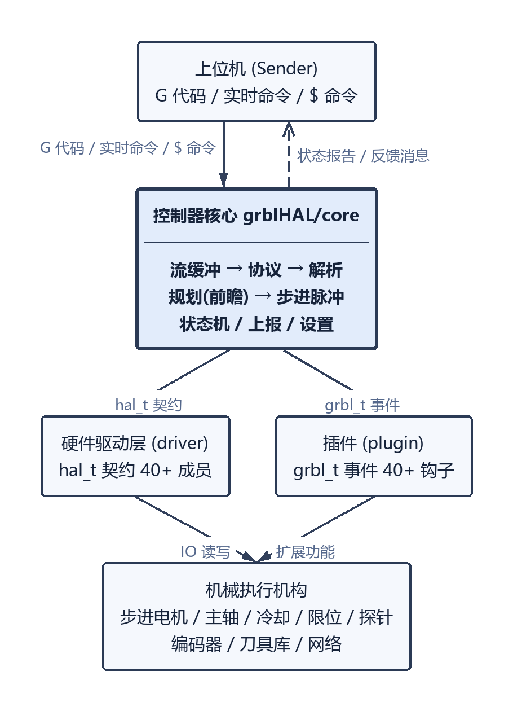
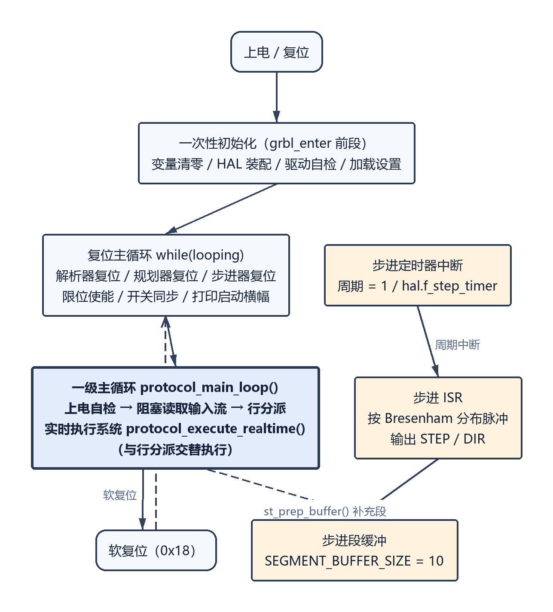
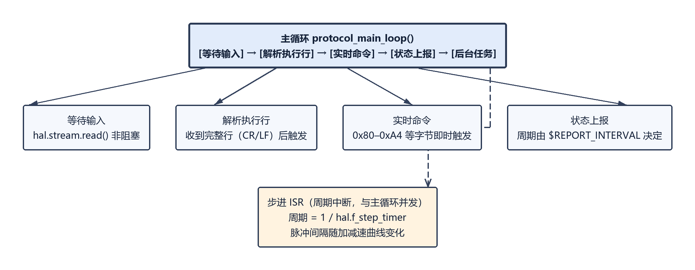
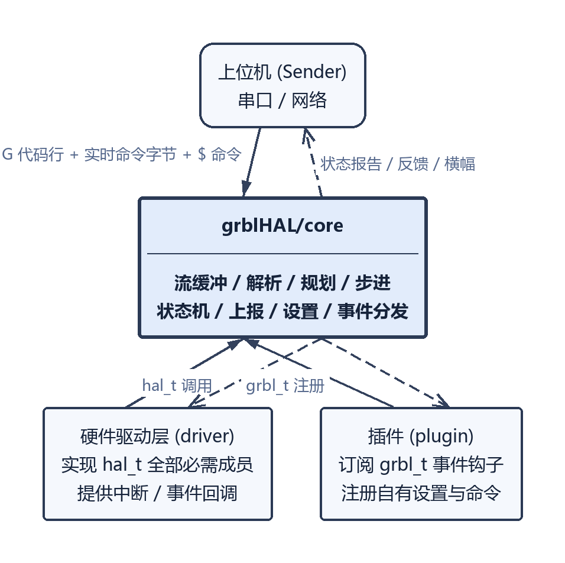
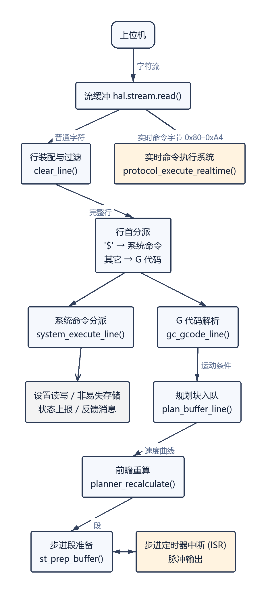
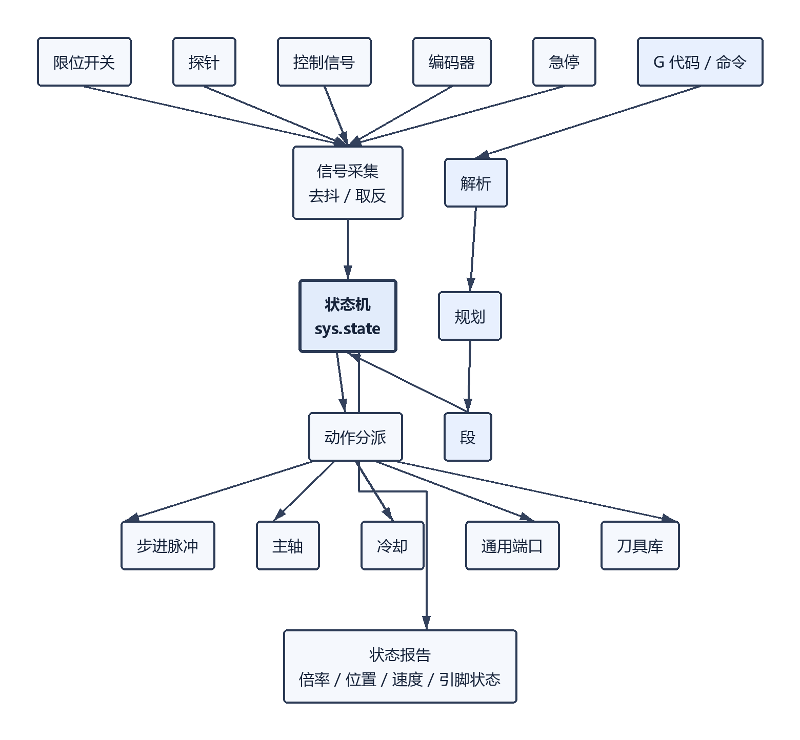

# grblHAL/core 软件需求规格说明书（竣工需求·逆向）

| 项目 | 内容 |
| --- | --- |
| 文档编号 | REQ-GRBLHAL-ASB-001 |
| 软件名称 | grblHAL/core（数控机床运动控制固件核心层） |
| 需求类型 | 竣工需求（as-built），源码静态逆向 |
| 锚定提交 | `ca26fc98f1b2171251c946ab91d5912b733efa78`（2026-10-08） |
| 版本标识 | `GRBL_VERSION "1.1f"`、`GRBL_BUILD 20261008`（`grbl.h:41`、`grbl.h:45`） |
| HAL 契约版本 | `HAL_VERSION 10`（`hal.h:44`） |
| 本地副本 | `_repos/grblHAL/` |
| 规模 | 114 个 `.c`/`.h` 文件，46348 行 |
| 需求标识前缀 | `GH-` |
| 格式依据 | 太搜文档.docx（星载软件需求规格说明书格式） |

**阅读约定**：本文所有证据均以 `文件:行号` 形式给出，路径相对于 `_repos/grblHAL/`。条款后的括号标注证据等级，沿用太搜文档的标注体系：`（任务书）` 表示该条来源于项目自述文档（`README.md`、`changelog.md`）；`（用户需求）` 表示对外契约（g-code/协议接口）；`（需求规格）` 表示由代码结构固化的实现事实；`（计算机使用说明）` 表示由处理器/工具链决定的环境事实；`（数据字典里找）` 表示由枚举与常量表反推。

---

# 目录

下列条目列出各章节及其在核心层中的实现模块（文件名相对于 `_repos/grblHAL/`，不带行号），带行号的逐条证据见正文各需求条。

<!-- TOC-BEGIN -->
1 概述
　1.1 软件概述（`grbllib.c`、`grbllib.h`、`README.md`）
　1.2 系统组成（`README.md`、`hal.h`、`core_handlers.h`、`platform.h`）
2 运行环境规定
　2.1 运行方案和场景（`grbllib.c`、`state_machine.c`、`stepper.c`、`protocol.c`）
　2.2 硬件环境
　　2.2.1 宿主计算机（`hal.h`、`config.h`、`README.md`）
　　2.2.2 中断设置（`core_handlers.h`、`grbllib.c`、`hal.h`）
　　2.2.3 存储器（`nvs.h`、`nvs_buffer.c`、`config.h`、`grbl.h`）
　2.3 支持软件环境
　　2.3.1 编程语言（`grbl.h`、`system.h`、`spindle_control.h`）
　　2.3.2 编译调试工具（`config.h`、`driver_opts.h`、`platform.h`）
　2.4 接口
　　2.4.1 与其他软件接口（`hal.h`、`core_handlers.h`、`plugins.h`）
　　2.4.2 硬件接口（`hal.h`、`spindle_control.h`、`stepper.h`、`probe.h`、`settings.h`）
3 软件详细需求
　3.1 功能分解（`grbllib.c`、`protocol.c`、`gcode.c`、`planner.c`、`stepper.c`、`report.c`）
　3.2 功能需求
　　3.2.1 软件初始化（`grbllib.c`、`settings.c`、`nvs_buffer.c`、`report.c`）
　　3.2.2 主循环与输入流处理（`grbllib.c`、`protocol.c`、`stream.c`）
　　3.2.3 实时命令处理（`grbl.h`、`protocol.c`、`settings.h`）
　　3.2.4 系统命令处理（`system.c`、`settings.c`、`nvs_buffer.c`、`report.c`）
　　3.2.5 G 代码解析与执行（`gcode.c`、`gcode.h`、`ngc_expr.c`、`ngc_flowctrl.c`、`ngc_params.c`）
　　3.2.6 运动规划与前瞻（`planner.c`、`planner.h`、`motion_control.c`）
　　3.2.7 步进脉冲生成（`stepper.c`、`stepper.h`、`stepper2.c`）
　　3.2.8 系统状态机管理（`state_machine.c`、`state_machine.h`、`system.h`）
　　3.2.9 归零（`machine_limits.c`、`motion_control.c`、`settings.c`）
　　3.2.10 探测（`probe.c`、`probe.h`、`motion_control.c`）
　　3.2.11 主轴控制（`spindle_control.c`、`spindle_control.h`、`spindle_sync.h`、`pid.c`）
　　3.2.12 冷却控制（`coolant_control.c`、`coolant_control.h`）
　　3.2.13 限位与安全信号处理（`machine_limits.c`、`machine_limits.h`、`ioports.c`）
　　3.2.14 刀具管理（`tool_change.c`、`tool_change.h`、`settings.h`）
　　3.2.15 倍率调整（`override.c`、`override.h`、`grbl.h`）
　　3.2.16 状态报告与反馈（`report.c`、`report.h`、`messages.c`）
　　3.2.17 设置与非易失存储管理（`settings.c`、`settings.h`、`nvs.h`、`nvs_buffer.c`）
　　3.2.18 插件与事件分发（`core_handlers.h`、`plugins.h`、`plugins_init.h`）
　　3.2.19 后台任务调度（`grbllib.c`、`task.h`、`grbl.h`）
　　3.2.20 文件系统与流（`vfs.c`、`vfs.h`、`fs_embedded.c`、`stream_file.c`）
　　3.2.21 网络与远程访问（`settings.h`、`stream.c`、`hal.h`）
　　3.2.22 现场总线与扩展设备（`modbus.c`、`modbus_rtu.c`、`canbus.c`、`ioports.c`、`crossbar.c`）
　　3.2.23 编码器接口（`encoders.c`、`encoders.h`、`settings.h`）
　　3.2.24 运动学变换（`kinematics/`）
　　3.2.25 错误与报警管理（`errors.c`、`errors.h`、`alarms.c`、`alarms.h`）
　3.3 性能需求
　　3.3.1 精度需求（`real.h`、`nuts_bolts.h`、`config.h`、`grbl.h`）
　　3.3.2 空间需求（`grbl.h`、`config.h`、`nvs.h`、`planner.c`、`stream.h`）
　　3.3.3 时间需求（`config.h`、`hal.h`、`stepper.c`、`settings.c`）
　3.4 可靠性和安全性需求
　　3.4.1 可靠性需求（`protocol.c`、`settings.c`、`nvs_buffer.c`、`alarms.c`）
　　3.4.2 安全性需求（`protocol.c`、`hal.h`、`state_machine.c`、`grbllib.c`）
附录1 数据字典（`gcode.h`、`system.h`、`nvs.h`、`errors.h`、`alarms.h`、`settings.h`）
附录2 软件IP（`grbllib.c`、`protocol.c`、`motion_control.c`、`stepper.c`、`machine_limits.c`、`state_machine.c`）
　附录2.1 通用IP
　附录2.2 领域专用IP
<!-- TOC-END -->

# 1 概述

## 1.1 软件概述（任务书）

grblHAL/core 是嵌入式数控（CNC）机床运动控制固件的**核心层**。它接收上位机通过串行链路送来的 G 代码指令流，解释为刀具运动与机床动作，经运动规划（前瞻、加减速、拐角速度约束）后由步进脉冲发生器输出到各轴电机，同时管理主轴、冷却、限位、探针、刀具等机床子系统，并把机床状态实时回报给上位机。

软件的主要功能是**指令解析与运动执行**，通过采集限位开关、探针、主轴编码器等输入信号判定机床当前状态，然后通过控制各轴步进电机、主轴与冷却输出使得刀具按程序轨迹运动，并在异常时进入报警状态以保护机床与人员安全。

软件的整体运行过程分为**复位初始化、怠速等待、程序运行、保持/暂停、归零、探测、报警**等阶段。各阶段的功能如下：

- **复位初始化**：清零系统变量、加载非易失参数、初始化各子系统、打印启动横幅，随后进行上电自检（自检失败、急停、电机故障、探针保护、归零要求、限位压合等条件判定），任何一项不通过则锁定为报警状态；
- **怠速等待**：主循环阻塞等待输入流数据，同时执行实时命令、状态上报与后台任务；
- **程序运行**：解析 G 代码行、校验语义、生成规划块、前瞻重算速度曲线、分段输出步进脉冲；
- **保持/暂停**：进给保持时受控减速至停止，恢复时从断点续行；安全门开启、单步、可选停止等均归入此阶段；
- **归零**：按 `$H` 指令驱动各轴寻找限位开关，含快进寻找、慢速定位、回退、自动找正等子过程；
- **探测**：按 `G38.x` 指令驱动探针接触检测，记录触发点坐标；
- **报警**：锁闭一切运动与 G 代码执行，仅允许设置读写与解锁类指令。

软件以**一套核心代码适配超过 15 个处理器系列**（`README.md`）。核心层不包含 `main()` 函数，其入口为 `grbl_enter()`（`grbllib.c:258`、`grbllib.h:33`），由外部硬件驱动调用。

## 1.2 系统组成（总体：任务书，详见计算机使用说明）

grblHAL 系统由若干层次组成，核心层是其中承上启下的部分。系统的组成如下：

1）**上位机（Sender）**：运行于 PC 的 G 代码发送软件，通过串口（或网络透传）向控制器发送 G 代码行，并接收状态报告与反馈信息。软件与 grbl 1.1f 的 G 代码发送器兼容（`README.md`）。

2）**控制器核心（本软件，core）**：指令流解析、G 代码语义解释、运动规划、步进脉冲生成、状态机管理、状态上报、设置管理、插件与事件分发。

3）**硬件驱动层（driver，本软件之外）**：实现 `hal_t` 结构体（`hal.h:579`）中声明的全部必需函数指针，向核心层提供定时器、GPIO、串口、非易失存储、限位/控制信号、主轴、冷却、步进、探针、刀具等硬件能力。驱动层位于独立仓库（`grblHAL/drivers`），**核心层单靠自身不能运行**。

4）**插件（plugin，本软件之外）**：通过 `grbl_t` 事件回调结构（`core_handlers.h:228`）与设置注册接口挂接到核心层，在不修改核心源码的前提下扩展功能。插件源码位于独立仓库（`grblHAL/plugins`）。

5）**机械执行机构**：各轴步进电机（经步进驱动器）、主轴电机（PWM / 0-10V / Modbus VFD / 开关量）、冷却泵与雾化阀、刀具库等。

系统组成如图 1.2-1 所示。

图 1.2-1 系统组成图

---

# 2 运行环境规定（任务书）

## 2.1 运行方案和场景

控制软件采用**主程序加中断**的方式运行，主程序为无限循环，中断为步进定时器周期中断。它们的功能分别如下：

- **主程序功能**：首先进行变量清零与各子系统初始化（`grbllib.c:265`–`grbllib.c:448`），包括 HAL 函数指针装配、驱动自检、限位初始化、设置加载、主轴与冷却全关、归零开关装配等；随后进入复位主循环（`grbllib.c:452`–`grbllib.c:520`），每个复位周期重新初始化解析器、规划器、步进器与开关状态，打印启动横幅；最后进入一级主循环 `protocol_main_loop()`（`protocol.c:128`），在其中阻塞读取输入流、分派实时命令与普通命令行、执行后台任务。

- **步进定时器中断服务程序功能**：步进定时器以 `hal.f_step_timer` 设定的频率周期性地进入中断（`stepper.c`），中断服务程序从步进段缓冲中取出当前执行段，按 Bresenham 算法计算各轴步进脉冲的分布，输出脉冲与方向信号，并按加减速曲线调整脉冲间隔；段缓冲耗尽时置位 `EXEC_SEGMENT_COMPLETE` 之类的执行标志，由主循环中的实时执行系统补充新段。

控制任务的时序关系如图 2.1-1 与图 2.1-2 所示。

图 2.1-1 主程序与中断示意图

图 2.1-2 控制任务时序图

## 2.2 硬件环境（计算机使用说明、任务书）

### 2.2.1 宿主计算机

本软件运行于 32 位微控制器（MCU）。核心层对处理器系列不做限定，要求为 **ARM 或其它 32 位 MCU**，具备充足的 RAM 与 Flash（`README.md`）；核心层向上通过 `hal_t` 契约抽象硬件差异，已适配的处理器系列超过 15 个（`README.md`）。

核心层在初始化时读取并由驱动层填写下列 MCU 相关量（`hal.h:579`–`hal.h:679`）：

| 变量 | 含义 | 证据 |
| --- | --- | --- |
| `hal.f_mcu` | MCU 主频，单位 MHz | `hal.h` |
| `hal.f_step_timer` | 步进定时器频率，单位 Hz，决定步进 ISR 基准频率 | `hal.h` |
| `hal.step_us_min` | 最小步进脉冲宽度，单位 μs；核心层默认 `2.0f` | `grbllib.c:292` |
| `hal.rx_buffer_size` | 驱动提供的接收缓冲大小 | `hal.h` |
| `hal.driver_version` | 驱动版本号，格式 YYMMDD | `hal.h` |
| `hal.driver_options` | 驱动选项字符串，逗号分隔 | `hal.h` |
| `hal.board` / `hal.board_url` | 板卡名称与链接 | `hal.h` |

核心层声明的控制脉冲能力为**最高 300kHz 稳定无抖动脉冲输出**，实际可达频率取决于驱动与处理器（`README.md`）。核心层对步进脉冲速率的编译期上限留有铰制宏 `MAX_STEP_RATE_HZ`（`config.h:279`，默认注释掉，示例值 30000 Hz）。

### 2.2.2 中断设置

本软件处理的中断由驱动层登记，核心层提供中断回调入口。核心层登记的回调如下：

| 中断源 | 核心层回调入口 | 证据 |
| --- | --- | --- |
| 限位开关变化 | `hal.limits.interrupt_callback = limit_interrupt_handler` | `grbllib.c:294`、`machine_limits.h:52` |
| 控制信号变化（复位/急停/安全门/循环启动等） | `hal.control.interrupt_callback = control_interrupt_handler` | `grbllib.c:295` |
| 步进电机驱动器故障 | `hal.stepper.interrupt_callback = stepper_driver_interrupt_handler` | `grbllib.c:296` |
| 主轴编码器索引脉冲 | `hal.spindle_encoder_on_index`（可选） | `hal.h` |
| 步进定时器 | 步进 ISR，频率由 `hal.f_step_timer` 决定 | `hal.h` |

表 2.2-1 中断信息表

核心层允许驱动层通过 `hal.irq_enable` / `hal.irq_disable` / `hal.irq_claim` 三个函数指针控制中断的开关与登记（`hal.h`）；若驱动未提供，核心层装配为空操作占位实现（`grbllib.c:288`–`grbllib.c:290`）。多个回调被明确标注为**从中断上下文调用**，插件在这些回调中不得执行长耗时操作（`core_handlers.h:261`、`core_handlers.h:262`、`core_handlers.h:263`、`core_handlers.h:281`、`core_handlers.h:282`、`core_handlers.h:293`）。

### 2.2.3 存储器

核心层通过 `hal.nvs` 接口访问非易失存储（NVS），并自行定义存储区内的地址布局。布局按功能分区如下：

| 分区 | 起始地址宏 | 内容 | 证据 |
| --- | --- | --- | --- |
| 全局设置 | `NVS_ADDR_GLOBAL = 1` | `settings_t` 结构全量 | `nvs.h:71` |
| 坐标系统参数 | `NVS_ADDR_PARAMETERS`（默认 `512U`） | `N_CoordinateSystems` 组坐标系数据，每组附 2 字节 CRC | `nvs.h:45`、`nvs.h:73`、`nvs.h:75` |
| 启动块 | `NVS_ADDR_STARTUP_BLOCK` | `N_STARTUP_LINE` 条启动行，每条附 2 字节 CRC | `nvs.h:47`、`nvs.h:78` |
| 构建信息 | `NVS_ADDR_BUILD_INFO` | 1 条构建信息行，附 2 字节 CRC | `nvs.h:46`、`nvs.h:77` |
| 刀具表 | `NVS_ADDR_TOOL_TABLE = GRBL_NVS_END + 1` | `N_TOOLS` 条刀具数据，每条附 2 字节 CRC | `nvs.h:80`、`nvs.h:81` |

表 2.2-2 存储器信息表

存储区容量约束：默认 `NVS_SIZE 2048` 字节，最大 `NVS_SIZE_MAX 4096` 字节（`nvs.h:30`、`nvs.h:37`）；整体大小由 `GRBL_NVS_SIZE` 计算（`nvs.h:81`），驱动层须将其上报给核心层（`grbllib.c:291`）。核心层在入口处用 `assert` 静态断言校验分区不重叠（`grbllib.c:260`、`grbllib.c:261`）。每组数据的完整性由校验和保护，校验算法为 `grbl_crc8` 或 `modbus_crc16x`（`nvs.h:59`、`nvs.h:61`），校验字节数 `NVS_CRC_BYTES 2`（`nvs.h:42`）。

核心层的缓冲容量约束如下：

| 缓冲 | 容量 | 证据 |
| --- | --- | --- |
| 接收缓冲 | `RX_BUFFER_SIZE 1024`，须为 2 的幂 | `stream.h:53` |
| 发送缓冲 | `TX_BUFFER_SIZE 512`，须为 2 的幂 | `stream.h:57` |
| 行缓冲 | `LINE_BUFFER_SIZE 257`（256 字符 + 终止符） | `protocol.h:36` |
| 步进段缓冲 | `SEGMENT_BUFFER_SIZE 10` | `config.h:392` |
| 启动行 | `N_STARTUP_LINE 2`（1–2 行） | `grbl.h:166` |
| 存储行长度 | `MAX_STORED_LINE_LENGTH` 70（6 轴且兼容级 ≤1 时为 60） | `grbl.h:246`–`grbl.h:251` |
| 坐标系数量 | `N_CoordinateSystems`：兼容级 ≤1 时 12，否则 9 | `gcode.h:202` |
| 刀具数量 | `N_TOOLS`，默认 0，上限 32 | `config.h:546`、`config.h:2474` |

表 2.2-3 缓冲与容量信息表

## 2.3 支持软件环境（任务书）

### 2.3.1 编程语言

- 编程语言：C 语言（C11）。源码中使用 `_Static_assert`（`assert` 重定义）与 `__attribute__((__packed__))`、`__attribute__((__transparent_union__))` 等 GCC 扩展（`system.h:102`、`spindle_control.h:315`）。

### 2.3.2 编译调试工具

- 构建系统：CMake（仓库根 `CMakeLists.txt`），核心层编译目标为静态库，由驱动工程链接。
- 编译器：面向 ARM 及多种 32 位目标的 GCC 工具链；核心层为主机仿真提供了独立目标。
- 编译期裁剪：全部功能开关集中在 `config.h`（2352 行），通过宏定义在编译期去除不需要的模块（`config.h`）。

## 2.4 接口

软件与外部接口关系如图 2.4-1 所示。

图 2.4-1 接口关系图

### 2.4.1 与其他软件接口（任务书）

本软件与外部软件的接口共三类：

（1）**与上位机发送软件的接口**：基于字符流的行协议。上行传输 G 代码行、系统命令（`$`开头）与实时命令字节；下行传输状态报告、反馈消息、启动横幅与错误/报警信息。该接口保持与 grbl 1.1f 发送器的兼容性（`README.md`）。

（2）**与硬件驱动层的接口**：`hal_t` 结构体（`hal.h:579`–`hal.h:679`）。驱动层必须在 `driver_init()` 中装配全部**必需**函数指针，可选成员未装配时核心层退化为对应功能不可用；核心层在入口处校验 `hal.version` 是否等于 `HAL_VERSION`，不匹配时驱动初始化应失败（`grbllib.c:286`）。核心层文档对此的表述为：未标注为可选的成员为必需项，若驱动未赋值则行为未定义，并很可能在某一时刻导致控制器崩溃（`hal.h:579`）。

（3）**与插件的接口**：`grbl_t` 事件结构体（`core_handlers.h:228`–`core_handlers.h:306`）。插件通过覆盖该结构中的函数指针订阅事件，通过 `settings_register()` 注册自有设置项，通过 `system_register_commands()` 注册自有 `$` 命令，通过 `errors_register()` / `alarms_register()` 注册自有错误码与报警码。

### 2.4.2 硬件接口（任务书）

| 序号 | 接口 | 方向 | 说明 | 证据 |
| --- | --- | --- | --- | --- |
| 1 | 串行通信口 | 双向 | 接收 G 代码流与实时命令，发送状态报告；可由驱动实现为 UART/USB CDC/网络透传 | `hal.h`、`stream.h` |
| 2 | 步进脉冲输出 | 输出 | 每轴 STEP/DIR 信号 | `stepper.h:84` |
| 3 | 步进使能输出 | 输出 | 驱动器使能信号 | `stepper.h` |
| 4 | 限位开关输入 | 输入 | 各轴硬限位，可触发中断 | `machine_limits.h:52` |
| 5 | 控制信号输入 | 输入 | 复位、急停、安全门、循环启动、进给保持 | `hal.h` |
| 6 | 探针输入 | 输入 | 主探针、对刀器、第二探针 | `probe.h:38`–`probe.h:42` |
| 7 | 主轴输出 | 输出 | PWM / 0-10V / 开关量 / Modbus VFD | `spindle_control.h:29`–`spindle_control.h:51` |
| 8 | 主轴编码器输入 | 输入 | 主轴转速反馈与螺纹同步 | `hal.h`、`spindle_control.h:443` |
| 9 | 冷却输出 | 输出 |  flood 与 mist 两路 | `coolant_control.h` |
| 10 | 通用 IO 端口 | 双向 | `M62`–`M68` 数字/模拟端口读写 | `hal.h` |
| 11 | 非易失存储 | 双向 | 设置、坐标系、启动块、刀具表 | `nvs.h` |
| 12 | 文件系统 | 双向 | SD 卡 / LittleFS，用于流式执行文件 | `hal.h` |
| 13 | 网络 | 双向 | Telnet / WebSocket / HTTP / FTP / DNS / mDNS / SSDP / WebDAV | `plugins.h:53`–`plugins.h:65` |
| 14 | Modbus RTU | 双向 | 扩展 IO 与 VFD 控制 | `settings.h:19` |
| 15 | CAN 总线 | 双向 | 扩展设备 | `settings.h:38` |

表 2.4-1 硬件接口信息表

---

# 3 软件详细需求

## 3.1 功能分解（需求规格）

对软件功能进行分解，软件数据流图如下图 3.1-1、图 3.1-2 所示。

软件的功能可分解为输入侧、解释侧、运动侧、执行侧、状态侧、扩展侧六个功能族：

- **输入侧**：输入流缓冲与字符接收、行装配与注释过滤、实时命令旁路提取（`protocol.c:213`、`protocol.c:83`）；
- **解释侧**：G 代码词法分析与语义校验、模态组状态维护、系统命令（`$`）分派、参量与表达式求值（`gcode.c:1175`、`system.c:1140`）；
- **运动侧**：运动条件生成、规划块入队、前瞻速度重算、步进段准备、步进脉冲输出（`motion_control.c:85`、`planner.c:399`）；
- **执行侧**：主轴、冷却、刀具、通用端口、运动学变换等机床动作输出（`spindle_control.c:884`、`coolant_control.c:45`）；
- **状态侧**：系统状态机、报警与错误管理、状态报告与反馈消息、倍率调整、限位与安全信号处理、设置与非易失存储（`state_machine.c:236`、`machine_limits.c:869`）；
- **扩展侧**：插件事件分发、后台任务调度、文件系统与流、网络通信、编码器（`grbllib.c:616`、`encoders.c:35`）。

图 3.1-1 软件顶层数据流图

图 3.1-2 信号与动作流向图

## 3.2 功能需求

### 3.2.1 软件初始化（任务书）

- 需求标识：GH-FREQ1
- 功能描述：软件上电初始化与复位初始化设置
- 调用条件：上电时调用一次；软复位或系统中止后重新调用
- 输入：硬件驱动层装配的 `hal_t` 函数指针表、非易失存储中的设置数据、控制信号状态
- 输出：已初始化的系统变量、规划器与步进器状态、启动横幅信息
- 处理：
- （1）由驱动层调用入口函数 `grbl_enter()`，入口处用静态断言校验非易失存储各分区地址不重叠（`grbllib.c:258`、`grbllib.c:260`）；
- （2）清零 `sys` 与 `tasks` 结构体，清零 `grbl` 事件结构体并装配核心层自有的回调（实时执行、入队、上报选项、设置变更、命令帮助、错误明细、报警明细、设置明细、刀具变更）（`grbllib.c:265`、`grbllib.c:271`）；
- （3）清零 `hal` 结构体并装配核心层默认实现（驱动复位、中断使能/禁止/登记、非易失存储大小、最小脉宽 2.0μs、冷却能力、限位/控制/步进中断回调、发送阻塞回调、刀具库状态查询、上拉禁用能力位）（`grbllib.c:285`、`grbllib.c:292`）；
- （4）置冷启动标志，调用限位初始化与上报函数装配；调用驱动初始化函数，令驱动层填写 `hal` 中的必需成员，并校验 HAL 契约版本号（`grbllib.c:303`、`grbllib.c:310`）；
- （5）若驱动自检未通过，置自检失败报警并调度启动任务上报驱动错误信息（`grbllib.c:412`、`grbllib.c:413`）；
- （6）初始化非易失存储缓冲，从非易失存储加载全部设置，清空机床位置坐标（`grbllib.c:359`、`grbllib.c:363`）；
- （7）按编译期开关调用运动学变换初始化（CoreXY、龙门绘图仪、Delta、极坐标、五轴 RTCP、非对称双驱）（`grbllib.c:330`、`grbllib.c:340`）；
- （8）校验主轴引用标识与主轴编码器配置的有效性，无效时回退默认值（`grbllib.c:390`、`grbllib.c:399`）；
- （9）关闭主轴与冷却全部输出，读取驱动提供的初始机床位置，初始化反向间隙补偿（`grbllib.c:418`、`grbllib.c:425`）；
- （10）装配归零开关来源，在驱动未提供归零开关或设置要求时以限位开关充当归零开关（`grbllib.c:431`、`grbllib.c:432`）；
- （11）按设置装配周期自动上报任务，按驱动能力隐藏文件系统选项（`grbllib.c:435`、`grbllib.c:441`）。

#### 3.2.1.1 上电一次性初始化

- 需求标识：GH-FREQ1-1
- 功能描述：上电时对核心层数据结构与子系统进行一次性的清零、装配与自检
- 调用条件：上电时调用一次
- 输入：驱动层 `driver_init()` 返回值、`hal` 结构体各能力位、非易失存储中的 `settings_t`
- 输出：装配完成的 `grbl`/`hal` 结构体、`sys` 运行变量、驱动自检结论字
- 处理：
- （1）清零并装配 `grbl` 事件结构体，把未被子系统接管的钩子指向空实现，记录核心层自身需要处理的钩子（`grbllib.c:269`、`grbllib.c:270`）；
- （2）清零并装配 `hal` 结构体，置 `hal.version = HAL_VERSION`；调用 `driver_init()` 后若 `driver.ok != 0xFF`，置 `sys.alarm = Alarm_SelftestFailed`，并调度启动任务上报驱动错误，随后核心层仍继续初始化（`grbllib.c:286`、`grbllib.c:411`）；
- （3）调用 `settings_init()` 从非易失存储读取设置并做合法性校验，加载失败时回退到编译期默认值（`settings.c:3720`）；
- （4）把步进使能函数包装为 `stepperEnable`，保证在使能与禁止时同步维护各轴状态（`grbllib.c:368`、`grbllib.c:192`）；
- （5）校验 `settings.spindle.ref_id` 与 `settings.spindle.encoder_spindle`，无效时替换为可用主轴的标识（`grbllib.c:390`、`grbllib.c:398`）；
- （6）使能步进电机（按设置决定上电是否励磁），关闭主轴与冷却（`grbllib.c:416`、`grbllib.c:419`）；
- （7）置 `sys.driver_started` 标志，供延时任务调度判断驱动是否可用；此标志为假时延时任务不执行（`grbllib.c:428`、`grbllib.c:555`）。

#### 3.2.1.2 复位初始化

- 需求标识：GH-FREQ1-2
- 功能描述：软复位或系统中止后把各子系统恢复到确定的初始状态，并打印启动横幅
- 调用条件：进入复位主循环 `while(looping)` 时每次调用
- 输入：`settings` 全量设置、`sys.position_lost` 位置丢失标志、`sys.override` 上次倍率
- 输出：复位后的解析器、规划器、步进器、限位与开关状态，启动横幅
- 处理：
- （1）重新装配上报函数入口，保存上次的倍率值（`grbllib.c:457`、`grbllib.c:461`）；
- （2）按位置是否丢失选择清零范围：位置未丢失或设置要求复位保持时，仅保留报警与归零状态而清零其余系统变量；位置已丢失时进一步保留状态与报警（`grbllib.c:464`、`grbllib.c:466`）；
- （3）恢复进给倍率与快速倍率（冷启动时或设置要求时不保持复位前数值，恢复为默认 100%），把各主轴转速倍率恢复为 100%（`grbllib.c:469`、`grbllib.c:473`）；
- （4）按设置装配自动上报与 MPG 自动上报标志，装配驻车禁用标志，清空倍率命令缓冲（`grbllib.c:476`、`grbllib.c:482`）；
- （5）复位各子系统：清空输入流缓冲、把 G 代码解析器置为默认状态、按设置使能硬限位、清空规划块缓冲与规划器变量、清空步进子系统变量、按设置装配待归零轴、从输入信号同步开关状态（`grbllib.c:486`、`grbllib.c:488`）；
- （6）同步清除后的 G 代码坐标与规划器坐标到当前机床位置；若驱动提供电机禁止能力则禁止各轴电机（`grbllib.c:495`、`grbllib.c:497`）；
- （7）调用刀具子系统初始化（驱动具备自动换刀能力时跳过）（`grbllib.c:500`、`grbllib.c:501`）；
- （8）打印启动横幅；若急停后不允许解锁且当前处于急停状态，则把状态置为报警（`grbllib.c:504`、`grbllib.c:507`）；
- （9）若驱动具备 MPG 能力，按 MPG 模式入队相应的状态报告命令（`grbllib.c:509`、`grbllib.c:510`）；
- （10）若存在复位任务，置位实时命令执行标志以执行这些任务；随后进入一级主循环（`grbllib.c:513`、`grbllib.c:516`）。

### 3.2.2 主循环与输入流处理（需求规格）

- 需求标识：GH-FREQ2
- 功能描述：从输入流读取字符、装配为命令行、完成上电自检与行首分派
- 调用条件：主程序中循环调用
- 输入：输入流字符、控制信号状态、限位开关状态
- 输出：待解释的命令行、上电自检结论、报警状态
- 处理：
- （1）进入主循环前执行上电自检，按下述优先级顺序判定：驱动自检失败、急停信号有效、电机故障信号有效、探针保护触发、需要归零、硬限位已压合、冷启动强制报警、处于报警或休眠状态；任一条件成立则置相应的报警并输出反馈消息，全部不成立则置怠速状态（`protocol.c:132`、`protocol.c:137`）；
- （2）自检通过后，若安全门开启且设置未要求怠速时忽略，则置安全门执行标志并立即执行实时命令以进入安全门处理（`protocol.c:180`、`protocol.c:181`）；
- （3）若存在待处理报警则升起该报警，否则在设置允许时调度启动脚本任务（`protocol.c:185`、`protocol.c:190`）；
- （4）冷启动时关闭主轴与冷却输出，并置位实时命令执行标志以执行启动任务，随后清除冷启动标志（`protocol.c:196`、`protocol.c:199`）；
- （5）进入无限循环，非阻塞读取输入流字符；读到取消字符时清空当前行、清除上次错误，且仅当处于点动状态时置位运动取消标志（`protocol.c:215`、`protocol.c:221`）；
- （6）读到文件结束字符时调用文件结束回调；读到换行或回车时判定行结束，并识别成对的换行回车序列以避免产生一次多余的空行响应（`protocol.c:224`、`protocol.c:230`）；
- （7）行装配过程中滤除行首空格与控制字符，按设置决定是否保留实时命令字符，识别括号注释与分号注释并停止在其中执行实时命令（`protocol.c:292`、`protocol.c:305`）；
- （8）对装配完成的行按行首字符分派：`$` 开头的行交给系统命令处理，其它行交给 G 代码解析执行（`protocol.c:250`、`protocol.c:272`）。

#### 3.2.2.1 注释与实时命令字符过滤

- 需求标识：GH-FREQ2-1
- 功能描述：在行装配阶段识别注释边界，决定是否在注释内继续提取实时命令
- 调用条件：每装配一个命令行时调用
- 输入：命令行原始字符
- 输出：行标志中的注释状态与实时命令保留标志
- 处理：
- （1）遇到左括号且当前不在分号注释中时，进入括号注释，并清除实时命令保留标志（`protocol.c:303`、`protocol.c:304`）；
- （2）遇到右括号且当前不在分号注释中时，退出括号注释，并清除实时命令保留标志（`protocol.c:308`、`protocol.c:310`）；
- （3）遇到分号且当前不在括号注释中时，进入分号注释并清除实时命令保留标志（`protocol.c:313`、`protocol.c:316`）；
- （4）上述状态用于在后续扫描中判定实时命令字符是否应被旁路提取（`protocol.c:1024`、`protocol.c:1006`）。

#### 3.2.2.2 行缓冲与溢出保护

- 需求标识：GH-FREQ2-2
- 功能描述：限制单行字符数，超长行按确定的规则截断或报错
- 调用条件：每接收一个字符时判定
- 输入：接收字符、当前行长度
- 输出：超长标志或错误码
- 处理：
- （1）行缓冲容量为 257 字节（256 字符加终止符），达到上限的字符不再写入（`protocol.h:36`、`protocol.c:328`）；
- （2）超长行按错误处理并输出错误提示，随后丢弃该行剩余字符（`protocol.c:247`、`errors.c:41`）；
- （3）取消字符可随时清空当前行缓冲，使长行不再占用缓冲（`protocol.c:215`、`protocol.c:217`）。

### 3.2.3 实时命令处理（任务书）

- 需求标识：GH-FREQ3
- 功能描述：从输入流中旁路提取实时命令字节并立即执行，不经命令行解释器
- 调用条件：收到实时命令字节时立即调用
- 输入：输入流中的实时命令字节
- 输出：状态报告、运动控制动作、倍率变化、报警状态
- 处理：
- （1）实时命令由流读取环节直接旁路提取，不进入行解释器；这是本软件的固定约定，若变更须同步修改上报模块中的帮助信息；
- （2）实时命令必须位于扩展 ASCII 字符集内，即取值 128（0x80）至 191（0xBF）；不得分配大于 191 的值，因为该范围是 UTF-8 编码首字节的取值空间；
- （3）按命令字节语义分类执行：状态报告类、循环启动与进给保持类、安全门类、状态覆盖类、倍率调整类、冷却与主轴覆盖类、软急停类、宏调用类；
- （4）部分命令仅在编译期开关打开时有效，或明确未由核心层实现（见 3.2.3.4）；
- （5）执行过程置位相应的实时执行标志，由实时执行系统在主循环与延时环节中统一处理，保证在运动过程中的确定时机生效。

#### 3.2.3.1 传统实时命令

- 需求标识：GH-FREQ3-1
- 功能描述：兼容 grbl 1.0/1.1 的传统单字符实时命令
- 调用条件：收到对应单字符时调用
- 输入：`0x03`、`0x14`、`0x18`、`0x19`、`?`、`~`、`!`、`%`
- 输出：程序中止、控制器重启、软复位、进给保持、状态报告、循环启动、进给保持、程序分界
- 处理：
- （1）`0x03`（Ctrl-C）执行程序中止；
- （2）`0x14`（Ctrl-T）执行控制器重启，且仅当前一字符为 `0x1B`（ESC）时有效；
- （3）`0x18`（Ctrl-X）执行软复位；
- （4）`0x19`（Ctrl-Y）执行进给保持；
- （5）`?` 请求传统格式状态报告，`~` 执行循环启动，`!` 执行进给保持；
- （6）`%` 表示程序分界，触发文件分界回调；
- （7）传统实时命令的可用性受设置项 `Setting_EnableLegacyRTCommands` 控制（`settings.h:87`），关闭后上述字符不再被解释为实时命令。

表 3.2-1 传统实时命令信息表

| 序号 | 命令字节 | 助记符 | 功能 | 证据 |
| --- | --- | --- | --- | --- |
| 1 | `0x03` | `CMD_EXIT` | 程序中止 | `grbl.h:100` |
| 2 | `0x14` | `CMD_REBOOT` | 控制器重启（需前置 `0x1B`） | `grbl.h:101` |
| 3 | `0x18` | `CMD_RESET` | 软复位 | `grbl.h:102` |
| 4 | `0x19` | `CMD_STOP` | 进给保持 | `grbl.h:103` |
| 5 | `?` | `CMD_STATUS_REPORT_LEGACY` | 请求状态报告（传统格式） | `grbl.h:105` |
| 6 | `~` | `CMD_CYCLE_START_LEGACY` | 循环启动 | `grbl.h:106` |
| 7 | `!` | `CMD_FEED_HOLD_LEGACY` | 进给保持 | `grbl.h:107` |
| 8 | `%` | `CMD_PROGRAM_DEMARCATION` | 程序分界 | `grbl.h:108` |

#### 3.2.3.2 扩展实时命令

- 需求标识：GH-FREQ3-2
- 功能描述：提供取值范围 0x80–0xA4 的扩展实时命令集
- 调用条件：收到对应字节时调用
- 输入：`0x80`–`0xA4` 范围内的命令字节
- 输出：状态报告、循环控制、倍率调整、冷却/主轴覆盖、软急停等
- 处理：
- （1）`0x80` 请求状态报告，`0x87` 请求含全部字段的实时状态报告；
- （2）`0x81` 执行循环启动，`0x82` 执行进给保持，`0x85` 取消点动；
- （3）`0x83` 请求当前 G 代码模态报告，`0xA2` 请求 PID 报告；
- （4）`0x84` 触发安全门处理，`0x88` 切换可选停止，`0x89` 切换单步执行；
- （5）`0x8B` 切换 MPG 模式，`0x8C` 切换自动上报；
- （6）`0x90` 复位进给倍率，`0x91`/`0x92` 进给倍率粗调增/减，`0x93`/`0x94` 进给倍率微调增/减；
- （7）`0x95` 复位快速倍率，`0x96`/`0x97`/`0x98` 分别置快速倍率为中/低/极低档；
- （8）`0x99` 复位主轴转速倍率，`0x9A`/`0x9B` 粗调增/减，`0x9C`/`0x9D` 微调增/减，`0x9E` 停止主轴；
- （9）`0x9F` 执行软急停：执行一次软复位、升起急停报警并进入急停状态；
- （10）`0xA0` 切换冷却 flood，`0xA1` 切换冷却 mist，`0xA3` 确认换刀，`0xA4` 切换探针连接状态。

表 3.2-2 扩展实时命令信息表

| 序号 | 命令字节 | 助记符 | 功能 | 证据 |
| --- | --- | --- | --- | --- |
| 1 | `0x80` | `CMD_STATUS_REPORT` | 请求状态报告 | `grbl.h:115` |
| 2 | `0x81` | `CMD_CYCLE_START` | 循环启动 | `grbl.h:116` |
| 3 | `0x82` | `CMD_FEED_HOLD` | 进给保持 | `grbl.h:117` |
| 4 | `0x83` | `CMD_GCODE_REPORT` | G 代码模态报告 | `grbl.h:118` |
| 5 | `0x84` | `CMD_SAFETY_DOOR` | 安全门 | `grbl.h:119` |
| 6 | `0x85` | `CMD_JOG_CANCEL` | 取消点动 | `grbl.h:120` |
| 7 | `0x86` | `CMD_DEBUG_REPORT` | 调试报告（仅 DEBUG 编译，默认注释） | `grbl.h:121` |
| 8 | `0x87` | `CMD_STATUS_REPORT_ALL` | 全字段实时状态报告 | `grbl.h:122` |
| 9 | `0x88` | `CMD_OPTIONAL_STOP_TOGGLE` | 切换可选停止 | `grbl.h:123` |
| 10 | `0x89` | `CMD_SINGLE_BLOCK_TOGGLE` | 切换单步执行 | `grbl.h:124` |
| 11 | `0x8A` | `CMD_OVERRIDE_FAN0_TOGGLE` | 切换风扇 0（核心层未实现） | `grbl.h:125` |
| 12 | `0x8B` | `CMD_MPG_MODE_TOGGLE` | 切换 MPG 模式 | `grbl.h:126` |
| 13 | `0x8C` | `CMD_AUTO_REPORTING_TOGGLE` | 切换自动上报 | `grbl.h:127` |
| 14 | `0x90` | `CMD_OVERRIDE_FEED_RESET` | 复位进给倍率 | `grbl.h:129` |
| 15 | `0x91` | `CMD_OVERRIDE_FEED_COARSE_PLUS` | 进给倍率粗调增 | `grbl.h:130` |
| 16 | `0x92` | `CMD_OVERRIDE_FEED_COARSE_MINUS` | 进给倍率粗调减 | `grbl.h:131` |
| 17 | `0x93` | `CMD_OVERRIDE_FEED_FINE_PLUS` | 进给倍率微调增 | `grbl.h:132` |
| 18 | `0x94` | `CMD_OVERRIDE_FEED_FINE_MINUS` | 进给倍率微调减 | `grbl.h:133` |
| 19 | `0x95` | `CMD_OVERRIDE_RAPID_RESET` | 复位快速倍率 | `grbl.h:134` |
| 20 | `0x96` | `CMD_OVERRIDE_RAPID_MEDIUM` | 快速倍率置中档 | `grbl.h:135` |
| 21 | `0x97` | `CMD_OVERRIDE_RAPID_LOW` | 快速倍率置低档 | `grbl.h:136` |
| 22 | `0x98` | `CMD_OVERRIDE_RAPID_EXTRA_LOW` | 快速倍率置极低档 | `grbl.h:137` |
| 23 | `0x99` | `CMD_OVERRIDE_SPINDLE_RESET` | 复位主轴倍率 | `grbl.h:138` |
| 24 | `0x9A` | `CMD_OVERRIDE_SPINDLE_COARSE_PLUS` | 主轴倍率粗调增 | `grbl.h:139` |
| 25 | `0x9B` | `CMD_OVERRIDE_SPINDLE_COARSE_MINUS` | 主轴倍率粗调减 | `grbl.h:140` |
| 26 | `0x9C` | `CMD_OVERRIDE_SPINDLE_FINE_PLUS` | 主轴倍率微调增 | `grbl.h:141` |
| 27 | `0x9D` | `CMD_OVERRIDE_SPINDLE_FINE_MINUS` | 主轴倍率微调减 | `grbl.h:142` |
| 28 | `0x9E` | `CMD_OVERRIDE_SPINDLE_STOP` | 停止主轴 | `grbl.h:143` |
| 29 | `0x9F` | `CMD_SOFT_ESTOP` | 软急停 | `grbl.h:144` |
| 30 | `0xA0` | `CMD_OVERRIDE_COOLANT_FLOOD_TOGGLE` | 切换冷却 flood | `grbl.h:145` |
| 31 | `0xA1` | `CMD_OVERRIDE_COOLANT_MIST_TOGGLE` | 切换冷却 mist | `grbl.h:146` |
| 32 | `0xA2` | `CMD_PID_REPORT` | PID 报告 | `grbl.h:147` |
| 33 | `0xA3` | `CMD_TOOL_ACK` | 确认换刀 | `grbl.h:148` |
| 34 | `0xA4` | `CMD_PROBE_CONNECTED_TOGGLE` | 切换探针连接状态 | `grbl.h:149` |

#### 3.2.3.3 插件保留实时命令

- 需求标识：GH-FREQ3-3
- 功能描述：为核心层之外的插件预留一段实时命令字节区间
- 调用条件：收到对应字节时调用
- 输入：`0xB0`–`0xB7` 范围内的命令字节
- 输出：由插件定义的动作，或未处理状态
- 处理：
- （1）`0xB0`–`0xB7` 共 8 个字节预留为宏调用命令；
- （2）核心层对区间内命令不预设行为，交由插件通过未知实时命令钩子处理；
- （3）插件未处理时返回未处理状态，核心层不产生副作用。

#### 3.2.3.4 实时命令的否定需求

- 需求标识：GH-FREQ3-4
- 功能描述：明确实时命令集中不受支持或条件生效的条目
- 调用条件：不适用（约束条款）
- 输入：不适用
- 输出：不适用
- 处理：
- （1）`0x8A` 切换风扇 0 明确标注为"核心层未实现"，仅保留编号占位；
- （2）`0x86` 调试报告在源码中处于注释状态，仅在定义 `DEBUG` 时才参与编译；
- （3）不得把实时命令值分配为大于 191，该区间为 UTF-8 首字节保留；
- （4）核心层不解释 0xC0 及以上的字节为实时命令，此类字节按普通数据参与行装配或被丢弃。

### 3.2.4 系统命令处理（需求规格）

- 需求标识：GH-FREQ4
- 功能描述：解释并执行以 `$` 开头的系统命令，完成参数读写、状态查询、运动控制与系统维护
- 调用条件：收到以 `$` 开头且已完成装配的命令行时调用
- 输入：命令行文本
- 输出：设置值、状态与信息文本、动作执行、错误提示
- 处理：
- （1）命令名取行首至首个 `=` 之间的内容，去除首尾空格并统一转为大写；
- （2）命令参数取首个 `=` 之后的全部内容，不做大小写转换；
- （3）仅输入一个 `$` 而不带命令名时输出命令帮助；
- （4）按命令分派表匹配命令名并执行对应处理；
- （5）命令按功能分为六类：设置读写、状态与信息输出、运动与状态控制、枚举查询、复位维护、时间与调试；
- （6）明确声明不接受参数的命令若携带 `=` 参数则被拒绝；
- （7）要求带参数的命令若缺少参数则按值格式错误处理；
- （8）设置读写命令仅在怠速、报警、急停与校验模式下允许，其它状态下拒绝并返回状态不允许错误；
- （9）命令在非基础输入流上执行且未声明允许重定向时返回访问被拒错误；在阻塞事件执行期间未声明允许阻塞时返回关键事件期间不允许错误；
- （10）插件可通过命令注册接口追加自定义命令，追加的命令与核心命令一起参与匹配与帮助输出。

表 3.2-3 系统命令信息表

| 序号 | 命令 | 功能 | 证据 |
| --- | --- | --- | --- |
| 1 | `$` | 输出命令帮助 | `system.c:1142` |
| 2 | `$G` | 输出解析器模态状态 | `system.c:970` |
| 3 | `$J=<代码>` | 执行点动 | `system.c:971` |
| 4 | `$#` | 输出偏移、刀具表、探测结果与原点数据 | `system.c:972` |
| 5 | `$#=<n>` | 输出第 n 号命名参数（需启用命名参数） | `system.c:972` |
| 6 | `$<n>` | 读取第 n 号设置项的当前值 | `system.c:978` |
| 7 | `$<n>=<值>` | 写入第 n 号设置项 | `system.c:978` |
| 8 | `$$` | 输出全部设置值 | `system.c:978` |
| 9 | `$$=<n>` | 输出第 n 号设置项的详细信息 | `system.c:978` |
| 10 | `$+` | 输出全部设置值（机器可读格式） | `system.c:984` |
| 11 | `$SED=<n>` | 输出第 n 号设置项的描述 | `system.c:985` |
| 12 | `$B` | 切换块删除模式 | `system.c:986` |
| 13 | `$S` | 切换单步执行模式 | `system.c:987` |
| 14 | `$O` | 切换可选停止模式 | `system.c:988` |
| 15 | `$C` | 进入校验模式，软复位退出 | `system.c:989` |
| 16 | `$X` | 解除报警锁闭 | `system.c:990` |
| 17 | `$H` | 对配置的轴执行归零 | `system.c:991` |
| 18 | `$HX`、`$HY`、`$HZ` | 单轴归零 | `system.c:992` |
| 19 | `$HA`–`$HW` | 其余各轴单轴归零，按轴使能编译期开关生效 | `system.c:995` |
| 20 | `$HSS` | 输出归零开关状态 | `system.c:1013` |
| 21 | `$HELP`、`$HELP <主题>` | 输出帮助或指定主题帮助 | `system.c:1014` |
| 22 | `$SPINDLES` | 枚举主轴信息（可读格式） | `system.c:1018` |
| 23 | `$SPINDLESH` | 枚举主轴信息（机器可读格式） | `system.c:1019` |
| 24 | `$SLP` | 进入休眠状态 | `system.c:1020` |
| 25 | `$TLR` | 设置刀具长度偏置参考 | `system.c:1021` |
| 26 | `$TPW` | 用对刀板探测刀具 | `system.c:1022` |
| 27 | `$I` | 输出系统与构建信息 | `system.c:1023` |
| 28 | `$I=<字符串>` | 写入构建信息，受编译期开关门控 | `system.c:1023` |
| 29 | `$I+` | 输出扩展系统信息 | `system.c:1029` |
| 30 | `$RST=*` | 恢复全部设置与数据 | `system.c:1030` |
| 31 | `$RST=$` | 恢复默认设置 | `system.c:1030` |
| 32 | `$RST=&` | 恢复驱动与插件默认设置 | `system.c:1030` |
| 33 | `$RST=#` | 清除坐标偏移与刀具数据 | `system.c:1030` |
| 34 | `$N` | 输出已存储的启动行 | `system.c:1031` |
| 35 | `$N0=<代码>`、`$N1=<代码>` | 写入第 1、2 条启动行 | `system.c:1032` |
| 36 | `$EA`、`$EAG` | 枚举报警码（普通格式与 CSV 格式） | `system.c:1034` |
| 37 | `$EE`、`$EEG` | 枚举错误码（普通格式与 CSV 格式） | `system.c:1036` |
| 38 | `$EG` | 枚举设置分组 | `system.c:1038` |
| 39 | `$ES`、`$ESG`、`$ESH` | 枚举设置项（普通、兼容、扩展三种格式） | `system.c:1039` |
| 40 | `$E*` | 枚举全部错误码、报警码与设置项 | `system.c:1042` |
| 41 | `$PINS` | 枚举引脚绑定关系 | `system.c:1043` |
| 42 | `$PINSTATE` | 输出辅助引脚状态 | `system.c:1044` |
| 43 | `$PORTS` | 枚举串口 | `system.c:1045` |
| 44 | `$LEV` | 输出最近的控制信号变化事件 | `system.c:1046` |
| 45 | `$LIM` | 输出当前限位引脚状态 | `system.c:1047` |
| 46 | `$SD` | 输出主轴编码器数据 | `system.c:1048` |
| 47 | `$SR` | 复位主轴编码器数据 | `system.c:1049` |
| 48 | `$SDS` | 输出步进驱动状态 | `system.c:1050` |
| 49 | `$REBOOT` | 重启控制器 | `system.c:1051` |
| 50 | `$RTC` | 输出实时时钟时间 | `system.c:1052` |
| 51 | `$RTC=<时间>` | 按 ISO8601 格式设置实时时钟 | `system.c:888` |
| 52 | `$DWNGRD` | 切换降级标志 | `system.c:1053` |
| 53 | `$Q` | 输出非易失存储布局，仅调试编译时可用 | `system.c:1054` |

#### 3.2.4.1 设置读写命令

- 需求标识：GH-FREQ4-1
- 功能描述：按设置号读写设置项，并支持设置项描述与枚举输出
- 调用条件：收到设置类系统命令时调用
- 输入：设置号、设置值、输出格式选项
- 输出：设置值、设置描述、枚举列表、错误提示
- 处理：
- （1）读取设置时输出设置的当前值与单位，值按该设置项的小数位格式输出；
- （2）写入设置时先按设置项的取值类型与范围校验，越界时返回设置值超范围错误；
- （3）设置项的可用性由可用性判定函数动态决定，不可用的设置项按未知设置项处理；
- （4）设置项描述可单独查询，用于在人机界面上显示说明文字；
- （5）枚举输出支持三种格式：核心层扩展格式、与 grbl 兼容的格式、以及包含完整元数据的扩展格式；
- （6）枚举全部设置项时按分组顺序输出，轴相关分组置于末尾；
- （7）未知设置号返回设置项已禁用错误。

#### 3.2.4.2 归零与解锁类命令

- 需求标识：GH-FREQ4-2
- 功能描述：执行整机或单轴归零，并在满足条件时解除报警锁闭
- 调用条件：收到归零或解锁命令时调用
- 输入：轴标识、当前系统状态
- 输出：归零运动、报警解除、错误提示
- 处理：
- （1）整机归零命令对配置为需要归零的轴执行归零；
- （2）单轴归零命令用于逐轴建立机床坐标，未启用单轴命令能力时返回设置项已禁用错误；
- （3）归零命令仅在怠速与报警状态下允许，其它状态下返回状态不允许错误；
- （4）解锁命令仅在报警与急停状态下有效，其余状态下不产生任何效果；
- （5）归零成功后清除需要归零与限位压合报警，并把机床坐标按各轴行程建立。

#### 3.2.4.3 枚举与查询类命令

- 需求标识：GH-FREQ4-3
- 功能描述：输出错误码、报警码、设置项、引脚与端口等系统信息的完整清单
- 调用条件：收到枚举类系统命令时调用
- 输入：枚举格式选项
- 输出：按固定格式组织的枚举文本
- 处理：
- （1）枚举命令以固定前缀开始，逐项输出编号与描述，以固定后缀结束；
- （2）错误码与报警码枚举支持普通文本与 CSV 两种格式，CSV 格式首行输出表头；
- （3）设置项枚举按分组、设置项、可选值三层组织输出；
- （4）引脚枚举输出各功能引脚与物理引脚的绑定关系，用于硬件适配核查；
- （5）端口枚举输出可用串口及其能力标志；
- （6）限位与控制信号查询输出当前的引脚电平状态。

#### 3.2.4.4 信息与维护类命令

- 需求标识：GH-FREQ4-4
- 功能描述：输出构建信息、维护启动行与实时时钟，并执行控制器重启与存储恢复
- 调用条件：收到信息或维护类系统命令时调用
- 输入：构建信息字符串、启动行内容、时间值、恢复范围选项
- 输出：系统信息文本、启动行内容、恢复结果
- 处理：
- （1）系统信息命令输出构建版本、编译选项、板卡名称与驱动信息，仅在怠速、报警、急停、休眠与校验状态下允许；
- （2）构建信息写入受独立编译期开关控制，关闭时该命令返回无效语句错误；写入内容超长时返回值格式错误；
- （3）启动行写入命令要求内容长度不超过单行存储上限，超长时返回值格式错误；状态不符时返回状态不允许错误；内容中包含分段符时须逐段通过代码校验；
- （4）实时时钟命令在驱动提供时钟能力时可用，缺省时该命令不注册；
- （5）存储恢复命令按选项恢复全部设置或仅恢复默认设置、驱动与插件默认、坐标偏移与刀具数据；各选项分别受编译期开关门控，未启用时返回无效语句错误；
- （6）重启命令需驱动层提供重启能力，且受前一字符为转义字符的条件约束。

### 3.2.5 G 代码解析与执行（需求规格）

- 需求标识：GH-FREQ5
- 功能描述：解析标准与扩展 G 代码行，维护模态状态并生成运动规划块或执行对应动作
- 调用条件：从输入流读入一个完整命令行后调用
- 输入：G 代码行文本
- 输出：更新的模态状态、入队的运动规划块、动作执行、错误提示
- 处理：
- （1）行内先剥离注释并按字母字切分，每个字母字按字母与数值两部分识别；
- （2）同一行内重复出现的字母字按字重复错误处理；
- （3）G 指令与 M 指令分别按整数部分与小数余数两部分编码，小数余数为数值减去整数部分后乘以一百再四舍五入；
- （4）未被具体指令消费的非零小数余数按命令值非整数错误处理；M 指令一律不接受小数形式；
- （5）每条指令归属一个模态组，同一行内同一模态组出现两次按模态组冲突错误处理；
- （6）非模态指令当行执行且不改变模态状态，模态指令更新模态状态并在后续行中保持；
- （7）未知 G 指令、未知 M 指令与未知字母字按不支持命令错误处理；
- （8）核心层未定义的 M 指令可交由用户指令回调处理，回调接受则该指令被接受并记入用户自定义模态组；
- （9）解析成功后按模态状态生成运动规划块或执行非运动动作，运动块入队时受规划缓冲余量约束。

表 3.2-4 G 指令信息表

| 序号 | 指令 | 模态组 | 功能 | 证据 |
| --- | --- | --- | --- | --- |
| 1 | `G0` | 运动 | 快速定位 | `gcode.c:1584` |
| 2 | `G1` | 运动 | 直线插补 | `gcode.c:1584` |
| 3 | `G2`、`G3` | 运动 | 顺时针、逆时针圆弧插补 | `gcode.c:1584` |
| 4 | `G5` | 运动 | 三次样条插补 | `gcode.c:1584` |
| 5 | `G5.1` | 运动 | 二次样条插补 | `gcode.c:1577` |
| 6 | `G4` | 非模态 | 暂停 | `gcode.c:1530` |
| 7 | `G10` | 非模态 | 坐标系、刀具表与参数设定 | `gcode.c:1520` |
| 8 | `G28`、`G30` | 非模态 | 回第一、第二参考点 | `gcode.c:1520` |
| 9 | `G28.1`、`G30.1` | 非模态 | 设定第一、第二参考点 | `gcode.c:1533` |
| 10 | `G53` | 非模态 | 绝对机床坐标覆盖 | `gcode.c:1530` |
| 11 | `G92` | 非模态 | 设定坐标偏移 | `gcode.c:1520` |
| 12 | `G92.1`、`G92.2`、`G92.3` | 非模态 | 复位、挂起、恢复坐标偏移 | `gcode.c:1538` |
| 13 | `G17`、`G18`、`G19` | 平面 | 选择 XY、ZX、YZ 平面 | `gcode.c:1616` |
| 14 | `G90`、`G91` | 距离模式 | 绝对、增量编程 | `gcode.c:1621` |
| 15 | `G91.1` | 弧 IJK 模式 | 弧 IJK 增量模式，为默认值 | `gcode.c:1626` |
| 16 | `G93`、`G94` | 进给率模式 | 反比时间、每分钟进给 | `gcode.c:1634` |
| 17 | `G95` | 进给率模式 | 每转进给 | `gcode.c:1639` |
| 18 | `G20`、`G21` | 单位 | 英寸、毫米 | `gcode.c:1644` |
| 19 | `G40` | 刀补 | 取消刀具半径补偿 | `gcode.c:1655` |
| 20 | `G41`、`G42` | 刀补 | 左、右刀具半径补偿，需编译期启用 | `gcode.c:1649` |
| 21 | `G41.1`、`G42.1` | 刀补 | 动态刀具半径补偿 | `gcode.c:1650` |
| 22 | `G43` | 刀长补偿 | 启用刀具长度补偿，需刀具表非空 | `gcode.c:1671` |
| 23 | `G43.1` | 刀长补偿 | 动态刀具长度补偿 | `gcode.c:1675` |
| 24 | `G43.2` | 刀长补偿 | 附加刀具长度补偿 | `gcode.c:1673` |
| 25 | `G49` | 刀长补偿 | 取消刀具长度补偿 | `gcode.c:1669` |
| 26 | `G54`–`G59` | 坐标系 | 选择工件坐标系 1–6 | `gcode.c:1685` |
| 27 | `G59.1`–`G59.3` | 坐标系 | 选择工件坐标系 7–9，需 9 组坐标系配置 | `gcode.c:1688` |
| 28 | `G61` | 控制模式 | 精确路径模式，需编译期启用路径混合 | `gcode.c:1698` |
| 29 | `G64` | 控制模式 | 路径混合模式 | `gcode.c:1705` |
| 30 | `G65` | 宏调用 | 非模态宏调用 | `gcode.c:1717` |
| 31 | `G66` | 宏调用 | 模态宏调用 | `gcode.c:1719` |
| 32 | `G66.1` | 宏调用 | 每块重入的模态宏调用 | `gcode.c:1726` |
| 33 | `G67` | 宏调用 | 结束模态宏调用 | `gcode.c:1734` |
| 34 | `G7`、`G8` | 车床直径模式 | 直径、半径编程，仅车床模式可用 | `gcode.c:1517` |
| 35 | `G96`、`G97` | 主轴转速模式 | 恒线速、恒转速，仅车床模式可用 | `gcode.c:1746` |
| 36 | `G98`、`G99` | 固定循环退刀 | 退刀到初始点、退刀面 | `gcode.c:1754` |
| 37 | `G50`、`G51` | 缩放 | 取消、启用缩放 | `gcode.c:1759` |
| 38 | `G33` | 运动 | 主轴同步运动（螺纹） | `gcode.c:1546` |
| 39 | `G33.1` | 运动 | 刚性攻丝 | `gcode.c:1552` |
| 40 | `G76` | 运动 | 螺纹切削 | `gcode.c:1546` |
| 41 | `G38.2`–`G38.5` | 运动 | 探测运动 | `gcode.c:1559` |
| 42 | `G80` | 运动 | 取消运动模式 | `gcode.c:1575` |
| 43 | `G73`、`G81`–`G86`、`G89` | 运动 | 固定循环 | `gcode.c:1606` |
| 44 | `G70`、`G71`、`G72` | 运动 | 车削循环，需车床模式与表达式功能 | `gcode.c:1588` |
| 45 | `G187` | 非模态 | 加速度配置，需编译期启用加速度配置 | `gcode.c:1765` |

表 3.2-5 M 指令信息表

| 序号 | 指令 | 功能 | 证据 |
| --- | --- | --- | --- |
| 1 | `M0` | 程序停止 | `gcode.c:1810` |
| 2 | `M1` | 可选停止 | `gcode.c:1818` |
| 3 | `M2`、`M30` | 程序结束、程序结束并复位 | `gcode.c:1823` |
| 4 | `M60` | 托盘交换 | `gcode.c:1823` |
| 5 | `M3`、`M4`、`M5` | 主轴正转、反转、停止 | `gcode.c:1828` |
| 6 | `M6` | 换刀，需驱动提供自动换刀能力 | `gcode.c:1835` |
| 7 | `M7`、`M8`、`M9` | 雾冷开、液冷开、冷却关 | `gcode.c:1848` |
| 8 | `M56` | 倍率控制，需启用停靠倍率控制 | `gcode.c:1871` |
| 9 | `M48`、`M49` | 启用、停用倍率 | `gcode.c:1875` |
| 10 | `M50`、`M51` | 启用、停用主轴倍率 | `gcode.c:1875` |
| 11 | `M53` | 倍率控制模式 | `gcode.c:1875` |
| 12 | `M61` | 设定当前刀具号 | `gcode.c:1880` |
| 13 | `M62`–`M65` | 数字输出控制，需驱动支持数字输出 | `gcode.c:1885` |
| 14 | `M66` | 等待输入，需驱动提供信号能力 | `gcode.c:1895` |
| 15 | `M67`、`M68` | 模拟输出控制，需驱动支持模拟输出 | `gcode.c:1903` |
| 16 | `M70`、`M71`、`M72`、`M73` | 模态状态保存、失效、恢复、保存并自动恢复 | `gcode.c:1911` |
| 17 | `M98` | 调用子程序 | `gcode.c:1918` |
| 18 | `M99` | 子程序返回 | `gcode.c:1925` |

表 3.2-6 字母地址字信息表

| 序号 | 字母 | 用途与约束 | 证据 |
| --- | --- | --- | --- |
| 1 | `X`、`Y`、`Z` | 轴目标坐标 | `gcode.c:2135` |
| 2 | `A`、`B`、`C` | 轴目标坐标，可重映射为 UVW | `gcode.c:1959` |
| 3 | `U`、`V`、`W` | 车床模式下为轴字，否则为用户参数 | `gcode.c:2083` |
| 4 | `I`、`J`、`K` | 圆弧与固定循环参数 | `gcode.c:2009` |
| 5 | `D` | 刀具半径补偿值与主轴参数 | `gcode.c:1989` |
| 6 | `E` | 用户 M 指令参数 | `gcode.c:1994` |
| 7 | `F` | 进给率，不允许负值 | `gcode.c:1999` |
| 8 | `H` | 刀具长度补偿号，必须为非负整数 | `gcode.c:2004` |
| 9 | `L` | 循环次数与参数，必须为非负整数 | `gcode.c:2027` |
| 10 | `N` | 行号，上限为一千万 | `gcode.c:2034` |
| 11 | `O` | 程序与子程序标号，必须为整数 | `gcode.c:2042` |
| 12 | `P` | 通用参数，按指令要求取整 | `gcode.c:2058` |
| 13 | `Q` | 用户 M 指令、`G61`、`G76` 参数 | `gcode.c:2063` |
| 14 | `R` | 圆弧半径与退刀面 | `gcode.c:2068` |
| 15 | `S` | 主轴转速 | `gcode.c:2073` |
| 16 | `T` | 刀具号，必须为非负整数且存在于刀具表 | `gcode.c:2078` |
| 17 | `$` | 主轴选择，必须为整数，需多系统主轴配置 | `gcode.c:2153` |

表 3.2-7 模态组信息表

| 序号 | 模态组 | 包含指令 | 证据 |
| --- | --- | --- | --- |
| 1 | 运动 | `G0`、`G1`、`G2`、`G3`、`G33`、`G33.1`、`G38.2`–`G38.5`、`G76`、`G80`、`G81`–`G86`、`G89` | `gcode.h:777` |
| 2 | 非模态 | `G4`、`G10`、`G28`、`G28.1`、`G30`、`G30.1`、`G53`、`G92`、`G92.1`–`G92.3` | `gcode.h:776` |
| 3 | 平面 | `G17`、`G18`、`G19` | `gcode.h:778` |
| 4 | 距离模式 | `G90`、`G91` | `gcode.h:779` |
| 5 | 弧 IJK 模式 | `G91.1` | `gcode.h:780` |
| 6 | 进给率模式 | `G93`、`G94`、`G95` | `gcode.h:781` |
| 7 | 单位 | `G20`、`G21` | `gcode.h:782` |
| 8 | 刀具半径补偿 | `G40`、`G41`、`G41.1`、`G42`、`G42.1` | `gcode.h:783` |
| 9 | 刀具长度补偿 | `G43`、`G43.1`、`G49` | `gcode.h:784` |
| 10 | 固定循环退刀 | `G98`、`G99` | `gcode.h:785` |
| 11 | 缩放 | `G50`、`G51` | `gcode.h:786` |
| 12 | 坐标系选择 | `G54`–`G59.3` | `gcode.h:787` |
| 13 | 控制模式 | `G61` | `gcode.h:788` |
| 14 | 主轴转速模式 | `G96`、`G97` | `gcode.h:789` |
| 15 | 车床直径模式 | `G7`、`G8` | `gcode.h:790` |
| 16 | 宏调用 | `G65`、`G66`、`G67`、`M98` | `gcode.h:791` |
| 17 | 停止 | `M0`、`M1`、`M2`、`M30`、`M99` | `gcode.h:793` |
| 18 | 辅助 I/O | `M62`–`M68` | `gcode.h:794` |
| 19 | 换刀 | `M6` | `gcode.h:795` |
| 20 | 主轴 | `M3`、`M4`、`M5` | `gcode.h:796` |
| 21 | 冷却 | `M7`、`M8`、`M9` | `gcode.h:797` |
| 22 | 倍率 | `M49`、`M50`、`M51`、`M53`、`M56` | `gcode.h:798` |
| 23 | 用户自定义 M | 由用户指令回调接受的全部 M 指令 | `gcode.h:799` |

#### 3.2.5.1 运动指令处理

- 需求标识：GH-FREQ5-1
- 功能描述：把运动类指令转换为目标坐标与运动参数，并生成规划块
- 调用条件：解析到运动模态组的指令时调用
- 输入：轴目标坐标、进给率、圆弧参数、平面选择、距离模式
- 输出：规划块序列、运动执行、错误提示
- 处理：
- （1）直线与快速定位按当前距离模式解释轴目标坐标，增量模式下坐标相对当前位置累加；
- （2）圆弧指令按当前平面选择确定插补平面，圆弧中心由 IJK 参数或半径 R 参数给出，半径参数为负时选择大于半圆的圆弧；
- （3）圆弧按固定份数细分并用弦长误差迭代修正，细分份数与弧角误差容限由编译期常量给出；
- （4）样条指令按贝塞尔曲线参数细分，细分步长受最小步长与最大步长约束；
- （5）运动前按软限位检查目标坐标超出范围时拒绝该运动并返回越界信息；
- （6）运动指令可带刀具长度补偿，补偿值按刀具表与动态补偿值计算；
- （7）运动块受规划缓冲余量约束，缓冲满时暂停入队直至有块被消费；
- （8）非运动指令执行前先同步规划缓冲，保证动作与已规划运动在时序上一致。

#### 3.2.5.2 非模态指令与程序流

- 需求标识：GH-FREQ5-2
- 功能描述：执行暂停、回参考点、坐标系偏移、程序停止与子程序等非运动指令
- 调用条件：解析到非模态组或程序流类指令时调用
- 输入：指令参数、当前模态状态
- 输出：动作执行、模态状态更新、程序流控制
- 处理：
- （1）暂停指令按毫秒参数延时，指令执行前同步规划缓冲；
- （2）回参考点指令先同步规划缓冲，再按中间点与参考点顺序执行运动；
- （3）参考点设定指令把当前坐标记录为非易失存储中的参考点；
- （4）坐标系偏移指令支持设定当前坐标系、设定指定坐标系与按当前位置设定三类；坐标系数据可在锁定状态下被拒绝写入；
- （5）程序停止指令暂停程序流，可选停止指令仅在可选停止模式打开时生效；
- （6）程序结束指令复位模态状态并可选地复位控制器；
- （7）子程序调用指令把当前解析位置压栈并跳转执行子程序，子程序返回指令出栈并恢复执行；
- （8）模态状态保存、失效与恢复指令用于暂存与恢复当前模态状态组。

#### 3.2.5.3 固定循环

- 需求标识：GH-FREQ5-3
- 功能描述：执行钻孔、镗孔与攻丝类固定循环
- 调用条件：解析到固定循环指令时调用
- 输入：循环指令、循环参数、退刀模式
- 输出：循环运动
- 处理：
- （1）固定循环指令包括 `G73`、`G81`–`G86`、`G89`，置循环激活标志；
- （2）循环退刀模式由 `G98`、`G99` 选择，分别退到初始点与退刀面；
- （3）循环参数包括循环次数、每次进给深度、退刀量、暂停时间与孔底偏移；
- （4）带参数的循环可重复执行，次数由参数给出；
- （5）循环执行期间的状态检查与非自动循环启动的处理存在已标注的待完善项，见 GH-FREQ5-4。

#### 3.2.5.4 宏、命名参数与表达式

- 需求标识：GH-FREQ5-4
- 功能描述：支持宏调用、命名参数与表达式求值
- 调用条件：解析到宏调用指令或含表达式的参数时调用
- 输入：宏编号、宏参数、表达式文本、命名参数
- 输出：宏执行、参数赋值、表达式求值结果
- 处理：
- （1）宏调用分非模态、模态与每块重入三种；模态宏在后续每个程序块开始时重新执行，直到被结束指令终止；
- （2）宏参数以赋值语句形式在调用块中给出，每个程序块可赋值的参数个数上限为编译期常量；
- （3）命名参数可通过查询与读写两类接口扩展，插件可注册虚拟命名参数；
- （4）表达式支持算术、比较、逻辑与函数运算，支持方括号嵌套；
- （5）流程控制支持条件分支、循环与子程序调用；
- （6）参数与变量数量存在上限，超出时返回表达式相关错误码；
- （7）宏执行需要按键宏或存储卡支持，缺少相应能力时宏调用被拒绝。

#### 3.2.5.5 G 代码的否定需求

- 需求标识：GH-FREQ5-5
- 功能描述：明确列出核心层未实现或明确拒绝的指令与功能
- 调用条件：不适用（约束条款）
- 输入：不适用
- 输出：不适用
- 处理：
- （1）非车床模式下不接受 `G7`、`G8`，返回不支持命令错误；
- （2）不接受 `G90.1`、`G61.1`；未启用路径混合编译开关时不接受 `G64`；
- （3）未启用刀具半径补偿编译开关时仅支持 `G40`，`G41`、`G42` 及带小数的 `G41.1`、`G42.1` 返回不支持命令错误；
- （4）刀具表为空时不接受 `G43` 系列刀具长度补偿；
- （5）驱动未提供探测能力时探测类指令返回不支持命令错误；
- （6）`M` 指令一律不接受小数形式，带小数的 M 指令返回不支持命令错误；
- （7）未知大写字母地址字返回不支持命令错误，未知 G 与未知 M 指令同样返回不支持命令错误；
- （8）车削循环与刚性攻丝在核心层为弱符号实现，返回待确认的不支持命令错误，需由驱动或插件提供实现；
- （9）程序起始符 `%` 的分界语义、每转进给量在复位时的处理、以及探测循环对非自动循环启动的响应均为已标注的待完善项。

---

### 3.2.6 运动规划与前瞻（需求规格）

- 需求标识：GH-FREQ6
- 功能描述：把直线与圆弧运动指令转换为带加减速曲线的规划块序列，并对相邻块的速度衔接做前瞻优化
- 调用条件：每执行一条运动指令时调用
- 输入：起点坐标、终点坐标、进给速率、各轴最大速率与加速度、拐角偏差设置
- 输出：规划块环形缓冲中的已规划块序列
- 处理：
- （1）运动指令先按运动学变换转换为各轴分量，再生成一个规划块并压入规划块环形缓冲的头部（`motion_control.c:116`、`planner.c:399`）；
- （2）规划块记录该段的单位方向向量、行程长度、标称速度、入口速度、出口速度、最大入口速度与加减速状态（`planner.h:97`、`planner.h:109`）；
- （3）入口速度与出口速度由前瞻算法计算，两者均受该段标称速度与各轴可达加速度约束（`planner.c:115`、`planner.c:336`）；
- （4）标称速度由编程进给速率与当前倍率共同决定；系统自身的运动（归零、驻车等）不受倍率影响（`planner.c:317`、`machine_limits.c:184`）；
- （5）规划缓冲满时运动指令不再继续入队，由调用方等待段缓冲与规划缓冲腾出空间（`motion_control.c:157`、`planner.c:300`）；
- （6）规划缓冲采用环形结构，其深度由运行期设置 `planner_buffer_blocks` 决定，而非编译期常量（`planner.c:230`、`settings.h:911`）。

#### 3.2.6.1 前瞻速度重算

- 需求标识：GH-FREQ6-1
- 功能描述：对规划缓冲中尚未执行的块执行反向与正向两遍速度重算，使相邻块速度衔接最优
- 调用条件：规划缓冲中有新增块时调用
- 输入：规划缓冲中自执行块至队尾的全部块、各轴加速度与最大速率
- 输出：各块重算后的入口速度、出口速度与标称速度
- 处理：
- （1）反向遍历尚未执行的块，为每一块计算入口速度，取以下三者的最小值：该块与其前一块之间的拐角速度、前一块的标称速度、从该块出口速度反推减速可达的速度（`planner.c:151`、`planner.c:152`）；
- （2）反向遍历结束后各块入口速度不超过其可达上限（`planner.c:132`）；
- （3）正向遍历，逐块检查相邻块的入口速度衔接是否超出最大加速度可达范围，超出时按下调该块入口速度处理（`planner.c:170`、`planner.c:172`）；
- （4）两遍遍历结束后判定速度计划已达最优，不再有可提升的空间（`planner.c:174`、`planner.c:183`）；
- （5）为支持增量重算，规划器维护执行块指针、队头指针、下一块指针与已规划块指针，重算仅覆盖尚未执行的部分（`planner.c:41`、`planner.c:44`）；
- （6）进给保持解除或运动中倍率变化后，已执行块与未执行块的速度衔接被重新计算，避免速度突变（`planner.c:712`、`planner.c:759`）。

#### 3.2.6.2 拐角速度计算

- 需求标识：GH-FREQ6-2
- 功能描述：按相邻两段的方向夹角与拐角偏差设置计算允许通过的拐角速度
- 调用条件：前瞻重算中每对相邻块判定时调用
- 输入：前一段单位方向向量、当前段单位方向向量、拐角偏差设置值、当前段加速度
- 输出：该拐角处的允许速度
- 处理：
- （1）两段方向向量的点积大于 0.999999 时判定为同向直行，拐角速度取最小拐角速度，即不减速（`planner.c:633`、`planner.c:635`）；
- （2）点积小于 −0.999999 时判定为反向折返，拐角速度取一个足够大的值，实际速度由后续的加速度约束限制（`planner.c:636`、`planner.c:638`）；
- （3）其余情况按向心加速度近似计算拐角速度，公式为拐角加速度与拐角偏差之积除以半角正弦的补数（`planner.c:642`、`planner.c:644`）；
- （4）拐角偏差为有限正值时，允许刀具在拐角处以受控的圆滑方式过渡，对应精确路径模式（`config.h:771`、`planner.c:611`）；
- （5）拐角偏差为 0 时，刀具在拐角处完全停止后再转向，对应精确停止模式（`config.h:315`、`planner.c:643`）。

#### 3.2.6.3 短段运动的处理约定

- 需求标识：GH-FREQ6-3
- 功能描述：对圆弧与曲线细分成的大量短段，规定其可执行性的判定准则
- 调用条件：不适用（约束条款）
- 输入：细分段长度、规划缓冲深度、加速度设置
- 输出：不适用
- 处理：
- （1）由 G2/G3 圆弧指令细分的段可能短于一个步进脉冲对应的行程，此类段的执行能力不取决于处理器速度，而取决于规划缓冲与段缓冲所能覆盖的总行程（`planner.c:104`）；
- （2）提高加速度、增大细分段长度或增大缓冲深度均可改善短段的执行连续性（`planner.c:106`、`planner.c:109`）；
- （3）规划器在环形缓冲满时以状态回报阻塞原因，不丢失已入队的块（`planner.c:302`、`report.c:1344`）。

### 3.2.7 步进脉冲生成（需求规格）

- 需求标识：GH-FREQ7
- 功能描述：把规划块的加减速曲线细分为步进段，并在步进定时器中断中输出各轴步进脉冲与方向信号
- 调用条件：步进段准备在实时执行系统中周期性调用；脉冲输出由步进定时器中断周期性触发
- 输入：规划缓冲中的已规划块、段缓冲、步进定时器频率、最小脉宽设置
- 输出：各轴 STEP 与 DIR 信号、步进使能信号、实时步进速率
- 处理：
- （1）段准备过程把规划块分裂为等时间间隔的步进段，每段记录该段内的步进事件数、段速率、是否处于加速/匀速/减速阶段（`stepper.c:878`、`stepper.c:1398`）；
- （2）段缓冲深度为编译期常量 `SEGMENT_BUFFER_SIZE 10`（`config.h:392`、`stepper.c:70`）；
- （3）步进中断从段缓冲取出当前段，按 Bresenham 直线插补算法在各轴间分配步进事件，使合成轨迹逼近直线（`stepper.c:603`、`stepper.c:451`）；
- （4）方向信号仅在方向发生变化时输出，以减少不必要翻转（`stepper.c:493`）；
- （5）脉冲宽度受最小脉宽约束，核心层默认最小脉宽为 2.0μs，实际脉宽由驱动层按硬件条件确定（`grbllib.c:292`、`hal.h:596`）；
- （6）每段执行完毕后递减段内剩余事件计数，计数归零时切换到下一段，并在需要时置位段完成标志以唤醒主循环补充新段（`stepper.c:713`、`stepper.c:471`）。

#### 3.2.7.1 步进段准备

- 需求标识：GH-FREQ7-1
- 功能描述：按当前执行块的速率曲线连续生成步进段，填满段缓冲
- 调用条件：实时执行系统中周期调用
- 输入：规划块速率曲线、段缓冲空闲深度、主轴转速与 PWM 变化点
- 输出：填满的段缓冲
- 处理：
- （1）从规划缓冲当前执行块出发，按加速度与标称速率计算各段的末端速率（`stepper.c:1010`、`stepper.c:982`）；
- （2）将速率转换为每个中断周期内应输出的步进事件数，即段的 `cycles_per_tick`（`stepper.c:1366`、`stepper.c:1398`）；
- （3）段内记录该段起始处应设置的主轴转速与 PWM 值，使主轴转速随运动同步变化（`stepper.c:1320`、`stepper.c:1323`）；
- （4）主轴同步运动（螺纹加工类）的段额外记录同步标志、目标位置与是否处于匀速段（`stepper.c:1369`、`stepper.c:1371`）；
- （5）段缓冲中保留指向所属规划块的指针，规划块被完全消费后才可被回收（`stepper.c:1082`、`stepper.h:68`）；
- （6）段缓冲有空闲且规划缓冲有已规划块时持续生成，直至任一方耗尽（`stepper.c:884`、`stepper.c:893`）。

#### 3.2.7.2 步进中断脉冲输出

- 需求标识：GH-FREQ7-2
- 功能描述：在步进定时器中断中按段内速率输出各轴脉冲，并统计已输出事件数
- 调用条件：由步进定时器周期性触发
- 输入：当前段、步进计数与计数器状态
- 输出：各轴 STEP/DIR 电平、步进事件计数
- 处理：
- （1）中断服务程序读取当前段，按 Bresenham 计数器决定本周期需要输出的轴组合（`stepper.c:481`、`stepper.c:603`）；
- （2）输出脉冲时同步输出方向信号（`stepper.c:494`、`stepper.c:467`）；
- （3）累计已输出事件数，达到该段事件总数时结束该段（`stepper.c:713`、`stepper.c:715`）；
- （4）段缓冲为空时进入空闲，机床停止进给但保持使能状态（受怠速锁定时间设置约束）（`stepper.c:569`、`stepper.c:267`）；
- （5）中断内不执行浮点运算以外的耗时操作，保证中断执行时间可控（`stepper.c:445`）；
- （6）驱动层可通过段与块的标识字段跟踪变化，实现自定义的底层脉冲输出（`stepper.h:48`、`stepper.h:66`）。

#### 3.2.7.3 自适应多轴步进平滑

- 需求标识：GH-FREQ7-3
- 功能描述：在低步进频率下自动降低步进速率的分辨率，抑制低速时的振动与噪声
- 调用条件：步进段准备时按段的步进频率自动判定
- 输入：段的步进频率、平滑等级设置
- 输出：该段的平滑等级与调整后的步进数据
- 处理：
- （1）平滑机制按频率分级，低步进频率（约 10kHz 以下）时优先触发，改善低速运动表现（`stepper.c:763`、`stepper.c:1388`）；
- （2）等级 0 表示不平滑，其频率区间从等级 1 的截止频率起，向上直至处理器允许的最高频率（`stepper.c:761`、`stepper.c:1395`）；
- （3）平滑等级上限为编译期常量 3（`grbl.h:232`）；
- （4）等级数小于等于 0 时编译期报错，不允许配置为无等级的平滑（`grbl.h:235`）；
- （5）平滑会改写段的步进数据，该改写属设计内行为，不影响规划块中记录的原始轨迹（`stepper.c:1391`、`stepper.c:1392`）。

#### 3.2.7.4 步进使能与怠速锁定

- 需求标识：GH-FREQ7-4
- 功能描述：按设置与运行状态控制步进电机使能信号，并在停止运动一段时间后锁定电机
- 调用条件：运动开始、运动结束、进入空闲时调用
- 输入：步进使能设置、怠速锁定时间设置、急停与复位信号
- 输出：步进使能信号
- 处理：
- （1）步进使能由核心层包装函数统一处理，在使能与禁止的同一时刻维护各轴状态，保证驱动层可见的状态一致（`grbllib.c:192`、`grbllib.c:197`）；
- （2）收到运动请求时唤醒步进子系统即使能电机（`state_machine.c:303`、`stepper.c:247`）；
- （3）运动结束后按怠速锁定时间设置延时禁止电机；设置为保持励磁时不禁止（`stepper.c:274`、`stepper.c:277`）；
- （4）急停、复位、报警、休眠等状态下立即禁止电机（`stepper.c:269`、`stepper.c:727`）；
- （5）驱动层提供电机禁止能力时，核心层在初始化与复位时调用该能力禁止指定轴，并可区分双驱轴的两个电机单独禁止（`grbllib.c:497`、`grbllib.c:498`）。

### 3.2.8 系统状态机管理（需求规格）

- 需求标识：GH-FREQ8
- 功能描述：维护系统运行状态与子状态，并按实时命令与信号变化执行状态转换
- 调用条件：状态变化或实时执行系统判定需要转换时调用
- 输入：实时命令、限位与控制信号、运动完成标志、报警与解锁命令
- 输出：系统状态、子状态、状态变化事件
- 处理：
- （1）系统状态用位标志表示，定义的状态包括：怠速、报警、校验模式、归零、循环执行、保持、点动、安全门开启、休眠、急停、换刀；
- （2）状态标志位的位置定义以枚举方式给出，枚举值本身不被核心层直接引用，仅供以位序号取用时使用；
- （3）状态转换通过状态设置接口完成，进入新状态时触发状态变化事件通知插件；
- （4）子状态用于在同一主状态内区分不同的处理分支，例如休眠状态下的不同唤醒原因、报警状态下的不同报警来源；
- （5）停车与保持另有独立的状态枚举，描述安全门开闭、回退、取消、恢复等中间过程以及未保持、已保持、待保持三种保持状态；
- （6）机床工作模式分为标准模式、激光模式与车床模式三种，影响部分指令的解释方式。

表 3.2-8 系统状态信息表

| 序号 | 状态 | 枚举值 | 含义 | 证据 |
| --- | --- | --- | --- | --- |
| 1 | 怠速 | `SystemState_Idle` | 无运动、无报警，可接收指令 | `system.h:103` |
| 2 | 报警 | `SystemState_Alarm` | 锁闭指令执行，仅允许设置与解锁 | `system.h:104` |
| 3 | 校验模式 | `SystemState_CheckMode` | 只解释不执行，用于程序校验 | `system.h:105` |
| 4 | 归零 | `SystemState_Homing` | 正在执行归零循环 | `system.h:106` |
| 5 | 循环执行 | `SystemState_Cycle` | 正在执行运动程序 | `system.h:107` |
| 6 | 保持 | `SystemState_Hold` | 进给保持，受控减速后停止 | `system.h:108` |
| 7 | 点动 | `SystemState_Jog` | 正在执行点动运动 | `system.h:109` |
| 8 | 安全门开启 | `SystemState_DoorOpen` | 安全门开启导致的暂停 | `system.h:110` |
| 9 | 休眠 | `SystemState_Sleep` | 低功耗状态，位置不再保持 | `system.h:111` |
| 10 | 急停 | `SystemState_EStop` | 软急停或硬急停触发 | `system.h:112` |
| 11 | 换刀 | `SystemState_ToolChange` | 等待换刀确认 | `system.h:113` |
| 12 | 未定义 | `SystemState_Undefined` | 未初始化或非法值 | `system.h:114` |

#### 3.2.8.1 状态转换规则

- 需求标识：GH-FREQ8-1
- 功能描述：规定各状态之间的允许转换及其触发条件
- 调用条件：实时执行系统处理实时执行标志时调用
- 输入：实时执行标志、系统状态、报警状态
- 输出：转换后的系统状态
- 处理：
- （1）怠速状态下收到循环启动进入循环执行；收到点动指令进入点动状态；
- （2）运动过程中收到进给保持，先减速至停止再进入保持状态，保持期间主轴与冷却按设置动作；
- （3）收到软复位时中止当前运动，清空缓冲，重新进入复位主循环；
- （4）安全门开启时进入安全门状态，按设置决定是否强制退回刀具与停止主轴、是否关闭冷却；
- （5）休眠状态下收到任一点动或指令时唤醒，唤醒后因位置可能丢失而进入报警状态要求重新归零；
- （6）急停状态下仅允许解锁操作，解锁后按设置决定是否进入报警状态；
- （7）换刀状态下等待换刀确认信号，确认后恢复执行；
- （8）任何状态下自检失败或驱动故障均直接进入报警状态。

#### 3.2.8.2 状态变化事件通知

- 需求标识：GH-FREQ8-2
- 功能描述：状态发生变化时向插件广播事件，使插件能够同步自身状态
- 调用条件：状态转换完成时调用
- 输入：新状态、旧状态
- 输出：事件回调调用
- 处理：
- （1）状态设置接口在改变状态后调用状态变化钩子；
- （2）钩子收到新状态与子状态，插件据此执行自身的状态同步；
- （3）未注册该钩子时核心层使用空实现，不产生额外开销。

### 3.2.9 归零（需求规格）

- 需求标识：GH-FREQ9
- 功能描述：驱动机床各轴寻找限位开关并建立机床坐标原点
- 调用条件：收到归零系统命令、或上电后设置要求归零并已完成前置条件时调用
- 输入：归零方向掩码、快进寻找速率、慢速定位速率、去抖延时、回退距离、归零循环配置、限位开关状态
- 输出：各轴归零运动、归零后的机床坐标、已归零标志
- 处理：
- （1）每个轴的归零按三种模式依次执行：快进寻找、慢速定位、回退（`machine_limits.c:276`、`machine_limits.h:31`）；
- （2）归零循环的轮数由设置决定，实际轮数为定位阶段数的两倍加一（默认设置下为 3 轮），每轮包含哪些轴由对应设置项决定，可将多轴同时归零或分组归零（`machine_limits.c:272`、`motion_control.c:910`）；
- （3）快进寻找阶段按归零方向掩码驱动轴向限位开关移动，检测到限位压合后立即停止（`machine_limits.c:360`、`machine_limits.c:423`）；
- （4）慢速定位阶段先反向低速离开限位开关，再以慢速重新接近，以提高归零重复精度（`machine_limits.c:491`、`machine_limits.h:32`）；
- （5）接近过程中的开关抖动由去抖延时滤除：检出限位后先停止步进并复位段缓冲，再按设置项给出的毫秒数延时等待瞬态动态平息（`machine_limits.c:485`、`settings.h:741`）；
- （6）回退阶段按回退距离使轴离开限位开关，回退距离由设置给出（`settings.c:1177`、`settings.c:625`）；
- （7）归零完成后按各轴最大行程设置机床坐标系原点，并置位已归零标志，此后软限位生效（`machine_limits.c:158`、`machine_limits.c:547`）；
- （8）归零过程中进入安全门状态、收到软复位、或任一步骤失败均立即终止归零并升起相应报警（`machine_limits.c:452`、`machine_limits.c:469`）。

#### 3.2.9.1 归零模式与失败处理

- 需求标识：GH-FREQ9-1
- 功能描述：区分归零的三个运动阶段，并按失败位置输出可辨识的报警码
- 调用条件：归零循环执行过程中逐阶段调用
- 输入：当前归零模式、限位开关状态、运动结束标志
- 输出：阶段推进或报警
- 处理：
- （1）三种模式分别为寻找、定位、回退，模式值按序递增（`machine_limits.h:31`、`machine_limits.h:33`）；
- （2）寻找阶段超时或未在行程内检出限位时升起归零接近失败报警（`machine_limits.c:466`）；
- （3）回退阶段未能在限定行程内离开限位时升起回退失败报警（`machine_limits.c:462`）；
- （4）归零过程中收到软复位时升起归零复位报警（`machine_limits.c:452`）；
- （5）归零过程中安全门开启时升起归零安全门报警（`machine_limits.c:456`）；
- （6）双驱轴的自动找正阶段失败时升起对应的自动找正失败报警（`machine_limits.c:433`）；
- （7）不属于上述具体情形的归零失败统一升起归零失败报警（`motion_control.c:869`）。

#### 3.2.9.2 双驱轴自动找正

- 需求标识：GH-FREQ9-2
- 功能描述：对由两个电机驱动的同一轴执行两侧独立找正，消除龙门结构的偏斜
- 调用条件：归零循环中该轴配置为双驱且启用自动找正时调用
- 输入：该轴两侧限位开关状态、该轴自动找正偏移设置
- 输出：两侧电机的独立运动与偏移补偿值
- 处理：
- （1）该轴的两个电机可被单独寻址与单独禁止，以便分别驱动两侧（`machine_limits.c:412`、`stepper.h:31`）；
- （2）自动找正时先使一侧电机到达限位，再驱动另一侧电机到达其限位，并记录先触发一侧的位置用于超差判定（超差时升起找正失败报警）；找正偏移量由用户设置项给出，核心层不自动计算写回（`machine_limits.c:409`、`machine_limits.c:411`）；
- （3）找正偏移写入该轴设置并可用于后续运动补偿（`settings.c:1578`、`settings.h:768`）；
- （4）非对称双驱与自动找正由独立编译期开关使能，未使能时不参与编译（`config.h:181`、`config.h:175`）。

### 3.2.10 探测（需求规格）

- 需求标识：GH-FREQ10
- 功能描述：执行探针接触检测并记录触发点坐标，支持对刀器与第二探针
- 调用条件：收到探测类运动指令时调用
- 输入：探针输入电平、探测方向、探测进给速率、探针保护设置
- 输出：探针触发时的机床坐标、探测成功或失败结论
- 处理：
- （1）探针按标识区分三类：默认探针、对刀器、第二探针（`probe.h:39`、`probe.h:27`）；
- （2）探测开始时把探针接入输入端口并可选地打开变化中断，检测到触发立即记录当前位置并停止运动（`motion_control.c:1025`、`stepper.c:591`）；
- （3）探测过程中未能在指令指定的距离内检测到触发时，按探测接触失败报警处理（`motion_control.c:1068`）；
- （4）探测开始时探针已处于触发状态时，按探测初始失败报警处理（`motion_control.c:1032`）；
- （5）探测结束或失败后恢复探针中断状态与运动状态（`motion_control.c:1073`、`motion_control.c:1082`）；
- （6）启用探针保护时，若探针在非探测状态下触发则升起探针保护报警并锁闭，防止误触发导致碰撞（`protocol.c:144`、`system.c:140`）。

#### 3.2.10.1 探针注册与连接检测

- 需求标识：GH-FREQ10-1
- 功能描述：由驱动层注册探针端口，并检测探针是否连接
- 调用条件：初始化时由驱动层调用注册；运行中按信号变化调用
- 输入：探针标识、端口号、中断模式、输入取值函数
- 输出：探针可用与连接状态标志
- 处理：
- （1）驱动层通过注册接口为每个探针提供端口号、中断模式、输入取值函数与上下文（`probe.c:161`）；
- （2）注册成功后置探针可用标志，并记录该探针是否支持电平变化中断与锁存（`probe.c:177`、`probe.c:179`）；
- （3）驱动未提供探针连接检测输入时，连接状态恒为真（`probe.c:33`）；
- （4）驱动提供连接检测时，核心层在启动阶段调度一次连接事件任务，按检测结果更新连接标志并上报反馈消息（`grbllib.c:448`、`probe.c:215`）；
- （5）探针保护是否生效由探针标志中的保护位置位与设置项共同决定（`probe.c:55`、`settings.h:644`）。

### 3.2.11 主轴控制（需求规格）

- 需求标识：GH-FREQ11
- 功能描述：按指令控制主轴启停、转向与转速，并支持多种主轴接口类型
- 调用条件：收到主轴类指令、或倍率与同步状态变化时调用
- 输入：主轴状态字、目标转速、转速倍率、主轴类型配置、主轴能力描述
- 输出：主轴使能、转向、转速信号（PWM/模拟量/通信指令/步进脉冲/开关量）
- 处理：
- （1）主轴状态以位标志表示，包含使能、转向、以及各类可选输出；
- （2）核心层为每种主轴类型分配固定引用标识，共定义 21 种类型，涵盖 VFD 变频器通信、模拟量 PWM、单/双路开关量、电磁阀、步进主轴与自定义主轴；
- （3）核心层通过主轴选择接口在多主轴配置下选定当前主轴，选择时按主轴引用标识查表；
- （4）转速设置受最小值与最大值约束，越界时返回越界错误码；
- （5）转速输出按设置的分段线性特性映射到 PWM 占空比，分段点由设置项给出；
- （6）启停可设置延时，用于等待主轴实际达到或退出设定转速；
- （7）主轴输出可整体取反，以适配低电平有效的驱动电路。

表 3.2-9 主轴类型信息表

| 序号 | 引用标识 | 取值 | 类型说明 | 证据 |
| --- | --- | --- | --- | --- |
| 1 | `SPINDLE_NONE` | 0 | 无主轴 | `spindle_control.h:29` |
| 2 | `SPINDLE_HUANYANG1` | 1 | 华远 VFD，协议 1 | `spindle_control.h:30` |
| 3 | `SPINDLE_HUANYANG2` | 2 | 华远 VFD，协议 2 | `spindle_control.h:31` |
| 4 | `SPINDLE_GS20` | 3 | 广数 VFD | `spindle_control.h:32` |
| 5 | `SPINDLE_YL620A` | 4 | 亿隆 VFD | `spindle_control.h:33` |
| 6 | `SPINDLE_MODVFD` | 5 | 通用 Modbus VFD | `spindle_control.h:34` |
| 7 | `SPINDLE_H100` | 6 | H100 系列 VFD | `spindle_control.h:35` |
| 8 | `SPINDLE_ONOFF0` | 7 | 单路开关量主轴 | `spindle_control.h:36` |
| 9 | `SPINDLE_ONOFF0_DIR` | 8 | 单路开关量 + 方向 | `spindle_control.h:37` |
| 10 | `SPINDLE_ONOFF1` | 9 | 双路开关量主轴 | `spindle_control.h:38` |
| 11 | `SPINDLE_ONOFF1_DIR` | 10 | 双路开关量 + 方向 | `spindle_control.h:39` |
| 12 | `SPINDLE_PWM0` | 11 | PWM 主轴 | `spindle_control.h:40` |
| 13 | `SPINDLE_PWM0_NODIR` | 12 | PWM 主轴，无方向 | `spindle_control.h:41` |
| 14 | `SPINDLE_PWM1` | 13 | 第二路 PWM 主轴 | `spindle_control.h:42` |
| 15 | `SPINDLE_PWM1_NODIR` | 14 | 第二路 PWM，无方向 | `spindle_control.h:43` |
| 16 | `SPINDLE_PWM2` | 15 | 第三路 PWM 主轴 | `spindle_control.h:44` |
| 17 | `SPINDLE_PWM2_NODIR` | 16 | 第三路 PWM，无方向 | `spindle_control.h:45` |
| 18 | `SPINDLE_PWM0_CLONE` | 17 | PWM 主轴克隆输出 | `spindle_control.h:46` |
| 19 | `SPINDLE_SOLENOID` | 18 | 电磁阀主轴 | `spindle_control.h:47` |
| 20 | `SPINDLE_STEPPER` | 19 | 步进电机主轴 | `spindle_control.h:48` |
| 21 | `SPINDLE_NOWFOREVER` | 20 | 常转主轴 | `spindle_control.h:49` |

主轴引用标识的上限为 `SPINDLE_REFID_MAX`，自定义主轴自 `SPINDLE_MY_SPINDLE=30` 起分配；VFD 类主轴与 PWM 类主轴分别有聚合掩码用于批量判定（`spindle_control.h:51`、`spindle_control.h:53`、`spindle_control.h:54`）。

#### 3.2.11.1 主轴转速倍率

- 需求标识：GH-FREQ11-1
- 功能描述：按倍率调整主轴实际转速，并支持禁用倍率
- 调用条件：收到主轴倍率实时命令或倍率复位时调用
- 输入：主轴转速倍率、编程转速
- 输出：实际输出转速
- 处理：
- （1）主轴转速倍率默认 100%，上限 200%，下限 10%；
- （2）倍率粗调步长为 10%，微调步长为 1%；
- （3）倍率变化后立即按新倍率重新计算并输出转速；
- （4）每路主轴独立维护各自的倍率，复位时全部恢复为 100%；
- （5）可对指定主轴禁用倍率，禁用后该主轴始终按编程转速输出。

#### 3.2.11.2 主轴同步运动

- 需求标识：GH-FREQ11-2
- 功能描述：使进给轴运动与主轴旋转保持同步，用于螺纹与刚性攻丝类加工
- 调用条件：执行主轴同步类指令时调用
- 输入：主轴每转进给量、主轴编码器计数、主轴转速
- 输出：与主轴转角同步的各轴运动
- 处理：
- （1）同步运动的进给速率按每转进给量与实测主轴转速换算为每分钟进给量，并随主轴转速变化周期性重算；
- （2）主轴每转进给模式与每分钟进给模式可相互切换，切换时按当前主轴转速换算；
- （3）同步段在段结构中额外记录同步标志、目标位置与是否处于匀速段；
- （4）主轴转速变化时更新正在执行段的转速与 PWM 值，使切削参数与主轴状态一致。

#### 3.2.11.3 主轴编码器绑定

- 需求标识：GH-FREQ11-3
- 功能描述：把编码器数据源绑定到主轴，用于转速测量与同步
- 调用条件：初始化时或主轴选择变化时调用
- 输入：编码器数据指针
- 输出：主轴转速测量值与同步基准
- 处理：
- （1）核心层提供把编码器数据源绑定到主轴的接口；
- （2）绑定后主轴可从编码器读取实际转速，用于转速显示与同步进给；
- （3）主轴转速变化时通知步进子系统，使正在执行段的转速与 PWM 及时更新；
- （4）未绑定编码器时主轴转速按编程值处理。

### 3.2.12 冷却控制（需求规格）

- 需求标识：GH-FREQ12
- 功能描述：按指令控制冷却输出的开关
- 调用条件：收到冷却类指令、或状态恢复时调用
- 输入：冷却状态字、冷却取反设置、开启延时
- 输出：冷却输出信号
- 处理：
- （1）冷却状态以位标志表示，包含 flood 与 mist 两路有效输出，另保留 shower 与主轴中心冷却两个当前未使用的位（`coolant_control.h:32`、`coolant_control.h:34`）；
- （2）设置中可对每一路冷却输出单独取反，以适配低电平有效的驱动电路（`coolant_control.h:41`、`settings.c:2385`）；
- （3）开启冷却时可设置开启延时，用于等待冷却液到达切削区（`coolant_control.h:42`、`coolant_control.c:49`）；
- （4）G 代码中的冷却指令经同步入口处理，在检查并满足附加条件后改变状态（`coolant_control.c:57`）；
- （5）复位或恢复运行时按保存的状态与延时恢复冷却输出（`coolant_control.c:31`、`state_machine.c:706`）；
- （6）程序结束、报警、急停时关闭全部冷却输出（`gcode.c:5011`、`protocol.c:458`）。

### 3.2.13 限位与安全信号处理（需求规格）

- 需求标识：GH-FREQ13
- 功能描述：采集硬限位、软限位与控制信号，在越界或危险时中止运动并报警
- 调用条件：硬限位与控制信号由中断触发；软限位在每次运动前调用
- 输入：各轴限位开关状态、机床坐标、行程范围、控制信号状态
- 输出：硬限位/软限位报警、运动中止、安全门处理、急停处理
- 处理：
- （1）硬限位可由驱动层通过中断上报，也可由核心层按需查询（如上电自检时读取限位状态），两者使用同一处理入口（`grbllib.c:294`、`machine_limits.c:84`）；
- （2）硬限位触发时立即中止所有运动并按触发轴升起硬限位报警，报警为关键报警（`machine_limits.c:108`、`machine_limits.c:109`）；
- （3）软限位在运动入队前检查目标坐标是否超出各轴行程范围，超出时拒绝该运动并按轴号返回越界信息（`motion_control.c:96`、`machine_limits.c:628`）；
- （4）软限位仅在归零完成后生效，未归零时不对坐标做范围约束（`machine_limits.c:692`、`settings.c:1043`）；
- （5）限位开关状态可整体取反，并可单独禁用上拉电阻以适配不同电路（`settings.h:791`、`settings.h:792`）；
- （6）双驱轴的两侧限位可分别采集，并可配置为任一触发即报警（`machine_limits.c:48`、`machine_limits.c:72`）；
- （7）上电自检时限位已压合将升起限位压合报警并锁闭，直到用户确认（`protocol.c:156`、`protocol.c:162`）；
- （8）控制信号包括复位、急停、安全门开启、循环启动与进给保持；急停与安全门的变化可通过中断即时上报（`nuts_bolts.h:442`、`nuts_bolts.h:445`）；
- （9）急停信号有效时立即进入急停状态并禁止电机，安全门信号有效时按设置决定是否退回刀具、停止主轴与关闭冷却（`system.c:1359`、`state_machine.c:588`）。

### 3.2.14 刀具管理（需求规格）

- 需求标识：GH-FREQ14
- 功能描述：管理换刀流程与刀具补偿数据
- 调用条件：收到换刀指令时调用；自动换刀时由换刀控制器提交状态
- 输入：刀具号、刀具数据、换刀确认信号、自动换刀控制器状态
- 输出：换刀动作、刀具补偿值、换刀状态
- 处理：
- （1）刀具数量由编译期常量给出，默认 0 表示不使用刀具库，上限为 32（`config.h:546`、`config.h:2474`）；
- （2）刀具数据存于非易失存储的独立分区，每条数据附校验字节，掉电后仍可恢复（`nvs.h:80`、`nvs.h:81`）；
- （3）换刀流程为：选中刀具、驱动层执行换刀动作、等待换刀确认、应用刀具补偿；换刀期间系统进入换刀状态（`tool_change.c:430`、`state_machine.c:434`）；
- （4）换刀确认可由实时命令给出，也可由换刀控制器提交（`stream.c:180`、`tool_change.c:569`）；
- （5）在主轴已有刀具时再次换刀按主轴已装刀错误处理，未装刀时执行换刀后动作按无刀具错误处理（该错误码由自动换刀流程/插件产生，核心层仅定义未引用）（`gcode.c:3054`、`errors.h:123`）；
- （6）刀具补偿可在程序中由指令设置，也可从刀具表读取（`gcode.c:296`、`gcode.c:2954`）；
- （7）刀具表持久化由编译期开关 `N_TOOLS` 整体启用或停用，停用后刀具数据的写入为空实现，不写入非易失存储（`settings.c:2896`、`settings.c:2952`）；
- （8）驱动层具备自动换刀能力时，核心层的换刀流程与自动换刀控制器协同工作（`tool_change.c:556`、`gcode.c:4234`）。

### 3.2.15 倍率调整（需求规格）

- 需求标识：GH-FREQ15
- 功能描述：在运行过程中实时调整进给、快速移动与主轴转速的倍率
- 调用条件：收到倍率类实时命令时调用
- 输入：倍率命令字节、当前倍率值
- 输出：调整后的倍率值、运动速度与主轴转速
- 处理：
- （1）进给倍率默认 100%，不可更改该默认值；上限 200%，下限 10%；粗调步长 10%，微调步长 1%；
- （2）快速移动倍率默认 100%，并提供中档 50%、低档 25%、极低档 5% 三个预设档位；
- （3）主轴转速倍率默认 100%，上限 200%，下限 10%；粗调步长 10%，微调步长 1%；
- （4）倍率命令不直接修改运动中的速度，而是先入队到倍率命令缓冲，在实时执行环节以确定顺序逐条应用；
- （5）倍率变化后对当前正在执行的运动重新计算速度计划，并同步更新已执行块与未执行块的速度衔接；
- （6）复位时按设置决定是否保持复位前的倍率值；完全复位时全部恢复默认值；
- （7）可撤消的倍率变化在程序结束或复位后被恢复。

表 3.2-10 倍率参数信息表

| 序号 | 项目 | 默认值 | 下限 | 上限 | 粗调 | 微调 | 证据 |
| --- | --- | --- | --- | --- | --- | --- | --- |
| 1 | 进给倍率 | 100% | 10% | 200% | 10% | 1% | `grbl.h:187`–`grbl.h:192` |
| 2 | 快速倍率 | 100% | 5% | 100% | 预设档位 | 预设档位 | `grbl.h:194`–`grbl.h:197` |
| 3 | 主轴倍率 | 100% | 10% | 200% | 10% | 1% | `grbl.h:199`–`grbl.h:204` |

### 3.2.16 状态报告与反馈（需求规格）

- 需求标识：GH-FREQ16
- 功能描述：响应状态查询与周期上报，输出机器状态、坐标、缓冲余量与倍率等运行信息
- 调用条件：收到状态查询实时命令时调用；配置了自动上报间隔时另由后台任务周期性调用
- 输入：系统状态、机器坐标、规划缓冲余量、输入缓冲空闲量、倍率值、引脚状态、模态状态、刀具与探针信息
- 输出：以固定前缀与后缀包裹的状态报告文本
- 处理：
- （1）状态报告以左尖括号开始，以右尖括号加行结束符结束；
- （2）报告首段为运行状态字，取自系统状态枚举，部分状态附带子状态编号；
- （3）其后各字段均以竖线分隔，并按固定顺序输出：坐标、缓冲余量、行号、剩余距离、进给与转速、引脚状态、倍率、坐标偏移、坐标系、附件状态、缩放、自动上报间隔、倍率模式、回零掩码、车床直径模式、刀具号、探针号、刀具长度偏置参考、等待输入结果；
- （4）坐标字段按设置选择输出机床坐标或工件坐标，各轴按配置的坐标小数位输出；
- （5）缓冲字段依次输出规划缓冲可用块数与输入缓冲空闲字节数；
- （6）进给与转速字段在转速可用时同时输出，否则仅输出进给；
- （7）各字段的刷新受独立计数节流控制，非全量报告时按计数决定是否重新计算该字段；
- （8）引脚状态字段输出当前压合的限位、控制与探针信号，探针触发标记仅在全量报告中输出；
- （9）插件可在报告结束前插入自定义字段，插入位置在核心字段之后；
- （10）报告文本写完后立即刷新输出缓冲，不等待后续数据。

表 3.2-11 实时状态报告字段信息表

| 序号 | 字段 | 输出条件 | 内容 | 证据 |
| --- | --- | --- | --- | --- |
| 1 | 状态字 | 恒有 | 怠速、运行、保持、点动、归零、报警、校验、安全门、休眠、换刀，部分带子状态号 | `report.c:1264` |
| 2 | `MPos:` 或 `WPos:` | 恒有 | 机床坐标或工件坐标，按轴输出 | `report.c:1328` |
| 3 | `Bf:` | 恒有 | 规划缓冲可用块数、输入缓冲空闲字节数 | `report.c:1342` |
| 4 | `Ln:` | 启用行号且行号非零 | 当前行号 | `report.c:1349` |
| 5 | `DTG:` | 启用剩余距离 | 到目标位置的剩余距离 | `report.c:1357` |
| 6 | `FS:` 或 `F:` | 启用进给速率 | 当前进给率与主轴转速 | `report.c:1370` |
| 7 | 系统主轴转速 | 系统主轴数大于一 | 各系统主轴转速 | `report.c:1380` |
| 8 | 主轴标识 | 主轴数大于一且启用主轴标识 | 当前主轴编号 | `report.c:1396` |
| 9 | `Pn:` | 启用引脚状态 | 压合的限位、控制与探针信号 | `report.c:1406` |
| 10 | `Ov:` | 启用倍率 | 进给、快速与主轴三项倍率 | `report.c:1455` |
| 11 | `WCO:` | 启用坐标偏移 | 各轴工件坐标偏移 | `report.c:1475` |
| 12 | `WCS:` | 启用坐标系字段 | 当前工件坐标系编号 | `report.c:1508` |
| 13 | `A:` | 启用附件状态 | 主轴、冷却、喷气与换刀等附件状态 | `report.c:1519` |
| 14 | `Sc:` | 启用缩放字段 | 各轴缩放符号 | `report.c:1549` |
| 15 | `AR` 或 `AR:<毫秒>` | 兼容级别不高于一且间隔非零 | 自动上报间隔 | `report.c:1555` |
| 16 | `MPG:` | 启用倍率模式字段 | 倍率模式标志 | `report.c:1563` |
| 17 | `H:` | 启用回零字段 | 各轴已回零掩码 | `report.c:1566` |
| 18 | `D:` | 启用且为车床模式 | 直径模式标志 | `report.c:1573` |
| 19 | `T:` | 启用刀具字段 | 当前刀具号 | `report.c:1576` |
| 20 | `P:` | 启用探针字段 | 当前探针编号与探头保护标志 | `report.c:1579` |
| 21 | `TLR:` | 启用刀长参考字段 | 刀具长度偏置参考掩码 | `report.c:1585` |
| 22 | `In:` | 启用等待输入结果字段 | 输入等待指令的读取结果 | `report.c:1588` |
| 23 | `FW:`、`$C:` | 兼容级别不高于一且为全量报告 | 固件标识与兼容级别 | `report.c:1599` |
| 24 | 解析器状态 | 启用解析器状态字段 | 当前 G 与 M 模态状态 | `report.c:1607` |

表 3.2-12 编译选项与能力标志信息表

| 序号 | 类别 | 标志 | 含义 | 证据 |
| --- | --- | --- | --- | --- |
| 1 | 选项字母 | `V` | 主轴转速可变 | `report.c:929` |
| 2 | 选项字母 | `N` | 恒有标志 | `report.c:932` |
| 3 | 选项字母 | `M` | 支持冷却雾 | `report.c:934` |
| 4 | 选项字母 | `C` | CoreXY 运动学 | `report.c:937` |
| 5 | 选项字母 | `P` | 使能停靠功能 | `report.c:941` |
| 6 | 选项字母 | `Z` | 强制设定原点 | `report.c:944` |
| 7 | 选项字母 | `H` | 支持单轴归零命令 | `report.c:947` |
| 8 | 选项字母 | `T` | 双限位开关 | `report.c:950` |
| 9 | 选项字母 | `A` | 探测运动允许进给倍率 | `report.c:953` |
| 10 | 选项字母 | `D` | 主轴无方向控制 | `report.c:956` |
| 11 | 选项字母 | `0` | 使能转速控制 | `report.c:959` |
| 12 | 选项字母 | `S` | 软件消抖 | `report.c:962` |
| 13 | 选项字母 | `R` | 停靠倍率控制 | `report.c:965` |
| 14 | 选项字母 | `L` | 无初始锁闭 | `report.c:968` |
| 15 | 选项字母 | `+` | 具备安全门信号 | `report.c:971` |
| 16 | 选项字母 | `*` | 非易失存储全擦除被禁用 | `report.c:974` |
| 17 | 选项字母 | `$` | 默认设置恢复被禁用 | `report.c:978` |
| 18 | 选项字母 | `#` | 参数清除被禁用 | `report.c:982` |
| 19 | 选项字母 | `I` | 构建信息写入命令被禁用 | `report.c:986` |
| 20 | 选项字母 | `W` | 坐标偏移变化不同步 | `report.c:990` |
| 21 | 选项字母 | `2` | 双电机同步 | `report.c:993` |
| 22 | 选项数值 | 数值段 | 规划缓冲块数、输入缓冲字节数，扩展格式追加轴数与刀具数 | `report.c:1001` |
| 23 | 扩展项 | `CCMP` | 支持刀具半径补偿 | `report.c:1033` |
| 24 | 扩展项 | `HOME` | 支持回零 | `report.c:1036` |
| 25 | 扩展项 | `NOPROBE` | 无探针 | `report.c:1039` |
| 26 | 扩展项 | `PROBES=` | 探针能力位掩码 | `report.c:1042` |
| 27 | 扩展项 | `PC` | 支持路径控制 | `report.c:1047` |
| 28 | 扩展项 | `RF` | 支持刀具参考 | `report.c:1051` |
| 29 | 扩展项 | `OS` | 支持可选停止 | `report.c:1056` |
| 30 | 扩展项 | `BD` | 支持块删除 | `report.c:1059` |
| 31 | 扩展项 | `ES` | 支持急停 | `report.c:1062` |
| 32 | 扩展项 | `MPG` | 支持手动脉冲发生器 | `report.c:1065` |
| 33 | 扩展项 | `LATHE` | 支持车床模式，可附加 UVW 选项 | `report.c:1068` |
| 34 | 扩展项 | `PPI` | 支持激光脉冲输出 | `report.c:1075` |
| 35 | 扩展项 | `REBOOT` | 支持重启命令 | `report.c:1078` |
| 36 | 扩展项 | `EXPR` | 支持表达式 | `report.c:1081` |
| 37 | 扩展项 | `TC`、`ATC=` | 支持换刀与自动换刀状态 | `report.c:1085` |
| 38 | 扩展项 | `SS` | 支持主轴同步 | `report.c:1088` |
| 39 | 扩展项 | `SED` | 支持设置项描述查询，恒有 | `report.c:1091` |
| 40 | 扩展项 | `RTC` | 支持实时时钟 | `report.c:1093` |
| 41 | 扩展项 | `CAN` | 支持 CAN 总线 | `report.c:1096` |
| 42 | 扩展项 | `PID` | 支持主轴闭环控制 | `report.c:1099` |
| 43 | 传统命令 | `RT+`、`RT-` | 传统实时命令字符是否使能 | `report.c:1031` |

#### 3.2.16.1 自动上报

- 需求标识：GH-FREQ16-1
- 功能描述：按可配置的时间间隔周期性输出状态报告
- 调用条件：由后台任务按设置的间隔周期性调用
- 输入：自动上报间隔设置、当前系统状态
- 输出：周期性的状态报告
- 处理：
- （1）自动上报间隔以毫秒为单位，取值范围为 100 至 1000，允许为空以关闭自动上报；
- （2）间隔设置非零时置自动上报标志，为零时清除标志并停止上报；
- （3）自动上报任务在每次执行结束时按当前间隔重新挂载延时任务，实现周期性调用；
- （4）上报内容为可配置字段子集，仅包含被使能的字段；倍率与坐标偏移字段按忙闲计数决定刷新频次；
- （5）收到单次状态查询命令时若自动上报已开启则该命令被忽略，避免重复输出；
- （6）手动脉冲发生器流具备独立的上报间隔设置，与主输入流的上报互不影响；
- （7）自动上报间隔改动需重启控制器后生效。

#### 3.2.16.2 启动横幅与选项报告

- 需求标识：GH-FREQ16-2
- 功能描述：上电与复位后输出固件版本、编译选项与驱动信息
- 调用条件：复位流程中初始化消息输出时调用；收到系统信息命令时调用
- 输入：固件版本与构建号、编译期选项、驱动与板卡信息、缓冲容量
- 输出：版本横幅、编译选项横幅与扩展编译选项横幅
- 处理：
- （1）版本横幅以方括号包裹，内容为固件标识、版本号与构建号、以及构建信息字符串；
- （2）编译选项横幅以方括号包裹，内容为选项字母集合、规划缓冲块数、输入缓冲字节数，扩展格式追加轴数与刀具数；
- （3）兼容级别为零时强制输出扩展格式；
- （4）扩展编译选项横幅逐项输出能力标识，各项之间以逗号分隔，末尾的多余分隔符被去除；
- （5）插件可在扩展编译选项横幅结束前追加自定义能力标识；
- （6）系统信息命令输出构建版本、编译选项与驱动信息，并按编译期开关决定是否输出扩展信息。

#### 3.2.16.3 处理结果与消息反馈

- 需求标识：GH-FREQ16-3
- 功能描述：对每条已解析的行反馈执行结果，并输出提示、告警与错误消息
- 调用条件：每处理完一条命令行后调用；产生消息时调用
- 输入：处理结果码、消息文本与消息级别
- 输出：执行结果文本、报警文本、消息文本、错误码与报警码枚举
- 处理：
- （1）处理成功时输出成功标识，标识仅在输入流已连接时写出；
- （2）处理失败时输出错误标识与错误码；
- （3）产生报警时输出报警标识与报警码，并在写出后延时一段时间；
- （4）消息以方括号包裹，按级别带信息、警告、错误或调试前缀，无前缀时为普通消息；消息同样仅在输入流已连接时写出；
- （5）行回显受独立编译期开关控制，默认关闭；
- （6）错误码与报警码可被枚举输出，支持普通文本与逗号分隔两种格式，后者首行输出表头；
- （7）错误码与报警码的编号规则与旧版固件保持兼容的区段不得改变，新增码从保留区段之后分配；
- （8）设置类命令遇到限位压合时除返回错误码外还触发报警并附加反馈消息。

### 3.2.17 设置与非易失存储管理（需求规格）

- 需求标识：GH-FREQ17
- 功能描述：以分组、带元数据的方式管理全部运行参数，并持久保存到非易失存储
- 调用条件：收到设置读写命令时调用；上电初始化时加载一次
- 输入：设置标识、设置值、非易失存储中的原始数据
- 输出：设置值、设置元数据、持久化后的存储内容
- 处理：
- （1）每个设置项由唯一标识符标识，标识符按功能分组，同一分组的设置项连续存放；
- （2）设置项元数据包含：标识、所属分组、显示名称、单位、数据类型、显示格式、最小值、最大值、类型、当前值取值函数、可用性判定函数、标志位；
- （3）标志位表达：修改后是否需要重启、是否允许为空、是否含子分组、增量取值、是否隐藏、是否需要重新加载；
- （4）设置以组结构注册，组之间可建立父子关系，轴相关分组必须连续并置于分组表末尾；
- （5）设置类型区分核心设置、扩展设置、非核心设置与可用性函数型设置，便于按类型分别处理；
- （6）设置值在非易失存储的全局设置分区中整块保存，附校验字节；读取时校验失败则整块回退到编译期默认值；
- （7）恢复默认值支持分范围执行：全部设置、仅参数、仅启动行、仅构建信息、仅驱动参数；
- （8）口令类设置在读取时以固定掩码回显，不输出明文；
- （9）设置项的可用性由可用性判定函数动态决定，不可用的设置项在遍历与显示时被跳过；
- （10）部分设置项仅在对应驱动能力存在时才注册，驱动能力位决定该设置项是否存在。

表 3.2-13 设置数据类型信息表

| 序号 | 数据类型 | 枚举值 | 说明 | 证据 |
| --- | --- | --- | --- | --- |
| 1 | `Format_Bool` | 0 | 布尔量 | `settings.h:1014` |
| 2 | `Format_Bitfield` | 1 | 位域 | `settings.h:1015` |
| 3 | `Format_XBitfield` | 2 | 扩展位域 | `settings.h:1016` |
| 4 | `Format_RadioButtons` | 3 | 单选按钮组 | `settings.h:1017` |
| 5 | `Format_AxisMask` | 4 | 轴掩码 | `settings.h:1018` |
| 6 | `Format_Integer` | 5 | 32 位整数 | `settings.h:1019` |
| 7 | `Format_Decimal` | 6 | 小数 | `settings.h:1020` |
| 8 | `Format_String` | 7 | 字符串 | `settings.h:1021` |
| 9 | `Format_Password` | 8 | 口令 | `settings.h:1022` |
| 10 | `Format_IPv4` | 9 | IPv4 地址 | `settings.h:1023` |
| 11 | `Format_Int8` | 10 | 8 位整数，内部使用 | `settings.h:1025` |
| 12 | `Format_Int16` | 11 | 16 位整数，内部使用 | `settings.h:1026` |

设置标识符的地址空间划分为若干区段：低段为与 grbl 兼容的经典设置项（0–69），随后是可选的驱动、网络与 PID 设置项（70–95），再向上为核心层扩展设置项；自 800 起为驱动与插件预留的轴设置区，每轴占 10 个地址；900–999 保留给自动换刀设备（`settings.h:540`–`settings.h:584`）。

#### 3.2.17.1 设置项的轴扩展

- 需求标识：GH-FREQ17-1
- 功能描述：为每个轴提供统一的轴相关设置块，并按轴号索引
- 调用条件：读写轴相关设置项时调用
- 输入：轴号、轴设置项偏移
- 输出：该轴该设置项的地址与取值
- 处理：
- （1）轴设置区以轴设置基址加轴号乘轴设置增量的方式寻址，轴设置增量为 10；
- （2）每轴的轴设置项依次为：每毫米步数、最大速率、加速度、最大行程、步进电流、细分数、反向间隙、自动找正偏移、归零进给速率、归零寻找速率；
- （3）步进电流与细分数两项不由核心层使用，仅供驱动层读取；
- （4）轴加加速度等扩展轴设置项位于独立的扩展轴设置区，偏移量为 0–9 乘轴设置增量；
- （5）编码器相关设置项另有独立的基址，按编码器序号索引，每个编码器最多 5 个设置项，增量同样为 10。

#### 3.2.17.2 启动行

- 需求标识：GH-FREQ17-2
- 功能描述：保存并在指定时机执行上电启动指令行
- 调用条件：归零完成或上电自检通过后执行
- 输入：非易失存储中的启动行内容
- 输出：按顺序执行的启动指令
- 处理：
- （1）可存储的启动行数量上限为 2 行，由编译期常量给出；
- （2）启动行与构建信息一起保存在非易失存储的固定分区，每条附校验字节；
- （3）设置要求启动行仅在归零完成后执行时，上电自检通过不立即调度启动脚本；
- （4）启动行在报警状态下不执行，报警状态下仅允许设置与内部命令。

### 3.2.18 插件与事件分发（需求规格）

- 需求标识：GH-FREQ18
- 功能描述：在不修改核心层源码的前提下，向外部插件提供事件订阅、设置注册、命令注册与错误码注册能力
- 调用条件：事件发生时由核心层调用已注册的钩子
- 输入：插件注册的钩子函数指针、插件注册的设置与命令
- 输出：钩子调用、插件设置项、插件命令与错误码
- 处理：
- （1）核心层维护一个事件结构体，成员为函数指针；插件在加载时覆盖其中需要关注的成员即可订阅对应事件；
- （2）核心层自身也通过同一结构体挂接内部实现，未被子系统接管的钩子指向空实现；
- （3）插件注册的设置项挂入核心层设置组体系，与核心层设置项一起被遍历与读写；
- （4）插件注册的系统命令挂入命令分派表，与核心层命令一起参与匹配与执行；
- （5）插件注册的错误码与报警码挂入错误与报警注册表，可被查询与显示；
- （6）钩子按所属阶段分为若干类：解析与执行类、状态与流程控制类、上报与显示类、设置读取与变更类、主轴与冷却类、探测与刀具类、流与文件类、实时命令与中断类；
- （7）若干钩子被明确标注为在中断上下文中调用，此类钩子内不得执行涉及阻塞、动态分配或长耗时的操作。

表 3.2-14 事件钩子分类信息表

| 序号 | 类别 | 代表钩子 | 说明 | 证据 |
| --- | --- | --- | --- | --- |
| 1 | 解析初始化 | `on_parser_init`、`on_pre_gcode_execute`、`on_process_gcode_comment`、`on_gcode_message`、`on_gcode_comment` | 解析阶段介入，可改写或观察解析结果 | `core_handlers.h:234`、`core_handlers.h:284`、`core_handlers.h:275`、`core_handlers.h:276`、`core_handlers.h:277` |
| 2 | 行号与宏 | `on_line_number_assigned`、`on_macro_execute`、`on_macro_return` | 行号分配前与宏调用前后介入 | `core_handlers.h:278`、`core_handlers.h:305`、`core_handlers.h:306` |
| 3 | 状态与流程 | `on_state_change`、`on_program_paused`、`on_program_completed`、`on_cycle_start` | 状态变化与程序流程事件，循环启动钩子在中断上下文 | `core_handlers.h:235`、`core_handlers.h:244`、`core_handlers.h:245`、`core_handlers.h:261` |
| 4 | 上报与显示 | `on_report_handlers_init`、`on_report_options`、`on_realtime_report`、`on_report_ngc_parameters`、`on_report_command_help`、`on_rt_reports_added` | 启动横幅、状态报告与命令帮助的扩展 | `core_handlers.h:237`、`core_handlers.h:249`、`core_handlers.h:259`、`core_handlers.h:250`、`core_handlers.h:251`、`core_handlers.h:252` |
| 5 | 设置 | `on_settings_changed`、`on_global_settings_restore`、`on_setting_get_description`、`on_get_settings`、`on_set_axis_setting_unit` | 设置读取、变更与恢复 | `core_handlers.h:253`、`core_handlers.h:254`、`core_handlers.h:255`、`core_handlers.h:258`、`core_handlers.h:274` |
| 6 | 主轴与冷却 | `on_spindle_programmed`、`on_spindle_at_speed`、`on_spindle_select`、`on_spindle_selected`、`on_override_changed`、`on_unknown_accessory_override` | 主轴程序值与到达转速、主轴切换、倍率变化 | `core_handlers.h:238`、`core_handlers.h:239`、`core_handlers.h:291`、`core_handlers.h:292`、`core_handlers.h:236`、`core_handlers.h:248` |
| 7 | 探测与刀具 | `on_probe_start`、`on_probe_completed`、`on_probe_toolsetter`、`on_tool_selected`、`on_tool_changed`、`on_toolchange_ack` | 探测与换刀流程介入，换刀确认钩子在中断上下文 | `core_handlers.h:272`、`core_handlers.h:273`、`core_handlers.h:271`、`core_handlers.h:279`、`core_handlers.h:280`、`core_handlers.h:281` |
| 8 | 坐标与偏移 | `on_wco_changed`、`on_wco_saved`、`on_modal_state_action` | 工件坐标偏移变化与模态状态动作 | `core_handlers.h:242`、`core_handlers.h:243`、`core_handlers.h:269` |
| 9 | 流与文件 | `on_stream_changed`、`on_file_open`、`on_file_end`、`on_file_demarcate` | 输入流切换与文件执行生命周期 | `core_handlers.h:266`、`core_handlers.h:295`、`core_handlers.h:296`、`core_handlers.h:294` |
| 10 | 实时命令与中断 | `on_execute_realtime`、`on_execute_delay`、`on_unknown_realtime_cmd`、`on_unknown_sys_command`、`on_control_signals_changed`、`on_port_out`、`on_reset`、`on_jog_cancel`、`on_homing_completed`、`on_homing_rate_set` | 实时执行环节与信号变化，多个钩子明确标注在中断上下文调用 | `core_handlers.h:246`、`core_handlers.h:247`、`core_handlers.h:263`、`core_handlers.h:264`、`core_handlers.h:262`、`core_handlers.h:240`、`core_handlers.h:293`、`core_handlers.h:282`、`core_handlers.h:270`、`core_handlers.h:268` |
| 11 | 用户扩展 | `on_user_command`、`on_unknown_feedback_message`、`on_get_alarms`、`on_get_errors` | 用户自定义命令与反馈消息、错误报警明细扩展 | `core_handlers.h:265`、`core_handlers.h:260`、`core_handlers.h:256`、`core_handlers.h:257` |

#### 3.2.18.1 中断上下文约束

- 需求标识：GH-FREQ18-1
- 功能描述：明确哪些钩子运行在中断上下文，约束插件在这些钩子中的行为
- 调用条件：不适用（约束条款）
- 输入：不适用
- 输出：不适用
- 处理：
- （1）在中断上下文调用的钩子包括：循环启动、控制信号变化、未知实时命令、换刀确认、取消点动、复位、端口输出；
- （2）端口输出钩子的调用条件为"可能从中断上下文调用，且仅对未被认领的端口"；
- （3）上述钩子中不得执行阻塞等待、动态内存分配与长耗时计算；
- （4）其余钩子在主循环或实时执行上下文中调用，仍应避免长时间占用以保证运动连续性。

### 3.2.19 后台任务调度（需求规格）

- 需求标识：GH-FREQ19
- 功能描述：提供任务的立即执行、延时执行、周期执行与复位执行能力
- 调用条件：由实时执行系统周期调用任务执行入口
- 输入：任务函数指针、任务上下文、延时时间
- 输出：任务调用
- 处理：
- （1）任务以函数指针加上下文的形式登记，核心层按类型维护任务链表（`task.h:25`、`grbllib.c:65`）；
- （2）任务类型包括：立即执行、延时执行、系统节拍执行、复位时执行、启动时执行（`task.h:29`、`task.h:32`）；
- （3）延时任务以毫秒为单位登记，到期后由任务执行入口调用（`grbllib.c:624`、`grbllib.c:577`）；
- （4）系统节拍任务按固定节拍周期调用，用于需要稳定周期的后台处理（`grbllib.c:571`、`task.h:32`）；
- （5）任务可被删除，删除时同时匹配函数指针与上下文，避免误删（`grbllib.c:659`）；
- （6）任务执行入口支持等待模式，等待模式下若当前不能获取任务锁则直接返回，避免重入（`grbllib.c:548`、`grbllib.c:607`）；
- （7）任务池容量为编译期常量，池耗尽时新任务登记失败（`grbllib.c:62`、`grbllib.c:541`）；
- （8）任务执行受驱动就绪标志门控，驱动未就绪时延时任务不被执行（`grbllib.c:555`、`system.h:282`）；
- （9）实时执行系统中另有独立的复位任务链表，复位后统一执行（`grbllib.c:868`）。

### 3.2.20 文件系统与流（需求规格）

- 需求标识：GH-FREQ20
- 功能描述：提供统一的虚拟文件系统抽象与多种输入输出流，用于从文件执行 G 代码程序
- 调用条件：挂载文件系统时、打开文件执行时、流切换时调用
- 输入：设备指针、挂载路径、文件系统操作表、文件名、访问模式
- 输出：文件句柄、目录项、流对象、G 代码执行流
- 处理：
- （1）虚拟文件系统以操作表形式抽象具体文件系统，提供挂载、卸载、打开、关闭、读取、判断文件结束、目录打开与遍历、容量查询等接口；
- （2）挂载路径长度上限为编译期常量 33 字节；
- （3）文件系统可设置访问模式，包括只读等模式；只读文件系统上的写操作返回只读错误；
- （4）可同时挂载多个驱动器，并按驱动器列表枚举可用存储设备；
- （5）核心层在驱动具备 SD 卡或 LittleFS 能力时按能力设置文件系统选项，例如是否分层列出目录、是否在启动时挂载、是否隐藏 LittleFS 卷；
- （6）输入流抽象提供：读取一个字符、写入、写入全部、重置读缓冲、挂起读等功能；写入可带阻塞回调，用于等待发送完成；
- （7）核心层支持多种输入流：主串口、文件、网络透传、JSON 格式流、蓝牙等；流切换时触发流变化事件通知插件；
- （8）从文件执行时，读到文件结束字符或文件末尾触发文件结束回调，并把最后一次错误码一并上报；
- （9）程序分界符在流中被识别时触发文件分界回调，用于多程序文件的连续执行。

表 3.2-15 虚拟文件系统接口信息表

| 序号 | 接口 | 功能 | 证据 |
| --- | --- | --- | --- |
| 1 | `vfs_mount` | 挂载文件系统到指定路径 | `vfs.h:233` |
| 2 | `vfs_unmount` | 卸载指定路径的文件系统 | `vfs.h:234` |
| 3 | `vfs_open` | 打开文件 | `vfs.h:235` |
| 4 | `vfs_close` | 关闭文件 | `vfs.h:236` |
| 5 | `vfs_eof` | 判断文件是否读到末尾 | `vfs.h:243` |
| 6 | `vfs_opendir` | 打开目录 | `vfs.h:249` |
| 7 | `vfs_readdir` | 读取目录项 | `vfs.h:250` |
| 8 | `vfs_closedir` | 关闭目录 | `vfs.h:251` |
| 9 | `vfs_fgetfree` | 查询路径所在卷的剩余空间 | `vfs.h:256` |
| 10 | `vfs_drives_open` | 打开驱动器枚举 | `vfs.h:258` |
| 11 | `vfs_drives_read` | 读取驱动器信息 | `vfs.h:259` |
| 12 | `vfs_drives_close` | 关闭驱动器枚举 | `vfs.h:260` |
| 13 | `vfs_get_drive` | 按路径查询驱动器 | `vfs.h:263` |
| 14 | `vfs_mount_set_mode` | 设置挂载点访问模式 | `vfs.h:264` |

### 3.2.21 网络与远程访问（需求规格）

- 需求标识：GH-FREQ21
- 功能描述：在具备网络能力的驱动上提供远程控制与文件访问服务
- 调用条件：网络驱动初始化后由网络任务处理
- 输入：网络设置（服务开关、地址模式、凭据、主机名）
- 输出：网络服务监听、远程 G 代码流、文件传输
- 处理：
- （1）网络服务以位标志配置，支持的服务包括：Telnet、WebSocket、HTTP、FTP、DNS、mDNS、SSDP、WebDAV（`plugins.h:56`、`plugins.h:63`）；
- （2）IP 地址获取模式支持静态地址、DHCP 与自动私有地址三种（`plugins.h:48`、`plugins.h:50`）；
- （3）无线模式支持关闭、站点模式、接入点模式与站点加接入点模式四种（`plugins.h:101`、`plugins.h:104`）；
- （4）网络设置项包括站点与接入点的服务集标识与密码、接入点国家码与信道、主机名、用户名与口令等；字符串长度上限分别为：服务集标识 65 字节、主机名与用户名口令各 33 字节、统一资源标识 65 字节（`plugins.h:67`、`plugins.h:70`、`plugins.h:72`）；
- （5）MQTT 相关设置单独成组，包括代理地址、端口、客户端标识、发布与订阅主题、服务质量与保留标志（`plugins.h:79`、`plugins.h:93`）；
- （6）Modbus TCP 相关设置按每个设备 5 个设置项的增量分配（`plugins.h:143`）；
- （7）网络不可用时对应设置项不注册或标记为不可用（核心层不实现，设置项注册与可用性判定由网络驱动/插件完成，核心层仅提供通用的设置项裁剪机制，`grbllib.c:441`）；
- （8）网络流可作为输入流接管 G 代码输入，切换时触发流变化事件（`stream.c:442`、`stream.h:86`）。

### 3.2.22 现场总线与扩展设备（需求规格）

- 需求标识：GH-FREQ22
- 功能描述：通过 Modbus 与 CAN 总线接入扩展 IO、变频器与其它从设备
- 调用条件：由后台任务周期性轮询或按事件触发
- 输入：总线配置、寄存器映射表、从站地址
- 输出：从设备读写、扩展 IO 状态
- 处理：
- （1）支持 Modbus RTU 与 Modbus TCP 两种承载方式（`modbus.h:49`、`modbus.h:51`、`driver_opts.h:35`）；
- （2）扩展设备按从站地址与寄存器映射描述，可映射为数字输入、数字输出、模拟输入与模拟输出（`ioports.h:29`、`ioports.h:34`、`expanders_init.h:124`）；
- （3）Modbus 通信异常时升起 Modbus 异常报警（非关键报警），扩展器通信异常时升起扩展器异常报警（关键报警）（`alarms.h:49`、`alarms.h:50`、`alarms.h:73`）；
- （4）CAN 总线用于接入支持该总线的扩展设备（`canbus.c:189`、`canbus.c:170`）；
- （5）映射到扩展设备的输出信号可被通用端口指令（`M62`–`M68`）直接操作（`gcode.c:4188`、`ioports.c:628`）；
- （6）扩展设备的动态取反支持按位配置，用于适配低电平有效的扩展输出（`ioports.c:1362`、`settings.h:247`）。

### 3.2.23 编码器接口（需求规格）

- 需求标识：GH-FREQ23
- 功能描述：接入旋转或直线编码器，用于主轴转速反馈、手轮点动与位置校验
- 调用条件：初始化时注册；运行时按中断或轮询读取
- 输入：编码器计数、编码器配置（模式、每转计数、每单位计数、双击窗口）
- 输出：主轴实测量、手轮点动位移、编码器位置
- 处理：
- （1）每个编码器的设置项最多 5 个，按编码器序号以固定增量寻址（`settings.h:40`、`settings.h:41`）；
- （2）可配置项包括编码器模式、每转计数、每单位计数与双击窗口时间（`plugins.h:160`、`plugins.h:163`）；
- （3）编码器可绑定到主轴作为转速反馈源，也可作为手轮脉冲源用于点动（`spindle_control.c:370`、`encoders.h:50`）；
- （4）手轮点动支持快速、慢速与单步三种速度以及对应的距离档位，档位值由设置项给出（`settings.h:100`、`settings.h:103`）；
- （5）编码器可支持索引信号输入，用于每转一次的绝对位置同步（`encoders.h:38`、`encoders.h:49`）。

### 3.2.24 运动学变换（需求规格）

- 需求标识：GH-FREQ24
- 功能描述：在笛卡尔目标坐标与各电机轴坐标之间执行正、逆运动学变换
- 调用条件：运动指令生成规划块前调用逆变换；位置上报与归零后调用正变换
- 输入：目标笛卡尔坐标、各电机轴位置
- 输出：各电机轴坐标、笛卡尔坐标
- 处理：
- （1）运动学接口由独立编译期开关启用，当配置为 CoreXY、龙门绘图仪、Delta 机器人、极坐标机器人、五轴 RTCP 或非对称双驱时自动启用（`config.h:121`、`config.h:172`）；
- （2）核心层在初始化时按配置调用对应运动学的初始化函数（`grbllib.c:330`、`grbllib.c:340`）；
- （3）逆变换把笛卡尔空间的目标位置与速度向量映射到各电机轴（`machine_limits.c:206`、`kinematics/corexy.c:68`）；
- （4）正变换把各电机轴位置映射回笛卡尔空间，用于位置显示与归零后的坐标建立（`system.c:1274`、`kinematics/interface.h:37`）；
- （5）运动学变换中可包含各轴行程与速度的耦合约束，例如 Delta 结构的可达工作空间限制（`kinematics/delta.c:579`、`kinematics/delta.c:612`）；
- （6）运动学模块由核心层统一调度，插件与驱动层通过统一接口访问，不直接调用具体运动学实现（`kinematics/interface.h:47`、`grbllib.c:89`）。

### 3.2.25 错误与报警管理（需求规格）

- 需求标识：GH-FREQ25
- 功能描述：以统一编号体系管理错误码与报警码，支持查询描述与动态注册
- 调用条件：发生错误或报警时置码并输出；收到查询命令时枚举输出
- 输入：错误码或报警码、报警严重程度
- 输出：错误/报警文本、状态报告中的报警字段、反馈消息
- 处理：
- （1）错误码使用统一的编号空间，0–38 与 grbl 传统错误码一一对应，39 以上为 grblHAL 扩展码，最大有效错误码为 92；此外定义了三个内部码用于内部控制流；
- （2）报警码同样统一编号，0 表示无报警，1–9 与 grbl 传统报警码一一对应，传统报警码 10 对应本软件的报警码 15，10 以上为 grblHAL 扩展码，最大有效报警码为 22；
- （3）报警分为关键报警与非关键报警；关键报警包括硬限位、软限位、急停、电机故障与扩展器异常；
- （4）错误与报警的描述文本可被查询与枚举，用于 `$E` 类命令的输出；
- （5）插件可注册自有错误码与报警码，注册后与内置码一起参与枚举与描述查询；
- （6）错误发生后当前行被丢弃，并输出错误提示行；报警发生后系统进入报警状态，锁闭指令执行；
- （7）报警可通过解锁命令或归零命令解除，关键报警在解除前不允许运动。

表 3.2-16 错误码分类信息表

| 序号 | 编号区间 | 分类 | 典型码 | 证据 |
| --- | --- | --- | --- | --- |
| 1 | 0–38 | 与传统 grbl 一致 | 成功、期望命令行、字母格式错误、值格式错误、未找到设置、负数不允许、未找到轴、未找到轴词 | `errors.h:32`–`errors.h:71` |
| 2 | 39–46 | 数值与范围 | 值超范围、最大进给速率超限、主轴转速超范围、限位已压合、需要归零 | `errors.h:72`–`errors.h:79` |
| 3 | 47–58 | 刀具与设置 | 刀具错误、工件坐标系统锁定、设置值超范围、非法归零配置、意外程序分界 | `errors.h:80`–`errors.h:91` |
| 4 | 60–66 | 文件系统 | 挂载错误、文件读错误、目录打开失败、目录不存在、未挂载、只读 | `errors.h:93`–`errors.h:99` |
| 5 | 70–76 | 蓝牙与表达式 | 蓝牙初始化错误、表达式各类语法与求值错误 | `errors.h:101`–`errors.h:109` |
| 6 | 77–86 | 认证与流控 | 需要认证、访问被拒、关键事件期间不允许、流控相关错误 | `errors.h:111`–`errors.h:121` |
| 7 | 87–92 | 刀具与刀补 | 主轴有刀、主轴无刀、文件删除失败、刀补生效中、刀补冲突、刀补非法 | `errors.h:122`–`errors.h:127` |
| 8 | 253–255 | 内部使用 | 用户异常、已处理、未处理 | `errors.h:129`–`errors.h:131` |

表 3.2-17 报警码分类信息表

| 序号 | 编号区间 | 分类 | 典型码 | 证据 |
| --- | --- | --- | --- | --- |
| 1 | 0 | 无报警 | 无报警 | `alarms.h:30` |
| 2 | 1–9 | 与传统 grbl 一致 | 硬限位、软限位、中止循环、探测初始失败、探测接触失败、归零复位、归零安全门、回退失败、归零接近失败 | `alarms.h:31`–`alarms.h:39` |
| 3 | 10–14 | 安全与状态 | 急停、需要归零、限位已压合、探针保护、主轴异常 | `alarms.h:40`–`alarms.h:44` |
| 4 | 15 | 传统码 10 的对应项 | 自动找正接近失败 | `alarms.h:45` |
| 5 | 16–22 | 扩展 | 自检失败、电机故障、归零失败、Modbus 异常、扩展器异常、非易失存储失败、缓冲溢出 | `alarms.h:46`–`alarms.h:52` |

---

## 3.3 性能需求

### 3.3.1 精度需求（数据字典里找）

核心层的位置、速度与加速度运算默认采用单精度浮点数；编译期提供实数类型选择开关，打开后全部运动学参数改用双精度浮点数参与运算，两分支互斥且必须二者择一，未选择时编译失败（`real.h:24`–`real.h:48`）。

坐标输出的有效小数位按单位区分：英寸制坐标保留 4 位小数，毫米制坐标保留 3 位小数；速率值英寸制保留 1 位小数，毫米制保留 0 位小数；设置值保留 3 位小数，主轴转速保留 0 位小数，闭环控制量保留 3 位小数（`grbl.h:173`–`grbl.h:179`）。

浮点数比较采用固定容差，取值为 0.0001（`nuts_bolts.h:44`）。角度类判据采用单独的角度误差容限，取值为 5×10⁻⁷ 弧度（`config.h:352`）。坐标换算常数取每英寸 25.40 毫米与每毫米 0.0393701 英寸（`nuts_bolts.h:467`–`nuts_bolts.h:468`）。

### 3.3.2 空间需求（任务书）

- 需求标识：GH-PREQ1
- 功能描述：限定各缓冲区与非易失存储的容量，使固件可在目标微控制器上运行
- 调用条件：不适用（容量约束）
- 输入：不适用
- 输出：不适用
- 处理：
- （1）输入缓冲区容量为 1024 字节，且必须为 2 的幂（`stream.h:53`）；
- （2）输出缓冲区容量为 512 字节，且必须为 2 的幂（`stream.h:57`）；
- （3）行缓冲区容量为 257 字节，即 256 个字符加一个结束符（`protocol.h:36`）；
- （4）步进段缓冲区容量为 10 个段（`config.h:392`）；
- （5）规划缓冲块数为运行期设置项，默认 100，有效范围 30 至 1000，取值越界时回退为 35，且该项改动需重启生效（`config.h:906`、`settings.c:2277`）；
- （6）规划缓冲采用堆分配，在初始化时按设置值申请并允许收缩（`planner.c:228`）；
- （7）非易失存储默认容量为 2048 字节，最大 4096 字节，其中 2 字节用于校验（`nvs.h:30`、`nvs.h:37`、`nvs.h:42`）；
- （8）启动行为 2 条，每行的最大存储长度在六轴且低兼容级别时为 60 字符，其余情况为 70 字符（`grbl.h:166`、`grbl.h:248`、`grbl.h:250`）；
- （9）覆盖命令环形缓冲区容量为 16（`override.h:28`）；
- （10）后台任务池容量为 40，可由编译期覆盖（`grbllib.c:61`）；
- （11）中断服务例程的可用栈深度受微控制器内存限制，核心层通过把中断代码标注为常驻内存或非易失存储执行的方式控制内存占用（`grbl.h:53`–`grbl.h:88`）。

表 3.3-1 空间需求

| 序号 | 需求标识 | 需求内容 | 证据 |
| --- | --- | --- | --- |
| 1 | GH-PREQ1 | 输入缓冲区 1024 字节，必须为 2 的幂 | `stream.h:53` |
| 2 | GH-PREQ1 | 输出缓冲区 512 字节，必须为 2 的幂 | `stream.h:57` |
| 3 | GH-PREQ1 | 行缓冲区 257 字节 | `protocol.h:36` |
| 4 | GH-PREQ1 | 步进段缓冲区 10 个段 | `config.h:392` |
| 5 | GH-PREQ1 | 规划缓冲默认 100 块，有效范围 30 至 1000 | `config.h:906` |
| 6 | GH-PREQ1 | 规划缓冲为堆分配并允许收缩 | `planner.c:228` |
| 7 | GH-PREQ1 | 非易失存储默认 2048 字节，最大 4096 字节 | `nvs.h:30` |
| 8 | GH-PREQ1 | 非易失存储校验占 2 字节 | `nvs.h:42` |
| 9 | GH-PREQ1 | 启动行 2 条，单行 60 或 70 字符 | `grbl.h:166` |
| 10 | GH-PREQ1 | 覆盖命令环形缓冲 16 | `override.h:28` |
| 11 | GH-PREQ1 | 后台任务池 40 | `grbllib.c:61` |

### 3.3.3 时间需求（任务书）

- 需求标识：GH-PREQ2
- 功能描述：限定规划、步进输出与各类定时行为的时基与周期
- 调用条件：不适用（时基约束）
- 输入：不适用
- 输出：不适用
- 处理：
- （1）规划器加减速时基为每秒 100 个节拍，段时长为其倒数（`config.h:271`、`stepper.c:39`）；
- （2）步进脉冲宽度的默认值为 5.0 微秒（`config.h:1965`）；
- （3）核心层在初始化时把步进脉冲最小宽度置为 2.0 微秒，驱动可在其能力范围内放宽该下限（`grbllib.c:292`）；
- （4）步进脉冲宽度的实际精度受微控制器中断延迟与驱动特性影响，核心层不做保证（`config.h:1954`）；
- （5）步进中断的调用频率由驱动提供的步进定时器频率决定，核心层不规定固定周期（`hal.h:597`）；
- （6）输入开关信号的软件消抖时间为 40 毫秒（`config.h:204`）；
- （7）校验模式下的行间延时为 0 毫秒，即全速解析（`config.h:195`）；
- （8）暂停指令按 50 毫秒的步长分段执行，以响应实时命令（`config.h:379`）；
- （9）休眠功能在持续 5.0 分钟无操作后进入（`config.h:511`）；
- （10）自动上报间隔的有效范围为 100 至 1000 毫秒（`settings.c:2502`）；
- （11）累计节拍计时器在 49.71 天后溢出，微秒计时器在 1.19 小时后溢出，核心层按溢出回绕处理（`hal.h:672`–`hal.h:673`）；
- （12）自适应多轴步进平滑在低步进频率下生效，其最高档位可支撑超过 30 千赫兹的步进频率（`grbl.h:215`–`grbl.h:236`）。

表 3.3-2 时间需求

| 序号 | 需求标识 | 需求内容 | 证据 |
| --- | --- | --- | --- |
| 1 | GH-PREQ2 | 规划器加减速时基为每秒 100 个节拍 | `config.h:271` |
| 2 | GH-PREQ2 | 步进脉冲宽度默认 5.0 微秒 | `config.h:1965` |
| 3 | GH-PREQ2 | 核心层把步进脉冲最小宽度置为 2.0 微秒 | `grbllib.c:292` |
| 4 | GH-PREQ2 | 步进脉冲宽度精度受中断延迟与驱动特性影响，不作保证 | `config.h:1954` |
| 5 | GH-PREQ2 | 步进中断频率由驱动的步进定时器频率决定，无固定周期 | `hal.h:597` |
| 6 | GH-PREQ2 | 输入开关信号软件消抖 40 毫秒 | `config.h:204` |
| 7 | GH-PREQ2 | 校验模式行间延时 0 毫秒 | `config.h:195` |
| 8 | GH-PREQ2 | 暂停指令按 50 毫秒步长分段 | `config.h:379` |
| 9 | GH-PREQ2 | 休眠进入时间为持续 5.0 分钟无操作 | `config.h:511` |
| 10 | GH-PREQ2 | 自动上报间隔 100 至 1000 毫秒 | `settings.c:2502` |
| 11 | GH-PREQ2 | 累计节拍计时器 49.71 天溢出，微秒计时器 1.19 小时溢出 | `hal.h:672` |
| 12 | GH-PREQ2 | 步进平滑最高档位可支撑超过 30 千赫兹的步进频率 | `grbl.h:232` |

---

## 3.4 可靠性和安全性需求

本软件的运行安全关键程度等级为 A 级。可靠性安全性要求如下。

### 3.4.1 可靠性需求（任务书）

- 需求标识：GH-SREQ1
- 功能描述：保证非易失存储数据的完整性与参数异常时的可用性
- 调用条件：不适用（约束条款）
- 输入：非易失存储数据、参数取值
- 输出：校验结果、回退后的参数值
- 处理：
- （1）非易失存储数据带校验字段，校验采用循环冗余或校验和算法，读取时校验失败的数据不被采用；
- （2）非易失存储的容量上限与布局由编译期断言保证，断言失败时编译不通过；
- （3）写入非易失存储可经缓冲或模拟层完成，以减少对存储介质的擦写次数；
- （4）参数读取后按各自的有效范围校验，越界时回退为默认值；
- （5）规划缓冲块数越界时回退为 35；
- （6）参数改动可通过重启生效标记控制，需要重启的项在改动后提示用户重启。

- 需求标识：GH-SREQ2
- 功能描述：防止缓冲区溢出与运动参数异常导致的功能失控
- 调用条件：不适用（约束条款）
- 输入：输入流数据、规划块、运动参数
- 输出：溢出报警、拒绝执行的指令
- 处理：
- （1）输入行装配受行缓冲容量限制，超长行被截断并丢弃多余字符，不允许越界写入；
- （2）规划缓冲满时运动指令暂停入队而不覆盖已有块，若无块可入队且无可等待的块则触发缓冲溢出报警；
- （3）进给率存在下限，避免运动参数反算时出现除零；
- （4）运动前按软限位检查目标坐标，越界时拒绝执行；
- （5）圆弧插补按固定份数细分并迭代修正弦长误差，避免细分不足导致的轨迹偏差；
- （6）圆弧半径、平面选择与退刀面等参数在解析阶段校验，非法取值返回对应错误码而不进入运动规划。

- 需求标识：GH-SREQ3
- 功能描述：在检测到硬件异常时进入锁闭状态，防止异常运动
- 调用条件：不适用（约束条款）
- 输入：限位信号、控制信号、探针信号、电机状态、自检结果
- 输出：报警、状态锁闭、运动停止
- 处理：
- （1）上电自检失败时置自检失败报警，且不允许执行任何代码；
- （2）急停信号有效时置急停报警并输出提示消息；
- （3）电机故障信号有效时置电机故障报警并输出提示消息；
- （4）探针保护使能且探针已触发时置探针保护报警；
- （5）配置为需要归零而未归零时置需要归零报警，该报警锁闭全部代码执行，仅允许设置类命令，且只能由成功的归零清除；
- （6）硬限位已压合时置限位压合报警；在限位解锁开关使能且已处于该报警时，再次检测到压合则直接转入怠速而不重复报警；
- （7）冷启动或驱动报告复位信号有效时置报警锁闭，需人工解锁后才能运动。

- 需求标识：GH-SREQ4
- 功能描述：报警按关键程度分级，并保证关键报警不被自动流程绕过
- 调用条件：不适用（约束条款）
- 输入：报警码
- 输出：报警关键性判定结果
- 处理：
- （1）报警分为关键与非关键两类，硬限位、软限位、急停、电机故障与扩展器异常判定为关键报警；
- （2）待处理报警在进入主循环前被重新触发，保证报警状态不被初始化流程清除；
- （3）执行阶段的中断类请求按固定优先级处理，安全门、软复位与急停请求优先于运动取消与倍率调整。

表 3.4-1 可靠性需求

| 序号 | 需求标识 | 需求内容 | 证据 |
| --- | --- | --- | --- |
| 1 | GH-SREQ1 | 非易失存储带校验字段，校验失败的数据不被采用 | `nvs.h:42`、`nvs.h:59` |
| 2 | GH-SREQ1 | 非易失存储布局由编译期断言保证 | `grbllib.c:260` |
| 3 | GH-SREQ1 | 参数越界回退为默认值，规划缓冲块数回退为 35 | `settings.c:2277` |
| 4 | GH-SREQ2 | 行装配受行缓冲容量限制，不允许越界写入 | `protocol.h:36` |
| 5 | GH-SREQ2 | 规划缓冲满时暂停入队，无块可用时触发缓冲溢出报警 | `alarms.h:52` |
| 6 | GH-SREQ2 | 进给率存在下限，避免反算除零 | `config.h:326` |
| 7 | GH-SREQ3 | 自检失败时置报警并禁止执行代码 | `protocol.c:130` |
| 8 | GH-SREQ3 | 需要归零报警锁闭全部代码，仅归零可清除 | `protocol.c:146` |
| 9 | GH-SREQ3 | 硬限位压合时置报警，解锁后再次压合直接转怠速 | `protocol.c:158` |
| 10 | GH-SREQ4 | 关键报警包括硬限位、软限位、急停、电机故障与扩展器异常 | `alarms.h:73` |

### 3.4.2 安全性需求（任务书）

- 需求标识：GH-SREQ5
- 功能描述：报警状态下限制可执行的命令范围，保证异常状态不被功能操作解除
- 调用条件：不适用（约束条款）
- 输入：当前状态、命令类型
- 输出：命令接受或拒绝
- 处理：
- （1）报警状态下拒绝执行代码行，返回状态不允许错误；
- （2）报警状态下仍允许读写设置项、执行内部命令与查询状态，以便人工干预与故障定位；
- （3）需要归零报警只能由成功的归零操作清除，不接受其它任何解锁途径；
- （4）硬限位与软限位报警可通过解锁命令在确认安全后解除，但解除后不改变限位检查使能状态；
- （5）急停状态下软复位请求被忽略，需先解除急停。

- 需求标识：GH-SREQ6
- 功能描述：运动执行期间对安全相关信号做最高优先级响应
- 调用条件：不适用（约束条款）
- 输入：限位信号、安全门信号、急停信号、探针信号
- 输出：运动减速停止、状态转换、报警
- 处理：
- （1）限位信号在中断上下文中被捕获，捕获后立即请求运动停止；
- （2）安全门打开时暂停程序并按安全门状态进入保持，重新关闭后可恢复执行；
- （3）急停信号在中断上下文中被捕获，捕获后立即停止运动并置急停状态；
- （4）探针触发信号在中断上下文中被捕获，捕获后锁存探针位置并停止探测运动；
- （5）运动取消请求优先于倍率调整请求处理，保证停止动作不被延迟；
- （6）点动运动中收到取消请求时按当前运动学配置取消剩余点动距离。

- 需求标识：GH-SREQ7
- 功能描述：主轴、冷却与辅助输出在异常与复位时回到安全状态
- 调用条件：不适用（约束条款）
- 输入：主轴状态、冷却状态、复位信号
- 输出：输出关闭动作
- 处理：
- （1）冷启动流程中强制关闭全部主轴与冷却输出；
- （2）复位流程中按复位保持标志决定是否保留主轴与冷却状态，未保持时输出关闭；
- （3）主轴转速倍率在复位时按保持标志决定是否恢复，未保持时回到默认值；
- （4）倍率与主轴转速的恢复行为由独立的复位保持设置项控制；
- （5）刀具长度偏置与坐标偏移在复位时的保留行为由独立设置项控制。

表 3.4-2 安全性需求

| 序号 | 需求标识 | 需求内容 | 证据 |
| --- | --- | --- | --- |
| 1 | GH-SREQ5 | 报警状态下拒绝代码行，仍允许设置与内部命令 | `protocol.c:257` |
| 2 | GH-SREQ5 | 需要归零报警仅能由归零清除 | `protocol.c:146` |
| 3 | GH-SREQ5 | 急停状态下软复位请求被忽略 | `protocol.c:863` |
| 4 | GH-SREQ6 | 限位信号在中断上下文捕获并立即请求停止 | `hal.h:170` |
| 5 | GH-SREQ6 | 安全门打开时暂停程序，关闭后可恢复 | `protocol.c:186` |
| 6 | GH-SREQ6 | 急停信号在中断上下文捕获 | `hal.h:207` |
| 7 | GH-SREQ6 | 探针触发在中断上下文捕获并锁存位置 | `hal.h:409` |
| 8 | GH-SREQ7 | 冷启动强制关闭主轴与冷却输出 | `grbllib.c:194` |
| 9 | GH-SREQ7 | 复位时按保持标志决定主轴与冷却状态 | `grbllib.c:459` |

---

# 附录1 数据字典（用户需求）

本附录列出核心层的关键数据项。类型名称与成员名称均取自源码声明，含义按声明处注释与使用上下文归纳；行号为锚定提交中的位置。

表 附1-1 系统状态数据字典

| 序号 | 数据项 | 类型 | 含义 | 证据 |
| --- | --- | --- | --- | --- |
| 1 | `sys.state` | `system_state_t` | 当前系统状态，取值涵盖怠速、报警、校验、归零、循环、保持、点动、安全门、休眠、急停、换刀与未定义 | `system.h:102` |
| 2 | `sys.position` | `int32_t[N_AXIS]` | 各轴当前步数位置，为运动控制与坐标换算的唯一基准 | `system.h:286` |
| 3 | `sys.probe_position` | `int32_t[N_AXIS]` | 探针触发瞬间锁存的各轴步数位置 | `system.h:260` |
| 4 | `sys.home_position` | `float[N_AXIS]` | 各轴归零后的机床坐标 | `system.h:271` |
| 5 | `sys.cold_start` | `bool` | 冷启动标志，区分上电初始化与后续复位 | `grbllib.c:301` |
| 6 | `sys.driver_started` | `bool` | 驱动已启动标志，用于门控后台任务执行 | `grbllib.c:428` |
| 7 | `sys.alarm_pending` | 报警相关成员 | 待处理报警，进入主循环前被重新触发 | `protocol.c:190` |
| 8 | `sys.flags.auto_reporting` | 位域 | 主输入流自动上报使能 | `grbllib.c:476` |
| 9 | `sys.flags.mpg_auto_reporting` | 位域 | 手动脉冲发生器流自动上报使能 | `grbllib.c:477` |
| 10 | `sys.override` | `overrides_t` | 进给、快速与主轴三项倍率及其控制状态的当前值 | `system.h:255` |
| 11 | `sys.override.feed_rate` | `override_t` | 进给倍率百分比 | `system.h:192` |
| 12 | `sys.rt_exec_state` | `volatile rt_exec_t` | 实时执行请求标志集合 | `system.h:262` |
| 13 | `sys.rt_exec_alarm` | `volatile uint_fast16_t` | 待处理报警标志集合 | `system.h:263` |
| 14 | `machine_mode_t` | 枚举 | 机器模式，取标准、激光与车床三种 | `system.h:130`–`system.h:134` |
| 15 | `parking_state_t` | 枚举 | 停靠状态机取值 | `system.h:138`–`system.h:144` |
| 16 | `hold_state_t` | 枚举 | 保持状态机取值 | `system.h:146`–`system.h:150` |
| 17 | `override_t` | `uint_fast16_t` | 倍率数值类型，决定倍率可表示范围 | `grbl.h:259` |

表 附1-2 解析与模态数据字典

| 序号 | 数据项 | 类型 | 含义 | 证据 |
| --- | --- | --- | --- | --- |
| 1 | `gc_state.position` | `float[N_AXIS]` | 解析器维护的当前坐标，按单位换算后的浮点值 | `gcode.h:704` |
| 2 | `gc_block.modal.motion` | `motion_mode_t` | 当前运动模态，含快速、直线、圆弧、样条、主轴同步、刚性攻丝、螺纹、探测与固定循环 | `gcode.h:777` |
| 3 | `gc_block.modal.plane_select` | 枚举 | 当前插补平面 | `gcode.h:778` |
| 4 | `gc_block.modal.distance` | 枚举 | 绝对或增量编程模式 | `gcode.h:779` |
| 5 | `gc_block.modal.feed_mode` | 枚举 | 每分钟、每转或反比时间进给模式 | `gcode.h:781` |
| 6 | `gc_block.modal.units` | 枚举 | 英寸或毫米单位 | `gcode.h:782` |
| 7 | `gc_block.modal.coord_select` | 索引 | 当前工件坐标系编号 | `gcode.h:787` |
| 8 | `gc_block.modal.tool_length` | 枚举 | 刀具长度补偿模式 | `gcode.h:784` |
| 9 | `gc_block.modal.coolant` | `coolant_state_t` | 冷却状态，含液冷、雾冷与两个预留位 | `coolant_control.h:27` |
| 10 | `gc_block.modal.spindle` | `spindle_state_t` | 主轴启停、转向与转速 | `spindle_control.h:60`–`spindle_control.h:73` |
| 11 | `gc_block.modal.program_flow` | 枚举 | 程序流状态，含暂停、可选停止与结束 | `gcode.h:793` |
| 12 | `gc_block.modal.override` | 枚举 | 倍率控制模式 | `gcode.h:798` |
| 13 | `gc_block.modal.macro` | 枚举 | 宏调用模式，含非模态、模态与每块重入 | `gcode.h:791` |
| 14 | `gc_block.modal.scaling` | 位域 | 各轴缩放开关 | `gcode.h:786` |
| 15 | `gc_block.values.xyz` | `float[N_AXIS]` | 当前块解析出的轴目标坐标 | `gcode.c:1959` |
| 16 | `gc_block.values.ijk` | `float[3]` | 圆弧中心相对坐标 | `gcode.c:2009` |
| 17 | `gc_block.values.words` | `parameter_words_t` | 已出现的字标志位，用于重复字与模态冲突检查 | `gcode.h:473` |
| 18 | `N_CoordinateSystems` | 编译期常量 | 工件坐标系数量，兼容级别不高于一时为 12，否则为 9 | `gcode.h:202` |
| 19 | `MAX_OFFSET_ENTRIES` | 编译期常量 | 偏移表项数，必须为 2 的幂，取 4 | `gcode.h:33` |

表 附1-3 设置数据字典

| 序号 | 数据项 | 类型 | 含义 | 证据 |
| --- | --- | --- | --- | --- |
| 1 | `settings.planner_buffer_blocks` | `uint16_t` | 规划缓冲块数，默认 100，有效 30 至 1000 | `settings.h:911` |
| 2 | `settings.junction_deviation` | `float` | 拐角偏差，决定拐点速度上限 | `config.h:771` |
| 3 | `settings.arc_tolerance` | `float` | 圆弧细分弦长误差容限 | `config.h:780` |
| 4 | `settings.report_interval` | `uint16_t` | 主输入流自动上报间隔，毫秒，零为关闭 | `settings.c:846` |
| 5 | `settings.mpg_report_interval` | `uint16_t` | 手动脉冲发生器流上报间隔 | `settings.c:856` |
| 6 | `settings.flags.legacy_rt_commands` | 位域 | 传统实时命令字符使能，决定 `[NEWOPT:RT+|-]` | `report.c:1031` |
| 7 | `settings.mode` | `machine_mode_t` | 机器模式设置 | `gcode.c:1512` |
| 8 | `settings.parking.flags.enable_override_control` | 位域 | 停靠倍率控制使能 | `gcode.c:1871` |
| 9 | `setting_id_t` | 枚举 | 设置项标识，旧版兼容段为零至六十九，其后为可选驱动段与扩展段，轴设置自 800 起 | `settings.h:47` |
| 10 | `setting_group_t` | 枚举 | 设置分组，自根分组起，含轴分组与未知分组哨兵值 | `settings.h:952` |
| 11 | `setting_datatype_t` | 枚举 | 设置取值类型，自布尔型起至 16 位整型止，共 12 种 | `settings.h:1012` |
| 12 | `AXIS_SETTINGS_INCREMENT` | 编译期常量 | 轴设置标识的轴间步长，取 10 | `settings.h:36` |
| 13 | `Setting_AxisSettingsBase1` | 编译期常量 | 轴设置起始标识，取 800 | `settings.h:540` |
| 14 | `stored_line_t` | 字符数组 | 启动行存储类型，长度为最大存储行长 | `settings.h:601` |
| 15 | `ENCODER_N_SETTINGS_MAX` | 编译期常量 | 编码器相关设置项数量上限，取 5 | `settings.h:40` |
| 16 | `settings_store_setting` | 函数 | 按设置标识写入设置值的统一入口 | `settings.c:3546` |

表 附1-4 运动规划与步进数据字典

| 序号 | 数据项 | 类型 | 含义 | 证据 |
| --- | --- | --- | --- | --- |
| 1 | `plan_block_t` | 结构 | 规划块，含方向位、进给率、目标位置、加速度与入口速度 | `planner.h:81`–`planner.h:127` |
| 2 | `block_buffer_t.size` | `uint_fast16_t` | 规划缓冲区可容纳的块数减一（非单块步数） | `planner.c:39` |
| 3 | `plan_block_t.step_event_count` | `uint32_t` | 块内最大步轴步数，决定块执行时长 | `planner.h:85` |
| 4 | `steps_t` | `uint32_t[N_AXIS]` | 各轴步数向量 | `planner.h:52`–`planner.h:77` |
| 5 | `segment_t` | 结构 | 步进执行段，含步数、方向、首段标志与平滑档位 | `stepper.h:65` |
| 6 | `segment_t.cycles_per_tick` | 定点数 | 每中断节拍走过的步距，即步进速率 | `stepper.h:72` |
| 7 | `segment_t.amass_level` | 位域 | 该段选用的平滑档位 | `stepper.h:65` |
| 8 | `st_block_t` | 结构 | 步进实时块，含段索引、倍率与加减速状态 | `stepper.h:42` |
| 9 | `stepper_t` | 结构 | 步进执行器状态，含执行标志、段缓冲指针与步进速率 | `stepper.h:83` |
| 10 | `coord_data_t` | 结构 | 坐标数据，为单精度浮点数组，长度为轴数 | `nuts_bolts.h:292` |
| 11 | `mpos_t` | 结构 | 机床位置，为 32 位整型步数数组，长度为轴数 | `nuts_bolts.h:329` |
| 12 | `ACCELERATION_TICKS_PER_SECOND` | 编译期常量 | 加减速时基，取每秒 100 节拍 | `config.h:271` |
| 13 | `SEGMENT_BUFFER_SIZE` | 编译期常量 | 段缓冲区大小，取 10 | `config.h:392` |
| 14 | `N_ARC_CORRECTION` | 编译期常量 | 圆弧细分修正份数，取 12，允许 1 至 255 | `config.h:337` |
| 15 | `MAX_AMASS_LEVEL` | 编译期常量 | 步进平滑档位上限，取 3 | `grbl.h:232` |
| 16 | `squaring_mode_t` | 枚举 | 双驱轴找正模式，含无、自动找正与并联三种 | `stepper.h:29` |
| 17 | `ramp_type_t` | 枚举 | 加减速类型，含梯形、三角与平滑梯形 | `stepper.h:35` |

表 附1-5 非易失存储数据字典

| 序号 | 数据项 | 类型 | 含义 | 证据 |
| --- | --- | --- | --- | --- |
| 1 | `NVS_SIZE` | 编译期常量 | 非易失存储默认容量，取 2048 字节 | `nvs.h:30` |
| 2 | `NVS_SIZE_MAX` | 编译期常量 | 非易失存储容量上限，取 4096 字节 | `nvs.h:37` |
| 3 | `NVS_CRC_BYTES` | 编译期常量 | 校验字段占用的字节数，取 2 | `nvs.h:42` |
| 4 | `NVS_ADDR_GLOBAL` | 编译期常量 | 全局区起始地址，取 1 | `nvs.h:71` |
| 5 | `NVS_ADDR_PARAMETERS` | 编译期常量 | 参数区起始地址，取 512 | `nvs.h:75` |
| 6 | `NVS_ADDR_BUILD_INFO` | 编译期常量 | 构建信息区起始地址 | `nvs.h:77` |
| 7 | `NVS_ADDR_STARTUP_BLOCK` | 编译期常量 | 启动行区起始地址 | `nvs.h:78` |
| 8 | `NVS_ADDR_TOOL_TABLE` | 编译期常量 | 刀具表区起始地址 | `nvs.h:80` |
| 9 | `GRBL_NVS_SIZE` | 编译期常量 | 全局区实际占用长度 | `nvs.h:81` |
| 10 | `calc_checksum` | 宏 | 校验算法选择，按配置映射为 16 位循环冗余或 8 位校验和 | `nvs.h:59` |
| 11 | `nvs_io_t` | 结构 | 存储访问接口，含类型、容量、驱动区与字节读写函数指针 | `nvs.h:145` |
| 12 | `nvs_buffer_alloc` | 函数 | 申请存储读写缓冲 | `grbllib.c:312` |
| 13 | `nvs_buffer_init` | 函数 | 初始化存储并载入数据 | `grbllib.c:358` |

表 附1-6 错误与报警数据字典

| 序号 | 数据项 | 类型 | 含义 | 证据 |
| --- | --- | --- | --- | --- |
| 1 | `status_code_t` | 枚举 | 错误码，旧版兼容段为零至三十八，其余为扩展段，另有用户异常保留值 253 至 255 | `errors.h:31` |
| 2 | `Status_GcodeValueOutOfRange` | 枚举值 | 代码数值超范围，码值 39 | `errors.h:72` |
| 3 | `Status_LimitsEngaged` | 枚举值 | 限位已压合，码值 45 | `errors.h:78` |
| 4 | `Status_HomingRequired` | 枚举值 | 需要归零，码值 46 | `errors.h:79` |
| 5 | `Status_SettingValueOutOfRange` | 枚举值 | 设置值超范围，码值 52 | `errors.h:85` |
| 6 | `Status_SettingDisabled` | 枚举值 | 设置项已禁用，码值 53 | `errors.h:86` |
| 7 | `Status_AuthenticationRequired` | 枚举值 | 需要认证，码值 77 | `errors.h:111` |
| 8 | `Status_AccessDenied` | 枚举值 | 访问被拒，码值 78 | `errors.h:112` |
| 9 | `Status_NotAllowedCriticalEvent` | 枚举值 | 关键事件期间不允许，码值 79 | `errors.h:113` |
| 10 | `alarm_code_t` | 枚举 | 报警码，旧版兼容段为一至九，其后为扩展段 | `alarms.h:29` |
| 11 | `Alarm_EStop` | 枚举值 | 急停，码值 10 | `alarms.h:40` |
| 12 | `Alarm_HomingRequired` | 枚举值 | 需要归零，码值 11 | `alarms.h:41` |
| 13 | `Alarm_LimitsEngaged` | 枚举值 | 限位已压合，码值 12 | `alarms.h:42` |
| 14 | `Alarm_ProbeProtect` | 枚举值 | 探针保护，码值 13 | `alarms.h:43` |
| 15 | `Alarm_SelftestFailed` | 枚举值 | 自检失败，码值 16 | `alarms.h:46` |
| 16 | `Alarm_MotorFault` | 枚举值 | 电机故障，码值 17 | `alarms.h:47` |
| 17 | `Alarm_BufferOverflow` | 枚举值 | 缓冲溢出，码值 22 | `alarms.h:52` |
| 18 | `alarm_is_critical` | 函数 | 判定报警是否为关键报警 | `alarms.h:73` |
| 19 | `errors_get_description` | 函数 | 取错误码描述文本 | `errors.h` |
| 20 | `alarms_get_description` | 函数 | 取报警码描述文本 | `alarms.h` |

---

# 附录2 软件IP

本附录列出核心层可复用的软件 IP。IP 标识取源码中的函数名，功能分类沿用本规格书的功能分解口径：通用 IP 为与目标硬件无关、可在其它嵌入式项目中直接复用的接口；领域专用 IP 为与数控运动控制业务强绑定、需配合 HAL 驱动使用的接口。返回值一栏中「无」表示该接口不返回结果值。

## 附录2.1 通用IP

表 附2-1 通用IP信息表

| 序号 | IP标识 | IP功能 | 输入参数 | 输出参数 | 返回值 | 依赖其他IP | 功能分类 |
| --- | --- | --- | --- | --- | --- | --- | --- |
| 1 | `modbus_crc16x` | 计算 16 位循环冗余校验 | 数据缓冲、长度 | 无 | 校验值 | 无 | 数据可靠性保护 |
| 2 | `grbl_crc8` | 计算 8 位校验和 | 数据缓冲、长度 | 无 | 校验值 | 无 | 数据可靠性保护 |
| 3 | `calc_checksum` | 按配置选择校验算法并计算存储校验值 | 数据缓冲、长度 | 无 | 校验值 | `modbus_crc16x`、`grbl_crc8` | 数据可靠性保护 |
| 4 | `nvs_buffer_alloc` | 申请非易失存储读写缓冲 | 存储容量 | 无 | 申请结果 | `hal.nvs` | 地址读写 |
| 5 | `nvs_buffer_init` | 初始化存储并载入持久数据 | 无 | 无 | 载入结果 | `nvs_buffer_alloc`、`calc_checksum` | 地址读写 |
| 6 | `nvs_buffer_free` | 释放存储缓冲 | 无 | 无 | 无 | 无 | 地址读写 |
| 7 | `settings_store_setting` | 按设置标识写入设置值并落盘 | 设置标识、设置值 | 设置值 | 执行结果码 | 设置描述表 | 地址读写 |
| 8 | `task_add_immediate` | 追加立即执行的后台任务 | 任务函数、数据指针 | 任务表 | 无 | 无 | 任务调度 |
| 9 | `task_add_delayed` | 追加延时执行的后台任务 | 任务函数、数据指针、延时毫秒 | 任务表 | 无 | 无 | 任务调度 |
| 10 | `task_delete` | 删除指定任务 | 任务函数 | 任务表 | 无 | 无 | 任务调度 |
| 11 | `task_execute` | 执行已到期的后台任务 | 是否阻塞等待 | 无 | 无 | `task_add_immediate`、`task_add_delayed` | 任务调度 |
| 12 | `task_add_systick` | 注册系统节拍任务 | 任务函数、数据指针 | 节拍任务表 | 无 | 无 | 任务调度 |
| 13 | `task_run_on_reset` | 注册复位时执行的任务 | 任务函数、数据指针 | 复位任务表 | 无 | 无 | 任务调度 |
| 14 | `task_raise_alarm` | 由任务置报警 | 报警码 | 报警状态 | 无 | 报警管理 | 数据处理 |
| 15 | `isintf` | 判定浮点数是否为整数值 | 浮点数 | 无 | 判定结果 | 无 | 基础数学库 |
| 16 | `errors_get_description` | 取错误码的文字描述 | 错误码 | 无 | 描述文本 | 错误码表 | 数据处理 |
| 17 | `alarms_get_description` | 取报警码的文字描述 | 报警码 | 无 | 描述文本 | 报警码表 | 数据处理 |
| 18 | `alarm_is_critical` | 判定报警是否为关键报警 | 报警码 | 无 | 判定结果 | 无 | 数据处理 |
| 19 | `flush_override_buffers` | 清空倍率命令缓冲 | 无 | 倍率命令缓冲 | 无 | 无 | 限幅运算 |
| 20 | `enqueue_feed_override` | 缓存进给倍率调整请求 | 实时命令字 | 倍率命令缓冲 | 无 | 无 | 限幅运算 |
| 21 | `enqueue_spindle_override` | 缓存主轴倍率调整请求 | 实时命令字 | 倍率命令缓冲 | 无 | 无 | 限幅运算 |
| 22 | `enqueue_coolant_override` | 缓存冷却覆盖请求 | 实时命令字 | 倍率命令缓冲 | 无 | 无 | 限幅运算 |

## 附录2.2 领域专用IP

表 附2-2 领域专用IP信息表

| 序号 | IP标识 | IP功能 | 输入参数 | 输出参数 | 返回值 | 依赖其他IP | 功能分类 |
| --- | --- | --- | --- | --- | --- | --- | --- |
| 1 | `grbl_enter` | 核心层入口，初始化全部子系统并进入复位循环 | HAL 接口结构 | 全局系统状态 | 无（不返回） | 全部核心模块、`driver_init` | 控制计算 |
| 2 | `protocol_main_loop` | 主循环，装配输入行并分发解析 | 输入流 | 解析结果 | 无 | `protocol_execute_realtime` | 数据处理 |
| 3 | `protocol_execute_realtime` | 处理实时命令与中断请求 | 中断请求标志 | 系统状态 | 无 | `protocol_exec_rt_system` | 控制计算 |
| 4 | `protocol_exec_rt_system` | 执行系统级实时动作与状态转换 | 中断请求标志 | 系统状态 | 无 | `state_set` | 控制计算 |
| 5 | `protocol_execute_noop` | 处理无需即时动作的实时命令 | 实时命令字 | 无 | 无 | 无 | 数据处理 |
| 6 | `protocol_buffer_synchronize` | 等待规划缓冲中的运动执行完毕 | 无 | 无 | 无 | 规划器接口 | 控制计算 |
| 7 | `mc_line` | 把一条直线运动加入规划器 | 目标坐标、进给率、运动参数 | 规划缓冲 | 无 | 运动学变换 | 控制计算 |
| 8 | `st_prep_buffer` | 由规划块生成步进执行段 | 规划块 | 段缓冲、步进实时块 | 无 | `planner` | 控制计算 |
| 9 | `st_wake_up` | 启动步进中断输出 | 无 | 步进定时器 | 无 | `hal.stepper.wake_up` | 设备驱动 |
| 10 | `st_go_idle` | 停止步进输出并复位执行器 | 无 | 步进定时器 | 无 | 无 | 设备驱动 |
| 11 | `st_reset` | 复位步进执行器状态 | 无 | 步进状态 | 无 | 无 | 设备驱动 |
| 12 | `st_rpm_changed` | 通知步进执行器主轴转速已变 | 无 | 步进状态 | 无 | 主轴接口 | 控制计算 |
| 13 | `st_is_stepping` | 判定是否正在输出步进脉冲 | 无 | 无 | 判定结果 | 无 | 控制计算 |
| 14 | `st_update_plan_block_parameters` | 按倍率变化更新当前规划块参数 | 无 | 规划块 | 无 | 规划器接口 | 控制计算 |
| 15 | `st_get_realtime_rate` | 取当前实时进给速率 | 无 | 无 | 速率值 | 无 | 控制计算 |
| 16 | `stepper_init` | 初始化步进执行器 | 无 | 步进状态 | 无 | `hal.stepper` | 设备驱动 |
| 17 | `limits_init` | 初始化限位与归零相关硬件 | 无 | 限位状态 | 无 | `hal.limits` | 设备驱动 |
| 18 | `limits_go_home` | 按阶段执行归零动作 | 归零阶段 | 归零运动 | 执行结果码 | `hal.homing` | 数据采集 |
| 19 | `limits_soft_check` | 按软限位检查目标坐标 | 目标坐标 | 无 | 检查结果码 | 机床坐标 | 数据采集 |
| 20 | `limits_homing_required` | 判定是否处于需要归零状态 | 无 | 无 | 判定结果 | 设置项 | 数据采集 |
| 21 | `limits_set_machine_positions` | 按归零结果建立机床坐标 | 归零模式 | 机床坐标 | 无 | 坐标换算 | 控制计算 |
| 22 | `limits_set_work_envelope` | 按设置建立软限位工作包络 | 无 | 软限位边界 | 无 | 设置项 | 限幅运算 |
| 23 | `limits_homing_pulloff` | 执行归零后的脱离动作 | 无 | 归零运动 | 无 | `limits_go_home` | 控制计算 |
| 24 | `limit_interrupt_handler` | 限位或控制信号的中断处理 | 引脚状态 | 中断请求标志 | 无 | 无 | 数据采集 |
| 25 | `limit_signals_merge` | 合并限位与控制信号状态 | 信号状态 | 无 | 合并后状态 | 无 | 数据处理 |
| 26 | `probe_add` | 注册探针并绑定驱动接口 | 探针标识、能力标志、接口 | 探针表 | 注册结果 | `hal.probe` | 设备驱动 |
| 27 | `state_set` | 设置系统状态并触发状态变化事件 | 目标状态 | 系统状态 | 无 | 状态变化事件 | 状态管理 |
| 28 | `state_update` | 按当前条件刷新系统状态 | 无 | 系统状态 | 无 | `state_set` | 状态管理 |
| 29 | `state_get_substate` | 取当前状态的子状态号 | 无 | 无 | 子状态号 | 无 | 状态管理 |
| 30 | `state_door_reopened` | 处理安全门重新打开 | 无 | 系统状态 | 无 | `state_set` | 状态管理 |
| 31 | `sync_position` | 由步数位置反算各坐标系坐标 | 无 | 坐标数据 | 无 | 坐标偏移表 | 控制计算 |
| 32 | `system_execute_startup` | 执行存储的启动行 | 无 | 解析结果 | 无 | 行解析 | 数据处理 |
| 33 | `report_init_fns` | 初始化报告输出函数表 | 无 | 报告函数表 | 无 | 无 | 数据处理 |
| 34 | `report_grbl_help` | 输出系统命令帮助 | 无 | 帮助文本 | 无 | 命令注册表 | 数据处理 |
| 35 | `auto_realtime_report` | 周期性输出状态报告 | 无 | 状态报告 | 无 | 状态查询 | 数据处理 |
| 36 | `plan_get_buffer_size` | 取规划缓冲总块数 | 无 | 无 | 块数 | 无 | 控制计算 |
| 37 | `transform_steps_to_cartesian` | 把各轴步数变换为笛卡尔坐标 | 步数向量 | 笛卡尔坐标 | 无 | 运动学实现 | 运动学变换 |
| 38 | `tc_init` | 初始化刀具管理 | 无 | 刀具状态 | 无 | `hal.tool` | 设备驱动 |
| 39 | `report_driver_error` | 输出驱动自检错误信息 | 无 | 错误文本 | 无 | 驱动接口 | 数据处理 |
| 40 | `probe_connected_event` | 处理探针连接状态变化事件 | 连接状态 | 探针状态 | 无 | `probe_add` | 数据采集 |

---
