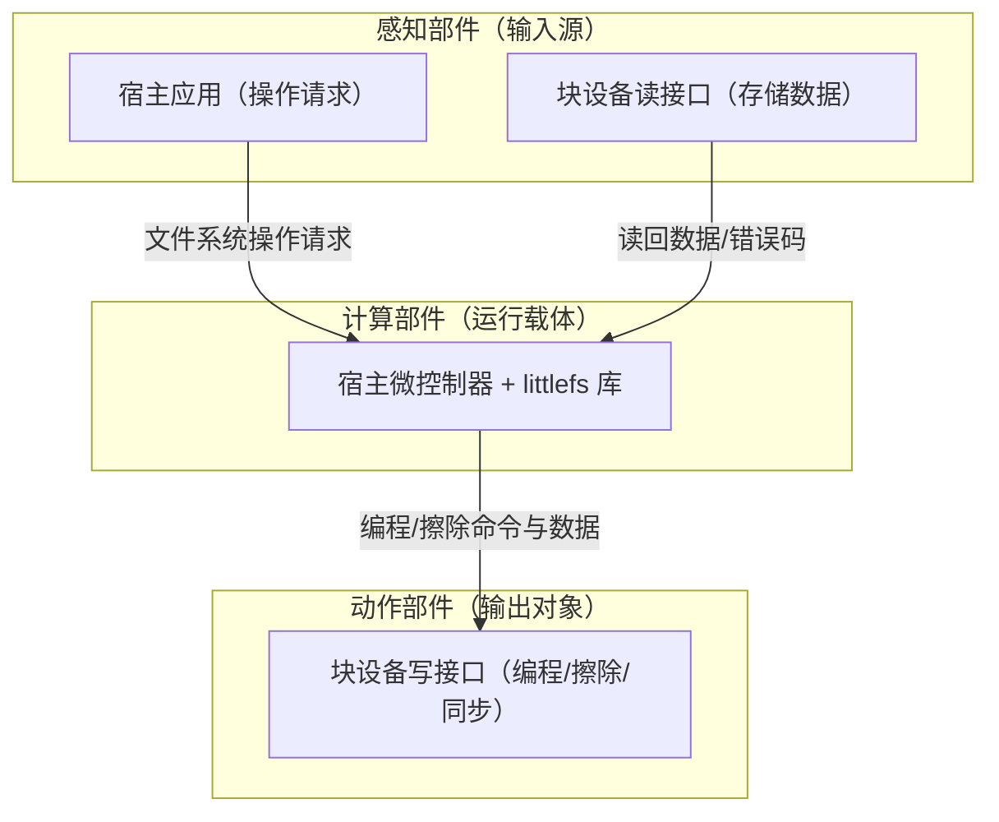
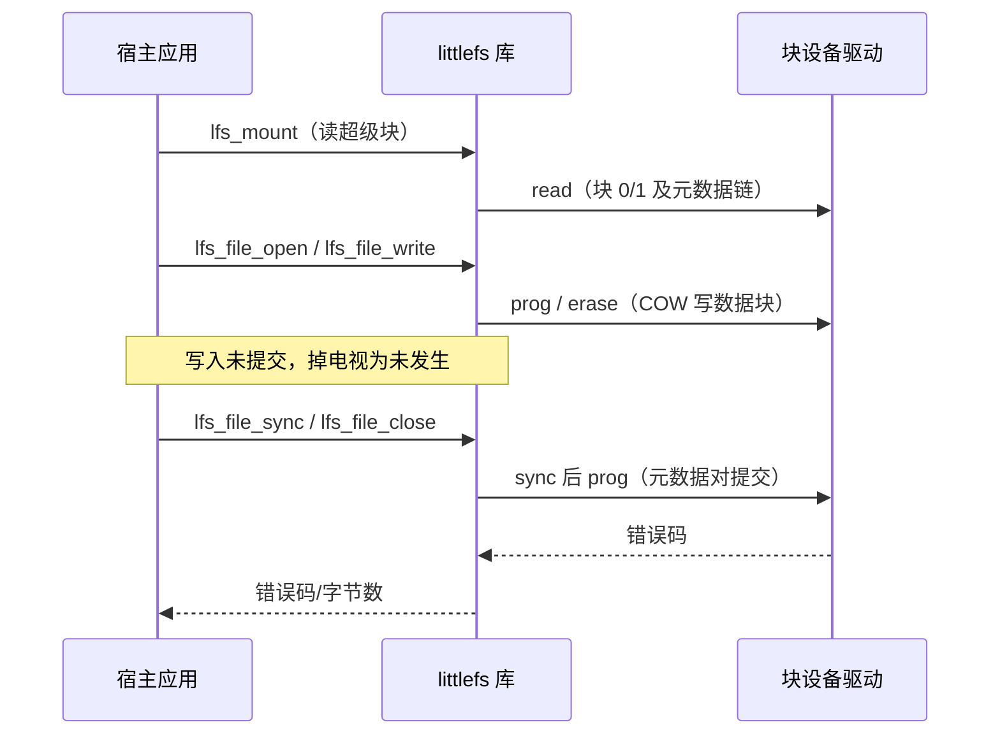
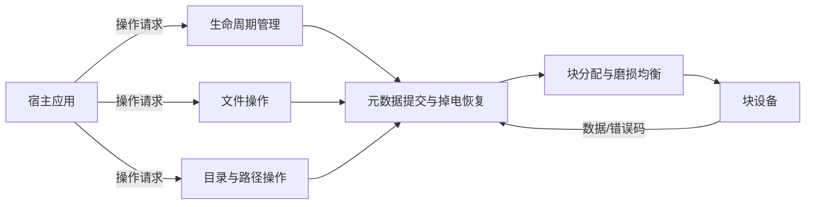
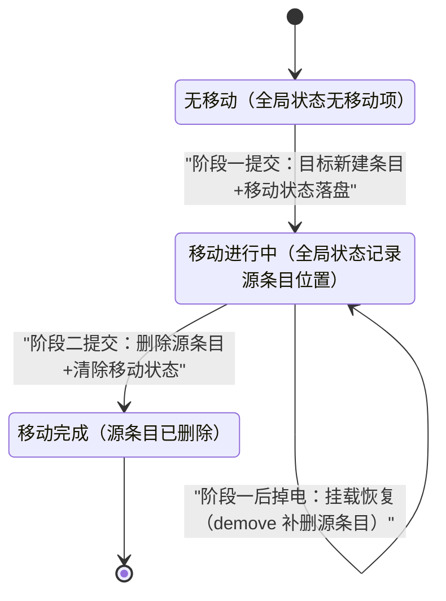
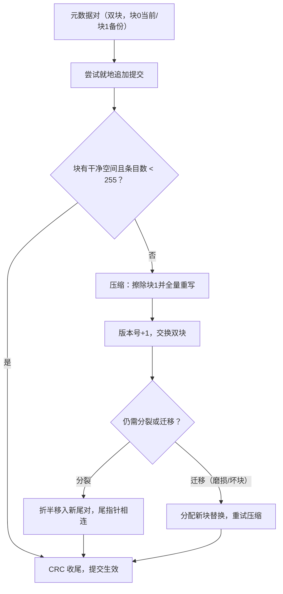

# littlefs 软件需求规格说明

> 本文档由代码仓库逆向生成。生成日期：2026-10-18；代码仓库：C:\ECNU\502\littlefs-master（littlefs v2.11，LFS_VERSION 0x0002000b，磁盘格式 LFS_DISK_VERSION 0x00020001）。
> 全文需求标识前缀：LF（littlefs）。
> 标注约定：（文件名）为代码出处；[待确认] 为代码中无法确定、需人工确认的内容。

# 1 概述

## 1.1 软件概述（README.md、DESIGN.md）

littlefs 是一个为微控制器设计的小型失效安全（fail-safe）嵌入式文件系统软件库：它以 C 库形式集成于宿主应用，对块设备存储进行格式化、挂载与类 POSIX 的文件/目录管理，保证任意时刻掉电后文件系统能自动恢复到最近一次一致状态。软件向上提供格式化、挂载、文件读写、目录与路径操作、自定义属性等 API，向下通过用户提供的读/编程/擦除/同步回调适配任意块存储介质。

软件围绕三个核心目标设计：其一为掉电恢复，任意写操作期间掉电，文件系统回退到最后已知良好状态，设备不会不可恢复；其二为磨损均衡，针对 Flash 存储提供动态块级磨损均衡，并能检测坏块、换块重试；其三为有界 RAM/ROM，内存占用不随文件系统容量与文件数量增长，无无界递归，动态内存仅限可静态提供的可配置缓冲区。


图1.1-1 littlefs 软件示意图

软件使用过程按阶段划分如下：

- 格式化阶段：lfs_format 擦除并写入超级块与根目录，生成全新文件系统；
- 挂载阶段：lfs_mount 读取超级块、校验磁盘格式版本、恢复掉电时未完成的移动与孤儿状态；
- 使用阶段：宿主应用执行文件/目录读写操作；写入在 sync/close 前不提交，掉电即视为未发生；
- 维护阶段：lfs_fs_gc、lfs_fs_mkconsistent 执行一致性修复、元数据压缩与分配器填充；
- 卸载阶段：lfs_unmount 释放资源。

## 1.2 系统组成（lfs.h、bd/）

软件由感知部件（数据输入源）、动作部件（输出对象）与计算部件（运行载体）三部分组成。

> 1）感知部件（数据输入源）：其一为宿主应用，向软件发出文件/目录操作请求；其二为块设备读接口，向软件提供存储介质上的数据（read 回调）。
>
> 2）动作部件（输出对象）：块设备的编程/擦除/同步接口，软件通过 prog、erase、sync 回调将命令与数据输出到存储介质。
>
> 3）计算部件（运行载体）：宿主微控制器及其上运行的 littlefs 库。典型目标平台为 32 位微控制器（约 32 KiB RAM、512 KiB ROM）配约 4 MiB SPI NOR Flash；软件以库形式被宿主应用调用，不依赖操作系统。



图1.2-1 系统组成图

# 2 运行环境规定

## 2.1 运行方案和场景（lfs.h、README.md）

软件以 C 函数库形式集成于宿主应用，采用"同步调用、按需运行"的方式工作：软件自身无主循环、无任务、无中断，全部功能由宿主应用在自身主流程或任务上下文中以函数调用触发，一次调用完成全部处理后返回；多个文件系统实例（多个 lfs_t）可同时挂载使用。

1. 主程序功能：宿主应用在自身主流程中依次执行——配置 lfs_config 并分配 lfs_t；首次使用时调用 lfs_format 格式化（挂载失败后格式化再挂载为推荐标准流程）；调用 lfs_mount 挂载；通过文件/目录 API 执行读写；必要时调用 lfs_fs_gc、lfs_fs_mkconsistent 执行维护；调用 lfs_unmount 卸载。
2. 中断服务程序功能：软件不注册、不占用任何中断；掉电处理不依赖中断与关机流程，而是依赖磁盘数据的自校验结构，在下次挂载时自动恢复。

关键时序点：

- lfs_file_write 调用后，数据仅进入内存缓存与 COW 数据块，目录元数据未提交，此时掉电该次写入视为未发生；
- lfs_file_sync / lfs_file_close 时先同步数据块（调用块设备 sync 回调）再提交目录元数据，此后写入对掉电安全；
- 挂载成功后不立即修复掉电残留（孤儿元数据对、未完成移动），修复推迟到首次写操作时执行；调用 lfs_fs_mkconsistent 可提前触发。



图2.1-1 宿主应用调用时序

## 2.2 硬件环境（DESIGN.md、lfs.h、lfs.c）

### 2.2.1 宿主计算机

典型目标平台为 32 位微控制器，约 32 KiB RAM、512 KiB ROM，外接约 4 MiB SPI NOR Flash。软件不依赖具体 CPU 型号与主频，任何可运行 C99 代码并具备块读/编程/擦除能力的平台均可部署；软件不依赖操作系统；默认按单线程假设运行，定义编译宏 LFS_THREADSAFE 后通过用户提供的 lock/unlock 回调支持多线程。

### 2.2.2 中断设置

软件不占用任何中断，不注册中断服务程序。块设备驱动自身的中断（如 SPI DMA 完成中断）由驱动管理，与软件无关。

表2.2-1 中断信息表

| 中断源 | 优先级 | 中断源（名称） | 触发方式 |
|-------|-------|--------------|---------|
| 无 | 无 | 软件不占用任何中断 | 无 |

### 2.2.3 存储器

表2.2-2 存储器信息表

| 属性 | RAM（数据存储器） | 块设备存储（外部存储介质） |
|------|-----------------|-------------------------|
| 组成 | 读缓存、编程缓存、每个打开文件一个缓存、lookahead 位图缓冲、固定结构体（lfs_t 等） | 可按块读/编程/擦除的存储（典型 SPI NOR Flash） |
| 容量 | 2×cache_size + N×cache_size + lookahead_size + 固定开销，N 为同时打开文件数，有界 | block_size × block_count（如 4 KiB × 1024 块 = 4 MiB） |
| 数据宽度 | 8 位（字节） | 8 位（字节） |
| 分配方式 | 由 config 提供静态缓冲区，或默认 malloc 分配；定义 LFS_NO_MALLOC 时仅静态 | 由用户/平台提供 |
| 约束 | cache_size 为 read_size/prog_size 公倍数且整除 block_size；lookahead_size 每字节跟踪 8 块 | block_size ≥ 128 字节，为 read_size/prog_size/cache_size 的倍数 |

## 2.3 支持软件环境（Makefile、README.md）

### 2.3.1 编程语言

编程语言：C 语言，符合 C99 标准；提供 extern "C" 声明，支持 C++ 宿主调用。

### 2.3.2 编译调试工具

> 编辑及编译软件：Makefile 构建系统，编译器 gcc（亦支持 clang），默认编译选项 -std=c99 -Wall -Wextra -pedantic、-Os 尺寸优化（DEBUG=1 时为 -O0）。
>
> 测试与调试工具：测试与基准运行于 Linux 环境；make test 运行全部测试（tests/*.toml 用例经 scripts/test.py 生成 C 代码，由 runners/test_runner 执行，支持掉电注入、坏块注入、valgrind 与 gdb）；make bench 运行基准；另有 size/code/data/stack/structs/cov 等分析目标。

## 2.4 接口（lfs.h、bd/）


图2.4-1 接口关系图

### 2.4.1 与其他软件接口

1) 与宿主应用接口：lfs.h 声明的公共 API，共 35 个函数——生命周期（lfs_format、lfs_mount、lfs_unmount、lfs_fs_stat）、通用操作（lfs_remove、lfs_rename、lfs_stat、lfs_getattr、lfs_setattr、lfs_removeattr）、文件操作（lfs_file_open、lfs_file_opencfg、lfs_file_close、lfs_file_sync、lfs_file_read、lfs_file_write、lfs_file_seek、lfs_file_truncate、lfs_file_tell、lfs_file_rewind、lfs_file_size）、目录操作（lfs_mkdir、lfs_dir_open、lfs_dir_close、lfs_dir_read、lfs_dir_seek、lfs_dir_tell、lfs_dir_rewind）、文件系统级（lfs_fs_size、lfs_fs_traverse、lfs_fs_mkconsistent、lfs_fs_gc、lfs_fs_grow、lfs_migrate）。所有调用可能返回负错误码。
2) 与块设备驱动接口：用户在 lfs_config 中提供 read/prog/erase/sync 回调（定义 LFS_THREADSAFE 时增加 lock/unlock）。契约：编程前块必须已擦除；擦除后块内容未定义；prog/erase 可返回 LFS_ERR_CORRUPT 声明该块为坏块；sync 必须将写缓存刷入介质并保证后续 read 命中真实介质，无写缓存时可直接返回 0；回调错误码为负值并原样透传。

表2.4-2 错误码表

| 错误码 | 值 | 含义 |
|-------|-----|------|
| LFS_ERR_OK | 0 | 无错误 |
| LFS_ERR_IO | -5 | 块设备操作错误（含底层透传错误） |
| LFS_ERR_CORRUPT | -84 | 数据损坏（校验失败/坏块） |
| LFS_ERR_NOENT | -2 | 路径不存在 |
| LFS_ERR_EXIST | -17 | 条目已存在 |
| LFS_ERR_NOTDIR | -20 | 条目不是目录 |
| LFS_ERR_ISDIR | -21 | 条目是目录 |
| LFS_ERR_NOTEMPTY | -39 | 目录非空 |
| LFS_ERR_BADF | -9 | 坏文件号（定义保留，实现中未使用） |
| LFS_ERR_FBIG | -27 | 文件过大 |
| LFS_ERR_INVAL | -22 | 参数非法 |
| LFS_ERR_NOSPC | -28 | 空间不足 |
| LFS_ERR_NOMEM | -12 | 内存不足 |
| LFS_ERR_NOATTR | -61 | 属性不存在 |
| LFS_ERR_NAMETOOLONG | -36 | 名称过长 |

### 2.4.2 硬件接口

表2.4-1 硬件接口信息表

| 序号 | 编号 | 描述 | 接口类型 | 数据 |
|------|------|------|---------|------|
| 1. | LF-IREQ1 | 与块设备读取接口（read 回调） | 函数回调、同步调用 | Input: 指定块/偏移/长度处的存储数据<br>Output: 调用参数（块号、块内偏移、长度） |
| 2. | LF-IREQ2 | 与块设备编程接口（prog 回调） | 函数回调、同步调用 | Input: 调用参数（块号、偏移、数据）<br>Output: 编程后的介质内容；错误码（可返回 LFS_ERR_CORRUPT） |
| 3. | LF-IREQ3 | 与块设备擦除接口（erase 回调） | 函数回调、同步调用 | Input: 调用参数（块号）<br>Output: 擦除后的介质状态；错误码（可返回 LFS_ERR_CORRUPT） |
| 4. | LF-IREQ4 | 与块设备同步接口（sync 回调） | 函数回调、同步调用 | Input: 无<br>Output: 写缓存刷入介质；错误码 |

# 3 软件详细需求

## 3.1 功能分解（lfs.c、lfs.h）

对软件功能进行分解，软件顶层数据流图如下：宿主应用的操作请求经生命周期管理与文件/目录操作进入元数据提交与掉电恢复功能，由块分配与磨损均衡功能从块设备取得存储空间，数据与错误码沿原路返回。



图3.1-1 软件顶层数据流图

| 需求标识 | 功能名称 | 一句话描述 | 主要证据文件 |
|---------|---------|-----------|-------------|
| LF-FREQ1 | 初始化与生命周期管理 | 格式化、挂载、卸载与文件系统信息查询 | lfs.c |
| LF-FREQ2 | 文件操作 | 文件打开/关闭、读写、定位、截断与同步提交 | lfs.c |
| LF-FREQ3 | 目录与路径操作 | 路径解析、目录创建/删除、重命名/移动、目录遍历 | lfs.c |
| LF-FREQ4 | 自定义属性管理 | 属性读取/设置/删除，随文件内容原子提交 | lfs.c |
| LF-FREQ5 | 元数据提交与掉电恢复 | 元数据对提交、CRC 校验、孤儿回收与一致性修复 | lfs.c、SPEC.md |
| LF-FREQ6 | 块分配与磨损均衡 | lookahead 块分配、坏块处理与元数据对迁移 | lfs.c |
| LF-FREQ7 | 文件系统维护 | 垃圾回收、扩容、空间统计与块遍历 | lfs.c |

## 3.2 功能需求

### 3.2.1 初始化与生命周期管理（lfs.c）

#### 3.2.1.1 格式化（lfs_format）

a. 需求标识：LF-FREQ1-1

b. 功能描述：对块设备执行格式化，写入超级块并创建根目录，生成可挂载的 littlefs 文件系统。

c. 调用条件：用户在首次使用存储介质前显式调用 lfs_format；格式化完成后不保持挂载状态，须再调用 lfs_mount；定义 LFS_READONLY 时该接口不存在。

d. 输入：未初始化的 lfs_t 实例、lfs_config 配置（块设备回调与几何参数，block_count 必须非 0）。

e. 输出：磁盘上块 0 与块 1 各含一份完整提交（版本号分别为 1 与 2），内容为超级块与根目录；返回 0 或负错误码。

f. 处理：

1. 调用 lfs_init 完成配置校验与缓存分配：read_size/prog_size/cache_size 非 0，cache_size 为两者公倍数且整除 block_size，block_size ≥ 128 字节，block_cycles ≠ 0 等，违反即 LFS_ASSERT 终止；
2. 初始化 lookahead 分配器：位图清零（全空闲）、起点为 0、窗口大小取 8×lookahead_size 与 block_count 的较小值、检查点置 block_count；
3. 分配根目录元数据对（先分配块 1 号位、后分配块 0 号位，最终 pair={0,1}）；开启磨损均衡时版本号对齐到 (block_cycles+1)|1 的倍数；
4. 构造超级块数据结构并提交 CREATE + SUPERBLOCK（数据为魔数 "littlefs"）+ INLINESTRUCT（数据为超级块 24 字节）三个元数据标签；
5. 再次空提交强制二次压缩，把完整副本写入另一块，防止意外挂载介质上残留的旧版 littlefs；
6. 回读 {0,1} 块对验证挂载入口可解析；无论成败释放临时资源并返回。

表3.2-1 超级块数据结构表

| 字节序号 | 参数含义 | 数据类型 | 备注 |
|---------|---------|---------|------|
| 0~3 | 磁盘格式版本 | 32 位无符号，小端 | 高 16 位主版本、低 16 位次版本，当前 0x00020001 |
| 4~7 | 逻辑块大小 block_size | 32 位无符号，小端 | 单位字节 |
| 8~11 | 块数量 block_count | 32 位无符号，小端 | |
| 12~15 | 文件名最大长度 name_max | 32 位无符号，小端 | ≤ 255 |
| 16~19 | 文件最大长度 file_max | 32 位无符号，小端 | ≤ 2^31-1 |
| 20~23 | 属性最大长度 attr_max | 32 位无符号，小端 | ≤ 1022 |

证据位置：lfs.c（lfs_format_、lfs_init、lfs_dir_alloc）、lfs.h（lfs_superblock_t 定义）、tests/test_superblocks.toml（格式化后双块魔数断言）

#### 3.2.1.2 挂载（lfs_mount）

a. 需求标识：LF-FREQ1-2

b. 功能描述：读取磁盘超级块与元数据链，校验磁盘格式与配置，恢复掉电时的全局状态并初始化分配器。

c. 调用条件：用户显式调用 lfs_mount（通常在格式化之后）；lfs_t 与 config 在挂载期间必须保持有效；支持同一时刻挂载多个文件系统实例。

d. 输入：未初始化的 lfs_t 实例、lfs_config 配置；磁盘上自块对 {0,1} 起的元数据链（版本号、tag 链、CRC、超级块、移动状态标签）。

e. 输出：lfs_t 各字段初始化（root、block_count、name_max/file_max/attr_max、seed、gstate/gdisk、lookahead 起点）；返回 0 或负错误码。

f. 处理：

1. lfs_init 校验配置并分配缓存；
2. 自 {0,1} 起沿元数据尾链逐对搜索超级块（魔数 "littlefs" 比对），tortoise 算法检测尾链成环，成环即返回 LFS_ERR_CORRUPT；最后一个出现的超级块所在对成为根目录 root；
3. 校验磁盘版本：主版本必须等于当前主版本，次版本必须不大于当前次版本，否则 LFS_ERR_INVAL；次版本较旧时置 needssuperblock 标志（首次写操作时重写超级块）；
4. 校验磁盘参数与配置：磁盘 name_max/file_max/attr_max 非 0 时不得大于配置上限，并以磁盘值为准收窄；block_count 配置非 0 时须与磁盘一致（为 0 时采用磁盘值）；block_size 必须与配置一致，不符即 LFS_ERR_INVAL；
5. 对链上每个元数据对读取 MOVESTATE 移动状态标签并异或累加，恢复上次掉电时的全局状态（孤儿计数、未完成移动）；gdisk 记录磁盘基准；
6. 以挂载扫描中收集的提交 CRC 混合生成种子 seed，分配器起点取 seed % block_count，使各次启动的分配位置均匀分布；挂载不执行全盘扫描；
7. 任何失败均释放已分配资源后返回负错误码。

表3.2-2 挂载参数校验规则表

| 校验项 | 规则 | 不满足时 |
|-------|------|---------|
| 磁盘主版本 | 必须等于当前主版本 | LFS_ERR_INVAL |
| 磁盘次版本 | 必须不大于当前次版本；较旧时挂载后首次写重写超级块 | LFS_ERR_INVAL |
| name_max/file_max/attr_max | 磁盘值非 0 时不得大于配置上限；以磁盘值为准收窄 | LFS_ERR_INVAL |
| block_count | 配置非 0 时须与磁盘一致；配置为 0 时采用磁盘值 | LFS_ERR_INVAL |
| block_size | 必须与配置一致 | LFS_ERR_INVAL |
| 元数据尾链 | 无环（tortoise 检测） | LFS_ERR_CORRUPT |
| 设备内容 | 存在至少一个有效提交（空白设备报环错误） | LFS_ERR_CORRUPT |

证据位置：lfs.c（lfs_mount_、lfs_dir_fetchmatch、lfs_dir_getgstate、lfs_tortoise_detectcycles）、tests/test_superblocks.toml（挂载与 fs_stat 断言）

#### 3.2.1.3 卸载（lfs_unmount）

a. 需求标识：LF-FREQ1-3

b. 功能描述：释放文件系统占用的全部资源，不做任何磁盘写入。

c. 调用条件：用户不再使用该文件系统实例时调用；要求此前所有文件均已关闭、数据已同步。

d. 输入：已挂载的 lfs_t 实例。

e. 输出：释放 malloc 分配的读缓存、编程缓存与 lookahead 缓冲（静态缓冲不释放）；恒返回 0。

f. 处理：

1. 遍历三项缓存，仅当 config 未提供对应静态缓冲时释放之；
2. 其余字段不清理，卸载后的 lfs_t 不得复用。

证据位置：lfs.c（lfs_unmount_、lfs_deinit）

#### 3.2.1.4 文件系统信息查询（lfs_fs_stat）

a. 需求标识：LF-FREQ1-4

b. 功能描述：查询磁盘上的文件系统信息，回填磁盘版本、几何参数与各上限。

c. 调用条件：挂载后由用户调用。

d. 输入：lfs_t 实例、lfs_fsinfo 结构体指针。

e. 输出：fsinfo 的 6 个字段——disk_version（磁盘版本）、block_size、block_count、name_max、file_max、attr_max；返回 0 或负错误码。

f. 处理：

1. 无待重写超级块标志时，disk_version 直接取当前磁盘版本 0x00020001（定义 LFS_MULTIVERSION 时取配置值）；
2. 有待重写标志（挂载时发现旧次版本）时，回读根元数据对中的超级块结构，取磁盘上真实版本；
3. block_size 取配置值，block_count/name_max/file_max/attr_max 取挂载时按磁盘超级块解析后的内存值。

证据位置：lfs.c（lfs_fs_stat_、lfs_fs_disk_version）、lfs.h（lfs_fsinfo 定义）

### 3.2.2 文件操作（lfs.c）

#### 3.2.2.1 文件打开（lfs_file_opencfg）

a. 需求标识：LF-FREQ2-1

b. 功能描述：按标志位打开或创建文件，初始化文件句柄，加载文件结构（CTZ 或内联）与自定义属性。

c. 调用条件：用户调用 lfs_file_opencfg（lfs_file_open 为其无配置版本，定义 LFS_NO_MALLOC 时仅后者可用且必须提供静态缓冲）；写模式打开时触发一致性修复。

d. 输入：路径、打开标志（lfs_open_flags 位或组合）、可选文件配置（静态缓冲、自定义属性列表）；文件系统运行时上限 name_max/file_max/attr_max/inline_max。

e. 输出：lfs_file_t 句柄各字段初始化；新建文件时向目录原子提交 CREATE + REG + INLINESTRUCT 三个标签；返回 0 或负错误码。

f. 处理：

1. 写访问时先执行掉电一致性修复（孤儿回收、未完成移动补删）；定义 LFS_READONLY 时断言只读；
2. 路径解析查找文件（lfs_dir_find）；不存在且无 LFS_O_CREAT 返回 LFS_ERR_NOENT，创建路径带尾斜杠返回 LFS_ERR_NOTDIR，末段名超过 name_max 返回 LFS_ERR_NAMETOOLONG；
3. 新建文件：原子提交 CREATE + REG（文件名）+ INLINESTRUCT（空内联）；提交因空间不足失败（NOSPC）时改写为 LFS_ERR_NAMETOOLONG（长文件名无法放入元数据块）；
4. 已存在：LFS_O_EXCL 置位返回 LFS_ERR_EXIST；类型非普通文件返回 LFS_ERR_ISDIR；LFS_O_TRUNC 置位直接声明为空内联文件并置脏标志；否则读取 CTZ 结构（头块指针与文件大小）；
5. 属性处理：读模式打开时从磁盘读入配置中列出的属性；写模式打开时属性大小超过 attr_max 返回 LFS_ERR_NOSPC，否则置脏标志（随 sync/close 原子写盘）；
6. 分配文件缓存（优先用 config 静态缓冲，否则 malloc，失败返回 LFS_ERR_NOMEM），缓存预填 0xff 防信息泄漏；内联文件时把内联数据读入缓存并置 LFS_F_INLINE；
7. 任一步失败时置错误标志并关闭句柄释放资源。

表3.2-3 文件打开标志表

| 标志 | 值 | 含义 |
|------|-----|------|
| LFS_O_RDONLY | 1 | 只读打开 |
| LFS_O_WRONLY | 2 | 只写打开 |
| LFS_O_RDWR | 3 | 读写打开 |
| LFS_O_CREAT | 0x0100 | 不存在则创建 |
| LFS_O_EXCL | 0x0200 | 已存在则返回 LFS_ERR_EXIST |
| LFS_O_TRUNC | 0x0400 | 打开即截断为空 |
| LFS_O_APPEND | 0x0800 | 每次写前定位到文件尾 |

证据位置：lfs.c（lfs_file_opencfg_、lfs_dir_find、lfs_dir_commit）、lfs.h（lfs_open_flags、lfs_file_config 定义）

#### 3.2.2.2 文件读取（lfs_file_read）

a. 需求标识：LF-FREQ2-2

b. 功能描述：自文件当前位置读取数据到用户缓冲，文件位置随读推进。

c. 调用条件：用户以读权限打开文件后调用；句柄必须在打开状态。

d. 输入：文件句柄、目标缓冲、请求字节数。

e. 输出：读出的数据（不超过文件剩余长度）；返回实际读取字节数（0 为文件尾），或负错误码。

f. 处理：

1. 若处于写状态（自上次同步以来写入过），先执行 flush 使未提交写入可读；
2. 位置超过文件大小时返回 0（文件尾）；
3. 按块循环读取：需要换块时调用 lfs_ctz_find 以 CTZ 跳表定位位置所在块与块内偏移（内联文件直接取内联位置），置读取标志；
4. 每块经读缓存（rcache）以 block_size 为单位整块预读，数据拷入用户缓冲；
5. 更新文件位置，返回累计字节数。

具体算法如下：

```
1. 由文件大小求块索引与块内偏移（lfs_ctz_index）
   b = block_size - 8                    // 数据块容量（块 0 有 2 个 4 字节头指针）
   i = size / b                          // 初始块索引
   i = (size - 4*(popc(i-1)+2)) / b      // 代入修正一次后收敛
   off = size - b*i - 4*popc(i)          // 块内数据偏移
2. 由位置定位所在块（lfs_ctz_find，复杂度 O(log n)）
   current = index(size-1)，target = index(pos)
   循环：skip = min(npw2(current-target+1)-1, ctz(current))
         读 head 块偏移 4*skip 处的 32 位指针，current -= 1<<skip
         直至 current == target，返回该块与 pos
```

证据位置：lfs.c（lfs_file_read_、lfs_file_flushedread、lfs_ctz_find、lfs_ctz_index）、lfs_util.h（lfs_popc、lfs_npw2）

#### 3.2.2.3 文件写入（lfs_file_write）

a. 需求标识：LF-FREQ2-3

b. 功能描述：自文件当前位置写入数据，采用写时复制（COW）更新数据块；写入在 sync/close 前不提交到目录元数据。

c. 调用条件：用户以写权限打开文件后调用；定义 LFS_READONLY 时该接口不存在。

d. 输入：文件句柄、数据缓冲、写入字节数。

e. 输出：更新后的文件数据块（COW 新块）与内存中的文件位置/大小；返回实际写入字节数（写入是完整完成的，错误为负值）。

f. 处理：

1. 若处于读状态（自上次同步以来读取过），先 flush 丢弃读缓存；
2. LFS_O_APPEND 置位时位置移到文件尾；写入后大小超过 file_max 返回 LFS_ERR_FBIG；
3. 位置越过当前文件尾时（稀疏写），先逐字节补零到写入起点；
4. 内联文件写入后大小超过 inline_max 时，先执行内联转外联（outline：分配新块并整体搬迁）；
5. 按块 COW 写入：换块时调用 lfs_ctz_extend 分配新块（末块未满则复制旧末块内容，已满则写入 1+ctz(索引) 个跳表指针），数据经编程缓存（pcache）写入，缓存满时落盘并回读校验；
6. 编程或校验失败（LFS_ERR_CORRUPT）时调用 lfs_file_relocate 整体换块重试；更新位置并返回字节数。

表3.2-4 CTZ 数据块容量参数表

| 参数 | 值/公式 | 说明 |
|------|--------|------|
| 块内指针容量 | block_size/4 个 | 每个指针 32 位 |
| 块 0 头指针数 | 2 个（8 字节） | 块 0 无向后跳表指针 |
| 块 i（i>0）头指针数 | 1+ctz(i) 个 | ctz 为尾零计数 |
| 块数据容量 | block_size − 4×头指针数 | 块 0 为 block_size − 8 |
| 块大小下限 | ≥128 字节（代码断言；理论下限 104 字节） | 保证 32 位指针不溢出 |
| 单文件上限 | ≤ 2^31-1 字节 | 超过返回 LFS_ERR_FBIG |

证据位置：lfs.c（lfs_file_write_、lfs_file_flushedwrite、lfs_ctz_extend、lfs_file_relocate、lfs_file_outline）、DESIGN.md（CTZ skip-lists 章节）

#### 3.2.2.4 文件同步与关闭（lfs_file_sync、lfs_file_close）

a. 需求标识：LF-FREQ2-4

b. 功能描述：将未落盘数据写盘并原子提交目录元数据（文件结构 + 自定义属性），使写入对掉电安全；关闭在同步后释放句柄资源。

c. 调用条件：用户调用 lfs_file_sync 显式同步；lfs_file_close 隐含同步；定义 LFS_READONLY 时 sync 接口不存在，close 仅释放资源。

d. 输入：文件句柄。

e. 输出：磁盘上更新后的文件数据块与目录元数据（CTZ 结构或内联数据 + 全部自定义属性在同一提交内生效）；返回 0 或负错误码。

f. 处理：

1. flush：把写入状态固化为"数据已全部落盘"——若写发生在文件中部，逐字节读出旧尾部数据经 COW 写回新链，保证旧块整体可弃；
2. 数据块先同步：调用块设备 sync 回调，确保数据先于元数据落盘；
3. 组装提交：内联文件提交 INLINESTRUCT（内联数据），否则提交 CTZSTRUCT（头块指针 + 文件大小，小端）；与 LFS_FROM_USERATTRS 属性列表合并为一次 lfs_dir_commit，原子生效；
4. 清脏标志；遍历打开句柄链表，把同一目录对中其它同文件句柄置 LFS_F_DUSTY（与磁盘不同步）标志；
5. 关闭：无错误标志时先同步；从链表摘除句柄并释放缓存；带错误标志的句柄关闭时丢弃未落盘数据。

证据位置：lfs.c（lfs_file_sync_、lfs_file_flush、lfs_file_close_、lfs_dir_commit）、lfs.h（LFS_F_DIRTY、LFS_F_DUSTY、LFS_F_ERRED 标志定义）

#### 3.2.2.5 文件定位与截断（lfs_file_seek、lfs_file_truncate、lfs_file_tell、lfs_file_rewind、lfs_file_size）

a. 需求标识：LF-FREQ2-5

b. 功能描述：修改文件读写位置（seek/tell/rewind）、查询文件大小、调整文件长度（truncate：扩张填零、收缩回收块）。

c. 调用条件：用户在文件打开期间调用；truncate 需写权限且定义 LFS_READONLY 时不存在。

d. 输入：文件句柄、偏移量与基准（LFS_SEEK_SET=0、LFS_SEEK_CUR=1、LFS_SEEK_END=2）或目标大小。

e. 输出：新文件位置（seek/tell/size 返回位置或大小）；truncate 后磁盘上的文件结构；返回 0 或负错误码。

f. 处理：

1. seek：按基准计算新位置；超过 file_max 返回 LFS_ERR_INVAL（负偏移折算为巨大无符号值同样命中）；位置未变时直接返回；读状态且新旧位置落在同一缓存块内时直接更新位置免重读；否则先 flush 再更新位置；
2. tell：返回当前文件位置；rewind：等价于 seek(0, LFS_SEEK_SET)；size：处于写状态时取位置与已提交大小的较大值，否则返回已提交大小；
3. truncate 收缩：目标不大于 inline_max 时回退为内联文件（读出前段数据写入内联结构）；否则先 flush，再以截断点所在块为新链头，尾链上被截掉的块成为孤儿，由后续提交触发的孤儿回收处理；
4. truncate 扩张：定位文件尾后逐字节补零至目标大小；恢复调用前位置；
5. truncate 目标超过编译期 LFS_FILE_MAX 返回 LFS_ERR_INVAL。

证据位置：lfs.c（lfs_file_seek_、lfs_file_truncate_、lfs_file_tell_、lfs_file_rewind_、lfs_file_size_）、lfs.h（lfs_whence_flags 定义）

### 3.2.3 目录与路径操作（lfs.c）

#### 3.2.3.1 路径解析与查找（lfs_dir_find）

a. 需求标识：LF-FREQ3-1

b. 功能描述：把路径逐段解析到目标条目（目录对、条目 id），所有目录/文件/属性操作共用此入口。

c. 调用条件：被 lfs_mkdir、lfs_remove、lfs_rename、lfs_stat、lfs_file_opencfg、lfs_getattr 等调用。

d. 输入：路径字符串；输出参数（所在目录对、条目 id）。

e. 输出：找到时返回条目标签；未找到时返回 LFS_ERR_NOENT 并给出父目录与插入位置 id；返回负错误码。

f. 处理：

1. 路径分隔符为 "/"，全部路径相对根目录解析；空路径返回 LFS_ERR_INVAL；
2. 逐段处理：跳过 "."；遇 ".." 采用深度消解——向后扫描后缀，普通段加 1、".." 减 1，深度归零处跳到该 ".." 之后重新解析（如 a/../b 等价于 b）；".." 越过根返回 LFS_ERR_INVAL；
3. 当前条目不是目录返回 LFS_ERR_NOTDIR；子目录经 DIRSTRUCT 标签取得其元数据对指针；
4. 每段在目录元数据对中按名匹配（fetchmatch 逐对搜索，目录分裂时沿尾链跨对搜索）；匹配按字典序 id 稳定；
5. 未找到且父目录未分裂时返回 LFS_ERR_NOENT，否则继续在链上后续对中搜索。

证据位置：lfs.c（lfs_dir_find、lfs_path_namelen、lfs_dir_fetchmatch、lfs_dir_find_match）

#### 3.2.3.2 目录创建与删除（lfs_mkdir、lfs_remove）

a. 需求标识：LF-FREQ3-2

b. 功能描述：创建目录；删除文件或空目录（删除目录必须为空）。

c. 调用条件：用户调用；定义 LFS_READONLY 时两者均不存在；调用前自动执行一致性修复。

d. 输入：路径。

e. 输出：磁盘上新增的目录元数据对与父目录条目（mkdir），或删除的父目录条目与被摘除的目录元数据对（remove）；返回 0 或负错误码。

f. 处理：

1. mkdir：路径查找——已存在返回 LFS_ERR_EXIST，父路径不存在返回 LFS_ERR_NOENT，父非目录返回 LFS_ERR_NOTDIR，末段名超过 name_max 返回 LFS_ERR_NAMETOOLONG；
2. mkdir：分配新元数据对，先向其提交软尾（SOFTTAIL=链端前驱），使新目录对先挂上全文件系统元数据链；父目录未分裂时，父条目（CREATE + NAME(目录) + DIRSTRUCT + 软尾）与挂链在同一次提交中原子完成；父目录已分裂时挂链与父条目分两次提交，中间掉电窗口以孤儿计数 ±1 保护，由孤儿回收修复；
3. remove：删除根目录返回 LFS_ERR_INVAL；条目不存在返回 LFS_ERR_NOENT；
4. remove 目录：读其元数据对，条目数非 0 或已分裂即非空，返回 LFS_ERR_NOTEMPTY；为空则登记孤儿计数并提交 DELETE 标签删除父目录条目；
5. remove 收尾：仍有孤儿时把被删目录对从元数据链上摘除（dir_drop），其两个块成为垃圾，由分配器回收；删除文件仅需提交 DELETE 标签。

证据位置：lfs.c（lfs_mkdir_、lfs_remove_、lfs_dir_drop、lfs_fs_preporphans）

#### 3.2.3.3 重命名与移动（lfs_rename）

a. 需求标识：LF-FREQ3-3

b. 功能描述：重命名或移动文件/目录（支持覆盖），采用两阶段提交保证掉电安全（原子性）。

c. 调用条件：用户调用；定义 LFS_READONLY 时不存在；调用前自动执行一致性修复。

d. 输入：源路径与目标路径。

e. 输出：目标目录中的新条目与源目录中被删除的旧条目；返回 0 或负错误码。

f. 处理：

1. 合法性检查：源为根或目标为根返回 LFS_ERR_INVAL；源不存在返回 LFS_ERR_NOENT；目标存在但类型与源不同返回 LFS_ERR_ISDIR/LFS_ERR_NOTDIR；目标为目录时必须为空（否则 LFS_ERR_NOTEMPTY）；源为文件而目标路径带尾斜杠返回 LFS_ERR_NOTDIR；新名超过 name_max 返回 LFS_ERR_NAMETOOLONG；源与目标同对同名直接返回 0；
2. 同对移动且新 id 不大于旧 id 时，旧 id 加 1（CREATE 拼接使后续 id 后移）；
3. 阶段一：跨对移动先在内存全局状态登记移动项（move type=DELETE、move id、源对地址），随后向目标目录对一次提交——DELETE 旧目标（若有）+ CREATE 新 id + NAME + FROM_MOVE（把源条目结构与属性复制进目标对）+（同对时）DELETE 旧条目；该提交的 MOVESTATE 增量使"移动状态"与"新条目"同时原子落盘；
4. 阶段二：清除内存移动状态后向源目录对提交 DELETE 源条目；该提交的 MOVESTATE 增量同时原子清除磁盘上的移动状态；同对移动无阶段二（删除已并入阶段一）；
5. 覆盖了目录时，把被覆盖目录对从元数据链上摘除，块回收给分配器。



图3.2-1 移动状态图

掉电恢复：阶段一后掉电，磁盘上目标已有新条目且移动状态已落盘；挂载时异或重建全局状态得知移动进行中，首次写操作前由 lfs_fs_demove 向源对提交 DELETE 补删源条目，用户视角文件不丢失、不复制两份。阶段二后掉电则移动已完整完成。

表3.2-5 重命名与移动合法性规则表

| 规则 | 不满足时 |
|------|---------|
| 源为根目录 | LFS_ERR_INVAL |
| 目标为根目录 | LFS_ERR_INVAL |
| 源不存在 | LFS_ERR_NOENT |
| 目标存在且类型与源不同 | LFS_ERR_ISDIR / LFS_ERR_NOTDIR |
| 目标为目录且非空 | LFS_ERR_NOTEMPTY |
| 新名长度超过 name_max | LFS_ERR_NAMETOOLONG |
| 源为文件且目标路径带尾斜杠 | LFS_ERR_NOTDIR |
| 源与目标同对同名 | 直接返回 0 |

证据位置：lfs.c（lfs_rename_、lfs_fs_prepmove、lfs_fs_demove、lfs_dir_traverse 的 FROM_MOVE 分支）、DESIGN.md（The move problem 章节）

#### 3.2.3.4 目录遍历（lfs_dir_open、lfs_dir_read、lfs_dir_close、lfs_dir_seek、lfs_dir_tell、lfs_dir_rewind）

a. 需求标识：LF-FREQ3-4

b. 功能描述：打开目录句柄并逐条遍历目录项（含 "." 与 ".."），支持定位与重绕。

c. 调用条件：用户调用；句柄打开期间在打开链表上登记。

d. 输入：路径（open）、遍历位置偏移（seek）；输出信息结构 lfs_info。

e. 输出：每个条目的类型、名称与大小（大小仅对普通文件有效，目录不填）；read 返回 1 表示读到一条、0 表示遍历结束、负值为错误。

f. 处理：

1. open：路径解析，末段非目录返回 LFS_ERR_NOTDIR，不存在返回 LFS_ERR_NOENT；根目录取 root 对，否则读 DIRSTRUCT 取子目录对；句柄置位置 0 并登记链表；
2. read：位置 0/1 分别合成 "." 与 ".."（类型为目录）；之后按条目 id 升序遍历头对，本对耗尽且已分裂时沿尾链进入下一对（id 重新编号）；条目经 getinfo 读取，删除的条目与超级块条目（根对 id 0）按"无此条目"跳过；
3. close：仅从链表摘除句柄；rewind：重新读入头对使句柄看到最新提交，位置归 0；
4. seek：位置含 "."/".." 计数；超过条目总数返回 LFS_ERR_INVAL；根目录从头对 id 1 开始（跳过超级块条目）；tell：返回当前位置。

证据位置：lfs.c（lfs_dir_open_、lfs_dir_read_、lfs_dir_seek_、lfs_dir_getinfo）

### 3.2.4 自定义属性管理（lfs.c）

#### 3.2.4.1 属性读取（lfs_getattr）

a. 需求标识：LF-FREQ4-1

b. 功能描述：按路径读取自定义属性（8 位类型唯一标识），短于缓冲补零、长于缓冲截断，并返回磁盘上的真实长度。

c. 调用条件：用户调用。

d. 输入：路径、8 位属性类型、缓冲与请求长度。

e. 输出：属性数据；返回磁盘上属性真实长度（可用于探测或动态分配缓冲），属性不存在返回 LFS_ERR_NOATTR，或其它负错误码。

f. 处理：

1. 路径解析定位条目（根目录特例直接取根对）；
2. 按 USERATTR+类型标签读取，读取量取磁盘长度与请求长度的较小值，缓冲其余部分补零；
3. 属性不存在（NOENT）改写为 LFS_ERR_NOATTR。

证据位置：lfs.c（lfs_getattr_、lfs_dir_getslice）、lfs.h（lfs_attr 定义）

#### 3.2.4.2 属性设置与删除（lfs_setattr、lfs_removeattr）

a. 需求标识：LF-FREQ4-2

b. 功能描述：设置（不存在时隐式创建）或删除自定义属性；属性可随文件内容在 sync/close 时原子提交。

c. 调用条件：用户调用；定义 LFS_READONLY 时两者均不存在。

d. 输入：路径、8 位属性类型、数据缓冲与长度（setattr）。

e. 输出：磁盘上更新后的 USERATTR 属性标签；返回 0 或负错误码。

f. 处理：

1. setattr：属性长度超过 attr_max 返回 LFS_ERR_NOSPC；向目录提交 USERATTR 新标签，日志重放语义使同类型旧值自动被遮蔽；
2. removeattr：提交带删除标记（长度字段全 1）的 USERATTR 标签删除属性；属性不存在时不报错；
3. 文件原子提交：以写模式打开文件时配置的属性列表在每次 sync/close 时与文件结构在同一提交内原子写盘；以读模式打开时在打开调用中从磁盘读入。

证据位置：lfs.c（lfs_commitattr、lfs_removeattr_、lfs_file_opencfg_、lfs_file_sync_）、lfs.h（lfs_file_config 定义）

### 3.2.5 元数据提交与掉电恢复（lfs.c、SPEC.md）

#### 3.2.5.1 元数据对提交（lfs_dir_commit）

a. 需求标识：LF-FREQ5-1

b. 功能描述：把一组元数据变更（目录项、超级块、全局状态）以一次提交原子写入元数据对；提交采用双块日志结构，支持就地追加、压缩、分裂与换块迁移。

c. 调用条件：所有元数据修改经此入口；由文件同步、目录操作、属性操作、块迁移修复等调用。

d. 输入：目标元数据对、属性变更列表（lfs_mattr 数组）。

e. 输出：磁盘上追加或重写后的元数据提交（标签链 + CRC），版本号与内存目录状态同步更新；返回 0 或内部状态码（RELOCATED/DROPPED/ORPHANED）。

f. 处理：

1. 提交前先驱逐同对内超缓存的内联文件（转外联并 flush），保证提交不丢数据；
2. 就地追加：仅当该块已确认擦除干净且条目数小于 255 时，把变更标签顺序写入现有日志尾部（标签与前一标签异或存储、大端），以 CRC 标签收尾；成功即生效；
3. 追加不满足（空间不足或损坏）则压缩：版本号加 1，擦除配对块，把日志中每个条目仅保留最新版本全量重写进配对块，写尾链标签与全局状态增量，CRC 收尾并回读校验，最后交换双块使新数据成为当前块；
4. 压缩仍装不下时分裂：先折半收缩至满足"条目数 < 255 且数据量 ≤ min(metadata_max−40, alignup(metadata_max/2, prog_size))"（40 字节预留 = 尾标签 12 + 全局状态 16 + 移动删除 4 + CRC 8），把后缀条目移入新分配的尾对，以尾指针相连；
5. 版本号达到磨损迁移模数（block_cycles > 0 且 rev+1 整除 (block_cycles+1)|1）时强制换块：分配新块替换配对块后重新压缩；根超级块对 {0,1} 不可迁移，写坏时冻结文件系统返回 LFS_ERR_NOSPC；
6. 提交引发的连锁修复：被删空的目录对从链上摘除；发生换块时修复父目录引用与前驱尾指针，并登记孤儿计数，随后立即执行孤儿回收。



图3.2-2 元数据对提交流程

表3.2-6 元数据标签（tag）32 位布局表

| 位段 | 宽度 | 含义 |
|------|------|------|
| D[31] | 1 | 有效位，0=有效；磁盘存储时与前一标签异或（首标签与 0xffffffff 异或） |
| D[30:20] | 11 | 类型 type3（3 位抽象类型 + 8 位 chunk 字段） |
| D[19:10] | 10 | 条目 id，0x3ff 表示非文件条目（目录/全局状态） |
| D[9:0] | 10 | 数据长度（字节），0x3ff 表示删除标记 |

表3.2-7 元数据类型表

| 类型值 | 名称 | 用途 |
|-------|------|------|
| 0x0ff | SUPERBLOCK | 超级块标识，数据为魔数 "littlefs"（8 字节） |
| 0x201 | INLINESTRUCT | 内联文件数据（不超过 inline_max 字节） |
| 0x202 | CTZSTRUCT | CTZ 文件结构（8 字节：头块指针 + 文件大小，小端） |
| 0x200 | DIRSTRUCT | 目录结构（8 字节：子目录元数据对指针） |
| 0x300 | USERATTR | 用户自定义属性（chunk 字段为 8 位属性类型） |
| 0x401 | CREATE | 条目创建（id 拼接插入，保持字典序） |
| 0x4ff | DELETE | 条目删除 |
| 0x500 | CRC（CCRC） | 提交结束标记与校验（数据前 4 字节为 CRC-32） |
| 0x5ff | FCRC | 前向 CRC（判定下一提交区域是否为干净擦除区） |
| 0x600 | TAIL（SOFTTAIL） | 指向链上下一元数据对（8 字节块对指针） |
| 0x601 | HARDTAIL | 目录内下一元数据对（定义保留，实现未使用） |
| 0x7ff | MOVESTATE | 全局移动状态增量（12 字节：内标签 + 块对） |

证据位置：lfs.c（lfs_dir_commit、lfs_dir_relocatingcommit、lfs_dir_compact、lfs_dir_splittingcompact、lfs_dir_commitcrc）、SPEC.md（Metadata pairs、Metadata tags 章节）

#### 3.2.5.2 掉电恢复与孤儿回收（lfs_fs_deorphan、lfs_fs_mkconsistent）

a. 需求标识：LF-FREQ5-2

b. 功能描述：掉电后恢复文件系统到最近一次一致状态——选择有效元数据块、丢弃被撕裂的提交、修复未完成移动与孤儿元数据对，并支持主动提前执行一致性修复。

c. 调用条件：块选择与提交校验在每次挂载及目录读取时自动执行；孤儿回收与移动补删由挂载后首次写操作前的强制一致性检查触发，或由 lfs_fs_mkconsistent 显式触发（定义 LFS_READONLY 时无写侧触发）。

d. 输入：元数据对双块内容、全局状态（gstate）。

e. 输出：修复后的元数据链与目录引用；返回 0 或负错误码。

f. 处理：

1. 元数据对读取时双块选择：比较两块版本号（模 2^32 序列比较，抗回绕），取较新块；从首标签起逐提交重放并累计 CRC-32（多项式 0x04c11db7、初值 0xffffffff），遇到 CRC 不匹配即丢弃该提交及其后全部数据；两块均无有效提交返回 LFS_ERR_CORRUPT；
2. 提交尾部以 FCRC 判定下一编程单元是否为干净擦除区，决定该块是否允许就地追加（避免向被撕裂编程的区域二次写入）；
3. 强制一致性修复链（首次写操作前执行）：desuperblock 重写版本过旧的超级块 → demove 按磁盘全局状态补删未完成移动的源条目 → deorphan 修复孤儿；
4. deorphan 两遍扫描：第一遍修复半孤儿（换块迁移中途掉电导致父目录仍引用旧块对），第二遍（仅掉电恢复路径）修复全孤儿（链上无任何父目录引用的元数据对），将其重新接入元数据链；全程以异或全局状态中的孤儿计数控制；
5. 孤儿块不立即擦除：修复后无人引用的块对由块分配器在下次扫描后重新分配复用；
6. lfs_fs_mkconsistent：执行上述修复链后，若内存全局状态与磁盘基准仍有差异，向根目录空提交一次把全局状态落盘。

证据位置：lfs.c（lfs_dir_fetchmatch、lfs_fs_forceconsistency、lfs_fs_deorphan、lfs_fs_demove、lfs_fs_desuperblock、lfs_fs_mkconsistent_）、lfs_util.c（lfs_crc）

### 3.2.6 块分配与磨损均衡（lfs.c）

#### 3.2.6.1 块分配（lfs_alloc）

a. 需求标识：LF-FREQ6-1

b. 功能描述：从块设备分配空闲块，采用 lookahead 位图扫描与伪随机起点实现全盘均匀分配。

c. 调用条件：元数据对分配、压缩换块、文件数据块 COW 分配等所有需要新块的场景。

d. 输入：文件系统状态（lookahead 结构、seed）。

e. 输出：分配到的块号；返回 0 或 LFS_ERR_NOSPC。

f. 处理：

1. 在 lookahead 位图窗口内自起点线性向前扫描空闲位（位图每字节跟踪 8 块、字节内 LSB 优先，置 1 表示在用），命中即返回该块，并顺带前跳至下一个空闲位（刚分配的块不立即置位，提交失败掉电后可重新分配）；
2. 每扫描一个块检查点预算减 1，预算耗尽返回 LFS_ERR_NOSPC——避免满盘时分配器死循环；检查点在"所有在途分配均已提交"的时间点重置为 block_count；
3. 窗口耗尽时重建位图：窗口起点按已扫描量前移（环回），窗口大小取 8×lookahead_size 与检查点的较小值；重建过程全盘遍历在用的元数据对、文件块与打开文件的未提交块，把窗口内占用位置位（遍历含孤儿引用，防止孤儿块被提前复用）；
4. 分配起点随机化：挂载时以种子 seed（由各元数据提交 CRC 经 CRC 累积混合生成）对 block_count 取模作为起点，使每次上电的分配位置均匀分布；格式化时起点为 0。

表3.2-8 lookahead 位图参数表

| 参数 | 值/规则 | 说明 |
|------|--------|------|
| 位图格式 | 1 字节跟踪 8 块，字节内 LSB 优先 | 置 1 = 在用 |
| 窗口大小 | min(8×lookahead_size, ckpoint) | lookahead_size 必须大于 0 |
| 扫描方向 | 自 start 线性向前，越过块数后环回 | |
| 窗口起点 | 挂载时 seed % block_count；格式化时 0 | |
| 检查点 ckpoint | 初值 block_count，每扫一块减 1，耗尽返回 LFS_ERR_NOSPC | 在途分配全部落盘时重置 |

证据位置：lfs.c（lfs_alloc、lfs_alloc_scan、lfs_alloc_lookahead、lfs_alloc_ckpoint）、DESIGN.md（The block allocator 章节）

#### 3.2.6.2 磨损均衡与坏块处理

a. 需求标识：LF-FREQ6-2

b. 功能描述：以版本号代理擦除次数，对元数据对实施换块迁移实现动态磨损均衡；检测坏块后驱逐并换块重试写入。

c. 调用条件：迁移在元数据对压缩前自动判定；坏块处理发生在擦除/编程失败或写后回读校验失败时。

d. 输入：元数据对版本号、配置项 block_cycles、块设备返回的 LFS_ERR_CORRUPT。

e. 输出：迁移到新块的元数据对；换块重试完成的数据写入；返回 0 或负错误码。

f. 处理：

1. 迁移判定：block_cycles 大于 0 且版本号加 1 整除 (block_cycles+1)|1 时强制换块（模数修正避免 block_cycles=1 不收敛与偶数取值别名效应）；block_cycles 取 -1 关闭迁移，取 0 被断言禁止；新元数据对的版本号对齐到同一模数，避免刚分配即触发迁移；
2. 迁移执行：压缩前分配新块替换配对块，随后重新压缩；成功后修复父目录引用与前驱尾指针；
3. 坏块检测：块设备 prog/erase 返回 LFS_ERR_CORRUPT，或编程后回读与内存副本比对不一致；
4. 坏块恢复：文件数据块经 lfs_file_relocate 整体搬迁到新块重试；元数据对压缩任一步骤遇坏块即换块重试；被驱逐的坏块不再被引用，设备持续对其报错时事实上永久跳过；
5. 根超级块对 {0,1} 不可迁移：写坏时告警并返回 LFS_ERR_NOSPC，文件系统冻结；
6. 磨损均衡仅覆盖动态块（空闲块与元数据对），不迁移静态数据块（无静态磨损均衡）。

证据位置：lfs.c（lfs_dir_needsrelocation、lfs_dir_compact 的 relocate 分支、lfs_file_relocate、lfs_bd_flush）、lfs.h（block_cycles 字段说明）、DESIGN.md（Wear leveling 章节）

### 3.2.7 文件系统维护（lfs.c）

#### 3.2.7.1 垃圾回收（lfs_fs_gc）

a. 需求标识：LF-FREQ7-1

b. 功能描述：执行文件系统清洁工作——一致性修复、压缩超阈值元数据、填充块分配器。

c. 调用条件：用户显式调用；非必需接口，可将昂贵工作卸载到非时间关键路径；无事可做不算错误；定义 LFS_READONLY 时不存在。

d. 输入：lfs_t 实例。

e. 输出：紧凑后的元数据与就绪的分配器；返回 0 或负错误码。

f. 处理：

1. 执行一致性修复链（重写旧版本超级块、补删未完成移动、回收孤儿）；
2. 沿元数据链压缩超过阈值的元数据对：阈值为配置 compact_thresh，取 0 时按块大小的 87.5%（block_size − block_size/8）计算，取 -1 时禁用；仅当阈值小于块大小减编程粒度时执行；
3. lookahead 未满时提前重建分配器位图。

证据位置：lfs.c（lfs_fs_gc_、lfs_fs_forceconsistency）、lfs.h（lfs_fs_gc 注释）

#### 3.2.7.2 容量调整与空间统计（lfs_fs_grow、lfs_fs_size、lfs_fs_traverse）

a. 需求标识：LF-FREQ7-2

b. 功能描述：调整文件系统块数（扩容为主）、统计在用块数、遍历全部在用块。

c. 调用条件：用户显式调用；grow 在定义 LFS_READONLY 时不存在。

d. 输入：lfs_t 实例；grow 输入新块数；traverse 输入回调函数与用户数据。

e. 输出：grow 更新超级块中的 block_count；size 返回在用块数（尽力而为，文件共享 COW 结构时可能偏大）；traverse 对每个在用块回调一次；返回 0 或负错误码。

f. 处理：

1. lfs_fs_grow：块数未变直接返回；默认仅支持扩容（定义 LFS_SHRINKNONRELOCATING 时支持缩容，缩容前检查被裁区间无在用块，否则 LFS_ERR_NOTEMPTY）；更新内存块数并重写超级块中的 block_count；
2. lfs_fs_traverse：自 {0,1} 起沿元数据链遍历（tortoise 环检测，成环返回 LFS_ERR_CORRUPT），回调每个元数据块、经 CTZ 遍历回调每个文件数据块，并遍历打开文件中未提交的写块；含孤儿引用选项；
3. lfs_fs_size：按上述遍历统计在用块总数。

证据位置：lfs.c（lfs_fs_grow_、lfs_fs_traverse_、lfs_fs_size_、lfs_shrink_checkblock）、lfs.h（lfs_fs_grow 注释）

## 3.3 性能需求

### 3.3.1 精度需求（lfs.c、lfs_util.h）

软件不进行浮点运算，全部计算基于 32 位整数。块地址为 32 位（0xffffffff 表示空块 LFS_BLOCK_NULL，0xfffffffe 表示内联 LFS_BLOCK_INLINE）；文件大小与位置为 32 位，单文件上限 2^31-1 字节；文件名上限 255 字节、单属性上限 1022 字节。数据完整性由 CRC-32 校验保证（多项式 0x04c11db7、初值 0xffffffff、无最终异或、按半字节查表计算），能检出元数据与文件数据中的随机损坏。

### 3.3.2 空间需求（lfs.c、lfs.h）

表3.3-1 空间需求

| 序号 | 编号 | 描述 |
|------|------|------|
| 1 | LF-PREQ1 | RAM 占用严格有界：读缓存 + 编程缓存 + 每个打开文件一个缓存（各 cache_size 字节）+ lookahead 位图（lookahead_size 字节）+ 固定结构体，不随文件系统总容量与文件总数增长 |
| 2 | LF-PREQ2 | 块设备块大小不小于 128 字节（代码断言；理论下限 104 字节），保证 32 位 CTZ 指针不溢出数据块 |
| 3 | LF-PREQ3 | 单个元数据对最多容纳 254 个条目；分裂时后段数据量不超过 min(metadata_max−40, alignup(metadata_max/2, prog_size)) 字节 |
| 4 | LF-PREQ4 | 文件名不超过 255 字节、单文件不超过 2^31-1 字节、单属性不超过 1022 字节（磁盘格式硬上限） |

### 3.3.3 时间需求（lfs.c、DESIGN.md）

表3.3-2 时间需求

| 序号 | 编号 | 描述 |
|------|------|------|
| 5 | LF-PREQ5 | CTZ 跳表任意块定位 O(log n)、文件末尾追加 O(1) |
| 6 | LF-PREQ6 | 元数据对更新均摊 O(1)（50% 容量分裂策略，垃圾回收开销上界 2 倍） |
| 7 | LF-PREQ7 | 目录条目查找最坏 O(nm)（n 个元数据对 × 每对 m 个条目） |
| 8 | LF-PREQ8 | 孤儿/半孤儿检测 O(n²)，仅在挂载后首次写操作前执行一次（lfs_fs_mkconsistent 可提前触发） |
| 9 | LF-PREQ9 | 所有 API 为同步阻塞调用，软件无内部周期任务与实时性约束，调用时长取决于块设备操作速度 |

## 3.4 可靠性和安全性需求（lfs.c、DESIGN.md）

表3.4-1 可靠性需求

| 序号 | 编号 | 描述 |
|------|------|------|
| 1 | LF-SREQ1 | 任意写操作期间掉电后，文件系统回退到最近一次一致状态：元数据对双块冗余 + 逐提交 CRC 校验 + 版本号序列比较选择有效块，被撕裂的提交整体丢弃 |
| 2 | LF-SREQ2 | 所有写入数据在编程后回读并与内存副本比对校验，不一致视为坏块并按坏块流程处理 |
| 3 | LF-SREQ3 | 坏块检测与绕过：prog/erase 返回 LFS_ERR_CORRUPT 或回读不一致时，驱逐坏块、分配新块并重试写入，保证数据最终写入成功或明确报错 |
| 4 | LF-SREQ4 | 掉电残留的孤儿与半孤儿元数据对在挂载后首次写操作前修复（两遍扫描），避免块泄漏与目录引用失效 |
| 5 | LF-SREQ5 | RAM 占用有界：目录遍历使用显式栈（深度上限 3），软件不存在无界递归 |
| 6 | LF-SREQ6 | 元数据尾链成环检测（tortoise 算法），检出环即返回 LFS_ERR_CORRUPT，防止遍历死循环 |
| 7 | LF-SREQ7 | 全部元数据以 CRC-32（多项式 0x04c11db7、初值 0xffffffff）逐提交校验，校验失败的提交及其后数据一律作废 |

表3.4-2 安全性需求

| 序号 | 编号 | 描述 |
|------|------|------|
| 8 | LF-SREQ8 | 文件数据采用写时复制（COW），不存在原地覆写：旧数据在新提交生效前完整保留，掉电后旧状态可回退 |
| 9 | LF-SREQ9 | 文件删除、重命名/移动为原子操作：重命名采用两阶段提交 + 全局移动状态，掉电后由 demove 补删源条目，用户视角不出现文件丢失或同一文件两份 |
| 10 | LF-SREQ10 | 配置合法性校验：尺寸约束违反由 LFS_ASSERT 立即终止（可裁剪）；磁盘超级块参数与配置不符返回 LFS_ERR_INVAL，拒绝在不匹配几何上运行 |
| 11 | LF-SREQ11 | 统一负值错误码约定，底层块设备错误码原样透传，调用方可区分故障来源并决策 |
| 12 | LF-SREQ12 | 根超级块对 {0,1} 写坏时冻结文件系统并返回 LFS_ERR_NOSPC，不在无法保证一致性的情况下继续修改 |
| 13 | LF-SREQ13 | 缓存信息防护：编程缓存使用前填充 0xff、读缓存丢弃时不清理但仅内部可见，避免残留敏感数据泄漏到未写区域 |

# 附录1 数据字典（lfs.h、lfs.c）

| 序号 | 变量名 | 物理含义 | 取值说明 | 备注 |
|------|-------|---------|---------|------|
| 1. | lfs_config | 文件系统配置 | read/prog/erase/sync 回调、read_size/prog_size/block_size/block_count/cache_size/lookahead_size/block_cycles 等 | 必须清零后填写；block_cycles 取 -1 关闭磨损均衡 |
| 2. | lfs_t | 文件系统实例状态 | cfg、root[2]、mlist、seed、gstate/gdisk/gdelta、lookahead、block_count、name_max/file_max/attr_max/inline_max | 由用户分配，支持多实例同时挂载 |
| 3. | lfs_file_t | 打开文件句柄 | flags、pos（逻辑位置）、block/off（当前块与块内偏移）、ctz{head,size}、cache | 打开期间有效 |
| 4. | lfs_mdir_t | 目录元数据对状态 | pair[2]（双块号）、rev（版本号）、off（提交尾部偏移）、count（条目数）、erased、split、tail[2]（链上后继对） | 版本号为擦除次数代理 |
| 5. | lfs_gstate_t | 全局状态 | tag（type 位=移动类型、id 位=移动条目、低 9 位=孤儿计数、bit9=需重写超级块、bit31=存在孤儿）、pair[2]（移动源对） | 磁盘上以 XOR 增量（MOVESTATE 标签）分布存储 |
| 6. | lfs_lookahead | 分配器前瞻窗口 | start（窗口起点）、size（窗口位宽）、next（扫描游标）、ckpoint（检查点预算）、buffer（位图） | 每字节 8 块 |
| 7. | lfs_cache_t | 块缓存 | block（-1 空/-2 内联）、off、size、buffer | 读缓存/编程缓存/文件缓存共用该结构 |
| 8. | LFS_VERSION | 软件库版本 | 0x0002000b（v2.11，高 16 位主版本） | lfs.h 定义 |
| 9. | LFS_DISK_VERSION | 磁盘格式版本 | 0x00020001（v2.1） | 挂载时主版本须一致、次版本须不大于当前 |
| 10. | LFS_BLOCK_NULL / LFS_BLOCK_INLINE | 空块号 / 内联标记 | 0xffffffff / 0xfffffffe | 块号 32 位 |
| 11. | LFS_NAME_MAX / LFS_FILE_MAX / LFS_ATTR_MAX | 名称/文件/属性上限 | 255 / 2147483647 / 1022 | 可重定义，写入超级块 |
| 12. | LFS_F_DIRTY | 文件已写未提交标志 | 0x00010000 | sync/close 时提交并清除 |
| 13. | LFS_F_DUSTY | 文件与磁盘不同步标志 | 0x00020000 | 其它句柄 sync 后置位 |
| 14. | LFS_F_WRITING | 自上次 flush 以来写入过 | 0x00040000 | 读写切换时触发 flush |
| 15. | LFS_F_READING | 自上次 flush 以来读取过 | 0x00080000 | 读缓存有效 |
| 16. | LFS_F_ERRED | 写过程中发生过错误 | 0x00100000 | close 时跳过同步、丢弃未落盘数据 |
| 17. | LFS_F_INLINE | 文件以内联形式存储 | 0x01000000 | 内联数据存于目录元数据 |
| 18. | LFS_OK_RELOCATED / DROPPED / ORPHANED | 提交内部状态码 | 1 / 2 / 3 | 换块迁移 / 目录对删除 / 产生孤儿 |
| 19. | LFS_CMP_EQ / LT / GT | 比较结果码 | 0 / 1 / 2 | 用于块数据比对与条目排序 |
| 20. | lfs_error | 错误码枚举 | OK=0、IO=-5、CORRUPT=-84、NOENT=-2、EXIST=-17、NOTDIR=-20、ISDIR=-21、NOTEMPTY=-39、FBIG=-27、INVAL=-22、NOSPC=-28、NOMEM=-12、NOATTR=-61、NAMETOOLONG=-36 | 负值错误码，见表2.4-2 |
