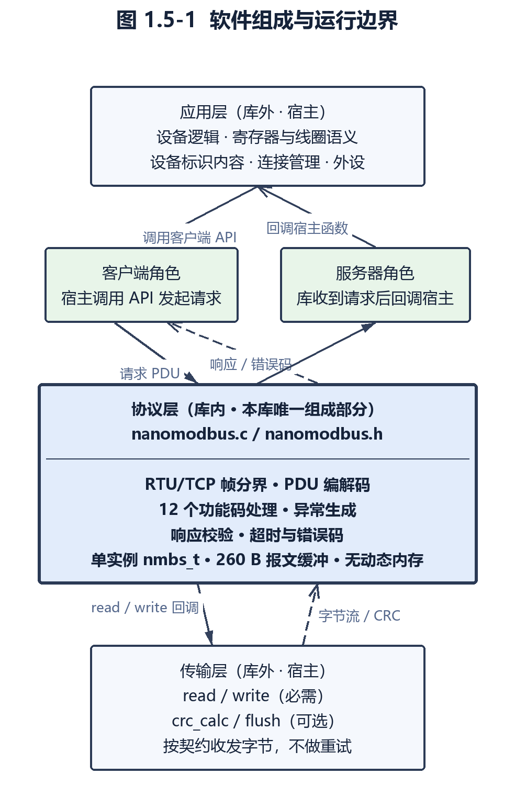
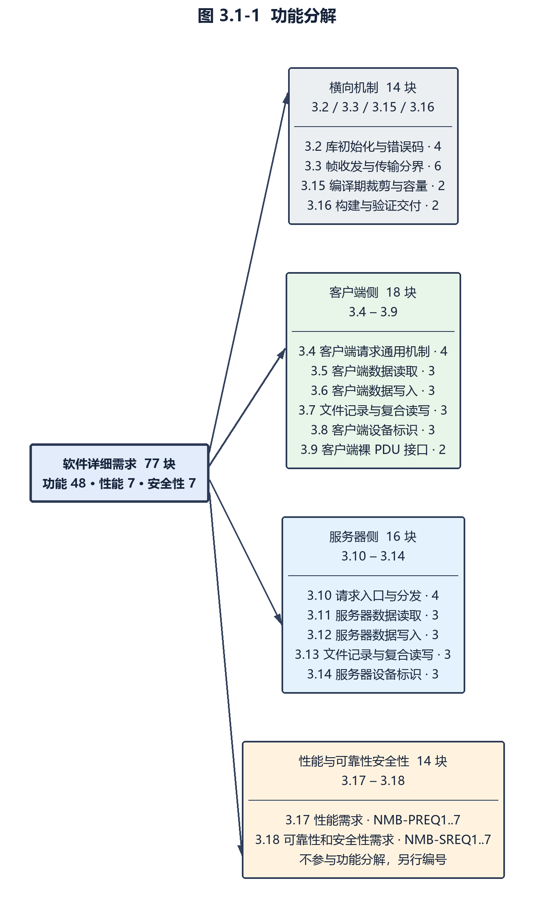

# nanoMODBUS 软件需求规格说明书（竣工需求·逆向）

| 项目 | 内容 |
| --- | --- |
| 文档编号 | REQ-NMB-ASB-001 |
| 软件名称 | nanoMODBUS（面向嵌入式/微控制器的紧凑型 Modbus RTU/TCP C 库） |
| 需求类型 | 竣工需求（as-built），源码静态逆向 |
| 锚定提交 | `91d6782930ee263bc760f27b0cbc5b82773c5f0d`（2026-02-01，tag `v1.23.0`；与 `master` HEAD 为同一提交） |
| 版本标识 | 上游无版本宏，版本以 tag `v1.23.0` 为唯一标识（全仓无 `VERSION` 定义，`CMakeLists.txt（第 1 行）` 仅声明 `cmake_minimum_required(VERSION 3.16)`） |
| 本地副本 | `_repos/nanoMODBUS/`（只读检出） |
| 逆向范围 | 档 2 = 核心 `nanomodbus.c` + `nanomodbus.h`（3,024 行）与 `tests/`（2,035 行），合计 5,059 行；`examples/`（31 文件 3,421 行）不写成需求，仅在边界处交代 |
| 规模（全仓） | 51 文件 / 9,003 行（根 9 / 3,388、`tests/` 5 / 2,035、`examples/` 31 / 3,421、`.github` + `.vscode` 6 / 159） |
| 有效代码行 | 核心 1,976 行（`nanomodbus.c` 1,806 + `nanomodbus.h` 170），与上游自述「约 2000 行」吻合 |
| 软件性质 | 无 `main()`、无硬件驱动、无外设控制的**可移植协议栈库**；硬件与网络由宿主提供 |
| 支持传输与角色 | 传输 RTU / TCP；角色客户端（Client）/ 服务器（Server） |
| 支持功能码 | 01、02、03、04、05、06、15、16、20、21、23、43（MEI 类型 0x0E）；服务器另有非法功能码异常路径 |
| 需求标识前缀 | `NMB-` |
| 许可证 | MIT（`LICENSE`，Copyright (c) 2022 Valerio De Benedetto (@debevv)） |
| 格式依据 | 星载软件需求规格说明书格式 |
| 交付形态 | Markdown、DOCX、PDF |

**阅读约定**：本文所有证据均以 `文件:行号` 形式给出，路径相对于 `_repos/nanoMODBUS/`（例如 `nanomodbus.c:1903-1907`、`nanomodbus.h:250-251`）。仓库内非 `.c`/`.h` 文件（`README.md`、`CMakeLists.txt`、`.github/workflows/ci.yml`、`LICENSE`、`Doxyfile`）一律写作 `` `路径（第 N-M 行）` ``；上游网页文档（GitHub 仓库页、Releases 页）引用时只标页面名、不带行号。上游 API 文档（GitHub Pages）由 `Doxyfile` 配置 Doxygen 从 `.c`/`.h` 生成，与头文件同源，**不作为独立证据源**。每个需求块末尾另有一行 `> 证据：……` 汇总该块的证据位置。

**证据等级**：条款标题或段末的括号标注表示该条的证据来源等级：

- `（任务书）`——该条来源于项目自述文档（`README.md`、上游 Releases 页）；
- `（用户需求）`——该条为对外契约（Modbus 协议帧格式与功能码语义、RTU CRC 与 TCP MBAP 规定的线格式）；
- `（需求规格）`——该条为由代码结构固化的实现事实；
- `（计算机使用说明）`——该条为由编译器、标准库或构建环境决定的事实；
- `（数据字典里找）`——该条由枚举、常量表与编译期宏反推。

**竣工需求判定准则**：本文描述锚定版本源码「已实现的行为」。凡一条陈述在换用另一种实现方式后仍必须成立者，写成需求条款；凡仅为当前实现的偶然特征者，写成实现说明并标注证据。上游自述与代码实测不一致时以代码实测为准，自述原文仅作引用。源码存在但当前构建不可达的分支（被 `NMBS_CLIENT_DISABLED`、`NMBS_SERVER_*_DISABLED` 等宏裁掉或保留未用的路径）记为「源码存在但不可达」并说明成因。

**缺陷与差异的登记**：本文如实描述实现中存在的边界缺口，不写成已防护场景。全部差异与缺陷统一编号 **D1–D30**，在正文相应条目中以「附录1.12 D<n>」标注，其类别、摘要与证据载体位置集中登记于附录 1.12。本库既无电气硬件接口，也不控制外设，故第 2 章按「宿主集成契约 + 数据流接口 + 存储与内存布局」三组契约组织。

**格式说明**：功能需求按六项要素组织，每块为连续的六段——`需求标识：`、`功能描述：`、`调用条件：`、`输入：`、`输出：`、`处理：`；`处理：` 后接若干条以 `；` 结尾、末条以 `。` 结尾的处理步骤。关系图以图片给出。

**需求标识体系**：

| 类别 | 形态 | 含义 |
| --- | --- | --- |
| 功能需求 | `NMB-FREQ<节号>-<序号>`（节号 1..15，对应正文 3.2..3.16） | 功能域内的单一功能，共 48 块 |
| 接口需求 | `NMB-IREQ<序号>` | 第 2 章定义的宿主集成契约与数据流接口，共 15 块 |
| 性能需求 | `NMB-PREQ<序号>`（1..7） | 第 3.17 节量化指标 |
| 可靠性和安全性需求 | `NMB-SREQ<序号>`（1..7） | 第 3.18 节 |

全文档需求块合计 **77 块**（FREQ 48 + IREQ 15 + PREQ 7 + SREQ 7）。

---

# 目录

下列条目列出各章节及其在本库中的实现模块（文件名相对于 `_repos/nanoMODBUS/`，不带行号），带行号的逐条证据见正文各需求条。

1 概述
　1.1 编写目的
　1.2 项目背景与来源（`README.md`、上游 Releases 页）
　1.3 术语与缩略语
　1.4 参考资料
　1.5 软件概述与系统组成（`nanomodbus.c`、`nanomodbus.h`；图 1.5-1）
2 运行环境规定
　2.1 运行方案与场景（`nanomodbus.c`、`nanomodbus.h`、`examples/`）
　2.2 目标运行环境（`nanomodbus.h`、`README.md`）
　2.3 支持软件环境（`CMakeLists.txt`、`.github/workflows/ci.yml`）
　2.4 对外接口（`nanomodbus.h`、`nanomodbus.c`）
　2.5 存储与内存布局（`nanomodbus.h`、`nanomodbus.c`）
3 软件详细需求
　3.1 功能分解（`nanomodbus.c`、`nanomodbus.h`）
　3.2 库初始化、平台契约与错误码体系（`nanomodbus.c`、`nanomodbus.h`）
　3.3 帧收发与传输分界（`nanomodbus.c`）
　3.4 客户端请求通用机制（`nanomodbus.c`、`nanomodbus.h`）
　3.5 客户端数据读取功能（`nanomodbus.c`、`nanomodbus.h`）
　3.6 客户端数据写入功能（`nanomodbus.c`、`nanomodbus.h`）
　3.7 客户端文件记录与复合读写（`nanomodbus.c`、`nanomodbus.h`）
　3.8 客户端设备标识（`nanomodbus.c`、`nanomodbus.h`）
　3.9 客户端裸 PDU 接口（`nanomodbus.c`、`nanomodbus.h`）
　3.10 服务器请求入口与分发（`nanomodbus.c`）
　3.11 服务器数据读取处理（`nanomodbus.c`）
　3.12 服务器数据写入处理（`nanomodbus.c`）
　3.13 服务器文件记录与复合读写（`nanomodbus.c`）
　3.14 服务器设备标识处理（`nanomodbus.c`）
　3.15 编译期裁剪与容量配置（`nanomodbus.h`、`nanomodbus.c`、`CMakeLists.txt`）
　3.16 构建与验证交付（`CMakeLists.txt`、`.github/workflows/ci.yml`、`tests/`）
　3.17 性能需求（`nanomodbus.c`、`nanomodbus.h`）
　3.18 可靠性和安全性需求（`nanomodbus.c`、`nanomodbus.h`）
附录1 数据字典（`nanomodbus.h`、`nanomodbus.c`）
附录2 软件IP（`LICENSE`）

---

# 1 概述

## 1.1 编写目的

本文给出 nanoMODBUS 在锚定版本上实现的**竣工需求**（as-built requirements），即「该版本源码实际实现并对外成立的需求」，用于以下四个方面：

- **选型与评估**：给出能力边界、资源占用与编译期裁剪手段，支撑是否在本项目中引入本库的判定；
- **移植与集成验收**：作为宿主实现传输回调、服务器回调与内存契约时的验收基线；
- **二次开发与维护**：作为改动本库时判定「哪些行为属于对外承诺、不可破坏」的对照基线；
- **归档与合规**：作为该第三方组件在软件配置项中的需求留档。

本文由源码静态逆向产生，**不是上游官方文档**。全部条款均可追溯至锚定提交的源码行或随仓文件行，上游 `README.md` 与 GitHub Pages API 文档仅作「自述」引用；凡自述与实现不一致处，一律以实现为准（差异登记见附录 1.12）。

**读者对象**：软件需求分析人员、嵌入式软件移植与集成工程师、软件配置管理与质量保证人员。

## 1.2 项目背景与来源

| 项 | 内容 |
| --- | --- |
| 项目名称 | nanoMODBUS —— A compact MODBUS RTU/TCP C library for embedded/microcontrollers（`README.md（第 1 行）`） |
| 来源 | GitHub 开源仓库 `debevv/nanoMODBUS` |
| 作者与版权 | Valerio De Benedetto（@debevv）；许可文件版权声明见 `LICENSE（第 1-3 行）`，源文件头版权年为 2026（`nanomodbus.h:4-6`） |
| 许可证 | MIT |
| 仓库规模 | 233 次提交；51 个文件 / 9,003 行 |
| 版本标识 | 全仓无版本宏、无 `VERSION` 文件，版本仅由 git tag 承载。本文锚定 tag `v1.23.0` = `91d6782930ee263bc760f27b0cbc5b82773c5f0d`（2026-02-01 13:36:06 +0100），该提交与 `master` HEAD 为同一提交 |
| 发布方式 | 上游以 git tag 及 GitHub Releases 页作为版本发布入口；本文引用的版本一律以锚定提交号为准，不随上游后续提交漂移 |
| 本地副本 | `_repos/nanoMODBUS/`（只读检出，本次全部取证的唯一代码来源） |
| 软件定位 | 面向嵌入式与资源受限系统的**协议栈中间件**：只实现 Modbus 协议层，串口与 TCP 的实际收发由宿主实现（`README.md（第 33-35 行）`） |

**来源分层**：本库的需求来源分三层，本文按此分层取证——

1. **任务书级**（自述）：`README.md`、上游 Releases 页与 API 文档站，给出功能码清单、平台契约与裁剪开关的意图；
2. **实现级**（需求规格）：`nanomodbus.c` 与 `nanomodbus.h`，给出行为、边界与错误语义；
3. **验证级**（第二证据源）：`tests/` 与 CI 配置，给出可执行的行为断言，用于确认某条行为确实被上游当作契约维护。

`examples/`（31 文件 3,421 行）为宿主应用示例，不属于本库需求，仅在需要交代宿主边界处引用。

## 1.3 术语与缩略语

| 术语 | 全称 / 含义 | 本文口径 | 依据 |
| --- | --- | --- | --- |
| ADU | Application Data Unit，应用数据单元 | 线路上的完整帧：RTU 为「地址 + PDU + CRC」，TCP 为「MBAP + PDU」 | 规范术语；帧组装见 `nanomodbus.c:389-403`、`418-429` |
| PDU | Protocol Data Unit，协议数据单元 | 「功能码 + 数据」，RTU 与 TCP 共用同一 PDU 编解码 | 规范术语 |
| RTU | Remote Terminal Unit，串行线路传输方式 | 二进制串行传输，含 16 位 CRC 与地址过滤 | `nanomodbus.h:130-133`；帧头 `nanomodbus.c:337-343`；CRC `nanomodbus.c:281-296`、`299-315`；地址过滤 `nanomodbus.c:438-446` |
| TCP | 面向连接的以太网传输方式 | 使用 MBAP 报头，无 CRC，单 ID 不参与过滤与比对 | `nanomodbus.h:130-133`；报头见 `nanomodbus.c:365-369` |
| MBAP | MODBUS Application Protocol header | TCP 报头 7 字节：事务号 2 + 协议号 2 + 长度 2 + 单元 ID 1 | `nanomodbus.c:365-369`、`371-382` |
| CRC | Cyclic Redundancy Check，循环冗余校验 | RTU 帧尾 16 位校验，多项式 0xA001、初值 0xFFFF | `nanomodbus.c:281-296` |
| FC | Function Code，功能码 | 请求/响应的首字节，标识操作类型 | `nanomodbus.h:248-259`（实例内报文状态字段含 `fc`） |
| 单元标识 | Unit Identifier，RTU 地址 / TCP 单元 ID | RTU 下用于寻址与过滤；TCP 下由 MBAP 的单元 ID 字段承载、不参与过滤与比对（本库不改写该字节，见附录1.12 D30） | `nanomodbus.c:440-445`、`489-490`、`nanomodbus.c:368` |
| 广播 | Broadcast | 单元标识为 0 的请求；服务器执行但不作答，客户端不应答 | `nanomodbus.h:276`；判定见 `nanomodbus.c:440-445` |
| 异常响应 | Exception Response | 服务器以「功能码 + 0x80」加异常码应答 | `nanomodbus.h:69-72`；发送见 `nanomodbus.c:458-470` |
| MEI | MODBUS Encapsulated Interface，封装接口 | FC 43 的封装类型字段，本库仅支持 0x0E（设备标识） | `nanomodbus.c:832`、`1665` |
| 线圈 / 离散输入 | Coil / Discrete Input | 1 位量：线圈可读写、离散输入只读 | `nanomodbus.h:106-125`（位域操作） |
| 保持寄存器 / 输入寄存器 | Holding Register / Input Register | 16 位量：保持寄存器可读写、输入寄存器只读 | 功能码接口见 `nanomodbus.h:380-390` |
| 位域 | `nmbs_bitfield` | 存放线圈/离散输入位的定长位数组，默认 2000 位 | `nanomodbus.h:82-96` |
| 平台回调 | Platform callbacks | 宿主实现的传输函数：`read`/`write` 必需，`crc_calc`/`flush` 可选 | `nanomodbus.h:161-172` |
| 服务器回调 | Server callbacks | 宿主实现的 12 个功能码处理函数，由库在解析请求后调用 | `nanomodbus.h:183-241` |
| 宿主 | Host application | 调用本库的应用与其运行环境，负责连接管理、设备语义与外设 | `README.md（第 55-61 行）` |
| 事务号 | Transaction ID | TCP 请求报头中的标识，响应须回显同值 | `nanomodbus.c:365-369`、`484-487` |
| 帧分界 | Frame boundary | 判定一帧结束的规则；RTU 由长度字段推导 + CRC，TCP 由 MBAP 长度字段 | `nanomodbus.c:337-382` |
| C99 | ISO/IEC 9899:1999 | 本库要求的语言标准，只依赖 C 标准库 | `CMakeLists.txt（第 4 行）`；`README.md（第 33-34 行）` |
| CMake | 跨平台构建系统 | 上游提供的构建与链接方式（静态库目标） | `CMakeLists.txt（第 12-13 行）` |
| CI | Continuous Integration | 上游 GitHub Actions 自动化构建与测试 | `.github/workflows/ci.yml` |

## 1.4 参考资料

| 编号 | 名称 | 性质 |
| --- | --- | --- |
| R1 | `_repos/nanoMODBUS/`（只读检出，锚定提交 `91d6782930ee263bc760f27b0cbc5b82773c5f0d`） | 取证本体 |
| R2 | `nanomodbus.h`（561 行）、`nanomodbus.c`（2,463 行） | 实现级来源 |
| R3 | `README.md`（204 行） | 上游自述（任务书级） |
| R4 | `tests/`（5 文件 2,035 行）、`CMakeLists.txt`（41 行）、`.github/workflows/ci.yml`（73 行） | 行为证据与构建验证 |
| R5 | `LICENSE`（21 行）、`Doxyfile`（5 行）、`.clang-format`、`.clang-tidy` | 许可、文档生成与代码规范 |
| R6 | 上游 API 文档站（GitHub Pages，`nanomodbus_8h.html`） | 由 `Doxyfile` 配置 Doxygen 从 R2 生成，与头文件同源，**不构成独立证据源** |
| R7 | MODBUS Application Protocol Specification V1.1b3（Modbus.org） | 外部规范，仅用于术语与功能码命名对照 |
| R8 | MODBUS over Serial Line Specification and Implementation Guide V1.02（Modbus.org） | 外部规范，仅用于 RTU 线格式术语对照 |
| R9 | MODBUS Messaging on TCP/IP Implementation Guide V1.0b（Modbus.org） | 外部规范，仅用于 MBAP 术语对照 |
| R10 | 星载软件需求规格说明书格式 | 本文格式依据 |

外部规范（R7–R9）仅在术语与功能码命名层面参考，用于确认本库实现的名称与通行 Modbus 语义一致；本文所有行为条款均以 R1/R2 为准，不据规范反推实现。

## 1.5 软件概述与系统组成

**软件性质**：nanoMODBUS 是**可移植协议栈库**，不含 `main()`、不含硬件驱动、不含外设控制，也不含任何串口或 TCP 实现（`README.md（第 33-35 行）`）。作为库，它由宿主程序创建实例并驱动：客户端侧由调用者直接调用 API，服务器侧由库在收到请求后回调宿主函数。

**系统组成**：软件由「协议层（本库）」与它上下两侧的宿主部分构成，共三层。

| 层 | 组成 | 职责 | 依据 |
| --- | --- | --- | --- |
| 应用层（宿主） | 设备逻辑、寄存器与线圈语义、设备标识内容、连接管理、外设 | 决定「数据是什么」与「连到哪里」 | `nanomodbus.h:183-241` |
| 协议层（本库） | `nanomodbus.c` / `nanomodbus.h` | RTU/TCP 帧分界、PDU 编解码、12 个功能码处理、异常生成、响应校验、超时与错误码 | `nanomodbus.c` 全文 |
| 传输层（宿主） | `read`/`write`（必需）、`crc_calc`/`flush`（可选） | 按契约收发字节与冲刷线路；不做重试 | `nanomodbus.h:161-172` |

**能力概览**（详细条款见第 3 章）：

- **传输**：RTU 与 TCP 二选一，创建实例时经 `nmbs_platform_conf.transport` 指定（`nanomodbus.h:130-133`；字段声明 `nanomodbus.h:162`、读取处 `nanomodbus.c:240`）；
- **角色**：客户端与服务器共用同一实例类型 `nmbs_t`，由创建函数区分（`nanomodbus.h:248-271`、`nanomodbus.c:1901-1918`、`1961-1963`）；
- **功能码**：01、02、03、04、05、06、15、16、20、21、23、43/14 共 12 个，服务器另有非法功能码异常路径（`README.md（第 20-32 行）`、`nanomodbus.c:1809-1894`）；
- **资源**：无动态内存分配，报文缓冲等全部位于实例内部，单实例 260 字节报文缓冲（`nanomodbus.h:250-251`、`248-271`）；
- **裁剪**：客户端、服务器、各服务器功能码处理与错误串转换均可在编译期裁掉，位域容量可配置（`README.md（第 185-203 行）`、`nanomodbus.h:82-91`）。

**规模**：核心 `nanomodbus.h` + `nanomodbus.c` 共 3,024 行（含空行与注释），**有效代码行 1,976**，与上游自述「Only ~2000 lines of code」吻合（`README.md（第 10-11 行）`）；`tests/` 2,035 行作为行为证据在本文范围内，`examples/` 3,421 行不在本文范围内。

---

# 2 运行环境规定

本库是可移植协议栈中间件，既没有电气硬件接口，也不控制任何外设，因此本章按库的视角把「硬件环境」「外设」类内容改写为三组契约：**宿主集成契约**（第 2.1、2.3 节）、**数据流接口**（第 2.2、2.4 节）与**存储与内存布局**（第 2.5 节）。本章共给出 15 块接口需求（`NMB-IREQ1`–`NMB-IREQ15`），其余功能行为见第 3 章。

### 2.1 运行方案与场景

**NMB-IREQ1 库的运行形态、角色与传输组合**

需求标识：NMB-IREQ1
功能描述：本库以「实例」为运行单位，实例在创建时确定一种角色（客户端或服务器）与一种传输（RTU 或 TCP），之后由宿主驱动完成协议处理；库自身不创建线程、不注册中断、不启动主循环。
调用条件：宿主在初始化阶段调用 `nmbs_client_create()` 或 `nmbs_server_create()` 建立一个实例；客户端随后按需调用各功能码 API，服务器随后周期性调用 `nmbs_server_poll()`。
输入：一个由调用者提供存储的 `nmbs_t` 对象；`nmbs_platform_conf` 平台配置（两种角色都需要）；服务器侧另需 `nmbs_callbacks` 回调表与 RTU 单 ID。
输出：创建成功返回 `NMBS_ERROR_NONE`，实例进入可运行状态；此后每次功能码调用或 `nmbs_server_poll()` 返回一个 `nmbs_error` 或 Modbus 异常码。
处理：
（1）角色与传输可自由组合为四种运行形态，但同一实例只承担一种角色与一种传输，且传输在创建时确定后不可更改；
（2）客户端形态为「一次调用一帧」：每次功能码 API 内部完成 PDU 组装、发送、等待并校验响应，调用返回即本次事务结束；
（3）服务器形态为「轮询一帧」：`nmbs_server_poll()` 每次最多处理一帧请求，处理完立即返回，宿主须在循环中反复调用；
（4）`nmbs_server_poll()` 开始时重置报文状态，随后接收请求帧头；若首个字节尚未到达且超时为 `NMBS_ERROR_TIMEOUT`，函数返回 `NMBS_ERROR_NONE`，即「线路空闲」不作为错误上报；
（5）请求处理过程中出现非超时错误时，`nmbs_server_poll()` 会调用平台 `flush` 冲刷线路残留后再返回该错误；
（6）库不提供线程安全保证：一个实例内只有一份报文状态与一个游标，多连接并发须为每个连接建立独立实例；
（7）库不含任何阻塞策略以外的调度逻辑，服务器实时性由宿主的轮询周期与超时参数共同决定。

> 证据：`nanomodbus.c:1901-1918`、`nanomodbus.c:1920-1952`、`nanomodbus.c:1961-1963`、`nanomodbus.h:130-133`、`nanomodbus.h:248-271`、`nanomodbus.h:278-291`

**NMB-IREQ2 宿主集成与数据流路径**

需求标识：NMB-IREQ2
功能描述：库内不含任何串口或 TCP 实现，全部线路 I/O 经宿主提供的 `read`/`write` 回调完成，形成「宿主应用 → 本库 → 平台回调 → 连接」的单向数据流路径。
调用条件：宿主集成本库时必填 `nmbs_platform_conf.read` 与 `nmbs_platform_conf.write`，并在创建实例前完成连接的建立与参数配置。
输入：宿主提供的两个函数指针及其用户数据指针 `arg`；库侧的报文缓冲与长度。
输出：回调返回实际读写的字节数；库据此判定「完成 / 超时 / 传输错误」并把结果向上返回为一个 `nmbs_error`。
处理：
（1）库发起的所有线路读操作都调用 `platform.read(msg.buf + buf_idx, count, byte_timeout_ms, platform.arg)`，写操作都调用 `platform.write(msg.buf, count, byte_timeout_ms, platform.arg)`；
（2）用户数据指针 `platform.arg` 在四处透传：`read`、`write`、可选 `crc_calc`、可选 `flush`，常用于传递连接句柄，并可在实例创建后经 `nmbs_set_platform_arg()` 改写；
（3）串口的打开与配置（波特率、数据位、校验、停止位）、TCP 的连接建立与关闭、重连策略、物理介质选择，全部属于宿主职责，库不感知；
（4）库不跨帧缓存数据、不重试失败请求、不自动重连；收发失败原样上抛为错误码；
（5）库的默认 `flush` 实现是「以零超时调用一次 `read`」，即非阻塞地丢弃线路残留字节，仅用于客户端发请求前与服务器错误后清理线路；
（6）随仓 `examples/` 下的 linux、stm32、rp2040、arduino、win32 五套代码是宿主集成示范，不属于本库需求，仅作为集成方式的参考实现。

> 证据：`nanomodbus.h:161-172`、`nanomodbus.c:147-166`、`nanomodbus.c:169-183`、`nanomodbus.c:186-189`、`nanomodbus.c:303`、`nanomodbus.c:422`、`README.md（第 128-153 行）`、`README.md（第 180-181 行）`

### 2.2 目标运行环境

**NMB-IREQ3 语言与运行库要求**

需求标识：NMB-IREQ3
功能描述：本库以 C99 编写，只依赖 C 标准库中的 `stdbool.h`、`stdint.h`、`string.h`，不依赖操作系统、不依赖浮点运算、不做文件与终端 I/O，可用于裸机或任意宿主 OS。
调用条件：宿主工具链需支持 C99；若宿主为 C++，可经头文件内的 `extern "C"` 保护直接包含。
输入：符合 C99 的编译器与标准库；可选地定义 `NMBS_DEBUG` 以启用调试输出。
输出：可编译为静态库、动态库或直接并入宿主工程的翻译单元。
处理：
（1）头文件只包含 `<stdbool.h>` 与 `<stdint.h>`，源文件另包含 `<string.h>`，此外无任何平台相关头文件；
（2）`<stdio.h>` 仅在定义 `NMBS_DEBUG` 时被包含，用于收发报文调试打印，届时宿主须提供可用的 `printf`；
（3）不使用操作系统原语：无线程、无互斥量、无信号量、无定时器 API；超时完全由平台回调按毫秒参数自行实现；
（4）不使用动态内存、不使用文件 I/O、不使用浮点类型与浮点运算、不读写 `errno`；
（5）不定义 `main()`，不要求任何链接期符号（除可选调试输出外）；
（6）头文件以 `extern "C"` 包裹全部声明，可被 C++ 宿主直接包含；
（7）构建侧显式要求 C99（`set(CMAKE_C_STANDARD 99)`），并开启 `-Wall -Wextra -pedantic -Wswitch-enum -Wcast-qual -Woverflow` 告警。

> 证据：`nanomodbus.h:43-44`、`nanomodbus.h:46-48`、`nanomodbus.h:557-559`、`nanomodbus.c:29-31`、`nanomodbus.c:35-40`、`CMakeLists.txt（第 4-5 行）`、`README.md（第 33-34 行）`

**NMB-IREQ4 字节序、对齐与数据表示约定**

需求标识：NMB-IREQ4
功能描述：库不假定主机字节序，所有线上多字节量按大端组装与解析，寄存器数组在收发边界显式交换，且不对任何结构体做整体序列化，因此不引入对齐与打包要求。
调用条件：宿主把寄存器、线圈等数据交给库，或从库取回数据时。
输入：线路字节流；宿主侧的 `uint16_t` 寄存器数组与 `nmbs_bitfield` 位数组。
输出：网络序字节流；或已转换为本机序的 `uint16_t` 数组。
处理：
（1）16 位量在线路上的表示固定为高字节在前：`put_2()` 先写高 8 位再写低 8 位，`get_2()` 反向合成；
（2）寄存器数组以主机序的 `uint16_t` 数组对外：`put_regs()` 在写出前逐个做字节交换，接收侧的 `swap_regs()` 在读入后就地换回主机序；
（3）位量（线圈与离散输入）以位数组传递，位序由库内位操作宏统一处理，与主机端序无关；
（4）库不发送或接收任何宿主自定义结构体的裸内存，报文缓冲是 `uint8_t` 数组，故宿主结构体的对齐、填充与端序不影响协议行为；
（5）`uint16_t`、`uint8_t`、`int32_t` 等定宽类型全部来自 `<stdint.h>`，位宽不随平台变化；
（6）文件记录类功能码存在一处数据表示不一致：FC20 回调收到的是**未交换**的原始缓冲，交换发生在回调返回之后；FC21 回调收到的是**已交换**的主机序数组（附录1.12 D18）。

> 证据：`nanomodbus.c:70-83`、`nanomodbus.c:130-143`、`nanomodbus.c:760`、`nanomodbus.c:812`、`nanomodbus.c:1397-1410`、`nanomodbus.c:1511`、`nanomodbus.h:96-125`

**NMB-IREQ5 编译期容量与行为开关**

需求标识：NMB-IREQ5
功能描述：库的行为与资源占用由一组宿主可定义的编译期宏控制，包括角色裁剪、逐功能码裁剪、错误串裁剪、位域容量与调试输出，默认配置下全部功能开启。
调用条件：宿主在编译 `nanomodbus.c` 时（或在其构建系统中以 `target_compile_definitions`）定义相应宏。
输入：宏名与取值，其中最关键的容量宏是 `NMBS_BITFIELD_MAX`。
输出：被裁剪的代码不参与编译，被裁剪的回调字段不出现在 `nmbs_callbacks` 中，位域类型按容量宏确定大小。
处理：
（1）`NMBS_CLIENT_DISABLED` 裁掉全部客户端代码，`NMBS_SERVER_DISABLED` 裁掉全部服务器代码；测试目标正是靠这两个宏验证「仅客户端」「仅服务器」两种组合仍可编译链接；
（2）`NMBS_SERVER_<功能码>_DISABLED` 共 12 个，逐个裁掉服务器侧该功能码的处理分支与 `nmbs_callbacks` 中的对应字段，被裁字段即该功能码的「回调为空返回异常码 1」路径不再可达；
（3）`NMBS_STRERROR_DISABLED` 裁掉错误码到字符串的转换函数；
（4）`NMBS_BITFIELD_MAX` 决定位域容量，默认 2000 位；其值必须能被 8 整除，否则在编译期以 `#error` 终止；实际字节数为 `NMBS_BITFIELD_MAX / 8`，默认 250 字节；
（5）`NMBS_DEBUG` 打开收发报文的调试打印，依赖宿主 `printf`；定义该宏的测试目标需额外链接 `pthread`；
（6）宏开关只影响编译期可达性，不改变协议语义；但注意服务器读位量路径把位量上限写成字面量 2000 而非引用 `NMBS_BITFIELD_MAX`，调小该宏会造成服务器侧越界读写（附录1.12 D21，见 3.15 与 3.18）。

> 证据：`nanomodbus.h:82-91`、`nanomodbus.h:184`、`nanomodbus.h:185-241`、`nanomodbus.h:337`、`nanomodbus.h:539`、`nanomodbus.h:548`、`nanomodbus.c:35-40`、`CMakeLists.txt（第 22-34 行）`、`README.md（第 185-204 行）`

### 2.3 支持软件环境

**NMB-IREQ6 构建环境**

需求标识：NMB-IREQ6
功能描述：上游以 CMake 提供构建描述，要求 CMake 3.16 及以上，产出名为 `nanomodbus` 的库目标；宿主也可手工把两个源文件并入自己的工程，不使用 CMake。
调用条件：宿主选择「CMake 链接」或「源码拷贝」两种集成方式之一时。
输入：`CMakeLists.txt` 与两个源文件；可选的 `BUILD_SHARED_LIBS`、`BUILD_EXAMPLES`、`BUILD_TESTS` 开关。
输出：静态库（默认可改为动态库）及可选的示例程序与测试程序可执行文件。
处理：
（1）最低构建工具版本为 CMake 3.16（`cmake_minimum_required(VERSION 3.16)`），工程语言声明为 C；
（2）C 标准固定为 99，并附加 `-Wall -Wextra -pedantic -Wswitch-enum -Wcast-qual -Woverflow` 告警；调试配置用 `-O0 -g`、发布配置用 `-O3 -g0`；
（3）库目标由 `add_library(nanomodbus nanomodbus.c)` 定义，默认为静态库，`BUILD_SHARED_LIBS=ON` 时改为动态库；
（4）`target_include_directories(nanomodbus PUBLIC ${CMAKE_CURRENT_SOURCE_DIR})` 把仓库根目录作为公开包含目录，宿主可直接 `#include "nanomodbus.h"`；
（5）`BUILD_EXAMPLES` 打开时额外构建 linux 示例 `client-tcp` 与 `server-tcp`，二者不属于库本体；
（6）手工集成方式为「把 `nanomodbus.c` 与 `nanomodbus.h` 拷入宿主代码库」，或以 CMake `FetchContent` 指定 tag 拉取后链接 `nanomodbus` 目标；
（7）构建不产出安装规则、不产出包配置文件，宿主不通过系统级包管理器使用本库。

> 证据：`CMakeLists.txt（第 1-7 行）`、`CMakeLists.txt（第 11-20 行）`、`README.md（第 97-121 行）`

**NMB-IREQ7 验证环境**

需求标识：NMB-IREQ7
功能描述：上游在同一 CMake 工程内提供测试目标，覆盖「全功能」「仅客户端」「仅服务器」「多服务器 RTU + 调试」四种编译组合；测试以真实字节流（`socketpair` + `select`）而非 mock 驱动，服务器运行在独立线程上。
调用条件：定义 `BUILD_TESTS` 后由 CTest 或直接执行测试程序；上游 CI 需在 GitHub Actions 上手动触发。
输入：`tests/` 下 5 个文件与 `pthread` 库。
输出：各测试程序的退出码；CTest 注册 4 个测试项。
处理：
（1）测试目标共 4 个：`nanomodbus_tests`（全功能主套件，链接 `pthread`）、`server_disabled`（定义 `NMBS_SERVER_DISABLED`）、`client_disabled`（定义 `NMBS_CLIENT_DISABLED`）、`multi_server_rtu`（定义 `NMBS_DEBUG`，链接 `pthread`）；
（2）主套件通过 `socketpair` 建立真实字节流，用 `select` 逐字节收发，服务器跑在独立 pthread 中，因此测试验证的是真实帧交换而非桩函数；
（3）同一断言集以 `for_transports` 在 RTU 与 TCP 两种传输下各跑一遍，按传输分叉的断言仅 13 处，这 13 处是「两种传输行为差异」最可靠的证据锚点；
（4）CI 工作流仅以 `workflow_dispatch` 手动触发，不随 push 或 pull request 自动运行（附录1.12 D11）；
（5）测试集自身存在缺陷与覆盖缺口：`multi_server_rtu.c` 的读回校验写成自比较 `memcmp(coils, coils, …)` 且全程无断言，**不得**作为多服务器 RTU 行为的证据；CRC 错误、MBAP 错误、单 ID 不匹配、非法功能码与客户端创建参数校验均无用例（附录1.12 D12–D15）；
（6）测试代码不属于库的交付物，宿主集成时不需要构建 `tests/`。

> 证据：`CMakeLists.txt（第 22-40 行）`、`.github/workflows/ci.yml（第 2-3 行）`、`tests/nanomodbus_tests.h:54-156`、`tests/nanomodbus_tests.c:1460-1468`、`tests/multi_server_rtu.c:182`

### 2.4 对外接口

**NMB-IREQ8 平台传输回调 read/write 契约**

需求标识：NMB-IREQ8
功能描述：库要求宿主实现两个必需的平台传输回调 `read` 与 `write`，二者按「读满/写满或字节超时」的阻塞语义工作，并以返回值区分「完成 / 传输侧超时 / 传输错误」三种结果。
调用条件：宿主创建实例前必须为 `nmbs_platform_conf.read` 与 `nmbs_platform_conf.write` 赋值，否则创建失败；此后每次收发由库按需调用。
输入：`read` 的 `buf`（库内报文缓冲地址）、`count`（期望字节数）、`byte_timeout_ms`（字节间超时，可正可负可零）、`arg`（用户数据）；`write` 的 `buf`、`count`、`byte_timeout_ms`、`arg`。
输出：`int32_t` 实际读/写字节数；库把该值映射为 `NMBS_ERROR_NONE`、`NMBS_ERROR_TIMEOUT` 或 `NMBS_ERROR_TRANSPORT`。
处理：
（1）两个回调应在「读写满 `count` 字节」或「`byte_timeout_ms >= 0` 且该超时到期」时返回，返回值为实际完成的字节数；
（2）`byte_timeout_ms < 0` 表示无限等待，`== 0` 表示只做一次非阻塞读写并立即返回，`> 0` 表示限时等待；
（3）库对返回值的判定为：恰好等于 `count` 记成功；落在 `0..count-1` 记超时；小于 0 记传输错误；大于 `count` 也记传输错误；
（4）库不解释超时值的单位与实现方式，`byte_timeout_ms` 原样透传，具体计时由回调自行实现；
（5）接收首字节时库临时借用 `read_timeout_ms` 作为等待上限，读到首字节后立即恢复为 `byte_timeout_ms`，因此「等首字节」与「等后续字节」是两个不同的时限；
（6）库不做重试：一次收发失败即原样上抛，调用者若需重试须在应用层实现；
（7）`write` 收到的永远是整帧（RTU 下已含帧尾 CRC，TCP 下已含 MBAP 报头），回调无需关心协议分帧。

> 证据：`nanomodbus.h:136-172`、`nanomodbus.c:147-166`、`nanomodbus.c:169-183`、`nanomodbus.c:320-321`、`nanomodbus.c:330`、`nanomodbus.c:348`、`README.md（第 133-153 行）`

**NMB-IREQ9 可选平台回调 crc_calc 与 flush 契约**

需求标识：NMB-IREQ9
功能描述：库允许宿主以两个可选回调替换默认的 CRC 计算与线路冲刷行为，二者允许为空并各有默认实现，用以适配带硬件 CRC 的平台或特殊的连接冲刷需求。
调用条件：宿主在 `nmbs_platform_conf` 中为 `crc_calc`、`flush` 赋值时启用；未赋值时由 `nmbs_platform_conf_create()` 装配默认实现。
输入：`crc_calc` 的 `data`、`length`、`arg`；`flush` 的 `nmbs` 实例指针、`arg`。
输出：`crc_calc` 返回 16 位 CRC 值；`flush` 无返回值。
处理：
（1）`crc_calc` 签名为 `uint16_t (*)(const uint8_t* data, uint32_t length, void* arg)`，仅在 RTU 传输下被调用：校验侧对「不含 CRC 的已收字节」计算，发送侧对「待发送帧」计算；
（2）默认 CRC 实现为逐位算法：多项式 `0xA001`、初值 `0xFFFF`，逐位右移并条件异或，结果与通行 Modbus CRC16 一致；
（3）`flush` 签名为 `void (*)(nmbs_t* nmbs, void* arg)`，默认实现是「以零超时调用一次 `read`」以非阻塞丢弃线路残留字节；
（4）库在客户端发起请求前与服务器处理出错后调用 `flush`，用于清除线路上的残帧；
（5）两个回调都允许为空；头文件声明中 `crc_calc` 与 `flush` 均标注为可选，创建实例时不做非空校验；
（6）`nmbs_platform_conf_create()` 会把结构体清零并写入默认 `crc_calc`、`flush` 与魔数 `0xFFFFDEBE`；库以该魔数判定调用者是否使用过该函数，未使用则创建实例失败；
（7）库另导出公开函数 `nmbs_crc_calc()`，供宿主在自定义 `crc_calc` 中复用默认算法或做测试比对。

> 证据：`nanomodbus.h:139-172`、`nanomodbus.h:541-546`、`nanomodbus.c:262-268`、`nanomodbus.c:281-296`、`nanomodbus.c:299-315`、`nanomodbus.c:418-429`、`nanomodbus.c:186-189`、`nanomodbus.c:1946`

**NMB-IREQ10 应用回调（服务器）契约**

需求标识：NMB-IREQ10
功能描述：服务器侧通过 `nmbs_callbacks` 结构把 12 个应用处理函数注入库中，库在完成请求参数校验后同步调用对应回调，并依据回调返回的 `nmbs_error` 生成正常应答或 Modbus 异常应答。
调用条件：调用 `nmbs_server_create()` 时必须传入已由 `nmbs_callbacks_create()` 初始化且字段齐备的回调表；此后每收到一帧可处理请求即调用其中一个回调。
输入：回调表 12 个函数指针、用户数据指针 `nmbs_callbacks.arg`；库传入的请求参数（地址、数量、位域、寄存器缓冲、文件号与记录号等）。
输出：回调返回 `NMBS_ERROR_NONE` 表示处理成功；返回 1..4 的异常码将原样发给客户端；返回其它非零值统一转成异常码 4。
处理：
（1）12 个字段与功能码的对应为：`read_coils`(FC01)、`read_discrete_inputs`(FC02)、`read_holding_registers`(FC03)、`read_input_registers`(FC04)、`write_single_coil`(FC05)、`write_single_register`(FC06)、`write_multiple_coils`(FC15)、`write_multiple_registers`(FC16)、`read_file_record`(FC20)、`write_file_record`(FC21)、`read_device_identification` 与 `read_device_identification_map`(FC43/14)；
（2）FC23 没有独立回调，复用 `read_holding_registers` 与 `write_multiple_registers` 两个字段，故这两个字段的编译期开关同时受 FC03/FC16 与 FC23 的裁剪宏支配；
（3）除设备标识的两个回调外，其余回调都带 `uint8_t unit_id` 与 `void* arg` 两个末尾参数；`unit_id` 为请求发起方在报文中的单 ID（RTU 取首字节、TCP 取 MBAP 单元 ID 字节，本库不改写该字节，见附录1.12 D30）；`arg` 取自回调表自身；
（4）设备标识的两个回调签名中不含 `unit_id` 与 `arg`（`read_device_identification` 收对象号与 128 字节缓冲区，`read_device_identification_map` 收 256 位位图），是 12 个回调中仅有的两个例外；
（5）回调返回值的映射规则统一为：`NMBS_ERROR_NONE` 视为成功；满足 `nmbs_error_is_exception()` 即 1..4 时原样作为异常码发送；其它非零值一律转成 `NMBS_EXCEPTION_SERVER_DEVICE_FAILURE`（异常码 4）；
（6）当某功能码已被编译进来但对应回调字段为空时，库按「不支持该功能码」处理，返回异常码 1；
（7）回调由库同步调用，回调内部耗时直接计入 `nmbs_server_poll()` 的返回时间，宿主须自行保证回调足够快；
（8）位量类回调须把数据写入库传入的 `nmbs_bitfield`，其容量由 `NMBS_BITFIELD_MAX` 决定；寄存器类回调直接读写信道参数指向的 `uint16_t` 数组；
（9）文件记录类回调的数据表示不一致：FC20 回调收到未做字节序交换的原始缓冲、交换发生在回调返回之后，FC21 回调收到的是已交换的主机序数组（附录1.12 D18）；
（10）FC43 在广播请求下不调用这两个设备标识回调，与其他功能码在广播下仍调用回调的行为不一致（附录1.12 D19）。

> 证据：`nanomodbus.h:182-241`、`nanomodbus.c:906-966`、`nanomodbus.c:1661-1674`、`nanomodbus.c:1943-1951`、`nanomodbus.h:80`

**NMB-IREQ11 公开 API 面**

需求标识：NMB-IREQ11
功能描述：库对外暴露 29 个公开函数，按「生命周期与初始化、参数设置、服务器轮询、客户端功能码、设备标识、裸 PDU、公共工具」七类组织，除 `nmbs_strerror()` 返回字符串、`nmbs_crc_calc()` 返回 CRC 值外，其余均以 `nmbs_t*` 为首参并以 `nmbs_error` 或 `void` 返回。
调用条件：宿主在集成本库时按其角色与所需功能码选取相应 API。
输入：`nmbs_t*` 实例指针、平台配置、回调表、功能码参数（地址、数量、数据缓冲）。
输出：`nmbs_error` 枚举值（含 8 个库错误、`NMBS_ERROR_NONE` 与 4 个 Modbus 异常）或字符串。
处理：
（1）生命周期与初始化类 4 个：`nmbs_platform_conf_create()`、`nmbs_callbacks_create()`、`nmbs_client_create()`、`nmbs_server_create()`；
（2）参数设置类 5 个：`nmbs_set_read_timeout()`、`nmbs_set_byte_timeout()`、`nmbs_set_destination_rtu_address()`、`nmbs_set_platform_arg()`、`nmbs_set_callbacks_arg()`；
（3）服务器类 1 个：`nmbs_server_poll()`；
（4）客户端功能码类 11 个：读类 4 个（FC01/02/03/04）、写类 4 个（FC05/06/15/16）、文件记录与复合读写 3 个（`nmbs_read_file_record()`、`nmbs_write_file_record()`、`nmbs_read_write_registers()`）；
（5）设备标识类 4 个：`nmbs_read_device_identification_basic()`、`..._regular()`、`..._extended()`、`nmbs_read_device_identification()`；
（6）裸 PDU 类 2 个：`nmbs_send_raw_pdu()` 与 `nmbs_receive_raw_pdu_response()`；
（7）公共工具类 2 个：`nmbs_crc_calc()` 与 `nmbs_strerror()`；
（8）裁剪保护：客户端功能码、设备标识与裸 PDU 三组声明整体位于 `NMBS_CLIENT_DISABLED` 保护之内，`nmbs_strerror()` 单独位于 `NMBS_STRERROR_DISABLED` 保护之内，服务器侧函数位于 `NMBS_SERVER_DISABLED` 之内；公开 API 总数按未定义任何裁剪宏的默认配置计。

> 证据：`nanomodbus.h:56-73`、`nanomodbus.h:285-554`、`nanomodbus.c:2418-2463`

**NMB-IREQ12 数据流接口的宿主实现边界**

需求标识：NMB-IREQ12
功能描述：本库对数据流只定义「字节流读写」这一层契约，不实现也不规定串口与网络的具体行为，帧间隔、连接管理与介质特性均由宿主承担。
调用条件：宿主把本库接入具体链路（RS-485/RS-232 串口或 TCP 连接）时。
输入：宿主提供的字节流连接与两个必需回调；库侧的 RTU/TCP 帧组装逻辑。
输出：符合 Modbus 线格式的字节流；或在契约无法满足时由宿主自行处理的链路异常。
处理：
（1）RTU 侧库只依赖「整帧字节」的读写，**不实现**规范中的 3.5 字符静默间隔检测，帧边界由功能码长度字段推导加帧尾 CRC 校验确定；
（2）TCP 侧库只依赖 MBAP 的 `length` 字段确定帧长，不使用 TCP 连接的建立、关闭与保活语义，连接生命周期完全由宿主管理；
（3）波特率、数据位、校验位、停止位、RS-485 收发方向切换、超时定时器的实现方式，全部属于宿主；
（4）单 ID 过滤的处理位置随传输不同：RTU 下库会据此判定广播与「非本机地址」并抑制应答，TCP 下库既不按其过滤、也不将其纳入响应比对，该字段按 MBAP 原样保留（见附录1.12 D30）；
（5）库不提供加密、认证、访问控制与数据压缩，也不做应用层语义校验（如寄存器地址是否存在），这些属于宿主或应用回调的职责；
（6）随仓 `examples/` 提供了各平台端口的具体实现，可作为宿主实现 `read`/`write` 的参考，但不属于本库需求；
（7）因库不随附任何串口或网络实现，选型表中「串口或 TCP 数据流」字段应按「需由宿主提供」判定，本库自身不满足该项的完整性要求。

> 证据：`nanomodbus.h:136-172`、`nanomodbus.c:337-343`、`nanomodbus.c:365-382`、`nanomodbus.c:440-445`、`nanomodbus.h:276`、`README.md（第 128-153 行）`

### 2.5 存储与内存布局

**NMB-IREQ13 实例结构与报文缓冲布局**

需求标识：NMB-IREQ13
功能描述：库的全部运行状态集中在一个由调用者提供存储的实例对象 `nmbs_t` 内，其中包含一个 260 字节的报文缓冲与一组报文状态字段，库自身不申请任何存储。
调用条件：宿主在创建实例前定义一个 `nmbs_t` 对象（静态存储期或栈上），并把其地址传给创建函数。
输入：宿主提供的 `nmbs_t` 对象地址；平台配置与（服务器侧）回调表。
输出：初始化并进入运行状态的实例；此后所有协议状态都保存在该对象内。
处理：
（1）`nmbs_t` 的非公开成员以「报文状态子结构 + 回调表 + 超时 + 平台配置 + 地址 + 事务号」的顺序排列，头文件注明全部成员视为私有、不建议直接读写；
（2）报文状态子结构内含 `uint8_t buf[260]` 报文缓冲、`uint16_t buf_idx` 游标、`unit_id`、`fc`、`transaction_id`、`broadcast`、`ignored`、`complete` 七个字段；
（3）`buf[260]` 是收发共用的唯一缓冲：发送时存放待发帧，接收时从同一缓冲的 `buf_idx` 处继续写入，因此一次事务的请求与响应复用同一块内存；
（4）实例创建时对整个结构体做 `memset` 清零，随后写入默认超时值 -1，并把平台配置整体赋值复制进实例；
（5）除 `platform.arg` 与 `callbacks.arg` 两个用户数据指针外，库不保存任何指向调用者内存的指针，调用者给出的数据缓冲只在单次调用的调用期内被使用；
（6）实例大小由编译期宏与传输无关，但与 `NMBS_BITFIELD_MAX` 无关（位域不作为实例成员），故调小位域宏不会缩小实例；
（7）服务器回调表与平台配置都是按值复制进实例的，调用者可在创建后丢弃这两个局部结构体。

> 证据：`nanomodbus.h:244-271`、`nanomodbus.c:228-249`、`nanomodbus.c:1901-1918`、`nanomodbus.c:1961-1963`

**NMB-IREQ14 位域类型与容量约束**

需求标识：NMB-IREQ14
功能描述：线圈与离散输入以定长位数组类型 `nmbs_bitfield` 表示，其字节数由编译期宏 `NMBS_BITFIELD_MAX` 决定并要求能被 8 整除；设备标识位图另用固定 32 字节的类型 `nmbs_bitfield_256`。
调用条件：宿主定义 `NMBS_BITFIELD_MAX` 时、调用位量类客户端 API 时、实现位量类服务器回调时。
输入：`NMBS_BITFIELD_MAX`（默认 2000）；位号与位数组。
输出：编译期确定的位数组类型；位操作宏对单个位的读写结果。
处理：
（1）`NMBS_BITFIELD_MAX` 默认值为 2000，并有一条 `#error` 检查其能否被 8 整除，否则编译期直接失败；
（2）派生宏 `NMBS_BITFIELD_BYTES_MAX` 等于 `NMBS_BITFIELD_MAX / 8`，默认即 250 字节；
（3）`nmbs_bitfield` 被定义为 `uint8_t[NMBS_BITFIELD_BYTES_MAX]`，以值传递方式出现在客户端 API 形参与服务器回调形参中；
（4）位操作以宏实现，提供读位、置位、清位、整字写入与整体复位五个操作，位序由宏内部统一处理；
（5）设备标识的位图类型 `nmbs_bitfield_256` 固定为 32 字节（256 位），不随 `NMBS_BITFIELD_MAX` 变化；
（6）服务器处理读位量请求时在栈上声明零初始化的 `nmbs_bitfield`（默认 250 字节）并交给回调填写，处理写多个线圈时同样在栈上声明一份用于解析；
（7）服务器读位量路径把数量上限写成字面量 2000 而未引用该宏：调小 `NMBS_BITFIELD_MAX` 后栈上位域随之缩小而服务器仍接受 2000，回调写入与应答组装的循环将越界读写（附录1.12 D21）。

> 证据：`nanomodbus.h:82-96`、`nanomodbus.h:101`、`nanomodbus.h:106-125`、`nanomodbus.h:186`、`nanomodbus.c:929`、`nanomodbus.c:1187`、`nanomodbus.c:1677`

**NMB-IREQ15 无堆分配与存储期约定**

需求标识：NMB-IREQ15
功能描述：库全程不使用动态内存分配，不定义文件作用域的可变变量，运行所需存储只有两份：调用者提供的实例对象，以及各处理函数在执行期内使用的少量栈空间。
调用条件：库的任意一次调用；包括实例创建、报文收发与功能码处理全过程。
输入：实例对象与其内部 260 字节缓冲；各函数按需在栈上声明的局部缓冲。
输出：不产生任何堆分配与释放；函数返回后除实例对象被改写外不残留状态。
处理：
（1）库内不出现 `malloc`、`calloc`、`realloc`、`free` 等动态内存调用，头文件也不使用任何可变长数组或柔性数组成员；
（2）文件作用域只定义 `static` 函数，不定义任何 `static` 变量，因此库不存在跨调用的全局状态，同一份代码可在多实例间安全共享；
（3）实例对象由调用者提供存储，可以是静态变量、栈上变量或由调用者从自有内存池划出的对象，库不假定其存储期；
（4）报文缓冲只有实例内的 `buf[260]` 一份，收发复用，故实例对象的最小可用体积主要由该缓冲决定；
（5）栈上开销集中在位量处理与服务器侧临时量：读位量用一份 `nmbs_bitfield`（默认 250 字节）、写多个线圈用一份 `nmbs_bitfield`、设备标识位图用 32 字节；
（6）`tests/` 中的多服务器用例把多个实例放在同一进程内运行，可作为「多实例、无全局状态」的旁证，但该用例自身存在缺陷（附录1.12 D12），不作为正式证据。

> 证据：`nanomodbus.c:1-2463`、`nanomodbus.c:147-183`、`nanomodbus.c:228-249`、`nanomodbus.h:82-96`、`nanomodbus.h:248-271`、`nanomodbus.c:929`、`nanomodbus.c:1187`

---

# 3 软件详细需求

## 3.1 功能分解

本库的功能分解按两条轴线进行。**纵向按角色**划分：客户端与服务器在调用条件、输入与输出形态上差异显著——客户端由应用主动调用 API，库负责组帧、发送并校验响应；服务器由库接收请求并回调应用。**横向按机制**划分：传输与帧分界、初始化与错误码体系、编译期裁剪、构建与验证，这些机制不区分角色且横贯两端，故单列成域，避免在各功能码块内重复描述。

分解结果共 15 个功能域，对应正文 3.2–3.16 节，合计 **48 块功能需求**。功能域与需求标识的对应关系固定为「节号 N ↔ `NMB-FREQ{N-1}`」，即 3.2 节为 `NMB-FREQ1-*`，3.16 节为 `NMB-FREQ15-*`。

| 节号 | 功能域 | 实现模块 | 块数 | 需求标识区间 |
| --- | --- | --- | ---: | --- |
| 3.2 | 库初始化、平台契约与错误码体系 | `nanomodbus.c`、`nanomodbus.h` | 4 | `NMB-FREQ1-1` – `NMB-FREQ1-4` |
| 3.3 | 帧收发与传输分界 | `nanomodbus.c` | 6 | `NMB-FREQ2-1` – `NMB-FREQ2-6` |
| 3.4 | 客户端请求通用机制 | `nanomodbus.c`、`nanomodbus.h` | 4 | `NMB-FREQ3-1` – `NMB-FREQ3-4` |
| 3.5 | 客户端数据读取功能 | `nanomodbus.c`、`nanomodbus.h` | 3 | `NMB-FREQ4-1` – `NMB-FREQ4-3` |
| 3.6 | 客户端数据写入功能 | `nanomodbus.c`、`nanomodbus.h` | 3 | `NMB-FREQ5-1` – `NMB-FREQ5-3` |
| 3.7 | 客户端文件记录与复合读写 | `nanomodbus.c`、`nanomodbus.h` | 3 | `NMB-FREQ6-1` – `NMB-FREQ6-3` |
| 3.8 | 客户端设备标识 | `nanomodbus.c`、`nanomodbus.h` | 3 | `NMB-FREQ7-1` – `NMB-FREQ7-3` |
| 3.9 | 客户端裸 PDU 接口 | `nanomodbus.c`、`nanomodbus.h` | 2 | `NMB-FREQ8-1` – `NMB-FREQ8-2` |
| 3.10 | 服务器请求入口与分发 | `nanomodbus.c` | 4 | `NMB-FREQ9-1` – `NMB-FREQ9-4` |
| 3.11 | 服务器数据读取处理 | `nanomodbus.c` | 3 | `NMB-FREQ10-1` – `NMB-FREQ10-3` |
| 3.12 | 服务器数据写入处理 | `nanomodbus.c` | 3 | `NMB-FREQ11-1` – `NMB-FREQ11-3` |
| 3.13 | 服务器文件记录与复合读写 | `nanomodbus.c` | 3 | `NMB-FREQ12-1` – `NMB-FREQ12-3` |
| 3.14 | 服务器设备标识处理 | `nanomodbus.c` | 3 | `NMB-FREQ13-1` – `NMB-FREQ13-3` |
| 3.15 | 编译期裁剪与容量配置 | `nanomodbus.h`、`nanomodbus.c`、`CMakeLists.txt` | 2 | `NMB-FREQ14-1` – `NMB-FREQ14-2` |
| 3.16 | 构建与验证交付 | `CMakeLists.txt`、`.github/workflows/ci.yml`、`tests/` | 2 | `NMB-FREQ15-1` – `NMB-FREQ15-2` |
| — | **合计** | — | **48** | — |

分解口径说明：

- **分组块数**：基础设施与横向机制 3.2/3.3 两域 10 块、客户端 3.4–3.9 六域 18 块、服务器 3.10–3.14 五域 16 块、横向机制 3.15/3.16 两域 4 块，合计 48 块；
- **功能码的成块方式**：12 个功能码不逐码爆破成块，而是按「读 / 写 / 文件记录与复合 / 设备标识」的同类模式归并成块，同一模式在客户端与服务器两侧各占一域，两侧的实现差异写在各块的输入、输出与处理中；
- **不在本节范围内的需求**：第 3.17 节性能需求（7 块 `NMB-PREQ`）与第 3.18 节可靠性和安全性需求（7 块 `NMB-SREQ`）不参与功能分解，另行编号；
- **图 3.1-1** 给出四组功能域的层次与块数归位——横向机制（3.2 / 3.3 / 3.15 / 3.16）、客户端侧（3.4–3.9）、服务器侧（3.10–3.14）、性能与可靠性安全性（3.17 / 3.18，不参与功能分解）。

### 3.2 库初始化、平台契约与错误码体系

**NMB-FREQ1-1 实例创建与平台配置校验**

需求标识：NMB-FREQ1-1
功能描述：创建客户端或服务器实例时清零实例，并按固定次序校验平台配置各字段，全部通过后把平台配置整体复制进实例。
调用条件：调用者以已定义的 `nmbs_t` 对象与 `nmbs_platform_conf` 指针调用 `nmbs_client_create()` 或 `nmbs_server_create()`，二者内部都进入 `nmbs_create()`。
输入：`nmbs`（`nmbs_t*`，可为 `NULL`）、`platform_conf`（`const nmbs_platform_conf*`，可为 `NULL`；其中 `initialized`、`transport`、`read`、`write` 是被校验字段，`crc_calc`、`flush`、`arg` 不被校验）。
输出：成功返回 `NMBS_ERROR_NONE`，实例的 `platform` 为配置副本；`platform_conf` 相关校验失败时返回 `NMBS_ERROR_INVALID_ARGUMENT`，此时实例已被清零并写入默认超时，属可观察副作用（`nmbs == NULL` 路径无实例可言，不存在该副作用）。
处理：
（1）若 `nmbs` 为空指针，直接返回 `NMBS_ERROR_INVALID_ARGUMENT`；
（2）以 `memset` 清零整个 `nmbs_t`，该步骤发生在 `platform_conf` 校验之前；
（3）把 `byte_timeout_ms` 与 `read_timeout_ms` 均置为 -1；
（4）若 `platform_conf` 为空或其 `initialized` 不等于魔数 `0xFFFFDEBE`，返回 `NMBS_ERROR_INVALID_ARGUMENT`；
（5）若 `transport` 既不是 `NMBS_TRANSPORT_RTU` 也不是 `NMBS_TRANSPORT_TCP`，返回 `NMBS_ERROR_INVALID_ARGUMENT`；
（6）若 `read` 或 `write` 任一函数指针为空，返回 `NMBS_ERROR_INVALID_ARGUMENT`；
（7）不校验 `crc_calc` 与 `flush`，二者允许为空；
（8）整体赋值 `nmbs->platform = *platform_conf` 后返回 `NMBS_ERROR_NONE`；
（9）魔数由 `nmbs_platform_conf_create()` 在清零结构体并装配默认 `crc_calc`、`flush` 之后写入；
（10）`nmbs_server_create()` 在进入 `nmbs_create()` 之前另做两项前置校验：RTU 传输下 `address_rtu == 0` 返回 `NMBS_ERROR_INVALID_ARGUMENT`，`callbacks` 为空或其 `initialized` 不等于魔数 `0xFFFFDEBE` 亦返回 `NMBS_ERROR_INVALID_ARGUMENT`；这两项失败时**不清零实例**，与第（2）步的副作用不同；
（11）同一路径上存在一处空指针解引用缺口：`nmbs_server_create()` 在 NULL 检查之前先读 `platform_conf->transport`，而 `nmbs_create()` 对 `nmbs == NULL` 是安全返回，二者行为不一致；同型的 `nmbs_platform_conf_create()` 与 `nmbs_callbacks_create()` 也都直接 `memset` 入参而不做 NULL 校验（附录1.12 D23）。

> 证据：`nanomodbus.c:228-249`、`nanomodbus.c:262-268`、`nanomodbus.c:1895-1897`、`nanomodbus.c:1901-1917`、`nanomodbus.c:1961-1963`、`nanomodbus.h:161-172`

**NMB-FREQ1-2 超时值设置与三档语义**

需求标识：NMB-FREQ1-2
功能描述：提供分别设置响应/轮询超时与字节间超时的接口，两值由调用者任意给定，库不做解释而按三档契约透传给平台回调。
调用条件：实例创建后或任意时刻调用 `nmbs_set_read_timeout()` 或 `nmbs_set_byte_timeout()`。
输入：`nmbs`（`nmbs_t*`）、`timeout_ms`（`int32_t`，任意 32 位有符号值，无范围校验）。
输出：无返回值；实例内 `read_timeout_ms` 或 `byte_timeout_ms` 被替换为该值。
处理：
（1）`nmbs_set_read_timeout()` 把 `timeout_ms` 直接赋给 `nmbs->read_timeout_ms`；
（2）`nmbs_set_byte_timeout()` 把 `timeout_ms` 直接赋给 `nmbs->byte_timeout_ms`；
（3）两个 setter 都不做正负判断、不做单位换算、不校验实例状态；
（4）实例创建时两值默认均为 -1，即默认无限等待；
（5）三档语义由头文件注释约定：小于 0 为无限等待、等于 0 为单次非阻塞读写、大于 0 为限时等待；
（6）库内不对该值的正负与单位作转义；除解析帧头时等待首字节临时借用 `read_timeout_ms` 外，所有收发都把 `byte_timeout_ms` 原样传给 `platform.read` 与 `platform.write`，由平台回调解释取值；
（7）`read_timeout_ms` 在客户端为响应超时、在服务器为 `nmbs_server_poll()` 的最大时长，头文件声明同时注明其小于 0 时该超时被禁用。

> 证据：`nanomodbus.c:252-259`、`nanomodbus.c:234-235`、`nanomodbus.c:152-153`、`nanomodbus.c:170`、`nanomodbus.c:321`、`nanomodbus.c:330`、`nanomodbus.c:348`、`nanomodbus.h:142-149`、`nanomodbus.h:278-291`

**NMB-FREQ1-3 用户数据指针与目的 RTU 地址设置**

需求标识：NMB-FREQ1-3
功能描述：提供两个直写 setter，分别设置透传给平台回调的用户数据指针，以及 RTU 传输下请求的目标单 ID。
调用条件：实例创建后调用 `nmbs_set_platform_arg()` 或 `nmbs_set_destination_rtu_address()`。
输入：`nmbs`（`nmbs_t*`）、`arg`（`void*`，可为 `NULL`）、`address`（`uint8_t`，取值 0..255，0 即广播地址 `NMBS_BROADCAST_ADDRESS`）。
输出：无返回值；分别改写实例内 `platform.arg` 或 `dest_address_rtu`。
处理：
（1）`nmbs_set_destination_rtu_address()` 把 `address` 直接赋给 `nmbs->dest_address_rtu`，不做取值校验；
（2）`nmbs_set_platform_arg()` 把 `arg` 直接赋给 `nmbs->platform.arg`，覆盖平台配置中原有的 `arg`；
（3）两个 setter 均为无条件直写，可在任意实例状态下调用；
（4）`platform.arg` 在收发链路上被透传给 `platform.read`、`platform.write`、`platform.crc_calc` 与 `platform.flush` 四处调用；
（5）`dest_address_rtu` 在客户端发起请求时被写入报文状态的 `msg.unit_id`，并由此决定 RTU 下该请求是否置广播标志、以及 RTU 响应单 ID 的比对基准；
（6）广播地址常量 `NMBS_BROADCAST_ADDRESS` 取值为 0。

> 证据：`nanomodbus.c:271-278`、`nanomodbus.c:152-153`、`nanomodbus.c:170`、`nanomodbus.c:186-188`、`nanomodbus.c:216-223`、`nanomodbus.c:303`、`nanomodbus.c:422`、`nanomodbus.c:476`、`nanomodbus.c:489-490`、`nanomodbus.h:158-159`、`nanomodbus.h:276`

**NMB-FREQ1-4 错误码枚举、异常判据与错误串映射**

需求标识：NMB-FREQ1-4
功能描述：以单一枚举 `nmbs_error` 表达 8 个库错误、`NMBS_ERROR_NONE` 与 4 个 Modbus 异常，并提供异常判据宏与错误码到字符串的映射函数。
调用条件：任何库 API 返回 `nmbs_error` 时；调用者调用 `nmbs_error_is_exception()` 或 `nmbs_strerror()` 时。
输入：`nmbs_error` 取值（库错误 -8..-1、无错误 0、异常 1..4）；`nmbs_strerror()` 的 `nmbs_error error` 入参。
输出：判据宏返回布尔值；`nmbs_strerror()` 返回静态只读字符串，未知取值返回 `"unknown error"`。
处理：
（1）枚举定义 8 个库错误：`NMBS_ERROR_INVALID_REQUEST` 为 -8、`NMBS_ERROR_INVALID_UNIT_ID` 为 -7、`NMBS_ERROR_INVALID_TCP_MBAP` 为 -6、`NMBS_ERROR_CRC` 为 -5、`NMBS_ERROR_TRANSPORT` 为 -4、`NMBS_ERROR_TIMEOUT` 为 -3、`NMBS_ERROR_INVALID_RESPONSE` 为 -2、`NMBS_ERROR_INVALID_ARGUMENT` 为 -1；
（2）枚举同时定义 `NMBS_ERROR_NONE` 为 0，以及 4 个 Modbus 异常：`NMBS_EXCEPTION_ILLEGAL_FUNCTION` 为 1、`NMBS_EXCEPTION_ILLEGAL_DATA_ADDRESS` 为 2、`NMBS_EXCEPTION_ILLEGAL_DATA_VALUE` 为 3、`NMBS_EXCEPTION_SERVER_DEVICE_FAILURE` 为 4；
（3）异常判据宏 `nmbs_error_is_exception(e)` 展开为 `((e) > 0 && (e) < 5)`，只有 1..4 被判为异常，规范中的 5、6、8、10、11 一律落在异常域之外；
（4）`nmbs_strerror()` 以 `switch` 覆盖上述全部 13 个取值，逐个返回固定英文字符串；
（5）异常 1、2 的字符串分别为 `"modbus exception 1: illegal function"`、`"modbus exception 2: illegal data address"`；
（6）异常 3 的字符串实为 `"modbus exception 3: data value"`，缺少与另三条一致的 `illegal` 一词；
（7）异常 4 的字符串为 `"modbus exception 4: server device failure"`；
（8）`default` 分支返回 `"unknown error"`；
（9）整个 `nmbs_strerror()` 定义体被 `NMBS_STRERROR_DISABLED` 条件编译包裹，头文件声明同样受该宏保护。

> 证据：`nanomodbus.h:56-80`、`nanomodbus.c:2417-2462`、`nanomodbus.h:548-555`

### 3.3 帧收发与传输分界

**NMB-FREQ2-1 报文缓冲与缓冲原语**

需求标识：NMB-FREQ2-1
功能描述：以实例内 260 字节定长报文缓冲与单一游标承载全部收发字节，并以一组不做边界检查的读、写、跳过原语编解码大端整数与寄存器。
调用条件：任何一次报文组装、解析与收发过程中。
输入：实例 `nmbs_t`、游标 `msg.buf_idx`、待写入的字节或双字节值、以及各原语的长度参数。
输出：原语推进游标并按需返回取出的值或缓冲区内视图；报文复位把游标归零。
处理：
（1）报文缓冲为实例内静态数组 `msg.buf[260]`，`msg.buf_idx`（`uint16_t`）是唯一读写游标，不涉及动态内存；
（2）`get_1` 取 `buf[buf_idx]` 后游标加一，`put_1` 先写后游标加一，`discard_1` 只把游标加一，三者都不做容量检查或断言；
（3）`get_2` 与 `put_2` 按大端编解码，高字节写在低地址；
（4）`set_1` 与 `set_2` 按绝对下标回填且不移动游标，仅在服务器未整体禁用且设备标识未禁用时编入；
（5）`get_n` 返回 `buf + buf_idx` 的缓冲区内视图并前移 `n` 字节，`put_n` 用 `memcpy` 写入后前移 `size` 字节；
（6）`get_regs` 返回内部 `uint16_t*` 视图并原地做高低字节交换，`put_regs` 把主机序数组逐元素交换后写入，`swap_regs` 为通用原地交换工具；
（7）`msg_buf_reset` 只把 `buf_idx` 置 0，不清零缓冲内容，也不改动任何状态字段；
（8）`msg_state_reset` 先调 `msg_buf_reset`，再把 `unit_id`、`fc`、`transaction_id` 置 0，把 `broadcast`、`ignored`、`complete` 置假。

> 证据：`nanomodbus.h:248-259`、`nanomodbus.c:43-58`、`nanomodbus.c:70-104`、`nanomodbus.c:109-112`、`nanomodbus.c:116-144`、`nanomodbus.c:192-205`

**NMB-FREQ2-2 RTU 帧头解析与 CRC 校验**

需求标识：NMB-FREQ2-2
功能描述：RTU 下以单 ID 与功能码两字节起始解析帧头，帧尾以 2 字节 CRC 界定，并对本帧已收字节重算 CRC 逐帧比对。
调用条件：`recv_msg_header()` 在 `transport == NMBS_TRANSPORT_RTU` 时进入 RTU 分支，`recv_msg_footer()` 在 RTU 下执行校验。
输入：线上字节流、`platform.crc_calc` 回调（默认为 `nmbs_crc_calc`）、报文缓冲内已收的 `[0, buf_idx)` 字节。
输出：帧头成功时 `msg.unit_id` 与 `msg.fc` 被填入；CRC 不符返回 `NMBS_ERROR_CRC`，读取超时或传输失败返回相应库错误码。
处理：
（1）先以 `recv(nmbs, 1)` 收首字节，成功后置 `first_byte_received` 为真，再用 `get_1` 得到 `msg.unit_id`；
（2）再以 `recv(nmbs, 1)` 收第二字节并用 `get_1` 得到 `msg.fc`；
（3）RTU 路径不读取任何长度字段，`msg.complete` 保持假，帧的结束由后续按功能码的按需读取与帧尾 CRC 共同界定；
（4）`recv_msg_footer()` 在 RTU 下先对 `buf[0, buf_idx)` 调 `platform.crc_calc` 得到本帧 CRC；
（5）随后以 `recv(nmbs, 2)` 追加读取线上 2 字节 CRC，用 `get_2` 取出并与之比对，不相等即返回 `NMBS_ERROR_CRC`；
（6）默认 CRC 算法为逐位实现，初值 `0xFFFF`，每字节先异或该字节，再循环 8 次按最低位决定是否右移并异或多项式 `0xA001`，不使用查表；
（7）默认 CRC 返回值先做高低字节交换，以配合大端写出得到 CRC 低字节在前的线上顺序；
（8）`recv_msg_footer()` 在 TCP 下不做任何校验，直接返回 `NMBS_ERROR_NONE`；
（9）`platform.crc_calc` 可由平台配置覆盖为自定义实现，比对同样使用覆盖后的实现。

> 证据：`nanomodbus.c:327-344`、`nanomodbus.c:299-315`、`nanomodbus.c:281-297`、`nanomodbus.h:154-156`

**NMB-FREQ2-3 TCP MBAP 解析**

需求标识：NMB-FREQ2-3
功能描述：TCP 下读取 8 字节 MBAP 加功能码头部，按 `length` 字段收满剩余 PDU，并校验长度域与协议号。
调用条件：`recv_msg_header()` 在 `transport == NMBS_TRANSPORT_TCP` 时进入 TCP 分支。
输入：线上字节流，以及 MBAP 的事务号、协议号、长度、单元 ID 四个字段与随后的功能码字节。
输出：成功时填入 `msg.transaction_id`、`msg.unit_id`、`msg.fc` 并置 `msg.complete` 为真；长度越界或协议号非 0 返回 `NMBS_ERROR_INVALID_TCP_MBAP`。
处理：
（1）先以 `recv(nmbs, 1)` 收第 1 字节，随后立即恢复字节超时并置 `first_byte_received` 为真；
（2）用 `discard_1` 前移游标为其余 7 字节腾出位置，再以 `recv(nmbs, 7)` 收齐头部剩余字节；
（3）用 `msg_buf_reset` 把游标归零，自偏移 0 起依次取出 `transaction_id`、`protocol_id`、`length`、`unit_id`、`fc`；
（4）长度字段语义为 1 字节单元 ID 加 1 字节功能码再加数据，合法区间判定写成 `length < 2 || length > 255`，越界返回 `NMBS_ERROR_INVALID_TCP_MBAP`；
（5）长度合法时以 `recv(nmbs, length - 2)` 收掉头部之后的剩余 PDU 数据；
（6）协议号校验 `protocol_id != 0` 放在上述数据读取之后，命中才返回 `NMBS_ERROR_INVALID_TCP_MBAP`；
（7）最后置 `msg.complete` 为真，使该实例后续的 `recv` 直接返回成功；
（8）TCP 下单元 ID 不参与地址过滤与比对：服务器地址分流仅在 RTU 下执行（`nanomodbus.c:438-446`），客户端响应单 ID 比对也仅在 RTU 下执行（`nanomodbus.c:489-490`）；MBAP 中的单元 ID 字节被原样读入 `msg.unit_id` 并原样传给服务器回调（`nanomodbus.c:368`、`nanomodbus.c:930`），全库没有「TCP 时强制置 0」的代码，仅当调用者把库自身客户端的目的单 ID 保持默认值 0 时线上发来的单元 ID 才为 0（可经 `nmbs_set_destination_rtu_address()` 改写，`nanomodbus.c:271-273`）。头文件 `nanomodbus.h:181` 对此有「TCP 下恒为 0」的自述，该自述与实现不符，按附录1.12 D30 不作为实现依据。

> 证据：`nanomodbus.c:345-383`、`nanomodbus.c:371-380`、`nanomodbus.c:147-150`、`nanomodbus.c:438-446`、`nanomodbus.c:368`、`nanomodbus.c:489-490`、`nanomodbus.c:930`、`nanomodbus.h:181`

**NMB-FREQ2-4 TCP 长度上界 255 的缓冲越界边界**

需求标识：NMB-FREQ2-4
功能描述：如实描述 TCP 长度字段上界 255 与 260 字节报文缓冲之间的算术关系：`length` 取 255 时接收写入量越过缓冲末字节一个字节，代码中不存在该情形的防护。
调用条件：TCP 传输下收到的 MBAP `length` 字段取值为 255，即代码允许的上界。
输入：`length` 字段值（判定通过的区间为 2..255）、偏移 8 的写起始位置、报文缓冲容量 260 字节。
输出：`recv(nmbs, length - 2)` 把对端数据写入缓冲；`length` 为 255 时写入覆盖 `buf[8..260]`，而 `buf` 的合法下标为 0..259，越界 1 字节。
处理：
（1）TCP 分支读满 8 字节头部后 `buf_idx` 为 8，该位置即后续数据的写入起点；
（2）长度校验只排除 `length < 2` 与 `length > 255`，255 本身被接受；
（3）`recv(nmbs, length - 2)` 以计数 253 调用 `platform.read`，目标地址为 `msg.buf + 8`；
（4）写入因此覆盖 `buf[8]` 至 `buf[260]`，越过 260 字节缓冲末端一个字节；
（5）`length` 为 254 时写入覆盖 `buf[8..259]`，恰好用满缓冲，可见 255 是本实现接受值与缓冲容量之间的失配点；
（6）`recv()` 只比较平台回调返回值与请求字节数，既不校验计数与缓冲剩余容量，也不在越界前返回错误；
（7）该路径没有任何断言、截断或提前拒绝逻辑，越界是实际存在的缺陷，不是已防护场景。

> 证据：`nanomodbus.c:365-382`、`nanomodbus.c:371-375`、`nanomodbus.c:147-166`、`nanomodbus.h:250`

**NMB-FREQ2-5 报文组装、发送与收发返回值语义**

需求标识：NMB-FREQ2-5
功能描述：按传输类型组装报文头部，RTU 下发送前追加 CRC，随后以游标长度作为发送量调用平台写回调，并把平台返回的字节数按固定规则映射为库错误码。
调用条件：任意一次请求或响应发送，以及任意一次 `recv()` 调用。
输入：`data_length`（不含功能码的 PDU 数据长度）、报文缓冲与游标、`byte_timeout_ms`、平台读回调与写回调的返回值。
输出：成功返回 `NMBS_ERROR_NONE`；短读短写映射为 `NMBS_ERROR_TIMEOUT`，负返回值与超出请求量的返回值映射为 `NMBS_ERROR_TRANSPORT`。
处理：
（1）`put_msg_header` 先把游标归零，RTU 下依次写 `unit_id`、`fc`；TCP 下依次写 `transaction_id`、协议号 0、长度 `1 + 1 + data_length`、`unit_id`，最后统一写 `fc`；
（2）`data_length` 的语义为不含功能码的 PDU 数据长度，TCP 的 MBAP 长度字段按 `1 + 1 + data_length` 填写；
（3）`send_msg` 在 RTU 下先对 `buf[0, buf_idx)` 调 `platform.crc_calc` 并用 `put_2` 追加 2 字节 CRC，TCP 下不追加任何校验字段；
（4）发送量取当时的 `msg.buf_idx`，即头部、PDU 与 RTU CRC 的总长，不接受另行传入的长度；
（5）`send` 固定从 `msg.buf` 起始地址写 `count` 字节，超时参数用 `byte_timeout_ms`，用户数据用 `platform.arg`；
（6）平台返回值等于请求量时判为成功；
（7）返回值落在 0 至 `count - 1` 之间时判为 `NMBS_ERROR_TIMEOUT`，返回值为负时判为 `NMBS_ERROR_TRANSPORT`；
（8）返回值大于请求量时同样判为 `NMBS_ERROR_TRANSPORT`，该分支需平台回调违约才可达；
（9）`recv` 的返回值判定与 `send` 完全一致，此外当 `msg.complete` 为真时 `recv` 立即返回 `NMBS_ERROR_NONE` 且不调用平台读回调。

> 证据：`nanomodbus.c:389-403`、`nanomodbus.c:418-429`、`nanomodbus.c:169-183`、`nanomodbus.c:147-166`

**NMB-FREQ2-6 首字节超时借用与恢复**

需求标识：NMB-FREQ2-6
功能描述：解析帧头时把字节间超时临时替换为响应/轮询超时，仅用于等待首字节，并在首字节读取返回后无条件恢复原值。
调用条件：每次进入 `recv_msg_header()`，即客户端等待响应与服务器接收请求的首字节等待阶段。
输入：实例原有的 `byte_timeout_ms` 与 `read_timeout_ms` 两个 `int32_t` 值。
输出：首字节读取使用 `read_timeout_ms`；首字节之后的所有字节读取使用原 `byte_timeout_ms`；无论首字节成败，实例的超时字段都回到原值。
处理：
（1）进入函数先把 `byte_timeout_ms` 备份到局部变量 `old_byte_timeout`；
（2）把 `nmbs->byte_timeout_ms` 改写为 `read_timeout_ms`；
（3）随后调用 `msg_state_reset` 复位报文状态，并把出口参数 `first_byte_received` 置假；
（4）RTU 分支以 `recv(nmbs, 1)` 等待首字节，TCP 分支同样以 `recv(nmbs, 1)` 等待首字节；
（5）两条分支都在 `recv` 返回之后、判断错误码之前立即把 `byte_timeout_ms` 恢复为 `old_byte_timeout`；
（6）因此首字节读取失败时，实例也不会残留被改写的字节超时；
（7）首字节成功后才置 `first_byte_received` 为真，其后所有字节一律按原始的 `byte_timeout_ms` 等待。

> 证据：`nanomodbus.c:318-333`、`nanomodbus.c:345-351`、`nanomodbus.h:142-149`、`nanomodbus.h:278-291`

### 3.4 客户端请求通用机制

**NMB-FREQ3-1 客户端请求前的报文状态准备**

需求标识：NMB-FREQ3-1
功能描述：每个客户端请求在组装报文之前必须推进事务号、清空线路残余数据并复位报文状态。
调用条件：任一客户端 API 通过入参校验后进入发送路径时调用 `msg_state_req()`。
输入：`nmbs` 实例、请求功能码 `fc`；事务号取自实例的 `current_tid`，目的地址取自 `dest_address_rtu`，两者均由实例保存。
输出：更新 `current_tid` 与 `msg.unit_id`、`msg.fc`、`msg.transaction_id`、`msg.broadcast`；调用一次 `flush` 回调；无返回值。
处理：
（1）若 `current_tid` 等于 `UINT16_MAX` 则改写为 1，否则自增 1，使事务号在 16 位域内回绕且永不取 0；
（2）调用 `platform.flush` 回调清空线路上残留的字节，避免上一次通信的残余数据被误当作本次响应；
（3）调用 `msg_state_reset()` 复位报文缓冲索引，并把 `msg.unit_id`、`msg.fc`、`msg.transaction_id`、`msg.broadcast`、`msg.ignored`、`msg.complete` 一律清零或置假；
（4）写入 `msg.unit_id = dest_address_rtu`、`msg.fc = fc`、`msg.transaction_id = current_tid`；
（5）仅当传输为 RTU 且 `msg.unit_id` 等于 `NMBS_BROADCAST_ADDRESS` 时置 `msg.broadcast = true`，TCP 下即使单 ID 为 0 也不标记为广播。

> 证据：`nanomodbus.c:209-224`、`nanomodbus.c:197-205`、`nanomodbus.c:271-273`

**NMB-FREQ3-2 客户端请求头组装与发送**

需求标识：NMB-FREQ3-2
功能描述：把请求 PDU 数据按传输类型组装为完整帧并发送，RTU 帧尾追加 CRC、TCP 填充 MBAP 头部。
调用条件：除 `nmbs_read_device_identification_basic()` 直接调用 `put_msg_header()` 之外，其余客户端功能码 API 在写入请求数据之前均调用 `put_req_header()`（内部转发 `put_msg_header()`），组装完成后调用 `send_msg()`。
输入：`data_length`（PDU 数据字节数）、`msg.unit_id`、`msg.fc`、`msg.transaction_id`，以及此前或随后写入实例内报文缓冲的请求数据。
输出：`send_msg()` 返回 `nmbs_error`；调用一次 `platform.write` 回调；报文缓冲索引推进到整帧长度。
处理：
（1）`put_msg_header()` 先复位报文缓冲索引，从帧首重新组装；
（2）RTU 下依次写入 1 字节单 ID 与 1 字节功能码；
（3）TCP 下依次写入 2 字节事务号、2 字节协议号常量 0、2 字节长度字段（值为 `1 + 1 + data_length`）、1 字节单 ID、1 字节功能码；
（4）发送前在 RTU 下用 `platform.crc_calc` 对报文缓冲中已组装的字节计算 CRC，并以 2 字节追加到帧尾，TCP 下不追加；
（5）调用 `send(nmbs, buf_idx)` 交出整帧；写入字节数等于请求长度返回 `NMBS_ERROR_NONE`，短写且回调返回负值返回 `NMBS_ERROR_TRANSPORT`，短写但非负返回 `NMBS_ERROR_TIMEOUT`，超长返回 `NMBS_ERROR_TRANSPORT`；
（6）各客户端 API 在 `send_msg()` 失败时原样返回该错误码，不做重试、不追加 flush。

> 证据：`nanomodbus.c:389-403`、`nanomodbus.c:418-429`、`nanomodbus.c:521-535`、`nanomodbus.c:169-183`

**NMB-FREQ3-3 客户端响应头部校验链**

需求标识：NMB-FREQ3-3
功能描述：接收响应时先备份请求侧标识，再依次执行事务号（TCP）、单 ID（RTU）、功能码与异常码校验，帧尾由 RTU CRC 或 TCP MBAP 收口。
调用条件：任一 `recv_*_res()` 以 `recv_res_header()` 作为第一步，裸接收 `nmbs_receive_raw_pdu_response()` 亦复用该函数。
输入：请求侧 `msg.transaction_id`、`msg.unit_id`、`msg.fc`（必须在 `recv_msg_header()` 复位报文状态之前读出）；线路上的响应字节。
输出：`NMBS_ERROR_NONE`、`NMBS_ERROR_INVALID_TCP_MBAP`、`NMBS_ERROR_INVALID_UNIT_ID`、`NMBS_ERROR_INVALID_RESPONSE`、`NMBS_ERROR_CRC`，或异常响应翻译出的正值 `nmbs_error`（1..4）。
处理：
（1）在调用 `recv_msg_header()` 之前把请求事务号、单 ID、功能码保存到局部变量，因为 `recv_msg_header()` 内部会复位这些报文字段；
（2）`recv_msg_header()` 把首字节等待临时替换为 `read_timeout_ms`，读完首字节立即恢复 `byte_timeout_ms`；RTU 分支读 1 字节单 ID 与 1 字节功能码且不做合法性判断，TCP 分支丢弃首字节后读 7 字节并解析出事务号、协议号、长度、单 ID、功能码，随后**先校验 `length` 落在 2..255，再接收 `length - 2` 字节，最后校验 `protocol_id` 为 0**（`nanomodbus.c:371-372`、`375`、`379-380`），两处任一失败均返回 `NMBS_ERROR_INVALID_TCP_MBAP`；
（3）TCP 下比对事务号，不一致返回 `NMBS_ERROR_INVALID_TCP_MBAP`；RTU 下令牌比对单 ID，不一致返回 `NMBS_ERROR_INVALID_UNIT_ID`；两处判断分别以传输为条件，故 TCP 下 `NMBS_ERROR_INVALID_UNIT_ID` 不可达、RTU 下事务号校验不可达；
（4）功能码不一致时先按 `msg.fc - 0x80 == req_fc` 判定是否为异常响应：成立则读 1 字节异常码、先做帧尾校验，异常码落在 1..4 时以该正值作为 `nmbs_error` 返回，否则返回 `NMBS_ERROR_INVALID_RESPONSE`；不成立则直接返回 `NMBS_ERROR_INVALID_RESPONSE`；
（5）各 `recv_*_res()` 以 `recv_msg_footer()` 收尾，RTU 下对已收字节重算 CRC 并与帧尾 2 字节比对，不相等返回 `NMBS_ERROR_CRC`；TCP 下该函数不做任何检查，MBAP 校验已在第（2）（3）步完成；
（6）长度字段校验分散在各接收函数内且一般在读取有效载荷之前完成；该性质不覆盖 TCP `length = 255` 的越界写（`length - 2` 的预读写入 `buf[8..260]`，附录1.12 D5），也不覆盖 FC20 响应自述字节计数、FC21 子请求记录长度与 FC43 对象长度三处未与报文缓冲容量联立校验的路径（附录1.12 D24–D26）；
（7）CRC 错、MBAP 错与单 ID 不匹配三类错误路径在 `tests/` 均无用例覆盖（附录1.12 D13），本块的错误分支只能以实现代码为证据。

> 证据：`nanomodbus.c:474-517`、`nanomodbus.c:318-386`、`nanomodbus.c:299-315`、`nanomodbus.h:80`

**NMB-FREQ3-4 客户端广播语义的不对称**

需求标识：NMB-FREQ3-4
功能描述：RTU 广播请求下写类 API 发送后立即返回成功且不等待响应，读类与文件记录/复合读写 API 不判断广播而必然等到超时。
调用条件：RTU 传输且 `dest_address_rtu` 被设置为 `NMBS_BROADCAST_ADDRESS`（0），`msg_state_req()` 据此置 `msg.broadcast`。
输入：广播标记 `msg.broadcast`，以及各功能码 API 传入的地址、数量与数据。
输出：FC05/FC06/FC15/FC16/FC21 在发送成功后返回 `NMBS_ERROR_NONE`；FC01/FC02/FC03/FC04/FC20/FC23 进入接收路径并以 `NMBS_ERROR_TIMEOUT` 结束。
处理：
（1）`msg_state_req()` 在每次请求前重建广播标记，使上一次广播不会污染下一次单播请求；
（2）FC05、FC06 在发送后以 `if (!nmbs->msg.broadcast)` 决定是否调用对应的 `recv_write_single_*_res()`，广播时直接返回 `NMBS_ERROR_NONE`；
（3）FC15、FC16、FC21 同样在发送后按广播标记跳过回显校验并返回 `NMBS_ERROR_NONE`；
（4）FC01、FC02、FC03、FC04、FC20、FC23 没有任何广播分支，广播地址下照常发送并进入接收路径，因服务器不应答而等待至 `read_timeout_ms` 到期，返回 `NMBS_ERROR_TIMEOUT`（`read_timeout_ms < 0` 即默认的无限等待时，该调用将永久阻塞）；
（5）该不对称仅存在于 RTU：TCP 下单 ID 不参与广播判定，任何单 ID 值都不会置位 `msg.broadcast`。

> 证据：`nanomodbus.c:2046-2049`、`nanomodbus.c:2066-2069`、`nanomodbus.c:2100-2103`、`nanomodbus.c:2134-2137`、`nanomodbus.c:2199-2202`、`nanomodbus.c:1985`、`nanomodbus.c:2017`、`nanomodbus.c:2167`、`nanomodbus.c:2245`、`tests/nanomodbus_tests.c:278-279`、`tests/nanomodbus_tests.c:478-479`、`tests/nanomodbus_tests.c:553-554`、`tests/nanomodbus_tests.c:644-645`、`tests/nanomodbus_tests.c:1105-1106`、`tests/nanomodbus_tests.c:1195-1196`、`tests/nanomodbus_tests.c:1256-1257`

### 3.5 客户端数据读取功能

**NMB-FREQ4-1 线圈与离散输入读取（FC01/FC02）**

需求标识：NMB-FREQ4-1
功能描述：读取线圈（FC01）与离散输入（FC02），校验请求数量与地址范围后发送 4 字节 PDU 数据，并解析位量响应。
调用条件：调用 `nmbs_read_coils()` 或 `nmbs_read_discrete_inputs()`，两者分别以功能码 1 与 2 转发到 `read_discrete()`。
输入：`address`（16 位起始地址）、`quantity`（1..`NMBS_BITFIELD_MAX`，默认 2000）、出参位域 `values`（可为 NULL）。
输出：成功返回 `NMBS_ERROR_NONE` 并把响应字节写入 `values`；失败返回 `NMBS_ERROR_INVALID_ARGUMENT`、传输错误或接收阶段错误码。
处理：
（1）数量校验：`quantity < 1` 或 `quantity > NMBS_BITFIELD_MAX` 立即返回 `NMBS_ERROR_INVALID_ARGUMENT`，不发出任何报文；
（2）地址溢出校验：以 32 位运算判断 `(uint32_t) address + (uint32_t) quantity > 0x10000`，成立即返回 `NMBS_ERROR_INVALID_ARGUMENT`，等价于允许读到地址 0xFFFF 为止；
（3）不校验出参指针 `values` 是否为空，NULL 时请求照常发送；
（4）组装 4 字节请求数据（2 字节地址 + 2 字节数量）并发送，发送失败原样返回错误；
（5）接收侧先完成头部校验（功能码；TCP 事务号与 MBAP 字段；RTU 单 ID），再读 1 字节字节数字段，仅当 `coils_bytes > NMBS_BITFIELD_BYTES_MAX`（默认 250）时返回 `NMBS_ERROR_INVALID_RESPONSE`，不校验该字节数是否等于请求数量所需的字节数，也不校验是否为 0；载荷读取完成后由 `recv_msg_footer()` 校验 RTU 帧尾 CRC；
（6）读取 `coils_bytes` 个字节，非空时逐字节写入 `values[i]`，因此远端返回的字节少于请求量时，出参高位字节保持调用者的原值。

> 证据：`nanomodbus.c:1966-1985`、`nanomodbus.c:542-574`、`nanomodbus.h:82-91`、`tests/nanomodbus_tests.c:226-233`、`tests/nanomodbus_tests.c:256-273`、`tests/nanomodbus_tests.c:313-320`

**NMB-FREQ4-2 保持寄存器与输入寄存器读取（FC03/FC04）**

需求标识：NMB-FREQ4-2
功能描述：读取保持寄存器（FC03）与输入寄存器（FC04），以比位量读取严格得多的规则校验响应字节数并完成字节序转换。
调用条件：调用 `nmbs_read_holding_registers()` 或 `nmbs_read_input_registers()`，两者分别以功能码 3 与 4 转发到 `read_registers()`。
输入：`address`（16 位起始地址）、`quantity`（1..125）、出参数组 `registers`（可为 NULL）。
输出：成功返回 `NMBS_ERROR_NONE` 并把响应寄存器按主机字节序写入 `registers`；失败返回 `NMBS_ERROR_INVALID_ARGUMENT`、传输错误或接收阶段错误码。
处理：
（1）数量校验：`quantity < 1` 或 `quantity > 125` 立即返回 `NMBS_ERROR_INVALID_ARGUMENT`，不发出任何报文；
（2）地址溢出校验与位量读取相同，以 32 位运算判断 `(uint32_t) address + (uint32_t) quantity > 0x10000`，成立即返回 `NMBS_ERROR_INVALID_ARGUMENT`；
（3）不校验出参指针 `registers` 是否为空，NULL 时请求照常发送；
（4）组装 4 字节请求数据（2 字节地址 + 2 字节数量）并发送，发送失败原样返回错误；
（5）接收侧读 1 字节字节数字段后做双重校验：`registers_bytes > 250` 或 `registers_bytes != quantity * 2` 均返回 `NMBS_ERROR_INVALID_RESPONSE`，故响应字节数必须与请求数量严格匹配；
（6）按 `registers_bytes / 2` 个寄存器逐个以 `get_2` 读出（大端组合），非空时写入 `registers[i]`。

> 证据：`nanomodbus.c:1998-2017`、`nanomodbus.c:582-614`、`tests/nanomodbus_tests.c:438-445`、`tests/nanomodbus_tests.c:468-473`

**NMB-FREQ4-3 读类出参为空时的行为与字节序处理**

需求标识：NMB-FREQ4-3
功能描述：读类 API 允许出参指针为空，此时仍完成整轮请求与响应消费，仅丢弃载荷；寄存器出参按主机字节序写入，位域出参按字节整字节拷贝、不涉字节序重排。
调用条件：调用 FC01/FC02/FC03/FC04 任一 API 且出参为 NULL，或出参非空但需要明确字节序语义时。
输入：`values`（位域，可为 NULL）、`registers`（寄存器数组，可为 NULL）；线路上的响应载荷字节。
输出：返回值与出参非空时相同；出参为空时不产生任何写入。
处理：
（1）参数校验与报文发送不依赖出参是否为空，NULL 与非 NULL 的请求路径完全一致；
（2）位量响应逐字节取出时以 `if (values)` 判定后才写入，为空则仅消费字节并推进报文缓冲索引；
（3）寄存器响应逐寄存器取出时以 `if (registers)` 判定后才写入，为空则仅消费并推进索引；
（4）`get_2` 把报文缓冲中相邻两字节按高字节在前组合为主机 `uint16_t`，因此寄存器出参天然为主机字节序；
（5）位量响应按字节整字节拷贝到 `values`，位序不做重排；
（6）「成功路径 + 出参为 NULL」在 `tests/` 中无任何用例覆盖（28 处 `NULL` 实参全部落在入参校验或异常响应分支），本块的出参可空行为只能以实现代码与头文件注释为证据（附录1.12 D13/D15 同类证据缺口）。

> 证据：`nanomodbus.c:565-566`、`nanomodbus.c:604-605`、`nanomodbus.c:43-47`、`nanomodbus.c:563-566`、`nanomodbus.c:602-607`、`nanomodbus.c:70-75`

### 3.6 客户端数据写入功能

**NMB-FREQ5-1 单点写（FC05/FC06）**

需求标识：NMB-FREQ5-1
功能描述：写单个线圈（FC05）与写单个寄存器（FC06），两者不做任何入参校验，并强制校验响应回显的地址与数值。
调用条件：调用 `nmbs_write_single_coil()` 或 `nmbs_write_single_register()`。
输入：`address`（16 位）、`value`（FC05 为 `bool`，FC06 为 16 位整数）；无有效范围限制。
输出：成功返回 `NMBS_ERROR_NONE`；回显不符返回 `NMBS_ERROR_INVALID_RESPONSE`；广播时直接返回 `NMBS_ERROR_NONE`。
处理：
（1）函数体内不存在任何 `NMBS_ERROR_INVALID_ARGUMENT` 返回路径，地址与数值均不检查，是功能码写 API 中唯一两个完全无入参校验者（裸 PDU 发送 `nmbs_send_raw_pdu()` 同样无校验，但不属功能码语义封装）；
（2）FC05 把布尔值映射为线值 `value ? 0xFF00 : 0`，FC06 直接把 16 位数值放入请求数据；
（3）组装 4 字节请求数据（2 字节地址 + 2 字节数值）并发送，发送失败原样返回错误；
（4）非广播时接收 4 字节回显，先完成头部校验（功能码；TCP 的事务号/协议号/长度/单 ID）与帧尾 CRC 校验（仅 RTU），再比对回显地址与数值；
（5）回显地址或数值任一与请求不符即返回 `NMBS_ERROR_INVALID_RESPONSE`；
（6）广播时发送成功后不调用接收函数，直接返回 `NMBS_ERROR_NONE`。

> 证据：`nanomodbus.c:2031-2070`、`nanomodbus.c:618-670`、`tests/nanomodbus_tests.c:634-639`、`tests/nanomodbus_tests.c:718-723`、`tests/nanomodbus_tests.c:644-645`

**NMB-FREQ5-2 多线圈写（FC15）**

需求标识：NMB-FREQ5-2
功能描述：写多个线圈，校验数量与地址范围、按位打包为字节，并强制校验响应回显的地址与数量。
调用条件：调用 `nmbs_write_multiple_coils()`。
输入：`address`（16 位起始地址）、`quantity`（1..0x07B0，即 1968）、`coils`（位域指针，不做非空校验）。
输出：成功返回 `NMBS_ERROR_NONE`；失败返回 `NMBS_ERROR_INVALID_ARGUMENT`、传输错误，或回显不符时的 `NMBS_ERROR_INVALID_RESPONSE`；广播时返回 `NMBS_ERROR_NONE`。
处理：
（1）数量校验：`quantity < 1` 或 `quantity > 0x07B0` 立即返回 `NMBS_ERROR_INVALID_ARGUMENT`，上限实测为 1968；
（2）地址溢出校验：以 32 位运算判断 `(uint32_t) address + (uint32_t) quantity > 0x10000`，成立即返回 `NMBS_ERROR_INVALID_ARGUMENT`；
（3）不校验位域指针 `coils` 是否为空，NULL 会在打包阶段被按字节读取；
（4）按 `(quantity + 7) / 8` 计算字节数 `coils_bytes`，请求 PDU 数据长度为 `5 + coils_bytes`，逐字节写入位域数据；
（5）发送成功后非广播时接收 4 字节回显，先完成头部校验与帧尾 CRC 校验（仅 RTU），再比对回显地址与数量，任一不符返回 `NMBS_ERROR_INVALID_RESPONSE`；
（6）广播时发送后直接返回 `NMBS_ERROR_NONE`，不做回显校验。

> 证据：`nanomodbus.c:2073-2104`、`nanomodbus.c:673-697`、`tests/nanomodbus_tests.c:812-819`、`tests/nanomodbus_tests.c:853-856`、`tests/nanomodbus_tests.c:858-863`、`tests/nanomodbus_tests.c:868-869`

**NMB-FREQ5-3 多寄存器写（FC16）与广播提前返回**

需求标识：NMB-FREQ5-3
功能描述：写多个寄存器，校验数量与地址范围、按寄存器序列化写入，并强制校验响应回显的地址与数量。
调用条件：调用 `nmbs_write_multiple_registers()`。
输入：`address`（16 位起始地址）、`quantity`（1..0x007B，即 123）、`registers`（16 位数组指针，不做非空校验）。
输出：成功返回 `NMBS_ERROR_NONE`；失败返回 `NMBS_ERROR_INVALID_ARGUMENT`、传输错误，或回显不符时的 `NMBS_ERROR_INVALID_RESPONSE`；广播时返回 `NMBS_ERROR_NONE`。
处理：
（1）数量校验：`quantity < 1` 或 `quantity > 0x007B` 立即返回 `NMBS_ERROR_INVALID_ARGUMENT`，上限实测为 123，明显低于 FC15 的 1968；
（2）地址溢出校验：以 32 位运算判断 `(uint32_t) address + (uint32_t) quantity > 0x10000`，成立即返回 `NMBS_ERROR_INVALID_ARGUMENT`；
（3）不校验数组指针 `registers` 是否为空；
（4）按 `quantity * 2` 计算字节数，请求 PDU 数据长度为 `5 + registers_bytes`，逐寄存器以 `put_2` 按高字节在前写入；
（5）发送成功后非广播时接收 4 字节回显，先完成头部校验与帧尾 CRC 校验（仅 RTU），再比对回显地址与数量，任一不符返回 `NMBS_ERROR_INVALID_RESPONSE`；
（6）广播时发送后直接返回 `NMBS_ERROR_NONE`，不做回显校验。

> 证据：`nanomodbus.c:2107-2138`、`nanomodbus.c:700-724`、`tests/nanomodbus_tests.c:952-959`、`tests/nanomodbus_tests.c:988-996`、`tests/nanomodbus_tests.c:998-1003`、`tests/nanomodbus_tests.c:1008-1009`

### 3.7 客户端文件记录与复合读写

**NMB-FREQ6-1 读文件记录（FC20）**

需求标识：NMB-FREQ6-1
功能描述：按文件号与记录号读取文件记录，校验三个入参，并在出参非空时校验响应子请求的参考类型与记录长度。
调用条件：调用 `nmbs_read_file_record()`。
输入：`file_number`（必须非 0）、`record_number`（0..0x270F，即 9999）、`count`（0..124）、出参数组 `registers`（可为 NULL）。
输出：成功返回 `NMBS_ERROR_NONE` 并把记录数据按主机字节序写入 `registers`；失败返回 `NMBS_ERROR_INVALID_ARGUMENT`、传输错误或 `NMBS_ERROR_INVALID_RESPONSE`。
处理：
（1）`file_number == 0`、`record_number > 0x270F`、`count > 124` 三条校验依次判定，命中任一立即返回 `NMBS_ERROR_INVALID_ARGUMENT`；
（2）count 上限 124 取自响应侧 PDU 容量推导 `(253 - 1 - 1 - 1 - 1) / 2`，上限实测值为 124；
（3）请求 PDU 数据固定 8 字节：字节数字段常量 7、参考类型常量 6、文件号、记录号、记录长度；
（4）发送成功后不区分广播，始终调用 `recv_read_file_record_res()` 等待响应；
（5）接收侧校验响应长度字段 `> 250` 时返回 `NMBS_ERROR_INVALID_RESPONSE`，随后由线值推导 `subreq_data_size = get_1() - 1`（长度字段为 0 时按 8 位无符号数下溢为 255）；该字节计数字段未与 `response_size` 或报文缓冲容量联立校验，RTU 下会以越界后的游标长度重算 CRC 并写入帧尾 2 字节（附录1.12 D25）；
（6）仅当 `registers` 非空时才校验参考类型等于 6 且 `count == subreq_data_size / 2`，随后做字节序交换并拷入出参；`registers` 为 NULL 时跳过全部语义校验，只要帧尾校验通过即返回成功。

> 证据：`nanomodbus.c:2141-2168`、`nanomodbus.c:727-765`、`tests/nanomodbus_tests.c:1074-1081`、`tests/nanomodbus_tests.c:1092-1100`、`tests/nanomodbus_tests.c:1105-1106`

**NMB-FREQ6-2 写文件记录（FC21）**

需求标识：NMB-FREQ6-2
功能描述：按文件号与记录号写文件记录，并在出参非空时把响应回显的参考类型、文件号、记录号、记录长度与数据内容逐项与请求比对，是客户端语义校验最严格的一处。
调用条件：调用 `nmbs_write_file_record()`。
输入：`file_number`（必须非 0）、`record_number`（0..0x270F）、`count`（0..122）、待写数组 `registers`（可为 NULL）。
输出：成功返回 `NMBS_ERROR_NONE`；失败返回 `NMBS_ERROR_INVALID_ARGUMENT`、传输错误或 `NMBS_ERROR_INVALID_RESPONSE`；广播时返回 `NMBS_ERROR_NONE`。
处理：
（1）`file_number == 0`、`record_number > 0x270F`、`count > 122` 三条校验依次判定，命中任一立即返回 `NMBS_ERROR_INVALID_ARGUMENT`，上限实测为 122，比 FC20 的 124 小 2；
（2）请求 PDU 数据长度为 `8 + count * 2`，字节数字段为 `7 + data_size`、参考类型为常量 6，随后写文件号、记录号、记录长度与寄存器数据；接收侧回显的 `subreq_record_length` 取自响应且无上界，`get_n` 会按 `record_length * 2` 推进游标（`uint16_t` 运算），RTU 下可越出 260 字节报文缓冲（附录1.12 D26）；
（3）发送成功后非广播时调用 `recv_write_file_record_res()`；广播时直接返回 `NMBS_ERROR_NONE`；
（4）接收侧的长度字段校验阈值为 `> 251`，与 FC20 侧的 250 不同；
（5）`registers` 非空时依次校验参考类型等于 6、回显文件号、回显记录号、回显记录长度等于请求 count，任一不符返回 `NMBS_ERROR_INVALID_RESPONSE`；
（6）通过上述四项回显校验后，把响应数据做字节序交换，并与本地请求数据 `memcmp` 逐字节比对，内容不同仍返回 `NMBS_ERROR_INVALID_RESPONSE`。

> 证据：`nanomodbus.c:2171-2203`、`nanomodbus.c:768-818`、`tests/nanomodbus_tests.c:1164-1171`、`tests/nanomodbus_tests.c:1182-1190`、`tests/nanomodbus_tests.c:1195-1196`

**NMB-FREQ6-3 复合读写（FC23）**

需求标识：NMB-FREQ6-3
功能描述：在一条报文中同时完成写多寄存器与读多寄存器，读段与写段的数量和地址分别独立校验，响应按读段数量严格比对。
调用条件：调用 `nmbs_read_write_registers()`。
输入：读段 `read_address`、`read_quantity`（1..125），写段 `write_address`、`write_quantity`（1..121），写数据 `registers`，读出参 `registers_out`（后两者均不校验非空）。
输出：成功返回 `NMBS_ERROR_NONE` 并把读回寄存器写入 `registers_out`；失败返回 `NMBS_ERROR_INVALID_ARGUMENT`、传输错误或接收阶段错误码。
处理：
（1）读段校验先行：`read_quantity < 1` 或 `> 0x007D` 返回 `NMBS_ERROR_INVALID_ARGUMENT`，随后以 32 位运算校验 `(uint32_t) read_address + (uint32_t) read_quantity > 0x10000`；
（2）写段校验随后独立执行：`write_quantity < 1` 或 `> 0x0079` 返回 `NMBS_ERROR_INVALID_ARGUMENT`，再以同一 32 位判据校验写起始地址，共 4 条拒绝路径且互不影响；
（3）请求 PDU 数据长度为 `9 + write_quantity * 2`，字段顺序为读地址、读数量、写地址、写数量、写字节数、写数据；
（4）不检查广播标记，广播地址下照常进入接收路径并等待至超时；
（5）响应复用 `recv_read_registers_res(nmbs, read_quantity, registers_out)`，即以读段 `read_quantity` 作为严格长度比对基准，字节数不等于 `read_quantity * 2` 或超过 250 即返回 `NMBS_ERROR_INVALID_RESPONSE`。

> 证据：`nanomodbus.c:2206-2246`、`nanomodbus.c:582-614`、`tests/nanomodbus_tests.c:1223-1232`、`tests/nanomodbus_tests.c:1234-1242`、`tests/nanomodbus_tests.c:1253-1257`

### 3.8 客户端设备标识

**NMB-FREQ7-1 设备标识 API 分工与响应公共校验**

需求标识：NMB-FREQ7-1
功能描述：四个公开设备标识 API 分别对应四种 read device id code，全部由同一个响应解析函数承担，并对响应公共字段与对象容量做统一校验。
调用条件：调用 `nmbs_read_device_identification_basic()`（code 1）、`nmbs_read_device_identification_regular()`（code 2）、`nmbs_read_device_identification_extended()`（code 3）或 `nmbs_read_device_identification()`（code 4）。
输入：Basic 传 3 个字符串缓冲；Regular 传 4 个；Extended 传 `object_id_start`（须不小于 0x80）、`ids`、`buffers`、`ids_length`、`buffer_length`、`objects_count_out`；单对象 API 传 `object_id`（须为 0..6 或不小于 0x80）、`buffer`、`buffer_length`。
输出：成功返回 `NMBS_ERROR_NONE` 并填充字符串缓冲；字段非法返回 `NMBS_ERROR_INVALID_RESPONSE`，对象数超出调用者缓冲数返回 `NMBS_ERROR_INVALID_ARGUMENT`。
处理：
（1）响应先校验 MEI 类型必须为 0x0E，否则返回 `NMBS_ERROR_INVALID_RESPONSE`；
（2）read device id code 必须落在 1..4，否则返回 `NMBS_ERROR_INVALID_RESPONSE`；
（3）一致性等级必须为 1..3 或 0x81..0x83，其它值返回 `NMBS_ERROR_INVALID_RESPONSE`；
（4）more follows 必须为 0 或 0xFF，其它值返回 `NMBS_ERROR_INVALID_RESPONSE`；当其为 0 时把下一对象号强制写为保留值 0x7F，作为流结束哨兵；
（5）对象容量按 `253 - 7` 初始化，每个对象先扣减 2 字节对象头，`object_length > res_size_left` 返回 `NMBS_ERROR_INVALID_RESPONSE`；
（6）当 `buffers_count` 非 0 且响应对象数大于该值时返回 `NMBS_ERROR_INVALID_ARGUMENT`，此为响应内容触发的入参类错误；
（7）函数末尾直接返回 `recv_msg_footer()` 的结果，即 RTU CRC 校验结果就是整个解析函数的返回值。

> 证据：`nanomodbus.c:820-901`、`nanomodbus.c:2249-2373`、`nanomodbus.h:469-518`、`tests/nanomodbus_tests.c:1357-1358`、`tests/nanomodbus_tests.c:1411-1425`、`tests/nanomodbus_tests.c:1434-1443`

**NMB-FREQ7-2 多轮设备标识循环与防护差异**

需求标识：NMB-FREQ7-2
功能描述：Basic、Regular、Extended 三个 API 以 `next_object_id == 0x7F` 为循环终止条件反复发起请求，其中 Basic 与 Regular 有零对象与总数超限防护，Extended 两者皆无。
调用条件：调用 Basic/Regular/Extended 设备标识 API 且起始对象号与终止哨兵不相等时进入循环。
输入：Basic 的固定缓冲数 3、Regular 的固定缓冲数 4、Extended 的调用者缓冲数 `ids_length`；每轮的下一对象号来自响应。
输出：成功返回 `NMBS_ERROR_NONE`；检出异常轮次返回 `NMBS_ERROR_INVALID_RESPONSE`；Extended 结束时无条件写出对象总数。
处理：
（1）Basic 使用映射表 `order[3] = {0, 1, 2}` 与 3 个缓冲，起始对象号 0x00，每轮累加已收对象数，`total_received > 3` 或单轮收到 0 个对象均返回 `NMBS_ERROR_INVALID_RESPONSE`；
（2）Regular 使用映射表 `order[7] = {0, 0, 0, 0, 1, 2, 3}` 与 4 个缓冲，起始对象号 0x03，累加上限为 4，单轮收到 0 个对象同样返回 `NMBS_ERROR_INVALID_RESPONSE`；
（3）Extended 校验 `object_id_start < 0x80` 后进入同样的循环，但既无单轮零对象检查，也无循环内总数与 `ids_length` 的比较；
（4）Extended 把 `ids_length - total_received` 作为本轮的缓冲数传入，该表达式按 8 位无符号数求值，`total_received` 超过 `ids_length` 时实参会回绕；
（5）Extended 循环结束后无条件执行 `*objects_count_out = total_received`，未校验该出参指针是否为空；
（6）`nmbs_read_device_identification_extended()` 仅在 `object_id_start >= 0x80` 时进入循环（`nanomodbus.c:2324-2325`），调用者传入保留值 0x7F（127）会被判 `NMBS_ERROR_INVALID_ARGUMENT` 且不写出参；循环的正常终止路径是上一轮响应 `more_follows == 0` 时 `next_object_id` 被置 0x7F（`nanomodbus.c:859-860`），循环条件随即不成立。

> 证据：`nanomodbus.c:2249-2354`、`tests/nanomodbus_tests.c:1427-1435`

**NMB-FREQ7-3 设备标识字符串写回与对象映射的两处越界缺陷**

需求标识：NMB-FREQ7-3
功能描述：设备标识响应写回字符串与按对象号选择缓冲的两处实现均缺少边界防护，分别在对象长度不小于调用者缓冲长度、响应对象号超出映射表长度时越界。
调用条件：`recv_read_device_identification_res()` 解析响应对象时，`buffers_out` 非空即进入字符串写回路径；`order` 非空即进入对象映射路径。
输入：来自报文的 `object_id`（1 字节，取值 0..255）与 `object_length`（1 字节，仅受 PDU 剩余容量约束）、调用者给定的 `buffers_length`、映射表 `order`。
输出：正常时把对象字符串写入对应缓冲；两处越界行为均无返回值体现，属未定义行为。
处理：
（1）字符串写回先用 `strncpy` 按 `buffers_length` 截断拷贝（`_WIN32` 分支改用 `strncpy_s`，两分支后面的终止符写回均在条件编译之外），随后无条件执行 `buffers_out[buf_index][object_length] = 0`，该终止符写回从未与 `buffers_length` 比较，因此当 `object_length >= buffers_length` 时终止符写到调用者缓冲区之外；
（2）`object_length` 来自报文，只受逐对象剩余容量约束：容量初值 `253 - 7 = 246`，每个对象先扣减 2 字节对象头再做比较，故**首个对象的实际接受上界为 244**（`nanomodbus.c:865`、`873-875`），此后每个对象再递减；并且该累计校验未扣除已消耗的对象数据长度（附录1.12 D24）；
（3）对象写回位置由 `order[object_id]` 决定，`order` 为 Basic 的 3 元素数组或 Regular 的 7 元素数组；
（4）响应中的 `object_id` 未被校验上界（仅校验 MEI 类型、code、一致性等级与 more follows），超出映射表长度时 `order[object_id]` 为越界读；
（5）上述两处在源码中均无防护分支，需求按实际行为描述，不得表述为已防护，差异在附录缺陷登记表中汇总。

> 证据：`nanomodbus.c:871-872`、`nanomodbus.c:887-896`、`nanomodbus.c:865-876`、`nanomodbus.c:2251`、`nanomodbus.c:2287`

### 3.9 客户端裸 PDU 接口

**NMB-FREQ8-1 裸 PDU 发送 nmbs_send_raw_pdu**

需求标识：NMB-FREQ8-1
功能描述：由调用者给定功能码与原始 PDU 数据直接发送，库只负责帧头组装与 RTU 的 CRC 追加，不做任何参数或长度校验。
调用条件：调用 `nmbs_send_raw_pdu(nmbs, fc, data, data_len)`。
输入：`fc`（功能码）、`data`（调用者提供的原始 PDU 数据，需自行转换为网络字节序）、`data_len`（`uint16_t`，无范围限制）。
输出：`send_msg()` 的错误码，成功返回 `NMBS_ERROR_NONE`；调用 `platform.write` 回调。
处理：
（1）先调用 `msg_state_req()` 推进事务号并清空线路残余，再以 `put_msg_header(nmbs, data_len)` 组装帧头；
（2）RTU 下帧头为单 ID 与功能码，TCP 下为事务号、协议号 0、长度字段（`1 + 1 + data_len`）、单 ID 与功能码；
（3）按 `data_len` 逐字节把调用者的数据写入报文缓冲，数据内容不做任何解释或字节序转换；
（4）调用 `send_msg()` 发送，RTU 下 CRC 由该函数自动计算并追加到帧尾，TCP 下不追加；
（5）函数体内不做任何参数校验，既不检查 `data` 是否为空，也不对 `data_len` 设上限：RTU 下帧长为 `2 + data_len + 2`，`data_len >= 257` 时 `put_1` 越界写；TCP 下帧长为 `8 + data_len`，`data_len >= 253` 时越界写，且自 `data_len >= 254` 起 MBAP 长度字段已超出规范允许的 255（附录1.12 D27）；
（6）不检查广播标记，广播地址下同样走正常发送路径。

> 证据：`nanomodbus.c:2376-2387`、`nanomodbus.c:389-403`、`nanomodbus.c:418-429`、`nanomodbus.h:520-529`、`tests/nanomodbus_tests.c:236-245`

**NMB-FREQ8-2 裸 PDU 响应接收 nmbs_receive_raw_pdu_response**

需求标识：NMB-FREQ8-2
功能描述：按调用者给定的字节数精确读取裸 PDU 响应，复用与功能码 API 相同的一套头部与帧尾校验，异常响应在此翻译为正值错误码。
调用条件：在 `nmbs_send_raw_pdu()` 之后调用 `nmbs_receive_raw_pdu_response(nmbs, data_out, data_out_len)`。
输入：`data_out`（响应数据出参，可为 NULL）、`data_out_len`（要接收的字节数，`uint8_t`）。
输出：成功返回 `NMBS_ERROR_NONE` 并填充 `data_out`；头部或帧尾校验失败返回相应错误码；Modbus 异常响应返回 1..4 的正值。
处理：
（1）先调用 `recv_res_header()`，因而事务号（TCP）、单 ID（RTU）、功能码与异常码四道校验全部生效；
（2）异常响应在 `recv_res_header()` 内被识别并翻译为正值 `nmbs_error`（1..4），由本函数原样返回调用者；
（3）读取阶段固定按 `data_out_len` 请求字节数，不做任何长度上限判断，也不与任何请求侧长度比对；
（4）`data_out` 非空时逐字节 `get_1` 写入出参，为空时走另一分支逐字节 `get_1` 丢弃，两条分支都保持报文缓冲索引推进；
（5）`data_out_len` 为 0 是合法输入，仍会读取并校验头部、跳过载荷循环并校验帧尾后返回成功；该合法路径在 `tests/` 中无覆盖，属证据缺口（附录1.12 D13/D15）；
（6）最后调用 `recv_msg_footer()`，RTU 下重算 CRC 并与帧尾比对，TCP 下不做检查；响应数据由调用者负责转回主机字节序。

> 证据：`nanomodbus.c:2390-2413`、`nanomodbus.c:474-517`、`nanomodbus.c:299-315`、`nanomodbus.h:531-538`、`tests/nanomodbus_tests.c:236-245`、`tests/nanomodbus_tests.c:1453-1454`

### 3.10 服务器请求入口与分发

**NMB-FREQ9-1 服务器创建与回调表校验**

需求标识：NMB-FREQ9-1
功能描述：服务器实例创建时校验 RTU 单 ID 与回调表合法性，并把回调表按值纳入实例。
调用条件：应用在配置好 `nmbs_platform_conf` 与 `nmbs_callbacks` 后调用 `nmbs_server_create()`。
输入：`nmbs` 实例指针、`address_rtu`（本机 RTU 单 ID）、`platform_conf`（须经 `nmbs_platform_conf_create()` 置 `initialized = 0xFFFFDEBE`）、`callbacks`（须经 `nmbs_callbacks_create()` 创建）。
输出：成功返回 `NMBS_ERROR_NONE`；RTU 且 `address_rtu == 0`、`callbacks` 为空或未初始化、以及 `nmbs_create()` 的任一校验失败时返回 `NMBS_ERROR_INVALID_ARGUMENT`。
处理：
（1）取 `platform_conf->transport`，若为 `NMBS_TRANSPORT_RTU` 且 `address_rtu == 0`，直接返回 `NMBS_ERROR_INVALID_ARGUMENT`（RTU 下 0 是广播地址，不可作为本机地址）；
（2）若 `callbacks` 为空指针或其 `initialized` 成员不等于幻数 `0xFFFFDEBE`，返回 `NMBS_ERROR_INVALID_ARGUMENT`，该幻数只能由 `nmbs_callbacks_create()` 写入；
（3）调用 `nmbs_create()` 复校验 `platform_conf` 非空且已初始化、传输类型合法、`read` 与 `write` 非空，失败则原样返回其错误码；注意步骤（1）已先解引用 `platform_conf`（`nanomodbus.c:1903`），故 `platform_conf == NULL` 时是空指针崩溃而非返回 `NMBS_ERROR_INVALID_ARGUMENT`（附录1.12 D23）；
（4）把 `address_rtu` 写入实例，并把整个 `nmbs_callbacks` 结构体按值拷贝进 `nmbs->callbacks`；
（5）TCP 下 `address_rtu` 不参与校验，传 0 合法，且后续也不参与单 ID 过滤。

> 证据：`nanomodbus.c:1901-1917`、`nanomodbus.c:1895-1898`、`nanomodbus.c:228-249`、`nanomodbus.h:239-241`

**NMB-FREQ9-2 服务器轮询主流程与空闲超时语义**

需求标识：NMB-FREQ9-2
功能描述：`nmbs_server_poll()` 完成一次“复位状态 → 收请求头 → 分发处理”的轮询，并把空闲超时与畸形报文区分开。
调用条件：应用周期调用 `nmbs_server_poll()`，通常在两次调用之间不阻塞等待。
输入：`nmbs` 实例；超时取自实例的 `read_timeout_ms`（首字节等待）与 `byte_timeout_ms`（首字节之后）。
输出：空闲无请求、请求处理完毕（含已回异常应答）时返回 `NMBS_ERROR_NONE`；已收到首字节但后续失败时返回对应的负错误码（`NMBS_ERROR_TIMEOUT`、`NMBS_ERROR_CRC`、`NMBS_ERROR_TRANSPORT`、`NMBS_ERROR_INVALID_TCP_MBAP` 等）；请求体超缓冲上限类错误返回 `NMBS_ERROR_INVALID_REQUEST`。
处理：
（1）先调用 `msg_state_reset()`，把报文缓冲索引与 `unit_id`、`fc`、`transaction_id`、`broadcast`、`ignored`、`complete` 全部复位；
（2）调用 `recv_req_header()` 接收请求头，其内部经 `recv_msg_header()` 再次执行 `msg_state_reset()`，即一次轮询内状态复位发生两次；
（3）收首字节期间临时把 `byte_timeout_ms` 换成 `read_timeout_ms`，读完首字节后立即恢复，故空闲判据只作用于首字节；
（4）若收头失败、`first_byte_received` 为 false 且错误为 `NMBS_ERROR_TIMEOUT`，视为线路空闲，直接返回 `NMBS_ERROR_NONE`，不 `flush` 也不报错；
（5）若已收到首字节后才失败（后续字节超时、RTU CRC 错、传输错、TCP MBAP 错），原样返回该负错误码且不 `flush`；
（6）调用 `handle_req_fc()` 按功能码分发处理；
（7）若分发返回非 `NMBS_ERROR_NONE` 且该错误不是 `NMBS_ERROR_TIMEOUT`，调用平台 `flush()` 清空线路后原样返回该错误；
（8）分发成功返回时统一返回 `NMBS_ERROR_NONE`，即“已回异常应答”不算轮询失败。

> 证据：`nanomodbus.c:1920-1952`、`nanomodbus.c:197-205`、`nanomodbus.c:318-330`

**NMB-FREQ9-3 功能码分发与非法功能码应答**

需求标识：NMB-FREQ9-3
功能描述：按请求功能码把报文分发到对应处理函数，未支持或被编译期禁用的功能码统一走 `default` 分支。
调用条件：`nmbs_server_poll()` 成功收完请求头之后调用 `handle_req_fc()`。
输入：`nmbs->msg.fc`（RTU 取自报文第 2 字节，TCP 取自 MBAP 之后的 PDU 首字节）。
输出：命中分支时返回对应 `handle_*` 的返回值；未命中且报文非本机地址时返回 `NMBS_ERROR_NONE`；未命中且报文属于本机时返回 `send_exception_msg()` 的结果（正常为 `NMBS_ERROR_NONE`，已发送异常 1）。
处理：
（1）用 `switch (nmbs->msg.fc)` 分发 FC 1、2、3、4、5、6、15、16、20、21、23、43 共十二个分支；
（2）每个 `case` 都被对应的 `NMBS_SERVER_*_DISABLED` 宏包裹，编译期禁用后该 `case` 连同回调结构体成员一并消失，请求落入 `default`；
（3）`default` 分支先无条件调用 `nmbs->platform.flush()` 清空线路（TCP 下该调用是一次 0 超时读，可能吞掉同连接的后继请求）；
（4）`default` 分支随后判 `!nmbs->msg.ignored`，仅当报文属于本机（或 TCP 模式）时才回 `NMBS_EXCEPTION_ILLEGAL_FUNCTION`（异常码 1）；
（5）`nmbs->msg.ignored` 为 true 时 `default` 不回任何应答，`err` 保持 `NMBS_ERROR_NONE`，`handle_req_fc()` 返回成功；
（6）各 `case` 处理函数的返回值原样向上传递，由 `nmbs_server_poll()` 决定是否 `flush` 并返回。

> 证据：`nanomodbus.c:1809-1892`、`nanomodbus.c:1813-1889`、`nanomodbus.h:184-237`

**NMB-FREQ9-4 地址过滤、广播判定与被忽略报文的处理**

需求标识：NMB-FREQ9-4
功能描述：RTU 下按单 ID 判定报文归属与广播属性，被忽略的报文不校验、不调回调，转而走客户端响应解析路径丢弃报文体。
调用条件：`recv_req_header()` 收完请求头之后，每次轮询对 RTU 报文都会执行判定。
输入：`nmbs->platform.transport`、`nmbs->msg.unit_id`（RTU 取自报文首字节）、`nmbs->address_rtu`（实例本机单 ID）、常量 `NMBS_BROADCAST_ADDRESS = 0`。
输出：置位 `nmbs->msg.broadcast` 与 `nmbs->msg.ignored`；被忽略时对应 `handle_*` 返回客户端解析函数的结果（通常为负的库错误码，如 `NMBS_ERROR_INVALID_RESPONSE`；若构造出的功能码为 `fc + 0x80`，则返回正的 Modbus 异常码 1..4，`nanomodbus.c:492-508`），并由 `nmbs_server_poll()` 原样返回。
处理：
（1）仅当传输为 `NMBS_TRANSPORT_RTU` 时执行归属判定，TCP 下两个标志恒为 false（由 `msg_state_reset()` 保持）；
（2）RTU 下 `msg.unit_id == 0` 时置 `msg.broadcast = true`，该报文对本机而言仍视为应处理的广播；
（3）RTU 下 `msg.unit_id != address_rtu` 时置 `msg.ignored = true`，单 ID 与本机不符的报文不属于本实例；
（4）单 ID 与本机相符时显式置 `msg.ignored = false`；
（5）`msg.ignored` 为 true 时各处理函数跳过全部参数校验与用户回调，改调客户端侧响应解析函数读取并丢弃报文体，例如 FC20 调 `recv_read_file_record_res(nmbs, NULL, 0)`；该路径转入的客户端解析函数对上界校验不足，可造成越界读写（附录1.12 D28）；
（6）各处理函数的分支形态固定为 `recv()` 定长请求体 → 取字段 → `recv_msg_footer()`（RTU 校验 CRC）→ `if (!nmbs->msg.ignored)` 走校验与应答，`else` 走客户端解析；
（7）例外：若请求体长度超过缓冲安全上限，其库错误码在 `msg.ignored` 判定之前就已返回，广播与非本机报文同样得到库错误码而非被静默丢弃。

> 证据：`nanomodbus.c:433-449`、`nanomodbus.c:961-963`、`nanomodbus.c:1423-1425`、`nanomodbus.h:276`

### 3.11 服务器数据读取处理

**NMB-FREQ10-1 读位量请求处理（FC01/FC02）**

需求标识：NMB-FREQ10-1
功能描述：处理读线圈（FC01）与读离散输入（FC02），校验数量与地址范围后调用用户回调并组装位域应答。
调用条件：收到 FC 1 或 FC 2 且对应宏未被禁用，请求头已判定归属（`msg.ignored == false`）。
输入：请求体 4 字节——`address`（2 字节大端）、`quantity`（2 字节大端）；实例内回调 `read_coils` 或 `read_discrete_inputs`。
输出：异常应答（异常码 1/2/3/4，广播时不发送）；成功且非广播时为 1 字节 byte count 加 `(quantity+7)/8` 字节位域；广播时只调回调不发送。
处理：
（1）`recv(4)` 读入 `address` 与 `quantity`，再调 `recv_msg_footer()` 完成 RTU CRC 校验；
（2）`quantity < 1 || quantity > 2000` 时回 `NMBS_EXCEPTION_ILLEGAL_DATA_VALUE`（异常码 3）；该 `2000` 是函数内硬编码字面量（`nanomodbus.c:922`），服务器侧不引用 `NMBS_BITFIELD_MAX`（仅客户端 `nanomodbus.c:1967` 引用），默认配置下二者数值相同，但调小 `NMBS_BITFIELD_MAX` 后服务器仍接受 `quantity = 2000`，而栈上 `nmbs_bitfield`（`nanomodbus.h:96`）已随之缩小，回调写入与应答组装将越界读写（附录1.12 D21）；
（3）以 32 位运算判 `(uint32_t) address + (uint32_t) quantity > 0x10000`，成立则回 `NMBS_EXCEPTION_ILLEGAL_DATA_ADDRESS`（异常码 2），恰好等于 `0x10000` 合法；
（4）回调指针为空（该 FC 已被编译进来但用户未注册）时回 `NMBS_EXCEPTION_ILLEGAL_FUNCTION`（异常码 1）；
（5）声明栈上零初始化 `nmbs_bitfield bitfield = {0}`（默认 `NMBS_BITFIELD_BYTES_MAX` = 250 字节，随宏变化）并按 `callback(address, quantity, bitfield, nmbs->msg.unit_id, nmbs->callbacks.arg)` 调用；
（6）回调返回值非 `NMBS_ERROR_NONE` 时，若 `nmbs_error_is_exception(err)`（即 1..4）则原样作为异常码转发，否则一律转成 `NMBS_EXCEPTION_SERVER_DEVICE_FAILURE`（异常码 4），地址存在与否只能由回调以此表达；
（7）回调成功且 `!nmbs->msg.broadcast` 时写应答头与 byte count，逐字节发送位域后 `send_msg()`（RTU 下补 CRC）；
（8）`msg.broadcast` 为 true 时仍完整调用回调，仅抑制应答的组装与发送。

> 证据：`nanomodbus.c:906-966`、`nanomodbus.c:1036-1046`、`nanomodbus.h:82-96`、`nanomodbus.h:106`

**NMB-FREQ10-2 读寄存器请求处理（FC03/FC04）**

需求标识：NMB-FREQ10-2
功能描述：处理读保持寄存器（FC03）与读输入寄存器（FC04），校验数量与地址范围后调用用户回调并组装寄存器应答。
调用条件：收到 FC 3 或 FC 4 且对应宏未被禁用，请求头已判定归属（`msg.ignored == false`）。
输入：请求体 4 字节——`address`、`quantity`（均为 2 字节大端）；实例内回调 `read_holding_registers` 或 `read_input_registers`。
输出：异常应答（异常码 1/2/3/4，广播时不发送）；成功且非广播时为 1 字节 byte count（`quantity*2`）加 `quantity` 个大端寄存器；广播时只调回调不发送。
处理：
（1）`recv(4)` 读入 `address` 与 `quantity`，再调 `recv_msg_footer()` 完成 RTU CRC 校验；
（2）`quantity < 1 || quantity > 125` 时回 `NMBS_EXCEPTION_ILLEGAL_DATA_VALUE`（异常码 3）；
（3）以 32 位运算判 `(uint32_t) address + (uint32_t) quantity > 0x10000`，成立则回 `NMBS_EXCEPTION_ILLEGAL_DATA_ADDRESS`（异常码 2）；
（4）回调指针为空时回 `NMBS_EXCEPTION_ILLEGAL_FUNCTION`（异常码 1）；
（5）声明栈上零初始化 `uint16_t regs[125] = {0}`，其容量与最大 `quantity` 对应，并按 `callback(address, quantity, regs, nmbs->msg.unit_id, nmbs->callbacks.arg)` 调用；
（6）回调返回值非 `NMBS_ERROR_NONE` 时，1..4 原样转发，其它非零值一律转成 `NMBS_EXCEPTION_SERVER_DEVICE_FAILURE`（异常码 4）；
（7）回调成功且 `!nmbs->msg.broadcast` 时写应答头与 byte count，以 `put_2()` 逐个大端发送 `regs[i]` 后 `send_msg()`；
（8）广播请求仍完整调用回调，仅抑制应答；该处紧邻广播判定留有 `// TODO check all these read request broadcast use cases` 注释，表明作者对该语义未定论。

> 证据：`nanomodbus.c:971-1032`、`nanomodbus.c:1050-1060`、`nanomodbus.c:1003`

**NMB-FREQ10-3 读取应答的组装形态与 PDU 容量约束**

需求标识：NMB-FREQ10-3
功能描述：规定读类应答的头部与数据组装方式，并给出读类响应长度与 253 字节 PDU 上限的关系。
调用条件：任一读类回调成功返回、且 `nmbs->msg.broadcast` 为 false 时进入应答组装。
输入：`nmbs->msg.unit_id`、`nmbs->msg.fc`、`nmbs->msg.transaction_id`、实例内 260 字节报文缓冲 `nmbs->msg.buf`、待发送数据长度 `data_length`。
输出：写入报文缓冲并通过 `send_msg()` 发出的一帧应答（RTU 由 `send_msg()` 追加 2 字节 CRC；TCP 写入 MBAP 长度字段）。
处理：
（1）`put_res_header(nmbs, data_length)` 转调 `put_msg_header()`，先复位 `buf_idx` 再写头部，保证应答覆盖请求占用的缓冲；
（2）RTU 头部为 `unit_id` + `fc` 两字节，TCP 头部为 `transaction_id` + `protocol_id = 0` + 长度（`1 + 1 + data_length`）+ `unit_id` + `fc`；
（3）FC01/02 的 `data_length` 为 `1 + (quantity + 7) / 8`，先写 1 字节 byte count 再逐字节写位域，位域低位地址对应字节最低位；
（4）FC03/04 的 `data_length` 为 `1 + quantity * 2`，先写 1 字节 byte count（`quantity * 2`）再以 `put_2()` 逐字写大端寄存器；
（5）读位量最大 `quantity` 为 2000，数据部分 1 + 250 = 251 字节；读寄存器最大 `quantity` 为 125，数据部分同为 251 字节，均在 253 字节 PDU 上限之内；
（6）库对读类应答长度不做任何额外上限检查，其不越界完全依赖上述 `quantity` 上限与 253 字节 PDU 上限的数值自洽；该数值自洽以服务器 `quantity` 上限硬编码 2000 为前提，`NMBS_BITFIELD_MAX` 被调小时栈数组先于应答帧长失配（附录1.12 D21）；
（7）读类应答不做分片：对照 FC43 才在应答流中引入 `res_size_left = 253 - 7` 的容量分片机制，读类无需也无法表达“后续还有数据”。

> 证据：`nanomodbus.c:389-403`、`nanomodbus.c:452-455`、`nanomodbus.c:938-955`、`nanomodbus.c:1004-1021`、`nanomodbus.c:1728`

### 3.12 服务器数据写入处理

**NMB-FREQ11-1 单点写请求处理（FC05/FC06）**

需求标识：NMB-FREQ11-1
功能描述：处理写单个线圈（FC05）与写单个寄存器（FC06），校验后调用用户回调并原样回显请求数据。
调用条件：收到 FC 5 或 FC 6 且对应宏未被禁用，请求头已判定归属（`msg.ignored == false`）。
输入：请求体 4 字节——`address`、`value`（均为 2 字节大端）；实例内回调 `write_single_coil` 或 `write_single_register`。
输出：异常应答（异常码 1/3/4，广播时不发送）；成功且非广播时为 4 字节回显数据 `address + value`；广播时只调回调不发送。
处理：
（1）FC05 与 FC06 均先 `recv(4)` 读入 `address` 与 `value`，再调 `recv_msg_footer()` 完成 RTU CRC 校验；
（2）FC05 校验线值：`value` 既不是 `0x0000` 也不是 `0xFF00` 时回 `NMBS_EXCEPTION_ILLEGAL_DATA_VALUE`（异常码 3）；
（3）FC05 转布尔后调用回调：`write_single_coil(address, value == 0 ? false : true, nmbs->msg.unit_id, nmbs->callbacks.arg)`；
（4）FC06 对 `value` 不做任何取值范围校验，直接把 16 位值交给 `write_single_register`；
（5）两个 FC 都不校验 `address` 范围，16 位地址空间内任意值均视为合法请求；
（6）回调指针为空时回 `NMBS_EXCEPTION_ILLEGAL_FUNCTION`（异常码 1）；回调返回非零时 1..4 原样转发，其它转成 `NMBS_EXCEPTION_SERVER_DEVICE_FAILURE`（异常码 4）；
（7）回调成功且非广播时以 `put_res_header(nmbs, 4)` 组装 4 字节应答，`put_2()` 原样回显 `address` 与 `value`，FC05 回显原始 `0xFF00` 而非布尔值；
（8）广播请求仍完整调用回调，仅抑制应答。

> 证据：`nanomodbus.c:1064-1115`、`nanomodbus.c:1118-1165`、`nanomodbus.h:204-210`

**NMB-FREQ11-2 多线圈写请求处理（FC15）**

需求标识：NMB-FREQ11-2
功能描述：处理写多个线圈（FC15），校验 byte count 与数量的一致性后调用回调并回显地址与数量。
调用条件：收到 FC 15 且 `NMBS_SERVER_WRITE_MULTIPLE_COILS_DISABLED` 未定义。
输入：请求体 5 字节定长部分——`address`、`quantity`（各 2 字节大端）、`coils_bytes`（1 字节 byte count），随后 `coils_bytes` 字节位域数据；实例内回调 `write_multiple_coils`。
输出：`coils_bytes > 246` 时返回库错误码 `NMBS_ERROR_INVALID_REQUEST`（负值，非 Modbus 异常）；其余校验失败回异常码 1/2/3；成功且非广播时为 4 字节 `address + quantity` 回显；广播时只调回调不发送。
处理：
（1）`recv(5)` 读入 `address`、`quantity` 与 `coils_bytes`；
（2）判 `coils_bytes > 246` 成立即返回 `NMBS_ERROR_INVALID_REQUEST`，该检查在读数据之前，且位于 `msg.ignored` 判定之前，因此广播报文与非本机单 ID 报文同样得到库错误码；
（3）`recv(nmbs, coils_bytes)` 读入位域数据，逐字节存入栈上零初始化 `nmbs_bitfield coils = {0}`（默认 `NMBS_BITFIELD_BYTES_MAX` = 250 字节，`coils_bytes ≤ 246` 不越界；调小该宏后 246 字节拷贝会越界，附录1.12 D21），再调 `recv_msg_footer()`；
（4）`quantity < 1 || quantity > 0x07B0`（1968）时回 `NMBS_EXCEPTION_ILLEGAL_DATA_VALUE`（异常码 3）；
（5）以 32 位运算判 `(uint32_t) address + (uint32_t) quantity > 0x10000`，成立则回 `NMBS_EXCEPTION_ILLEGAL_DATA_ADDRESS`（异常码 2）；
（6）`coils_bytes == 0` 回异常码 3；
（7）`(quantity + 7) / 8 != coils_bytes` 回异常码 3，即 byte count 必须与 quantity 严格匹配（246 与 1968 二者互相自洽）；
（8）回调指针为空时回异常码 1，否则按 `write_multiple_coils(address, quantity, coils, unit_id, arg)` 调用，返回值 1..4 原样转发、其它转异常码 4；
（9）回调成功且非广播时以 `put_res_header(nmbs, 4)` 回显 `address` 与 `quantity`，广播时仅执行回调。

> 证据：`nanomodbus.c:1169-1241`、`nanomodbus.h:212-214`

**NMB-FREQ11-3 多寄存器写请求处理（FC16）**

需求标识：NMB-FREQ11-3
功能描述：处理写多个保持寄存器（FC16），校验 byte count 与数量的一致性后调用回调并回显地址与数量。
调用条件：收到 FC 16 且 `NMBS_SERVER_WRITE_MULTIPLE_REGISTERS_DISABLED` 未定义。
输入：请求体 5 字节定长部分——`address`、`quantity`（各 2 字节大端）、`registers_bytes`（1 字节 byte count），随后 `registers_bytes` 字节寄存器数据；实例内回调 `write_multiple_registers`。
输出：`registers_bytes > 246` 时返回库错误码 `NMBS_ERROR_INVALID_REQUEST`；其余校验失败回异常码 1/2/3；成功且非广播时为 4 字节 `address + quantity` 回显；广播时只调回调不发送。
处理：
（1）`recv(5)` 读入 `address`、`quantity` 与 `registers_bytes`；
（2）`recv(nmbs, registers_bytes)` **先**把数据读入报文缓冲，此处的长度上限检查晚于读取动作，与 FC15 先检查后读取的顺序不一致；
（3）读完再判 `registers_bytes > 246` 并返回 `NMBS_ERROR_INVALID_REQUEST`；该检查晚于读取动作，`recv()` 只向 `msg.buf + buf_idx` 写入、**不推进** `buf_idx`（`nanomodbus.c:147-153`）。TCP 下报文已在收头时整帧预读（`nanomodbus.c:382`，`complete = true`），此处 `recv()` 不再产生读写；RTU 下进入本函数时 `buf_idx = 7`，`registers_bytes = 255` 时写入区达 `msg.buf[7..261]`，越 260 字节报文缓冲 2 字节并压到紧随其后的 `uint16_t buf_idx`（`nanomodbus.h:250-251`），`registers_bytes ≥ 254` 即越界（附录1.12 D22）；
（4）声明栈数组 `uint16_t registers[0x007B]`（123 个，未零初始化），按 `registers_bytes / 2` 向下取整逐字以 `get_2()` 读入，byte count 为奇数时最后一个半字被读入缓冲但不进入数组；
（5）`quantity < 1 || quantity > 0x007B`（123）时回 `NMBS_EXCEPTION_ILLEGAL_DATA_VALUE`（异常码 3）；
（6）以 32 位运算判 `(uint32_t) address + (uint32_t) quantity > 0x10000`，成立则回 `NMBS_EXCEPTION_ILLEGAL_DATA_ADDRESS`（异常码 2）；
（7）`registers_bytes == 0` 回异常码 3；`registers_bytes != quantity * 2` 同样回异常码 3；
（8）回调指针为空时回异常码 1，否则按 `write_multiple_registers(address, quantity, registers, unit_id, arg)` 调用，返回值 1..4 原样转发、其它转异常码 4；
（9）回调成功且非广播时以 `put_res_header(nmbs, 4)` 回显 `address` 与 `quantity`，广播时仅执行回调。

> 证据：`nanomodbus.c:1246-1318`、`nanomodbus.h:217-220`、`nanomodbus.h:250`

### 3.13 服务器文件记录与复合读写

**NMB-FREQ12-1 读文件记录请求处理（FC20）**

需求标识：NMB-FREQ12-1
功能描述：处理读文件记录（FC20），逐子请求校验引用类型、文件号、记录号与记录长度后调用回调组装应答。
调用条件：收到 FC 20 且 `NMBS_SERVER_READ_FILE_RECORD_DISABLED` 未定义。
输入：请求体首字节 `request_size`，随后 `request_size` 字节子请求串，每个子请求头 7 字节（`reference_type` 1 字节 + `file_number` 2 字节 + `record_number` 2 字节 + `record_length` 2 字节）；实例内回调 `read_file_record`。
输出：`request_size > 245` 时返回库错误码 `NMBS_ERROR_INVALID_REQUEST`；其余校验失败回异常码 1/2/3；成功且非广播时为“1 字节 byte count + 每子请求（2 字节长度 + 引用类型 0x06 + 记录数据）”的应答；广播时仍调回调但不发送。
处理：
（1）`recv(1)` 读入 `request_size`，判 `request_size > 245` 成立即返回 `NMBS_ERROR_INVALID_REQUEST`，该检查位于 `msg.ignored` 判定之前；
（2）`recv(request_size)` 读入子请求串，`subreq_header_size` 固定为 7，`subreq_count = request_size / 7`，子请求数组在 C99 下为变长数组 `subreq[subreq_count]`、在 MSVC 或 `__STDC_NO_VLA__` 下固定为 `subreq[35]`；
（3）解析中对每个子请求累加 `response_data_size += 2 + record_length * 2`，该变量类型为 `uint8_t`，多子请求时会回绕（理论上限 35 × 250 = 8750）；此后的应答逐子请求写入使 `buf_idx` 达 RTU 8,753 / TCP 8,759 字节，远超 260 字节报文缓冲（附录1.12 D17，详见可靠性章节）；
（4）用 `discard_n(request_size % 7)` 跳过非 7 整数倍的尾部字节，再 `recv_msg_footer()` 完成 RTU CRC 校验；
（5）`request_size % 7 != 0` 回异常码 3；`request_size < 0x07 || request_size > 0xF5` 回异常码 3，其中上界 `0xF5`（245）因步骤（1）已拒绝大于 245 而成为**死分支**；
（6）逐子请求校验均回 `NMBS_EXCEPTION_ILLEGAL_DATA_ADDRESS`（异常码 2）：`reference_type != 0x06`、`file_number == 0`、`record_number > 0x270F`（9999）、`record_length > 124`；
（7）校验通过后先写正响应头 `put_res_header(1 + response_data_size)` 与 1 字节 data size，**再**逐子请求写 2 字节长度与常量 `0x06`，用 `get_n()` 取缓冲区指针作为回调的 `uint16_t*` 输出区；其中传入 `put_res_header()` 的长度已按 `uint8_t` 回绕，与随后实际写出的字节数不一致；
（8）传给回调的缓冲区**未做字节序交换**，回调返回后才由 `swap_regs()` 就地交换为网络序发送，回调返回值 1..4 原样转发、其它转异常码 4；
（9）无 `read_file_record` 回调时回异常码 1；`!msg.broadcast` 时 `send_msg()`，广播时仍调回调但不发送。

> 证据：`nanomodbus.c:1321-1428`、`nanomodbus.h:222-225`、`nanomodbus.h:250`

**NMB-FREQ12-2 写文件记录请求处理（FC21）**

需求标识：NMB-FREQ12-2
功能描述：处理写文件记录（FC21），两遍遍历子请求（先纯校验、后取数据调回调），成功时以请求内容作为应答回显。
调用条件：收到 FC 21 且 `NMBS_SERVER_WRITE_FILE_RECORD_DISABLED` 未定义。
输入：请求体首字节 `request_size`，随后 `request_size` 字节子请求串（子请求头同样 7 字节）；实例内回调 `write_file_record`。
输出：`request_size > 251` 时返回库错误码 `NMBS_ERROR_INVALID_REQUEST`；其余校验失败回异常码 1/2/3；成功且非广播时回显整个请求子请求串；广播时仍调回调但不发送。
处理：
（1）`recv(1)` 读入 `request_size`，判 `request_size > 251` 成立即返回 `NMBS_ERROR_INVALID_REQUEST`，该检查位于 `msg.ignored` 判定之前；
（2）`recv(request_size)` 读入子请求串，保存当前的 `msg.buf_idx` 到局部变量 `msg_buf_idx`，并用 `discard_n(request_size)` 把索引推到报文末尾以便 `recv_msg_footer()` 取 CRC；
（3）`request_size < 7` 回异常码 3；随后进入第一遍纯校验循环，条件为 `do { … } while (size >= 7)`，每轮读 7 字节子请求头并用 `discard_n(record_length * 2)` 跳过数据、`size -= 7 + record_length * 2`；
（4）第一遍校验项均回 `NMBS_EXCEPTION_ILLEGAL_DATA_ADDRESS`（异常码 2）：`reference_type != 0x06`、`file_number == 0`、`record_number > 0x270F`、`record_length > 122`（该上限与 FC20 的 124 不同）；
（5）第一遍结束后若 `size` 非 0 回异常码 3，即子请求拼接必须刚好覆盖 `request_size`；
（6）第二遍把 `buf_idx` 复位到 `msg_buf_idx` 重新遍历：`discard_1()` 跳过引用类型，读文件号、记录号与长度，用 `get_regs()` 取出**已交换为本机序**的 `uint16_t*`；
（7）以 `file_number`、`record_number`、`count = record_length` 调用 `write_file_record`，回调返回后 `swap_regs()` 把缓冲区换回网络序，因此若回调改写了数据，回显的是改写后的值而非请求原文；
（8）无回调时在遍历到第一个子请求处回异常码 1；回调返回值 1..4 原样转发、其它转异常码 4；
（9）非广播时把 `buf_idx` 复位到 `msg_buf_idx`、`discard_n(request_size)` 后直接 `send_msg()` 发送同一缓冲区作为回显，不重写任何字段；广播时执行回调但不发送。

> 证据：`nanomodbus.c:1432-1536`、`nanomodbus.h:227-230`

**NMB-FREQ12-3 复合读写请求处理（FC23）**

需求标识：NMB-FREQ12-3
功能描述：处理读/写多个寄存器（FC23），先写后读，两个回调都必须注册，应答只回读段数据。
调用条件：收到 FC 23 且 `NMBS_SERVER_READ_WRITE_REGISTERS_DISABLED` 未定义。
输入：请求体 9 字节定长部分——`read_address`、`read_quantity`、`write_address`、`write_quantity`（各 2 字节大端）与 `byte_count_write`（1 字节 byte count），随后 `byte_count_write` 字节写数据；实例内回调 `write_multiple_registers` 与 `read_holding_registers`。
输出：`byte_count_write > 242` 时返回库错误码 `NMBS_ERROR_INVALID_REQUEST`；其余校验失败回异常码 1/2/3；成功且非广播时为 1 字节 byte count（`read_quantity * 2`）加读回寄存器大端序列；广播时只执行写回调、不读、不发送。
处理：
（1）`recv(9)` 依次读入 `read_address`、`read_quantity`、`write_address`、`write_quantity` 与 `byte_count_write`；
（2）判 `byte_count_write > 242` 成立即返回 `NMBS_ERROR_INVALID_REQUEST`，该检查在 `recv(byte_count_write)` 之前、也在 `msg.ignored` 判定之前；
（3）`recv(byte_count_write)` 读入写数据，寄存器数组在 C99 下为变长数组 `registers[byte_count_write / 2]`、在 MSVC 或 `__STDC_NO_VLA__` 下固定为 `registers[0x007B]`，按大端逐字读入后 `recv_msg_footer()`；
（4）`read_quantity < 1 || read_quantity > 0x007D`（125）回异常码 3；`write_quantity < 1 || write_quantity > 0x007B`（123）回异常码 3，其中 `write_quantity > 123` 因步骤（2）已限制 `byte_count_write ≤ 242` 且步骤（5）要求二者相等（即 `write_quantity ≤ 121`）而成为**死分支**；
（5）`byte_count_write != write_quantity * 2` 回异常码 3；
（6）以 32 位运算分别判 `read_address + read_quantity` 与 `write_address + write_quantity` 是否大于 `0x10000`，成立则回 `NMBS_EXCEPTION_ILLEGAL_DATA_ADDRESS`（异常码 2）；
（7）`write_multiple_registers` 与 `read_holding_registers` 任一为空时回异常码 1，两个回调必须同时注册；
（8）先调用写回调 `write_multiple_registers(write_address, write_quantity, registers, unit_id, arg)`，其返回非零时 1..4 原样转发、其它转异常码 4；
（9）写回调成功后，仅当 `!nmbs->msg.broadcast` 时才用 `regs[read_quantity]` 调用读回调，读回调失败时改为回一个异常应答（此时 `put_res_header()` 尚未调用，不存在已写出的正响应数据）；两者都成功时以 byte count 加寄存器大端序列组装应答并 `send_msg()`。

> 证据：`nanomodbus.c:1540-1642`、`nanomodbus.h:194-196`、`nanomodbus.h:217-220`

### 3.14 服务器设备标识处理

**NMB-FREQ13-1 设备标识回调与 map 契约**

需求标识：NMB-FREQ13-1
功能描述：规定读设备标识（FC43 / MEI 0x0E）所依赖的两个回调的签名、map 位域语义以及 map 未置位对象的处理。
调用条件：收到 FC 43 且 `NMBS_SERVER_READ_DEVICE_IDENTIFICATION_DISABLED` 未定义，请求头已判定归属且报文非广播。
输入：实例内回调 `read_device_identification_map`（签名为 `nmbs_error (*)(nmbs_bitfield_256 map)`）与 `read_device_identification`（签名为 `nmbs_error (*)(uint8_t object_id, char buffer[128])`）；常量 `NMBS_DEVICE_IDENTIFICATION_STRING_LENGTH = 128`。
输出：回调缺失或校验失败时回异常码 1/2/3/4；成功时该块只产出 `map` 位域与回调写入的字符串，不单独发送报文。
处理：
（1）两个回调必须同时注册，`read_device_identification_map` 与 `read_device_identification` 任一为空即回 `NMBS_EXCEPTION_ILLEGAL_FUNCTION`（异常码 1）；
（2）`read_device_identification` 的回调签名**没有 `arg` 参数**，只能通过 `object_id` 与输出字符串缓冲区与库交互；
（3）`map` 的类型为 `nmbs_bitfield_256`，即 32 字节 / 256 位，位索引即 object id，第 i 位为 1 表示实例将输出该 object；
（4）每次请求在调用 map 回调前先用 `nmbs_bitfield_reset(map)` 把整个位域清零，回调只需置位要输出的对象；
（5）字符串缓冲为栈上 `char str[NMBS_DEVICE_IDENTIFICATION_STRING_LENGTH]`（128 字节），回调调用前仅置 `str[0] = 0`，回调负责写入以 NUL 结尾的字符串；
（6）遍历对象时，map 中未置位且 `id < 0x03`（Basic 对象 0/1/2 属强制项）时回 `NMBS_EXCEPTION_SERVER_DEVICE_FAILURE`（异常码 4）；
（7）map 中未置位且 `id >= 0x03` 时跳过该 id 继续遍历，不影响应答正确性；
（8）map 回调的返回值同样按 1..4 原样转发、其它非零值转成异常码 4 的规则处理。

> 证据：`nanomodbus.c:1661-1686`、`nanomodbus.c:1757-1762`、`nanomodbus.h:232-236`、`nanomodbus.h:101`、`nanomodbus.h:125`

**NMB-FREQ13-2 四种 read device id code 的服务端处理与应答分片**

需求标识：NMB-FREQ13-2
功能描述：按 `read_device_id_code` 的四种取值分别输出指定区间的设备标识对象，固定 conformity level 并按 253 字节 PDU 上限分片。
调用条件：收到 FC 43，两个设备标识回调均已注册、`mei_type == 0x0E`、`read_device_id_code` 在 1..4、`object_id` 合法且报文非广播。
输入：`recv(3)` 读入的 `mei_type`、`read_device_id_code`、`object_id`（均 1 字节）；map 回调置位的 `nmbs_bitfield_256`。
输出：异常应答（异常码 1/2/3/4，广播时连回调都不调用）；成功时为 MEI 类型 0x0E + code 回显 + conformity level 0x83 + 三个控制字节 + 若干 object 条目（object id + 长度 + 字符串）的应答。
处理：
（1）`recv(3)` 读入 `mei_type`、`read_device_id_code` 与 `object_id`，`recv_msg_footer()` 后依次校验；
（2）`mei_type != 0x0E` 回异常码 1；`read_device_id_code < 1 || > 4` 回异常码 3；`object_id > 6 && object_id < 0x80`（保留区间 7..0x7F）回异常码 2；
（3）先写固定前缀：`put_res_header(nmbs, 0)`（长度稍后修正）、`0x0E`、回显 `read_device_id_code`、固定 conformity level `0x83`；
（4）code 4（单个 object）：map 中该 `object_id` 位未置位即回异常码 2，置位则写 more_follows = 0、next_object_id = 0、number_of_objects = 1，再写 object id、`strlen(str)` 与字符串，并用 `set_msg_header_size(6 + 2 + str_len)` 修正 TCP MBAP 长度后直接 `send_msg()`；
（5）code 1 的 object id 区间为 0..2（`object_id > 0x02` 回异常码 2，`last_id = 0x02`）；code 2 为 3..6（越界回异常码 2，`last_id = 0x06`）；code 3 为 ≥ 0x80（`object_id < 0x80` 回异常码 2，`last_id = 0xFF`）；
（6）code 1/2/3 走多 object 流式分支：先占位写入 more_follows、next_object_id、number_of_objects 三个字节并记录其索引，`msg_size` 初值 6；
（7）剩余容量初值 `res_size_left = 253 - 7`（246），每输出一个 object 前先减 `2 + str_len`，若变为负数则不写该 object，置 more_follows = 0xFF、next_object_id = 当前 id 并 break，实现 253 字节 PDU 上限内的分片；
（8）每个成功输出的 object 累加 `msg_size += 2 + str_len` 与 `res_number_of_objects`，遍历结束后用 `set_1()` 回填三个占位字节，再用 `set_msg_header_size(msg_size)` 修正 TCP 长度并 `send_msg()`。

> 证据：`nanomodbus.c:1646-1805`、`nanomodbus.c:1688-1718`、`nanomodbus.c:1728-1797`

**NMB-FREQ13-3 广播下不调用设备标识回调**

需求标识：NMB-FREQ13-3
功能描述：FC43 收到广播请求时不调用 map 与 identification 回调，仅静默结束本次处理。
调用条件：RTU 下 `nmbs->msg.unit_id == NMBS_BROADCAST_ADDRESS`，相应 `msg.broadcast` 被置为 true。
输入：`nmbs->msg.broadcast`、已通过各项校验的 FC43 请求。
输出：不产生任何应答字节，`handle_req_fc()` 与 `nmbs_server_poll()` 均返回 `NMBS_ERROR_NONE`。
处理：
（1）`handle_read_device_identification()` 把整个应答构造过程（含两个回调的调用）都包在 `if (!nmbs->msg.broadcast)` 之内；
（2）广播时既不调用 `read_device_identification_map`，也不调用 `read_device_identification`，连对象存在性校验与字符串读取都不发生；
（3）广播分支执行完毕后不写入任何字节、不 `send_msg()`，控制流直接落到函数末尾的 `return NMBS_ERROR_NONE`；
（4）该行为与读类、写类 FC 的广播语义不一致：FC01/02/03/04、FC05/06/15/16、FC20/21 在广播下均完整调用用户回调，只抑制应答的发送；FC23 例外——广播下只调用写回调，读回调被 `if (!nmbs->msg.broadcast)`（`nanomodbus.c:1604`）跳过，不读、不发送（与 `NMB-FREQ12-3` 输出一致）；
（5）因此广播 FC43 时应用侧看不到任何回调调用，无法借此感知广播写操作的到达，属需在差异登记表中如实记录的实现差异。

> 证据：`nanomodbus.c:1674-1798`、`nanomodbus.c:1800-1804`、`nanomodbus.c:938`、`nanomodbus.c:1520`、`nanomodbus.c:1604`

### 3.15 编译期裁剪与容量配置

**NMB-FREQ14-1 裁剪类宏**

需求标识：NMB-FREQ14-1
功能描述：通过一组编译期宏按角色、按服务器功能码、按错误串与调试打印四个层次裁剪代码，而收发核心不受任何裁剪开关影响。
调用条件：构建时定义相应宏后编译 `nanomodbus.c` 与 `nanomodbus.h`。
输入：预处理宏定义集合，包括角色宏、12 个服务器功能码宏、错误串宏与调试宏。
输出：被裁掉的分支不参与编译，相应公开声明与实例成员随之消失或保留；核心收发函数始终编入。
处理：
（1）`NMBS_CLIENT_DISABLED` 裁掉全部客户端代码，头文件中客户端 API 声明整段不编译；
（2）`NMBS_SERVER_DISABLED` 裁掉全部服务器代码与 `nmbs_callbacks` 各回调字段、服务器 API 声明；
（3）12 个服务器功能码宏逐个裁掉对应回调字段与处理逻辑，分别为 `NMBS_SERVER_READ_COILS_DISABLED`、`NMBS_SERVER_READ_DISCRETE_INPUTS_DISABLED`、`NMBS_SERVER_READ_HOLDING_REGISTERS_DISABLED`、`NMBS_SERVER_READ_INPUT_REGISTERS_DISABLED`、`NMBS_SERVER_WRITE_SINGLE_COIL_DISABLED`、`NMBS_SERVER_WRITE_SINGLE_REGISTER_DISABLED`、`NMBS_SERVER_WRITE_MULTIPLE_COILS_DISABLED`、`NMBS_SERVER_WRITE_MULTIPLE_REGISTERS_DISABLED`、`NMBS_SERVER_READ_FILE_RECORD_DISABLED`、`NMBS_SERVER_WRITE_FILE_RECORD_DISABLED`、`NMBS_SERVER_READ_DEVICE_IDENTIFICATION_DISABLED`、`NMBS_SERVER_READ_WRITE_REGISTERS_DISABLED`；其中 `read_holding_registers` 字段额外与 `NMBS_SERVER_READ_WRITE_REGISTERS_DISABLED` 取「或」守卫，`write_multiple_registers` 字段同理，故单独定义这两个专属宏并不移除对应字段；
（4）`NMBS_STRERROR_DISABLED` 只裁掉 `nmbs_strerror()` 的定义与头文件声明；
（5）`NMBS_DEBUG` 打开时包含 `<stdio.h>` 并把 `NMBS_DEBUG_PRINT` 定义为 `printf`，关闭时定义为 `(void) (0)`，仅影响调试打印；
（6）`get_1`、`put_1`、`discard_1`、`get_2`、`put_2`、`get_n`、`swap_regs`、`msg_buf_reset` 等基础读、写、跳过、复位原语，以及 `recv`、`send`、`flush`、状态机、`nmbs_create`、两个超时 setter、`nmbs_crc_calc`、`recv_msg_footer`、`recv_msg_header`、`put_msg_header`、`send_msg` 均不受任何裁剪开关保护，客户端与服务器两种角色都会编入；`set_1`/`set_2`/`put_n`/`get_regs`/`put_regs` 等附加原语为例外，见第（7）（8）步；
（7）服务器侧的 `discard_n`、`set_1`、`set_2`、`put_n`、`get_regs`、`set_msg_header_size`、`recv_req_header`、`put_res_header`、`send_exception_msg` 随 `NMBS_SERVER_DISABLED` 或对应功能码宏被裁掉；
（8）客户端侧的 `put_regs`、`msg_state_req`、`put_req_header` 随 `NMBS_CLIENT_DISABLED` 被裁掉。

> 证据：`nanomodbus.h:184-236`、`nanomodbus.h:337`、`nanomodbus.h:539`、`nanomodbus.h:548`、`nanomodbus.c:35-40`、`nanomodbus.c:43-58`、`nanomodbus.c:61-67`、`nanomodbus.c:70-82`、`nanomodbus.c:85-96`、`nanomodbus.c:100-104`、`nanomodbus.c:107-113`、`nanomodbus.c:116-125`、`nanomodbus.c:129-136`、`nanomodbus.c:140-144`、`nanomodbus.c:192-194`、`nanomodbus.c:208-225`、`nanomodbus.c:406-414`、`nanomodbus.c:432-471`、`nanomodbus.c:520-536`

**NMB-FREQ14-2 容量类宏与编译期约束**

需求标识：NMB-FREQ14-2
功能描述：以可覆盖的 `NMBS_BITFIELD_MAX` 定义位域容量并强制 8 整除约束，派生字节容量，并定义设备标识字符串长度。
调用条件：编译 `nanomodbus.h` 时未自定义 `NMBS_BITFIELD_MAX`，或自定义了该宏。
输入：`NMBS_BITFIELD_MAX` 宏值，未预定义时取默认值。
输出：`nmbs_bitfield` 类型、`NMBS_BITFIELD_BYTES_MAX` 与设备标识字符串长度常量；不满足整除约束时编译期报错终止。
处理：
（1）若未预先定义 `NMBS_BITFIELD_MAX`，头文件把它定义为默认值 2000；
（2）随后以 `#if ((NMBS_BITFIELD_MAX & 7) > 0)` 判断其是否被 8 整除，不整除即触发 `#error "NMBS_BITFIELD_MAX must be divisible by 8"`；
（3）`NMBS_BITFIELD_BYTES_MAX` 定义为 `NMBS_BITFIELD_MAX / 8`；
（4）`nmbs_bitfield` 定义为 `uint8_t` 数组，元素个数为 `NMBS_BITFIELD_BYTES_MAX`，默认即 250 字节；
（5）设备标识 map 使用独立的 `nmbs_bitfield_256`，定义为 32 字节即固定 256 位，不受 `NMBS_BITFIELD_MAX` 影响；
（6）`NMBS_DEVICE_IDENTIFICATION_STRING_LENGTH` 定义为 128，且仅在服务器设备标识未被禁用时进入编译；
（7）位操作宏 `nmbs_bitfield_read`、`nmbs_bitfield_set`、`nmbs_bitfield_unset`、`nmbs_bitfield_write`、`nmbs_bitfield_reset` 基于该类型按位下标寻址。

> 证据：`nanomodbus.h:82-96`、`nanomodbus.h:101`、`nanomodbus.h:106-125`、`nanomodbus.h:232-236`

### 3.16 构建与验证交付

**NMB-FREQ15-1 构建目标与测试目标**

需求标识：NMB-FREQ15-1
功能描述：以 CMake 定义库目标与可选的示例、测试目标，并固定 C 标准与告警口径。
调用条件：在仓库根执行 CMake 配置与构建；示例目标需 `BUILD_EXAMPLES`，测试目标需 `BUILD_TESTS`。
输入：`CMakeLists.txt`，以及 `BUILD_EXAMPLES` 与 `BUILD_TESTS` 两个选项。
输出：产出 `nanomodbus` 库目标、可选的示例可执行文件，以及 4 个测试可执行文件与对应 ctest 条目。
处理：
（1）最低 CMake 版本要求为 3.16，工程语言为 C，`CMAKE_C_STANDARD` 设为 99；
（2）统一追加告警口径 `-Wall -Wextra -pedantic -Wswitch-enum -Wcast-qual -Woverflow`，调试配置追加 `-O0 -g`，发布配置追加 `-O3 -g0`；
（3）以 `add_library(nanomodbus nanomodbus.c)` 生成库目标，并把仓库根目录加入其公开包含路径，`BUILD_SHARED_LIBS=ON` 时改为动态库；
（4）定义 `BUILD_EXAMPLES` 时额外生成 `client-tcp` 与 `server-tcp` 两个示例可执行文件并链接 `nanomodbus`；
（5）定义 `BUILD_TESTS` 时生成 4 个测试可执行文件：`nanomodbus_tests` 链接 `pthread`，`server_disabled` 定义 `NMBS_SERVER_DISABLED`，`client_disabled` 定义 `NMBS_CLIENT_DISABLED`，`multi_server_rtu` 定义 `NMBS_DEBUG` 并链接 `pthread`；
（6）调用 `enable_testing()` 后为上述 4 个可执行文件各注册一个 ctest 条目，名称依次为 `test_general`、`test_server_disabled`、`test_client_disabled`、`test_multi_server_rtu`。

> 证据：`CMakeLists.txt（第 1-5 行）`、`CMakeLists.txt（第 6-7 行）`、`CMakeLists.txt（第 11-20 行）`、`CMakeLists.txt（第 22-40 行）`

**NMB-FREQ15-2 验证执行现状**

需求标识：NMB-FREQ15-2
功能描述：记录当前 CI 工作流的触发方式与测试执行链路：构建产物跨作业传递后运行 ctest，且工作流只能手动触发。
调用条件：在 GitHub Actions 手工触发 `ci` 工作流时，仓库无 push 与 pull request 之类的自动触发事件。
输入：`.github/workflows/ci.yml` 的工作流定义，以及以 `BUILD_TESTS=ON` 的 Debug 配置构建出的产物。
输出：Build 作业产出打包的构建目录制品，Test 作业下载该制品并执行 `ctest`，Embedded 作业另外构建三套宿主示例。
处理：
（1）工作流名为 `ci`，`on` 段只声明 `workflow_dispatch`，即仅支持手动触发，无 push 与 pull request 触发器；
（2）Build 作业以 `-DBUILD_TESTS=ON -DCMAKE_BUILD_TYPE=Debug` 配置并构建，随后把 `build/` 打包为 `build.tar.gz` 作为名为 `build` 的制品上传；
（3）Test 作业以 `needs: Build` 依赖构建作业，下载该制品、解包后进入 `build` 目录执行 `ctest`；
（4）Embedded 作业与本库测试无关，用于构建 Arduino、rp2040、stm32 三套宿主示例；
（5）本地执行等价路径为 CMake 配置 `BUILD_TESTS=ON` 后运行 4 个 ctest 条目。

> 证据：`.github/workflows/ci.yml（第 1-3 行）`、`.github/workflows/ci.yml（第 5-22 行）`、`.github/workflows/ci.yml（第 23-53 行）`、`.github/workflows/ci.yml（第 54-72 行）`、`CMakeLists.txt（第 36-40 行）`

### 3.17 性能需求

**NMB-PREQ1 报文缓冲容量与 PDU 上限**

需求标识：NMB-PREQ1
功能描述：以实例内静态的 260 字节报文缓冲承载单条 RTU/TCP 报文，并把单帧 PDU 的有效容量限定在 253 字节内。
调用条件：任何一次客户端请求的组装与发送，或一次 `nmbs_server_poll()` 的报文接收。
输入：`nmbs_t` 内嵌的 `msg.buf[260]` 与唯一游标 `msg.buf_idx`；RTU 帧为 1 字节单 ID + 1 字节 FC + PDU + 2 字节 CRC；TCP 帧为 6 字节 MBAP 头 + 1 字节单 ID + 1 字节 FC + PDU 数据。
输出：发送长度取自 `msg.buf_idx`；RTU 发送前追加 2 字节 CRC，TCP 不追加校验字段；TCP 的 MBAP `length` 字段为 `1 + 1 + data_length`。
处理：
（1）编译期为每个实例内嵌 `uint8_t buf[260]`，收发热路径不使用任何动态内存；
（2）RTU 下 260 字节须容纳 1 字节单 ID + 1 字节 FC + 最多 253 字节 PDU + 2 字节 CRC，合计 257 字节，留 3 字节裕度；
（3）TCP 下按 MBAP 的 `length` 字段预读 `length - 2` 字节，预读后 `buf_idx = length + 6`，因此 `length == 254` 恰好用满 260 字节；
（4）代码允许的 `length` 上界为 255，此时写入区间为 `buf[8..260]`，比 260 字节缓冲的实际容量多 1 字节（越界缺口见 NMB-SREQ2）；
（5）发送路径统一以 `msg.buf_idx` 为长度、从 `buf[0]` 起写整帧，RTU 在发送前用 `put_2` 追加 CRC。

> 证据：`nanomodbus.h:250-251`、`nanomodbus.c:371-375`、`nanomodbus.c:389-403`、`nanomodbus.c:421-426`

**NMB-PREQ2 各功能码数量上限实测值**

需求标识：NMB-PREQ2
功能描述：为各功能码在客户端侧设定数量上限并在发送任何字节之前即时拒绝，使单次请求的 PDU 不超过 253 字节。
调用条件：调用带数量参数的客户端 API 时，先执行上限判断，再组装并发送报文。
输入：调用者给出的 `quantity`（FC20/FC21 为 `count`）。
输出：超限时返回 `NMBS_ERROR_INVALID_ARGUMENT` 且不发报文；未超限时按上限内的长度组装 PDU。
处理：
（1）FC01/FC02 读位量的合法区间为 1..`NMBS_BITFIELD_MAX`，默认上限 2000；
（2）FC03/FC04 读寄存器的合法区间为 1..125；
（3）FC16 写多寄存器的合法区间为 1..`0x007B`，即上限 123；
（4）FC15 写多线圈的合法区间为 1..`0x07B0`，即上限 1968，对应字节数 `(quantity + 7) / 8` 最大 246；
（5）FC20 读文件记录的 `count` 上限为 124，源码注释给出的推导是 `(253 - 1 - 1 - 1 - 1) / 2 = 124`；
（6）FC21 写文件记录的 `count` 上限为 122；
（7）FC23 的读段 `read_quantity` 上限为 `0x007D`（125）、写段 `write_quantity` 上限为 `0x0079`（121），两段各自独立校验；
（8）上述上限全部落在客户端侧，超限一律立即返回 `NMBS_ERROR_INVALID_ARGUMENT`，不产生任何线路活动。

> 证据：`nanomodbus.h:82-83`、`nanomodbus.c:1967-1968`、`nanomodbus.c:1999-2000`、`nanomodbus.c:2074-2075`、`nanomodbus.c:2108-2109`、`nanomodbus.c:2149-2151`、`nanomodbus.c:2179-2180`、`nanomodbus.c:2209-2216`

**NMB-PREQ3 位域容量与编译期约束**

需求标识：NMB-PREQ3
功能描述：以编译期宏确定位域容量，并使位域类型在栈上以固定字节数使用，避免运行期长度计算。
调用条件：编译期确定容量；运行期在 FC01/FC02 的服务器处理与客户端读位量响应解析、FC43 对象映射三处使用。
输入：编译期宏 `NMBS_BITFIELD_MAX`（可由构建方覆盖）。
输出：位域类型 `nmbs_bitfield` 的字节容量、客户端读位量响应的字节数上限、服务器读位量回调可写的最大位数。
处理：
（1）`NMBS_BITFIELD_MAX` 未定义时默认取 2000，同时作为 FC01/FC02 客户端数量上限与服务器侧 quantity 上界；
（2）该宏必须能被 8 整除，否则预处理期以 `#error` 终止编译；
（3）派生宏 `NMBS_BITFIELD_BYTES_MAX = NMBS_BITFIELD_MAX / 8`，默认 250，作为客户端读位量响应的字节数上限；
（4）位域类型 `nmbs_bitfield` 为 `uint8_t[NMBS_BITFIELD_BYTES_MAX]`，服务器 FC01/02 处理函数在栈上以该类型零初始化一份位域，单次占用 250 字节栈空间；
（5）设备标识对象映射使用独立的 `nmbs_bitfield_256`（32 字节，256 位），其索引即 object id；
（6）全部位操作以宏实现，读位、置位、清位、按值写入与整表清零都直接在字节数组上按位运算，无运行期长度参数。

> 证据：`nanomodbus.h:82-89`、`nanomodbus.h:91-96`、`nanomodbus.h:101`、`nanomodbus.h:106-125`、`nanomodbus.c:554-556`、`nanomodbus.c:929`

**NMB-PREQ4 16 位事务号空间与回绕**

需求标识：NMB-PREQ4
功能描述：以 16 位计数器承载事务号，在 1..65535 内递增并在上界回绕，不使用 0。
调用条件：每次客户端请求组装前由内部状态机自增事务号。
输入：实例内 `uint16_t current_tid`。
输出：写入 `msg.transaction_id` 的事务号，并随 TCP 的 MBAP 一起上线；RTU 侧该字段不上线、不校验。
处理：
（1）事务号空间为 1..65535，共 65535 个取值，字段宽度 16 位；
（2）递增规则为：`current_tid == UINT16_MAX` 时回绕为 1，否则加 1；
（3）0 从不作为事务号被写出：实例清零后初值为 0，但首次请求即被改写为 1；
（4）TCP 发送时事务号以 2 字节大端写入 MBAP 头部；
（5）TCP 响应侧须回显相同事务号，不一致返回 `NMBS_ERROR_INVALID_TCP_MBAP`；
（6）RTU 传输不携带事务号，该比对分支在 RTU 实例中不可达。

> 证据：`nanomodbus.h:270`、`nanomodbus.c:209-213`、`nanomodbus.c:221`、`nanomodbus.c:396`、`nanomodbus.c:484-487`

**NMB-PREQ5 超时取值语义与首字节借用**

需求标识：NMB-PREQ5
功能描述：以两个 32 位超时值区分「等首字节」与「等后续字节」，并把三档取值语义交由宿主平台回调解释。
调用条件：任何一次平台读或平台写调用，以及 `nmbs_server_poll()` 的一次轮询。
输入：实例内 `read_timeout_ms` 与 `byte_timeout_ms`，创建时均置 -1。
输出：超时值原样作为 `byte_timeout_ms` 形参传给宿主回调；超时或传输失败按统一规则映射为库错误码。
处理：
（1）实例保留两个超时：`read_timeout_ms` 负责首字节等待与服务器轮询时限，`byte_timeout_ms` 负责字节间时限；
（2）取值语义三档：`< 0` 无限等待、`== 0` 非阻塞单次读写、`> 0` 限时毫秒；库内不做分支，一律原样透传；
（3）进入 `recv_msg_header()` 时备份 `byte_timeout_ms` 并临时替换为 `read_timeout_ms`，仅用于首字节；
（4）首字节读取结束后无论成败都立即恢复备份值，首字节之后的全部字节使用 `byte_timeout_ms`；
（5）收发返回值判定一致：等于请求数即成功，短读且返回值为负为 `NMBS_ERROR_TRANSPORT`，短读但非负为 `NMBS_ERROR_TIMEOUT`，超出请求数为 `NMBS_ERROR_TRANSPORT`；
（6）库不做任何重试，发送或接收失败时原样把错误码返回调用者；
（7）服务器侧首字节未到且错误为 `NMBS_ERROR_TIMEOUT` 时，`nmbs_server_poll()` 返回 `NMBS_ERROR_NONE`，空闲轮询不视为失败。

> 证据：`nanomodbus.h:142-149`、`nanomodbus.h:263-264`、`nanomodbus.c:234-235`、`nanomodbus.c:155-165`、`nanomodbus.c:320-321`、`nanomodbus.c:328-333`、`nanomodbus.c:346-351`、`nanomodbus.c:1925-1930`

**NMB-PREQ6 CRC 计算代价与可替换性**

需求标识：NMB-PREQ6
功能描述：默认以逐位算法计算 Modbus CRC16，不占用任何附加静态数据，并允许宿主整体替换为查表等其它实现。
调用条件：RTU 传输下发送前追加 CRC、接收后校验 CRC；TCP 传输完全不进入该路径。
输入：待计算数据的首地址，以及以 `msg.buf_idx` 为界的已收/待发字节数，长度参数为 `uint32_t`。
输出：16 位 CRC 值，经高低字节交换后以 2 字节大端写出，使线上顺序为 CRC 低字节在前。
处理：
（1）默认实现为逐位算法，不使用查找表，附加静态数据量为 0 字节；
（2）初值固定为 `0xFFFF`；
（3）每字节先与当前值异或，再循环 8 次；
（4）每次循环检查最低位：为 1 时右移后异或反射多项式 `0xA001`，否则仅右移；
（5）返回值做高低字节交换，配合大端写出得到低字节在前的线上顺序；
（6）循环计数使用 `uint_fast32_t` 与 `uint_fast8_t`，允许编译器选择最宽的自然字长；
（7）该函数可在平台配置中通过 `crc_calc` 指针整体替换，`nmbs_platform_conf_create()` 默认装配本实现；
（8）RTU 接收侧对已收字节重算 CRC 并与帧尾 2 字节比对，不一致返回 `NMBS_ERROR_CRC`。

> 证据：`nanomodbus.h:167-168`、`nanomodbus.c:262-268`、`nanomodbus.c:281-297`、`nanomodbus.c:302-314`、`nanomodbus.c:421-424`

**NMB-PREQ7 编译期裁剪与代码体积**

需求标识：NMB-PREQ7
功能描述：通过编译期开关按角色与按功能码裁剪代码，使单一角色或单一传输场景可以只编入必需路径。
调用条件：构建时定义相应宏。
输入：`NMBS_CLIENT_DISABLED`、`NMBS_SERVER_DISABLED`、12 个 `NMBS_SERVER_*_DISABLED`、`NMBS_STRERROR_DISABLED`、`NMBS_DEBUG`。
输出：被裁剪的 API 与回调成员从编译单元与结构体中消失，对应的功能码在服务器侧落入未命中分支。
处理：
（1）`NMBS_CLIENT_DISABLED` 裁掉全部客户端 API 与客户端专用内部函数，例如事务号状态机与请求头构造函数；
（2）`NMBS_SERVER_DISABLED` 裁掉全部服务器处理、`nmbs_callbacks` 结构体与服务器专用内部函数；
（3）12 个逐功能码开关关闭后，对应回调成员从 `nmbs_callbacks` 中消失，`handle_req_fc()` 中对应 `case` 不编译，该功能码落入 `default` 分支；
（4）`NMBS_STRERROR_DISABLED` 只裁掉文件末尾的 `nmbs_strerror()`，与收发热路径无关；
（5）收发核心不受任何开关保护，两种传输与两种角色都会编入，包括缓冲区原语、CRC、收发封装、flush、帧头帧尾与实例创建；
（6）测试构建用四种组合验证裁剪可行性：全功能、仅客户端（定义 `NMBS_SERVER_DISABLED`）、仅服务器（定义 `NMBS_CLIENT_DISABLED`）、多服务器 RTU 加 `NMBS_DEBUG`；
（7）`NMBS_DEBUG` 只切换收发路径上的调试打印，不改变报文内容与长度语义。

> 证据：`nanomodbus.h:184-237`、`nanomodbus.h:337`、`nanomodbus.h:548`、`nanomodbus.c:208-225`、`nanomodbus.c:419-420`、`nanomodbus.c:523-534`、`nanomodbus.c:1813-1889`、`nanomodbus.c:2417-2418`、`CMakeLists.txt（第 22-34 行）`

### 3.18 可靠性和安全性需求

**NMB-SREQ1 响应校验六道检查与不可达组合**

需求标识：NMB-SREQ1
功能描述：客户端在解析任何响应前依次完成事务号、单 ID、功能码、异常码、长度字段、CRC/MBAP 六道检查，任一不通过即返回库错误码。
调用条件：每个 `recv_*_res()` 入口，以及裸响应接收 `nmbs_receive_raw_pdu_response()`。
输入：刚收到的响应报文缓冲，以及调用 `recv_msg_header()` 之前快照的本请求事务号、单 ID、功能码。
输出：六道检查全通过时返回 `NMBS_ERROR_NONE` 并继续解析载荷；异常响应时把 1..4 的异常码作为正值 `nmbs_error` 返回；其余情况返回对应负错误码。
处理：
（1）调用 `recv_msg_header()` 之前先快照本请求的 `transaction_id`、`unit_id`、`fc`，因为收头过程会复位这些状态字段；
（2）第一道：TCP 下响应事务号必须与请求一致，否则返回 `NMBS_ERROR_INVALID_TCP_MBAP`；该检查被 TCP 条件限定，RTU 下不可达；
（3）第二道：RTU 下响应单 ID 必须与请求一致，否则返回 `NMBS_ERROR_INVALID_UNIT_ID`；TCP 下不比对单 ID，该检查不可达；
（4）第三道：响应功能码必须与请求一致；不一致时再判是否满足「响应功能码减 0x80 等于请求功能码」；
（5）第四道：异常响应读 1 字节异常码，要求落在 1..4，超范围返回 `NMBS_ERROR_INVALID_RESPONSE`，合法时以正值返回；
（6）第五道：MBAP 的 `protocol_id` 必须为 0、`length` 必须落在 2..255，否则返回 `NMBS_ERROR_INVALID_TCP_MBAP`；
（7）第六道：RTU 下对已收字节重算 CRC 并与帧尾 2 字节比对，不一致返回 `NMBS_ERROR_CRC`；TCP 下该校验为空操作；
（8）功能码既不匹配请求、又不构成异常帧时，返回 `NMBS_ERROR_INVALID_RESPONSE`。

> 证据：`nanomodbus.h:80`、`nanomodbus.c:299-315`、`nanomodbus.c:371-380`、`nanomodbus.c:474-517`

**NMB-SREQ2 报文缓冲边界校验与实际越界缺口**

需求标识：NMB-SREQ2
功能描述：报文缓冲的越界防护仅由各功能码处理函数自身的长度校验承担，缓冲原语本身无上界检查，且存在三处已确认的越界缺口（TCP 帧预读、RTU 下 FC16 请求体读入、FC20 应答构造）。
调用条件：任何向 `msg.buf` 写入字节的路径，包括 TCP 帧预读、服务器 FC16 请求体读入与 FC20 应答构造。
输入：缓冲区游标 `msg.buf_idx`、TCP 的 MBAP `length` 字段、各功能码的字节数字段。
输出：在容量边界内的写入正常完成；越过 260 字节容量的写入会破坏实例后续字段，代码中无任何断言拦截。
处理：
（1）缓冲原语 `get_1`/`put_1`/`discard_1`/`get_2`/`put_2`/`get_n`/`put_n` 一律只读写 `buf[buf_idx]` 并推进游标，没有任何边界检查或容量断言；
（2）TCP 的 `length` 只校验 `length < 2` 与 `length > 255`，未与 260 字节缓冲容量联立判断；
（3）`length == 255` 时按 `length - 2` 预读 253 字节，写入区间为 `buf[8..260]`，越过 260 字节缓冲 1 字节，容量自洽的上界实际是 `length == 254`（预读后 `buf_idx == 260`）；
（4）`protocol_id != 0` 的判定发生在按 `length` 预读数据之后，MBAP 头部非法时仍会先按对端给定的长度把数据读入缓冲区；
（5）服务器 FC20 把应答长度累加变量声明为 `uint8_t`，逐子请求累加 `2 + record_length * 2`，既无 253 字节上限判断，也无「超限则回异常」分支；
（6）FC20 请求侧允许 `request_size` 至多 245 字节（子请求头 7 字节，最多 35 个子请求），单子请求 `record_length` 上限 124，每个子请求应答写入 `1 + 1 + record_length * 2` 即 250 字节，应答实际写入量可达 TCP 头 9 字节加 35 乘 (2 + 248)，即 8759 字节，远超 260 字节缓冲并覆盖实例后续字段；
（7）对照 FC43 存在 `res_size_left = 253 - 7` 的逐对象分片保护，FC20 没有任何对应检查；
（8）服务器 FC16 的 `registers_bytes > 246` 检查位于 `recv(registers_bytes)` 之后：RTU 下 `recv` 只写缓冲、由 `get_1`/`get_2` 推进游标，报文头 2 字节消耗后 `buf_idx == 2`，读完地址、数量、字节数 3 个字段后 `buf_idx == 7`，`registers_bytes == 255` 时该次 `recv` 直接写入 `buf[7..261]`，越出 260 字节缓冲 **2 字节**并覆盖紧随其后的 `buf_idx` 字段；TCP 下整帧已由 `recv_msg_header` 按 MBAP `length` 一次性预读并置 `msg.complete`，后续 `recv` 为空操作，其越界走第（3）步的预读路径（`length` 达 255 时越界 1 字节）。

> 证据：`nanomodbus.h:250`、`nanomodbus.c:43-58`、`nanomodbus.c:100-104`、`nanomodbus.c:371-380`、`nanomodbus.c:1257-1262`、`nanomodbus.c:1328-1336`、`nanomodbus.c:1350-1358`、`nanomodbus.c:1391-1392`、`nanomodbus.c:1728`

**NMB-SREQ3 设备标识写回越界与 order 数组越界读**

需求标识：NMB-SREQ3
功能描述：设备标识响应解析按报文给出的对象长度写回调用者缓冲区，并按报文给出的对象号索引 `order[]`，两处都缺少与调用者容量的联立校验。
调用条件：调用任一 FC43/14 客户端 API 并收到对象长度较大或对象号越界的响应时。
输入：响应中的 `object_id` 与 `object_length`，以及调用者给出的 `buffers_length`、`buffers_count` 与 `order[]`。
输出：正常时把对象字符串写入调用者缓冲区并以 0 结尾；异常输入时向缓冲区之外写入或越界读取 `order[]`。
处理：
（1）解析前先校验对象长度之和不超过 `253 - 7` 的 PDU 剩余容量，超限返回 `NMBS_ERROR_INVALID_RESPONSE`；
（2）随后用 `strncpy` 把报文中的对象字符串写入 `buffers_out[buf_index]`，拷贝长度为调用者给出的 `buffers_length`；
（3）紧接其后无条件执行以 `object_length` 为下标的终止符写回，而 `object_length` 来自报文；
（4）`object_length` 只受 PDU 剩余容量约束，从不与 `buffers_length` 比较，因此当其不小于 `buffers_length` 时会向调用者缓冲区之外写入 1 个 0 字节；
（5）写回位置 `buf_index` 由 `order[object_id]` 决定，而 `object_id` 直接取自响应且没有上界校验；
（6）Basic API 的 `order[3]` 与 Regular API 的 `order[7]` 都按该 `object_id` 直接寻址，越界对象号会读出数组之外的内存作为写回下标；
（7）`order` 为空指针时退化为按到达顺序取下标，此路径不经过 `order[]` 索引；
（8）`buffers_count == 0` 时 `buffers_out` 被强制置空指针，跳过全部字符串写回，此时对象数超限检查同样不可达。

> 证据：`nanomodbus.c:853-857`、`nanomodbus.c:865-876`、`nanomodbus.c:887-896`、`nanomodbus.c:2251`、`nanomodbus.c:2287`

**NMB-SREQ4 广播语义与不应答保证**

需求标识：NMB-SREQ4
功能描述：RTU 广播请求被服务器接受并执行应执行的回调，但服务器不产生任何应答字节；客户端仅在部分写类 API 上按广播语义提前返回。
调用条件：RTU 传输下单 ID 为 0，即 `NMBS_BROADCAST_ADDRESS`。
输入：请求单 ID、传输类型、实例本机 RTU 地址。
输出：服务器侧不发响应或异常帧；客户端侧写类 API 返回 `NMBS_ERROR_NONE`，读类 API 等待响应直至超时。
处理：
（1）广播标志只在 RTU 传输且单 ID 为 0 时置真，TCP 下即使单 ID 为 0 也不置广播；
（2）服务器 RTU 侧按单 ID 分流：为 0 置广播，不等于本机地址置 `ignored`，与本机地址相同则两者皆假；
（3）异常应答函数在广播时立即返回成功，既不改写功能码也不写头部，更不发送任何字节；
（4）各读类与写类处理函数把正应答整段包在「非广播」条件内，广播请求只执行应用回调、不发送响应；
（5）FC43 处理函数在广播时连对象映射回调与对象值回调都不调用，与其它功能码广播仍执行回调的行为不一致；
（6）客户端侧只有 FC05/FC06/FC15/FC16/FC21 在广播下发送后立即返回 `NMBS_ERROR_NONE`，不进入响应接收路径；
（7）客户端读类 API（FC01/02/03/04）与 FC20/FC23 不检查广播标志，广播地址下仍进入响应接收路径，最终必然等到 `NMBS_ERROR_TIMEOUT`；
（8）广播标志在每次请求前被状态复位清掉，上一次广播不会污染下一次单播请求。

> 证据：`nanomodbus.c:197-205`、`nanomodbus.c:222-223`、`nanomodbus.c:438-446`、`nanomodbus.c:458-461`、`nanomodbus.c:938`、`nanomodbus.c:1674`、`nanomodbus.c:1985`、`nanomodbus.c:2046-2049`、`nanomodbus.c:2199-2202`、`nanomodbus.c:2245`

**NMB-SREQ5 错误码传播层级**

需求标识：NMB-SREQ5
功能描述：服务器参数校验失败一律以 Modbus 异常应答表达且轮询仍报成功，只有请求体超缓冲安全上限的几类才返回库错误码，且该检查先于忽略判定。
调用条件：`nmbs_server_poll()` 收到一帧后，从收头、功能码分发到各处理函数校验的各条返回路径。
输入：请求报文及其各长度字段，应用回调的返回值。
输出：`nmbs_server_poll()` 返回 `NMBS_ERROR_NONE`、负库错误码，或在收头失败时返回超时/CRC/传输/MBAP 错误；应用回调的返回值被翻译为 Modbus 异常码。
处理：
（1）参数校验失败一律返回 Modbus 异常（1/2/3/4），`nmbs_server_poll()` 仍返回 `NMBS_ERROR_NONE`，即「已回异常应答」不算失败；
（2）应用回调返回 1..4 时原样作为异常码转发，其它任何非零值统一转成 `NMBS_EXCEPTION_SERVER_DEVICE_FAILURE`；
（3）仅请求体超缓冲安全上限的五类返回库错误码 `NMBS_ERROR_INVALID_REQUEST`：FC15 的字节数大于 246、FC16 的字节数大于 246、FC20 的请求长度大于 245、FC21 的请求长度大于 251、FC23 的写字节数大于 242；
（4）这些上限检查位于忽略判定之前，因此广播报文与非本机地址报文同样会得到库错误码；
（5）轮询收到非零且非超时的错误时先执行一次线路 flush，再把该错误原样返回；
（6）已收到首字节但报文不完整、CRC 错误或 MBAP 非法时，轮询返回对应负错误码且不发送任何应答；
（7）首字节未到的空闲超时被吞掉，轮询返回成功；
（8）被忽略的报文跳过全部参数校验与用户回调，转调客户端响应解析函数，其负错误码会被轮询原样返回。

> 证据：`nanomodbus.c:931-936`、`nanomodbus.c:961-962`、`nanomodbus.c:1180-1181`、`nanomodbus.c:1261-1262`、`nanomodbus.c:1328-1329`、`nanomodbus.c:1438-1440`、`nanomodbus.c:1555-1556`、`nanomodbus.c:1925-1930`、`nanomodbus.c:1943-1951`

**NMB-SREQ6 调用者责任边界**

需求标识：NMB-SREQ6
功能描述：出参指针可空、部分写 API 与裸 PDU 接口无入参校验、裸 PDU 无长度上限、字节序与地址存在性由调用者负责。
调用条件：调用客户端任一数据 API、裸 PDU 接口，或宿主实现平台收发回调时。
输入：调用者传入的出参指针、地址与数值、裸 PDU 数据与长度，以及宿主 `read`/`write` 回调的返回值。
输出：可空指针下请求仍发出且响应被完整消费；无校验路径下任意入参都被直接编码发送；返回码按固定规则映射。
处理：
（1）读类与写多 API 普遍不校验出参指针非空，指针为空时请求照发、响应照收，仅丢弃载荷；
（2）`nmbs_write_single_coil()` 与 `nmbs_write_single_register()` 没有任何入参校验，是唯一两类不存在入参非法返回路径的写 API；
（3）`nmbs_send_raw_pdu()` 不做任何参数校验，数据指针可为空，长度参数为 16 位且无 PDU 上限，直接计入 MBAP 长度计算；
（4）`nmbs_receive_raw_pdu_response()` 按调用者给定长度精确读取，不做长度上限判断，出参为空指针时逐字节丢弃但保持游标推进；
（5）裸 PDU 的字节序责任在调用者：请求数据须由调用者转为网络字节序，响应数据须由调用者转回主机字节序；
（6）地址是否真实存在、是否越出设备实际范围不在库内判断，只能由服务器回调返回异常 2 表达；
（7）平台回调契约要求 `read`/`write` 阻塞到收满请求字节数或字节超时到期，返回实际字节数或负值，短返回被解释为超时、负返回被解释为传输错误。

> 证据：`nanomodbus.h:150-152`、`nanomodbus.h:531-538`、`nanomodbus.c:565-566`、`nanomodbus.c:2031-2070`、`nanomodbus.c:2376-2387`、`nanomodbus.c:2390-2412`

**NMB-SREQ7 验证覆盖现状与证据缺口**

需求标识：NMB-SREQ7
功能描述：现有测试以真实字节流对打覆盖正常与部分非法路径，但协议错误路径、客户端创建校验与部分功能码的服务端非法请求均无覆盖，且交付流水线不自动运行测试。
调用条件：评估协议层错误处理、创建校验与裁剪行为的验证充分性时。
输入：`tests/` 五个文件、`CMakeLists.txt` 的测试目标定义、CI 工作流触发配置。
输出：正常路径与部分边界具备行为断言；协议错误路径与创建校验只能以实现代码为证据。
处理：
（1）主套件用套接字对建立真实字节流并以 `select` 逐字节收发，服务器跑在独立线程，RTU 与 TCP 由同一断言集各跑一遍；
（2）协议错误路径无任何注入用例：没有 CRC 错误、没有 MBAP 协议号与长度字段错误、没有单 ID 不匹配、没有非法功能码（FC 7/8/11/12/17/22/24）用例；
（3）因此 NMB-SREQ1 的六道校验与 NMB-SREQ2 的缓冲边界缺口只能引实现代码作证据，测试侧证据缺口须登记；
（4）服务器创建入参校验有五类非法参数用例，但客户端创建的入参校验没有任何用例；
（5）FC15 与 FC16 的「数量与字节数不匹配」用例被注释掉、FC23 的裸 PDU 回显校验标为待办，均未生效；
（6）FC20 与 FC21 没有服务端裸 PDU 非法请求注入，FC23 的服务端非法请求与回显校验同样缺失；
（7）多服务器 RTU 用例的读回校验为同一数组自比较、随机数取模恒为 0、全程无断言且主函数恒返回成功，不得作为任何行为的证据；
（8）CI 只由手动触发的工作流入口启动，推送与合并请求都不会自动运行测试。

> 证据：`tests/nanomodbus_tests.h:54-62`、`tests/nanomodbus_tests.c:32-79`、`tests/nanomodbus_tests.c:833-837`、`tests/nanomodbus_tests.c:973-977`、`tests/nanomodbus_tests.c:1244-1251`、`tests/nanomodbus_tests.c:1460-1468`、`tests/`（全量：CRC 错/MBAP 错/单 ID 不匹配/非法功能码无覆盖，证据缺口）、`.github/workflows/ci.yml（第 2-3 行）`

---

# 附录1 数据字典

本附录汇总本库对外成立的全部编码表：功能码、异常码、库错误码、传输与地址常量、编译期宏、服务器回调、位域与位操作、类型与结构、帧结构容量、设备标识对象。表内每个取值均给出可溯源的源码位置，路径相对于 `_repos/nanoMODBUS/`。

数据字典的取值口径与第 3 章需求条目一致：只登记锚定版本源码中实际出现的取值，源码中未命名的数值（如设备标识对象号、MBAP 字段偏移）按源码中的字面量登记，并注明其可观察语义依据。

## 附录1.1 功能码字典

本库支持 12 个 Modbus 功能码，另有 1 条非法功能码异常路径。客户端入口为公开 API，服务器入口为 `handle_req_fc()` 的 `switch` 分发。

| 功能码 | 十六进制 | Modbus 名称 | 客户端公开 API | 服务器处理函数 | 服务器回调字段 | 服务器裁剪宏 |
| --- | --- | --- | --- | --- | --- | --- |
| 01 | 0x01 | Read Coils | `nmbs_read_coils()`（`nanomodbus.h:360`） | `handle_read_coils()`（`nanomodbus.c:1037`） | `read_coils`（`nanomodbus.h:186`） | `NMBS_SERVER_READ_COILS_DISABLED` |
| 02 | 0x02 | Read Discrete Inputs | `nmbs_read_discrete_inputs()`（`nanomodbus.h:370`） | `handle_read_discrete_inputs()`（`nanomodbus.c:1044`） | `read_discrete_inputs`（`nanomodbus.h:190`） | `NMBS_SERVER_READ_DISCRETE_INPUTS_DISABLED` |
| 03 | 0x03 | Read Holding Registers | `nmbs_read_holding_registers()`（`nanomodbus.h:380`） | `handle_read_holding_registers()`（`nanomodbus.c:1051`） | `read_holding_registers`（`nanomodbus.h:195`） | `NMBS_SERVER_READ_HOLDING_REGISTERS_DISABLED` |
| 04 | 0x04 | Read Input Registers | `nmbs_read_input_registers()`（`nanomodbus.h:390`） | `handle_read_input_registers()`（`nanomodbus.c:1058`） | `read_input_registers`（`nanomodbus.h:200`） | `NMBS_SERVER_READ_INPUT_REGISTERS_DISABLED` |
| 05 | 0x05 | Write Single Coil | `nmbs_write_single_coil()`（`nanomodbus.h:399`） | `handle_write_single_coil()`（`nanomodbus.c:1065`） | `write_single_coil`（`nanomodbus.h:205`） | `NMBS_SERVER_WRITE_SINGLE_COIL_DISABLED` |
| 06 | 0x06 | Write Single Register | `nmbs_write_single_register()`（`nanomodbus.h:408`） | `handle_write_single_register()`（`nanomodbus.c:1119`） | `write_single_register`（`nanomodbus.h:209`） | `NMBS_SERVER_WRITE_SINGLE_REGISTER_DISABLED` |
| 15 | 0x0F | Write Multiple Coils | `nmbs_write_multiple_coils()`（`nanomodbus.h:418`） | `handle_write_multiple_coils()`（`nanomodbus.c:1169`） | `write_multiple_coils`（`nanomodbus.h:213`） | `NMBS_SERVER_WRITE_MULTIPLE_COILS_DISABLED` |
| 16 | 0x10 | Write Multiple Registers | `nmbs_write_multiple_registers()`（`nanomodbus.h:428`） | `handle_write_multiple_registers()`（`nanomodbus.c:1246`） | `write_multiple_registers`（`nanomodbus.h:218`） | `NMBS_SERVER_WRITE_MULTIPLE_REGISTERS_DISABLED` |
| 20 | 0x14 | Read File Record | `nmbs_read_file_record()`（`nanomodbus.h:439`） | `handle_read_file_record()`（`nanomodbus.c:1322`） | `read_file_record`（`nanomodbus.h:223`） | `NMBS_SERVER_READ_FILE_RECORD_DISABLED` |
| 21 | 0x15 | Write File Record | `nmbs_write_file_record()`（`nanomodbus.h:451`） | `handle_write_file_record()`（`nanomodbus.c:1432`） | `write_file_record`（`nanomodbus.h:228`） | `NMBS_SERVER_WRITE_FILE_RECORD_DISABLED` |
| 23 | 0x17 | Read Write Multiple Registers | `nmbs_read_write_registers()`（`nanomodbus.h:465`） | `handle_read_write_registers()`（`nanomodbus.c:1540`） | `read_holding_registers` + `write_multiple_registers`（`nanomodbus.h:195`、`nanomodbus.h:218`） | `NMBS_SERVER_READ_WRITE_REGISTERS_DISABLED` |
| 43 / 14 | 0x2B / 0x0E | Read Device Identification | `nmbs_read_device_identification_basic()`、`…_regular()`、`…_extended()`、`nmbs_read_device_identification()`（`nanomodbus.h:478`、`nanomodbus.h:491`、`nanomodbus.h:506`、`nanomodbus.h:518`） | `handle_read_device_identification()`（`nanomodbus.c:1646`） | `read_device_identification` + `read_device_identification_map`（`nanomodbus.h:234`、`nanomodbus.h:235`） | `NMBS_SERVER_READ_DEVICE_IDENTIFICATION_DISABLED` |
| 其它 | — | 非法功能码 | 无（可由 `nmbs_send_raw_pdu()` 发出，`nanomodbus.h:529`） | `handle_req_fc()` 的 `default` 分支（`nanomodbus.c:1885`） | 无 | 无 |

功能码字典的口径说明：

- 功能码 43 的**应用层子码**是 MEI 类型 `0x0E`，服务器对 `mei_type != 0x0E` 一律回异常 1，见 `nanomodbus.c:1665`；
- 功能码 23 没有专属回调，服务器**复用** `read_holding_registers` 与 `write_multiple_registers` 两个字段，因此这两个字段的编译开关被「或」守卫共享（`nanomodbus.h:194`、`nanomodbus.h:217`）；该非对称性在 NMB-FREQ10-3 与 NMB-IREQ10 中已作为接口契约描述；
- 客户端请求功能码由 `read_discrete()` 的 `fc` 参数（`nanomodbus.c:1966`）与 `read_registers()` 的 `fc` 参数（`nanomodbus.c:1998`）传入，文件记录、复合读写与设备标识各在自身入口内写定字面量；
- 非法功能码路径的异常只在**非忽略**报文上发出，且发出前先调用平台 `flush`（`nanomodbus.c:1886-1888`）；
- 服务器侧 `handle_req_fc()` 的 `switch` 逐分支由对应裁剪宏包裹（`nanomodbus.c:1813-1889`）。

## 附录1.2 异常码字典

异常码是 Modbus 协议层的响应码，位于 `nmbs_error` 枚举的正数段（`nanomodbus.h:69-72`），由服务器经 `send_exception_msg()` 发出，由客户端在 `recv_res_header()` 中还原为同值错误码返回给调用者。

| 异常码 | 名称 | 十六进制 | 含义 | 服务器发出点数 | 主要发出位置 |
| --- | --- | --- | --- | --- | --- |
| 1 | `NMBS_EXCEPTION_ILLEGAL_FUNCTION` | 0x01 | 功能码不受支持 | 12 | `nanomodbus.c:958`（FC01/02 回调缺失）、`nanomodbus.c:1888`（非法功能码）、`nanomodbus.c:1663`（设备标识回调缺失） |
| 2 | `NMBS_EXCEPTION_ILLEGAL_DATA_ADDRESS` | 0x02 | 数据地址非法 | 19 | `nanomodbus.c:926`（读位）、`nanomodbus.c:991`（读寄存器）、`nanomodbus.c:1672`（设备标识对象号） |
| 3 | `NMBS_EXCEPTION_ILLEGAL_DATA_VALUE` | 0x03 | 数据值非法 | 17 | `nanomodbus.c:923`（读位数量）、`nanomodbus.c:988`（读寄存器数量）、`nanomodbus.c:1669`（设备标识读码） |
| 4 | `NMBS_EXCEPTION_SERVER_DEVICE_FAILURE` | 0x04 | 服务器设备故障 | 14 | `nanomodbus.c:935`（回调返回非异常错误）、`nanomodbus.c:1685`（设备标识 map 回调失败）、`nanomodbus.c:1760`（必需对象缺失） |

异常码字典的口径说明：

- 发出点数按源码中 `send_exception_msg(nmbs, <异常码>)` 调用点计数，全库合计 62 处调用（`nanomodbus.c:906-1888`）；
- 异常判据宏 `nmbs_error_is_exception(e)` 展开为 `((e) > 0 && (e) < 5)`（`nanomodbus.h:80`），因此异常码的合法域被硬编码为 1..4；Modbus 规范中的异常 5、6、8、10、11 在本库**不存在**；
- 客户端收到功能码为 `请求 fc + 0x80` 的响应后读取 1 字节异常码，取值不在 1..4 时返回 `NMBS_ERROR_INVALID_RESPONSE` 而非将该值透传（`nanomodbus.c:503-504`）；
- 服务器处于广播语义时不发异常响应，`send_exception_msg()` 直接返回成功（`nanomodbus.c:459-461`）；
- 异常响应报文把功能码置为 `fc + 0x80` 后再构造报文头（`nanomodbus.c:463`）。

## 附录1.3 库错误码字典

库错误码为 `nmbs_error` 枚举的负数段与零值（`nanomodbus.h:58-66`），表示库自身的失败原因，与协议异常码共用同一枚举类型。

| 错误码 | 名称 | 值 | `nmbs_strerror()` 返回串 | 源码返回点数 | 主要返回位置 |
| --- | --- | --- | --- | --- | --- |
| −8 | `NMBS_ERROR_INVALID_REQUEST` | -8 | `invalid request received` | 5 | `nanomodbus.c:1181`（FC15 数量与字节数不符）、`nanomodbus.c:1262`（FC16 同）、`nanomodbus.c:1329`（FC20 记录超限）、`nanomodbus.c:1439`（FC21 同）、`nanomodbus.c:1556`（FC23 同） |
| −7 | `NMBS_ERROR_INVALID_UNIT_ID` | -7 | `invalid unit ID received` | 1 | `nanomodbus.c:490`（RTU 响应单元 ID 与请求不符） |
| −6 | `NMBS_ERROR_INVALID_TCP_MBAP` | -6 | `invalid TCP MBAP received` | 3 | `nanomodbus.c:486`（事务号不符）、`nanomodbus.c:372`（长度字段越界）、`nanomodbus.c:380`（协议号非 0） |
| −5 | `NMBS_ERROR_CRC` | -5 | `invalid CRC received` | 1 | `nanomodbus.c:311`（RTU 帧尾 CRC 不符） |
| −4 | `NMBS_ERROR_TRANSPORT` | -4 | `transport error` | 4 | `nanomodbus.c:160`、`nanomodbus.c:165`（`recv`）、`nanomodbus.c:177`、`nanomodbus.c:182`（`send`） |
| −3 | `NMBS_ERROR_TIMEOUT` | -3 | `timeout` | 2 | `nanomodbus.c:162`（`recv` 短读）、`nanomodbus.c:179`（`send` 短写） |
| −2 | `NMBS_ERROR_INVALID_RESPONSE` | -2 | `invalid response received` | 30 | `nanomodbus.c:504`（异常码越域）、`nanomodbus.c:511`（功能码既非请求值也非 `fc+0x80`）、`nanomodbus.c:555`（读位响应字节数不符） |
| −1 | `NMBS_ERROR_INVALID_ARGUMENT` | -1 | `invalid argument provided` | 27 | `nanomodbus.c:230`（`nmbs` 为空）、`nanomodbus.c:238`（平台配置魔数不符）、`nanomodbus.c:1904`（RTU 服务器地址为 0） |
| 0 | `NMBS_ERROR_NONE` | 0 | `no error` | — | 全库成功返回值，共 152 处 |

库错误码字典的口径说明：

- `nmbs_strerror()` 的映射在 `NMBS_STRERROR_DISABLED` 未定义时编译（`nanomodbus.c:2417-2462`），未登记取值返回静态串 `unknown error`（`nanomodbus.c:2460`）；
- 异常码 1..4 同样可传入 `nmbs_strerror()`，返回 `modbus exception N: ...` 形式（`nanomodbus.c:2447-2458`）；
- `NMBS_ERROR_INVALID_REQUEST` 只由服务器侧的 5 个文件记录/复合读写处理函数返回，客户端不发此码（附录1.1 与 NMB-FREQ13 一致）；
- `NMBS_ERROR_NONE` 的出现次数按标识符出现计数（含比较与赋值），不代表独立返回点；
- 枚举值段划分由头文件注释固化：`Values <= 0 are library errors, > 0 are modbus exceptions`（`nanomodbus.h:54`）。

## 附录1.4 传输类型与地址常量

| 标识 | 值 | 类型 | 定义位置 | 语义 |
| --- | --- | --- | --- | --- |
| `NMBS_TRANSPORT_RTU` | 1 | `nmbs_transport` | `nanomodbus.h:131` | RTU 串行传输 |
| `NMBS_TRANSPORT_TCP` | 2 | `nmbs_transport` | `nanomodbus.h:132` | TCP 传输 |
| `NMBS_BROADCAST_ADDRESS` | 0 | `static const uint8_t` | `nanomodbus.h:276` | 广播地址，可传给 `nmbs_set_destination_rtu_address()` |
| 服务器 RTU 地址 | 0..255 | `uint8_t` | `nanomodbus.c:1913` | 由 `nmbs_server_create()` 的 `address_rtu` 参数给定，`0` 在 RTU 下被拒绝 |
| 目标 RTU 地址 | 0..255 | `uint8_t` | `nanomodbus.c:271-273` | 由 `nmbs_set_destination_rtu_address()` 设置 |
| 平台配置魔数 | `0xFFFFDEBE` | `uint32_t` | `nanomodbus.c:267`、`nanomodbus.c:1897` | 标记 `nmbs_platform_conf`/`nmbs_callbacks` 已由对应 `_create()` 初始化 |

传输与地址字典的口径说明：

- 传输取值只有 1 与 2 两个合法值，其余值在 `nmbs_create()` 中返回 `NMBS_ERROR_INVALID_ARGUMENT`（`nanomodbus.c:240`）；
- 广播地址在客户端经目标地址字段表达（`nanomodbus.c:527-529` 的调试分支可见 RTU 下的 `broadcast` 语义）；
- 魔数校验是「老用户代码未调用 `*_create()` 时返回值未初始化」的兼容手段，头文件字段注明为 保留字段（`nanomodbus.h:171`、`nanomodbus.h:240`）；
- TCP 传输下 `unit_id` 取自 MBAP 的单元 ID 字节并原样传给服务器回调，库不强制置 0；头文件注释 `It is always 0 on TCP`（`nanomodbus.h:181`）为上游自述，与实现不符（附录1.12 D30）。

## 附录1.5 编译期宏字典

本库全部编译期开关均为 `#ifndef`/`#ifdef` 形式的**定义即生效**宏，不提供 CMake 选项封装（`CMakeLists.txt（第 15、22 行）` 的 `BUILD_EXAMPLES` 与 `BUILD_TESTS` 只控制示例与测试目标，不改变库本体）。

| 类别 | 宏名 | 作用 | 定义/使用位置 |
| --- | --- | --- | --- |
| 角色 | `NMBS_SERVER_DISABLED` | 裁掉全部服务器代码、`nmbs_callbacks` 各回调字段与服务器 API 声明 | `nanomodbus.h:184`、`nanomodbus.c:61` |
| 角色 | `NMBS_CLIENT_DISABLED` | 裁掉全部客户端代码与客户端 API 声明 | `nanomodbus.h:337`、`nanomodbus.c:129` |
| 服务器功能码 | `NMBS_SERVER_READ_COILS_DISABLED` | 裁掉 FC01 回调字段与处理逻辑 | `nanomodbus.h:185`、`nanomodbus.c:1036` |
| 服务器功能码 | `NMBS_SERVER_READ_DISCRETE_INPUTS_DISABLED` | 裁掉 FC02 | `nanomodbus.h:189`、`nanomodbus.c:1043` |
| 服务器功能码 | `NMBS_SERVER_READ_HOLDING_REGISTERS_DISABLED` | 裁掉 FC03（与 FC23 共享字段） | `nanomodbus.h:194`、`nanomodbus.c:1050` |
| 服务器功能码 | `NMBS_SERVER_READ_INPUT_REGISTERS_DISABLED` | 裁掉 FC04 | `nanomodbus.h:199`、`nanomodbus.c:1057` |
| 服务器功能码 | `NMBS_SERVER_WRITE_SINGLE_COIL_DISABLED` | 裁掉 FC05 | `nanomodbus.h:204`、`nanomodbus.c:1064` |
| 服务器功能码 | `NMBS_SERVER_WRITE_SINGLE_REGISTER_DISABLED` | 裁掉 FC06 | `nanomodbus.h:208`、`nanomodbus.c:1118` |
| 服务器功能码 | `NMBS_SERVER_WRITE_MULTIPLE_COILS_DISABLED` | 裁掉 FC15 | `nanomodbus.h:212`、`nanomodbus.c:1168` |
| 服务器功能码 | `NMBS_SERVER_WRITE_MULTIPLE_REGISTERS_DISABLED` | 裁掉 FC16（与 FC23 共享字段） | `nanomodbus.h:217`、`nanomodbus.c:1245` |
| 服务器功能码 | `NMBS_SERVER_READ_FILE_RECORD_DISABLED` | 裁掉 FC20 | `nanomodbus.h:222`、`nanomodbus.c:1321` |
| 服务器功能码 | `NMBS_SERVER_WRITE_FILE_RECORD_DISABLED` | 裁掉 FC21 | `nanomodbus.h:227`、`nanomodbus.c:1431` |
| 服务器功能码 | `NMBS_SERVER_READ_WRITE_REGISTERS_DISABLED` | 裁掉 FC23 处理逻辑，并解除 FC03/FC16 回调字段的「或」守卫 | `nanomodbus.h:194`、`nanomodbus.c:1539` |
| 服务器功能码 | `NMBS_SERVER_READ_DEVICE_IDENTIFICATION_DISABLED` | 裁掉 FC43/14 及两个设备标识回调字段 | `nanomodbus.h:232`、`nanomodbus.c:1645` |
| 错误串 | `NMBS_STRERROR_DISABLED` | 裁掉 `nmbs_strerror()` 的定义与声明 | `nanomodbus.h:548`、`nanomodbus.c:2417` |
| 调试 | `NMBS_DEBUG` | 打开时包含 `<stdio.h>` 并把 `NMBS_DEBUG_PRINT` 定义为 `printf` | `nanomodbus.c:35-40` |
| 调试 | `NMBS_DEBUG_PRINT` | 调试打印宏，关闭时展开为 `(void) (0)` | `nanomodbus.c:37`、`nanomodbus.c:39` |
| 容量 | `NMBS_BITFIELD_MAX` | 位域位数上限，默认 2000，可在外部覆盖；须被 8 整除 | `nanomodbus.h:82-89` |
| 容量 | `NMBS_BITFIELD_BYTES_MAX` | 位域字节容量，定义为 `NMBS_BITFIELD_MAX / 8` | `nanomodbus.h:91` |
| 容量 | `NMBS_DEVICE_IDENTIFICATION_STRING_LENGTH` | 设备标识单个对象字符串缓冲长度，固定 128 | `nanomodbus.h:233` |
| 工具 | `NMBS_UNUSED_PARAM(x)` | 消除未使用参数告警 | `nanomodbus.c:33` |
| 测试目标 | `BUILD_TESTS` | 生成 4 个测试可执行文件并注册 4 个 CTest 用例 | `CMakeLists.txt（第 22、36-40 行）` |
| 测试目标 | `BUILD_EXAMPLES` | 生成 2 个 Linux 示例可执行文件 | `CMakeLists.txt（第 15 行）` |
| 构建选项 | `BUILD_SHARED_LIBS` | 由 CMake 解释，决定构建动态库而非静态库 | `CMakeLists.txt（第 11 行）` |

编译期宏字典的口径说明：

- 12 个服务器功能码宏的**边界语义不对称**：单独定义 `NMBS_SERVER_READ_HOLDING_REGISTERS_DISABLED` 或 `NMBS_SERVER_WRITE_MULTIPLE_REGISTERS_DISABLED` 并不会移除对应回调字段，字段由「本宏或 FC23 宏」的「或」条件守卫（`nanomodbus.h:194`、`nanomodbus.h:217`）；
- `NMBS_BITFIELD_MAX` 只影响 `nmbs_bitfield`，不影响设备标识用的 `nmbs_bitfield_256`（固定 32 字节）（`nanomodbus.h:101`）；
- 除容量与调试宏外，其余裁剪宏均同时作用于头文件声明与 `.c` 实现，不产生「声明存在而实现被裁」的组合；
- 收发核心 `recv`/`send`/`recv_msg_header`/`recv_msg_footer`/`send_msg` 不受任何裁剪宏影响（`nanomodbus.c:147-183`、`nanomodbus.c:299-429`）；
- 本库无版本宏，`CMakeLists.txt（第 1 行）` 中的 `VERSION` 属于 `cmake_minimum_required` 语法，非项目版本号。

## 附录1.6 服务器回调字典

`nmbs_callbacks` 共 12 个函数指针字段，被 13 条服务器功能码路径消费，另有 2 个保留成员。全部字段声明均受裁剪宏保护（`nanomodbus.h:183-241`）。

| 字段名 | 签名要点 | 消费功能码 | 触发位置 | 声明位置 |
| --- | --- | --- | --- | --- |
| `read_coils` | `(uint16_t address, uint16_t quantity, nmbs_bitfield coils_out, uint8_t unit_id, void* arg)` | FC01 | `nanomodbus.c:1037` | `nanomodbus.h:186` |
| `read_discrete_inputs` | `(uint16_t, uint16_t, nmbs_bitfield, uint8_t, void*)` | FC02 | `nanomodbus.c:1044` | `nanomodbus.h:190` |
| `read_holding_registers` | `(uint16_t, uint16_t, uint16_t*, uint8_t, void*)` | FC03、FC23 | `nanomodbus.c:1051`、`nanomodbus.c:1540` | `nanomodbus.h:195` |
| `read_input_registers` | `(uint16_t, uint16_t, uint16_t*, uint8_t, void*)` | FC04 | `nanomodbus.c:1058` | `nanomodbus.h:200` |
| `write_single_coil` | `(uint16_t address, bool value, uint8_t, void*)` | FC05 | `nanomodbus.c:1065` | `nanomodbus.h:205` |
| `write_single_register` | `(uint16_t, uint16_t value, uint8_t, void*)` | FC06 | `nanomodbus.c:1119` | `nanomodbus.h:209` |
| `write_multiple_coils` | `(uint16_t, uint16_t quantity, const nmbs_bitfield, uint8_t, void*)` | FC15 | `nanomodbus.c:1169` | `nanomodbus.h:213` |
| `write_multiple_registers` | `(uint16_t, uint16_t, const uint16_t*, uint8_t, void*)` | FC16、FC23 | `nanomodbus.c:1246`、`nanomodbus.c:1540` | `nanomodbus.h:218` |
| `read_file_record` | `(uint16_t file_number, uint16_t record_number, uint16_t* registers, uint16_t count, uint8_t, void*)` | FC20 | `nanomodbus.c:1322` | `nanomodbus.h:223` |
| `write_file_record` | `(uint16_t, uint16_t, const uint16_t*, uint16_t, uint8_t, void*)` | FC21 | `nanomodbus.c:1432` | `nanomodbus.h:228` |
| `read_device_identification` | `(uint8_t object_id, char buffer[128])` | FC43/14 | `nanomodbus.c:1702`、`nanomodbus.c:1765` | `nanomodbus.h:234` |
| `read_device_identification_map` | `(nmbs_bitfield_256 map)` | FC43/14 | `nanomodbus.c:1680` | `nanomodbus.h:235` |
| `arg` | `void*` 用户数据，透传给上表 12 个回调中的 10 个（两个设备标识回调的签名中无此参数） | — | `nanomodbus.c:1914` 整体赋值 | `nanomodbus.h:239` |
| `initialized` | `uint32_t` 保留字段，魔数 `0xFFFFDEBE` | — | `nanomodbus.c:1906` 校验 | `nanomodbus.h:240` |

回调字典的口径说明：

- 回调返回 `NMBS_ERROR_NONE` 表示成功；返回 1..4 的异常码被原样作为异常响应发出（`nanomodbus.c:1682-1683`）；返回其它非零值一律升级为异常 4（`nanomodbus.c:1685`）；
- 回调返回 `NMBS_ERROR_NONE` 之外的值都不会被静默吞掉，服务器必定发出异常响应或（广播时）直接返回成功；
- **唯一两个不带 `unit_id` 与 `arg` 参数的回调**是设备标识的两个字段（`nanomodbus.h:234-235`），它们无法获知请求方单元 ID，也不能按实例区分用户数据，只能经 `nmbs_set_callbacks_arg()` 影响其它回调的 `arg`（`nanomodbus.c:1954-1956`）；
- FC23 无专属回调，服务器先调用 `write_multiple_registers` 再调用 `read_holding_registers`，两次调用的 `unit_id` 与 `arg` 相同（`nanomodbus.c:1540-1604`）；
- `arg` 字段与 `nmbs_platform_conf.arg` 是两个**互相独立**的用户数据指针，前者由 `nmbs_set_callbacks_arg()` 设置，后者由 `nmbs_set_platform_arg()` 设置（`nanomodbus.c:276-278`、`nanomodbus.c:1954-1956`）；
- 回调结构整体按值复制进实例，`callbacks` 入参可在 `nmbs_server_create()` 返回后释放（`nanomodbus.c:1914`）。

## 附录1.7 位域与位操作字典

| 标识 | 形态 | 容量 | 定义位置 |
| --- | --- | --- | --- |
| `nmbs_bitfield` | `uint8_t` 数组 | `NMBS_BITFIELD_BYTES_MAX` 字节 = 默认 250 字节 / 2000 位 | `nanomodbus.h:96` |
| `nmbs_bitfield_256` | `uint8_t[32]` | 固定 256 位，不受 `NMBS_BITFIELD_MAX` 影响 | `nanomodbus.h:101` |
| `NMBS_BITFIELD_MAX` | 宏 | 默认 2000，须被 8 整除 | `nanomodbus.h:82-89` |
| `NMBS_BITFIELD_BYTES_MAX` | 宏 | `NMBS_BITFIELD_MAX / 8` | `nanomodbus.h:91` |
| `nmbs_bitfield_read(bf, b)` | 宏 | 读第 `b` 位，返回 `bool` | `nanomodbus.h:106` |
| `nmbs_bitfield_set(bf, b)` | 宏 | 置第 `b` 位 | `nanomodbus.h:111` |
| `nmbs_bitfield_unset(bf, b)` | 宏 | 清第 `b` 位 | `nanomodbus.h:116` |
| `nmbs_bitfield_write(bf, b, v)` | 宏 | 写第 `b` 位为 `v` | `nanomodbus.h:121` |
| `nmbs_bitfield_reset(bf)` | 宏 | 以 `memset` 清零整个位域 | `nanomodbus.h:125` |

位域字典的口径说明：

- 位寻址为 **LSB-first**：字节下标取 `b >> 3`，位掩码取 `0x1 << (b & 7)`（`nanomodbus.h:106-121`），与 Modbus 线圈打包顺序一致；
- `nmbs_bitfield_reset()` 展开为 `memset(bf, 0, sizeof(bf))`，因作用于数组类型而非指针，可直接用于 `nmbs_bitfield` 与 `nmbs_bitfield_256` 两种长度（`nanomodbus.h:125`、`nanomodbus.c:1678`）；
- `NMBS_BITFIELD_MAX` 的 8 整除约束由预处理期 `#error` 强制（`nanomodbus.h:87-89`），不满足时**编译终止**而非运行期降级；
- 位域容量只约束客户端输出缓冲与服务器回调入参，协议层不校验调用者提供的位域是否足够大，容量责任在调用者（NMB-SREQ6）；
- 设备标识 map 使用独立的 256 位域表达对象号存在性，服务器在每次请求时先清零再交由回调填充（`nanomodbus.c:1677-1680`）。

## 附录1.8 类型与结构字典

| 类型 | 性质 | 成员/取值 | 定义位置 |
| --- | --- | --- | --- |
| `nmbs_t` | 不透明实例类型，完整定义在头文件但成员标注为私有 | 见下表 | `nanomodbus.h:50`（前向声明）、`nanomodbus.h:248-271`（完整定义） |
| `nmbs_platform_conf` | 平台契约结构 | `transport`、`read`、`write`、`crc_calc`、`flush`、`arg`、`initialized` | `nanomodbus.h:161-172` |
| `nmbs_callbacks` | 服务器回调结构 | 见附录1.6 | `nanomodbus.h:183-241` |
| `nmbs_transport` | 枚举 | 1 = RTU、2 = TCP | `nanomodbus.h:130-133` |
| `nmbs_error` | 枚举 | −8..−1 库错误、0 无错、1..4 异常 | `nanomodbus.h:56-73` |
| `nmbs_bitfield` / `nmbs_bitfield_256` | 数组类型 | 见附录1.7 | `nanomodbus.h:96`、`nanomodbus.h:101` |

`nmbs_t` 私有成员（`nanomodbus.h:248-271`）：

| 成员 | 类型 | 语义 | 位置 |
| --- | --- | --- | --- |
| `msg.buf[260]` | `uint8_t` | 收发共用报文缓冲 | `nanomodbus.h:250` |
| `msg.buf_idx` | `uint16_t` | 缓冲读写游标 | `nanomodbus.h:251` |
| `msg.unit_id` | `uint8_t` | 当前报文的单元 ID | `nanomodbus.h:253` |
| `msg.fc` | `uint8_t` | 当前报文的功能码 | `nanomodbus.h:254` |
| `msg.transaction_id` | `uint16_t` | TCP 事务号 | `nanomodbus.h:255` |
| `msg.broadcast` | `bool` | 广播语义标志 | `nanomodbus.h:256` |
| `msg.ignored` | `bool` | RTU 单元 ID 不匹配标志 | `nanomodbus.h:257` |
| `msg.complete` | `bool` | TCP 整帧已读入标志 | `nanomodbus.h:258` |
| `callbacks` | `nmbs_callbacks` | 服务器回调副本 | `nanomodbus.h:261` |
| `byte_timeout_ms` | `int32_t` | 字节间超时，默认 −1 | `nanomodbus.h:263` |
| `read_timeout_ms` | `int32_t` | 请求/响应超时，默认 −1 | `nanomodbus.h:264` |
| `platform` | `nmbs_platform_conf` | 平台配置副本 | `nanomodbus.h:266` |
| `address_rtu` | `uint8_t` | 本服务器 RTU 地址 | `nanomodbus.h:268` |
| `dest_address_rtu` | `uint8_t` | 客户端目标 RTU 地址 | `nanomodbus.h:269` |
| `current_tid` | `uint16_t` | TCP 事务号计数器 | `nanomodbus.h:270` |

类型字典的口径说明：

- `nmbs_t` 由**调用者分配**，库不使用任何动态内存；`nmbs_create()` 以 `memset` 将整个实例清零后写入默认超时（`nanomodbus.c:232-235`）；
- `nmbs_platform_conf` 与 `nmbs_callbacks` 均按值复制进实例，入参结构体可在创建返回后释放或复用（`nanomodbus.c:246`、`nanomodbus.c:1914`）；
- 结构体内 `initialized` 字段是「是否已调用对应 `_create()`」的兼容标记，缺省栈变量未初始化时其值不确定，魔数校验的具体强度见 NMB-SREQ6；
- `msg.buf` 的 260 字节是所有协议路径的唯一报文存储，TCP 下 260 = 7 字节 MBAP/头 + 253 字节 PDU（附录1.9）；
- 头文件以 `typedef struct nmbs_t nmbs_t;` 前向声明，使公开 API 全部以指针形态出现（`nanomodbus.h:50`）。

## 附录1.9 帧结构与容量常量

| 常量/字段 | 值 | 语义 | 位置 |
| --- | --- | --- | --- |
| 报文缓冲 `msg.buf` | 260 字节 | 单帧收发共用缓冲 | `nanomodbus.h:250` |
| TCP MBAP 头部 | 7 字节 | 事务号 2 + 协议号 2 + 长度 2 + 单元 ID 1 | `nanomodbus.c:365-369` |
| TCP 协议号 | 恒为 0 | 由发送侧写 0，接收侧校验非 0 即报错 | `nanomodbus.c:397`、`nanomodbus.c:379-380` |
| TCP 长度字段 | 1 + 1 + 数据长度 | 含单元 ID 与功能码，不含 MBAP 前 6 字节 | `nanomodbus.c:398` |
| TCP 长度合法区间 | 2..255 | 判定写成 `length < 2 || length > 255` | `nanomodbus.c:371` |
| TCP 剩余读取量 | `length - 2` | 头部已含单元 ID 与功能码各 1 字节 | `nanomodbus.c:375` |
| TCP 长度字段回填偏移 | 偏移 4 | 设备标识响应**事后**回写长度时用 | `nanomodbus.c:411` |
| RTU 帧尾 CRC | 2 字节 | 发送时追加，接收时校验 | `nanomodbus.c:422-423`、`nanomodbus.c:309-311` |
| PDU 上限 | 253 字节 | 设备标识响应按 `253 - 7` 预留空间 | `nanomodbus.c:1728` |
| 设备标识单对象缓冲 | 128 字节 | `NMBS_DEVICE_IDENTIFICATION_STRING_LENGTH` | `nanomodbus.h:233` |
| 异常响应长度 | 1 字节 | 报文头之后仅 1 字节异常码 | `nanomodbus.c:464-465` |
| 功能码宽度 | 1 字节 | 异常响应以 `fc + 0x80` 回填 | `nanomodbus.c:463` |
| 单元 ID 宽度 | 1 字节 | RTU 首字节、TCP MBAP 第 7 字节 | `nanomodbus.c:337`、`nanomodbus.c:368` |
| 地址与数量宽度 | 各 2 字节 | 全部地址类字段按大端读写 | `nanomodbus.c:70-82` |

帧结构字典的口径说明：

- 字节序：地址、数量、寄存器值在线上**一律大端**，由 `get_2`/`put_2` 统一实现（`nanomodbus.c:70-82`）；`get_regs`/`put_regs`/`swap_regs` 对寄存器数组做成对的字节交换（`nanomodbus.c:117-144`）；
- RTU 首字节的读取**借用读超时**：读取第一个字节时临时把 `byte_timeout_ms` 替换为 `read_timeout_ms`，读毕立即还原（`nanomodbus.c:320-321`、`nanomodbus.c:330`）；
- TCP 下不校验 CRC，`recv_msg_footer()` 直接返回成功（`nanomodbus.c:302-314`）；
- TCP 头部先以 1 字节试探首字节到达，再读 7 字节 MBAP 并用 `discard_1` 推进游标后重启缓冲（`nanomodbus.c:346-363`）；
- 服务器设备标识响应因长度需事后确定，使用 `set_msg_header_size()` 直接按偏移回填长度字段，而非重新构造报文头（`nanomodbus.c:408-413`）；
- 报文缓冲容量不足以容纳最大 TCP ADU：MBAP 7 字节加 255 字节长度域所指内容共 262 字节，超出 260 字节缓冲 2 字节，该缺口在 NMB-SREQ2 与附录1.12 D5 中登记；
- 变长数组回退：当 `__STDC_NO_VLA__` 已定义或编译器为 `_MSC_VER` 时，服务器侧三处以固定上限数组替代变长数组（`nanomodbus.c:1344`、`nanomodbus.c:1562`、`nanomodbus.c:1605`），属编译器能力决定的事实。

## 附录1.10 设备标识对象字典

功能码 43 / MEI 类型 0x0E 的设备标识对象号在源码中以字面量出现，未定义具名常量。下表按源码判据登记取值域与语义依据。

| 标识 | 取值 | 语义 | 依据位置 |
| --- | --- | --- | --- |
| MEI 类型 | `0x0E` | 设备标识专用 MEI 类型，非 0x0E 回异常 1 | `nanomodbus.c:1665`、`nanomodbus.c:1689` |
| 读设备标识码 | 1..4 | 1 = 基本、2 = 常规、3 = 扩展、4 = 单个对象；越域回异常 3 | `nanomodbus.c:1668-1669`、`nanomodbus.c:1736-1755` |
| 基本对象号 | `0x00`..`0x02` | VendorName、ProductCode、MajorMinorRevision | `nanomodbus.c:1738-1741`、`nanomodbus.h:478-479` |
| 常规对象号 | `0x03`..`0x06` | VendorUrl、ProductName、ModelName、UserApplicationName | `nanomodbus.c:1743-1746`、`nanomodbus.h:491-492` |
| 扩展对象号 | `0x80`..`0xFF` | 厂商自定义对象 | `nanomodbus.c:1748-1751` |
| 保留区 | `0x07`..`0x7F` | 请求落在该区回异常 2 | `nanomodbus.c:1671-1672` |
| 一致性等级字段 | `0x83` | 响应第 3 字节固定值 | `nanomodbus.c:1691` |
| 更多跟随 | `0x00` / `0xFF` | 0 = 本次读完，0xFF = 还有更多且给出下一对象号 | `nanomodbus.c:1697`、`nanomodbus.c:1777-1778` |
| 下一对象号 | 0..255 | 未读完时的续读起点 | `nanomodbus.c:1698`、`nanomodbus.c:1778` |
| 对象个数 | 0..255 | 本次响应携带的对象数 | `nanomodbus.c:1699`、`nanomodbus.c:1788` |
| 响应数据区上限 | `253 - 7` 字节 | 服务器侧预留余量 | `nanomodbus.c:1728` |
| 对象存在性 map | `nmbs_bitfield_256` | 回调填位，位为 0 且对象号 < 0x03 时回异常 4 | `nanomodbus.c:1677-1680`、`nanomodbus.c:1758-1761` |

设备标识对象字典的口径说明：

- 基本与常规对象号的中文语义依据是客户端 API 的形参名（`vendor_name`、`product_code`、`major_minor_revision`、`vendor_url`、`product_name`、`model_name`、`user_application_name`，`nanomodbus.h:478-492`），源码中无对应具名常量；
- 读码 4（单个对象）与读码 1/2/3 走**不同分支**：读码 4 只取一个对象并显式写「更多跟随 = 0、下一对象号 = 0、对象个数 = 1」（`nanomodbus.c:1693-1719`）；
- 读码 1/2/3 共用循环：逐个对象调用回调，累加长度，一旦剩余空间不足即停止并回填 `0xFF` 续读标记（`nanomodbus.c:1721-1797`）；
- 基本对象缺失（位为 0 且对象号小于 0x03）被视为服务器设备故障而非跳过，回异常 4（`nanomodbus.c:1759-1760`）；常规与扩展对象缺失只跳过（`nanomodbus.c:1761`）；
- map 回调与取值回调**必须同时存在**，任一为空即回异常 1（`nanomodbus.c:1662-1663`）；
- 客户端侧四个入口分别对应读码 1、2、3、4（`nanomodbus.c:2249`、`nanomodbus.c:2285`、`nanomodbus.c:2321`、`nanomodbus.c:2357`）。

## 附录1.11 对外符号总表

头文件共声明 **29 个对外符号**，按职责分为 6 组（`nanomodbus.h:285-554`）。除此之外库内另有 1 个未在头文件声明的函数。

| 组 | 符号 | 声明位置 | 裁剪归属 |
| --- | --- | --- | --- |
| 生命周期与初始化 | `nmbs_platform_conf_create()` | `nanomodbus.h:296` | 恒在 |
| 生命周期与初始化 | `nmbs_callbacks_create()` | `nanomodbus.h:308` | `NMBS_SERVER_DISABLED` |
| 生命周期与初始化 | `nmbs_server_create()` | `nanomodbus.h:318` | `NMBS_SERVER_DISABLED` |
| 生命周期与初始化 | `nmbs_server_poll()` | `nanomodbus.h:328` | `NMBS_SERVER_DISABLED` |
| 生命周期与初始化 | `nmbs_client_create()` | `nanomodbus.h:344` | `NMBS_CLIENT_DISABLED` |
| 参数设置 | `nmbs_set_read_timeout()` | `nanomodbus.h:285` | 恒在 |
| 参数设置 | `nmbs_set_byte_timeout()` | `nanomodbus.h:291` | 恒在 |
| 参数设置 | `nmbs_set_platform_arg()` | `nanomodbus.h:302` | 恒在 |
| 参数设置 | `nmbs_set_destination_rtu_address()` | `nanomodbus.h:350` | `NMBS_CLIENT_DISABLED` |
| 参数设置 | `nmbs_set_callbacks_arg()` | `nanomodbus.h:334` | `NMBS_SERVER_DISABLED` |
| 客户端功能码 | `nmbs_read_coils()` | `nanomodbus.h:360` | `NMBS_CLIENT_DISABLED` |
| 客户端功能码 | `nmbs_read_discrete_inputs()` | `nanomodbus.h:370` | `NMBS_CLIENT_DISABLED` |
| 客户端功能码 | `nmbs_read_holding_registers()` | `nanomodbus.h:380` | `NMBS_CLIENT_DISABLED` |
| 客户端功能码 | `nmbs_read_input_registers()` | `nanomodbus.h:390` | `NMBS_CLIENT_DISABLED` |
| 客户端功能码 | `nmbs_write_single_coil()` | `nanomodbus.h:399` | `NMBS_CLIENT_DISABLED` |
| 客户端功能码 | `nmbs_write_single_register()` | `nanomodbus.h:408` | `NMBS_CLIENT_DISABLED` |
| 客户端功能码 | `nmbs_write_multiple_coils()` | `nanomodbus.h:418` | `NMBS_CLIENT_DISABLED` |
| 客户端功能码 | `nmbs_write_multiple_registers()` | `nanomodbus.h:428` | `NMBS_CLIENT_DISABLED` |
| 客户端功能码 | `nmbs_read_file_record()` | `nanomodbus.h:439` | `NMBS_CLIENT_DISABLED` |
| 客户端功能码 | `nmbs_write_file_record()` | `nanomodbus.h:451` | `NMBS_CLIENT_DISABLED` |
| 客户端功能码 | `nmbs_read_write_registers()` | `nanomodbus.h:465` | `NMBS_CLIENT_DISABLED` |
| 设备标识 | `nmbs_read_device_identification_basic()` | `nanomodbus.h:478` | `NMBS_CLIENT_DISABLED` |
| 设备标识 | `nmbs_read_device_identification_regular()` | `nanomodbus.h:491` | `NMBS_CLIENT_DISABLED` |
| 设备标识 | `nmbs_read_device_identification_extended()` | `nanomodbus.h:506` | `NMBS_CLIENT_DISABLED` |
| 设备标识 | `nmbs_read_device_identification()` | `nanomodbus.h:518` | `NMBS_CLIENT_DISABLED` |
| 裸 PDU | `nmbs_send_raw_pdu()` | `nanomodbus.h:529` | `NMBS_CLIENT_DISABLED` |
| 裸 PDU | `nmbs_receive_raw_pdu_response()` | `nanomodbus.h:538` | `NMBS_CLIENT_DISABLED` |
| 工具 | `nmbs_crc_calc()` | `nanomodbus.h:546` | 恒在 |
| 工具 | `nmbs_strerror()` | `nanomodbus.h:554` | `NMBS_STRERROR_DISABLED` |

对外符号表的口径说明：

- 计数 29 为按头文件逐条点数的结果；客户端通用函数曾被重复归类，本表未沿用该归类；
- **未声明于头文件的库内函数**：`nmbs_create()`（`nanomodbus.c:228`）是唯一的例外，它由 `nmbs_server_create()` 与 `nmbs_client_create()` 调用，不构成对外契约；
- 恒在的 5 个符号（`nmbs_platform_conf_create`、`nmbs_set_read_timeout`、`nmbs_set_byte_timeout`、`nmbs_set_platform_arg`、`nmbs_crc_calc`）不受角色裁剪影响，任何裁剪组合下都可用；
- 全部 29 个符号均为普通 C 函数，无宏别名、无函数指针导出；
- 头文件以 `extern "C"` 包裹，可被 C++ 直接包含（`nanomodbus.h:46-48`、`nanomodbus.h:557-559`）。

## 附录1.12 实现缺口与差异登记

本表集中登记全文引用的差异与缺陷编号 D1–D30，供逐条追溯。编号在本文内唯一且稳定；类别中标注「越界」者为可造成报文缓冲或栈数组越界读写的实现缺口，本库为静态逆向对象，正文如实描述其触发条件与边界，不写成已防护场景，也不对上游代码作修改。

| 编号 | 类别 | 摘要 | 证据载体 |
| --- | --- | --- | --- |
| D1 | 自述与实现不符 | README 称「Broadcast requests and responses」，实现为接受广播请求但服务器不应答 | `nanomodbus.c:458-461`、各 `handle_*` 的 `if (!nmbs->msg.broadcast)` 分支 |
| D2 | 自述口径 | README 称「约 2000 行代码」，实测有效代码行 1,976（`splitlines()` 全量 3,024） | `README.md（第 10-11 行）` |
| D3 | 文档缺口 | 头文件注释写 `NMBS_INVALID_ARGUMENT`，枚举实为 `NMBS_ERROR_INVALID_ARGUMENT` | `nanomodbus.h:503`、`nanomodbus.h:65` |
| D4 | 文档笔误 | 异常 3 的 `nmbs_strerror()` 串为「data value」，与另三条「illegal xxx」风格不一致 | `nanomodbus.c:2447-2457` |
| D5 | 实现缺陷（越界） | TCP MBAP `length` 允许到 255，写入 `buf[8..260]`，越 260 字节缓冲 1 字节 | `nanomodbus.c:365-382`、`nanomodbus.c:147-153`、`nanomodbus.h:250` |
| D6 | 实现缺陷（越界） | FC43/14 设备标识字符串写回：`strncpy` 后无条件写终止符，`object_length` 未与调用者缓冲长度比较 | `nanomodbus.c:865`、`872`、`892-896` |
| D7 | 实现缺陷（越界读） | `order[object_id]` 以报文中的 object id 直接索引，无上界校验 | `nanomodbus.c:871`、`887-889`、`2251`、`2287` |
| D8 | 未决点（上游自认） | 读类请求广播用例未核对：`// TODO check all these read request broadcast use cases` | `nanomodbus.c:1003` |
| D9 | 语义不对称 | 读类客户端 API（FC01/02/03/04/20/23）不检查广播地址，广播下必然走接收路径直至超时 | `nanomodbus.c:1985`、`2017`、`2167`、`2245` |
| D10 | 调用者责任边界 | 出参指针普遍不校验非空；FC05/FC06 无任何入参校验 | `nanomodbus.c:565-566`、`604-605`、`2031-2070` |
| D11 | 交付验证 | CI 仅由 `workflow_dispatch` 手动触发，不随 push / pull request 自动运行 | `.github/workflows/ci.yml（第 2-3 行）` |
| D12 | 测试缺陷 | `multi_server_rtu.c` 读回校验写成自比较 `memcmp(coils, coils, …)`、随机数恒为 0、无断言 | `tests/multi_server_rtu.c:164-212` |
| D13 | 证据缺口 | 协议错误路径无注入用例：无 CRC 错、无 MBAP 错、无单 ID 不匹配、无非法功能码用例 | `tests/`（全量） |
| D14 | 证据缺口 | 部分用例被注释或标 TODO：FC15/16「长度与字节数不匹配」、FC23 raw 回显校验 | `tests/nanomodbus_tests.c:833-837`、`973-977`、`1244-1251` |
| D15 | 证据缺口 | 客户端创建函数 `nmbs_client_create()` 的入参校验无对应用例 | `tests/`（全量） |
| D16 | 正面事实 | 测试用 `socketpair` 真实字节流 + 独立线程，RTU/TCP 双跑同一断言集，是两种传输差异的可靠证据锚点 | `tests/nanomodbus_tests.h:54-156`、`tests/nanomodbus_tests.c:1460-1468` |
| D17 | 实现缺陷（越界，最严重） | FC20 服务器侧缺 PDU 上限校验：理论最多写 8,759（TCP）/ 8,753（RTU）字节，而报文缓冲仅 260 字节 | `nanomodbus.c:1350`、`1358`、`1397-1399`、`nanomodbus.h:250` |
| D18 | 接口约定不一致 | FC20 回调收到未交换字节序的原始缓冲，FC21 回调收到已交换的主机序数组 | `nanomodbus.c:1399`、`1401-1402`、`1410` |
| D19 | 行为不一致 | FC43 广播请求下不调用两个设备标识回调，与其他功能码广播下仍调用回调的行为不同 | `nanomodbus.c:1661-1674` |
| D20 | 返回层级不一致 | 参数校验失败一律回 Modbus 异常且轮询报成功；仅「请求体超缓冲上限」类返回库错误码，且该检查先于忽略判定 | `nanomodbus.c:1328`、`1438-1440` 等各处理函数 |
| D21 | 实现缺陷（裁剪放大） | 服务器 FC01/02 的位量上限 2000 与 FC15 的 246 为字面量，不引用 `NMBS_BITFIELD_MAX`；调小该宏后回调写入与应答组装越界 | `nanomodbus.c:922`、`1180`、`nanomodbus.h:82-96` |
| D22 | 实现缺陷（越界） | FC16 服务器侧长度校验晚于读取：RTU 下 `registers_bytes = 255` 时写至 `buf[261]`，越界 2 字节；TCP 路径受整帧预读早退保护 | `nanomodbus.c:1257`、`1261`、`147-153` |
| D23 | 实现缺陷（空指针） | `nmbs_server_create()` 先读 `platform_conf->transport` 后判空，NULL 入参为空指针解引用而非返回参数错误 | `nanomodbus.c:1903`、`237-238` |
| D24 | 实现缺陷（越界） | FC43 客户端 `res_size_left` 每对象只扣 2 字节对象头，未累计已消耗的对象数据长度 | `nanomodbus.c:865`、`873-875` |
| D25 | 实现缺陷（越界） | FC20 客户端响应自述字节计数未与缓冲容量联立校验，RTU 下以越界游标重算 CRC 并写帧尾 | `nanomodbus.c:727-765`、`299-315` |
| D26 | 实现缺陷（越界） | FC21 客户端 `subreq_record_length` 取自响应且无上界，`get_n(record_length * 2)` 可越出报文缓冲 | `nanomodbus.c:789`、`793`、`303`、`305` |
| D27 | 实现缺陷（越界） | `nmbs_send_raw_pdu()` 不做参数校验：RTU 下 `data_len >= 257`、TCP 下 `data_len >= 253` 即越界写 | `nanomodbus.c:2376-2387` |
| D28 | 实现缺陷（越界） | 服务器对单 ID 不符的报文转客户端响应解析路径，其中 FC20/FC21 解析函数上界校验不足，可越界读写 | `nanomodbus.c:962`、`1110`、`1160`、`1237`、`1314`、`1424`、`1532`、`1638`、`1801` |
| D29 | 差异登记 | 版权年份在仓库内不一致：根 `LICENSE` 为 2022，两个源文件头为 2026 | `LICENSE（第 3 行）`、`nanomodbus.c:6`、`nanomodbus.h:6` |
| D30 | 自述与实现不符 | 头文件称「It is always 0 on TCP」，实现把 MBAP 单元 ID 原样读入并原样传给回调，全库无强制置 0 的代码 | `nanomodbus.h:181`、`nanomodbus.c:368`、`nanomodbus.c:930` |

---

# 附录2 软件IP

本附录说明本库的知识产权归属、内含软件 IP 构成、第三方依赖边界与复现范围。本库为纯源码分发型开源库，仓库内不含二进制产物、不含加密或授权校验代码、不含第三方 vendored 代码。

## 附录2.1 著作权与许可

| 项目 | 内容 | 证据 |
| --- | --- | --- |
| 许可证类型 | MIT License | `LICENSE（第 1 行）` |
| 版权人 | Valerio De Benedetto (@debevv) | `LICENSE（第 3 行）` |
| 版权年（仓库许可证文件） | 2022 | `LICENSE（第 3 行）` |
| 版权年（源文件头注释） | 2026 | `nanomodbus.c:6`、`nanomodbus.h:6` |
| 授权范围 | 使用、复制、修改、合并、发布、分发、再许可与销售，需保留版权声明与许可声明 | `LICENSE（第 5-13 行）` |
| 免责条款 | 按「原样」提供，无任何明示或默示担保 | `LICENSE（第 15-21 行）` |
| 源文件头声明 | `nanomodbus.c` 与 `nanomodbus.h` 各自内嵌完整 MIT 许可全文 | `nanomodbus.c:1-25`、`nanomodbus.h:1-25` |

著作权与许可的口径说明：

- **版权年份不一致**：仓库根 `LICENSE` 写 `Copyright (c) 2022`，而两个源文件的头注释写 `Copyright (c) 2026`（`LICENSE（第 3 行）` 对 `nanomodbus.c:6`、`nanomodbus.h:6`）。两者许可条款文本完全一致，仅年份不同；本文以仓库根 `LICENSE` 的 2022 为文档元数据取值（正文元数据表第 18 行），该差异不影响授权范围，登记备查；
- 三个许可文本（`LICENSE` 与两个源文件头）除年份外逐字一致，不存在「源文件头附加限制」的情况；
- 文档编号为 `REQ-NMB-ASB-001`，本文档自身为逆向分析成果，其著作权主张独立于被分析软件；
- 上游 `README.md` 未声明任何附加许可或商业授权条件（`README.md（第 183-204 行）`）。

## 附录2.2 软件IP清单

**附表2-1 通用IP**

| 序号 | IP 名称 | 形态 | 载体位置 | 说明 |
| --- | --- | --- | --- | --- |
| 1 | Modbus RTU/TCP 协议栈实现 | 算法与协议逻辑 | `nanomodbus.c:299-429`（帧收发）、`nanomodbus.c:474-820`（响应解析）、`nanomodbus.c:906-1805`（服务器处理）、`nanomodbus.c:1966-2414`（客户端请求） | 12 个功能码的完整编解码与服务器分发 |
| 2 | CRC-16/Modbus 逐位算法（无查表） | 算法 | `nanomodbus.c:281-297` | 以位移与异或实现，无查表常量 |
| 3 | 位域 LSB-first 打包与解包 | 宏与算法 | `nanomodbus.h:106-125`、`nanomodbus.c:542-617` | 线圈与离散输入的位序处理 |
| 4 | TCP MBAP 头部构造与校验 | 算法 | `nanomodbus.c:318-380`、`nanomodbus.c:389-403`、`nanomodbus.c:408-413` | 含长度字段事后回填手法 |
| 5 | 大端编解码原语 | 算法 | `nanomodbus.c:70-144` | `get_1`/`get_2`/`put_1`/`put_2`/`get_regs`/`put_regs`/`swap_regs` |
| 6 | 编译期角色与功能码裁剪机制 | 预处理结构 | `nanomodbus.h:184-237`、`nanomodbus.c:61-67` 等 | 两文件合计 147 处预处理条件分支（`nanomodbus.c` 107 处、`nanomodbus.h` 40 处），见附录1.5 |
| 7 | 服务器回调注册与调用契约 | 接口设计 | `nanomodbus.h:183-241`、`nanomodbus.c:1036-1805` | 见附录1.6 |
| 8 | 设备标识对象分段与续读机制 | 协议逻辑 | `nanomodbus.c:1646-1805` | 含 `0xFF` 续读标记与剩余空间计算 |
| 9 | 平台层函数指针契约 | 接口设计 | `nanomodbus.h:161-172` | 宿主提供 read/write/crc_calc/flush |
| 10 | 静态分配单例实例布局 | 数据结构 | `nanomodbus.h:248-271` | 260 字节报文缓冲置于实例内 |

**附表2-2 领域专用IP**

| 序号 | IP 名称 | 结论 | 依据 |
| --- | --- | --- | --- |
| — | 无 | 本库为通用 Modbus 协议栈，不含任何行业专用算法、专用数据表、加密算法、专利算法或与特定硬件绑定的实现 | 全仓仅 9 个根文件与 `tests/`、`examples/`，无算法数据表（除 CRC 位运算外无常量表）；`nanomodbus.c` 无硬件寄存器访问、无中断向量、无 DMA 描述符 |

软件IP清单的口径说明：

- 附表 2-1 各条均为**实现层面**的软件 IP，其可专利性本文不作判断，只登记载体位置；
- 第 2 条 CRC 实现为逐位算法而非查表，因此仓库内**不存在 CRC 常数表**，这既是 IP 构成也是体积特征（NMB-PREQ6）；
- `examples/` 下的 31 文件（含 Arduino 与 Linux 示例）不属于逆向范围，也不作为 IP 载体登记（正文元数据表第 11 行）；
- `tests/` 下的 5 个文件为验证性代码，不含产品逻辑，不单独登记为 IP；
- 上游 GitHub Pages 上的 API 文档由 `Doxyfile` 配置 Doxygen 从 `.c`/`.h` 生成（`Doxyfile（第 2 行）`），不构成独立 IP 载体。

## 附录2.3 第三方组件与外部依赖

| 类别 | 组件 | 引入方式 | 是否随仓库分发 | 依据 |
| --- | --- | --- | --- | --- |
| 运行时 | C99 标准库（`stdbool.h`、`stdint.h`、`string.h`，调试时 `stdio.h`） | 系统提供 | 否 | `nanomodbus.c:27-40`、`nanomodbus.h:43-44` |
| 构建 | CMake ≥ 3.16 | 系统提供 | 否 | `CMakeLists.txt（第 1 行）` |
| 构建 | C 编译器，C99 及以上 | 系统提供 | 否 | `CMakeLists.txt（第 4 行）` |
| 测试 | `pthread`（POSIX 线程库） | 系统提供，仅测试与多服务器示例链接 | 否 | `CMakeLists.txt（第 24、34 行）` |
| 测试 | `socketpair`、`select`、`unistd.h` 等 POSIX 接口 | 系统提供，仅测试使用 | 否 | `tests/nanomodbus_tests.c:32-79` |
| 文档 | Doxygen | 可选，仅生成 API 文档 | 否 | `Doxyfile（第 1-5 行）` |

第三方组件与外部依赖的口径说明：

- **本库无任何第三方运行时依赖**，不包含 vendored 代码、子模块或外部源码目录：全仓 51 个文件中不存在 `third_party/`、`vendor/`、`subprojects/` 一类目录，根目录仅 9 个文件（正文元数据表第 12 行）；
- 上游自述的依赖边界为「Requires only C99 and its standard library」（`README.md（第 33-34 行）`），与源码实测一致；
- `pthread` 只出现在测试与示例目标，不进入库本体的链接依赖（`CMakeLists.txt（第 12-13 行）` 的 `nanomodbus` 目标不含任何 `target_link_libraries`）；
- CMake 的 `FetchContent` 用法是**宿主项目**引入本库的方式，本库自身不拉取任何依赖（`README.md（第 107-121 行）`）；
- 本库不使用 C 标准库的堆分配函数（全仓 `malloc`、`calloc`、`realloc`、`free` 出现次数均为 0），`memset`（`nanomodbus.c:232`、`nanomodbus.c:263`、`nanomodbus.c:1896`，另经 `nmbs_bitfield_reset()` 展开于 `nanomodbus.h:125`）与 `memcpy`（`nanomodbus.c:110`、`nanomodbus.c:761`）是仅有的两个 `string.h` 函数调用；
- 变长数组在三处按编译器能力回退为固定上限数组（`nanomodbus.c:1344`、`nanomodbus.c:1562`、`nanomodbus.c:1605`），该回退不需要额外库支持。

## 附录2.4 复现边界与合规提示

复现本文所述全部行为所需的最小文件集：

| 文件 | 用途 | 必需性 |
| --- | --- | --- |
| `nanomodbus.c` | 库实现 | 必需 |
| `nanomodbus.h` | 库接口与类型 | 必需 |
| `CMakeLists.txt` | 库与测试目标定义 | 构建库本体必需，手工集成可省 |
| `tests/`（5 文件） | 行为验证 | 验证必需 |
| `README.md` | 宿主集成与裁剪宏说明 | 参考 |
| `LICENSE` | 许可文本 | 分发必需 |
| `Doxyfile`、`.clang-format`、`.clang-tidy`、`.gitignore` | 辅助配置 | 可选 |
| `examples/`（31 文件） | 集成示例 | 非必需，不在逆向范围 |

复现边界与合规提示的口径说明：

- **最小可集成单元是两个文件**：上游自述的手工集成方式即「copy `nanomodbus.c` and `nanomodbus.h` inside your application codebase」（`README.md（第 99-101 行）`）；
- 仓库内**不含**构建产物、目标文件、库文件、固件镜像或生成代码，因此不存在「随源码分发的二进制 IP」；
- 本库**不含**任何授权校验、许可证密钥、遥测上报、网络回连或隐蔽通信逻辑：全库唯一的网络相关行为是宿主实现的 read/write 回调，库本体不做任何网络调用（`nanomodbus.c:147-183`）；
- 再分发时须随源码保留 MIT 许可与版权声明，源文件头已内嵌该声明（`nanomodbus.c:1-25`、`nanomodbus.h:1-25`）；
- 本文档引用的上游网页（GitHub 仓库页、Releases 页、GitHub Pages API 文档）只作来源说明，其内容不作为独立证据；全部需求证据均落在本地只读副本 `_repos/nanoMODBUS/` 的文件与行号上；
- 本文档的锚定提交为 `91d6782930ee263bc760f27b0cbc5b82773c5f0d`（tag `v1.23.0`），凡上游后续变更导致的差异均不在本文责任范围内；复现时应以该提交为准。
