# µCNC 运动控制内核软件需求规格说明书（竣工需求·逆向）

| 项目 | 内容 |
| --- | --- |
| 文档编号 | REQ-UCNC-001 |
| 软件名称 | µCNC（面向微控制器的通用数控机床运动控制固件） |
| 需求类型 | 竣工需求（as-built），源码静态逆向 |
| 锚定提交（核心） | `4f4e5809516dae7008bd705b745096be923ea99c`（2026-09-02，tag `v1.17.0`） |
| 锚定提交（外部模块） | `660630760af6e7d86166c7ea782c79030c74adfd`（2026-09-03） |
| 版本标识 | `CNC_VERSION "1.17.0"`（`uCNC/src/cnc_build.h:27-30`） |
| 设置结构版本 | `SETTINGS_VERSION {'V','0','7'}`（`uCNC/src/interface/grbl_settings.c:32-34`） |
| 本地副本 | `_repos/uCNC/`（核心）、`_repos/uCNC-modules/`（B 档外部模块） |
| 规模 | 核心源码 216 文件 / 141,881 行，其中架构无关主体 148 文件 / 53,995 行；外部模块源码类 142 文件 / 52,853 行 |
| 需求标识前缀 | `UC-` |
| 格式依据 | `成品/太搜文档.docx`（星载软件需求规格说明书格式） |
| 交付形态 | Markdown / DOCX / PDF 三件套 |

**阅读约定**：本文所有证据均以 `文件:行号` 形式给出，路径相对于 `_repos/uCNC/`；外部模块路径以 `uCNC-modules/` 开头，同为 `_repos/uCNC/` 下的检出内容。非 `.c`/`.h` 文件（README、CHANGELOG、PINOUTS 等）不使用 `:行号`，一律写作 `路径（第 N-M 行）`。条款后的括号标注证据等级，沿用太搜文档的标注体系：

- `（任务书）`——该条来源于项目自述文档（`README.md`、`CHANGELOG.md`、各模块 `README.md`、`PINOUTS.md`）；
- `（用户需求）`——该条为对外契约（G 代码、Grbl 协议接口）；
- `（需求规格）`——该条为由代码结构固化的实现事实；
- `（计算机使用说明）`——该条为由处理器、工具链或构建环境决定的事实；
- `（数据字典里找）`——该条由枚举与常量表反推。

**竣工需求判定准则**：本文描述的是锚定版本源码「已实现的行为」。凡一条陈述在换用另一种实现方式后仍必须成立者，写成需求条款；凡仅为当前实现的偶然特征者，写成实现说明并标注证据。上游自述与代码实测不一致时，正文一律按代码写，自述原文仅在「自述差异」说明中引用。

**格式说明**：本文按太搜文档的六要素需求块组织功能需求，每块为连续的六段——`需求标识：`、`功能描述：`、`调用条件：`、`输入：`、`输出：`、`处理：`；`处理：` 后接若干条以 `；` 结尾、末条以 `。` 结尾的步骤。关系图一律以 PNG 图片给出（图源 JSON 同存 `图/`）。

---

# 目录

下列条目列出各章节及其在本软件中的实现模块（文件名相对于 `_repos/uCNC/`，不带行号），带行号的逐条证据见正文各需求条。

<!-- TOC-BEGIN -->
1 概述
　1.1 软件概述（`uCNC/README.md`、`uCNC/src/cnc.c`、`uCNC/src/cnc_build.h`）
　1.2 系统组成（`uCNC/src/hal/`、`uCNC/src/core/`、`uCNC/src/interface/`、`uCNC/src/modules/`、`uCNC/src/module.c`）
　1.3 文档边界说明
2 运行环境规定
　2.1 运行方案和场景（`uCNC/src/cnc.c`、`uCNC/src/hal/mcus/mcu.h`、`uCNC/cnc_config.h`）
　2.2 硬件环境
　　2.2.1 控制器（MCU）与板卡（`uCNC/src/hal/mcus/`、`uCNC/src/hal/boards/`）
　　2.2.2 中断设置（`uCNC/src/hal/mcus/mcu.h`、`uCNC/src/core/interpolator.c`、`uCNC/src/core/io_control.c`）
　　2.2.3 存储器（`uCNC/src/interface/grbl_settings.c`、`uCNC/src/hal/mcus/mcudefs.h`、`uCNC/src/modules/file_system.c`）
　2.3 支持软件环境
　　2.3.1 编程语言（`uCNC/src/hal/mcus/mcu.h`、`uCNC/src/atomic.h`、`uCNC/src/cnc.h`）
　　2.3.2 编译调试工具（`platformio.ini`、`ucnc_modules.py`、`uCNC/src/hal/boards/`、`makefiles/`）
　2.4 接口
　　2.4.1 与其他软件的接口（`uCNC/src/interface/grbl_protocol.c`、`uCNC/src/hal/mcus/mcu.h`、`uCNC/src/hal/tools/tool.h`、`uCNC/src/module.c`）
　　2.4.2 硬件接口（`uCNC/src/hal/io_hal.h`、`uCNC/src/hal/boards/`、`uCNC/src/hal/mcus/mcu.h`）
3 软件详细需求
　3.1 功能分解（`uCNC/src/cnc.c`、`uCNC/src/module.c`、`uCNC/src/core/parser.c`、`uCNC/src/core/planner.c`、`uCNC/src/core/interpolator.c`）
　3.2 加工指令与运动
　　3.2.1 G 代码解析（`uCNC/src/core/parser.c`、`uCNC/src/core/parser.h`）
　　3.2.2 表达式与参数（`uCNC/src/core/parser_expr.c`）
　　3.2.3 G/M 代码执行与模态管理（`uCNC/src/core/parser.c`、`uCNC/src/core/parser.h`）
　　3.2.4 运动控制（`uCNC/src/core/motion_control.c`、`uCNC/src/core/motion_control.h`）
　　3.2.5 速度规划与块缓冲（`uCNC/src/core/planner.c`、`uCNC/src/core/planner.h`）
　　3.2.6 步进插补（`uCNC/src/core/interpolator.c`、`uCNC/src/core/interpolator.h`）
　　3.2.7 归零（`uCNC/src/core/motion_control.c`、`uCNC/src/cnc.c`）
　　3.2.8 探测（`uCNC/src/core/motion_control.c`、`uCNC/src/core/io_control.c`）
　　3.2.9 高度图（`uCNC/src/core/motion_control.c`、`uCNC/src/interface/grbl_settings.h`）
　　3.2.10 运动学变换（`uCNC/src/hal/kinematics/`）
　　3.2.11 G5 / G5.1 三次·二次样条插值（`uCNC-modules/g5/`）
　　3.2.12 G7 / G8 车床半径·直径模式（`uCNC-modules/g7_g8/`）
　　3.2.13 G28.1 / G30.1 存取参考点（`uCNC-modules/g28_1_g30_1/`）
　　3.2.14 G33 螺纹车削·同步进给（`uCNC-modules/g33/`）
　　3.2.15 G96 / G97 恒线速·恒转速（`uCNC-modules/g96_g97/`）
　3.3 系统调度与状态机（`uCNC/src/cnc.c`、`uCNC/src/cnc.h`）
　3.4 内核并发原语与缓冲（`uCNC/src/atomic.h`、`uCNC/src/buffer.c`、`uCNC/src/buffer.h`）
<!-- TOC-END -->

---

# 1 概述

## 1.1 软件概述（任务书）

µCNC 是面向微控制器的**通用数控（CNC）机床运动控制固件**（`README.md（第 7 行）`）。它接收上位机经串行链路（UART / USB / 网络）送来的 G 代码指令流，解释为刀具运动与机床动作，经速度规划（前瞻、加速度约束、拐角速度）后由步进脉冲发生器输出到各轴电机，同时管理主轴、冷却、限位、探针、刀具等机床子系统，并把机床状态实时回报给上位机。

软件的主要功能是**指令解析与运动执行**：通过采集限位开关、探针、急停、安全门、主轴编码器等输入信号判定机床当前状态，再通过控制各轴步进电机、主轴与冷却输出使刀具按程序轨迹运动，并在异常时进入报警状态以保护机床与人员安全。

软件的整体运行过程分为**复位初始化、怠速等待、程序运行、进给保持、归零、探测、报警**等阶段。各阶段的功能如下：

- **复位初始化**：清零系统变量、加载非易失参数、初始化各子系统，按 Grbl 兼容等级决定是否输出启动横幅，随后进行上电自检（急停、安全门、限位压合、丢位等条件判定），任何一项不通过则锁定为报警状态（`uCNC/src/cnc.c:99-135`、`uCNC/src/cnc.c:1102`）；
- **怠速等待**：主循环阻塞等待输入流数据，同时执行实时命令、状态上报与后台任务（`uCNC/src/cnc.c:172-217`）；
- **程序运行**：解析 G 代码行、校验语义、生成规划块、前瞻重算速度曲线，由步进中断输出脉冲；
- **进给保持**：受控减速至停止，恢复时从断点续行；安全门开启、单步、可选停止等均归入此阶段；
- **归零**：驱动各轴寻找限位开关，含快进寻找、慢速定位、回退（pull-off）与双轴自方正（`uCNC/src/core/motion_control.c:863`、`:916`、`:968`）；
- **探测**：按 `G38.x` 驱动探针接触检测并锁存触发点坐标（`uCNC/src/core/motion_control.c:1084`）；
- **报警**：锁闭一切运动与 G 代码执行，仅允许状态查询、设置读写与解锁类指令。

软件以**一套核心代码适配 15 个 MCU 家族与 10 个板级映射**（`README.md（第 303-317 行）`、`uCNC/src/hal/mcus/`）。核心代码内**不含 `main()`**，其运行入口为库函数 `cnc_init()` 与 `cnc_run()`（`uCNC/src/cnc.c:99-135`、`uCNC/src/cnc.c:172-217`；`uCNC/src/hal/mcus/README.md（第 393-407 行）`），由外部工程（Arduino `.ino` 或 PlatformIO 工程）提供 `main()` 及其循环。

软件的设计目标为自述三条（`README.md（第 46-56 行）`）：

1）用 **C 语言（GNU99 兼容）** 编写，以获得对大量 CPU / MCU 与编译器的支持（`README.md（第 48 行）`）；

2）建立**模块化库基础**：硬件无关（所有 MCU / 硬件操作收敛到标准 HAL，移植 MCU 应当直接，`README.md（第 50 行）`）、运动学无关（HAL 定义机器坐标与运动之间的双向换算，支持 Cartesian / CoreXY / Delta / Scara 等，最多 6 轴，`README.md（第 51 行）`）、可配置 HAL 连接（自 1.2.0，`README.md（第 52 行）`）、独立 tool HAL（自 1.3.0，`README.md（第 53 行）`）、专用舵机 PIN 类型（自 1.4.0，`README.md（第 54 行）`）、模块扩展系统（自 1.4.0，可在核心挂 hook 并附加多个 listener，模块按配置逐个启停，`README.md（第 55 行）`）；

3）**兼容既有 Grbl 工具与上位软件**，采用与 Grbl 兼容的协议（`README.md（第 56 行）`）。

软件与 Grbl 的关系为**受其启发并保持协议兼容**：项目自述「强烈受 Grbl 与 LinuxCNC 启发」（`README.md（第 46 行）`），为融入 Grbl 生态而使用 Grbl 兼容协议（`README.md（第 56 行）`），默认引脚配置刻意模仿 Grbl 在 Arduino UNO 上的配置（`uCNC/src/hal/mcus/avr/README.md（第 23 行）`），并提供 Grbl 风格回零开关 `ENABLE_GRBL_STYLE_HOMING`（`CHANGELOG.md（第 108 行）`）与 Grbl 协议一致性单元测试（`CHANGELOG.md（第 14 行）`）。

软件的关键标识与自述指标如下表。

| 项目 | 内容 | 证据 | 等级 |
| --- | --- | --- | --- |
| 产品定位 | 通用 CNC 机床运动控制固件 | `README.md（第 7 行）` | 任务书 |
| 起始版本与设计取向 | 2019 年下半年启动，目标是兼具 Grbl 的紧凑与 LinuxCNC 的灵活 | `README.md（第 46 行）` | 任务书 |
| 当前主版本 | v1.17（本报告锚定 v1.17.0） | `README.md（第 77 行）`、`uCNC/src/cnc_build.h:27-30` | 任务书 |
| 运行入口 | 无 `main()`；入口为 `cnc_init()` 与 `cnc_run()` | `uCNC/src/cnc.c:99-135`、`uCNC/src/cnc.c:172-217` | 需求规格 |
| 最小主程序骨架 | 仅需 `cnc_init();` 与循环 `cnc_run();` | `uCNC/src/hal/mcus/README.md（第 393-407 行）` | 任务书 |
| 步进速率指标 | 三轴 UNO 16 MHz 下最高 30 kHz；启用 16 位步进算法可推至 40 kHz | `README.md（第 294 行）` | 任务书 |
| 平台覆盖 | 适配 15 个 MCU 家族、10 个板级映射 | `README.md（第 303-317 行）`、`uCNC/src/hal/mcus/` | 任务书 |

表 1.1-1 软件标识与关键指标

## 1.2 系统组成（总体：任务书，详见计算机使用说明）

µCNC 系统由三层组成，**控制器核心是本软件，即本次逆向的对象**。

1）**上位机（Sender / GUI）**：运行于 PC 的 G 代码发送软件或移动网页终端，通过串口（USB / UART）或网络（telnet / websocket / HTTP）向控制器发送 G 代码行，并接收状态报告与反馈。软件与既有 Grbl 生态的上位机兼容（`README.md（第 56 行）`；`uCNC/src/modules/net/socket.md`）。

2）**控制器核心（本软件）**：承担指令流解析、G 代码语义解释、运动规划、步进脉冲生成、状态机管理、状态上报、设置管理、工具与运动学抽象、模块与事件分发。核心层按依赖方向分为四层（`uCNC/src/`）：

- `hal/`——硬件抽象四层：**MCU HAL**（`uCNC/src/hal/mcus/`，15 个 MCU 家族实现加弱默认实现 `mcu.c`）、**IO HAL**（`uCNC/src/hal/io_hal.h`，引脚编号与端口模型，支持直连 MCU IO 或经扩展器如 74HC595）、**运动学 HAL**（`uCNC/src/hal/kinematics/`，6 种运动学）、**tool HAL**（`uCNC/src/hal/tools/`，10 种内置工具实现）；
- `core/`——G 代码解析器（`uCNC/src/core/parser.c`）、表达式求值（`uCNC/src/core/parser_expr.c`）、运动控制（`uCNC/src/core/motion_control.c`）、速度规划（`uCNC/src/core/planner.c`）、步进插补（`uCNC/src/core/interpolator.c`）、IO 控制（`uCNC/src/core/io_control.c`）；
- `interface/`——Grbl 协议兼容层（`uCNC/src/interface/grbl_protocol.c`）、输入流抽象（`uCNC/src/interface/grbl_stream.c`）、设置与持久化（`uCNC/src/interface/grbl_settings.c`）、状态报告与文本输出（`uCNC/src/interface/grbl_print.c`）；
- `modules/`——可选功能模块（编码器、PID、文件系统、系统菜单、网络栈、Modbus、移位寄存器、软 UART / SPI / I2C、数字微步与数字电位器、Flash 在线更新）；
- 顶层 `uCNC/src/cnc.c` 与 `uCNC/src/module.c`——系统调度与扩展机制（事件 / 钩子 / 监听器）。

3）**机床与外部设备**：步进驱动器与电机、主轴（PWM / 继电器 / BESC / 变频器 / 激光 / 等离子 / 舵机笔 / 刺绣步进）、冷却输出、限位开关、探针、急停与安全门、编码器、显示与输入设备（系统菜单）、SD 卡与外部存储。

系统的组成单元与职责如下表。

| 序号 | 组成单元 | 职责 | 主要文件 | 证据 |
| --- | --- | --- | --- | --- |
| 1 | 上位机 | 发送 G 代码、接收状态 | — | `README.md（第 56 行）` |
| 2 | MCU HAL | 基本 IO 读写、中断、通信、定时器、EEPROM | `uCNC/src/hal/mcus/mcu.c`、`uCNC/src/hal/mcus/mcu.h`、`uCNC/src/hal/mcus/mcus.h` | `uCNC/src/hal/mcus/README.md（第 21-28 行）` |
| 3 | 板级 HAL | 内部命名引脚到物理引脚的映射 | `uCNC/src/hal/boards/` | `uCNC/src/hal/mcus/README.md（第 27 行）` |
| 4 | IO HAL | 构建期决定 IO 函数链接（直连或扩展器） | `uCNC/src/hal/io_hal.h` | `uCNC/src/hal/mcus/README.md（第 28 行）` |
| 5 | 运动学 HAL | 执行器与 X/Y/Z/A/B/C 坐标双向换算、回零顺序 | `uCNC/src/hal/kinematics/` | `uCNC/src/hal/kinematics/README.md（第 86-89 行）`、`:94-148` |
| 6 | tool HAL | 工具能力抽象（7 个函数指针）与多工具管理 | `uCNC/src/hal/tools/tool.c`、`uCNC/src/hal/tools/tool.h` | `uCNC/src/hal/tools/README.md（第 23-39 行）` |
| 7 | 核心层 | 解析、规划、插补、IO 控制 | `uCNC/src/core/` | `_analysis/uCNC_架构主干.md` §1.2 |
| 8 | 接口层 | Grbl 协议、流、设置、报告 | `uCNC/src/interface/` | `_analysis/uCNC_架构主干.md` §1.3 |
| 9 | 模块层 | 可选功能扩展 | `uCNC/src/modules/` | `uCNC/src/modules/README.md` |
| 10 | 扩展机制 | 事件、钩子、监听器 | `uCNC/src/module.c`、`uCNC/src/module.h` | `_analysis/uCNC_架构主干.md` §4 |
| 11 | 机床设备 | 执行器与传感器 | — | `README.md（第 266-281 行）` |

表 1.2-1 系统组成单元

系统组成关系如图 1.2-1 所示。

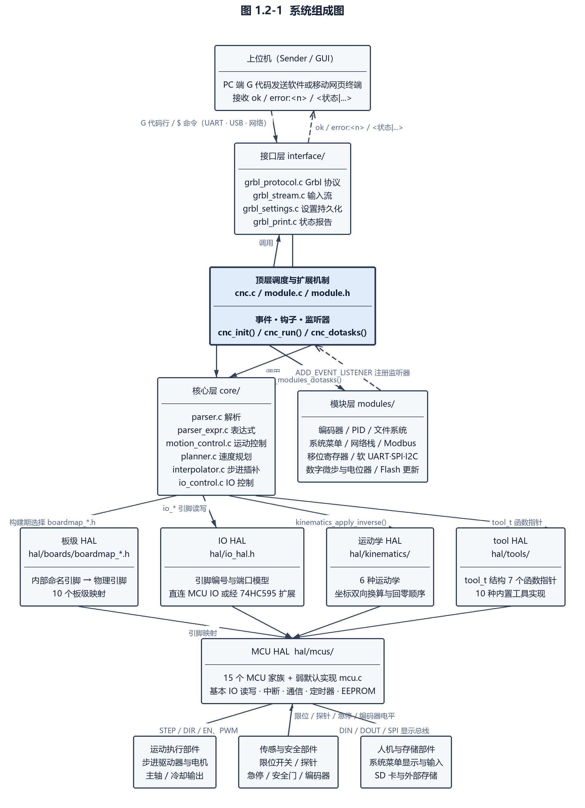

图 1.2-1 系统组成图

## 1.3 文档边界说明

本文档为**竣工需求（as-built）**，即对锚定版本源码已实现行为的规范化描述，判定准则是「换一种实现方式后该陈述是否仍然成立」。

**1）覆盖范围**——本文档对 µCNC 的**运动控制内核算法**给出逐条需求：从 G 代码字节流到步进脉冲的完整链路，以及支撑该链路运行的系统调度与并发原语。§1.1 与 §1.2 描述的是软件整体构成，其中的系统层次与外部设备不逐一展开为需求条款。

本文档覆盖：

- §2 与 §3.1：运行环境与功能分解；
- **§3.2 内核算法主体**：G 代码解析、表达式与参数、G/M 执行与模态管理、运动控制、速度规划与块缓冲、步进插补、归零、探测、高度图、运动学变换、G5/G5.1、G7/G8、G28.1/G30.1、G33、G96/G97；
- **§3.3 系统调度与状态机**；
- **§3.4 内核并发原语与缓冲**。

以下内容**不在本文档的范围内**：主轴、冷却、刀具与换刀，机器 IO、限位与安全、编码器、扩展 IO 与软外设，输入流、Grbl 协议、状态报告、设置与持久化、启动块，系统菜单、文件系统、Modbus、网络服务、Flash 在线更新，扩展机制、编译期配置、HAL 与板级支持，通信输出链路，性能需求与可靠性安全性需求，IO 指令与外部模块命令（M17/M42/M62–M68/M80/M81/M300/TMC），以及状态与错误码、设置项、命令与代码、枚举与常量等数据字典内容。

**2）需求标识**——本文档的需求标识形如 `UC-FREQ3214-3`，由四段组成：`UC-` 前缀、需求类别码（`FREQ`，功能需求）、功能域编码与序号。功能域编码为该需求块所属小节的章节号去点拼接（§3.2.14 → `3214`、§3.3.1 → `331`），序号在同一小节内从 1 连续编排。

**3）不作为需求条款的内容**——以下三类内容不构成本文的需求条款：

- **具体引脚分配**——引脚到物理端口的对应属板级配置，随 `boardmap_*.h` 变化，本文只描述引脚模型的命名空间、编号区间与存在性判定规则，不固定任何板卡的具体分配；
- **第三方库内部行为**——tinyUSB、FatFs、LVGL 等外部组件的内部实现不在本文范围内；
- **已被上游标注为弃用或未完成的能力**——见 2.4.1 的弃用说明与各功能域的「实现说明」段。

此外，本文对上游自述与代码实测不一致之处一律**按代码撰写**，自述原文仅在对应的「自述差异」说明中引用，以便集成方评估其影响。

---

# 2 运行环境规定

## 2.1 运行方案和场景

µCNC 是**裸机（bare-metal）固件**，不依赖 RTOS。其运行方案为：外部工程提供 `main()`，在完成时钟与 IO 初始化后调用 `cnc_init()` 完成一次性初始化，随后进入无限循环反复调用 `cnc_run()`；运动脉冲的产生、输入变化通知与运行时钟由 MCU 的中断服务程序（ISR）驱动（`uCNC/src/hal/mcus/README.md（第 373-379 行）`、`:393-407`）。

主程序与中断的职责划分如下：

- **`cnc_init()` 的功能**：清零系统变量、加载非易失设置、初始化各子系统（解析器、规划器、插补器、IO、工具、运动学、模块），并按 Grbl 兼容等级决定是否输出启动横幅（`uCNC/src/cnc.c:99-135`）。
- **`cnc_run()` 的功能**：执行状态机与实时命令、从输入流取行并送入 G 代码解析器、驱动规划与插补的数据供给、处理后台任务、产生状态报告；空闲时阻塞等待输入流数据（`uCNC/src/cnc.c:172-217`）。
- **步进定时器中断的功能**：以等间隔调用 `mcu_step_cb()` 与 `mcu_step_reset_cb()`，从插补段缓冲取出当前段并按步进算法输出脉冲与方向信号，最高速率由 `$0`（步进脉冲时间）决定（`uCNC/src/hal/mcus/README.md（第 373 行）`）。
- **运行时钟中断的功能**：以 1 ms 或 RTC 节拍生成运行时间，调用 `mcu_rtc_cb(uint32_t millis)`，供超时判定与软件延时使用（`uCNC/src/hal/mcus/README.md（第 375 行）`）。
- **通信接收中断的功能**：每收到一个字节即经 `mcu_com_rx_cb(uint8_t c)` 递交核心层（`uCNC/src/hal/mcus/README.md（第 377 行）`）。
- **可中断输入的功能**：输入电平变化时调用 `mcu_limits_changed_cb()`、`mcu_controls_changed_cb()`、`mcu_probe_changed_cb()`、`mcu_inputs_changed_cb()`（`uCNC/src/hal/mcus/README.md（第 379 行）`；回调声明见 `uCNC/src/hal/mcus/mcu.h:88-95`）。

主程序与中断的关系如图 2.1-1 所示。

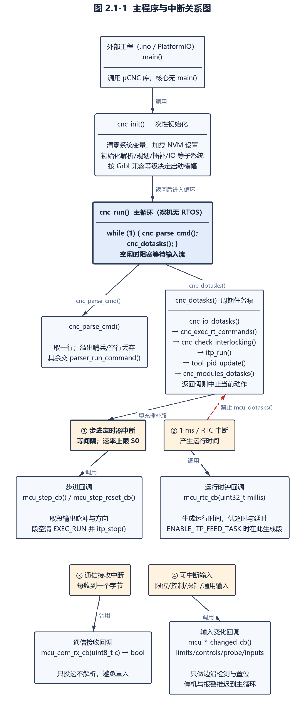

图 2.1-1 主程序与中断关系图

典型运行场景如下：

1）**上电 / 复位**：`cnc_init()` 加载设置并初始化子系统；随后主循环检查故障系统（急停、安全门、限位压合、丢位、探针保护等），任一条件成立即进入报警状态并锁闭运动（`uCNC/src/cnc.c:1102`、`uCNC/src/cnc.c:1153`、`uCNC/src/cnc.c:498`）。

2）**空闲（Idle）**：主循环等待输入流，周期性上报状态（`?` 请求或自动报告），执行实时命令（复位、进给保持、循环启动、点动取消、安全门变化），并运行后台任务。

3）**程序执行（Run）**：解析 G 代码行、生成运动块、规划器做前瞻与速度重算、插补器按段输出步进脉冲；执行期间可被实时命令打断（进给保持、软复位、循环停止）。

4）**归零（Home）**、**探测（Probe）**、**进给保持（Hold）**、**安全门（Door）**、**点动（Jog）**、**报警（Alarm）** 等场景由状态机管理；`uCNC/cnc_config.h:671-677` 另声明了一组扩展状态 `Locked`、`Dwell`、`Probe`（开关 `ENABLE_EXTRA_GRBL_STATES`，在本 tag 中为注释项、不参与编译）。状态报告实际输出的 `Hold:2` 与 `Door:3` 两个细分码未见于 `docs/Grbl-states.md` 的记载（`uCNC/src/interface/grbl_protocol.c:484-486`、`:491-495`）。

5）**配置生成场景**：用户可通过 µCNC 配置构建 Web 工具（uCNC-webconfig，测试模式，支持 1.12 及以上）生成配置覆盖文件，也可手工编辑（`README.md（第 11 行）`；`uCNC/README.md（第 10-13 行）`）。

本软件对宿主环境的硬性要求（来自 MCU HAL 自述）如下表。

| 序号 | 约束 | 证据 |
| --- | --- | --- |
| 1 | 至少提供 2 个硬件定时器（仅 1 个可能可行但有局限） | `uCNC/src/hal/mcus/README.md（第 319-324 行）` |
| 2 | 至少提供 1 个通信硬件端口 | 同上 |
| 3 | 非易失存储、PWM 硬件 IO、可中断输入脚、带 ADC 的输入脚均为**可选** | 同上 |
| 4 | 不得对 CPU 核数作假设，只要内存在核间共享；多核并发保护由实现方保证 | `uCNC/src/hal/mcus/README.md（第 328-329 行）` |
| 5 | 不得对回调运行上下文（ISR / 事件 / RTOS 线程）作假设，只要满足时序要求 | `uCNC/src/hal/mcus/README.md（第 331 行）` |
| 6 | 回调函数**不可重入**，可重入会导致上下文丢失；但回调执行期间可被另一回调抢占 | `uCNC/src/hal/mcus/README.md（第 332 行）` |

表 2.1-1 宿主环境运行约束

各中断源必须由 MCU 实现完成的工作如下表（**中断职责契约**，属对外硬性要求）。

| 序号 | 中断源 | 必须完成的工作 | 证据 |
| --- | --- | --- | --- |
| 1 | 步进定时器中断 | 以等间隔交替调用 `mcu_step_cb()` 与 `mcu_step_reset_cb()`，最高速率由设置项 `$0` 决定 | `uCNC/src/hal/mcus/README.md（第 373 行）` |
| 2 | 1 ms 中断或 RTC | 生成运行时间并调用 `mcu_rtc_cb(uint32_t millis)`；**此上下文禁止调用 `mcu_dotasks()`** | `uCNC/src/hal/mcus/README.md（第 375 行）` |
| 3 | 通信接收中断 | 每个收到的字节经 `mcu_com_rx_cb(uint8_t c)` 递交 | `uCNC/src/hal/mcus/README.md（第 377 行）` |
| 4 | 可中断输入 | 变化时调用 `mcu_limits_changed_cb()`、`mcu_controls_changed_cb()`、`mcu_probe_changed_cb()`、`mcu_inputs_changed_cb()` | `uCNC/src/hal/mcus/README.md（第 379 行）`、`uCNC/src/hal/mcus/mcu.h:88-95` |

表 2.1-2 中断职责契约表

## 2.2 硬件环境

### 2.2.1 控制器（MCU）与板卡

本软件运行于微控制器之上，**不存在宿主计算机**；传统意义上运行上位软件的 PC 是独立于本软件的外部实体（见 2.4.1）。核心代码与具体 MCU 解耦，通过 MCU HAL 适配以下 15 个 MCU 家族（`README.md（第 303-317 行）`、`uCNC/src/hal/mcus/`）。

| MCU / 平台 | 引入版本 | 自述限制 |
| --- | --- | --- |
| AVR（Arduino UNO / MEGA） | 起始平台 | 无 |
| STM32F1（Bluepill 等） | v1.1.x | 无 |
| SAMD21（Arduino Zero / M0） | v1.3.x | 无 |
| STM32F4（Blackpill 等） | v1.4.x | 不仿真 EEPROM |
| ESP8266 | v1.5.x / v1.12.x | 缺模拟输入与输入 ISR；支持 WiFi telnet |
| ESP32 | v1.5.x | 支持 WiFi telnet 与蓝牙 |
| NXP LPC1768/9 | v1.5.x | EEPROM 仿真与模拟输入仍在开发 |
| RP2040 | v1.6.x | 支持 WiFi telnet 与蓝牙 |
| RP2040（多核模式） | v1.9.x | 新增 multicore 模式 |
| STM32F0（Bluepill 等） | v1.9.x | 无 |
| RP2350 | v1.11.x | 初步支持 |
| STM32H7（单核） | v1.12.x | 缺 SPI DMA 与 EEPROM 仿真等特性 |
| ESP32-S3 | v1.13.x | 初步支持，缺 BLE |
| ESP32-C3 | v1.13.x | 初步支持，缺 BLE |
| Windows PC（virtual 目标） | — | 仅用于仿真 / 调试，ISR 行为使其不能作为真实替代品 |

表 2.2-1 MCU 家族适配表

代码中的 MCU 家族标识与目录一一对应：`avr`、`stm32f0x`、`stm32f1x`、`stm32f4x`、`stm32h7x`、`samd21`、`lpc176x`、`esp8266`、`esp32`、`esp32c3`、`esp32s3`、`esp32common`、`rp2040`、`rp2350`、`virtual`（`uCNC/src/hal/mcus/` 子目录）。未定义 `MCU` 宏时编译期直接报错（`uCNC/src/hal/mcus/mcudefs.h:112-114`）。

板级支持以 `boardmap_*.h` 提供引脚映射，自述涵盖 Arduino UNO、Arduino Mega（Ramps 兼容）、RAMBO、Melzi v1.1.4、Arduino Zero / M0、Bluepill、Blackpill、WeMos D1 / D1 R32、Re-Arm、MKS Robin Nano v3.1、Fysetc Cheetah v2、MKS Monster8 V2、mellow Fly D5 等（`README.md（第 298 行）`、`README.md（第 155-157 行）`；`CHANGELOG.md（第 241、454、417、30、61 行）`）。

受 MCU 与板卡能力决定的功能上限（自述值）如下表。

| 资源 | 上限（自述） | 证据 |
| --- | --- | --- |
| 独立轴数 | 6 | `README.md（第 269 行）` |
| 步进 step/dir 驱动 | 8（6 独立 + 2 可镜像用于双驱轴） | `README.md（第 270、289 行）` |
| 限位开关 | 9（6 每个轴 + X/Y/Z 可选第二限位） | `README.md（第 271、290 行）` |
| 探针 / 进给保持 / 循环启动 / 急停 / 安全门 | 各 1，均中断驱动 | `README.md（第 272-276 行）` |
| PWM 输出 / 模拟输入 | 各 16 | `README.md（第 277-278 行）` |
| 通用数字输入 / 输出 | 各 50（前 8 个输入引脚支持变化中断） | `README.md（第 279-280、291 行）` |
| 舵机控制输出 | 6（50 Hz PPM） | `README.md（第 281 行）` |

表 2.2-2 功能上限表

> **自述差异（上游矛盾）**：`uCNC/src/hal/mcus/README.md（第 42、44、46 行）` 对 STEP 写「最多 8 路」而对 DIR / ENABLE 写「最多 6 路」；同文件（第 50 行）写舵机 `SERVO0`–`SERVO7`（8 路），与 `README.md（第 281 行）` 的 6 路不一致，且同文件的引脚表只定义到 `SERVO5`。集成方应以 `uCNC/src/hal/mcus/mcu.h` 与 `uCNC/src/hal/io_hal.h` 的宏定义为准。

引脚内部编号区间（需求规格）为：1–96（STEP / DIR / EN / PWM / SERVO / DOUT）、100–113（限位与专用输入）、114–129（ANALOG）、130–179（DIN）、200–215（通信类 UART / USB / SPI / I2C / SPI2）（`uCNC/src/hal/mcus/README.md（第 88-281 行）`）。引脚存在性的判定规则为：为 MCU IO 时 `STEP0` 与 `DIO1` 均求值为 1；为扩展 IO 时 `STEP0` 为 1 而 `DIO1` 为 −1；未定义时均为 0（`uCNC/src/hal/mcus/README.md（第 291-300 行）`）。

### 2.2.2 中断设置

本软件处理四类中断，其职责见 2.1 的「中断职责契约表」与「主程序与中断的职责划分」。本节给出核心侧的中断接口与上下文机制。

ISR 回调在核心侧的声明集中在 `uCNC/src/hal/mcus/mcu.h:88-95`，其中 `mcu_com_rx_cb` 的返回类型为 `bool`（供流控判断），其余为 `void`。

核心代码以 **ISR 上下文感知机制**区分中断上下文与主循环上下文：用 `mcu_isr_context_enter()` 宏在函数入口登记 ISR 上下文（内部以原子计数器 `mcu_in_isr_context_counter` 实现，退出时经 `__attribute__((__cleanup__))` 自动递减），并用 `mcu_in_isr_context()` 查询当前是否处于 ISR 上下文，供 IO 等层采取不同策略（`uCNC/src/hal/mcus/mcu.h:667-692`）。该宏的典型使用点为 `uCNC/src/core/io_control.c:140`、`:211`、`:277`、`:311`，`uCNC/src/core/interpolator.c:1081` 与 `uCNC/src/cnc.c:434`。

该计数器为 `volatile buffer_index_t mcu_in_isr_context_counter`（`uCNC/src/hal/mcus/mcu.h:673`），采用原子载入与加减（`ATOMIC_LOAD_N`、`ATOMIC_FETCH_ADD` / `ATOMIC_FETCH_SUB`，`uCNC/src/hal/mcus/mcu.h:674-688`），因此在多核 MCU 上同样成立。

### 2.2.3 存储器

本软件既使用 MCU 内部程序存储器（存放固件代码与常量表），也使用**非易失参数存储区**存放设置。设置存储的设计要点如下：

1）**容量**——非易失存储区大小由 `NVM_STORAGE_SIZE` 定义，默认 **0x400（1024 字节）**（`uCNC/src/hal/mcus/mcudefs.h:116-118`）。各 MCU 实现可在其上调整（如 SAMD21 注释为「1Kb 仿真 EEPROM 足够」，`uCNC/src/hal/mcus/samd21/mcu_samd21.c:33`；RP2040 / RP2350 注释为「2K 仿真 EEPROM」，`uCNC/src/hal/mcus/rp2040/mcu_rp2040.c:356`、`uCNC/src/hal/mcus/rp2350/mcu_rp2350.c:329`）。

2）**访问抽象**——核心层经 `nvm_start_read()`、`nvm_getc()`、`nvm_putc()`、`nvm_end_read()`、`nvm_end_write()` 五个弱符号函数访问，默认实现转发到 MCU 的 `mcu_eeprom_getc()`、`mcu_eeprom_putc()`、`mcu_eeprom_flush()`（`uCNC/src/interface/grbl_settings.c:283-288`）；MCU HAL 侧的接口声明为 `mcu_eeprom_getc(uint16_t address)`、`mcu_eeprom_putc(uint16_t address, uint8_t value)`、`mcu_eeprom_flush(void)`（`uCNC/src/hal/mcus/mcu.h:456`、`:461`、`:466`），弱默认实现在 `uCNC/src/hal/mcus/mcu.c:954`、`:962`、`:969`。该抽象允许外置 NVM（如 I2C EEPROM、SD 卡）替换内部存储。

3）**格式与完整性**——设置区以带版本号的记录形式存储，版本常量为 `SETTINGS_VERSION {'V','0','7'}`（`uCNC/src/interface/grbl_settings.c:32-34`），加载时先比对版本；记录以 CRC 校验（7 位 CRC 查表 `crc7_table`，`uCNC/src/interface/grbl_settings.c:40`；计算函数 `settings_size_crc`，`:277`）。加载、保存、擦除三条路径均在访问前以 `address >= NVM_STORAGE_SIZE` 做边界检查（`:330`、`:413`、`:573`）。版本号与结构体变化时必须同步递增 `SETTINGS_VERSION`（源码注释 `// if settings struct is changed this version should change too`，`:31`）。

4）**越界与损坏的处置**——版本不匹配或 CRC 校验失败时设置视为无效，此时按「安全设置」策略处理（首次烧录或设置结构变更后强制进入报警状态，直到执行 `$RST=*`，`README.md（第 40 行）`）；**但该默认行为被部分板级映射覆盖**（AVR UNO 板级映射在未显式定义时强制 `DISABLE_SAFE_SETTINGS`，`uCNC/src/hal/boards/avr/boardmap_uno.h:186-188`），集成方须区分全局默认与板级覆盖。

5）**文件系统存储**——另有用于 SD 卡与内部 Flash 的文件系统模块（`uCNC/src/modules/file_system.c`、`uCNC/src/modules/file_system.h`），以及 Flash 在线更新模块（`uCNC/src/modules/flash_update.c`、`uCNC/src/modules/flash_update.h`），二者与设置存储相互独立（`uCNC/src/modules/README.md（第 37-40 行）`）。

6）**空间需求基线**——固件必须适配 AVR（Arduino UNO，2 KB SRAM / 32 KB Flash 级别）这一起始平台，因此所有缓冲结构（输入流缓冲、运动块队列、段缓冲）均以静态数组在编译期确定容量（`README.md（第 294、298 行）`）。

## 2.3 支持软件环境

### 2.3.1 编程语言

核心代码使用 **C 语言（GNU99 兼容）**（`README.md（第 48 行）`）。为兼容 C++ 编译器（Arduino / PlatformIO 工具链），公共头文件采用 `extern "C"` 包裹（例：`uCNC/src/cnc.h:19-21`、`uCNC/src/hal/mcus/mcudefs.h:122-124`）。个别 MCU 实现使用 C++（如 ESP32 的 EEPROM 仿真 `uCNC/src/hal/mcus/esp32common/esp32_eeprom.cpp`）。

代码使用少量 GNU 扩展与编译器特性，如下表。

| 特性 | 用途 | 证据 |
| --- | --- | --- |
| `FORCEINLINE` | 强制内联的原子与上下文辅助函数 | `uCNC/src/hal/mcus/mcu.h:675`、`:682` |
| `__attribute__((weak))` | HAL 默认实现可被 MCU 实现覆盖 | `uCNC/src/interface/grbl_settings.c:283-288`、`uCNC/src/hal/mcus/mcu.c:954` |
| `__attribute__((__cleanup__))` | ISR 上下文计数器自动递减 | `uCNC/src/hal/mcus/mcu.h:688` |
| `__attribute__((packed))` 与位域 | 设置结构与模态组紧凑存储 | `uCNC/src/interface/grbl_settings.h`、`uCNC/src/core/parser.h:249-260` |
| `__rom__` | 常量表置于只读存储 | `uCNC/src/interface/grbl_settings.c:40` |
| C11 风格原子原语 | 多核与 ISR 并发保护（自 1.14） | `uCNC/src/atomic.h`；`CHANGELOG.md（第 152 行）` |
| 子集 `printf` 格式化 | 不依赖标准库的格式化输出（自 1.11） | `CHANGELOG.md` 1.11 节 |

表 2.3-1 语言与编译器特性表

### 2.3.2 编译调试工具

本软件提供三条构建途径：

1）**PlatformIO（主途径）**——仓库根 `platformio.ini` 定义工程，`source_dir` 与 `include_dir` 均指向 `uCNC/`，`framework = arduino`，监控串口速率 115200、行结束符 LF（`platformio.ini（第 11-31 行）`）。默认编译环境 16 个：`AVR-UNO`、`AVR-MEGA2560-RAMPS-V1_4`、`AVR-RAMBO`、`SAMD21-Wemos-M0`、`STM32F0-Bluepill-F030C8`、`STM32F1-Bluepill-F103C8`、`STM32F4-Blackpill-F401CC`、`STM32H7-Generic-STM32H750`、`ESP8266-Wemos-D1-R2`、`LPC176X-RE-ARM`、`ESP32-Wemos-D1-R32`、`RP2040-PICO-W`、`RP2040-PICO-W-MULTICORE`、`RP2350-PICO2`、`ESP32-S3`、`ESP32-C3`（`platformio.ini（第 14 行）`）；各架构的板级环境在 `uCNC/src/hal/boards/<arch>/<arch>.ini` 中分层定义（`platformio.ini（第 15-24 行）`）。

2）**Arduino IDE**——自 v1.3.0 起工程结构重整，可直接打开 `uCNC/uCNC.ino` 配置、编译与烧录（`README.md（第 348 行）`）。

3）**Makefile**——`makefiles/` 目录按 MCU 提供构建脚本，含 `makefiles/virtual/` 用于 PC 仿真目标。

构建期脚本：`ucnc_modules.py` 作为 PlatformIO 前置脚本（`extra_scripts`，`platformio.ini（第 32-33 行）`）处理模块仓库拉取（`custom_ucnc_modules_url`、`custom_ucnc_modules`，`platformio.ini（第 35-36 行）`）；`avr_compiler.py` 处理 AVR 目标编译细节。依赖锁定见 `dependencies.lock`，第三方库包含 tinyUSB（USB 协议栈）、FatFs（SD 卡）、LVGL（图形，见外部模块）等。

**配置工具**：µCNC 配置构建 Web 工具（uCNC-webconfig，测试模式，支持 1.12 及以上）可生成配置覆盖文件（`README.md（第 11 行）`、`:62`）；另有旧版配置构建工具（`README.md（第 63-65 行）`）。配置分两层：`cnc_config.h`（适配板卡与自定义基础配置）与 `cnc_hal_config.h`（机器 HAL 高级配置：Tools、encoders、PID controllers、双驱轴等）（`uCNC/README.md（第 10-13 行）`）。

**调试与验证**：提供 `virtual` MCU 目标用于在 Windows PC 上独立测试核心代码（`README.md（第 300 行）`、`:317`）；提供 Grbl 协议一致性单元测试套件（unity），在提交与 PR 合并时执行校验（`CHANGELOG.md（第 14 行）`）；`test/` 与 `tests/` 目录用于测试。

## 2.4 接口

### 2.4.1 与其他软件的接口

本软件对外提供四类软件接口。

1）**上位机通信接口（用户需求）**——与 Grbl 兼容的字符协议。上位机经 UART / USB / 网络发送 G 代码行或以 `$` 起始的系统命令，控制器以 `ok` / `error:<n>` 应答，并以 `<状态|...>` 形式上报状态；实时命令为单字符（`?`、`!`、`~`、`0x18` 等）。协议严格度由**Grbl 兼容等级**（0 / 1 / 2 / 3，默认 2）决定，等级影响启动行为、命令容忍度与急停输入语义（`uCNC/cnc_config.h:658-669`，语义表只存在于该处代码注释，故本等级标「（需求规格）」）。协议兼容性为项目自述目标之一（`README.md（第 56 行）`）。

2）**HAL 接口（对外扩展契约）**——任何希望在新型 MCU、板卡、运动学或工具上使用本软件者，必须实现相应 HAL：

- **MCU HAL**——基本 IO（`mcu_config_input` 等，`uCNC/src/hal/mcus/mcu.h:99-107` 起）、通信、定时器、EEPROM（`uCNC/src/hal/mcus/mcu.h:456-466`）与 2.1 表 2.1-2 所列回调（`uCNC/src/hal/mcus/mcu.h:88-95`）；核心侧提供弱默认实现（`uCNC/src/hal/mcus/mcu.c`），未覆盖的能力在编译期由 `#error` 或功能开关拒绝；
- **板级配置**——提供 `boardmap_*.h`，把内部命名引脚映射到物理引脚（`uCNC/src/hal/mcus/README.md（第 27 行）`）；
- **运动学 HAL**——必须实现 `kinematics_init`、`kinematics_apply_inverse`、`kinematics_apply_forward`、`kinematics_home`、`kinematics_check_boundaries`；`kinematics_apply_transform` 与 `kinematics_apply_reverse_transform` 可选（`uCNC/src/hal/kinematics/README.md（第 94-148 行）`）；
- **tool HAL**——以 `tool_t` 结构（7 个函数指针：`startup_code`、`shutdown_code`、`pid_update`、`range_speed`、`get_speed`、`set_speed`、`set_coolant`）描述一个工具，在 `cnc_hal_config.h` 中以 `#define TOOL<x> <工具>` 绑定，未使用的函数指针必须初始化为 NULL（`uCNC/src/hal/tools/README.md（第 23-39 行）`、`:132-134`）。

3）**模块与事件接口**——`uCNC/src/module.c`、`uCNC/src/module.h` 定义事件、钩子与监听器机制，外部模块通过注册监听器在核心的固定触发点插入代码；模块可在 `cnc_config.h` 中逐个启用或禁用（`README.md（第 55 行）`）。外部模块取自 `uCNC-modules` 仓库（`README.md（第 60 行）`）。

4）**文件与网络接口**——文件系统模块提供文件列表、运行、上传与 JSON API，供 Web 前端与本地菜单使用（`uCNC/src/modules/file_system.c`、`uCNC/src/modules/file_system.h`）；网络栈提供 TCP socket、telnet、HTTP、websocket 服务（`uCNC/src/modules/net/`）。**弃用说明**：`endpoint.h` 与旧 `websocket.h` 在 `uCNC/src/modules/README.md（第 33 行）` 中标注为已弃用，而 `README.md（第 141-142 行）` 仍将其列为特性，集成方应按弃用处理（其中 `endpoint.h` 在锚定版本中已不存在）。

接口关系如图 2.4-1 所示。

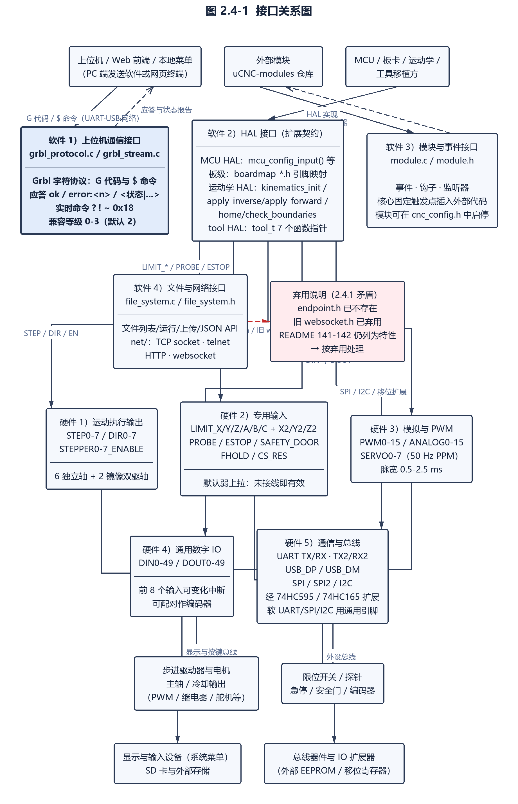

图 2.4-1 接口关系图

### 2.4.2 硬件接口

硬件接口由 MCU HAL 的引脚模型定义，分五类。

1）**运动执行输出**——`STEP0`–`STEP7`、`DIR0`–`DIR7`、`STEPPER0_ENABLE`–`STEPPER7_ENABLE`；支持最多 6 独立轴与 2 路镜像输出用于双驱轴自方正（`uCNC/src/hal/mcus/README.md（第 42-46 行）`；`README.md（第 270 行）`、`:289`）。

2）**专用输入**——限位 `LIMIT_X/Y/Z/A/B/C` 与第二限位 `LIMIT_X2/Y2/Z2`（共 9）、探针 `PROBE`、控制类 `ESTOP`、`SAFETY_DOOR`、`FHOLD`、`CS_RES`；均可配置为中断驱动（`uCNC/src/hal/mcus/README.md（第 54-56 行）`；`README.md（第 271-276 行）`）。**默认电平语义**为：控制输入、限位与探针由 MCU 内部弱上拉保持高电平，未接线时即为有效状态；急停有效时板卡保持 Alarm 模式，仅允许 `?` 查询状态（`README.md（第 36 行）`）。

3）**模拟与 PWM**——`PWM0`–`PWM15`、`ANALOG0`–`ANALOG15`、`SERVO0`–`SERVO7`（50 Hz PPM，脉宽 0.5–2.5 ms）（`uCNC/src/hal/mcus/README.md（第 48-50 行）`；`uCNC/src/hal/tools/tools/README.md（第 152-168 行）`）。

4）**通用数字 IO**——`DIN0`–`DIN49`（前 8 个可启用变化中断，并可配对作为编码器输入）、`DOUT0`–`DOUT49`（`uCNC/src/hal/mcus/README.md（第 78-84 行）`）。

5）**通信与总线**——UART `TX` / `RX` 与 `TX2` / `RX2`、USB `USB_DP` / `USB_DM`、SPI `SPI_CLK/SDI/SDO/CS`、I2C `I2C_CLK` / `I2C_DATA`、SPI2 组（`uCNC/src/hal/mcus/README.md（第 59-74 行）`）。此外可经 74HC595 / 74HC165 移位寄存器扩展 IO，或经软件模拟 UART / SPI / I2C 使用通用引脚（`uCNC/src/modules/shift_register.c`、`uCNC/src/modules/softuart.c`、`uCNC/src/modules/softspi.c`、`uCNC/src/modules/softi2c.c`）。

---

# 3 软件详细需求

## 3.1 功能分解（需求规格）

对软件功能进行分解，软件数据流图如下图 3.1-1、图 3.1-2 所示。

µCNC 的功能可分解为输入侧、解释侧、运动侧、执行侧、状态侧、扩展侧六个功能族：

- **输入侧**：把 UART / USB / 网络 / EEPROM 等互不相同的字节来源统一为「当前输入流」，完成字符归一化、行装配、溢出处置与命令回显（`uCNC/src/interface/grbl_stream.c:244-297`）；非易失存储中的启动块在初始化阶段直接送入解析器（`uCNC/src/cnc.c:1302`）；
- **解释侧**：G 代码词法分析与语义校验、模态组状态维护与复位、表达式与参数求值、O 代码子程序与流程控制（`uCNC/src/core/parser.c:1015-1355`、`uCNC/src/core/parser_expr.c`）；
- **运动侧**：运动条件生成与坐标—步数变换、规划块入队、前瞻速度重算、拐角速度与加速度约束、步进插补与脉冲输出（`uCNC/src/core/motion_control.c`、`uCNC/src/core/planner.c`、`uCNC/src/core/interpolator.c`）；
- **执行侧**：主轴、冷却、刀具、通用输出端口、运动学变换等机床动作输出，以及限位、探针、急停、安全门等信号输入（`uCNC/src/core/io_control.c`、`uCNC/src/hal/tools/tool.c`、`uCNC/src/hal/kinematics/`）；
- **状态侧**：系统状态机与报警管理、复位与进给保持、状态报告、倍率调整、设置读写与非易失存储（`uCNC/src/cnc.c:172-217`、`uCNC/src/interface/grbl_settings.c`）；
- **扩展侧**：事件分发、钩子与监听器、内置模块装载、外部 G/M 代码模块与单轴驱动模块（`uCNC/src/module.c:53-80`、`uCNC/src/module.h:58-65`；`uCNC-modules/`）。

各功能族的职责与主要实现文件如下表。

| 功能族 | 职责 | 主要实现 |
| --- | --- | --- |
| 输入侧 | 流选择、字节归一化、溢出处置、行装配、实时命令旁路 | `uCNC/src/interface/grbl_stream.c`、`uCNC/src/interface/grbl_protocol.c` |
| 解释侧 | 取词、校验、模态管理、表达式与参数、子程序 | `uCNC/src/core/parser.c`、`uCNC/src/core/parser_expr.c` |
| 运动侧 | 运动块生成、进给率与加速度、坐标变换、规划、插补 | `uCNC/src/core/motion_control.c`、`uCNC/src/core/planner.c`、`uCNC/src/core/interpolator.c` |
| 执行侧 | 步进/方向/使能输出、PWM 与模拟量、工具与运动学 | `uCNC/src/core/io_control.c`、`uCNC/src/hal/tools/tool.c`、`uCNC/src/hal/kinematics/kinematic.c` |
| 状态侧 | 状态机、报警、复位、状态报告、倍率、设置持久化 | `uCNC/src/cnc.c`、`uCNC/src/interface/grbl_print.c`、`uCNC/src/interface/grbl_settings.c` |
| 扩展侧 | 事件、监听器、钩子、模块装载 | `uCNC/src/module.c`、`uCNC/src/module.h` |

表 3.1-1 功能族与实现映射表

顶层数据流的路径为：上位机字节流 → 当前输入流 → 解析器取词与校验 → 运动条件生成 → 规划器入队与前瞻 → 插补段准备 → 步进中断输出脉冲；反向的信息流为：状态报告、错误码、反馈消息与回显经文本输出链路送回上位机。运动条件由工具、运动学与 IO 三层共同消费，机床侧的电平变化则经中断回调反向触发状态机与报警判定（`uCNC/src/hal/mcus/mcu.h:88-95`、`uCNC/src/cnc.c:1102`）。

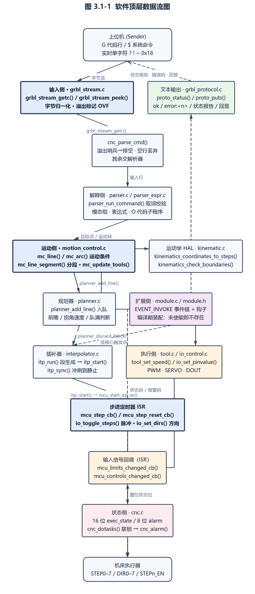

图 3.1-1 软件顶层数据流图

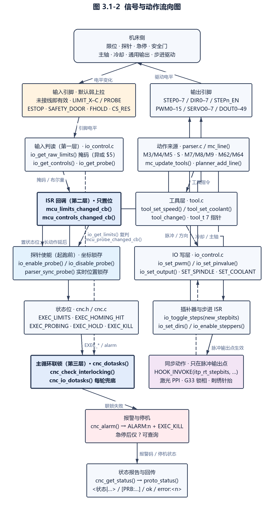

图 3.1-2 信号与动作流向图

上述六个功能族在 µCNC 中是**编译期装配**而非运行期按需装载：功能的存在性由 `uCNC/cnc_config.h` 与 `uCNC/src/cnc_hal_config_helper.h` 中的配置宏在编译期决定，未使能的模块不进入构建，其对应功能在运行期完全不存在（`uCNC/src/cnc_hal_config_helper.h:2135-2209`、`uCNC/src/module.c:53-80`）。

## 3.2 加工指令与运动

本节描述从 G 代码字节流到步进脉冲的完整链路。3.2.1 与 3.2.2 为解释侧：前者覆盖取词、预处理、注释、行号、命令校验与命令块的数据结构，后者覆盖表达式求值与参数体系（编号参数、命名参数、O 代码子程序）。3.2.3 描述 G/M 代码的执行与模态管理，含执行顺序、各模态组语义、M 码行为、程序结束与复位范围、不支持代码的处置。3.2.4 描述运动控制，含运动块的生成与坐标变换、进给率与加速度来源、坐标偏移叠加、同步类运动、归零/探测/点动等特殊入口、软限位检查与入队阻塞。3.2.5 描述速度规划与块缓冲，含环形块缓冲、前瞻重算、拐角速度、加速度约束、倍率施加与出队交接。

外部 G 代码功能模块（`uCNC-modules/g5/`、`uCNC-modules/g7_g8/`、`uCNC-modules/g28_1_g30_1/`、`uCNC-modules/g33/`、`uCNC-modules/g96_g97/`）是本节所述指令集的扩展部分，均在核心之外单独交付、以事件监听器形式挂入核心。

**装配方式为编译期装配，而非运行期装载**：内核自动装载清单只含 `digimstep`、`digipot`、`encoder`、`laser_ppi`、`plasma_thc`、`file_system`、`flash_update` 七个模块（`uCNC/src/module.c:53-80`），外部模块均不在其列，必须由使用者在 `load_modules()` 中显式书写 `LOAD_MODULE(<模块名>)`；模块的初始化函数由 `DECL_MODULE` 生成，事件监听器只在其中登记（`uCNC/src/module.h:51`、`uCNC/src/module.h:70-88`）。漏写 `LOAD_MODULE` 时模块代码仍被编译进目标文件，但监听器不入链、编译期无任何提示，功能静默不生效。

**码号口径**：`EXTENDED_GCODE(X)` 展开为 `(int16_t)(X * 10)`（正值），走内核「独立扩展命令」分支（`uCNC/src/core/parser.h:111-114`、`uCNC/src/core/parser.c:1415-1436`）；`EXTENDED_MOTION_GCODE(X)` 展开为 `-X`（负值），与内核 `G0`–`G3` 同处运动组 `switch` 的 `default` 分支，经 `gcode_exec` 事件交回模块（`uCNC/src/core/parser.h:115`、`uCNC/src/core/parser.c:2050-2056`）。

**解析扩展的触发口径**：内核仅在取词错误码为 `STATUS_GCODE_UNSUPPORTED_COMMAND`（20）或 `STATUS_GCODE_UNUSED_WORDS`（36）时触发 `gcode_parse` 事件（`uCNC/src/core/parser.c:973-978`、`uCNC/src/interface/grbl_interface.h:70`、`uCNC/src/interface/grbl_interface.h:86`）。此外，内核 `parser_gcode_word` 对一切带尾数的 G 码设有白名单闸门：仅放行 38、39（受条件编译保护）、43、59、61、90、92，其余码直接返回 `STATUS_GCODE_COMMAND_VALUE_NOT_INTEGER`（23）（`uCNC/src/core/parser.c:2434-2453`、`uCNC/src/interface/grbl_interface.h:73`）。该闸门与上述事件触发条件是 G28.1/G30.1 与 G5.1 在本版本不可达的直接原因。

**事件链裁决口径**：`DEFAULT_EVENT_HANDLER` 顺序遍历监听器链表，某监听器返回 `EVENT_HANDLED`（真）即终止传播并把静态游标重置到链表头，返回 `EVENT_CONTINUE`（假）则继续下一个（`uCNC/src/module.h:106-131`）。因此同码号并存时的胜负取决于监听器入链顺序（先注册者先裁决），而不是后注册者覆盖先注册者。

**可达性总账（本节 5 个模块）**：`g33` 可达；`g96_g97` 可达但 G97 功能缩水；`g5` 半可达（无尾数 G5 可达、G5.1 不可达）；`g7_g8` 与 `g28_1_g30_1` 在本版本**源码存在但完全不可达**，成因分别见 3.2.12 与 3.2.13。

### 3.2.1 G 代码解析（用户需求、需求规格）

解析器把输入流中的一个命令行转换为「显式命令描述 + 字值集合 + 新解析状态」的三元组，并按 RS274NGC v3 的三段结构工作：取词（转换为带参数的结构）、校验（按标准第 3.5–3.7 节）、执行（按标准第 3.8 节顺序），三段分别由 `parser_fetch_command()`、`parser_validate_command()` 与执行分派承担（`uCNC/src/core/parser.h:5-8`、`uCNC/src/core/parser.c:1015-1355`）。

#### 3.2.1.1 输入流读取与字符归一化

- 需求标识：UC-FREQ321-1
- 功能描述：解析器不直接访问串口，而是从「当前输入流」逐字符读取命令行，并在读取时对行结束符与制表符做归一化，使上层词法分析只需处理单一的行结束标记 `EOL`（需求规格）
- 调用条件：解析器每次需要下一个字符时调用（`parser_get_next_preprocessed()` 与 `parser_get_token()` 均经此路径）
- 输入：输入流中的一个原始字节
- 输出：归一化后的字符；`\n`、`\r`、`0x00` 一律返回 `EOL`，`\t` 返回空格
- 处理：
- （1）`grbl_stream_peek()` 取得原始字节后做归一化：`\n`、`\r`、`0` 映射为 `EOL`，`\t` 映射为空格，其余字符原样返回（`uCNC/src/interface/grbl_stream.c:254-282`、`uCNC/src/interface/grbl_stream.c:284-297`）；
- （2）当前无缓存字符时，`_grbl_stream_peek()` 在无可用数据的情况下循环等待并调用 `cnc_dotasks()`，保证等待期间后台任务仍被执行（`uCNC/src/interface/grbl_stream.c:262-265`）；
- （3）当前流未注册取字符回调（`stream_getc` 为空）时返回溢出标记 `OVF`，使上层产生可判定的溢出错误而不是静默停滞（`uCNC/src/interface/grbl_stream.c:267-273`）；
- （4）读取到空字符时按 `\n` 处理，避免从 EEPROM 等非串口流中读出字符串终止符而被误判为有效字（`uCNC/src/interface/grbl_stream.c:289-292`）；
- （5）`grbl_stream_getc()` 取出字符后清空 peek 缓存，并在启用 `ENABLE_MULTISTREAM_GUARD` 时把「非 `EOL`」标记为流忙（`uCNC/src/interface/grbl_stream.c:244-252`）。

`EOL`、`OVF` 与文件结束标记 `FILE_EOF` 共同构成解析器的三个特殊输入符号，其判定分散在取词、预处理与注释三条路径上（`uCNC/src/core/parser.c:2384-2387`、`uCNC/src/core/parser.c:948-954`、`uCNC/src/core/parser.c:939-945`）。

#### 3.2.1.2 溢出处置

- 需求标识：UC-FREQ321-2
- 功能描述：接收缓冲溢出时，输入流以一个专用标记 `OVF` 通知解析器；解析器识别该标记、终止当前命令的处理，并按未处理完的行数逐行报出溢出错误，随后清空残留数据以恢复同步（需求规格）
- 调用条件：接收侧检测到缓冲区满并调用 `grbl_stream_overflow()` 置位标记；解析器在读取到 `OVF` 时作出反应
- 输入：溢出的字节（用于计数行结束符）
- 输出：`STATUS_OVERFLOW`（值 11）错误，每个未处理完的行一次
- 处理：
- （1）溢出时 `grbl_stream_overflow()` 把 peek 缓存置为 `OVF`；若溢出点恰在行结束符处，则递增 `grbl_stream_overflow_count` 计数，供稍后逐行报错（`uCNC/src/interface/grbl_stream.c:299-311`）；
- （2）解析器在 `parser_get_token()` 中读到 `OVF` 时返回 `STATUS_OVERFLOW`，`parser_fetch_command()` 随即把该错误向上传递并终止本命令的取词循环（`uCNC/src/core/parser.c:2386-2387`）；
- （3）注释处理函数 `parser_get_comment()` 遇到 `OVF` 时直接返回且不设置注释结束标志，避免在数据不完整时继续消费字符（`uCNC/src/core/parser.c:2239-2241`）；
- （4）恢复同步由 `grbl_stream_overflow_flush()` 完成：排空当前流中剩余字节，对每个行结束符报一次 `STATUS_OVERFLOW`，调用流的清理回调，再按溢出计数逐个补报错误，最后清空 peek 缓存（`uCNC/src/interface/grbl_stream.c:313-342`）。

#### 3.2.1.3 注释处理

- 需求标识：UC-FREQ321-3
- 功能描述：解析器支持 RS274NGC 的圆括号注释与 Grbl 风格的分号行注释；注释内容不参与语法解析，但其中符合 `(MSG,...)` 形式的文本可作为反馈消息发往上位机，并允许内插参数值（用户需求）
- 调用条件：预处理阶段遇到 `(` 或 `;` 时以该字符为参数调用 `parser_get_comment(start_char)`
- 输入：起始字符（`(` 或 `;`）与注释体内容
- 输出：被消费的注释字符；启用 `PROCESS_COMMENTS` 且注释为消息形式时输出一条反馈消息
- 处理：
- （1）预处理 `parser_get_next_preprocessed()` 跳过空格、`(` 与 `;`：遇空格直接丢弃，遇 `(` 或 `;` 则进入注释处理（`uCNC/src/core/parser.c:2319-2331`）；
- （2）注释的两条终止条件是：起始字符为 `(` 时遇 `)` 结束，任意起始字符遇 `EOL` 均结束，即以 `(` 开始而未闭合的注释在行尾自动结束且不产生错误（`uCNC/src/core/parser.c:2218-2313`、`uCNC/src/core/parser.c:2236-2238`）；
- （3）括号注释不支持嵌套：源码中注释体内再遇 `(` 的分支被显式注释掉并标注「error under RS274NGC (commented for Grbl compatibility)」，即注释体内再出现 `(` 既不报错也不开启新层级（`uCNC/src/core/parser.c:2229`）；
- （4）注释过程中遇 `OVF` 时不结束注释而是直接返回，由上层统一报溢出错误（`uCNC/src/core/parser.c:2239-2241`）；
- （5）消息解析（`PROCESS_COMMENTS`）在注释体内以 `M`→`S`→`G`→`,` 的状态机识别 `MSG,` 前缀，识别成功后输出 `MSG_FEEDBACK_START`（`[MSG:`），随后原样转出后续字符，注释结束时输出 `MSG_FEEDBACK_END`（`]`）；全局标志 `g_mute_comment_output` 为真时抑制全部消息输出（`uCNC/src/core/parser.c:2244-2291`、`uCNC/src/core/parser.c:2258`）；
- （6）消息体内支持参数内插：消息状态下遇 `#` 时调用 `parser_get_float()` 取得参数号并打印其数值（仅在启用 `ENABLE_RS274NGC_EXPRESSIONS` 时存在），随后在注释已到 `)` 或行尾时结束消息（`uCNC/src/core/parser.c:2260-2291`）。

#### 3.2.1.4 预处理与字符过滤

- 需求标识：UC-FREQ321-4
- 功能描述：词法分析前对输入字符流做统一预处理——丢弃空白与注释、统一大小写、区分行结束与文件结束，并在启用回显时把命令回送上位机（需求规格）
- 调用条件：每次需要下一个有效字符时调用 `parser_get_next_preprocessed(peek)`
- 输入：原始字符流
- 输出：过滤后的单个字符；`peek` 参数为真时只查看不消费
- 处理：
- （1）循环跳过空格、`(` 与 `;`：空格直接丢弃，括号与分号进入注释处理，直至遇到非上述字符（`uCNC/src/core/parser.c:2319-2355`）；
- （2）`peek` 为真时不消费字符，供需要多字符判别（如表达式回溯）的调用者使用（`uCNC/src/core/parser.c:2319-2355`）；
- （3）非 `peek` 时消费该字符；若启用 `ECHO_CMD`，在命令行首输出 `MSG_ECHO`（`[echo:`）前缀并回送字符，遇 `FILE_EOF` 及以下标记时结束回显（`uCNC/src/core/parser.c:2336-2351`、`uCNC/src/interface/grbl_interface.h:190`）；
- （4）字符大小写在词法层统一：`parser_get_token()` 首步即执行 `TOUPPER(c)`，因此 G/M 码与地址字母不区分大小写（`uCNC/src/core/parser.c:2379`）；
- （5）空白符已在输入层归一为空格或 `EOL`，故预处理只需处理空格一种空白（`uCNC/src/interface/grbl_stream.c:284-297`）。

> **实现说明**：字符过滤在 µCNC 中不存在独立的过滤表，而由三层分担——输入流的行结束与制表符归一化、预处理的空白与注释跳过、词法层的大小写转换。三层的终止符号集合并不相同：输入层产生 `EOL`/`OVF`/`FILE_EOF`，预处理层只识别空格、`(` 与 `;`。

#### 3.2.1.5 行号处理与行计数

- 需求标识：UC-FREQ321-5
- 功能描述：解析器可选地处理 G 代码行号 `N`——既可直接读取程序中的 `N` 字（带范围校验），也可在未使用 `N` 字时按文本行自动计数，二者互斥；`N` 字必须是命令行中的第一个字（用户需求）
- 调用条件：每行取词时遇 `N` 字进入字母字处理分支；行结束时按配置写入行号
- 输入：`N` 字后的数值，或（自动计数模式下）行结束标记
- 输出：写入 `parser_words_t.n` 的 32 位行号；非法时返回错误码
- 处理：
- （1）`N` 字仅当位于命令行首（`wordcount == 0`）时有效，否则返回 `STATUS_GCODE_INVALID_LINE_NUMBER`（值 27），因为同一行出现第二个 `N` 不合法（`uCNC/src/core/parser.c:962-966`）；
- （2）启用 `GCODE_PROCESS_LINE_NUMBERS` 且未启用 `GCODE_COUNT_TEXT_LINES` 时，`N` 字数值写入 `words->n`；数值超过 `MAX_LINE_NUMBER`（默认 10000000）时同样返回 `STATUS_GCODE_INVALID_LINE_NUMBER`（`uCNC/src/core/parser.c:2738-2749`、`uCNC/src/core/parser.h:126-128`）；
- （3）启用 `GCODE_COUNT_TEXT_LINES` 时忽略程序中的 `N` 字，改为在每行结束（`EOL`）时自增静态计数器 `linecounter` 并写入 `words->n`（`uCNC/src/core/parser.c:949-953`、`uCNC/src/core/parser.c:858-860`）；
- （4）未启用 `GCODE_PROCESS_LINE_NUMBERS` 时 `n` 字段不存在，行号能力在编译期整体移除（`uCNC/src/core/parser.h:288-290`）。

#### 3.2.1.6 命令校验与错误产生

- 需求标识：UC-FREQ321-6
- 功能描述：取词完成后，解析器按 RS274NGC v3 的 3.5–3.7 节对命令做完整校验，逐项判定参数存在性、取值范围、模态组冲突与状态相关性，任一不满足即返回对应错误码，命令不进入执行阶段（用户需求）
- 调用条件：`parser_process_command()` 在取词成功后调用 `parser_validate_command()`
- 输入：新解析状态 `new_state`、字集合 `words`、显式命令描述 `cmd`
- 输出：`STATUS_OK`（0）或具体错误码
- 处理：
- （1）**点动模式约束**：执行状态为 `EXEC_JOG` 时只允许出现距离模式、单位模式与非模态组，非模态只允许 `G53`；出现 `GCODE_JOG_INVALID_WORDS`（I、J、K、D、L、P、R、T、S）中任一字即返回 `STATUS_INVALID_JOG_COMMAND`（16），并把运动模式强制为 G1（`uCNC/src/core/parser.c:1021-1041`、`uCNC/src/core/parser.h:179`）；
- （2）**非模态组校验**：`G28`/`G30` 不需要进给率；`G4` 必须有 `P` 且 `P ≥ 0`，否则返回 `STATUS_GCODE_VALUE_WORD_MISSING`（28）或 `STATUS_NEGATIVE_VALUE`（4）；`G10` 必须有 `P` 或 `L` 且 `L` 只能为 2 或 20，否则返回 `STATUS_GCODE_UNSUPPORTED_COMMAND`（20），`P` 超出合法坐标系范围时返回 `STATUS_GCODE_UNSUPPORTED_COORD_SYS`（29），并特例允许 `P = 28/30` 表示设置归零点；`G92` 必须有轴字，否则返回 `STATUS_GCODE_NO_AXIS_WORDS`（26），且禁止 `R` 字；`G53` 要求当前运动模式为 `G0` 或 `G1`，否则返回 `STATUS_GCODE_G53_INVALID_MOTION_MODE`（30）（`uCNC/src/core/parser.c:1045-1112`）；
- （3）**运动组校验**：`G0`/`G1` 不需要进给率；`G38.x` 必须有轴字；`G2`/`G3` 必须有轴字，且必须含当前平面内的坐标字（否则返回 `STATUS_GCODE_NO_AXIS_WORDS_IN_PLANE`（32））并含该平面的 I/J 偏移或 `R`（否则返回 `STATUS_GCODE_NO_OFFSETS_IN_PLANE`（35））；`G80` 禁止出现轴字（否则返回 `STATUS_GCODE_AXIS_WORDS_EXIST`（31））；`G39` 要求平面为 `G17` 且同时含 I、J、Z、R 四字，否则返回 `STATUS_INVALID_PLANE_SELECTED`（56）或 `STATUS_GCODE_VALUE_WORD_MISSING`（28）；固定循环要求至少一个轴字，`G82`/`G86`/`G88`/`G89` 必须有 `P`，否则返回 `STATUS_GCODE_CANNED_CYCLE_MISSING_P`（46），`G83` 必须有 `Q` 且 `Q ≥ 0`，否则返回 `STATUS_GCODE_CANNED_CYCLE_MISSING_Q`（47）或 `STATUS_NEGATIVE_VALUE`（`uCNC/src/core/parser.c:1117-1258`）；
- （4）**进给率校验**：命令含轴字且需要进给率（非 G0/G1 类、无扩展命令）或处于点动状态时，若未给出 `F` 字，则在逆时间进给模式（G93）下或当前进给率为 0 时返回 `STATUS_GCODE_UNDEFINED_FEED_RATE`（22）；给出 `F` 字时要求 `F > 0`，否则返回 `STATUS_NEGATIVE_VALUE`（`uCNC/src/core/parser.c:1261-1282`）；
- （5）**刀具长度偏置校验**：`G43.1` 只允许 `Z` 字，出现其它轴字返回 `STATUS_GCODE_G43_DYNAMIC_AXIS_ERROR`（37）；`G43.x` 不得与运动组命令同行，否则返回 `STATUS_GCODE_MODAL_GROUP_VIOLATION`（21）（`uCNC/src/core/parser.c:1294-1307`）；
- （6）**其它输入校验**：`S`、`T` 字必须非负，否则返回 `STATUS_NEGATIVE_VALUE`；`T` 超过工具总数时返回 `STATUS_INVALID_TOOL`（40）（`uCNC/src/core/parser.c:1321-1331`）；
- （7）**扩展命令互斥**：扩展命令（`cmd->group_extended > 0`）不得与其它任何命令组同行出现，否则返回 `STATUS_GCODE_MODAL_GROUP_VIOLATION`；扩展命令 `M10` 必须同时给出 `S` 与 `P`，否则返回 `STATUS_GCODE_VALUE_WORD_MISSING`（`uCNC/src/core/parser.c:1335-1352`）。

> **实现说明（缺陷）**：校验 `G39` 的 I、J 非负时，`uCNC/src/core/parser.c:1217` 的两个条件分支都写作 `words->ijk[0] < 0`，即 J 为负不会被检出，与同行注释「检查 I 与 J」不符。集成方若依赖该错误码拦截负 J，须自行在上位机侧校验。

#### 3.2.1.7 命令块的数据结构与模态组划分

- 需求标识：UC-FREQ321-7
- 功能描述：解析器把一行 G 代码表示为三个数据结构的组合——显式命令描述（本行出现过哪些组与字）、字值集合、新的解析状态；模态组以 16 位掩码标识，同一行内同一模态组出现两次即判为冲突（需求规格）
- 调用条件：每行解析开始时构造，取词过程中逐步填充，校验与执行阶段消费
- 输入：行内各字
- 输出：填充完成的 `parser_cmd_explicit_t`、`parser_words_t`、`parser_state_t`
- 处理：
- （1）**模态组共 16 个**，每组占 1 位掩码：运动、平面选择、距离模式、进给率模式、单位、刀具半径补偿、刀具长度偏置、固定循环返回模式、坐标系选择、路径控制、程序停止、换刀、主轴、冷却、倍率开关、非模态（`uCNC/src/core/parser.h:131-146`）；
- （2）**同一行内同组重复判冲突**：`parser_gcode_word()` 与 `parser_mcode_word()` 在写入前比较新旧组掩码，若未发生变化则返回 `STATUS_GCODE_MODAL_GROUP_VIOLATION`（21）；例外是冷却组允许位叠加（`M7` 与 `M8` 可同时生效），比较时用 `~GCODE_GROUP_COOLANT` 屏蔽该组（`uCNC/src/core/parser.c:2639-2645`、`uCNC/src/core/parser.c:2724-2731`）；
- （3）**运动与轴字的互斥**：同一行内 G0/G1/G2/G3/G38/G80–G89 之间出现两个运动命令返回 `STATUS_GCODE_MODAL_GROUP_VIOLATION`；与轴字同时出现在不允许的场合返回 `STATUS_GCODE_AXIS_COMMAND_CONFLICT`（24）（`uCNC/src/core/parser.c:2489-2497`、`uCNC/src/core/parser.c:2612-2616`）；
- （4）**非模态组每行复位**：`parser_groups_t.nonmodal` 字段标注为「每行复位、不持久」（`uCNC/src/core/parser.h:236`）；
- （5）**字掩码共 16 位**：X、Y、Z、A、B、C、D、F、I、J、K、L、P、R、S、T；其中 `Q` 与 `D` 共用一位、`E` 与 `A` 共用一位（注释说明二者不会共存），`H` 用于 G43 并映射到工具轴（`uCNC/src/core/parser.h:148-171`）；
- （6）**字重复检测**：同一行内重复出现同一个字（掩码未变化）返回 `STATUS_GCODE_WORD_REPEATED`（25）（`uCNC/src/core/parser.c:2895-2902`）；
- （7）**显式命令描述**另行记录三个标志位：`group_0_1_useaxis`（本行已使用过轴字，用于冲突判定）、`is_jog`、`dry_run`（`uCNC/src/core/parser.h:293-301`）。

#### 3.2.1.8 解析状态的生命周期与复位

- 需求标识：UC-FREQ321-8
- 功能描述：解析器的模态状态与坐标系参数具有明确的生命周期：上电初始化时加载非易失参数并执行完整复位；程序结束类命令（`M2`/`M30`）执行模态复位但保留坐标系参数；系统复位路径额外清除 `G92` 偏置与刀具长度偏置（需求规格）
- 调用条件：`parser_init()` 于系统初始化时调用；`parser_reset(fullreset)` 在程序结束与系统复位路径调用
- 输入：`fullreset` 布尔量（是否执行超出 M2/M30 范围的附加复位）
- 输出：被复位的解析状态；从非易失存储载入的参数
- 处理：
- （1）**初始化**：`parser_init()` 清空位置缓存，调用 `parser_parameters_load()` 载入参数，随后以 `parser_reset(true)` 执行完整复位；在 `FORCE_GLOBALS_TO_0` 下额外把解析状态、参数、WCO 计数、G92 永久偏置与探针步进位置全部清零（`uCNC/src/core/parser.c:177-189`）；
- （2）**M2/M30 语义的模态复位**（`parser_reset(false)`）：停止类命令清零，坐标系复位为 `G54`、平面复位为 `G17`、倍率开关复位为 `M48`、刀具半径补偿复位为 `G40`、距离模式复位为 `G90`、进给模式复位为 `G94`、刀具长度偏置复位为 `G49`、冷却复位为 `M9`、主轴复位为 `M5`、路径模式复位为 `G61`、运动模式复位为 `G1`、单位复位为 `G21`（`uCNC/src/core/parser.c:2918-2961`）；
- （3）**完整复位的附加动作**：清空 `G92` 偏置、清零刀具长度偏置、换刀标志置 1、工具索引复位为设置中的默认刀具（`uCNC/src/core/parser.c:2918-2961`）；
- （4）**参数载入**：`parser_parameters_load()` 在启用 `G92_STORE_NONVOLATILE` 时从非易失存储载入永久 `G92` 偏置，否则清零；随后遍历全部坐标系（含归零点 G28/G30）从存储载入，最后单独载入 `G54` 并同步到坐标系数组首元素（`uCNC/src/core/parser.c:2969-2995`）；
- （5）**扩展点**：复位过程在 `ENABLE_PARSER_MODULES` 下触发 `parser_reset` 事件，允许模块修改复位后的状态（`uCNC/src/core/parser.c:2943-2945`）；
- （6）**命令丢弃**：`parser_discard_command()` 逐字符消费直到文件结束标记，用于放弃当前不被接受的命令（`uCNC/src/core/parser.c:2905-2916`）。

> **实现说明**：µCNC 不存在「G 代码上下文栈」（模态状态的压栈/出栈），RS274NGC 亦未定义该概念。跨行状态仅由三处承担：模态组状态本身（`parser_state` 静态变量）、固定循环的跨行粘滞参数 `sticky_mask`/`sticky_r`/`sticky_old`/`sticky_new`（`uCNC/src/core/parser.c:3071-3074`）、以及表达式求值的运算符栈（见 3.2.2）。

#### 3.2.1.9 单位模式与距离模式对数值的即时影响

- 需求标识：UC-FREQ321-9
- 功能描述：单位模式（`G20` 英寸 / `G21` 毫米）在执行阶段统一换算为毫米，保证全部内部状态变量以毫米为单位；距离模式（`G90` 绝对 / `G91` 增量）决定坐标字被解释为绝对目标还是相对当前点的增量，两者分别在不同阶段施加（需求规格）
- 调用条件：执行阶段第 12 步施加单位换算；坐标转换阶段施加距离模式
- 输入：`new_state->groups.units`、`new_state->groups.distance_mode` 以及各坐标字与偏移字
- 输出：换算后的坐标字、偏移字、`R` 字与进给率
- 处理：
- （1）单位换算仅在单位模式为 `G20` 时执行，把全部轴坐标字、I/J/K 偏移字、进给率（非 G93 逆时间模式时）与 `R` 字统一乘以英寸到毫米的换算系数；源码注释明确「全部内部状态变量必须转换为毫米」（`uCNC/src/core/parser.c:1590-1617`）；
- （2）换算按字是否实际出现分别施加：I/J/K 仅在本次命令使用了这些字时换算，`R` 字同理，避免对未出现的字做无意义运算（`uCNC/src/core/parser.c:1590-1617`）；
- （3）执行阶段以 `abspos = (distance_mode == G90)` 判定绝对与增量，据此在计算目标坐标时分别使用「坐标字直接作为目标」与「坐标字叠加当前位置」两种解释（`uCNC/src/core/parser.c:1660`、`uCNC/src/core/parser.c:1801`）；
- （4）固定循环中的距离模式处理：`R` 平面与平面轴目标坐标在 `G90` 下需叠加当前坐标系偏移与 `G92` 偏移（以及启用工具轴时的刀具长度偏置），在 `G91` 下叠加平面轴的上一位置；`G53` 非模态时不做叠加（`uCNC/src/core/parser.c:3143-3183`）；
- （5）单位模式不影响模态状态的持久性：`G20`/`G21` 属单位模态组，一经设定即持续生效，直至被同组命令改变或被复位为 `G21`（`uCNC/src/core/parser.c:2937`）。

#### 3.2.1.10 解析器的否定需求

- 需求标识：UC-FREQ321-10
- 功能描述：解析器对不被接受的输入有明确且可判定的拒绝行为并产生稳定错误码；在锁定状态下解析器不执行任何 G 代码（用户需求）
- 调用条件：取词、校验、执行各阶段以及命令分派入口
- 输入：任意违反上述规则的输入
- 输出：对应错误码；命令不进入执行阶段
- 处理：
- （1）**不支持的 G/M 码**：`parser_gcode_word()` 与 `parser_mcode_word()` 的 `default` 分支返回 `STATUS_GCODE_UNSUPPORTED_COMMAND`（20）；带小数的 G 码仅 `G38.x`/`G39.x`/`G43.x`/`G59.x`/`G61.x`/`G90.x`/`G92.x` 允许，其余带小数返回 `STATUS_GCODE_COMMAND_VALUE_NOT_INTEGER`（23）（`uCNC/src/core/parser.c:2635-2636`、`uCNC/src/core/parser.c:2720-2721`、`uCNC/src/core/parser.c:2434-2453`）；
- （2）**不使用的字**：地址字母合法但当前配置或命令不接受该字时返回 `STATUS_GCODE_UNUSED_WORDS`（36），例如未启用工具时出现 `T` 或 `H`、未启用轴时出现该轴字母；启用 `IGNORE_UNDEFINED_AXIS` 时对未定义轴字母忽略该错误（`uCNC/src/core/parser.c:2884-2892`、`uCNC/src/core/parser.c:981-989`）；
- （3）**非法语句**：出现非字母、非数字、非特殊符号的字符返回 `STATUS_INVALID_STATEMENT`（3）；期望命令字母的位置出现其它字符返回 `STATUS_EXPECTED_COMMAND_LETTER`（1）（`uCNC/src/core/parser.c:2887-2892`、`uCNC/src/core/parser.c:2424`）；
- （4）**数值格式错误**：字母后未跟合法数值返回 `STATUS_BAD_NUMBER_FORMAT`（2）（`uCNC/src/core/parser.c:2392-2397`、`uCNC/src/core/parser.c:2412`）；
- （5）**锁定状态拒绝执行**：命令分派入口检测到 G 代码锁定（`EXEC_GCODE_LOCKED`）或处于报警状态时丢弃整条命令并返回 `STATUS_SYSTEM_GC_LOCK`（9）；点动锁定（`EXEC_JOG_LOCKED`）时非点动命令同样被拒绝并返回该错误码（`uCNC/src/core/parser.c:218-229`）；
- （6）**注释不参与解析**：注释内容一律不参与语法解析，即使其中包含看似 G 代码的文本；
- （7）**模块可覆盖部分拒绝行为**：取词阶段对 `STATUS_GCODE_UNSUPPORTED_COMMAND` 与 `STATUS_GCODE_UNUSED_WORDS` 两类错误触发 `gcode_parse` 事件，允许模块改写错误码与命令内容，使原本被拒绝的命令可被接受（这是扩展模块实现自定义 G/M 码的机制）（`uCNC/src/core/parser.c:973-978`）。

3.2.1 节涉及的特殊输入标记、编译开关与错误码如下表。

| 名称 | 值/含义 | 等级 | 证据 |
| --- | --- | --- | --- |
| `EOL` | 行结束标记，输入层把 `\n`/`\r`/`0` 归一为此值 | 需求规格 | `uCNC/src/interface/grbl_stream.c:289-292` |
| `OVF` | 溢出标记，由溢出处理置入 peek 缓存 | 需求规格 | `uCNC/src/interface/grbl_stream.c:310` |
| `FILE_EOF` | 文件结束标记，仅文件流产生 | 需求规格 | `uCNC/src/core/parser.c:2342`、`uCNC/src/core/parser.c:2402` |
| `STATUS_OVERFLOW` | 11 输入溢出 | 用户需求 | `uCNC/src/interface/grbl_interface.h:63` |
| `MSG_FEEDBACK_START` / `MSG_FEEDBACK_END` | `[MSG:` / `]` 反馈消息边界 | 用户需求 | `uCNC/src/interface/grbl_interface.h:206-207` |
| `MSG_ECHO` | `[echo:` 命令回显前缀 | 需求规格 | `uCNC/src/interface/grbl_interface.h:190` |
| `g_mute_comment_output` | 为真时抑制注释消息输出 | 需求规格 | `uCNC/src/core/parser.c:2258`、`uCNC/src/core/parser.c:2270` |
| `MAX_LINE_NUMBER` | 10000000，`N` 字允许的最大行号 | 需求规格 | `uCNC/src/core/parser.h:126-128` |
| `GCODE_PROCESS_LINE_NUMBERS` / `GCODE_COUNT_TEXT_LINES` | 行号处理与文本行自动计数开关 | 需求规格 | `uCNC/src/core/parser.h:288-290`、`uCNC/src/core/parser.c:858-860` |
| `GCODE_GROUP_MOTION` … `GCODE_GROUP_NONMODAL` | `0x0001`–`0x8000` 共 16 个模态组掩码位 | 数据字典里找 | `uCNC/src/core/parser.h:131-146` |
| `GCODE_WORD_X` … `GCODE_WORD_T` | `0x0001`–`0x8000` 共 16 个字掩码位；`Q`=`D`、`E`=`A` 为位别名 | 数据字典里找 | `uCNC/src/core/parser.h:149-171` |
| `GCODE_JOG_INVALID_WORDS` | 点动时禁止的字掩码组合 | 数据字典里找 | `uCNC/src/core/parser.h:179` |
| `STATUS_GCODE_UNSUPPORTED_COMMAND` / `STATUS_GCODE_MODAL_GROUP_VIOLATION` / `STATUS_GCODE_AXIS_COMMAND_CONFLICT` / `STATUS_GCODE_WORD_REPEATED` / `STATUS_GCODE_NO_AXIS_WORDS` / `STATUS_GCODE_INVALID_LINE_NUMBER` / `STATUS_GCODE_VALUE_WORD_MISSING` | 20 / 21 / 24 / 25 / 26 / 27 / 28 不支持命令、模态组冲突、轴命令冲突、字重复、缺轴字、行号非法、缺必需字 | 用户需求 | `uCNC/src/interface/grbl_interface.h:70-78` |
| `STATUS_GCODE_UNSUPPORTED_COORD_SYS` / `STATUS_GCODE_G53_INVALID_MOTION_MODE` / `STATUS_GCODE_AXIS_WORDS_EXIST` / `STATUS_GCODE_NO_AXIS_WORDS_IN_PLANE` / `STATUS_GCODE_NO_OFFSETS_IN_PLANE` / `STATUS_GCODE_G43_DYNAMIC_AXIS_ERROR` | 29 / 30 / 31 / 32 / 35 / 37 坐标系不支持、G53 模式非法、不允许的轴字、平面内无轴字、平面内无偏移、G43 轴字非法 | 用户需求 | `uCNC/src/interface/grbl_interface.h:79-87` |
| `STATUS_INVALID_STATEMENT` / `STATUS_BAD_NUMBER_FORMAT` / `STATUS_NEGATIVE_VALUE` / `STATUS_SYSTEM_GC_LOCK` / `STATUS_INVALID_JOG_COMMAND` / `STATUS_GCODE_UNDEFINED_FEED_RATE` / `STATUS_GCODE_COMMAND_VALUE_NOT_INTEGER` / `STATUS_GCODE_UNUSED_WORDS` / `STATUS_INVALID_TOOL` / `STATUS_GCODE_CANNED_CYCLE_MISSING_P` / `STATUS_GCODE_CANNED_CYCLE_MISSING_Q` / `STATUS_INVALID_PLANE_SELECTED` / `STATUS_MAXIMUM_PARAMS_PER_BLOCK_EXCEEDED` | 3 / 2 / 4 / 9 / 16 / 22 / 23 / 36 / 40 / 46 / 47 / 56 / 60 语句非法、数值格式错误、数值为负、系统锁定、点动命令非法、进给率未定义、需要整数、未使用的字、工具号非法、固定循环缺 P、缺 Q、平面非法、单行参数过多 | 用户需求 | `uCNC/src/interface/grbl_interface.h:53-56`、`uCNC/src/interface/grbl_interface.h:61-111` |
| `INCH_MM_MULT` | `25.4f`，英寸到毫米的换算系数（G20 时施加） | 需求规格 | `uCNC/src/utils.h:179`（定义）、`uCNC/src/core/parser.c:1596`（使用点） |
| `sticky_mask` / `sticky_r` / `sticky_old` / `sticky_new` | 固定循环跨行参数存在性掩码、R 平面、旧 Z、新 Z | 需求规格 | `uCNC/src/core/parser.c:3071-3074` |
| `G92_STORE_NONVOLATILE` | G92 偏置掉电保存开关 | 需求规格 | `uCNC/src/core/parser.c:2972` |
| `PARSER_PARAM_SIZE` / `SETTINGS_PARSER_PARAMETERS_ADDRESS_OFFSET` | 单组坐标系参数字节数、坐标系参数在 NVM 中的起始地址 | 需求规格 | `uCNC/src/core/parser.c:2976`、`uCNC/src/core/parser.c:2984` |
| `TOTAL_COORDINATE_SYSTEMS` | 坐标系总数（`COORD_SYS_COUNT` 加归零点 2） | 需求规格 | `uCNC/src/core/parser.c:57-61` |
| `RS274NGC_MAX_PARAMS_SET_PER_LINE` | 10，单行允许的参数赋值条数上限 | 需求规格 | `uCNC/src/core/parser.h:205-207` |

表 3.2-1 解析器输入标记、开关与错误码表

### 3.2.2 表达式与参数（用户需求、需求规格）

本节全部能力由 `ENABLE_RS274NGC_EXPRESSIONS` 编译开关整体启用，O 代码另需 `ENABLE_O_CODES`（`uCNC/src/core/parser_expr.c:42`、`uCNC/src/core/parser_expr.c:171`）。启用后，`parser_get_float()` 的实现从 `parser.c` 的简单数值解析（`prt_atof`）切换为表达式求值器，切换点即 `uCNC/src/core/parser.c:2357-2362` 的 `#ifndef` 分支。因此「一元函数」「命名参数」「O 代码」等能力在未使能对应宏的构建中完全不存在。

#### 3.2.2.1 表达式求值入口与优先级处理

- 需求标识：UC-FREQ322-1
- 功能描述：表达式求值采用算符优先级的栈式算法：逐个读取符号（操作符、字面量、变量引用），依据优先级层级决定何时归约，最终在栈收敛为单值时返回结果，并同时返回数值的符号性与整数/浮点属性（需求规格）
- 调用条件：任何需要数值的场合——G 代码字的值、参数赋值右值、表达式内部子表达式（`[...]`）、O 代码的行号与参数
- 输入：字符流中的表达式文本
- 输出：数值 `*value`，以及状态字节（`NUMBER_OK`、`NUMBER_ISFLOAT`、`NUMBER_ISNEGATIVE` 的位组合，或 `NUMBER_UNDEF`）
- 处理：
- （1）求值开始时把栈深度置 1，栈底放入 `OP_ASSIGN` 作为终结符，栈空间为 `MAX_PARSER_STACK_DEPTH`（默认 16）个 `parser_stack_t`（每项含 `lhs` 与 `op`）（`uCNC/src/core/parser_expr.c:676-680`）；
- （2）每个循环取得一个操作符号 `op = parser_get_operation(...)`，**入栈类**符号（`OP_EXPR_START`（`[`）与 `OP_PARSER_VAR`（`#`））直接压栈并增加深度，`OP_NAMED_PARAM`（`#<名字>`）与 `OP_REAL`（数值字面量）则直接求值为右值 `rhs`（`uCNC/src/core/parser_expr.c:672-781`）；
- （3）**归约类**（其余二元与一元操作符）循环比较栈顶操作符与本操作符的优先级层级（`OP_LEVEL`），只要栈顶层级低于本操作符层级就弹出并执行栈顶操作，直至条件不满足，然后把本操作符压栈并把当前 `rhs` 存为该栈项的 `lhs`、`rhs` 清零（`uCNC/src/core/parser_expr.c:730-759`、`uCNC/src/core/parser_expr.c:733`）；
- （4）**一元函数约束**：仅当栈深不大于 1、或栈顶操作符不大于 `OP_NEG`、或栈顶为 `OP_EXPR_START` 时，才允许把字母序列识别为一元函数，否则字母按地址字（`OP_WORD`）处理（`uCNC/src/core/parser_expr.c:497-540`）；
- （5）**`ATAN` 的特殊处理**：`ATAN` 作为一元函数压栈后，若紧随的操作符不是除法 `OP_DIV` 则求值失败并返回 `NUMBER_UNDEF`；若是除法则把该操作符改写为 `OP_ATAN_DIV`，即实现 RS274NGC 的二元 `ATAN[y]/[x]` 形式（`uCNC/src/core/parser_expr.c:738-745`）；
- （6）**结束与收敛**：遇 `OP_INVALID`（且栈深不大于 1）、`OP_ENDLINE`、`OP_WORD`、`OP_EXPR_END` 时逐层弹出执行直至栈深回到 1；`OP_EXPR_START` 弹出时终止本轮归约，以支持子表达式（`uCNC/src/core/parser_expr.c:693-721`）；
- （7）**变量索引保护**：归约后若栈顶仍为 `OP_PARSER_VAR` 且本操作符不是变量，则先执行该变量取值再继续，防止变量索引被后续操作覆盖（`uCNC/src/core/parser_expr.c:762-765`）；
- （8）**返回值校验**：栈深度回到 1 时执行栈底操作得到最终值，并按值的正负与是否含小数分别置 `NUMBER_ISNEGATIVE`、`NUMBER_ISFLOAT` 位（`uCNC/src/core/parser_expr.c:771-774`）；
- （9）**失败路径**：任何一步断言失败（`parser_assert_op`）或栈深异常均返回 `NUMBER_UNDEF`（0），上层据此报数值格式错误（`uCNC/src/core/parser_expr.c:300-419`）。

#### 3.2.2.2 运算符集合

- 需求标识：UC-FREQ322-2
- 功能描述：表达式支持 RS274NGC 的完整运算符集合，含逻辑运算、比较运算、算术运算、幂运算与一元数学函数；运算符以「优先级层级（3 位）+ 编号」编码（需求规格）
- 调用条件：求值过程中识别到对应符号或关键字时
- 输入：运算符符号（`+ - * / **`）、关键字（`AND OR XOR EQ NE GT GE LT LE MOD`）或函数名（`SQRT COS SIN TAN ACOS ASIN ATAN EXP LN ABS FIX FUP ROUND EXISTS`）
- 输出：对应的操作码，或 `OP_INVALID`（无法识别）
- 处理：
- （1）**优先级共 8 级**（`OP_LEVEL0`–`OP_LEVEL7`，编码于操作码的高 3 位）：第 0 级为逻辑运算 `AND`/`OR`/`XOR`；第 1 级为比较运算 `EQ`/`NE`/`GT`/`GE`/`LT`/`LE`；第 2 级为 `+`/`-`；第 3 级为 `*`/`/`/`MOD`；第 4 级为幂 `**`；第 5 级为一元运算与 15 个数学函数（`NEG`、`SQRT`、`COS`、`SIN`、`TAN`、`ACOS`、`ASIN`、`ATAN`、`ATAN_DIV`、`EXP`、`LN`、`ABS`、`FIX`、`FUP`、`ROUND`、`EXISTS`）；第 6 级为表达式结构符号 `OP_PARSER_VAR`、`OP_EXPR_END`、`OP_EXPR_START`；另有 `OP_WORD`、`OP_REAL`、`OP_NAMED_PARAM`、`OP_ASSIGN`、`OP_ENDLINE` 等非优先级操作码（`uCNC/src/core/parser_expr.c:240-298`）；
- （2）**符号到操作符的映射**：`[` → `OP_EXPR_START`，`]` → `OP_EXPR_END`（并回退一个字符），`#` → `OP_PARSER_VAR`，`=` → `OP_ENDLINE`，`+` → `OP_ADD`，`/` → `OP_DIV`，`**` → `OP_POW`（单独 `*` → `OP_MUL`），`-` → `OP_SUB`（若前一字符为 `-` 则为一元 `OP_NEG`）（`uCNC/src/core/parser_expr.c:421-496`）；
- （3）**关键字识别**：非一元上下文下按首字母预判二元关键字（`A`→`AND`、`O`→`OR`、`X`→`XOR`、`E`→`EQ`、`N`→`NE`、`G`→`GT`、`L`→`LT`，另有 `MOD`），匹配失败则视为地址字 `OP_WORD`（`uCNC/src/core/parser_expr.c:497-540`）；
- （4）**函数名识别**：一元上下文中收集最多 7 个字母（`char str[7]`）后按名称串比较（`rom_strcmp`）得到函数操作码，无法匹配返回 `OP_INVALID`（`uCNC/src/core/parser_expr.c:542-670`）；
- （5）**`<` 的双重含义**：`<` 在栈顶为 `OP_PARSER_VAR` 时表示命名参数引用（`#<name>`）而非比较运算（`uCNC/src/core/parser_expr.c:435-438`）。

#### 3.2.2.3 数值字面量与结果类型

- 需求标识：UC-FREQ322-3
- 功能描述：表达式中的数值字面量以实数形式解析，内部统一使用浮点运算；求值结果附带三个属性位，供上层判断数值是否有效、是否为负、是否为浮点（非整数）（需求规格）
- 调用条件：识别到数值字面量（首位为 `0`–`9` 或 `.`）时
- 输入：数字字符序列（含小数点）
- 输出：浮点值 `rhs` 与状态位
- 处理：
- （1）**字面量入口**：`parser_get_operation()` 判定首字符为数字或小数点即返回 `OP_REAL` 并清空回溯字符，随后求值函数调用 `prt_atof()` 完成实际数值转换（`uCNC/src/core/parser_expr.c:429-433`、`uCNC/src/core/parser_expr.c:727-729`）；
- （2）**转换函数**：`prt_atof()` 直接以「取下一个预处理字符」的回调为输入源，即数值解析与注释跳过、大小写归一在同一字符源上完成（`uCNC/src/core/parser_expr.c:728`）；
- （3）**结果状态位**：`NUMBER_OK`（`0x20`）表示求值成功；`NUMBER_ISFLOAT`（`0x40`）在值不等于其下取整时置位；`NUMBER_ISNEGATIVE`（`0x80`）在值小于 0 时置位；未求得值时为 `NUMBER_UNDEF`（0）（`uCNC/src/core/parser_expr.c:771-774`、`uCNC/src/core/parser.h:117-120`）；
- （4）**整/浮点区分的使用**：上层用该标志区分 G 代码的小数位（`parser_fetch_command()` 结合数值小数部分计算 mantissa）与整数参数（如工具号、行号）；
- （5）**正负号的表示**：负号既可由一元运算 `OP_NEG` 产生，也可由 `prt_atof()` 解析带符号字面量产生，两条路径的结果均通过 `rhs < 0` 反映到状态位。

表达式求值涉及的优先级编码与状态位如下表。

| 名称 | 值/含义 | 等级 | 证据 |
| --- | --- | --- | --- |
| `MAX_PARSER_STACK_DEPTH` | 16 表达式求值栈深度上限 | 需求规格 | `uCNC/src/core/parser.h:202-204` |
| `OP_LEVEL0`–`OP_LEVEL7` | `0<<5`–`7<<5` 共 8 个优先级层级编码 | 数据字典里找 | `uCNC/src/core/parser_expr.c:240-248` |
| `OP_AND` / `OP_OR` / `OP_XOR` | 层级 0 逻辑运算 | 数据字典里找 | `uCNC/src/core/parser_expr.c:252-254` |
| `OP_EQ`/`OP_NE`/`OP_GT`/`OP_GE`/`OP_LT`/`OP_LE` | 层级 1 比较运算 | 数据字典里找 | `uCNC/src/core/parser_expr.c:256-261` |
| `OP_ADD` / `OP_SUB` | 层级 2 加减 | 数据字典里找 | `uCNC/src/core/parser_expr.c:263-264` |
| `OP_MUL` / `OP_DIV` / `OP_MOD` | 层级 3 乘、除、取模 | 数据字典里找 | `uCNC/src/core/parser_expr.c:266-268` |
| `OP_POW` | 层级 4 幂（`**`） | 数据字典里找 | `uCNC/src/core/parser_expr.c:270` |
| `OP_NEG` … `OP_EXISTS` | 层级 5 一元负与 15 个数学函数 | 数据字典里找 | `uCNC/src/core/parser_expr.c:272-287` |
| `OP_PARSER_VAR` / `OP_EXPR_END` / `OP_EXPR_START` | 层级 6 变量引用与表达式边界 | 数据字典里找 | `uCNC/src/core/parser_expr.c:289-291` |
| `OP_WORD` / `OP_REAL` / `OP_NAMED_PARAM` / `OP_ASSIGN` / `OP_ENDLINE` | 201 / 203 / 204 / 252 / 253 地址字、实数、命名参数、赋值终结符、行结束 | 数据字典里找 | `uCNC/src/core/parser_expr.c:293-298` |
| `parser_backtrack` | `char` 单字符回溯缓存，用于多字符符号判别 | 需求规格 | `uCNC/src/core/parser_expr.c:43` |
| `NUMBER_UNDEF` / `NUMBER_OK` / `NUMBER_ISFLOAT` / `NUMBER_ISNEGATIVE` | 0 / `0x20` / `0x40` / `0x80` 数值状态位 | 数据字典里找 | `uCNC/src/core/parser.h:117-120` |

表 3.2-2 表达式运算符编码与数值状态位表

#### 3.2.2.4 编号参数体系

- 需求标识：UC-FREQ322-4
- 功能描述：`#` 后跟编号构成编号参数引用；解析器把参数号按百位分组，映射到用户变量、探针结果、归零点、G92 偏置、各坐标系偏置、刀具长度偏置、当前位置以及 O 代码运行状态等不同数据源（用户需求）
- 调用条件：表达式求值中识别到 `OP_PARSER_VAR`（`#`）时读取；`parser_get_parameter(param)` 完成实际取值
- 输入：参数编号（`uint16_t`）
- 输出：参数当前值（浮点数）；未知参数返回 0
- 处理：
- （1）**用户变量**：编号 1–`RS274NGC_MAX_USER_VARS`（默认 30）映射到数组 `g_parser_num_params[param-1]`，这是唯一可写参数区；该数组为内存变量，不写非易失存储（`uCNC/src/core/parser.c:3412`、`uCNC/src/core/parser.h:199-201`）；
- （2）**参数号分解**：以 `offset = param * 0.1` 取高位（百位以上）分组，以 `pos = param - offset*10` 取末位；取值前 `pos` 先减 1 以适配零基索引（`uCNC/src/core/parser.c:3566-3570`）；
- （3）**分组含义**：`506x` 为探针触发位置（由步进位置经运动学逆变换为坐标，`pos` 小于轴数时返回该轴坐标）；`5070` 为探针是否成功的标志（`last_probe_ok`）；`516x` 为 G28 归零点坐标、`518x` 为 G30 归零点坐标（`DISABLE_HOME_SUPPORT` 时不存在）；`521x` 为 G92 永久偏置 `g92permanentoffset[pos]`；`5220` 为当前坐标系编号（`coord_system + 1`），`522x`–`538x` 为各坐标系（G54–G59.3）的偏置，索引由 `(offset - 522) >> 1` 推算，且当目标坐标系不是当前坐标系时从存储加载；`5400` 为当前刀具（`groups.tool_change`），`540x` 为刀具长度偏置；`542x` 为当前工作坐标位置（由当前位置减去 WCO 得到）；`600x`–`611x` 为命名参数（见 3.2.2.5）（`uCNC/src/core/parser.c:3572-3668`）；
- （4）**越界与未知分组**：`pos` 超出轴数或坐标系数的请求落入 `break`，最终返回 0（`uCNC/src/core/parser.c:3660-3663`）；
- （5）**参数编号的合法性前置校验**：`#` 后的编号必须在 1 到 `RS274NGC_MAX_USER_VARS` 之间且为整数，否则在取词阶段即返回 `STATUS_GCODE_MAX_VALUE_EXCEEDED`（38）；该前置校验仅针对赋值语句左侧的变量号（`uCNC/src/core/parser.c:910-914`）。

#### 3.2.2.5 命名参数与参数赋值

- 需求标识：UC-FREQ322-5
- 功能描述：在启用 `ENABLE_NAMED_PARAMETERS` 时，`#<名字>` 语法可访问一组只读的命名参数（LinuxCNC 风格），覆盖固件版本、模态状态、刀具与坐标系统、速度倍率、当前进给与转速、绝对位置、O 代码返回值与调用层级（用户需求）
- 调用条件：表达式求值中识别到 `#<`（栈顶为变量引用且当前字符为 `<`）
- 输入：参数名（最长 24 字符，`NAMED_PARAM_MAX_LEN`）
- 输出：参数值（浮点数）；无法识别时返回 −1
- 处理：
- （1）**名称到编号的映射**：启动时建立常量表 `named_params[]`（存放于只读存储 `__rom__`），每项为「名称 + 16 位编号」；名称比较经 `rom_strcmp` 与 ROM 字符串进行（`uCNC/src/core/parser_expr.c:47-56`、`uCNC/src/core/parser_expr.c:57-169`、`uCNC/src/core/parser_expr.c:1469-1514`）；
- （2）**主要别名**：`_vmajor`→6001、`_vminor`→6002、`_line`→6003、`_motion_mode`→6010、`_plane`→6011、`_ccomp`→6012、`_metric`→6013、`_absolute`→6015、`_incremental`→6016、`_feed`→6044、`_rpm`→6045、`_x`→5420、`_y`→5421、`_z`→5422、`_current_tool`→5400、`_value`→6100、`_value_returned`→6101、`_task`→6110、`_call_level`→6111（`uCNC/src/core/parser_expr.c:57-169`）；
- （3）**600 组**为版本号（主版本取 `CNC_MAJOR_MINOR_VERSION`、补丁号取 `CNC_PATCH_VERSION`，经 `str_atof` 转换）与行号（仅在启用行号处理时）（`uCNC/src/core/parser.c:3415-3552`）；
- （4）**601 组（模态状态）**为运动模式（`motion*10 + mantissa`）、平面选择（`(17+plane)*10`）、补偿模式、公制/英制、绝对/增量、逆时间与每分钟进给等布尔量（返回 0 或 1）（`uCNC/src/core/parser.c:3442`、`uCNC/src/core/parser.c:3456`）；
- （5）**602 组**为当前坐标系（返回 G54–G59.3 对应的 54x/59x 编号）、刀具偏置是否启用、返回模式（G98/G99）与主轴转速模式（`uCNC/src/core/parser.c:3485-3488`）；
- （6）**603 组**为主轴是否运转、是否正转、冷却液状态（flood/mist）；源码中 `_mist`/`_flood` 的取值分别使用 `M7`/`M8` 掩码，与命名表顺序一致（`uCNC/src/core/parser.c:3415-3552`）；
- （7）**604 组**为进给倍率与速度倍率使能状态、进给保持状态、当前进给率、当前主轴转速（`uCNC/src/core/parser.c:3510`）；
- （8）**605 组**为当前绝对位置（`parser_last_pos`，按轴返回）；**606 组**为当前与选定刀具（`uCNC/src/core/parser.c:3531`）；
- （9）**610/611 组**为 O 代码返回值 `o_code_returned`、`o_code_return_value` 与调用层级 `o_code_stack_index`（`uCNC/src/core/parser.c:3415-3552`）；
- （10）**参数赋值**：`#<编号>=<表达式>` 形式在取词阶段被记录到「本行待修改参数表」（`modified_params[]`，最多 `RS274NGC_MAX_PARAMS_SET_PER_LINE` 条，默认 10），超出上限返回 `STATUS_MAXIMUM_PARAMS_PER_BLOCK_EXCEEDED`（60）；赋值在命令执行时统一施加，以保证同一行内后续引用能读到新值（`uCNC/src/core/parser.c:910-927`、`uCNC/src/core/parser.h:205-207`）；
- （11）**赋值目标限制**：仅编号 1–`RS274NGC_MAX_USER_VARS` 的用户变量可被赋值，其它编号为只读（`uCNC/src/core/parser.c:3670-3676`）。

> **实现说明**：命名参数中有多项标注「not implemented」并返回固定值——补偿模式（固定返回 400）、单位每转（0）、恒线速模式与车削直径/半径模式（0）、自适应进给（0）、当前/选定刀位（`uCNC/src/core/parser.c:3442`、`uCNC/src/core/parser.c:3456`、`uCNC/src/core/parser.c:3485-3488`、`uCNC/src/core/parser.c:3510`、`uCNC/src/core/parser.c:3531`）。这些编号在数据字典中按「已定义但未实现」登记，上位机不应据其判断机床状态。

#### 3.2.2.6 参数的持久化范围

- 需求标识：UC-FREQ322-6
- 功能描述：表达式参数体系中的持续性参数有明确的掉电保存边界：用户变量与运行态参数不保存，坐标系偏置与（可选的）G92 永久偏置保存在非易失存储中（需求规格）
- 调用条件：系统初始化时载入；执行 `G10`/`G92` 等命令或系统保存命令时写回
- 输入：参数值
- 输出：写入非易失存储的参数记录
- 处理：
- （1）**用户变量（#1–#30）不持久化**：`g_parser_num_params` 为普通内存数组，无任何载入或保存路径（`uCNC/src/core/parser.c:3412`）；
- （2）**运行态参数不持久化**：`605x`（当前位置）、`604x`（当前进给与转速）、`601x`/`602x`/`603x`（模态状态）均为运行时状态，随复位恢复默认；
- （3）**G92 偏置可选持久化**：启用 `G92_STORE_NONVOLATILE` 时，初始化阶段从地址 `G92ADDRESS` 载入到 `g92permanentoffset` 并同步到运行时 `g92_offset`；未启用时置零（`uCNC/src/core/parser.c:2971-2978`）；
- （4）**坐标系偏置持久化**：全部坐标系（含 G28/G30 归零点）在初始化阶段逐个从 `SETTINGS_PARSER_PARAMETERS_ADDRESS_OFFSET + i * PARSER_PARAM_ADDR_OFFSET` 载入，每项长度 `PARSER_PARAM_SIZE`；坐标系统数由 `TOTAL_COORDINATE_SYSTEMS` 决定（`COORD_SYS_COUNT` 加 2 个归零点，禁用归零支持时为 0 个）（`uCNC/src/core/parser.c:2981-2994`、`uCNC/src/core/parser.c:57-61`）；
- （5）**坐标系数据的双份存放**：默认（未定义 `DISABLE_COORDINATES_SYSTEM_RAM`）时载入静态二维数组 `coordinate_systems[][]` 以便快速切换，并单独把 G54 载入运行时字段；定义该宏时只保留运行时字段，切换坐标系需重新从存储读取（`uCNC/src/core/parser.c:63-65`、`uCNC/src/core/parser.c:2983-2987`）；
- （6）**参数保存**：`parser_parameters_save()` 提供写回路径，由 `G10` 与系统设置保存命令调用（`uCNC/src/core/parser.c:343`）。

#### 3.2.2.7 O 代码：子程序调用与流程控制

- 需求标识：UC-FREQ322-7
- 功能描述：在启用 `ENABLE_O_CODES` 时，以 `O<编号> <关键字>` 形式的 O 代码提供子程序调用、条件分支与三种循环结构；O 代码状态以栈维护，支持嵌套与跨行跳转（用户需求）
- 调用条件：取词阶段遇到字 `O`，经 `parser_ocode_word()` 处理（`uCNC/src/core/parser.c:929-938`）
- 输入：O 编号、关键字（最长 16 字符）、可选表达式参数
- 输出：子程序跳转、循环控制或丢弃后续代码；错误时返回 O 代码专用错误码
- 处理：
- （1）**关键字识别**：自 `O` 起向后最多收集 16 个大写字母构成关键字串（`char o_cmd[16]`），随后解析一个表达式作为参数（`uCNC/src/core/parser_expr.c:1018-1028`）；
- （2）**调用（CALL）**：`O<n> CALL` 依次保存当前用户变量到新增的上下文槽（`o_code_stack_context_vars[i_context]`，上下文栈深度 10）、拼装子程序文件名 `/<drive>/o<n>.nc` 并检查是否存在（不存在返回 `STATUS_OCODE_ERROR_INVALID_OPERATION`（103））、把后续表达式逐个写入用户变量 `#1`、`#2`… 作为传参、把调用记录压入 O 代码栈并打开该文件（`uCNC/src/core/parser_expr.c:1039-1081`）；
- （3）**返回（RETURN / ENDSUB）**：自栈顶向下查找 `O_CODE_OP_SUB` 记录；找到则把栈指针回退到该层并结束子程序，若记录编号与本条 O 代码编号相同则视为正常返回（`STATUS_OK`），否则继续；未找到子程序记录返回 `STATUS_OCODE_ERROR_INVALID_OPERATION`（`uCNC/src/core/parser_expr.c:1157-1179`）；
- （4）**条件（IF / ELSEIF / ELSE / ENDIF）**：以关键字长度区分类型（`IF`=2、`ELSE`=4、`ELSEIF`=6、`ENDIF`=5）；`IF`/`ELSEIF` 必须带表达式参数，否则返回 `STATUS_OCODE_ERROR_INVALID_OPERATION`；条件为真时把栈项标记为 `O_CODE_OP_IF_FOUND`，否则调用 `o_code_discard()` 丢弃该行；条件已满足后再遇不满足的分支则把标记改为 `O_CODE_OP_IF_DISCARD` 并持续丢弃到 `ENDIF`；`ELSE` 的参数恒置 1（`uCNC/src/core/parser_expr.c:1086-1155`）；
- （5）**条件丢弃的跨行特性**：当栈顶为 `IF` 类或带丢弃标志且 O 编号不同时，后续 O 代码行一律调用 `o_code_discard()` 并直接返回成功，实现「跳过整个分支」（`uCNC/src/core/parser_expr.c:1086-1155`）；
- （6）**循环——WHILE 与 DO-WHILE**：`O<n> WHILE [expr]` 起始循环，`O<n> DO` 与 `O<n> ENDWHILE` 配合；以关键字长度区分类型（`DO`=2、`WHILE`=5、`ENDWHILE`=8）；`WHILE` 起始时若条件为假则直接标记 `O_CODE_OP_WHILE_BREAK` 并丢弃；`ENDWHILE` 时按 `O_CODE_OP_WHILE`（前测）或 `O_CODE_OP_DO_WHILE`（后测）分别回跳——前测型重新求值条件，后测型直接回跳到循环体起点（`o_code_seek`），条件求值为 0 时标记退出并丢弃剩余（`uCNC/src/core/parser_expr.c:1231-1412`）；
- （7）**循环——REPEAT**：`O<n> REPEAT [次数]` 与 `O<n> ENDREPEAT` 配合；循环次数由参数截断取整存入栈项的 `loop` 字段，`ENDREPEAT` 时若计数非零则递减并回跳到循环体起点，否则清除该栈项（`uCNC/src/core/parser_expr.c:1416-1462`）；
- （8）**跳出与继续（BREAK / CONTINUE）**：先在栈中找到 `REPEAT` 记录，找不到再找 `WHILE` 记录；找到后清空其上所有栈项并回退栈指针；对 `REPEAT` 置 `O_CODE_OP_REPEAT_DISCARD` 且 `BREAK` 时把计数清零以强制退出，对 `WHILE` 置 `O_CODE_OP_WHILE_BREAK`（BREAK）或 `O_CODE_OP_WHILE_DISCARD`（CONTINUE）；两者均未找到返回 `STATUS_OCODE_ERROR_INVALID_OPERATION`（`uCNC/src/core/parser_expr.c:1184-1226`）；
- （9）**栈深度保护**：`O<n> ENDIF` 在栈为空时返回 `STATUS_OCODE_ERROR_STACK_UNDERFLOW`（105）；上下文栈溢出与解析栈溢出对应 `STATUS_OCODE_ERROR_STACK_OVERFLOW`（106）（`uCNC/src/core/parser_expr.c:199-208`）；
- （10）**函数退出时的错误清理**：`parser_ocode_word()` 的错误变量带 `__cleanup__(o_code_word_error)` 属性，函数退出时统一处理，保证错误不会遗留栈项（`uCNC/src/core/parser_expr.c:998`）。

> **实现说明**：µCNC **未实现** O 代码的子程序定义关键字 `SUB`。`parser_ocode_word()` 的分支只覆盖 `CALL`、`RETURN`、`ENDSUB`、`IF/ELSEIF/ELSE/ENDIF`、`DO/WHILE/ENDWHILE`、`REPEAT/ENDREPEAT`、`CONTINUE/BREAK`；以 `SUB` 结尾的 O 代码行落到函数末尾并返回错误变量初值 `STATUS_GCODE_UNSUPPORTED_COMMAND`（20）（`uCNC/src/core/parser_expr.c:998`、`uCNC/src/core/parser_expr.c:1464`）。即子程序体只能以独立文件 `/<drive>/o<n>.nc` 的形式由 `CALL` 调用，不能在主程序中就地定义。

#### 3.2.2.8 O 代码与文件系统的交互

- 需求标识：UC-FREQ322-8
- 功能描述：O 代码的循环与子程序调用依赖文件定位能力，因此 O 代码只在文件流中具备完整语义；解析器在子程序结束时恢复上层文件，并在文件结束时收敛状态（需求规格）
- 调用条件：O 代码行出现在文件流中时
- 输入：文件系统对象与文件内偏移
- 输出：文件切换、定位与关闭操作
- 处理：
- （1）**驱动器与路径**：子程序文件路径由 `OCODE_DRIVE`（默认字符 `'C'`）与 O 编号拼成 `/<drive>/o<n>.nc`（`uCNC/src/core/parser_expr.c:1047-1049`、`uCNC/src/core/parser_expr.c:180-182`）；
- （2）**文件打开与关闭**：`o_code_open(index)` 按栈项打开文件并设置当前 O 代码文件；`o_code_close(index)` 与关闭常量 `O_CODE_FILE_CLOSE`（1）、`O_CODE_FILE_CLOSE_ALL`（2）控制单个或全部子程序文件的关闭；`o_code_entry_point(index)` 定位到子程序入口（`uCNC/src/core/parser_expr.c:823-883`）；
- （3）**定位（seek）**：`o_code_seek(pos)` 把文件定位到指定偏移，是实现循环回跳与条件跳过的唯一手段；文件大小与剩余字节数之差被用作文本位置（`file_info.size - fs_available(file)`），源码注释称之为 `ftell` 的替代方案（`uCNC/src/core/parser_expr.c:923-933`）；
- （4）**子程序结束与流恢复**：`o_code_end_subrotine()` 结束当前层子程序并恢复上层文件；当子程序全部结束时，解析器在遇文件结束标记 `FILE_EOF` 时切换输入流；`o_code_file_changed` 标志用于在切换文件时插入一个虚拟行结束，避免上下两行被拼接为同一行（`uCNC/src/core/parser_expr.c:884-922`、`uCNC/src/core/parser_expr.c:796-800`、`uCNC/src/core/parser.c:939-945`）；
- （5）**取字符源**：`o_code_getc()` 作为输入流回调，从当前 O 代码文件读取字符并向解析器提供 `EOL`/`FILE_EOF`（`uCNC/src/core/parser_expr.c:792-810`）；
- （6）**含 O 代码时的错误收敛**：若 O 代码行产生错误，解析器连续调用 `o_code_end_subrotine()` 直到返回假，使整个子程序栈收敛，避免错误后栈状态悬空（`uCNC/src/core/parser.c:932-937`）；
- （7）**容量常量**：O 代码解析栈深度等于 `MAX_PARSER_STACK_DEPTH`（16），上下文（用户变量保存）栈深度为 10，每个上下文保存 `min(RS274NGC_MAX_USER_VARS, 30)` 个浮点数（`uCNC/src/core/parser_expr.c:173-179`）。

#### 3.2.2.9 表达式的错误处置

- 需求标识：UC-FREQ322-9
- 功能描述：表达式求值与 O 代码执行各有独立的错误码体系，错误发生时通过返回值逐层上传，最终以 `error:<n>` 形式上报上位机，且不破坏解析状态（用户需求）
- 调用条件：求值失败或 O 代码操作非法时
- 输入：非法表达式或非法 O 代码
- 输出：通用 G 代码错误码（1–60 区间）或 O 代码专用错误码（100–106 区间）
- 处理：
- （1）**表达式求值失败**：`parser_get_float()` 在栈不平衡、断言失败、一元函数上下文非法、`ATAN` 未后跟除法、变量索引越界等情况下返回 `NUMBER_UNDEF`；调用方据上下文分别报 `STATUS_BAD_NUMBER_FORMAT`（2）或 `STATUS_INVALID_STATEMENT`（3）（`uCNC/src/core/parser_expr.c:672-781`、`uCNC/src/core/parser_expr.c:300-419`）；
- （2）**参数赋值错误**：`#` 后编号非整数或超出用户变量范围返回 `STATUS_GCODE_MAX_VALUE_EXCEEDED`（38）；赋值语句缺少 `=` 返回 `STATUS_INVALID_STATEMENT`；单行赋值条数超限返回 `STATUS_MAXIMUM_PARAMS_PER_BLOCK_EXCEEDED`（60）（`uCNC/src/core/parser.c:910-927`、`uCNC/src/interface/grbl_interface.h:111`）；
- （3）**命名参数错误**：名称无法识别时 `parser_get_parameter()` 返回 −1（`parser_get_named_parameter` 的初值）而不产生错误码，即未知命名参数被静默视为 −1（`uCNC/src/core/parser.c:3660-3663`）；
- （4）**O 代码专用错误码**：`STATUS_O_CODE_SUBROTINE`（100，子程序状态标记）、`STATUS_OCODE_ERROR_FILE_NOT_FOUND`（101，子程序文件不存在或定位失败）、`STATUS_OCODE_ERROR_INVALID_NUMBER`（102，O 编号或关键字组合非法）、`STATUS_OCODE_ERROR_INVALID_OPERATION`（103，操作非法）、`STATUS_OCODE_ERROR_INVALID_EXPRESSION`（104，表达式非法）、`STATUS_OCODE_ERROR_STACK_UNDERFLOW`（105，栈下溢）、`STATUS_OCODE_ERROR_STACK_OVERFLOW`（106，栈上溢）；其中 101–106 构成可判定错误区间（`STATUS_OCODE_ERROR_MIN`/`MAX`）（`uCNC/src/core/parser_expr.c:199-208`）；
- （5）**错误传播**：O 代码错误经 `parser_ocode_word()` 返回给 `parser_fetch_command()`，后者先收敛子程序栈再向上返回，上层协议层以 `error:<n>` 上报（`uCNC/src/core/parser.c:932-937`）；
- （6）**状态不被破坏**：错误返回前不修改模态组状态，模态状态仅在校验通过后的执行阶段被更新，因此错误行对后续行无副作用。

3.2.2 节的编译开关、O 代码栈结构、容量常量与错误码如下表。

| 名称 | 值/含义 | 等级 | 证据 |
| --- | --- | --- | --- |
| `ENABLE_RS274NGC_EXPRESSIONS` | 启用表达式求值（整体开关） | 需求规格 | `uCNC/src/core/parser_expr.c:42` |
| `ENABLE_O_CODES` | 启用 O 代码 | 需求规格 | `uCNC/src/core/parser_expr.c:171`、`uCNC/src/core/parser.c:928` |
| `ENABLE_NAMED_PARAMETERS` | 启用命名参数 | 需求规格 | `uCNC/src/core/parser_expr.c:47` |
| `RS274NGC_MAX_USER_VARS` | 30 用户变量个数（#1–#30） | 需求规格 | `uCNC/src/core/parser.h:199-201` |
| `g_parser_num_params` | `float[30]` 用户变量存储（内存，不持久化） | 需求规格 | `uCNC/src/core/parser.c:3412` |
| `g92permanentoffset` / `G92ADDRESS` | G92 永久偏置及其在 NVM 中的地址 | 需求规格 | `uCNC/src/core/parser.c:47`、`uCNC/src/core/parser.c:2973` |
| `NAMED_PARAM_MAX_LEN` | 24 命名参数名最大长度 | 需求规格 | `uCNC/src/core/parser_expr.c:49` |
| `named_params[]` | 名称到编号的映射常量表（`__rom__`） | 数据字典里找 | `uCNC/src/core/parser_expr.c:113-169` |
| `parser_param_modif_t` / `modified_params[]` / `modified_params_count` | 单行待修改参数项、待修改参数表（10 条）、本行已记录条数 | 需求规格 | `uCNC/src/core/parser.h:214-218`、`uCNC/src/core/parser.h:317-318` |
| `OCODE_DRIVE` | `'C'` O 代码子程序所在文件系统驱动器 | 需求规格 | `uCNC/src/core/parser_expr.c:180-182` |
| `OCODE_PARSER_STACK_DEPTH` / `OCODE_CONTEXT_STACK_DEPTH` / `OCODE_CONTEXT_SIZE` | 16 / 10 / 单个上下文字节数 用户变量上下文栈参数 | 需求规格 | `uCNC/src/core/parser_expr.c:173-179` |
| `O_CODE_OP_CALL` / `_SUB` / `_IF` / `_WHILE` / `_REPEAT` | 1 / 2 / 4 / 8 / 16 O 代码操作类型基值 | 数据字典里找 | `uCNC/src/core/parser_expr.c:187-197` |
| `O_CODE_OP_DISCARD` | `0x80` 丢弃标志位 | 数据字典里找 | `uCNC/src/core/parser_expr.c:184` |
| `O_CODE_FILE_CLOSE` / `_CLOSE_ALL` | 1 / 2 文件关闭模式 | 数据字典里找 | `uCNC/src/core/parser_expr.c:229-230` |
| `o_code_stack_t` | `{uint16_t code; uint8_t op; uint32_t pos; int32_t loop; uint8_t context_index;}` O 代码栈项 | 需求规格 | `uCNC/src/core/parser_expr.c:216-223` |
| `STATUS_O_CODE_SUBROTINE` / `STATUS_OCODE_ERROR_FILE_NOT_FOUND` / `_INVALID_NUMBER` / `_INVALID_OPERATION` / `_INVALID_EXPRESSION` / `_STACK_UNDERFLOW` / `_STACK_OVERFLOW` | 100–106 O 代码状态标记与六类错误 | 用户需求 | `uCNC/src/core/parser_expr.c:199-205` |
| `STATUS_OCODE_ERROR_MIN` / `_MAX` | 101 / 106 O 代码错误可判定区间 | 数据字典里找 | `uCNC/src/core/parser_expr.c:207-208` |
| `DISABLE_COORDINATES_SYSTEM_RAM` | 不保留坐标系 RAM 副本 | 需求规格 | `uCNC/src/core/parser.c:63-65` |
| `G28HOME` / `G30HOME` | G28/G30 归零点在坐标系数组中的索引 | 数据字典里找 | `uCNC/src/core/parser.c:3596`、`uCNC/src/core/parser.c:3602` |

表 3.2-3 表达式与参数体系开关、常量与错误码表

### 3.2.3 G/M 代码执行与模态管理（用户需求、需求规格）

命令块的执行遵循 RS274NGC v3 的三段式结构，并把「同一行内多个命令」的执行次序固定为标准的 20 步顺序；模态状态（16 个模态组）只在校验通过后由执行阶段更新，因此错误行对后续行无副作用。执行阶段的产物是目标位置数组 `target[]` 与运动块数据 `motion_data_t`，随后交给 3.2.4 的运动控制与 3.2.5 的速度规划。

#### 3.2.3.1 命令块的解析—校验—执行三段式

- 需求标识：UC-FREQ323-1
- 功能描述：对一行 G 代码命令块依次执行取词、校验与执行三个步骤，任一步失败即丢弃该块并向上返回错误状态（需求规格）
- 调用条件：解析器从输入流取到一行完整命令块时（`parser_gcode_command()`）
- 输入：已解析出字与显式分组的命令结构 `parser_cmd_explicit_t *cmd`
- 输出：状态码 `STATUS_OK` 或对应错误码；成功后模态状态 `parser_state` 被更新
- 处理：
- （1）把当前模态状态复制为「候选新状态」`next_state`，并将非模态组清零（`uCNC/src/core/parser.c:2133-2137`）；
- （2）调用 `parser_fetch_command()` 取词，失败则调用 `parser_discard_command()` 丢弃该行并返回错误（`uCNC/src/core/parser.c:2148-2154`）；
- （3）若为点动命令（`cmd->is_jog`），在检查模式下拒绝执行并返回 `STATUS_IDLE_ERROR`，否则把执行状态置为 `EXEC_JOG`（`uCNC/src/core/parser.c:2156-2163`）；
- （4）调用 `parser_validate_command()` 做语义校验，失败即返回（`uCNC/src/core/parser.c:2166-2171`）；
- （5）在启用 `ENABLE_CANNED_CYCLES` 时转入固定循环包装函数 `parser_exec_command_block()`，否则直接调用 `parser_exec_command()`（`uCNC/src/core/parser.c:2175-2179`、`uCNC/src/core/parser.c:3076`）；
- （6）执行成功后，`new_state` 成为新的当前模态状态（`uCNC/src/core/parser.c:2129`）。

#### 3.2.3.2 固定循环的命令块分派

- 需求标识：UC-FREQ323-2
- 功能描述：当命令块为固定循环（G81–G89）且带轴字时，按循环类型展开为多条基础指令（G0/G1/G4）逐条执行；否则作为单条命令执行（需求规格）
- 调用条件：进入 `parser_exec_command_block()` 时
- 输入：候选新状态、字集合、命令结构
- 输出：各子命令的合并执行结果
- 处理：
- （1）判定条件为「非模态组为空 且 命令带任意轴字 且 运动码在 G81–G89 之间」；不满足则该块直接交给 `parser_exec_command()` 执行并把粘滞掩码 `sticky_mask` 清零（`uCNC/src/core/parser.c:3079-3083`）；
- （2）满足时按循环类型（G81/G82/G83/G85/G86/G89）展开，每条子命令经 `parser_exec_command()` 执行（`uCNC/src/core/parser.c:3235`、`uCNC/src/core/parser.c:3253`、`uCNC/src/core/parser.c:3270`、`uCNC/src/core/parser.c:3313`、`uCNC/src/core/parser.c:3328`、`uCNC/src/core/parser.c:3349`、`uCNC/src/core/parser.c:3366`、`uCNC/src/core/parser.c:3379`）；
- （3）循环类型集合受编译开关约束：`ENABLE_CANNED_CYCLES` 之外的 G84/G87/G88 只在识别层被接受，展开层仅处理 G81/G82/G83/G85/G86/G89（`uCNC/src/core/parser.c:2477-2487`、`uCNC/src/core/parser.c:3296-3301`）。

#### 3.2.3.3 扩展命令（模块自定义码）的分派

- 需求标识：UC-FREQ323-3
- 功能描述：正数的扩展命令码在块执行的最前段被单独处理，核心未实现者返回「不支持命令」并交由模块事件处理（需求规格）
- 调用条件：`cmd->group_extended > 0`
- 输入：扩展命令码、字集合
- 输出：执行状态；未识别返回 `STATUS_GCODE_UNSUPPORTED_COMMAND`（20）
- 处理：
- （1）先同步插补器 `itp_sync()`，保证前序运动已完成（`uCNC/src/core/parser.c:1415-1417`）；
- （2）核心内建的扩展命令仅有舵机控制 `M10`，且仅在 `SERVOS_MASK != 0` 时编译进来；其参数 P（舵机序号，须小于 6）与 S（0–255 值，经 `CLAMP` 限幅）联合决定输出（`uCNC/src/core/parser.c:1420-1427`）；
- （3）其余扩展命令落入 `default` 分支返回 `STATUS_GCODE_UNSUPPORTED_COMMAND`，并向 `gcode_exec` 事件发起调用供模块接管（`uCNC/src/core/parser.c:1429-1434`）；
- （4）扩展命令处理后立即返回，不再走后续模态流程（`uCNC/src/core/parser.c:1436`）。

#### 3.2.3.4 按标准规定的 20 步顺序执行

- 需求标识：UC-FREQ323-4
- 功能描述：一行中同时出现多个模态与非模态命令时，严格按 RS274NGC v3 第 3.8 节规定的执行顺序逐项生效，与它们在行内的书写次序无关（下文步骤编号与源码注释的编号一一对应）（用户需求）
- 调用条件：每次执行命令块（`parser_exec_command()`）
- 输入：命令块内各模态组的取值与非模态命令
- 输出：目标位置数组 `target[]`、运动块数据 `motion_data_t block_data`、被更新的模态状态
- 处理：
- （1）注释已在解析前滤除（`uCNC/src/core/parser.c:1444`）；
- （2）设置进给模式：默认按每分钟进给，`feedrate_mode == G93` 时叠加逆时间进给标志 `MOTIONCONTROL_MODE_INVERSEFEED`（`uCNC/src/core/parser.c:1446-1450`）；
- （3）设置进给率：行内出现 F 字时更新 `new_state->feedrate`（`uCNC/src/core/parser.c:1452-1455`）；
- （4）设置主轴转速：行内出现 S 字时取整存入 `new_state->spindle`（`uCNC/src/core/parser.c:1459-1462`）；
- （5）选刀：T 字与当前刀号不同时置位 `groups.tool_change`（`uCNC/src/core/parser.c:1466-1472`）；
- （6）M6 换刀：调用 `tool_change()`，失败时按 `ALARM_ON_ATC_ERROR` 决定是否进入报警（`uCNC/src/core/parser.c:1475-1488`）；
- （7）主轴启停与转向：把主轴转速与转向标志写入运动块；主轴模式下属具发生变化时立即更新工具，并可选执行安全延时 `DELAY_ON_SPINDLE_SPEED_CHANGE` 与转速等待 `TOOL_WAIT_FOR_SPEED`（`uCNC/src/core/parser.c:1491-1515`）；
- （8）冷却开关：冷却组变化写入运动块的 `coolant` 标志（`uCNC/src/core/parser.c:1517-1519`）；
- （9）倍率旁路：`feed_speed_ovr_bypass` 变化写入 `ovr_bypass` 标志（`uCNC/src/core/parser.c:1524-1526`）；
- （10）暂停（dwell）：存在非模态命令且不是 G53 时先同步插补器；若为 G4 则把 P 值（秒）换算为毫秒并限幅到 65535，随后清除非模态组（`uCNC/src/core/parser.c:1528-1538`）；确定存在 dwell 时调用 `mc_dwell()`（`uCNC/src/core/parser.c:1542-1545`）；
- （11）设置工作平面：按 G17/G18/G19 确定圆弧的 a/b 轴与偏移轴；高度图启用时禁止 G18/G19 并返回 `STATUS_INVALID_PLANE_SELECTED`（`uCNC/src/core/parser.c:1547-1588`）；
- （12）设置长度单位：`units == G20`（英寸）时把轴字、IJK 字、R 字与进给率统一换算为毫米或毫米每秒（`uCNC/src/core/parser.c:1590-1617`）；
- （13）刀具半径补偿：未实现，源码注释即标注为「not implemented yet」（`uCNC/src/core/parser.c:1619`）；
- （14）刀具长度补偿：`tlo_mode == G43` 时把轴字（Grbl 兼容语义下为 Z 字）写入 `tool_length_offset`，并清零该轴字避免重复生效；同时复位工件坐标偏移计数器（`uCNC/src/core/parser.c:1621-1633`）；
- （15）坐标系选择：更新 `coord_system_index` 并装载对应坐标系偏移，复位工件坐标计数器（`uCNC/src/core/parser.c:1635-1643`）；
- （16）路径控制模式：G61.1 置 `PLANNER_MOTION_EXACT_STOP`，G64 置 `PLANNER_MOTION_CONTINUOUS`（`uCNC/src/core/parser.c:1646-1655`）；
- （17）设置距离模式：以 `parser_last_pos` 为基准，G90（绝对）直接取字值，G91（增量）叠加当前位置；非模态命令激活时强制按绝对处理；A/B/C 轴可经 `AXIS_x_FORCE_RELATIVE_MODE` 强制相对（`uCNC/src/core/parser.c:1657-1713`）；
- （18）设置回退模式（G98/G99）：未实现，源码注释即标注（`uCNC/src/core/parser.c:1715`）；
- （19）执行 G28/G30/G10/G92 系命令或由 G53 修改目标（`uCNC/src/core/parser.c:1716-1889`）；
- （20）执行运动（G0–G3、G80–G89），可能已被 G53 修饰（`uCNC/src/core/parser.c:1891-2068`）。

> **自述差异**：源码注释第 13 项写作「cutter radius compensation on or off (G40, G41, G42) (not implemented yet)」，但识别层 `parser_gcode_word()` 实际接受 G40/G41/G42 并写入 `groups.cutter_radius_compensation`，执行层不做任何动作（`uCNC/src/core/parser.c:2542-2547`）；而上游自述清单只列 G40（`README.md（第 201 行）`）。实测结论为「G41/G42 可被解析但不产生补偿动作」。

#### 3.2.3.5 运动模式与轴字冲突的判定

- 需求标识：UC-FREQ323-5
- 功能描述：同一行内运动组命令与带轴字的非模态或组 0、1 命令互斥，冲突时返回相应错误码（需求规格）
- 调用条件：解析 G 码字时（`parser_gcode_word()`）
- 输入：代码号、尾数（mantissa）、命令结构
- 输出：`STATUS_GCODE_MODAL_GROUP_VIOLATION`（21）或 `STATUS_GCODE_AXIS_COMMAND_CONFLICT`（24）
- 处理：
- （1）运动类代码（G0/G1/G2/G3/G38.x/G39/G80–G89）与已出现的轴字冲突时：同一组内重复出现报模态组冲突（21），不同组报轴字冲突（24）（`uCNC/src/core/parser.c:2489-2492`）；
- （2）除 G80 外的运动代码置位「组 0/1 已用轴字」标志（`uCNC/src/core/parser.c:2494-2497`）；
- （3）G10/G28/G30/G92 同样参与该标志判定并报轴字冲突（`uCNC/src/core/parser.c:2612-2616`）。

#### 3.2.3.6 同组模态命令重复出现的拒绝

- 需求标识：UC-FREQ323-6
- 功能描述：同一行内对同一模态组给出两次命令即判为模态组冲突；冷却组允许叠加，为例外（需求规格）
- 调用条件：解析 G 码字结束时（`uCNC/src/core/parser.c:2639`）；解析 M 码字结束时（`uCNC/src/core/parser.c:2724`）
- 输入：本次累积的分组掩码 `new_group` 与已登记掩码 `cmd->groups`
- 输出：`STATUS_GCODE_MODAL_GROUP_VIOLATION`（21）
- 处理：
- （1）G 码路径：若 `new_group == cmd->groups`（本次未引入任何新的分组位）则报冲突（`uCNC/src/core/parser.c:2639-2642`）；
- （2）M 码路径：比较时把冷却组位掩去后再比较，使 M7/M8/M9 可在同一行叠加（`uCNC/src/core/parser.c:2724`）；
- （3）冷却组采用「或」语义而非替换语义（`uCNC/src/core/parser.c:2690-2695`）。

#### 3.2.3.7 运动组（G0/G1/G2/G3/G38.x/G39/G80–G89）

- 需求标识：UC-FREQ323-7
- 功能描述：运动组决定本行的目标点如何被解释与执行；组内码可带尾数（G38.x、G39.x、G43.1、G59.x、G61.1、G90.x、G92.x）（用户需求）
- 调用条件：命令块含运动组码（`cmd->groups & GCODE_GROUP_MOTION`）
- 输入：目标轴字（X/Y/Z/A/B/C）、IJK 或 R 字（圆弧）、P/Q/L 字（固定循环）、进给率 F
- 输出：对 `mc_line()`、`mc_arc()`、`mc_probe()`、`mc_build_hmap()` 的调用；或 `STATUS_FEED_NOT_SET`（41）
- 处理：
- （1）**G0 快速移动**：进给置为 `FLT_MAX`（不受编程进给率限制），并穿透到 G1 的处理；非主轴模式下关闭工具（如激光）（`uCNC/src/core/parser.c:1914-1923`）；
- （2）**G1 直线插补**：进给率为 0 时返回 `STATUS_FEED_NOT_SET`，否则调用 `mc_line(target, &block_data)`（`uCNC/src/core/parser.c:1924-1930`）；
- （3）**G2/G3 圆弧插补**：进给率为 0 时同样报错，否则按当前平面取 a/b 轴与对应偏移轴；R 字半径形式由目标点与半径反解圆心，当 `(4R² − x² − y²) < 0` 时返回 `STATUS_GCODE_ARC_RADIUS_ERROR`（34），IJK 偏移形式由偏移量直接得圆心并以 0.002mm 为圆心一致性容差（超出即 `STATUS_GCODE_INVALID_TARGET`，33），最终调用 `mc_arc()`（`uCNC/src/core/parser.c:1932-2000`）；
- （4）**G38.x 探测**：由尾数合成探测标志（尾数大于 3 时置位标志位 1，尾数为奇数时置位标志位 2），调用 `mc_probe()`；返回 `STATUS_PROBE_SUCCESS` 时记录 `last_probe_ok = 1` 并上报探测结果，返回 `STATUS_PROBE_UNSUCCESS` 时同样上报但结果位置置 0，二者均归一为 `STATUS_OK` 返回（`uCNC/src/core/parser.c:2003-2030`）；
- （5）**G39 高度图**：仅在 `ENABLE_G39_H_MAPPING` 下编译；尾数为 0 时调用 `mc_build_hmap()` 建立高度图并把 `height_map_active` 置 1，失败则清除该标志（`uCNC/src/core/parser.c:2032-2048`）；尾数为 1 或 2 时在识别层直接返回 `STATUS_OK`（见 UC-FREQ323-17）；
- （6）**G80**：不产生运动，识别层不置「已用轴字」标志（`uCNC/src/core/parser.c:2494-2497`）；
- （7）**G81–G89**：由 `parser_exec_command_block()` 包装为多步基础指令，见 UC-FREQ323-2。

#### 3.2.3.8 平面选择组（G17/G18/G19）

- 需求标识：UC-FREQ323-8
- 功能描述：平面选择决定圆弧插补与固定循环所使用的两轴及对应偏移字（需求规格）
- 调用条件：识别层收到 G17/G18/G19；执行层在步骤 11 使用
- 输入：代码号
- 输出：轴索引 `a`/`b` 与偏移轴索引 `offset_a`/`offset_b`
- 处理：
- （1）识别层把代码号减去 17 存入 2 位字段 `plane`（`uCNC/src/core/parser.c:2516-2522`）；
- （2）执行层映射为 G17→(X,Y)、G18→(Z,X)、G19→(Y,Z)，各分支均以对应轴宏是否定义作为编译条件（`uCNC/src/core/parser.c:1547-1588`）；
- （3）启用高度图（G39）时选择 G18/G19 返回 `STATUS_INVALID_PLANE_SELECTED`（56）（`uCNC/src/core/parser.c:1561-1565`、`uCNC/src/core/parser.c:1575-1579`）。

#### 3.2.3.9 单位组（G20/G21）

- 需求标识：UC-FREQ323-9
- 功能描述：以英寸模式（G20）编程时，全部长度类字在执行前换算为毫米；内部状态一律以毫米表示（用户需求）
- 调用条件：`groups.units == G20`（`uCNC/src/core/parser.c:1591`）
- 输入：轴字、IJK 字、R 字、F 字
- 输出：换算后的内部值（乘以 `INCH_MM_MULT`）
- 处理：
- （1）轴字 X/Y/Z/A/B/C 逐一乘以英寸—毫米系数（`uCNC/src/core/parser.c:1593-1597`）；
- （2）行内出现任意 I/J/K 字时三者同时换算（`uCNC/src/core/parser.c:1600-1605`）；
- （3）非逆时间进给模式（`feedrate_mode != G93`）且行内出现 F 字时，进给率换算为毫米每秒（`uCNC/src/core/parser.c:1608-1611`）；
- （4）R 字换算（`uCNC/src/core/parser.c:1613-1616`）。

#### 3.2.3.10 距离模式组（G90/G91）

- 需求标识：UC-FREQ323-10
- 功能描述：绝对与增量距离模式的判定与目标点计算（用户需求）
- 调用条件：每行执行到步骤 17
- 输入：轴字、`parser_last_pos`、当前坐标系偏移与 G92 偏移
- 输出：目标数组 `target[]`
- 处理：
- （1）以 `parser_last_pos` 初始化目标数组（`uCNC/src/core/parser.c:1658`）；
- （2）`abspos = (distance_mode == G90)`，且非模态命令激活时强制按绝对处理（`uCNC/src/core/parser.c:1660-1662`）；
- （3）逐轴处理：绝对模式下取字值，增量模式下与当前位置相加（`uCNC/src/core/parser.c:1667-1713`）；
- （4）A/B/C 轴可分别以 `AXIS_A_FORCE_RELATIVE_MODE`、`AXIS_B_FORCE_RELATIVE_MODE`、`AXIS_C_FORCE_RELATIVE_MODE` 强制为相对（常见于旋转轴）（`uCNC/src/core/parser.c:1687-1712`）；
- （5）绝对模式下再叠加坐标系偏移与 G92 偏移；轴为刀具轴（`AXIS_TOOL`）时叠加刀具长度偏移（`uCNC/src/core/parser.c:1801-1817`）。

#### 3.2.3.11 进给率模式组（G93/G94）

- 需求标识：UC-FREQ323-11
- 功能描述：G94 为每分钟进给（默认），G93 为逆时间进给；逆时间模式下进给率不被最小值约束裁剪（用户需求）
- 调用条件：识别层收到 G93/G94；执行层步骤 2 与目标点计算后使用
- 输入：`groups.feedrate_mode`、`new_state->feedrate`
- 输出：`block_data.motion_mode` 的 `MOTIONCONTROL_MODE_FEED` 或 `MOTIONCONTROL_MODE_INVERSEFEED` 标志与 `block_data.feed`
- 处理：
- （1）识别层以 `code - 93` 存入 1 位字段（`uCNC/src/core/parser.c:2532-2535`）；
- （2）执行层先置默认模式 `MOTIONCONTROL_MODE_FEED`，`feedrate_mode == G93` 时叠加逆时间标志（`uCNC/src/core/parser.c:1446-1450`）；
- （3）进给率初值置 `FLT_MAX`；非逆时间模式取 `min(FLT_MAX, new_state->feedrate)`，逆时间模式直接取 `new_state->feedrate`（`uCNC/src/core/parser.c:1718-1728`）；
- （4）**内部进给率单位为「每秒」而非「每分钟」**，源码注释明确说明（`uCNC/src/core/parser.c:1451`），与用户可见的 mm/min 表述不同。

#### 3.2.3.12 坐标系组（G54–G59.3）

- 需求标识：UC-FREQ323-12
- 功能描述：选择工件坐标系并装载其偏移；G59.1/G59.2/G59.3 由尾数扩展得到（用户需求）
- 调用条件：识别层收到 G54–G59（可带 .1–.3 尾数）；执行层步骤 15
- 输入：代码号、尾数（0–3）、`COORD_SYS_COUNT`
- 输出：`parser_parameters.coord_system_index` 与其偏移数组 `coord_system_offset[AXIS_COUNT]`
- 处理：
- （1）尾数大于 3 返回 `STATUS_GCODE_UNSUPPORTED_COMMAND`（`uCNC/src/core/parser.c:2570-2573`）；
- （2）代码号按 `code -= (54 - mantissa)` 折算为 1 起始的坐标系序号（`uCNC/src/core/parser.c:2575`）；
- （3）序号超出 `COORD_SYS_COUNT` 返回 `STATUS_GCODE_UNSUPPORTED_COORD_SYS`（29）（`uCNC/src/core/parser.c:2577-2580`）；
- （4）执行时先同步插补器，再装载偏移并复位工件坐标计数器 `parser_wco_counter`（`uCNC/src/core/parser.c:1636-1642`）；
- （5）G54 的坐标系组位始终被置位，即使 `DISABLE_COORD_SYS_SUPPORT` 打开（`uCNC/src/core/parser.c:2563`、`uCNC/src/core/parser.c:2583`）。

#### 3.2.3.13 刀具长度补偿组（G43/G43.1/G49）

- 需求标识：UC-FREQ323-13
- 功能描述：G43.1 用轴字（Grbl 兼容语义下为 Z 字）动态设置刀具长度偏移，G49 取消；不支持标准 G43 的 H 字寻址形式（用户需求）
- 调用条件：识别层收到 G43/G49；执行层步骤 14
- 输入：代码号、尾数、刀具轴字
- 输出：`parser_parameters.tool_length_offset`；目标点叠加该偏移
- 处理：
- （1）识别层：尾数大于 1 返回 `STATUS_GCODE_UNSUPPORTED_COMMAND`；`tlo_mode` 置 G43 或 G49（`uCNC/src/core/parser.c:2548-2557`）；
- （2）执行层（仅在定义了 `AXIS_TOOL` 时编译）：先把偏移清零；`tlo_mode == G43` 时取刀具轴字为偏移，并清除该轴字以免重复参与运动，同时复位工件坐标计数器（`uCNC/src/core/parser.c:1621-1633`）；
- （3）保留 G43.1 用轴字而非 H 字语义是为与 Grbl 后向兼容（`README.md（第 229 行）`）。

#### 3.2.3.14 路径控制模式组（G61/G61.1/G64）

- 需求标识：UC-FREQ323-14
- 功能描述：G61.1 为精确停止模式，G64 为连续路径模式，二者通过规划器模式标志影响拐角速度策略（用户需求）
- 调用条件：识别层收到 G61/G61.1/G64；执行层步骤 16
- 输入：代码号、尾数
- 输出：`block_data.motion_mode` 的 `PLANNER_MOTION_EXACT_STOP` 或 `PLANNER_MOTION_CONTINUOUS` 标志
- 处理：
- （1）识别层：尾数大于 1 返回 `STATUS_GCODE_UNSUPPORTED_COMMAND`；代码号折算后存入 2 位字段 `path_mode`（`uCNC/src/core/parser.c:2586-2595`）；
- （2）执行层：`G61_1` 置精确停止标志，`G64` 置连续路径标志，G61（普通）不加任何标志（`uCNC/src/core/parser.c:1646-1654`）；
- （3）G64 的因子设置 `$11` 允许为负值（`CHANGELOG.md（第 199 行）`）。

#### 3.2.3.15 非模态命令组（G4/G10/G28/G30/G53/G92 系）

- 需求标识：UC-FREQ323-15
- 功能描述：非模态命令只在本行生效（G53、G92.1–G92.3 明确豁免），执行前须同步插补器（用户需求）
- 调用条件：识别层把命令编码进 4 位字段 `nonmodal`（`uCNC/src/core/parser.c:2630-2633`）
- 输入：代码号、尾数、P/L 字
- 输出：运动调用（G28/G30 为两段 G0 式运动）或坐标系与偏移的读写；索引 `index` 决定动作路径
- 处理：
- （1）**编码规则**：`code = floor(code × 0.10001) + mantissa`，因此 G4→1、G10→2、G28→3、G30→4、G53→6、G92→10、G92.1→11、G92.2→12、G92.3→13（`uCNC/src/core/parser.c:2620-2633`）；
- （2）非模态组非空且不为 G53 时先调用 `itp_sync()` 同步运动（`uCNC/src/core/parser.c:1529-1531`）；
- （3）**G53**：置索引 254（`MOTION_G53`），清除非模态组使其可与运动命令同行，执行层不产生独立动作（`uCNC/src/core/parser.c:1779-1782`、`uCNC/src/core/parser.c:1791`）；
- （4）**G92.1/G92.2/G92.3**：分别清永久偏移并穿透、清当前 G92 偏移、从永久偏移恢复；三者均清除非模态组以允许与运动同行（`uCNC/src/core/parser.c:1765-1778`）；
- （5）**G92**：索引 `G92OFFSET`，以坐标系偏移为基准、当前 G92 偏移为相对量计算新偏移（`uCNC/src/core/parser.c:1762-1763`、`uCNC/src/core/parser.c:1819-1822`）；
- （6）**G10**：P 字给出目标坐标系（缺省为当前坐标系），P=28/P=30 分别映射到回零坐标系 `G28HOME`/`G30HOME`，其余取 `index-1`；L=20 表示以当前位置设置偏移（`uCNC/src/core/parser.c:1736-1752`、`uCNC/src/core/parser.c:1826`）；
- （7）**G28/G30**：以对应回零坐标系为中间点、用户给定轴字为目标点，执行两段 `mc_line()`（进给均置 `FLT_MAX`），并更新 `parser_last_pos`（`uCNC/src/core/parser.c:1755-1760`、`uCNC/src/core/parser.c:1872-1884`）；
- （8）**G4**：见步骤 10，P 值（秒）换算为毫秒并限幅 65535（`uCNC/src/core/parser.c:1532-1537`）；
- （9）非模态运动时非主轴工具被关闭（`uCNC/src/core/parser.c:1861-1864`）；
- （10）除 G28/G30 外，其余非模态命令经 `parser_coordinate_system_save()` 落盘（`uCNC/src/core/parser.c:1886-1888`）。

#### 3.2.3.16 固定循环代码的识别范围

- 需求标识：UC-FREQ323-16
- 功能描述：识别层接受 G81–G89 全体作为运动组码，但展开层只实现 G81/G82/G83/G85/G86/G89（需求规格）
- 调用条件：`ENABLE_CANNED_CYCLES` 已启用且识别到 81–89
- 输入：代码号、P/Q/R/L 字、进给模式与半径补偿模式
- 输出：展开后的基础指令序列，或固定循环专用错误码
- 处理：
- （1）识别层在 `ENABLE_CANNED_CYCLES` 下接受 81–89 全部（`uCNC/src/core/parser.c:2477-2487`）；
- （2）展开层仅对 G81/G82/G83/G85/G86/G89 分支处理（`uCNC/src/core/parser.c:3296-3301`）；
- （3）固定循环校验产生的错误码为：缺 P 字 46、缺 Q 字 47、进给模式非法 48、半径补偿模式非法 49（`uCNC/src/interface/grbl_interface.h:97-100`）。

#### 3.2.3.17 G39 系列尾数的特殊语义

- 需求标识：UC-FREQ323-17
- 功能描述：G39.1/G39.2 只改变高度图激活标志而不立即建立高度图；G39（无尾数）才触发采样建立（需求规格）
- 调用条件：`ENABLE_G39_H_MAPPING` 已启用且识别到 G39
- 输入：尾数 mantissa
- 输出：`groups.height_map_active` 的置位与清零
- 处理：
- （1）尾数为 0 时置 `height_map_active = 1` 并继续走运动组流程，即触发 `mc_build_hmap()`（`uCNC/src/core/parser.c:2500-2511`、`uCNC/src/core/parser.c:2032-2048`）；
- （2）尾数非 0 时按 `(mantissa == 2)` 设定激活标志后直接返回 `STATUS_OK`，不产生运动（`uCNC/src/core/parser.c:2502-2507`）。

模态组掩码与执行路径索引如下表。

| 名称 | 值/含义 | 等级 | 证据 |
| --- | --- | --- | --- |
| `GCODE_GROUP_*`（16 位） | MOTION `0x0001`、PLANE `0x0002`、DISTANCE `0x0004`、FEEDRATE `0x0008`、UNITS `0x0010`、CUTTERRAD `0x0020`、TOOLLENGTH `0x0040`、RETURNMODE `0x0080`、COORDSYS `0x0100`、PATH `0x0200`、STOPPING `0x0400`、TOOLCHANGE `0x0800`、SPINDLE `0x1000`、COOLANT `0x2000`、ENABLEOVER `0x4000`、NONMODAL `0x8000` | 数据字典里找 | `uCNC/src/core/parser.h:131-146` |
| `GCODE_WORD_*` | X `0x0001` … T `0x8000`；`GCODE_WORD_Q` 复用 `GCODE_WORD_D`、`GCODE_WORD_E` 复用 `GCODE_WORD_A` | 数据字典里找 | `uCNC/src/core/parser.h:149-169` |
| `GCODE_ALL_AXIS` | 全部轴字掩码 | 数据字典里找 | `uCNC/src/core/parser.h:180` |
| `MOTION_G28`/`MOTION_G30`/`MOTION_G53`/`MOTION_MODAL`/`G92OFFSET` | 非模态执行路径索引常量 | 需求规格 | `uCNC/src/core/parser.c:1731`、`uCNC/src/core/parser.c:1756-1780`、`uCNC/src/core/parser.c:1800` |
| `SPINDLE_MODE`=0、`PWM_VARPOWER_MODE`=1、`PPI_MODE`=2、`PPI_VARPOWER_MODE`=4、`PLASMA_THC_MODE`=8、`EMBROIDERY_MODE`=16 | 工具工作模式位 | 数据字典里找 | `uCNC/src/core/parser.h:191-196` |
| `STATUS_GCODE_UNSUPPORTED_COMMAND`=20、`MODAL_GROUP_VIOLATION`=21、`AXIS_COMMAND_CONFLICT`=24、`UNSUPPORTED_COORD_SYS`=29、`INVALID_TARGET`=33、`ARC_RADIUS_ERROR`=34、`FEED_NOT_SET`=41、`PROBE_SUCCESS`=45、`INVALID_PLANE_SELECTED`=56、`PROBE_UNSUCCESS`=61 | 运动组与平面组用到的错误码 | 用户需求 | `uCNC/src/interface/grbl_interface.h:70-84`、`uCNC/src/interface/grbl_interface.h:92-112` |
| `STATUS_GCODE_CANNED_CYCLE_MISSING_P/Q`=46/47、`INVALID_FEEDMODE`=48、`INVALID_RADIUSCOMPMODE`=49 | 固定循环错误码 | 用户需求 | `uCNC/src/interface/grbl_interface.h:97-100` |

表 3.2-4 模态组掩码与执行路径索引表

#### 3.2.3.18 停止类 M 码（M0/M1/M2/M30/M60）

- 需求标识：UC-FREQ323-18
- 功能描述：停止类 M 码被编码进 3 位字段 `stopping`，其中 M0/M60 为无条件暂停，M1 为条件暂停，M2/M30 为程序结束并复位解析器状态（用户需求）
- 调用条件：识别层收到 M0/M1/M2/M30/M60（`uCNC/src/core/parser.c:2659-2670`）
- 输入：代码号
- 输出：`groups.stopping` 取值与执行侧的暂停或复位动作
- 处理：
- （1）**编码规则**：M0→1、M1→2、M2→3、M30→4、M60→6；实现方式为 M60 先折算为 5、M30 折算为 3（按 `code & 1` 判定），再统一加 1（`uCNC/src/core/parser.c:2659-2670`）；
- （2）执行侧：`stopping` 为 1（M0）或 6（M60）时置 `hold`；为 2（M1）时按 `M1_CONDITION_ASSERT` 宏决定是否置 `hold`（该宏由用户 HAL 侧定义，对应自述「M1 的停止条件可在 HAL 文件中设置」）；为 3（M2）或 4（M30）时置 `hold` 并置 `resetparser`（`uCNC/src/core/parser.c:2075-2094`）；
- （3）`hold` 在检查模式（`mc_get_checkmode()`）下不生效（`uCNC/src/core/parser.c:2096`）；
- （4）`hold` 生效时调用 `mc_pause()`；`resetparser` 为真时进一步执行 `cnc_stop(true)`、`parser_reset(false)` 与反馈消息 `MSG_FEEDBACK_8`，并把候选状态整体替换为复位后的状态（`uCNC/src/core/parser.c:2098-2105`）；
- （5）未定义 `DISABLE_ENDPROGRAM_LOCK` 时，M2/M30 之后置位 `EXEC_POSITION_MAYBE_LOST`（`uCNC/src/core/parser.c:2106-2108`）；
- （6）后续行若仍携带 `stopping` 为 3 或 4（即上一行是 M2/M30）且本行不含停止组，则在未定义 `DISABLE_ENDPROGRAM_LOCK` 时直接返回 `STATUS_PROGRAM_ENDED`，实现「程序结束后锁死」的语义（`uCNC/src/core/parser.c:1400-1410`）。

#### 3.2.3.19 主轴控制（M3/M4/M5）

- 需求标识：UC-FREQ323-19
- 功能描述：M3 正转、M4 反转、M5 停止；仅当系统定义了至少一个工具（`TOOL_COUNT > 0`）时编译进来（用户需求）
- 调用条件：识别层收到 M3/M4/M5
- 输入：代码号
- 输出：`groups.spindle_turning`（2 位字段）；执行侧写入运动块的 `spindle_running` 标志并触发工具更新
- 处理：
- （1）识别层编码：M3→1、M4→2、M5 归一为 `M5` 常量，实现为 `code = (code == 5) ? M5 : code - 2`（`uCNC/src/core/parser.c:2672-2678`）；
- （2）执行侧把主轴转速与转向写入运动块，并据此判断工具是否需要更新（`uCNC/src/core/parser.c:1491-1494`）；
- （3）仅当工具工作模式为 `SPINDLE_MODE` 时才执行同步更新，可选叠加安全延时 `DELAY_ON_SPINDLE_SPEED_CHANGE` 与转速等待循环 `TOOL_WAIT_FOR_SPEED`；后者在等待期间调用 `cnc_dotasks()`，等待失败返回 `STATUS_CRITICAL_FAIL`（`uCNC/src/core/parser.c:1497-1515`）；
- （4）运动过程中若工具已随运动更新，则不再重复更新（`uCNC/src/core/parser.c:2064-2065`）。

#### 3.2.3.20 冷却控制（M7/M8/M9）

- 需求标识：UC-FREQ323-20
- 功能描述：M7 雾状冷却、M8 液冷、M9 关闭；冷却组采用「或」累加语义，M7 与 M8 可叠加（用户需求）
- 调用条件：`ENABLE_COOLANT` 已启用且识别到 M7/M8/M9
- 输入：代码号
- 输出：`groups.coolant`（2 位字段）与运动块的 `coolant` 标志
- 处理：
- （1）M7 在未定义 `M7_SAME_AS_M8` 时返回 `STATUS_GCODE_UNSUPPORTED_COMMAND`，即默认把 M7 视作 M8（`uCNC/src/core/parser.c:2684-2687`、`uCNC/src/core/parser.c:2693-2695`）；
- （2）M8 时 `coolant |= M8`；M7 在允许独立语义时 `coolant |= M7`（`uCNC/src/core/parser.c:2690-2696`）；
- （3）M9 直接把 `coolant` 置为 `M9`（全关）（`uCNC/src/core/parser.c:2698-2701`）；
- （4）冷却组变更被写入运动块的 `coolant` 标志，并参与工具更新判定（`uCNC/src/core/parser.c:1517-1519`）。

#### 3.2.3.21 换刀（M6）

- 需求标识：UC-FREQ323-21
- 功能描述：M6 执行换刀，仅当 `TOOL_COUNT > 1` 时可用；T 字给出目标刀号，T0 等价于不装刀（用户需求）
- 调用条件：识别层收到 M6（`TOOL_COUNT > 1` 时编译）
- 输入：T 字（刀号）
- 输出：`tool_change()` 的返回值；刀号写入 `tool_index`
- 处理：
- （1）T 字与当前刀号不同时置位 `groups.tool_change`（`uCNC/src/core/parser.c:1466-1472`）；
- （2）M6 执行前先 `itp_sync()` 同步运动，随后调用 `tool_change()`；失败时按 `ALARM_ON_ATC_ERROR` 决定是否调用 `cnc_alarm(EXEC_ALARM_ATC_ERROR)` 并返回错误（`uCNC/src/core/parser.c:1475-1488`）；
- （3）换刀成功后把 `tool_index` 更新为请求刀号（`uCNC/src/core/parser.c:1487`）；
- （4）识别层 M6 分支仅置 `GCODE_GROUP_TOOLCHANGE` 组位，不设置其它状态（`uCNC/src/core/parser.c:2680-2683`）。

#### 3.2.3.22 倍率旁路（M48/M49）

- 需求标识：UC-FREQ323-22
- 功能描述：M48 启用进给倍率，M49 旁路（忽略）进给倍率；旁路状态随运动块传递到规划器（需求规格）
- 调用条件：识别层收到 M48/M49
- 输入：代码号
- 输出：`groups.feed_speed_ovr_bypass` 与运动块的 `ovr_bypass` 标志
- 处理：
- （1）识别层置 1 位字段：`feed_speed_ovr_bypass = (code == 48) ? M48 : M49`，组位为 `GCODE_GROUP_ENABLEOVER`（`uCNC/src/core/parser.c:2703-2707`）；
- （2）该字段变化时置位 `update_tools`，并把旁路标志写入运动块 `motion_flags.bit.ovr_bypass`（`uCNC/src/core/parser.c:1524-1526`）；
- （3）`parser_reset()` 的默认值为 M48，即复位后倍率生效（`uCNC/src/core/parser.c:2925`）。

> **自述差异**：M48/M49 属核心内置 M 码，但上游核心 G/M 码清单（`README.md（第 204-207 行）`）未列出这两个代码，仅在 `CHANGELOG.md（第 49 行）` 提及「M48/M49 override 旁路逻辑修改」。本文按代码事实列入内置码清单。

#### 3.2.3.23 舵机控制（M10）

- 需求标识：UC-FREQ323-23
- 功能描述：M10 直接设置某一舵机输出的脉宽值；仅在配置了舵机引脚（`SERVOS_MASK != 0`）时存在（任务书）
- 调用条件：识别层收到 M10 且 `SERVOS_MASK != 0`
- 输入：P 字（舵机序号，须小于 6）、S 字（0–255，经 `CLAMP` 限幅）
- 输出：对 `io_set_pinvalue(SERVO_PINS_OFFSET + P, value)` 的调用
- 处理：
- （1）识别层把 M10 登记为扩展命令（`cmd->group_extended = M10`）而非普通 M 码；同一行已有其它扩展命令时返回模态组冲突（`uCNC/src/core/parser.c:2708-2718`）；
- （2）执行侧在处理扩展命令的最前段（20 步顺序之前）执行：P 小于 6 时对 `SERVO_PINS_OFFSET + P` 写入限幅后的 S 值（`uCNC/src/core/parser.c:1415-1427`）。

#### 3.2.3.24 M 码的模态组排他规则

- 需求标识：UC-FREQ323-24
- 功能描述：两个 M 码若落入同一模态组即判冲突；冷却组为唯一例外（需求规格）
- 调用条件：解析 M 码字结束时（`uCNC/src/core/parser.c:2724`）
- 输入：累积组掩码与已登记组掩码
- 输出：`STATUS_GCODE_MODAL_GROUP_VIOLATION`（21）
- 处理：
- （1）比较前把 `GCODE_GROUP_COOLANT` 位从两侧掩去，使 M7/M8/M9 可与停止、主轴等组同行出现（`uCNC/src/core/parser.c:2724`）；
- （2）停止组、主轴组、换刀组、旁路组各自独立，同组重复即报错（`uCNC/src/core/parser.c:2724`）。

#### 3.2.3.25 程序结束（M2/M30）的状态复位范围

- 需求标识：UC-FREQ323-25
- 功能描述：M2/M30 结束时把解析器模态状态复位到 RS274NGC / LinuxCNC 规定的默认值（以下为 `parser_reset(false)` 即 M2/M30 范围）（用户需求）
- 调用条件：`resetparser` 为真（即 `stopping` 为 3 或 4）且处于非检查模式（`uCNC/src/core/parser.c:2099-2102`）
- 输入：无（隐式作用于全局 `parser_state`）
- 输出：复位后的模态状态；`cnc_stop(true)` 的停机动作；`MSG_FEEDBACK_8` 反馈消息
- 处理：
- （1）停止组清零，清除 M0/M1/M2/M30/M60 的残留（`uCNC/src/core/parser.c:2922`）；
- （2）坐标系复位为 G54（`uCNC/src/core/parser.c:2923`）；
- （3）平面复位为 G17（`uCNC/src/core/parser.c:2924`）；
- （4）倍率旁路复位为 M48（倍率生效）（`uCNC/src/core/parser.c:2925`）；
- （5）刀径补偿复位为 G40（`uCNC/src/core/parser.c:2926`）；
- （6）距离模式复位为 G90（绝对）（`uCNC/src/core/parser.c:2927`）；
- （7）进给率模式复位为 G94（每分钟）（`uCNC/src/core/parser.c:2928`）；
- （8）刀长补偿复位为 G49（取消）（`uCNC/src/core/parser.c:2929`）；
- （9）`TOOL_COUNT > 0` 时：冷却复位为 M9、主轴复位为 M5、路径模式复位为 G61（`uCNC/src/core/parser.c:2930-2934`）；
- （10）运动模式复位为 G1，尾数清零（`uCNC/src/core/parser.c:2935-2936`）；
- （11）单位复位为 G21（毫米）（`uCNC/src/core/parser.c:2937`）；
- （12）工件坐标计数器清零；启用高度图时清除高度图激活标志（`uCNC/src/core/parser.c:2938-2941`）；
- （13）向 `parser_reset` 事件发起调用，允许模块扩展复位行为（`uCNC/src/core/parser.c:2943-2945`）。

#### 3.2.3.26 全复位（软复位）的附加复位范围

- 需求标识：UC-FREQ323-26
- 功能描述：全复位在 M2/M30 复位范围之外，额外清除 G92 偏移、刀具长度偏移与换刀状态（需求规格）
- 调用条件：`parser_reset(true)`（`uCNC/src/core/parser.c:2947-2960`）
- 输入：无
- 输出：被清零的参数
- 处理：
- （1）G92 偏移数组清零，等价于 G92.2 语义（`uCNC/src/core/parser.c:2953`）；
- （2）刀具长度偏移清零（`uCNC/src/core/parser.c:2954`）；
- （3）`TOOL_COUNT > 0` 时把换刀组置 1，表示未选刀（`uCNC/src/core/parser.c:2955-2957`）；
- （4）`TOOL_COUNT > 1` 时把当前刀号复位为设置项 `default_tool`（`uCNC/src/core/parser.c:2958-2960`）。

#### 3.2.3.27 程序结束分界符的否定需求

- 需求标识：UC-FREQ323-27
- 功能描述：µCNC 不实现 Grbl 风格的 `%` 程序分界符处理，输入流中的 `%` 不产生任何程序流语义（需求规格）
- 调用条件：输入流中出现 `%` 字符
- 输入：`%` 字符
- 输出：无程序流语义
- 处理：
- （1）全 `uCNC/src` 范围内对 `%` 的处理仅见于格式化输出（`uCNC/src/interface/grbl_print.c:227`、`uCNC/src/interface/grbl_print.c:414`）与 HTTP 请求的百分号解码（`uCNC/src/modules/net/utils/http_request.c:154`），不存在程序开始或结束的分界语义；
- （2）程序结束语义完全由 M2/M30 承担（见 UC-FREQ323-18、UC-FREQ323-25）。

停止组、冷却组等 M 码状态字段与相关编译开关如下表。

| 名称 | 值/含义 | 等级 | 证据 |
| --- | --- | --- | --- |
| `stopping`（3 位） | 1=M0、2=M1、3=M2、4=M30、6=M60 | 数据字典里找 | `uCNC/src/core/parser.c:2659-2670`、`uCNC/src/core/parser.c:2078-2094`、`uCNC/src/core/parser.h:248` |
| `spindle_turning`（2 位） | 由 M3/M4/M5 编码 | 数据字典里找 | `uCNC/src/core/parser.c:2672-2678`、`uCNC/src/core/parser.h:251` |
| `coolant`（2 位） | M7/M8/M9 权限，或语义 | 数据字典里找 | `uCNC/src/core/parser.c:2684-2701`、`uCNC/src/core/parser.h:252` |
| `feed_speed_ovr_bypass`（1 位） | M48/M49 | 数据字典里找 | `uCNC/src/core/parser.c:2703-2707`、`uCNC/src/core/parser.h:246` |
| `tool_change`（1 或 5 位） | 未选刀或请求刀号，位宽按 `TOOL_COUNT` 选择 | 需求规格 | `uCNC/src/core/parser.h:249-257` |
| `MSG_FEEDBACK_8` | M2/M30 后的反馈消息 | 用户需求 | `uCNC/src/core/parser.c:2103` |
| `EXEC_POSITION_MAYBE_LOST`=0x4000 | 程序结束后位置可能丢失标志 | 数据字典里找 | `uCNC/src/cnc.h:70` |
| `DISABLE_ENDPROGRAM_LOCK` | 关闭程序结束后锁定行为的编译开关 | 需求规格 | `uCNC/src/core/parser.c:1402`、`uCNC/src/core/parser.c:2106` |
| `M1_CONDITION_ASSERT` | M1 暂停的用户条件宏 | 需求规格 | `uCNC/src/core/parser.c:2085-2087` |
| `M7_SAME_AS_M8` / `ENABLE_COOLANT` | M7 等同 M8 的开关、冷却功能开关 | 需求规格 | `uCNC/src/core/parser.c:2685-2695`、`uCNC/src/core/parser.c:2689` |
| `ALARM_ON_ATC_ERROR` | 换刀失败时是否报警 | 需求规格 | `uCNC/src/core/parser.c:1482-1484` |
| `DELAY_ON_SPINDLE_SPEED_CHANGE` / `TOOL_WAIT_FOR_SPEED` / `TOOL_WAIT_FOR_SPEED_MAX_ERROR` | 主轴换速安全延时（秒，乘 1000 后存入 dwell）与转速等待阈值 | 需求规格 | `uCNC/src/core/parser.c:1500-1513` |
| `SERVOS_MASK`、`SERVO_PINS_OFFSET` | 舵机引脚存在性与编号偏移 | 需求规格 | `uCNC/src/core/parser.c:1420-1425`、`uCNC/src/core/parser.c:2708` |
| `parser_reset()` 默认值 | 停止 0 / G54 / G17 / M48 / G40 / G90 / G94 / G49 / M9 / M5 / G61 / G1 / G21 | 需求规格 | `uCNC/src/core/parser.c:2922-2937` |

表 3.2-5 M 码状态字段与复位默认值表

#### 3.2.3.28 内置 G 码识别表

- 需求标识：UC-FREQ323-28
- 功能描述：核心解析器（不含外部模块）识别下表全部 G 码；「自述清单」列给出上游 `README.md` 清单的对应情况（需求规格）
- 调用条件：解析到 G 字时进入 `parser_gcode_word()`（`uCNC/src/core/parser.c:2456`）
- 输入：代码号与尾数
- 输出：对应的模态组位与状态字段；未识别返回错误 20
- 处理：
- （1）按代码号进入 `switch` 分支，设置对应模态组位与状态字段（`uCNC/src/core/parser.c:2456-2637`）；
- （2）识别结果见下表，「条件」列为编译开关，未列出者无条件编译（`uCNC/src/core/parser.c:2456-2637`）。

| 代码 | 语义 | 模态组 | 条件 | 自述清单 |
| --- | --- | --- | --- | --- |
| G0 / G1 | 快速定位 / 直线插补 | MOTION | — | 有（`README.md（第 195 行）`） |
| G2 / G3 | 顺时针 / 逆时针圆弧 | MOTION | `DISABLE_ARC_SUPPORT` 未定义 | 有 |
| G4 | 暂停（P 秒） | NONMODAL | — | 有（`README.md（第 194 行）`） |
| G10 | 坐标系与回零坐标设置 | NONMODAL | `DISABLE_G10_SUPPORT` 未定义 | 有（带 `*`） |
| G17 / G18 / G19 | 平面选择 XY / ZX / YZ | PLANE | `DISABLE_ARC_SUPPORT` 未定义 | 有（`README.md（第 199 行）`） |
| G20 / G21 | 英寸 / 毫米 | UNITS | — | 有（`README.md（第 197 行）`） |
| G28 / G30 | 回参考点 1 / 2 | NONMODAL | `DISABLE_HOME_SUPPORT` 未定义 | 有（`README.md（第 194 行）`） |
| G38.2–G38.5 | 探测（尾数限 2–5） | MOTION | `DISABLE_PROBING_SUPPORT` 未定义 | 有（`README.md（第 195 行）`） |
| G39 / G39.1 / G39.2 | 高度图建立与控制 | MOTION | `ENABLE_G39_H_MAPPING` | 有（`README.md（第 214 行）`） |
| G40 / G41 / G42 | 刀径补偿取消 / 左 / 右 | CUTTERRAD | — | 自述仅列 G40（`README.md（第 201 行）`） |
| G43 / G43.1 / G49 | 刀长补偿设置 / 取消 | TOOLLENGTH | — | 有（`README.md（第 200 行）`） |
| G53 | 机床坐标直通 | NONMODAL | — | 有（`README.md（第 194 行）`） |
| G54–G59 / G59.1–G59.3 | 工件坐标系选择 | COORDSYS | G55–G59 需 `DISABLE_COORD_SYS_SUPPORT` 未定义；尾数 ≤3 且序号 ≤ `COORD_SYS_COUNT` | 有（`README.md（第 202 行）`） |
| G61 / G61.1 / G64 | 精确停止 / 精确停止 / 连续路径 | PATH | `DISABLE_PATH_MODES` 未定义 | 有（`README.md（第 203 行）`） |
| G80 | 取消运动 | MOTION | — | 有（`README.md（第 195 行）`） |
| G81–G89 | 固定循环 | MOTION | `ENABLE_CANNED_CYCLES`（识别层接受 81–89 全体） | 自述列 G81/G82/G83/G85/G86/G89（`README.md（第 195 行）`、`README.md（第 168 行）`） |
| G90 / G91 | 绝对 / 增量 | DISTANCE | — | 有（`README.md（第 198 行）`） |
| G92 / G92.1 / G92.2 / G92.3 | 坐标偏移设置与清除 | NONMODAL | — | 有（`README.md（第 194 行）`） |
| G93 / G94 | 逆时间 / 每分钟进给 | FEEDRATE | — | 有（`README.md（第 196 行）`） |
| G98 / G99 | 回退到初始平面 / R 平面 | RETURNMODE | — | 自述未列（执行层未实现） |

表 3.2-6 核心内置 G 码识别表

> **实现说明**：G40/G41/G42 与 G98/G99 可被识别层接受并写入模态组位，但执行层不产生任何动作（`uCNC/src/core/parser.c:2542-2547`、`uCNC/src/core/parser.c:2558-2562`）。识别与实现的范围差异对集成方可见：这些代码不会报错，也不会改变机床行为。

#### 3.2.3.29 内置 M 码识别表

- 需求标识：UC-FREQ323-29
- 功能描述：核心解析器识别下表全部 M 码；尾数非零一律报错（需求规格）
- 调用条件：解析到 M 字时进入 `parser_mcode_word()`（`uCNC/src/core/parser.c:2648`）
- 输入：代码号与尾数
- 输出：对应模态组位与状态字段
- 处理：
- （1）尾数非零时先返回 `STATUS_GCODE_COMMAND_VALUE_NOT_INTEGER`（23）（`uCNC/src/core/parser.c:2652-2655`）；
- （2）按代码号进入 `switch` 分支并设置对应模态组位与状态字段，识别结果见下表（`uCNC/src/core/parser.c:2648-2722`）。

| 代码 | 语义 | 模态组 | 条件 | 自述清单 |
| --- | --- | --- | --- | --- |
| M0 / M1 / M2 / M30 / M60 | 暂停 / 条件暂停 / 程序结束 / 程序结束 / 暂停 | STOPPING | — | 有（`README.md（第 204 行）`） |
| M3 / M4 / M5 | 主轴正转 / 反转 / 停 | SPINDLE | `TOOL_COUNT > 0` | 有（`README.md（第 206 行）`） |
| M6 | 换刀 | TOOLCHANGE | `TOOL_COUNT > 1` | 有（`README.md（第 207 行）`） |
| M7 / M8 / M9 | 雾冷 / 液冷 / 关冷却 | COOLANT | `ENABLE_COOLANT`；M7 另需 `M7_SAME_AS_M8` | 有（`README.md（第 205 行）`） |
| M10 | 舵机脉宽设置 | 扩展命令（非模态组） | `SERVOS_MASK != 0` | 有（`README.md（第 215 行）`） |
| M48 / M49 | 启用 / 旁路进给与转速倍率 | ENABLEOVER | — | 自述未列（仅 `CHANGELOG.md（第 49 行）` 提及） |

表 3.2-7 核心内置 M 码识别表

#### 3.2.3.30 内置码清单与自述的比对结论

- 需求标识：UC-FREQ323-30
- 功能描述：上游自述清单与代码识别集合的差异共 6 处，全部为「代码有而自述未列」，不存在「自述有而代码完全无」的核心内置码（任务书）
- 调用条件：核对内置 G/M 码清单时
- 输入：3.2.3.28 与 3.2.3.29 两张表
- 输出：差异清单与处置结论
- 处理：
- （1）**代码有而自述未列**：G41、G42（刀径补偿，`uCNC/src/core/parser.c:2542-2547`，执行层不动作）、G98、G99（回退平面模式，`uCNC/src/core/parser.c:2558-2562`，执行层不动作）、M48、M49（倍率旁路，`uCNC/src/core/parser.c:2703-2707`）；
- （2）**自述与识别层覆盖不同**：自述列 G81/G82/G83/G85/G86/G89 共 6 种固定循环，代码识别层在 `ENABLE_CANNED_CYCLES` 下接受 G81–G89 全体（含 G84/G87/G88），但展开层仅 6 种（见 UC-FREQ323-16），故须按「识别范围」与「实现范围」分别表述（`uCNC/src/core/parser.c:2477-2487`、`uCNC/src/core/parser.c:3296-3301`）；
- （3）**自述清单未区分编译开关**：G39 系、G43.1、G59.1–G59.3、M10 均带条件语义，自述在 NOTES 中说明（`README.md（第 226-233 行）`），与代码条件编译一一对应，无冲突；
- （4）**外部模块码不在本节范围**：G5/G5.1、G7/G8、G33、G96/G97、M17/M18、M42、M62–M68、M80/M81、M101–M103、M126–M128、M300、M350/M351/M906/M907/M913/M914/M920 由模块或工具经 `cmd->group_extended` 机制提供（`README.md（第 236-258 行）`、`README.md（第 260 行）`）。

#### 3.2.3.31 非命令字的处理范围

- 需求标识：UC-FREQ323-31
- 功能描述：识别并接受 A/B/C/D/F/H/I/J/K/L/N/P/Q/R/S/T/X/Y/Z 各字，其中 Q 与 D 复用同一存储位、E 与 A 复用同一存储位（用户需求）
- 调用条件：解析字地址时
- 输入：字地址字母与数值
- 输出：写入 `parser_words_t` 的对应字段（`uCNC/src/core/parser.h:273-291`）
- 处理：
- （1）字掩码定义见 `uCNC/src/core/parser.h:149-169`，其中 `GCODE_WORD_Q` 定义为 `GCODE_WORD_D`、`GCODE_WORD_E` 定义为 `GCODE_WORD_A`，仅用于固定循环与样条（`uCNC/src/core/parser.h:168-169`）；
- （2）H 与 Q 在源码注释中被标注为「与不支持的命令相关」（`uCNC/src/core/parser.h:173`）；
- （3）进给率 F、主轴 S、刀号 T、行号 N、参数 P/L、半径 R、偏移 I/J/K 均有独立字段（`uCNC/src/core/parser.h:273-291`）。

#### 3.2.3.32 未识别代码一律报错误 20

- 需求标识：UC-FREQ323-32
- 功能描述：G 字或 M 字未落入识别集合时返回 `STATUS_GCODE_UNSUPPORTED_COMMAND`（错误码 20），该行被丢弃且不产生任何运动或状态改变（需求规格）
- 调用条件：识别层 `switch` 落入 `default`（G 码 `uCNC/src/core/parser.c:2635-2636`；M 码 `uCNC/src/core/parser.c:2720-2721`）
- 输入：代码号
- 输出：`STATUS_GCODE_UNSUPPORTED_COMMAND`（20）
- 处理：
- （1）G 码识别层的 `default` 直接返回错误 20（`uCNC/src/core/parser.c:2635-2636`）；
- （2）M 码识别层的 `default` 同样返回错误 20（`uCNC/src/core/parser.c:2720-2721`）；
- （3）执行层遇到正数扩展命令但核心未实现时，同样返回错误 20，并触发 `gcode_exec` 事件供模块接管（`uCNC/src/core/parser.c:1429-1434`）；
- （4）**不存在静默忽略策略**：所有未支持代码均以错误码形式反馈给上位机（`uCNC/src/interface/grbl_interface.h:70`）。

#### 3.2.3.33 尾数非法的处置

- 需求标识：UC-FREQ323-33
- 功能描述：对不接受尾数的代码给非零尾数时报错误 23；对受限尾数的代码越界时报错误 20 或 29（需求规格）
- 调用条件：尾数校验点
- 输入：代码号与尾数
- 输出：错误码 20、23 或 29
- 处理：
- （1）**仅允许特定代码带尾数**：G38/G39（条件编译）、G43、G59、G61、G90、G92 之外，任何带尾数的 G 码返回 `STATUS_GCODE_COMMAND_VALUE_NOT_INTEGER`（23）（`uCNC/src/core/parser.c:2436-2453`）；
- （2）M 码尾数一律非零即报错误 23（`uCNC/src/core/parser.c:2652-2655`）；
- （3）G38 尾数必须落在 2–5 之间，否则错误 20（`uCNC/src/core/parser.c:2460-2464`）；
- （4）G43 尾数大于 1 报错误 20（`uCNC/src/core/parser.c:2549-2552`）；
- （5）G59 尾数大于 3 报错误 20，折算后序号超出 `COORD_SYS_COUNT` 报错误 29（`uCNC/src/core/parser.c:2570-2580`）；
- （6）G61 尾数大于 1 报错误 20（`uCNC/src/core/parser.c:2589-2592`）；
- （7）G90/G91 带尾数时 G90 报错误 20，G91 穿透处理（`uCNC/src/core/parser.c:2524-2527`）；
- （8）G92 尾数大于 3 报错误 20（`uCNC/src/core/parser.c:2599-2602`）。

内置码清单相关的编译开关与结构体字段如下表。

| 名称 | 值/含义 | 等级 | 证据 |
| --- | --- | --- | --- |
| `DISABLE_ARC_SUPPORT` | 关闭圆弧，同时关闭 G17/G18/G19 | 需求规格 | `uCNC/src/core/parser.c:2472-2475`、`uCNC/src/core/parser.c:2515-2523` |
| `DISABLE_PROBING_SUPPORT` / `ENABLE_G39_H_MAPPING` | 关闭 G38/G39 / 启用高度图 | 需求规格 | `uCNC/src/core/parser.c:2439-2444`、`uCNC/src/core/parser.c:2459-2469`、`uCNC/src/core/parser.c:2499-2511` |
| `DISABLE_G10_SUPPORT` / `DISABLE_HOME_SUPPORT` / `DISABLE_COORD_SYS_SUPPORT` / `DISABLE_PATH_MODES` | 分别关闭 G10 / G28·G30 / G55–G59 / G61·G64 | 需求规格 | `uCNC/src/core/parser.c:2603-2611`、`uCNC/src/core/parser.c:2564-2582`、`uCNC/src/core/parser.c:2585-2596` |
| `ENABLE_CANNED_CYCLES` | 启用固定循环 | 需求规格 | `uCNC/src/core/parser.c:2477-2487` |
| `COORD_SYS_COUNT` | 可用坐标系数量上限（含 G28/G30 回零坐标系） | 需求规格 | `uCNC/src/core/parser.c:2577` |
| `GCODE_WORD_TOOL`=`(1 << AXIS_TOOL)` | 刀具轴字掩码 | 数据字典里找 | `uCNC/src/core/parser.h:171` |
| `parser_words_t` 字段 | `xyzabc[]`、`ijk[3]`、`d`、`f`、`p`、`r`、`s`、`t`、`l`、可选 `n` | 需求规格 | `uCNC/src/core/parser.h:273-291` |
| `parser_cmd_explicit_t` 字段 | `groups`、`words`、`group_extended`、`group_0_1_useaxis:1`、`is_jog:1`、`dry_run:1` | 需求规格 | `uCNC/src/core/parser.h:293-301` |
| `parser_parameters_t` 字段 | `tool_length_offset`、`coord_system_index`、`coord_system_offset[]`、`g92_offset[]`、`last_probe_position[]`、`last_probe_ok` | 需求规格 | `uCNC/src/core/parser.h:263-271` |

表 3.2-8 内置码清单相关开关与结构体字段表

### 3.2.4 运动控制（需求规格）

本节描述从「已解析的目标点」到「送入规划器的运动块」的完整管线。管线的五个步骤为：① 解耦目标点与后续管线；② 施加全部运动学变换；③ 换算为执行器位置；④ 计算相对上一行的运动增量；⑤ 若行过长则切分为更小线段（`uCNC/src/core/motion_control.c:291-297`）。全部异步运动（G0/G1/G2/G3/G28/G30/点动/回零/探测/高度图）都收敛到 `mc_line()` 这一个入口。

#### 3.2.4.1 直线运动块的生成管线

- 需求标识：UC-FREQ324-1
- 功能描述：`mc_line()` 是全部异步运动的唯一入口，负责软限位检查、高度图补偿、方向向量与行程计算、运动学变换、步数与主步进器统计、进给与加速度限幅、分段与入队（需求规格）
- 调用条件：解析器对 G0/G1/G28/G30/点动/回零/探测/高度图等一切需要产生运动的场合调用（`uCNC/src/core/motion_control.c:298`）
- 输入：目标点数组 `target[AXIS_COUNT]`（工件坐标，已含坐标系偏移与 G92 偏移）、运动块数据 `block_data`
- 输出：状态码；`block_data` 被填充 `steps[]`、`dirbits`、`feed`、`max_feed`、`max_accel`、`feed_conversion`、`cos_theta`、`main_stepper`（`uCNC/src/core/motion_control.h:64-84`）；运动块被送入规划器
- 处理：
- （1）复位 `dirbits` 与 `main_stepper`，避免长圆弧遗留状态（`uCNC/src/core/motion_control.c:305-306`）；
- （2）启用高度图且本块带 `MOTIONCONTROL_MODE_APPLY_HMAP` 时，对目标点施加高度图补偿（`uCNC/src/core/motion_control.c:310-314`）；
- （3）执行软限位检查（见 UC-FREQ324-13）（`uCNC/src/core/motion_control.c:316-348`）；
- （4）刺绣模式下且主轴停转时，同步插补器并把针速降至 0 并等待（`uCNC/src/core/motion_control.c:350-361`）；
- （5）以 `mc_last_target` 为前一点，逐轴计算 `motion_segment[]`、方向向量 `dir_vect[]` 与平方行程和 `line_dist`（`uCNC/src/core/motion_control.c:366-382`）；
- （6）未启用 `ABC_INDEP_FEED_CALC` 时，`line_dist == 0` 直接返回成功，即空运动不入队（`uCNC/src/core/motion_control.c:389-399`）；
- （7）调用 `kinematics_coordinates_to_steps()` 把目标点换算为执行器步数（`uCNC/src/core/motion_control.c:404`）；
- （8）逐执行器计算相对 `mc_last_step_pos` 的步差：负差置位方向位（`MOTION_NON_UNIFORM` 未定义时在 `mc_line` 处理，否则在 `mc_line_segment` 重算），绝对值最大者记为主步进器 `main_stepper`（`uCNC/src/core/motion_control.c:407-427`、`uCNC/src/core/motion_control.c:169-198`）；
- （9）`max_steps == 0`（不足一步）时直接返回成功（`uCNC/src/core/motion_control.c:430-438`）；
- （10）**限定值反归一化**：对每个参与轴计算归一化方向分量，用 `max_feed_rate[i]/|n_i|` 与 `acceleration[i]/|n_i|` 收紧整体 `max_feed` 与 `max_accel`，并以 `F_STEP_MAX` 封顶（`uCNC/src/core/motion_control.c:457-476`）；
- （11）启用 PPI 激光时按 PPI 设置改写激光执行器的步进率与最大进给（`uCNC/src/core/motion_control.c:504-549`）；
- （12）换算为「每秒」单位：进给率按 `MIN_SEC_MULT` 由每分钟换算为每秒，块进给取 `min(max_feed, step_feed)`；同时算出 `feed_conversion = line_dist / steps_per_sec`，供插补器把步数换算回时间（`uCNC/src/core/motion_control.c:552-565`）；
- （13）分段：基础段数为 1，依次被高度图分段、运动学分段、16 位 Bresenham 步数上限三种条件抬高，最后可由 `mc_line_calc_segments` 事件覆盖（`uCNC/src/core/motion_control.c:569-597`）；
- （14）多段时逐段推进临时目标点并调用 `mc_line_segment()`，首段之后把 `cos_theta` 置 1（表示同向、无拐角约束）（`uCNC/src/core/motion_control.c:599-647`）；
- （15）调用 `mc_line_segment()` 入队（`uCNC/src/core/motion_control.c:659`）；
- （16）保存 `mc_last_target` 供下一运动计算方向；恢复原始进给率并清零 `max_accel`，等待下次重算（`uCNC/src/core/motion_control.c:667-670`）。

#### 3.2.4.2 圆弧插补的段化处理

- 需求标识：UC-FREQ324-2
- 功能描述：`mc_arc()` 把圆弧离散为若干直线段并逐段调用 `mc_line()`；段数由圆弧张角、半径与设置项 `arc_tolerance`（`$12`）共同决定（需求规格）
- 调用条件：解析器执行 G2/G3 时（`uCNC/src/core/parser.c:1997`）
- 输入：目标点、圆心相对偏移（`center_offset_a/b`）、半径、平面两轴索引、顺逆标志、运动块
- 输出：状态码；圆弧被分解为直线段序列
- 处理：
- （1）取当前位置为圆心基准，计算圆心绝对位置与两段半径向量（`uCNC/src/core/motion_control.c:681-690`）；
- （2）由点积与行列式求圆心角 `arc_angle = atan2(det, dotprod)`；顺时针时若角度为正则减去 2π，逆时针时若为负则加上 2π，以保证转向正确且整圆走满一周（`uCNC/src/core/motion_control.c:692-711`）；
- （3）**段数计算**：`segment_count = floor(|radius × arc_angle / 2| / sqrt(arc_tolerance × (2r − arc_tolerance)))`，即按弦高误差反解段数；段数为 0 时退化为单段（`uCNC/src/core/motion_control.c:714-718`）；
- （4）非平面轴按 `(target − position)/segment_count` 均分增量，实现螺旋插补——螺旋由非平面轴的线性增量自然叠加得到（`uCNC/src/core/motion_control.c:721-730`）；
- （5）逆时间进给模式（G93）下把块进给率乘以段数，使每段消耗的时间相加后仍等于编程的总时间（`uCNC/src/core/motion_control.c:732-736`）；
- （6）**三角函数近似与修正**：用三阶泰勒近似每段正弦余弦（`cos_per_sgm`、`sin_per_sgm`），每 `N_ARC_CORRECTION` 段执行一次精确修正（用 `cos()` 求角度精确值，再由 `sin² + cos² = 1` 关系求正弦以省去一次正弦运算）（`uCNC/src/core/motion_control.c:738-783`）；
- （7）逐段更新平面两轴的位置（圆心加旋转后的半径向量）与非平面轴增量，调用 `mc_line()`；任一段失败立即返回（`uCNC/src/core/motion_control.c:785-802`）；
- （8）最后一段以精确目标点调用 `mc_line()`，保证终点无累积误差（`uCNC/src/core/motion_control.c:803-804`）。

> **实现说明**：G2/G3 的圆心一致性容差（0.002mm）在解析层实施（见 UC-FREQ323-7）；本条的 `arc_tolerance` 是**段化误差**（设置项 `$12`），二者含义不同。

#### 3.2.4.3 运动学变换的调用点

- 需求标识：UC-FREQ324-3
- 功能描述：工件坐标到执行器位置的换算只在运动控制层发生，解析层始终只处理工件坐标（需求规格）
- 调用条件：每次生成运动块
- 输入：工件坐标目标点
- 输出：执行器步数数组
- 处理：
- （1）正向（坐标→步数）：`kinematics_coordinates_to_steps(target, step_new_pos)`，分段时对每段临时目标点另行调用（`uCNC/src/core/motion_control.c:404`、`uCNC/src/core/motion_control.c:628`、`uCNC/src/core/motion_control.c:651`）；
- （2）反向（步数→坐标）：`mc_sync_position()` 中由 `itp_get_rt_position()` 取实时步位置后调用 `kinematics_steps_to_coordinates()` 并同步解析器位置（`uCNC/src/core/motion_control.c:1166-1171`）；
- （3）运动学自身的约束检查在 `mc_line()` 进入处调用（`kinematics_check_boundaries`）（`uCNC/src/core/motion_control.c:317`）；
- （4）回零顺序由运动学 HAL 的 `kinematics_home()` 决定（`uCNC/src/hal/kinematics/README.md（第 86-89 行）`）。

#### 3.2.4.4 进给率的三级来源与换算

- 需求标识：UC-FREQ324-4
- 功能描述：块进给率依次受编程进给率、各轴物理上限与全局步进率上限三重约束，且内部统一以「每秒」为单位参与规划（需求规格）
- 调用条件：每次 `mc_line()`
- 输入：`block_data->feed`（编程进给率）、`g_settings.max_feed_rate[]`、`g_settings.acceleration[]`、`F_STEP_MAX`
- 输出：`block_data->feed`（实际块进给率）、`block_data->max_feed`、`block_data->max_accel`
- 处理：
- （1）**第一级**：编程进给率来自解析器（写入 `new_state->feedrate` 后限定并写入块）；G93 模式不受最小值裁剪（`uCNC/src/core/parser.c:1452-1455`、`uCNC/src/core/parser.c:1718-1728`）；
- （2）**第二级**：逐轴用归一化方向分量反解该轴允许的合成进给率与加速度并取全轴最小值，`F_STEP_MAX` 为全局硬上限（`uCNC/src/core/motion_control.c:469-473`）；
- （3）**第三级**：按实际步数换算为执行器速率——`feed_convert_to_steps_per_sec = max_steps × MIN_SEC_MULT`，`block_data.feed = min(max_feed, step_feed)`（`uCNC/src/core/motion_control.c:552-563`）；
- （4）`block_data.max_accel` 在块未预设时取 `max_steps × max_accel`，已预设（如同步运动）时按 `max_accel × inv_dist × steps_per_sec` 折算（`uCNC/src/core/motion_control.c:556-557`）；
- （5）`max_accel` 在每次运动结束后被清零，以便下一运动重新计算（`uCNC/src/core/motion_control.c:670`）；
- （6）进给率内部单位为「每秒」，源码注释明确标注（`uCNC/src/core/parser.c:1451`）；对外（状态报告）仍按每分钟呈现。

#### 3.2.4.5 工件坐标偏移、G92 偏移与刀长补偿的叠加次序

- 需求标识：UC-FREQ324-5
- 功能描述：绝对定位时目标点等于编程坐标加工件坐标系偏移加 G92 偏移（刀具轴另加刀具长度偏移）；增量定位时只叠加增量（需求规格）
- 调用条件：解析器步骤 17（`uCNC/src/core/parser.c:1801-1817`）
- 输入：坐标字、`parser_parameters.coord_system_offset[]`、`parser_parameters.g92_offset[]`、`parser_parameters.tool_length_offset`
- 输出：送入 `mc_line()` 的目标点
- 处理：
- （1）绝对模式（G90）且该轴有字时：`target[i] += coord_system_offset[i] + g92_offset[i]`（`uCNC/src/core/parser.c:1801-1810`）；
- （2）刀具轴若有字：`target[AXIS_TOOL] += tool_length_offset`（`uCNC/src/core/parser.c:1811-1816`）；
- （3）增量模式（G91）不做偏移叠加，目标点由 `parser_last_pos` 加增量得到；
- （4）坐标系切换时装载新偏移并复位工件坐标计数器 `parser_wco_counter`（`uCNC/src/core/parser.c:1636-1642`）；
- （5）G53 通过把索引置为 `MOTION_G53` 跳过偏移叠加，实现机床坐标直通（`uCNC/src/core/parser.c:1779-1782`、`uCNC/src/core/parser.c:1791`）。

#### 3.2.4.6 工件坐标反算与状态报告用位置

- 需求标识：UC-FREQ324-6
- 功能描述：把机床坐标换算回工件坐标（供状态报告与 `$#` 参数），维持机床坐标与工件坐标两个视图（需求规格）
- 调用条件：状态报告与参数查询时
- 输入：机床坐标点
- 输出：工件坐标点
- 处理：
- （1）`parser_machine_to_work(float *axis)` 执行机床坐标到工件坐标的换算（`uCNC/src/core/parser.c:3002`）；
- （2）`parser_get_wco(float *axis)` 返回当前工件坐标偏移（`uCNC/src/core/parser.c:362`）；
- （3）`parser_sync_position()` 在点动成功后与运动学反算一起被调用，保证解析器位置与实际位置一致（`uCNC/src/core/parser.c:2997`、`uCNC/src/core/motion_control.c:1200-1203`）。

#### 3.2.4.7 暂停（dwell）的执行

- 需求标识：UC-FREQ324-7
- 功能描述：dwell 在检查模式下不执行；正常模式下先同步插补器、更新工具，再按毫秒等待（需求规格）
- 调用条件：`block_data->dwell` 非零（由 G4 或主轴换速延时产生）（`uCNC/src/core/motion_control.c:808`）
- 输入：`block_data->dwell`（毫秒）
- 输出：状态码 `STATUS_OK`；执行状态短暂置位 `EXEC_DWELL`
- 处理：
- （1）检查模式（`mc_checkmode`）下整个函数体被跳过并返回 `STATUS_OK`（`uCNC/src/core/motion_control.c:811`）；
- （2）置执行状态 `EXEC_DWELL`（`uCNC/src/core/motion_control.c:813`）；
- （3）调用 `mc_update_tools()` 在暂停期间完成工具更新（`uCNC/src/core/motion_control.c:814`）；
- （4）调用 `cnc_dwell_ms(block_data->dwell)` 等待（`uCNC/src/core/motion_control.c:815`）；
- （5）清除 `EXEC_DWELL`（`uCNC/src/core/motion_control.c:816`）。

#### 3.2.4.8 程序暂停（M0/M1/M2/M30）

- 需求标识：UC-FREQ324-8
- 功能描述：`mc_pause()` 先同步插补器再进入保持状态，同步失败返回 `STATUS_CRITICAL_FAIL`（需求规格）
- 调用条件：解析器处理停止类 M 码时（`uCNC/src/core/parser.c:2098`）
- 输入：无
- 输出：状态码；执行状态置位 `EXEC_HOLD`
- 处理：
- （1）检查模式下整个函数体被跳过（`uCNC/src/core/motion_control.c:824`）；
- （2）`itp_sync()` 同步插补器，失败返回 `STATUS_CRITICAL_FAIL`（`uCNC/src/core/motion_control.c:826-829`）；
- （3）置位 `EXEC_HOLD`（`uCNC/src/core/motion_control.c:830`）。

#### 3.2.4.9 工具与运动的同步更新

- 需求标识：UC-FREQ324-9
- 功能描述：工具（主轴转速与转向、冷却）的更新与运动同步：先同步插补器，再经规划器把工具状态登记为「随运动生效」，最后同步主轴（需求规格）
- 调用条件：块内主轴或冷却发生变化、存在 dwell、或处于暂停中（`uCNC/src/core/motion_control.c:835`）
- 输入：`block_data`（含 `spindle`、`motion_flags.bit.coolant`、`motion_flags.bit.spindle_running`）
- 输出：状态码；规划器中登记的工具状态
- 处理：
- （1）仅在 `TOOL_COUNT > 0` 且非检查模式下执行（`uCNC/src/core/motion_control.c:837-839`）；
- （2）`itp_sync()` 同步插补器（`uCNC/src/core/motion_control.c:841-844`）；
- （3）`planner_sync_tools(block_data)` 把工具状态登记到规划器，使其在运动队列到达该块时生效（`uCNC/src/core/motion_control.c:846-849`、`uCNC/src/core/planner.c:540`）；
- （4）`itp_sync_spindle()` 同步主轴（`uCNC/src/core/motion_control.c:850`）。

#### 3.2.4.10 回零运动入口

- 需求标识：UC-FREQ324-10
- 功能描述：回零由 `mc_home_motion()`（寻找）、`mc_home_motion_pulloff()`（回退）、`mc_home_axis()`（单轴完整流程）三个入口构成，回零进给率取设置项 `homing_fast_feed_rate` 与 `homing_slow_feed_rate`（需求规格）
- 调用条件：系统命令 `$H` 或外部模块触发（完整流程属 3.2.7，本条仅登记调用关系）
- 输入：轴掩码 `axis_mask`、是否原点搜索、是否快速模式、轴限位号
- 输出：布尔结果或状态码；产生 G0 式快速运动与慢速定位运动
- 处理：
- （1）`mc_home_motion()` 以 `fast_mode` 选择快或慢进给率，置 `MOTIONCONTROL_MODE_FEED`，主轴与 dwell 清零（`uCNC/src/core/motion_control.c:863-870`）；
- （2）`mc_home_motion_pulloff()` 执行回退（`uCNC/src/core/motion_control.c:916`）；
- （3）`mc_home_axis()` 组织单轴回零全过程（`uCNC/src/core/motion_control.c:968`）；
- （4）回零轴顺序由运动学 HAL 定义（`uCNC/src/hal/kinematics/README.md（第 86-89 行）`）。

#### 3.2.4.11 探测运动入口

- 需求标识：UC-FREQ324-11
- 功能描述：`mc_probe()` 接受由解析层从 G38.x 尾数合成的标志位，执行受控探测并在触发时锁存位置（需求规格）
- 调用条件：解析器执行 G38.x（`uCNC/src/core/parser.c:2010`）
- 输入：目标点、探测标志（`MOTIONCONTROL_PROBE_INVERT`=1 反相、`MOTIONCONTROL_PROBE_NOALARM_ONFAIL`=2 失败不报警）、运动块
- 输出：`STATUS_PROBE_SUCCESS`、`STATUS_PROBE_UNSUCCESS` 或其它错误码
- 处理：
- （1）标志位合成：尾数大于 3 时置位 1（`MOTIONCONTROL_PROBE_NOALARM_ONFAIL` 语义位），尾数为奇数时置位 2（`MOTIONCONTROL_PROBE_INVERT` 语义位）（`uCNC/src/core/parser.c:2007-2008`、`uCNC/src/core/motion_control.h:38-39`）；
- （2）探测成功时解析器记录 `last_probe_ok = 1` 并同步探测位置（`uCNC/src/core/parser.c:2013-2028`）。

#### 3.2.4.12 点动运动

- 需求标识：UC-FREQ324-12
- 功能描述：点动以增量偏移方式发起运动；仅允许在空闲或点动状态下执行，报警时拒绝（需求规格）
- 调用条件：解析器识别到点动命令（`cmd->is_jog`）（`uCNC/src/core/motion_control.c:1173`）
- 输入：目标偏移数组 `target_offset[]`、运动块
- 输出：状态码；`STATUS_IDLE_ERROR` 或 `STATUS_JOG_CANCELED`
- 处理：
- （1）取当前执行状态，若除 `EXEC_JOG` 之外还有任何活动状态，或系统处于报警，则返回 `STATUS_IDLE_ERROR`（`uCNC/src/core/motion_control.c:1176-1181`）；
- （2）置位 `EXEC_JOG`（`uCNC/src/core/motion_control.c:1183`）；
- （3）以上一次目标点为基准叠加偏移得到新目标（`uCNC/src/core/motion_control.c:1186-1191`）；
- （4）`TOOL_COUNT > 0` 时从规划器状态继承工具标志与主轴转速，保证点动不改变主轴与冷却状态（`uCNC/src/core/motion_control.c:1193-1196`）；
- （5）调用 `mc_line()`，成功后同步解析器位置（`uCNC/src/core/motion_control.c:1198-1203`）；
- （6）点动过程中若规划器缓冲满且收到冲刷请求，`mc_line_segment()` 返回 `STATUS_JOG_CANCELED`（`uCNC/src/core/motion_control.c:257-272`）。

运动块的数据结构与运动模式标志位如下表。

| 名称 | 值/含义 | 等级 | 证据 |
| --- | --- | --- | --- |
| `motion_data_t` 字段 | `line`（可选）、`steps[]`、`dirbits`、`full_steps`（可选）、`feed`、`max_feed`、`max_accel`、`feed_conversion`、`cos_theta`、`main_stepper`、`spindle`、`dwell`、`motion_mode`、`motion_flags` | 需求规格 | `uCNC/src/core/motion_control.h:64-84` |
| `motion_flags_t` 位域 | `ovr_bypass`、`optimal`、`synched`、`spindle_running`(2)、`coolant`(2)、`backlash_comp`（条件编译） | 需求规格 | `uCNC/src/core/motion_control.h:41-62` |
| `MOTIONCONTROL_MODE_FEED`=0、`INVERSEFEED`=1、`BACKLASH_COMPENSATION`=2、`PAUSEPROGRAM`=4、`PAUSEPROGRAM_CONDITIONAL`=8、`APPLY_HMAP`=16 | 运动模式标志位 | 数据字典里找 | `uCNC/src/core/motion_control.h:31-36` |
| `MOTIONCONTROL_PROBE_INVERT`=1、`PROBE_NOALARM_ONFAIL`=2 | 探测标志位 | 数据字典里找 | `uCNC/src/core/motion_control.h:38-39` |
| `N_ARC_CORRECTION` | 圆弧段化中执行精确三角修正的段间隔 | 需求规格 | `uCNC/src/core/motion_control.c:751` |
| `arc_tolerance` | 设置项（`$12`），圆弧段化弦高误差 | 需求规格 | `uCNC/src/core/motion_control.c:717` |
| `F_STEP_MAX` / `MIN_SEC_MULT` | 全局步进率上限（进给率硬顶）与每分钟到每秒的换算系数（`0.016666…f`，即 1/60） | 需求规格 | `uCNC/src/core/motion_control.c:471`、`uCNC/src/utils.h:180`、`uCNC/src/core/motion_control.c:559` |
| `MAX_STEPS_PER_LINE` / `MAX_STEPS_PER_LINE_BITS` | 16 位 Bresenham 单行步数上限与位移 | 需求规格 | `uCNC/src/core/motion_control.c:585-587` |
| `H_MAPING_SEGMENT_INV_SIZE` / `KINEMATICS_MOTION_SEGMENT_INV_SIZE` | 高度图与运动学的分段密度 | 需求规格 | `uCNC/src/core/motion_control.c:575`、`uCNC/src/core/motion_control.c:579` |
| `STATUS_TRAVEL_EXCEEDED`、`STATUS_JOG_CANCELED`、`STATUS_IDLE_ERROR`、`STATUS_CRITICAL_FAIL` | 运动控制用到的错误码 | 用户需求 | `uCNC/src/core/motion_control.c:334`、`uCNC/src/core/motion_control.c:271`、`uCNC/src/core/motion_control.c:1180`、`uCNC/src/core/motion_control.c:262` |
| `EXEC_DWELL`、`EXEC_HOLD`、`EXEC_JOG` | 执行状态位 | 数据字典里找 | `uCNC/src/core/motion_control.c:813`、`uCNC/src/core/motion_control.c:830`、`uCNC/src/core/motion_control.c:1183` |

表 3.2-9 运动块数据结构与运动模式标志表

#### 3.2.4.13 软限位的判定与分级处置

- 需求标识：UC-FREQ324-13
- 功能描述：每个直线运动块在应用高度图补偿之后、计算方向向量之前先做软限位校验；越界时的处置按「是否为点动」与三个编译开关分级（需求规格）
- 调用条件：每次 `mc_line()` 入口（`uCNC/src/core/motion_control.c:317`）
- 输入：目标点（含高度图补偿）、运动学边界定义（由运动学 HAL 的 `kinematics_check_boundaries()` 提供）
- 输出：无越界时继续；越界时返回错误码或转入报警
- 处理：
- （1）调用 `kinematics_check_boundaries(target)`，返回真表示在界内并正常继续（`uCNC/src/core/motion_control.c:317-318`）；
- （2）越界时先撤销高度图补偿，保持解析层状态一致（`uCNC/src/core/motion_control.c:320-323`）；
- （3）**点动越界**（`EXEC_JOG` 置位）：未定义 `ALLOW_SOFT_LIMIT_JOG_MOTION_CLAMPING` 时，若也未定义 `IGNORE_JOG_TARGET_SOFT_LIMIT_ERROR`，则同步插补器、置位 `EXEC_HOLD` 并返回 `STATUS_TRAVEL_EXCEEDED`；未定义 `ALLOW_SOFT_LIMIT_JOG_MOTION_CLAMPING` 时无条件返回该错误码（`uCNC/src/core/motion_control.c:325-336`）；
- （4）**非点动越界**：未定义 `MODIFY_SOFT_LIMIT_TO_ERROR` 时调用 `cnc_alarm(EXEC_ALARM_SOFT_LIMIT)` 进入报警并返回 `STATUS_OK`，即错误以报警形式呈现而非错误码；定义该宏时返回 `STATUS_TRAVEL_EXCEEDED`（`uCNC/src/core/motion_control.c:337-347`）；
- （5）`ALLOW_SOFT_LIMIT_JOG_MOTION_CLAMPING` 启用时点动分支为空体，即点动越界不报错，交由运动学层的钳制逻辑处理（`uCNC/src/core/motion_control.c:325-339`）。

#### 3.2.4.14 规划器缓冲满时的阻塞等待

- 需求标识：UC-FREQ324-14
- 功能描述：规划器缓冲满时，运动控制层在原地循环执行后台任务并等待，不丢弃运动；等待期间若收到冲刷请求则取消点动（需求规格）
- 调用条件：`mc_line_segment()` 中且非检查模式（`uCNC/src/core/motion_control.c:258`）
- 输入：规划器缓冲状态
- 输出：入队成功；或 `STATUS_CRITICAL_FAIL`（后台任务返回假）；或 `STATUS_JOG_CANCELED`（冲刷）
- 处理：
- （1）`planner_buffer_is_full()` 为真时循环调用 `cnc_dotasks()`；该函数返回假表示系统需要中断当前流程，直接返回 `STATUS_CRITICAL_FAIL`（`uCNC/src/core/motion_control.c:258-263`）；
- （2）等待过程中若 `mc_flush_pending` 被置位（经 `mc_flush_pending_motion()`），跳出循环（`uCNC/src/core/motion_control.c:264`、`uCNC/src/core/motion_control.c:1208-1211`）；
- （3）冲刷标志被消费并清零；若确实因冲刷退出则返回 `STATUS_JOG_CANCELED` 且该块不入队（`uCNC/src/core/motion_control.c:267-272`）；
- （4）未冲刷时向 `mc_line_segment` 事件发起调用，随后调用 `planner_add_line(block_data)` 完成入队（`uCNC/src/core/motion_control.c:274-279`）；
- （5）入队成功后清零块内 dwell，保证 dwell 只在首段生效（`uCNC/src/core/motion_control.c:282`）；
- （6）更新 `mc_last_step_pos` 为本次目标步位置（`uCNC/src/core/motion_control.c:286`）。

#### 3.2.4.15 反冲补偿块的插入

- 需求标识：UC-FREQ324-15
- 功能描述：启用反冲补偿时，若本次运动相对上次发生某执行器方向翻转，则先向规划器插入一个只含反冲步数的补偿块，再插入实际运动块（需求规格）
- 调用条件：`ENABLE_BACKLASH_COMPENSATION` 已启用且 `mc_last_dirbits ^ block_data->dirbits` 非零（`uCNC/src/core/motion_control.c:210-211`）
- 输入：`g_settings.backlash_steps[]`、方向位变化量
- 输出：一个附加的补偿运动块；补偿块以最大进给率执行
- 处理：
- （1）比较本次与上次方向位，得到发生翻转的执行器集合（`uCNC/src/core/motion_control.c:210`）；
- （2）复制当前块生成补偿块，清零其步数与累加变量（`uCNC/src/core/motion_control.c:213-219`）；
- （3）补偿块进给率取 `max_feed`，等效快速移动（`uCNC/src/core/motion_control.c:220`）；
- （4）置位 `MOTIONCONTROL_MODE_BACKLASH_COMPENSATION` 与 `backlash_comp` 标志（`uCNC/src/core/motion_control.c:222-223`）；
- （5）对每个方向翻转的执行器填入 `g_settings.backlash_steps[i]`，并重新统计主步进器（`uCNC/src/core/motion_control.c:224-240`）；
- （6）缓冲满时同样阻塞等待（`uCNC/src/core/motion_control.c:242-248`）；
- （7）补偿块入队后把原块的 dwell 清零，避免 dwell 执行两次（`uCNC/src/core/motion_control.c:250-252`）。

#### 3.2.4.16 运动控制事件（模块扩展点）

- 需求标识：UC-FREQ324-16
- 功能描述：运动控制层在关键位置暴露 5 个可挂钩事件，允许外部模块改写分段数、修改每段目标与步数、或在回零前后插入动作（需求规格）
- 调用条件：`ENABLE_MOTION_CONTROL_MODULES` 已启用
- 输入：各事件专用的参数结构体
- 输出：模块对参数的修改（分段数、目标点、步数、运动块）直接生效
- 处理：
- （1）**`mc_line_calc_segments`**：在分段数计算完成后、切分之前发起，模块可通过 `line_segments` 指针改写分段数（`uCNC/src/core/motion_control.c:593-597`、`uCNC/src/core/motion_control.h:139-145`）；
- （2）**`mc_line_segment_pre`**：在每一段（含多段切分后的每段）入队前发起，参数含目标点、目标步数与运动块，供模块做段级修改（`uCNC/src/core/motion_control.c:629-633`、`uCNC/src/core/motion_control.c:654-658`、`uCNC/src/core/motion_control.h:148-153`）；
- （3）**`mc_line_segment`**：在入队前发起，参数为运动块本身（`uCNC/src/core/motion_control.c:274-277`）；
- （4）**`mc_home_axis_start`** 与 **`mc_home_axis_finish`**：回零轴开始与结束，后者由 `mc_home_axis_finalize()` 触发（`uCNC/src/core/motion_control.c:856-861`、`uCNC/src/core/motion_control.h:158-161`）；
- （5）全部事件在未启用 `ENABLE_MOTION_CONTROL_MODULES` 时不编译，核心行为不受影响。

软限位、反冲补偿与运动控制事件相关的开关与结构如下表。

| 名称 | 值/含义 | 等级 | 证据 |
| --- | --- | --- | --- |
| `ALLOW_SOFT_LIMIT_JOG_MOTION_CLAMPING` | 允许点动越界由运动学钳制而非报错 | 需求规格 | `uCNC/src/core/motion_control.c:325-339` |
| `IGNORE_JOG_TARGET_SOFT_LIMIT_ERROR` | 点动超软限位时不置 HOLD 也不报错 | 需求规格 | `uCNC/src/core/motion_control.c:330-335` |
| `MODIFY_SOFT_LIMIT_TO_ERROR` | 把软限位越界由报警改为错误码返回 | 需求规格 | `uCNC/src/core/motion_control.c:341-346` |
| `EXEC_ALARM_SOFT_LIMIT` | 软限位报警码 | 数据字典里找 | `uCNC/src/core/motion_control.c:342` |
| `ENABLE_BACKLASH_COMPENSATION` / `backlash_steps[]` | 反冲补偿编译开关与各执行器反冲步数（设置表成员） | 需求规格 | `uCNC/src/core/motion_control.c:208`、`uCNC/src/core/motion_control.c:230` |
| `ENABLE_MOTION_CONTROL_MODULES` | 运动控制模块事件编译开关 | 需求规格 | `uCNC/src/core/motion_control.c:593`、`uCNC/src/core/motion_control.c:629`、`uCNC/src/core/motion_control.c:654` |
| `mc_line_calc_segments_args_t` | `line_segments`、`line_dist`、`dir_vect`、`max_steps` | 需求规格 | `uCNC/src/core/motion_control.h:139-145` |
| `mc_line_segment_pre_args_t` | `target`、`target_steps`、`block_data` | 需求规格 | `uCNC/src/core/motion_control.h:148-153` |
| `homing_status_t` | `axis`、`axis_limit`、`status` | 需求规格 | `uCNC/src/core/motion_control.h:87-92` |
| `mc_flush_pending` | 冲刷请求标志（经 `mc_flush_pending_motion()` 置位） | 需求规格 | `uCNC/src/core/motion_control.c:1208-1211`、`uCNC/src/core/motion_control.c:264` |

表 3.2-10 软限位、反冲补偿与运动控制事件参数表

### 3.2.5 速度规划与块缓冲（需求规格）

规划器是一个链式前瞻规划器，源码自述其算法「与 Grbl 类似」（`uCNC/src/core/planner.h:3-4`、`uCNC/src/core/planner.c:2-3`）（任务书）。其职责与四个速度量的定义见源码注释：① 计算新运动相对前一运动的方向变化；② 按交界点夹角调整最大进入速度；③ 重新计算全部链式段；为运动轮廓计算四个速度量——目标进给、按方向允许的快速进给（含倍率）、进入速度（初值 0）、按交界角允许的最大进入速度（`uCNC/src/core/planner.c:53-66`）。

#### 3.2.5.1 环形块缓冲与其容量

- 需求标识：UC-FREQ325-1
- 功能描述：规划器是一个定长环形缓冲，容量由编译期常量决定，默认 20 个运动块；读写游标与块计数分离，块计数在多核与中断并发下用原子块递增（需求规格）
- 调用条件：`planner_init()` 时清零并置默认倍率（`uCNC/src/core/planner.c:311-325`）
- 输入：`motion_data_t`（来自运动控制层）
- 输出：`planner_block_t` 数组与 `planner_state_t` 全局状态
- 处理：
- （1）**容量**：`PLANNER_BUFFER_SIZE` 默认 20，可由用户配置覆盖（`uCNC/src/core/planner.h:32-34`）；
- （2）**存储**：静态数组 `planner_data[PLANNER_BUFFER_SIZE]`，配 `planner_data_write`（写游标）、`volatile planner_data_read`（读游标，被步进 ISR 读取）、`volatile planner_data_blocks`（块计数）（`uCNC/src/core/planner.c:32-36`）；
- （3）**环形推进**：`planner_buffer_next()` 与 `planner_buffer_prev()` 实现回绕（`uCNC/src/core/planner.c:273-291`）；
- （4）**块结构** `planner_block_t`：方向位、各执行器步数、主步进器、进给换算系数、进入速度平方 `entry_feed_sqr`、进入速度上限平方 `entry_max_feed_sqr`、目标进给平方 `feed_sqr`、快速进给平方 `rapid_feed_sqr`、加速度、主轴转速（条件编译）、规划标志（`uCNC/src/core/planner.h:43-63`）；
- （5）**状态结构** `planner_state_t`：倍率计数 `ovr_counter`、进给倍率 `feed_override`、快速倍率 `rapid_feed_override`、规划倍率计数 `planner_ovr_counter`、主轴转速与主轴倍率、状态标志（条件编译）（`uCNC/src/core/planner.h:65-76`）；
- （6）**块计数用原子递增**：`planner_add_block()` 注明「`planner_data_blocks` 可能已被步进 ISR 修改」，因此改用 `ATOMIC_CODEBLOCK { planner_data_blocks++; }`（`uCNC/src/core/planner.c:204-235`、`uCNC/src/core/planner.c:224-234`）。

#### 3.2.5.2 缓冲空满判定与边界行为

- 需求标识：UC-FREQ325-2
- 功能描述：空判定为块计数为 0，满判定为块计数等于容量；容量为编译期常量，不为判满预留空位（需求规格）
- 调用条件：运动控制层入队前查询（`uCNC/src/core/motion_control.c:242`、`uCNC/src/core/motion_control.c:258`）
- 输入：`planner_data_blocks`
- 输出：布尔结果
- 处理：
- （1）`planner_buffer_is_empty()` 返回 `!planner_data_blocks`（`uCNC/src/core/planner.c:293-296`）；
- （2）`planner_buffer_is_full()` 返回 `planner_data_blocks == PLANNER_BUFFER_SIZE`（`uCNC/src/core/planner.c:298-301`）；
- （3）空闲块数 `planner_get_buffer_freeblocks()` 返回 `PLANNER_BUFFER_SIZE - planner_data_blocks`，供协议层报告缓冲余量（`uCNC/src/core/planner.c:632-635`）；
- （4）**缓冲满时的行为由运动控制层实现**：原地循环执行后台任务直到有空位（见 UC-FREQ324-14），规划器自身不阻塞（`uCNC/src/core/motion_control.c:258-265`）；
- （5）缓冲清空 `planner_buffer_clear()` 把读写游标与块计数归零并清零整个数组，由 `planner_clear()` 对外提供（`uCNC/src/core/planner.c:303-309`、`uCNC/src/core/planner.c:327-335`）。

#### 3.2.5.3 前瞻重算的触发条件与范围

- 需求标识：UC-FREQ325-3
- 功能描述：每加入一个与前一运动有方向变化（`cos_theta != 0`）且非精确停止、非反冲补偿的块，就触发一次前瞻重算；重算范围覆盖当前缓冲内从新块向前回溯到「已优化」标记块或缓冲首块的链（需求规格）
- 调用条件：`planner_add_line()` 中判定 `cos_theta != 0` 且不带 `PLANNER_MOTION_EXACT_STOP` 与 `MOTIONCONTROL_MODE_BACKLASH_COMPENSATION` 标志（`uCNC/src/core/planner.c:154`）
- 输入：新加入块与已有链
- 输出：各块的 `entry_feed_sqr` 被改写，必要时更新插补器 `itp_update()`
- 处理：
- （1）触发条件为 `cos_theta != 0`（同向或近似同向）且非精确停止、非反冲补偿块（`uCNC/src/core/planner.c:154`）；
- （2）**反向遍历（backward pass）**：从新块开始向前回退，逐块把 `entry_feed_sqr` 收紧为 `min(entry_max_feed_sqr, 2 × 主步进器步数 × 加速度 + 下一块进入速度)`，直到遇到已标记 `optimal` 的块或缓冲首块（`uCNC/src/core/planner.c:492-509`）；
- （3）**前向遍历（forward pass）**：从停下的块向后推进，若某块进入速度低于下一块，则按同样的加速度上限校核下一块可达速度，不足时下调下一块进入速度并标记该块为 `optimal`（`uCNC/src/core/planner.c:511-537`）；
- （4）若被修改的块恰好是正在执行的块（`block == first`），调用 `itp_update()` 把新的速度约束立即下发给插补器（`uCNC/src/core/planner.c:529-533`）；
- （5）缓冲内不足 1 块时把新块的进入速度直接置 0，即从静止起步（`uCNC/src/core/planner.c:487-491`）；
- （6）`optimal` 标志同时用于「提前终止反向遍历」的优化（`uCNC/src/core/planner.c:496-502`）。

#### 3.2.5.4 单位向量夹角与半角恒等式求交界限速

- 需求标识：UC-FREQ325-4
- 功能描述：由相邻两运动块的归一化方向向量点积得到 `cos_theta`，再经半角恒等式换算为 `tan(θ/2)` 形式的角因子，据此计算交界点允许的最大进入速度（需求规格）
- 调用条件：`planner_add_line()` 中 `cos_theta` 非 0 且不为 1（`uCNC/src/core/planner.c:156`）
- 输入：`cos_theta`（来自运动控制层的方向向量点积，或 `ENABLE_LINACT_PLANNER` 时在规划器内按执行器步数计算）、`g_settings.g64_angle_factor`
- 输出：`planner_data[index].entry_max_feed_sqr`
- 处理：
- （1）**方向向量来源**：默认（轴驱动）由 `mc_line()` 逐轴归一化后点积得到；`ENABLE_LINACT_PLANNER` 时改由规划器按各执行器步数占总步数比例计算并按执行器累加（`uCNC/src/core/motion_control.c:457-466`、`uCNC/src/core/planner.c:94-126`）；
- （2）`cos_theta` 被 `CLAMP(0, cos_theta, 1.0f)` 限制在 [0,1]，即夹角限制在 [0°,90°]（`uCNC/src/core/planner.c:151`）；
- （3）**无前块或首次入队**时 `cos_theta` 强制为 0，意味着必须在交界点完全停止（`uCNC/src/core/planner.c:136-149`）；
- （4）`cos_theta == 1`（完全同向）时 `entry_max_feed_sqr = min(本块 feed_sqr, 前块 feed_sqr)`，即不因拐角降速（`uCNC/src/core/planner.c:186-189`）；
- （5）`0 < cos_theta < 1` 时用半角恒等式 `tan(θ/2) = sqrt((1−cosθ)/(1+cosθ))`，实现上改写为 `sqrt(1−cos²θ)/(1+cosθ)` 以避免除法溢出，得到角因子（`uCNC/src/core/planner.c:159-171`）；
- （6）G64 连续路径模式下从角因子中减去 `g_settings.g64_angle_factor` 并再次限幅，实现「G64 因子放宽拐角速度限制」；非 G64 时减数为 0（`uCNC/src/core/planner.c:174-175`）；
- （7）角因子小于 1 时按 `entry_max_feed_sqr = (1 − 角因子)² × 前块 feed_sqr` 与本块 `feed_sqr` 取小（`uCNC/src/core/planner.c:177-184`）；
- （8）`ENABLE_LINACT_COLD_START` 启用时，若某执行器由静止启动（上次方向分量为 0）则把 `cos_theta` 置为 −100，从而在限幅后变成 0、强制完全停止；方向位变化时同样强制 `cos_theta = 0`（`uCNC/src/core/planner.c:109-115`、`uCNC/src/core/planner.c:139-144`）。

#### 3.2.5.5 变速路程公式求块顶速度

- 需求标识：UC-FREQ325-5
- 功能描述：以「进入速度、退出速度、可用步数、加速度」四量按匀加速公式求解当前执行块的顶速度，并受目标进给与快速进给上限约束（需求规格）
- 调用条件：插补器每次从规划器取块时调用 `planner_get_block_top_speed()`（`uCNC/src/core/planner.c:378`）
- 输入：退出速度平方 `exit_speed_sqr`、当前块的 `entry_feed_sqr`、`acceleration`、主步进器步数、`feed_sqr`、`rapid_feed_sqr`
- 输出：本块的顶速度平方
- 处理：
- （1）源码给出推导：由 `v_max_entry² = v_entry² + 2·d_start·a` 与 `v_max_exit² = v_exit² + 2·d_decel·a`，在 `d_decel = d_total − d_start` 处取 `v_max_entry² = v_max_exit²`，推得 `v_max² = (v_exit² + 2·a·d + v_entry²)/2`（`uCNC/src/core/planner.c:380-394`）；
- （2）`speed_delta = exit_speed_sqr − entry_feed_sqr`，`junction_speed_sqr = 2 × acceleration × 主步进器步数`（`uCNC/src/core/planner.c:397-400`）；
- （3）**三种情形**：加速路程足够（`junction_speed_sqr >= speed_delta`）时按上述公式取顶速度；不足且目标为加速时取 `junction_speed_sqr + entry_feed_sqr`（全程加速仍达不到退出速度）；否则取 `entry_feed_sqr`（全程减速仍会超出）（`uCNC/src/core/planner.c:402-416`）；
- （4）目标进给与快速进给按倍率缩放后取小，最后返回 `min(拐角顶速度, 目标速度)`（`uCNC/src/core/planner.c:418-438`）；
- （5）**加速度来源**：`planner_data[].acceleration` 由运动控制层的 `block_data->max_accel` 传入，后者已按「各轴加速度反归一化取最小」计算（`uCNC/src/core/planner.c:130`、`uCNC/src/core/motion_control.c:469-476`）。

#### 3.2.5.6 G61.1 精确停止模式的负向约束

- 需求标识：UC-FREQ325-6
- 功能描述：带 `PLANNER_MOTION_EXACT_STOP`（G61.1）或反冲补偿标志的块不参与交界速度优化，即在该块处必须减速到交界速度上限（通常为静止）（需求规格）
- 调用条件：`planner_add_line()` 的条件判定（`uCNC/src/core/planner.c:154`）
- 输入：`block_data->motion_mode`
- 输出：该块不触发 `planner_recalculate()`
- 处理：
- （1）条件为 `cos_theta != 0 && !(EXACT_STOP | BACKLASH_COMPENSATION)`；不满足时直接跳过交界速度计算与重算（`uCNC/src/core/planner.c:154-193`）；
- （2）对应解析层 G61.1 置位 `PLANNER_MOTION_EXACT_STOP`（`uCNC/src/core/parser.c:1648-1650`）；
- （3）常量定义为 `PLANNER_MOTION_EXACT_PATH`=32（默认、未使用）、`PLANNER_MOTION_EXACT_STOP`=64、`PLANNER_MOTION_CONTINUOUS`=128（`uCNC/src/core/planner.h:36-38`）。

#### 3.2.5.7 进给率倍率与快速倍率的施加

- 需求标识：UC-FREQ325-7
- 功能描述：实时进给率倍率与快速运动倍率以百分比形式作用于规划块的目标速度与快速速度上限，并在块顶速度与块出口速度的计算中即时生效（需求规格）
- 调用条件：规划器计算块出口速度（`planner_get_block_exit_speed_sqr()`）与块顶速度（`planner_get_block_top_speed()`）时；倍率变更时由 `planner_feed_ovr()` 与 `planner_rapid_feed_ovr()` 触发重算
- 输入：倍率百分比
- 输出：被缩放后的出口速度平方与块顶速度平方
- 处理：
- （1）倍率值先经 `CLAMP(FEED_OVR_MIN, value, FEED_OVR_MAX)` 限制到合法区间（`uCNC/src/core/planner.c:552`、`uCNC/src/core/planner.c:564`）；
- （2）值发生变化时写入 `g_planner_state.feed_override`（或 `rapid_feed_override`），把 `g_planner_state.ovr_counter` 清零，并调用 `itp_update()` 让插补器按新倍率重新计算当前块的速度曲线；倍率未变化时不产生任何动作（`uCNC/src/core/planner.c:554-559`、`uCNC/src/core/planner.c:566-571`）；
- （3）速度缩放用二次方换算：`speed_sqr *= fast_flt_pow2(override)` 后再 `*= 0.0001f`，即倍率按平方作用于速度平方量（`uCNC/src/core/planner.c:361-365`、`uCNC/src/core/planner.c:422-426`）；
- （4）快速倍率仅缩放 `rapid_feed_sqr`，且进给速度永不大于快速速度上限：出口速度取 `MIN(exit_speed_sqr, rapid_feed_sqr)`，块顶速度最终同样经 `MIN(target_speed_sqr, rapid_feed_sqr)` 收口（`uCNC/src/core/planner.c:368-375`、`uCNC/src/core/planner.c:429-438`）；
- （5）块上带 `ovr_bypass` 标志（`planner_flags.bit.ovr_bypass`）时**跳过**上述全部倍率缩放；该标志由 M48/M49 设置（`uCNC/src/core/planner.c:359`、`uCNC/src/core/planner.c:420`；见 UC-FREQ323-22）。

#### 3.2.5.8 主轴与冷却倍率的施加

- 需求标识：UC-FREQ325-8
- 功能描述：主轴转速倍率与冷却开关状态由规划器状态维护，并以「与运动块关联的状态标志」形式随块下发，保证倍率变化在时间轴上与运动同步（需求规格）
- 调用条件：主轴倍率变更、冷却切换、块入队与出队时
- 输入：主轴倍率百分比、冷却切换请求
- 输出：当前生效的主轴转速与冷却状态
- 处理：
- （1）主轴倍率经 `CLAMP(SPINDLE_OVR_MIN, value, SPINDLE_OVR_MAX)` 限制后写入 `g_planner_state.spindle_speed_override`（`uCNC/src/core/planner.c:575-584`）；
- （2）主轴倍率的切换与复位**仅在真实进给保持（`EXEC_HOLD`）状态下可用**，否则请求被忽略（`uCNC/src/core/planner.c:586-597`、`uCNC/src/core/planner.c:599-610`）；
- （3）冷却状态以「当前状态 XOR 覆盖位」的形式给出（`coolant_override`）（`uCNC/src/core/planner.c:612-629`）；
- （4）工具相关状态（主轴转速、运行与冷却等标志位）在块入队时经 `planner_sync_tools()` 复制到规划器状态，复制的标志位由掩码 `TOOL_STATE_COPY_FLAG_MASK`（0x79）限定（`uCNC/src/core/planner.c:540-547`、`uCNC/src/core/planner.h:40`）；
- （5）块出队时，若缓冲中仍有块，则把下一块的主轴转速与状态标志提升为当前规划器状态（`uCNC/src/core/planner.c:260-266`）。

#### 3.2.5.9 规划块出队与向插补器的交接

- 需求标识：UC-FREQ325-9
- 功能描述：当一个规划块的运动全部输出完毕后，该块从环形缓冲中出队，读写游标前移，并在必要时把下一块的入口速度接续到新队首，以保持速度连续（需求规格）
- 调用条件：当前块被插补器消费完毕时调用（主循环与步进 ISR 均可进入该函数）
- 输入：队列读游标、块计数
- 输出：队首前移、被清除的块槽位、更新后的块计数与工具状态
- 处理：
- （1）块计数为 0 时直接返回（`uCNC/src/core/planner.c:241-245`）；
- （2）读游标自增并按 `PLANNER_BUFFER_SIZE` 回绕，随后把原队首的入口速度赋给新队首的 `entry_feed_sqr`，再清零原槽位（`uCNC/src/core/planner.c:247-257`）；
- （3）块计数递减；若仍有剩余块，用新队首的 `spindle` 与 `planner_flags` 刷新规划器状态（`uCNC/src/core/planner.c:259-268`）；
- （4）该函数仅在步进 ISR 停止后于主循环中执行，因此对共享游标不做原子保护（源码注释说明）（`uCNC/src/core/planner.c:237-238`）；
- （5）块顶速度与出口速度的计算入口分别为 `planner_get_block_top_speed()` 与 `planner_get_block_exit_speed_sqr()`；块缓冲区访问入口为 `planner_get_block()`（队首）与 `planner_get_last_block()`（队尾，即最近入队块）（`uCNC/src/core/planner.c:337-346`、`uCNC/src/core/planner.c:348-376`、`uCNC/src/core/planner.c:378-439`）。

> **实现说明**：向插补器实际输出步进段的路径属 3.2.6 步进插补，本条只描述队列侧的交接契约。

#### 3.2.5.10 规划器预输出事件

- 需求标识：UC-FREQ325-10
- 功能描述：在从当前规划块中取出步进段送往步进生成缓冲之前，规划器向已注册的监听器发出预输出事件，允许外部模块在最后一刻修改该规划块（需求规格）
- 调用条件：启用 `ENABLE_PLANNER_MODULES` 编译开关，且每次从块中取出一批步进前调用 `planner_itp_pre_output()`
- 输入：指向当前队首规划块 `planner_block_t` 的指针
- 输出：无返回值；监听器对块的修改直接生效
- 处理：
- （1）`planner_itp_pre_output()` 取 `&planner_data[planner_data_read]` 作为事件参数，调用 `EVENT_INVOKE(planner_pre_output, args)`（`uCNC/src/core/planner.c:442-448`）；
- （2）事件处理器由 `DECL_EVENT_HANDLER(planner_pre_output)` 声明，仅在 `ENABLE_PLANNER_MODULES` 成立时编译（`uCNC/src/core/planner.h:118-123`）；
- （3）源码注释说明调用前无需判空，因为该函数只在缓冲中存在规划块时被调用（`uCNC/src/core/planner.c:444-445`）；
- （4）该事件是 v1.17 运动控制事件与车削模式的基础之一，外部模块（如车削动态转速）借此调整块参数（`README.md（第 32 行）`、`README.md（第 81 行）`）。

#### 3.2.5.11 缓冲容量、边界判定与阻塞契约

- 需求标识：UC-FREQ325-11
- 功能描述：规划器使用固定容量的环形块缓冲，容量在编译期由 `PLANNER_BUFFER_SIZE` 决定；缓冲区满时不得覆盖未执行的块，入队方必须等待（需求规格）
- 调用条件：块入队前查询剩余空间；状态上报或流控需要时查询空闲块数
- 输入：无（内部状态）
- 输出：`planner_buffer_is_full()`、`planner_buffer_is_empty()`、`planner_get_buffer_freeblocks()` 的判定结果
- 处理：
- （1）容量默认 `PLANNER_BUFFER_SIZE` 为 20（可被配置覆盖），缓冲为静态数组 `planner_data[PLANNER_BUFFER_SIZE]`（`uCNC/src/core/planner.h:32-34`、`uCNC/src/core/planner.c:638`）；
- （2）空判定为块计数等于 0，满判定为块计数等于容量（`uCNC/src/core/planner.c:293-301`）；
- （3）空闲块数为 `PLANNER_BUFFER_SIZE - 块计数`（`uCNC/src/core/planner.c:632-635`）；
- （4）读写游标均为 `uint8_t`，以 `planner_buffer_next()` 与 `planner_buffer_prev()` 做回绕（`uCNC/src/core/planner.c:273-291`）；
- （5）缓冲清空（`planner_buffer_clear()`）把读写游标与块计数归零并清空整个数组，该动作在软复位、报警等路径上使用（`uCNC/src/core/planner.c:303-309`）；
- （6）入队侧在缓冲满时的等待行为见 UC-FREQ324-14（运动控制层的阻塞等待）。

#### 3.2.5.12 规划器状态的保存与恢复（劫持）

- 需求标识：UC-FREQ325-12
- 功能描述：启用 `ENABLE_MOTION_CONTROL_PLANNER_HIJACKING` 时，规划器可把整份状态（全部块、读写游标、块计数、倍率状态）存入副本，并在之后完整恢复，使核心能够在不丢失原有运动队列的前提下插入并执行另一组运动（需求规格）
- 调用条件：调用 `planner_store()` 保存，调用 `planner_restore()` 恢复
- 输入：无
- 输出：无返回值；规划器内部状态被替换或还原
- 处理：
- （1）保存时把 `planner_data` 整块 `memcpy` 到静态副本 `planner_data_copy`，同时备份 `planner_data_write`、`planner_data_read`、`planner_data_blocks` 与 `g_planner_state`（`uCNC/src/core/planner.c:644-651`）；
- （2）恢复时按同样方式反向拷回（`uCNC/src/core/planner.c:653-660`）；
- （3）副本为静态数组，额外占用 `PLANNER_BUFFER_SIZE × sizeof(planner_block_t)` 的空间（`uCNC/src/core/planner.c:638`）；
- （4）典型用途为归零回退、探测、点动等需要临时插入运动序列的场景。

规划器的容量常量、模式标志与结构体字段如下表。

| 名称 | 值/含义 | 等级 | 证据 |
| --- | --- | --- | --- |
| `PLANNER_BUFFER_SIZE` | 20（默认），规划块环形缓冲容量 | 需求规格 | `uCNC/src/core/planner.h:32-34` |
| `PLANNER_MOTION_EXACT_PATH` / `PLANNER_MOTION_EXACT_STOP` / `PLANNER_MOTION_CONTINUOUS` | 32（精确路径模式，默认未使用）/ 64（精确停止，G61.1）/ 128（连续路径，G64） | 数据字典里找 | `uCNC/src/core/planner.h:36-38` |
| `TOOL_STATE_COPY_FLAG_MASK` | `0x79`，块入队时从运动标志复制到规划器状态的位掩码 | 数据字典里找 | `uCNC/src/core/planner.h:40` |
| `planner_block_t` | 规划块：`dirbits`、`steps[STEPPER_COUNT]`、`main_stepper`、`feed_conversion`、`entry_feed_sqr`、`entry_max_feed_sqr`、`feed_sqr`、`rapid_feed_sqr`、`acceleration`、`spindle`、`planner_flags`、可选 `line` | 需求规格 | `uCNC/src/core/planner.h:43-63` |
| `planner_state_t` | 规划器状态：`ovr_counter`、`feed_override`、`rapid_feed_override`、`planner_ovr_counter`、`spindle_speed`、`spindle_speed_override`、`state_flags` | 需求规格 | `uCNC/src/core/planner.h:65-76` |
| `FEED_OVR_MIN` / `FEED_OVR_MAX` / `SPINDLE_OVR_MIN` / `SPINDLE_OVR_MAX` | 编译期常量，进给与主轴倍率的钳制区间 | 需求规格 | `uCNC/src/core/planner.c:552`、`uCNC/src/core/planner.c:564`、`uCNC/src/core/planner.c:577` |
| `g_planner_state` | 规划器全局状态实例 | 需求规格 | `uCNC/src/core/planner.h:78` |
| `planner_pre_output` | 规划块预输出事件处理器（`ENABLE_PLANNER_MODULES`） | 需求规格 | `uCNC/src/core/planner.h:118-123` |
| `ENABLE_LINACT_PLANNER` / `ENABLE_LINACT_COLD_START` | 按执行器线性规划与冷启动限速开关 | 需求规格 | `uCNC/src/core/planner.c:94-126`、`uCNC/src/core/planner.c:109-115` |
| `ENABLE_MOTION_CONTROL_PLANNER_HIJACKING` | 规划器状态保存与恢复开关 | 需求规格 | `uCNC/src/core/planner.c:637-661` |

表 3.2-11 规划器容量常量、模式标志与状态结构表

### 3.2.6 步进插补（需求规格）

步进插补位于速度规划与 MCU 步进定时器之间：规划器把运动折算为带入口/出口速度与加速度约束的规划块，插补器把块切分为携带定时信息的「段」放入输出环形缓冲，MCU 步进定时器中断按 Bresenham 算法逐脉冲消费段。块缓冲保存执行直线插补所需的必要数据，段是块的一个片段并额外携带加速/减速信息，二者容量相同但读写角色不同（`uCNC/src/core/interpolator.h:53-90`、`:55-64`、`:77-84`）。

进给率倍率**不在**插补器内部改写定时值：倍率由规划器以「速度平方」的比例施加到块的出口速度与拐点速度上，再通过 `itp_update()` 通知插补器重算剖面；已被写入段缓冲的段不追溯修改（`uCNC/src/core/interpolator.c:899-903`、`uCNC/src/core/planner.c:348-376`）。插补器与规划器、步进中断的关系如图 3.2-1 所示。

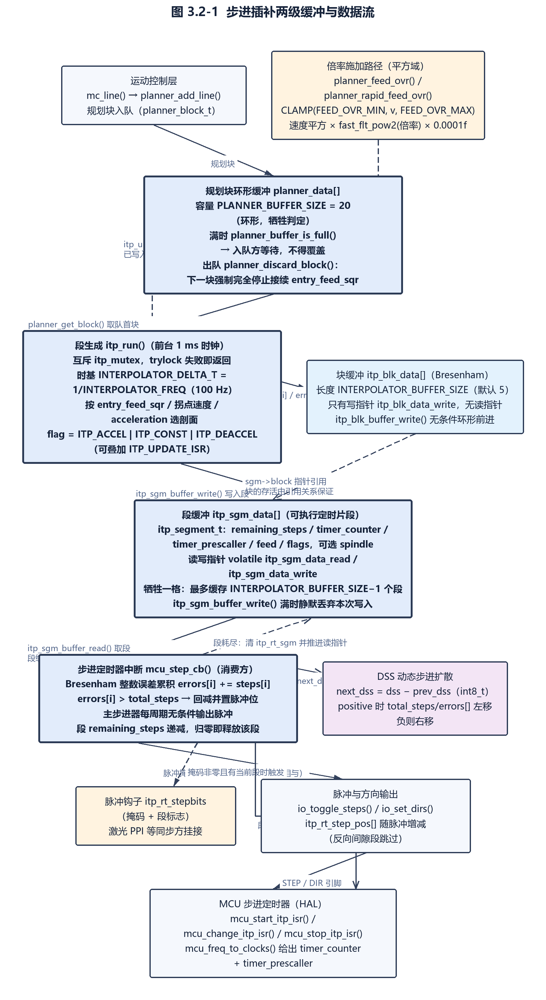

图 3.2-1 步进插补两级缓冲与数据流

#### 3.2.6.1 两级缓冲结构

- 需求标识：UC-FREQ326-1
- 功能描述：步进插补采用「块缓冲」（保存块的 Bresenham 数据）与「段缓冲」（保存可执行的定时片段）两级环形缓冲；段缓冲跨上下文共享，由前台 `itp_run()` 写、由步进中断读，块缓冲只由前台写、由中断经段内的块指针间接访问
- 调用条件：`itp_init()` 初始化时建立；`itp_run()` 在每轮主循环或运行时钟任务中填充段；步进定时器中断每次消费一段
- 输入：段缓冲容量宏 `INTERPOLATOR_BUFFER_SIZE`（未定义时取 5）
- 输出：两份长度均为 `INTERPOLATOR_BUFFER_SIZE` 的静态数组，以及段缓冲读写指针 `itp_sgm_data_read`/`itp_sgm_data_write` 与块缓冲写指针 `itp_blk_data_write`
- 处理：
- （1）容量与存储：`INTERPOLATOR_BUFFER_SIZE` 未定义时取 5，`itp_blk_data[]` 与 `itp_sgm_data[]` 均为该长度的静态数组，块缓冲写指针与段缓冲读写指针为独立 `uint8_t`，其中段缓冲读写指针加 `volatile` 限定，因为会被中断触碰（`uCNC/src/core/interpolator.c:33-35`、`:44-49`）；
- （2）段缓冲读推进：`itp_sgm_buffer_read()` 先比较读指针与写指针，相等即视为空并直接返回而不推进，否则读指针递增并对容量取模后写回（`uCNC/src/core/interpolator.c:144-160`）；
- （3）段缓冲写推进：`itp_sgm_buffer_write()` 先算出 `write+1`（取模），仅当该值不等于读指针时才提交写指针，因此缓冲满时静默丢弃本次写入而不覆盖未消费数据（`uCNC/src/core/interpolator.c:162-177`）；
- （4）满判定为「写指针前进一格后等于读指针」，空判定为「读写指针相等」，即环形缓冲牺牲一格，实际最多缓存 `INTERPOLATOR_BUFFER_SIZE-1` 个待执行段（`uCNC/src/core/interpolator.c:179-196`）；
- （5）块缓冲只有写指针、没有读指针，`itp_blk_buffer_write()` 无条件环形前进，块的存活由段内 `sgm->block` 指针的引用关系保证（`uCNC/src/core/interpolator.c:211-225`）；
- （6）清空：`itp_sgm_clear()` 把两个段指针归零、清 `itp_rt_sgm`、复位 `prev_dss`/`prev_spindle` 并整体 `memset` 段数组，`itp_blk_clear()` 清 `itp_cur_plan_block`、写指针与块数组，`itp_clear()` 在互斥保护下依次调用二者（`uCNC/src/core/interpolator.c:198-209`、`:211-225`、`:935-952`）；
- （7）并发保护：段缓冲读写指针用 `volatile` 限定，跨函数临界区使用互斥 `itp_mutex`（RTOS 下为二值信号量，否则为一个 `volatile uint8_t` 自旋标志）；`itp_run()` 采用「trylock 失败即返回」的非阻塞策略，避免与持锁路径互等（`uCNC/src/core/interpolator.c:71-76`、`:403-417`、`:937-951`）；
- （8）`itp_init()` 完成两级缓冲的初始清零，并在 `FORCE_GLOBALS_TO_0` 下把步进锁定掩码一并清零（`uCNC/src/core/interpolator.c:231-256`、`:239-241`）。

#### 3.2.6.2 段生成与速度剖面

- 需求标识：UC-FREQ326-2
- 功能描述：插补器把每个规划块切分为若干段，每段对应一段恒定斜率的速度剖面（加速、匀速或减速）并携带该剖面的步数与定时参数；段长以固定积分周期为量化单位，段内步数由浮点部分距离累加后取整得到
- 调用条件：`itp_run()` 在段缓冲未满（`!itp_sgm_is_full()`）且有可用规划块时循环执行；执行状态含 `EXEC_ALARM` 时立即退出
- 输入：当前块的 `entry_feed_sqr`、`feed_sqr`、`acceleration`、主步进器上的剩余步数，以及规划器提供的出口速度与拐点速度
- 输出：写入段缓冲的 `itp_segment_t`，含 `remaining_steps`、`timer_counter`、`timer_prescaller`、`feed`、`flags`（`ITP_ACCEL`/`ITP_CONST`/`ITP_DEACCEL` 之一，可叠加 `ITP_UPDATE_ISR`）与可选 `spindle`
- 处理：
- （1）段的积分时基为常量 `INTERPOLATOR_DELTA_T = 1/INTERPOLATOR_FREQ`，`INTERPOLATOR_FREQ` 默认 100 Hz，即每段至少覆盖一个 10 ms 采样窗口（`uCNC/src/core/interpolator.c:37`、`:49-51`）；
- （2）需要重算剖面时（新块置位或 `itp_needs_update`）读取规划器的出口速度平方与拐点速度平方，由 `(v_junction²-v_entry²)/(2a)` 求加速距离、`(v_junction²-v_exit²)/(2a)` 求减速距离，据此得出块内「加速结束步数」`accel_until` 与「减速起始步数」`deaccel_from`；只有当加速时间大于一个采样周期时才使用整数周期切片，否则把 `accel_until` 直接置为整块剩余步数（`uCNC/src/core/interpolator.c:506-573`）；
- （3）按剩余步数落在哪个区间选择剖面：`remaining_steps > accel_until` 为加速段（标志 `ITP_ACCEL`），否则 `remaining_steps > deaccel_from` 为匀速段（速度变化为 0，标志 `ITP_CONST`），否则为减速段（标志 `ITP_DEACCEL`）；加速段与减速段的行程上限分别为 `accel_until` 与 0（`uCNC/src/core/interpolator.c:618-667`；`uCNC/src/core/interpolator.h:33-41`）；
- （4）每段末速度用「中值速度」法更新：计算段内速度增量后取半、加到段首速度上得到段中速度，再以 `partial_distance += current_speed * integrator` 累加浮点行程（`uCNC/src/core/interpolator.c:669-712`）；
- （5）行程取整：`segm_steps = max(0, round(partial_distance))`，取整后从 `partial_distance` 中扣除，剩余小数部分留到下一段继续累加，从而在长行程上不产生系统性误差（`uCNC/src/core/interpolator.c:669-712`）；
- （6）若段首速度不大于 0（运动已停止），把 `entry_feed_sqr` 清零；若此时处于 `EXEC_STOPPING` 则直接跳出，否则把该段步数取为全部剩余步数以冲刷剩余运动（`uCNC/src/core/interpolator.c:669-712`）；
- （7）段步数不得超过当前剖面区间的剩余量：若 `segm_steps > remaining_steps - profile_steps_limit`，则截断为 `remaining_steps - profile_steps_limit`（`uCNC/src/core/interpolator.c:669-712`）；
- （8）段生成后扣减 `block->steps[main_stepper]` 并把段写入段缓冲；当块剩余步数归零时，同时推进块缓冲写指针、清 `itp_cur_plan_block` 并调用 `planner_discard_block()` 把该规划块移出规划缓冲（`uCNC/src/core/interpolator.c:821-828`、`:863-876`）；
- （9）段末速度非零时把 `(current_speed + speed_change)²` 回写为块的 `entry_feed_sqr`，使下一段的起始速度与下一块的入口速度衔接；当恰好到达 `accel_until` 且未处于停止状态时，用拐点速度的平方覆盖 `entry_feed_sqr` 以消除浮点累加误差（`uCNC/src/core/interpolator.c:821-828`、`:863-876`）；
- （10）除线性加速度剖面外，源码内建 S 曲线速度曲线分支：`S_CURVE_ACCELERATION_LEVEL` 为 1–5 时使用固定加加速度曲线，为 -1 时按 `g_settings.s_curve_profile` 在 5 种曲线间切换，默认线性；该分支只改变每段速度增量的算法，不改变段结构与接口（`uCNC/src/core/interpolator.c:258-345`、`:542-546`、`:554-556`、`:598-600`、`:630-639`、`:656-664`）。

#### 3.2.6.3 Bresenham 直线插补与脉冲分配

- 需求标识：UC-FREQ326-3
- 功能描述：各轴的脉冲分配由整数 Bresenham 误差累积完成：以块内主步进器（步数最多者）的步数为误差上限，每轴各自累加本轴步数，累加值超过上限即输出一个脉冲并回减上限，主步进器本身则每个中断周期无条件输出脉冲
- 调用条件：每次步进定时器中断 `mcu_step_cb()`，且当前段剩余步数不为零、段所引用的块指针非空
- 输入：块的 `steps[i]`（各轴步数的两倍）、`total_steps`（主步进器步数的两倍）、`errors[i]`（初值等于 `total_steps`）、`dirbits`，以及段内的 `main_stepper`/`idle_steppers` 优化字段
- 输出：交给 `io_toggle_steps()` 的脉冲位掩码；按方向递增或递减的实时步进位置 `itp_rt_step_pos[i]`；段内剩余步数减一
- 处理：
- （1）建块时把所有量左移一位：`total_steps = (主步进器步数) << 1`、`steps[i] = block->steps[i] << 1`、`errors[i]` 初值置为 `total_steps`，使比较使用严格大于号而非带半格偏置（`uCNC/src/core/interpolator.c:450-464`；`uCNC/src/core/interpolator.h:55-64`）；
- （2）方向位在段加载时一次性输出：由块的 `dirbits` 经 `io_set_dirs()` 设置到方向引脚（`uCNC/src/core/interpolator.c:1201`）；
- （3）每个中断周期对每轴执行 `errors[i] += steps[i]`，若 `errors[i] > total_steps` 则 `errors[i] -= total_steps` 并置位该轴脉冲掩码（`uCNC/src/core/interpolator.c:1232-1266`）；
- （4）误差与总步数保存在「块」而非「段」中，因此跨段边界连续累积，保证同一条块内脉冲分布的相位一致（`uCNC/src/core/interpolator.h:55-64`）；
- （5）默认路径（未定义 `DISABLE_ITP_STEP_GEN_OPTIMIZATIONS`）下主步进器走快速路径：不做误差累加，每个周期直接置脉冲位；不动的轴（`idle_steppers` 对应位）被跳过，不做误差累加（`uCNC/src/core/interpolator.c:846-861`、`:1232-1266`）；
- （6）每次输出脉冲时同步维护实时位置：方向位有效则自减 `itp_rt_step_pos[i]`，否则自增；启用反向间隙补偿且该段带 `ITP_BACKLASH` 标志时不更新实时位置，以避免间隙动作污染机械坐标（`uCNC/src/core/interpolator.c:1232-1266`）；
- （7）可选 16 位算法：定义 `BRESENHAM_16BIT` 时 `step_t` 为 `uint16_t`、每行最大步数为 `1 << (16-(2+DSS_MAX_OVERSAMPLING))`，未定义时为 `uint32_t` 与 `1 << (32-(2+DSS_MAX_OVERSAMPLING))`；该选项同时把 `DSS_MAX_OVERSAMPLING` 的上限收紧为 3（未定义时可达 5）（`uCNC/src/cnc_hal_config_helper.h:2080-2088`、`:2094-2101`）；
- （8）定义 `BRESENHAM_16BIT` 时，运动控制层在计算段数后检查总步数是否超过 `MAX_STEPS_PER_LINE`，超过则把一条直线运动拆成更多子段，使每段都落在 16 位可表示范围内；该能力通过状态报告信息串中的 `16B,` 对外可见（`uCNC/src/core/motion_control.c:581-589`；`uCNC/src/interface/grbl_protocol.c:972-975`）；
- （9）段内剩余步数在每个中断周期递减，归零后段被释放（`uCNC/src/core/interpolator.c:1405-1407`）。

#### 3.2.6.4 直线执行器方向映射

- 需求标识：UC-FREQ326-4
- 功能描述：插补器把运动控制层给出的「步进器方向位」翻译为「直线执行器（LINACT）IO 掩码」后存入块的 `dirbits`，使步进脉冲与方向输出可以落在与步进器编号不同的物理引脚上（例如把第二个直线执行器映射到激光 PPI 引脚）
- 调用条件：`itp_run()` 为新规划块建立块结构时，每块一次
- 输入：块的 `dirbits` 中每个步进器对应的方向位
- 输出：块内 `dirbits` 字段——各 LINACT 的 IO 掩码按位或的结果
- 处理：
- （1）清空块内 `dirbits` 后，对每个步进器取下标对应的位掩码 `(1 << i)`，把「运动块方向位」送入 `itp_get_linact_dirs(mask)`（`uCNC/src/core/interpolator.c:347-366`、`:450-464`）；
- （2）`itp_get_linact_dirs()` 用 switch 把 `1/2/4/8/16/32` 分别映射为 `LINACT0_IO_MASK`…`LINACT5_IO_MASK`，其他取值返回 0，即不支持第 7 个及以后的步进器映射（`uCNC/src/core/interpolator.c:347-366`）；
- （3）返回值与块内 `dirbits` 按位或，逐轴累积（`uCNC/src/core/interpolator.c:450-464`）；
- （4）`LINACTn_IO_MASK` 默认等于 `STEPn_IO_MASK`；当某个轴不存在（未定义 `AXIS_X`…`AXIS_C`）时，配置层把对应的 `LINACTn_IO_MASK` 强制清 0，使不存在的轴不会输出任何方向位（`uCNC/src/cnc_hal_config_helper.h:1797-1815`、`:1842-1854`）；
- （5）配置层校验任意两个 `LINACTn_IO_MASK` 不得有位冲突，冲突时在编译期报错（`uCNC/src/cnc_hal_config_helper.h:2247-2260`）。

#### 3.2.6.5 步进频率与时基

- 需求标识：UC-FREQ326-5
- 功能描述：段生成阶段把该段的步进速率换算为 MCU 定时器的「重载值 + 预分频器」二元组并存入段中；步进中断的启动、变速与停止分别通过三个 HAL 回调完成，插补器本身不接触任何定时器寄存器
- 调用条件：每生成一个段计算一次定时参数；每次从段缓冲取出新段、启动中断或要求停止时调用对应 HAL 回调
- 输入：段的当前速度 `current_speed`（步/秒）、`g_settings.max_step_rate`、段步数
- 输出：段的 `timer_counter` 与 `timer_prescaller`，以及按 `feed_conversion` 折算的工程单位进给率 `feed`
- 处理：
- （1）速率上限预处理：设置项 `max_step_rate`（$0）的存放单位是「每步的微秒数」，其默认值为 `1000000 / F_STEP_MAX`，设置校验也以 `1000000 / F_STEP_MAX` 为下限，低于该值返回 `STATUS_MAX_STEP_RATE_EXCEEDED`；插补器据此按 `max_step_rate = 1000000 / g_settings.max_step_rate` 换算回「步/秒」，与 `current_speed`/`dss_speed` 同量纲（`uCNC/src/core/interpolator.c:719`；`uCNC/src/interface/grbl_settings.c:99`、`:491-498`；`uCNC/src/interface/grbl_settings.h:39`；`uCNC/src/hal/mcus/mcu.h:44-45`）；
- （2）DSS 路径（`DSS_MAX_OVERSAMPLING != 0`）把扩展后的速率 `dss_speed` 交给 `mcu_freq_to_clocks()` 得到段定时参数；非 DSS 路径先把 `current_speed` 钳位，再用下取整到 `INTERPOLATOR_FREQ` 的速度调用 `mcu_freq_to_clocks()`，保证最低速率不低于插补器的积分频率（`uCNC/src/core/interpolator.c:750-758`）；
- （3）段的 `feed` 字段由 `current_speed * block->feed_conversion` 得到；`feed_conversion` 是运动控制层用「直线距离 / 每步进单位对应的进给量」预先算好的折算系数，因此段内 `feed` 是可直接上报的工程单位每秒值（`uCNC/src/core/interpolator.c:750-758`、`:455`；`uCNC/src/core/motion_control.c:565`）；
- （4）中断启动：`itp_start(false)` 在「非 RUN、非 STOPPING、非 ALARM 且段缓冲非空」时置 `EXEC_RUN`、在 `ENABLE_STEPPERS_DISABLE_TIMEOUT` 下重新使能步进器，并以段缓冲读位置那一段的定时参数调用 `mcu_start_itp_isr()`（`uCNC/src/core/interpolator.c:1416-1435`）；
- （5）中断变速：中断取出新段时，若段标志含 `ITP_UPDATE_ISR`，调用 `mcu_change_itp_isr()` 应用新的重载值与预分频器，随后清除 `ITP_UPDATE`（`ITP_UPDATE = ITP_UPDATE_ISR | ITP_UPDATE_TOOL`）位（`uCNC/src/core/interpolator.c:1204-1218`；`uCNC/src/core/interpolator.h:33-36`）；
- （6）中断停止：请求停止时置 `itp_isr_stop`，实际关停在「步进复位回调」`mcu_step_reset_cb()` 中完成——先复位步进引脚，再调用 `mcu_stop_itp_isr()` 并清 `EXEC_RUN`；段缓冲取空时则由 `mcu_step_cb()` 直接清 `EXEC_RUN` 并调用 `itp_stop()`（`uCNC/src/core/interpolator.c:1059-1071`、`:1221-1227`）；
- （7）HAL 契约：`mcu_freq_to_clocks()`/`mcu_clocks_to_freq()` 完成频率与定时参数的互转，`mcu_start_itp_isr()`/`mcu_change_itp_isr()`/`mcu_stop_itp_isr()` 完成定时器生命周期；实现必须保证「脉冲回调」与「脉冲复位回调」成对出现（`uCNC/src/hal/mcus/mcu.h:280-304`；`uCNC/src/hal/mcus/avr/mcu_avr.c:912-948`）。

#### 3.2.6.6 进给率倍率在插补侧的落地路径

- 需求标识：UC-FREQ326-6
- 功能描述：进给率倍率（进给倍率与快速倍率）不在插补器内部改写定时值，而是由规划器以「速度平方」的比例形式施加到块的出口速度与拐点速度上，再通过 `itp_update()` 通知插补器本块剖面需要重算；插补器在下一轮段生成时读取新的速度约束并重算加速/减速区间与每段定时
- 调用条件：`planner_feed_ovr()`/`planner_rapid_feed_ovr()` 检测到倍率数值实际变化时；规划器重算后判定被修改的块是当前执行块时；实时指令处理中工具状态变化时；上层直接调用 `itp_update()` 时
- 输入：`g_planner_state.feed_override`、`g_planner_state.rapid_feed_override`（百分数，被钳位到 `FEED_OVR_MIN`–`FEED_OVR_MAX`），以及块的 `feed_sqr`/`rapid_feed_sqr`
- 输出：静态标志 `itp_needs_update` 置位；随后插补器以新的 `accel_until`/`deaccel_from`/积分时间片与新的段定时值替换原剖面
- 处理：
- （1）`itp_update()` 的实现只是把静态标志 `itp_needs_update` 置为 `true`，不接收倍率参数、也不直接计算定时，插补侧不存在「倍率计数器」这类机制（`uCNC/src/core/interpolator.c:899-903`）；
- （2）`planner_feed_ovr()` 把入参钳位后写入 `g_planner_state.feed_override` 并把 `g_planner_state.ovr_counter` 清零，然后调用 `itp_update()`；`planner_rapid_feed_ovr()` 对 `rapid_feed_override` 做同样处理；两者都只在数值真正改变时才动作（`uCNC/src/core/planner.c:550-572`）；
- （3）规划器自身的重算流程中，如果被修改的块恰好是执行块，也会调用 `itp_update()`（`uCNC/src/core/planner.c:529-533`）；
- （4）倍率的实际数学施加点是规划器的两个查询函数：`planner_get_block_exit_speed_sqr()` 把下一块的入口速度平方与快速进给上限分别乘以 `fast_flt_pow2(倍率) * 0.0001f`，`planner_get_block_top_speed()` 对目标速度平方与快速进给上限做同样处理，最后取各约束的最小值；因为作用在平方域且乘 `0.0001f`，等价于把百分数倍率按平方折算（`uCNC/src/core/planner.c:348-376`、`:378-438`）；
- （5）两个乘法都受块的 `planner_flags.bit.ovr_bypass` 保护：该位置位（如 G 代码要求忽略倍率）时倍率不生效（`uCNC/src/core/planner.c:348-376`、`:378-438`；`uCNC/src/core/planner.h:43-63`）；
- （6）插补器在段生成的 `itp_needs_update` 分支中依次调用 `planner_get_block_exit_speed_sqr()` 与 `planner_get_block_top_speed()`，重新求出口速度、拐点速度、加速距离与减速距离，并重新计算积分时间片，最终生成使用新速度的段（`uCNC/src/core/interpolator.c:525-573`、`:466-467`）；
- （7）重算的作用范围只限于此后新生成的段：`itp_update_feed()` 的注释明确要求不要更新已经进入输出缓冲的步进，文件中原有的批量回改段缓冲定时值的代码被整段注释保留（`uCNC/src/core/interpolator.c:93-113`）；
- （8）倍率状态与实时指令的接口：`cnc.c` 的实时指令处理按增减步长改写两个倍率值，工具状态变化时调用 `itp_update()` 使剖面跟随工具切换重算（`uCNC/src/cnc.c:999-1028`、`:1091-1098`）。

> **实现说明**：`g_planner_state.ovr_counter` 与步进定时无关，其全部使用点只有 Grbl 状态报告的节流（周期性复位为 `STATUS_WCO_REPORT_MIN_FREQUENCY` 并在每次报告时递减）（`uCNC/src/interface/grbl_protocol.c:341-343`、`:386`；`uCNC/src/core/planner.h:65-76`）。`itp_update_feed(float step_frequency)` 是 `ENABLE_RT_SYNC_MOTIONS` 下的另一个入口，它把「当前规划块」的 `feed_sqr` 直接改写为入参频率的平方并置 `itp_needs_update`，用于实时同步运动在线改变块速度；除定义与声明外全仓库没有调用者，属对外预留接口，不得据此认定其为当前生效行为（`uCNC/src/core/interpolator.c:93-113`）。

#### 3.2.6.7 DSS 动态步进扩散

- 需求标识：UC-FREQ326-7
- 功能描述：当段的速度较低时，插补器用「动态步进扩散」（DSS）把 Bresenham 的分辨率按 2 的幂做超采样：段被拆成更多、更密的定时周期，而每个周期只输出一张可能为空的脉冲掩码，从而把低速下的脉冲在时间轴上打散以降低步进电机振动
- 调用条件：`DSS_MAX_OVERSAMPLING` 不为 0 且段步数不为 0 时，对每个生成的段计算一次扩散级别
- 输入：段的当前速度、`DSS_MAX_OVERSAMPLING`、`DSS_CUTOFF_FREQ`、段步数、上一段的扩散级别 `prev_dss`
- 输出：段的 `next_dss`（相对上一段的级别增量，可为负）、可选的 `dss_level`（绝对值，供实时同步运动使用）、`remaining_steps = segm_steps << dss`，以及按超采样后速率计算的定时参数；必要时给段加 `ITP_UPDATE_ISR` 标志
- 处理：
- （1）以 `max(INTERPOLATOR_FREQ, current_speed)` 为起点，在「速率低于 `DSS_CUTOFF_FREQ`、级别未达 `DSS_MAX_OVERSAMPLING`、且本段步数非 0」的条件下反复把速率乘 2、级别加 1（`uCNC/src/core/interpolator.c:714-758`）；
- （2）等离子 THC 模式下强制至少 1 级扩散，并在进入该分支时把速率与段速度各乘 2 后按速率上限钳位（`uCNC/src/core/interpolator.c:714-758`）；
- （3）若本段级别与上一段不同，则给段置 `ITP_UPDATE_ISR`，使中断在切换该段时重新应用定时（`uCNC/src/core/interpolator.c:714-758`）；
- （4）段内记录相对增量 `next_dss = dss - prev_dss`（类型为 `int8_t`，因此级别回落时记录负值），并更新 `prev_dss`（`uCNC/src/core/interpolator.c:714-758`；`uCNC/src/core/interpolator.h:79-84`）；
- （5）段步数按 `segm_steps << dss` 放大，与超采样后的周期数保持一致（`uCNC/src/core/interpolator.c:714-758`）；
- （6）中断侧消费 `next_dss`：为正时把块的 `total_steps` 与各轴 `errors[]` 一律左移该位数，为负时右移相应位数；由于 Bresenham 状态存放在块内，扩散级别的变化会在同一块内平滑过渡而不丢相位（`uCNC/src/core/interpolator.c:1148-1199`）；
- （7）位宽保护：`DSS_MAX_OVERSAMPLING` 的合法上限在配置层被限制为 5，启用 `BRESENHAM_16BIT` 时上限收紧为 3，以保证左移后的误差值不溢出 16 位（`uCNC/src/cnc_hal_config_helper.h:2080-2088`）；
- （8）若段为非扩散（`prev_dss == 0`），中断才把 `main_stepper` 设为块的主步进器，使主步进器每周期无条件输出脉冲；进入扩散后主步进器快速路径被关闭，改由误差累积按比例分配脉冲（`uCNC/src/core/interpolator.c:846-861`）；
- （9）`DSS_CUTOFF_FREQ` 被配置层限制在最高步进速率的八分之一以内（`uCNC/src/cnc_hal_config_helper.h:2103-2107`）。

#### 3.2.6.8 段与块的生命周期及块模式

- 需求标识：UC-FREQ326-8
- 功能描述：插补器通过一个「当前规划块」指针串起两级缓冲的生命周期：取块、建 Bresenham 数据、反复切段直到块步数耗尽、丢弃规划块并推进块缓冲写指针；在实时同步运动启用时，块的产出还可被「块 ID」与「块模式」节流，实现单块执行、突发执行与连续执行三种节拍
- 调用条件：每轮 `itp_run()`；块模式相关分支仅在 `ENABLE_RT_SYNC_MOTIONS` 下编译
- 输入：规划缓冲的非空状态与块内容、`itp_block_mode`、`itp_block_counter`（外部通过 `itp_inc_block_id()` 递增）、工具模式
- 输出：块缓冲写指针推进、`itp_cur_plan_block` 的清空与设置、段缓冲中的新段
- 处理：
- （1）取块判据：仅当 `itp_cur_plan_block == NULL` 时才尝试取块；若此时规划缓冲也为空则跳出循环（源码注释说明「段缓冲不满时块缓冲不可能满」）（`uCNC/src/core/interpolator.c:422-477`）；
- （2）建块：从规划器取块并记入 `itp_cur_plan_block`，清零块结构，可选复制行号，重置 `dirbits`，按 3.2.6.3、3.2.6.4 的规则填充 `total_steps`/`errors[]`/`steps[]`，并取出 `feed_conversion`；随后置 `itp_needs_update` 要求重算剖面（`uCNC/src/core/interpolator.c:422-477`）；
- （3）模块前置钩子：在 `ENABLE_PLANNER_MODULES` 下，每次产出段之前都调用 `planner_itp_pre_output()`，它以规划器读位置的块为参数触发 `planner_pre_output` 事件，供外部模块在块被输出前修改它（`uCNC/src/core/interpolator.c:479-504`；`uCNC/src/core/planner.c:442-449`）；
- （4）块 ID 门槛（`ENABLE_RT_SYNC_MOTIONS`）：读出当前块模式；若工具处于刺绣模式且模式非「连续」，并且当前块尚未开始冲刷且本地块计数等于外部块计数，说明外部还没有调用 `itp_inc_block_id()` 放行，则直接跳出、不产出段（`uCNC/src/core/interpolator.c:479-504`；`uCNC/src/core/interpolator.h:116-126`）；
- （5）模式节拍：`ITP_BLOCK_SINGLE` 下把本地块计数记为外部块计数（每个块需要一个放行信号）；`ITP_BLOCK_BURST` 下本地块计数自增（可连续产出队列中的多个块）；`ITP_BLOCK_CONTINUOUS` 不看块计数（默认节拍，段缓冲有空位即产出）；三者处理完毕后把 `flushing_block` 置真，表示该块已开始冲刷（`uCNC/src/core/interpolator.c:78-91`、`:479-504`）；
- （6）收尾：段生成后若块的主步进器剩余步数为 0，则推进块缓冲写指针、清 `itp_cur_plan_block`、调用 `planner_discard_block()` 把该规划块移出缓冲，并把扩散级别 `prev_dss` 复位（`uCNC/src/core/interpolator.c:863-873`）；
- （7）`planner_discard_block()` 的语义：缓冲为空则直接返回；否则先把下一个块的 `entry_feed_sqr` 同步为被丢弃块的值（保证跨块速度衔接不被缓冲释放打断），再整体清零被丢弃块、块数减一、读指针后移，并在还有块时把主轴速度与规划器状态标志前移（`uCNC/src/core/planner.c:239-271`）；
- （8）中断侧段生命周期：段内剩余步数归零时，把段的块指针置 `NULL`、清 `itp_rt_sgm` 并推进段缓冲读指针；下一周期若无当前段且缓冲非空则加载新段，并仅当段引用的块非空时输出方向、按需应用定时与工具更新（`uCNC/src/core/interpolator.c:1128-1135`、`:1137-1220`）；
- （9）驱动时机：默认配置启用 `ENABLE_ITP_FEED_TASK`，此时段生成被放在 1 ms 的运行时钟回调中执行（条件为「循环处于运行态、无告警、无互锁失败」），并在「取出新块后」与「重算剖面后」各强制跳出一次循环，把 CPU 让回主循环；未启用该选项时由主循环的 `cnc_dotasks()` 调用（`uCNC/src/cnc.c:430-457`、`:344-353`；`uCNC/src/cnc_hal_config_helper.h:332-333`、`:2090-2092`；`uCNC/src/core/interpolator.c:422-477`）；
- （10）刺绣工具通过 `itp_set_block_mode()` 与 `itp_inc_block_id()` 逐块或突发放行运动（`uCNC/src/hal/tools/tools/embroidery_stepper.c:146`、`:158`、`:279`）。

#### 3.2.6.9 同步段、同步阻塞与工具同步

- 需求标识：UC-FREQ326-9
- 功能描述：插补器对同步运动（激光 PPI、等离子 THC、刺绣等需要与步进脉冲严格对齐的实时动作）提供一套协同契约：被标记为同步的段带 `ITP_SYNC` 标志，同步段的启动权不交给插补器而由同步方在合适时机调用；插补器另外提供「冲刷到静止」的阻塞同步接口、主轴/工具同步接口，并把每个脉冲掩码通过钩子实时暴露给同步方
- 调用条件：块带 `synched` 标志时（`ENABLE_RT_SYNC_MOTIONS`）；外部请求冲刷、主轴同步、工具停止或脉冲钩子时
- 输入：块的 `planner_flags.bit.synched`；外部调用 `itp_sync()`/`itp_sync_spindle()`/`itp_stop_tools()`/`itp_start(is_synched)`
- 输出：段上的 `ITP_SYNC` 标志、`itp_sync_ready()` 的布尔结果、`itp_sync()` 的状态码、主轴与工具输出的更新，以及钩子回调收到的脉冲掩码与段标志
- 处理：
- （1）段生成时若块的 `planner_flags.bit.synched` 置位，则给该段加 `ITP_SYNC` 标志（`uCNC/src/core/interpolator.c:830-836`；`uCNC/src/core/interpolator.h:40`）；
- （2）`itp_sync_ready()` 在原子块内检查当前执行段是否同时具备 `ITP_SYNC` 与 `ITP_CONST`，即同步段必须已进入匀速阶段才算就绪（`uCNC/src/core/interpolator.c:115-126`）；
- （3）`itp_start(bool is_synched)` 在「无 RUN、无 STOPPING、无 ALARM 且段缓冲非空」时准备启动中断，但入参为真时不自行启动（既不清 `EXEC_RUN`、也不调用 `mcu_start_itp_isr`），把启动时机让给同步方；入参为假的启动路径整体置于原子块中（`uCNC/src/core/interpolator.c:1416-1435`）；
- （4）`itp_run()` 在收尾时按段缓冲读位置段是否带 `ITP_SYNC` 计算出该布尔值并传入 `itp_start()`；`ENABLE_RT_SYNC_MOTIONS` 未启用时恒以假值调用（`uCNC/src/core/interpolator.c:889-896`）；
- （5）`itp_sync()` 是阻塞式冲刷：循环条件为「插补器非空或规划器非空」，每轮调用 `cnc_dotasks()` 推进系统；`cnc_dotasks()` 返回假时立即以 `STATUS_CRITICAL_FAIL` 退出（源码中被注释掉的「回零命中即跳出」分支已停用），全部排空后返回 `STATUS_OK`（`uCNC/src/core/interpolator.c:1016-1034`）；
- （6）`itp_sync_spindle()` 以缩放系数 0 调用 `planner_get_spindle_speed()`，把结果写入主轴输出，即按当前规划器主轴速度重新施加一次主轴转速，用于运动停止状态下的主轴对齐（`uCNC/src/core/interpolator.c:1036-1042`）；
- （7）`itp_stop_tools()` 直接调用 `tool_stop()` 停止工具，由 `cnc_stop(true)` 路径调用（`uCNC/src/core/interpolator.c:930-933`；`uCNC/src/cnc.c:545-552`）；
- （8）脉冲钩子：插补器创建钩子 `itp_rt_stepbits`（参数为脉冲掩码与段标志），中断仅在本次脉冲掩码非零且存在当前段时触发它，供激光 PPI 等模块插入脉宽调制动作；另有函数指针 `itp_rt_step_prevent_cb` 与条件宏 `RT_STEP_PREVENT_CONDITION`，使中断每周期一进入就可被外部条件短路，刺绣工具用它做「机针未抬起即不步进」的互锁，并通过重置该指针解除（`uCNC/src/core/interpolator.c:1073-1090`、`:1118-1126`、`:128-129`；`uCNC/src/core/interpolator.h:108-134`；`uCNC/src/module.h:152-165`；`uCNC/src/cnc_hal_config_helper.h:2439`；`uCNC/src/hal/tools/tools/laser_ppi.c:262`、`:277`；`uCNC/src/hal/tools/tools/embroidery_stepper.c:232`、`:256`）；
- （9）`itp_sync_rt_position()` 提供与「从零点重算」不同的另一种实时位置对齐方式：它原子地把外部传入的步数数组整体复制到内部实时位置（`uCNC/src/core/interpolator.c:962-968`）。

> **实现说明**：`itp_sync_ready()`、`itp_sync_rt_position()` 与 `itp_get_rt_segment()` 在本仓库内除声明与定义外没有调用点，应登记为对外/预留契约而非当前生效行为（`uCNC/src/core/interpolator.h:93-134`；`uCNC/src/core/interpolator.c:115-126`、`:962-968`、`:1437-1440`）。

#### 3.2.6.10 实时位置与实时进给维护

- 需求标识：UC-FREQ326-10
- 功能描述：插补器始终维护一份以「步数」为单位的实时机械位置（每个输出脉冲对应一个计数），并对外提供读取、单轴读取、强制写入与从坐标系原点重设四类接口，同时提供「当前段的进给率」与「当前段行号」两个执行态查询；位置在中断内随脉冲无锁更新，对外读取则用原子临界区保护
- 调用条件：中断每次输出脉冲时更新；上层查询（状态报告、编码器对齐、位置重设）时读取或写入
- 输入：脉冲方向位、外部传入的步数数组或坐标原点、编码器配置
- 输出：`itp_rt_step_pos[]`，以及位置数组、单轴步数、实时进给率、行号与当前段指针等查询结果
- 处理：
- （1）实时位置为 `int32_t itp_rt_step_pos[STEPPER_COUNT]`，在中断内按方向位对相应轴自减或自增；启用反向间隙补偿且当前段带 `ITP_BACKLASH` 标志时跳过计数更新，使间隙补偿动作不被计入机械坐标（`uCNC/src/core/interpolator.c:54-55`、`:1237-1239`、`:1250`）；
- （2）`itp_get_rt_position()` 在原子临界区内用 `memcpy` 整体复制出位置数组，避免读到跨轴的中间状态；`itp_get_rt_position_index()` 同样在原子块内读取单轴，未命中原子块时返回 0（`uCNC/src/core/interpolator.c:954-978`）；
- （3）`itp_sync_rt_position()` 反向整体写入内部位置数组，用于外部强制对齐（`uCNC/src/core/interpolator.c:962-968`）；
- （4）`itp_reset_rt_position(float *origin)` 分三步：若未启用回零功能则先把 `origin` 数组清零；用 `kinematics_coordinates_to_steps()` 把坐标原点换算成步数并写入实时位置（对 Delta 等非直角运动学即在此完成解算）；若存在步进器编码器则调用 `encoders_itp_reset_rt_position()` 把各步进器编码器计数一并重置到该原点（`uCNC/src/core/interpolator.c:980-993`；`uCNC/src/hal/kinematics/kinematic.h:102`；`uCNC/src/modules/encoder.c:2043-2059`）；
- （5）`itp_get_rt_feed()`：执行状态不含 `EXEC_RUN` 时直接返回 0；否则返回段缓冲读位置段的 `feed` 字段（该字段在段生成时已折算为工程单位每秒）；缓冲为空时返回 0（`uCNC/src/core/interpolator.c:995-1009`）；
- （6）`itp_get_rt_line_number()` 返回段缓冲读位置段所引用块的行号（受 `GCODE_PROCESS_LINE_NUMBERS` 控制），块指针为空时返回 0（`uCNC/src/core/interpolator.c:1051-1056`）；
- （7）`itp_get_rt_segment()` 返回段缓冲读位置段的指针，缓冲为空时返回 `NULL`，供实时同步模块查看当前段状态（`uCNC/src/core/interpolator.c:1437-1440`）；
- （8）外部消费链：`io_get_steps_pos()` 先取插补器实时位置，再对配置了编码器的轴用编码器读数（乘分辨率）覆盖，使上层得到「要么来自脉冲计数、要么来自闭环反馈」的统一位置；Grbl 协议层用实时位置生成 `[STEPS:...]` 反馈，并用实时进给率与行号生成实时状态报告（`uCNC/src/core/io_control.c:730-753`；`uCNC/src/interface/grbl_protocol.c:942-944`、`:406`、`:527`；`uCNC/src/core/motion_control.c:1168`）。

#### 3.2.6.11 停止、清空与保持/急停行为

- 需求标识：UC-FREQ326-11
- 功能描述：插补器区分「请求停止」与「实际关停」两个阶段：请求停止只置标志并（必要时）标记位置可能丢失，实际关停延迟到下一次步进复位回调完成，以保证脉冲不被截断在有效电平中间；另有一类「受控停止」由执行状态 `EXEC_STOPPING` 驱动，插补器在段生成阶段主动把剖面改成减速斜坡直至速度归零
- 调用条件：`itp_stop()` 由 `cnc_stop()` 与中断自行停车路径调用；`itp_clear()` 由运动控制层的清理路径调用；受控停止由保持（HOLD）、安全门（DOOR）、取消（CANCELING）三类执行状态触发；告警（ALARM）触发段生成的直接退出
- 输入：执行状态位 `EXEC_RUN`/`EXEC_ALLACTIVE`/`EXEC_ALARM`/`EXEC_STOPPING`、工具模式
- 输出：`itp_isr_stop` 标志、`EXEC_POSITION_MAYBE_LOST` 状态位、步进引脚复位、中断关停与 `EXEC_RUN` 清除、段缓冲与块缓冲的清空
- 处理：
- （1）`itp_stop()` 在原子临界区内读取当前执行状态：若含 `EXEC_RUN`（运动正在跑），置位 `EXEC_POSITION_MAYBE_LOST`，与 Grbl 语义一致地表示「运动被中途打断、位置可能不准确」；随后置 `itp_isr_stop = true`（`uCNC/src/core/interpolator.c:905-928`）；
- （2）出临界区后，若工具模式不是主轴模式，调用 `tool_set_speed(0)` 关闭工具输出；主轴按约定继续旋转，不在此处停止（`uCNC/src/core/interpolator.c:905-928`）；
- （3）实际关停发生在 `mcu_step_reset_cb()`：该回调总是先把所有步进引脚复位到无效电平，然后若 `itp_isr_stop` 为真，调用 `mcu_stop_itp_isr()`、清 `itp_isr_stop` 并清除 `EXEC_RUN`；该函数被标记为 MCU 回调，通过宏展开的 cleanup 变量自动配平中断上下文进入/退出，因此其中的提前返回安全（`uCNC/src/core/interpolator.c:1059-1071`）；
- （4）中断自行停车：当取段时发现段缓冲为空，清 `EXEC_RUN` 并调用 `itp_stop()`，源码注释说明这是唯一自然清除 RUN 标志的路径（`uCNC/src/core/interpolator.c:1221-1227`）；
- （5）`itp_clear()` 在互斥保护下依次清空块缓冲与段缓冲（含 `itp_rt_sgm`、`prev_dss`、`prev_spindle`），被运动控制层的 `mc_clear()` 调用，是软复位或取消运动时清空运动数据的入口（`uCNC/src/core/interpolator.c:935-952`；`uCNC/src/core/motion_control.c:1458-1474`）；
- （6）`itp_is_empty()` 的判据是「段缓冲为空且当前执行段指针为空」，因此不会在最后一段仍在执行时误判为空（`uCNC/src/core/interpolator.c:1011-1014`）；
- （7）受控停止：`EXEC_STOPPING` 在头文件中被定义为 `EXEC_DOOR | EXEC_HOLD | EXEC_CANCELING` 的复合位，故插补器只需一次状态测试即可覆盖保持、安全门与取消三种情形（`uCNC/src/cnc.h:75`、`:77`）；
- （8）段生成阶段检测到 `EXEC_STOPPING` 时，把加速结束点与减速起点同时覆写为「当前剩余步数」，把减速积分时间片置为恰一个采样周期，并置 `itp_needs_update`，即从当前速度起强制建立一条最陡的减速斜坡、丢弃原先依据拐点速度算出的剖面（`uCNC/src/core/interpolator.c:516-524`）；
- （9）减速过程中若段首速度已降到 0 且仍处于 `EXEC_STOPPING`，则不再生成新段（跳出），待段缓冲耗尽后由中断自行停车；同时在该状态下不用拐点速度覆盖 `entry_feed_sqr`，避免把已归零的入口速度又抬回去（`uCNC/src/core/interpolator.c:693-696`、`:823-826`）；
- （10）`itp_start()` 把 `EXEC_STOPPING` 与 `EXEC_RUN`、`EXEC_ALARM` 并列为禁止启动中断的条件，保证保持/门/取消期间不会被重新启动（`uCNC/src/core/interpolator.c:1416-1419`）；
- （11）告警中断：`itp_run()` 的段生成循环在每次迭代开头检查 `EXEC_ALARM`，一旦处于告警即直接从函数返回，不再产出任何新段（`uCNC/src/core/interpolator.c:424-428`）。

#### 3.2.6.12 步进模式切换与恢复

- 需求标识：UC-FREQ326-12
- 功能描述：插补器对外暴露一个可选的「步进模式」切换接口，供需要改变脉冲发生方式的 MCU（例如用 DMA/I2S 批量产生脉冲的 ESP 系列）在「默认批量模式」与「实时逐脉冲模式」之间切换；接口返回切换前的模式，调用方据此自动恢复；无此概念的 MCU 使用恒成功的弱符号默认实现
- 调用条件：回零轴运动与探测运动进入时切到实时模式、返回时经清理属性自动恢复；I2S 类 MCU 初始化时按编译选项设定初始模式
- 输入：目标模式值（`ITP_STEP_MODE_DEFAULT` 或 `ITP_STEP_MODE_REALTIME`）
- 输出：切换前的模式值（由调用方保存与回传）；MCU 内部脉冲发生子系统的模式状态
- 处理：
- （1）内部定义四种模式常量：`ITP_STEP_MODE_STARTUP`（0）、`ITP_STEP_MODE_DEFAULT`（1）、`ITP_STEP_MODE_REALTIME`（2）、`ITP_STEP_MODE_SYNC`（4），其中 `SYNC` 是与其他模式按位或使用的过渡标志（`uCNC/src/core/interpolator.h:43-46`）；
- （2）插补器内提供弱符号默认实现 `itp_set_step_mode()`，它忽略入参并返回 0，即在没有步进模式概念的 MCU 上该接口恒成功且不需恢复（`uCNC/src/core/interpolator.c:1442`；`uCNC/src/core/interpolator.h:106`）；
- （3）支持该概念的 MCU 用同名强符号覆盖它：ESP32 三个系列的 I2S/DMA 方案、ESP8266 与虚拟 MCU 均有覆盖实现（`uCNC/src/hal/mcus/esp32/esp32_i2s.c:226-251`；`uCNC/src/hal/mcus/esp32c3/esp32c3_i2s.c:256`；`uCNC/src/hal/mcus/esp32s3/esp32s3_i2s.c:258`；`uCNC/src/hal/mcus/esp8266/mcu_esp8266.c:479`；`uCNC/src/hal/mcus/virtual/mcu_virtual.c:1192`）；
- （4）覆盖实现共同遵守的契约是：入参非 0 时先调用 `itp_sync()` 把已排队运动全部执行完，再原子地设置模式（先置「同步中」标志，完成切换后清除），最后返回切换前的模式（`uCNC/src/hal/mcus/esp32/esp32_i2s.c:226-251`）；
- （5）以 ESP32 I2S 实现为例，`ITP_STEP_MODE_DEFAULT` 走「无毛刺切换」路径并在完成后把模式位清为 `DEFAULT`；若编译期选择「仅实时模式」，则无论入参为何都进入实时模式（`uCNC/src/hal/mcus/esp32/esp32_i2s.c:226-251`）；
- （6）I2S 初始化路径按编译选项设定初始模式：非「仅实时」时设为 `DEFAULT`，否则设为 `REALTIME`（`uCNC/src/hal/mcus/esp32/esp32_i2s.c:348-359`）；
- （7）调用侧的自动恢复机制：`mc_restore_step_mode()` 是一个以 `__cleanup__` 属性注册的清理函数（形参为「旧模式值的指针」），`mc_home_axis()` 与 `mc_probe()` 均以「用 cleanup 属性声明的局部变量接收 `itp_set_step_mode(ITP_STEP_MODE_REALTIME)` 的返回值」的写法调用它，函数从任意返回点退出时都会自动把旧模式写回（`uCNC/src/core/motion_control.c:155-158`、`:968-971`、`:1084-1087`）；
- （8）用途：回零与探测要求脉冲动作可被限位/探针事件立即打断，因此临时切到实时逐脉冲模式；常规加工使用默认模式以获得更高的脉冲吞吐（`uCNC/src/core/motion_control.c:155-158`、`:968-971`、`:1084-1087`）。

#### 3.2.6.13 步进锁定与限位联锁

- 需求标识：UC-FREQ326-13
- 功能描述：在多步回零（`ENABLE_MULTI_STEP_HOMING`）场景下，插补器提供一个步进屏蔽掩码，被屏蔽的轴在中断中不再输出脉冲，用于「某个限位已命中、但其它轴仍需继续寻找限位」时锁住已到位的轴，避免其继续撞向硬限位
- 调用条件：回零运动过程中限位状态变化且该限位属于本次回零的锁定掩码时由 IO 层调用；锁定期结束后由 IO 层以 0 解锁
- 输入：要屏蔽的步进器位掩码 `lockmask`
- 输出：静态变量 `itp_step_lock`；中断输出脉冲时被掩码与运算后的实际脉冲掩码
- 处理：
- （1）`itp_lock_stepper(lockmask)` 把入参整体写入静态变量 `itp_step_lock`，不做原子保护（调用方持有相应上下文）；该接口仅在 `ENABLE_MULTI_STEP_HOMING` 下编译（`uCNC/src/core/interpolator.c:65-67`、`:1044-1049`；`uCNC/src/core/interpolator.h:110-112`）；
- （2）中断在函数末尾把本周期算出的脉冲掩码与 `itp_step_lock` 的按位取反相与后交给下一周期的输出路径；该选项未启用时直接使用未屏蔽的掩码（`uCNC/src/core/interpolator.c:1409-1413`）；
- （3）`itp_init()` 在 `FORCE_GLOBALS_TO_0` 下把锁存清零，保证上电初值为「不锁定任何轴」（`uCNC/src/core/interpolator.c:239-241`）；
- （4）IO 层的使用流程：限位变化处理中，若正在运行且正在回零、变化的限位属于本次回零的限位掩码、且变化的是已被锁定的限位之一，则把当前触发的限位集合写入锁存；若当前触发的限位集合与已锁定集合不完全相同，则直接返回而不触发告警，即「还有轴没找到限位，继续走」（`uCNC/src/core/io_control.c:166-192`）；
- （5）全部命中后 IO 层以 0 调用 `itp_lock_stepper()` 解锁，随后执行停车并置限位告警与位置可能丢失状态（`uCNC/src/core/io_control.c:166-192`）；
- （6）限位掩码自身由 `io_lock_limits()` 记录到 IO 层静态变量中，供上述比较使用；限位开关的采样、去抖与告警码不属于本节范围，本节只固化「插补器侧只认一个屏蔽掩码」这一契约（`uCNC/src/core/io_control.c:69-70`、`:389-393`）。

> **实现说明**：`itp_run()` 的剖面状态（`accel_until`、`deaccel_from`、`junction_speed`、`feed_convert`、`partial_distance` 与两个积分时间片等）是函数内 `static`，`itp_clear()` 与 `itp_init()` 都不重置它们；清空后第一个新块会置 `itp_needs_update` 从而刷新大部分剖面量，但 `partial_distance` 的残留小数与积分时间片的初始值是否影响首个段需实测确认（`uCNC/src/core/interpolator.c:379-401`、`:231-256`、`:935-952`）。中断在本周期输出的是上一周期计算并保存的脉冲掩码，而实时位置计数与段剩余步数递减发生在本周期，二者相差一个定时周期；短路条件命中时该周期既不输出也不计数。`timer_prescaller` 由 `mcu_freq_to_clocks()` 决定，插补器不做任何范围校验，低速率与高速率下的预分频器档位需结合各 MCU 实现复核（`uCNC/src/core/interpolator.c:1093-1099`、`:1229-1232`、`:1405-1413`、`:753`、`:757`；`uCNC/src/hal/mcus/avr/mcu_avr.c:931`、`:947`）。

### 3.2.7 归零（需求规格）

归零的执行状态位 `EXEC_HOMING` 是此后一切「归零态特殊行为」（限位屏蔽、状态报告、限位处理分支、运动学变换旁路）的总开关：控制器收到 `$H` 后置位该状态、调用运动学层的归零序列，序列内部逐轴调用 `mc_home_axis()` 完成「搜索命中 + 脱离」两段运动，最后把归零位置写回实时步进位置以确立机器坐标系（`uCNC/src/cnc.c:471-496`；`uCNC/src/core/motion_control.c:968-1081`）。归零的轴序由运动学层决定，不是配置项（`uCNC/src/hal/kinematics/kinematic_cartesian.c:46-148`）。单轴归零的时序如图 3.2-2 所示。

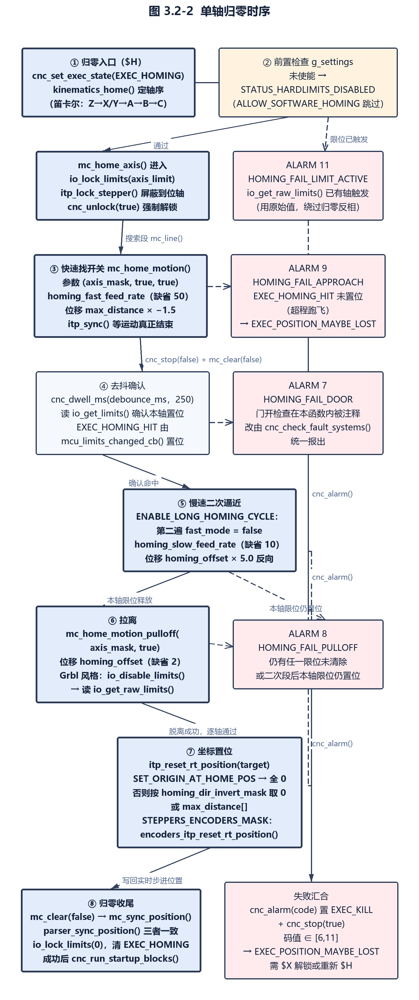

图 3.2-2 单轴归零时序

归零/探测中产生的直线运动本身仍走 `mc_line()`，其规划与分段机理属运动控制与速度规划范畴，本节只展开归零流程、设置项、告警与边界条件。

#### 3.2.7.1 归零入口与使能条件

- 需求标识：UC-FREQ327-1
- 功能描述：控制器提供一个「全机归零」入口 `cnc_home()`，它置位归零执行状态、调用运动学层的归零序列、在返回前清空并同步运动缓冲；上位机通过 Grbl 系统命令 `$H` 触发，未使能归零时该命令被拒绝
- 调用条件：收到 `$H` 命令（`GRBL_HOME`）时；调用前要求 `g_settings.homing_enabled` 为真，且若板级定义了 `SAFETY_DOOR` 则安全门状态为关
- 输入：无参数；依赖 `g_settings.homing_enabled`、`g_settings.hard_limits_enabled` 与各轴 `AXIS_*_HOMING_MASK`
- 输出：`STATUS_OK` 或运动学/校验返回的错误码；失败时经 `cnc_alarm()` 报出对应 ALARM 码；成功时追加执行启动块
- 处理：
- （1）解析器在 `GRBL_HOME` 分支先检查 `homing_enabled`，未使能直接返回 `STATUS_SETTING_DISABLED`，随后清 `EXEC_DOOR` 并在门仍开启时返回 `STATUS_CHECK_DOOR`，最后调用 `cnc_home()`（`uCNC/src/core/parser.c:763-776`）；
- （2）`cnc_home()` 先 `cnc_set_exec_state(EXEC_HOMING)`，再调用运动学层入口 `kinematics_home()`（`uCNC/src/cnc.c:471-496`）；
- （3）归零返回后清 `io_lock_limits(0)`（仅在 `ENABLE_MULTI_STEP_HOMING` 下），调用 `mc_clear(false)` 把运动控制与实时位置重新同步，并清 `EXEC_HOMING`（`uCNC/src/cnc.c:471-496`）；
- （4）仅当 `kinematics_home()` 返回 `STATUS_OK` 时才调用 `cnc_run_startup_blocks()` 执行非易失存储中的启动块（`uCNC/src/cnc.c:486-489`、`:1302-1336`）；
- （5）归零期间主循环忽略保持请求，`EXEC_HOMING` 下的 HOLD 不生效（`uCNC/src/cnc.c:643-681`）；
- （6）在 `EMULATE_GRBL_STARTUP > 2` 的构建中，`cnc_home()` 恒返回 `STATUS_OK`，错误只以 ALARM 形式呈现（`uCNC/src/cnc.c:471-496`）；
- （7）系统菜单模块也以发送串口命令 `$H\r` 的方式复用同一入口，不存在第二条归零代码路径（`uCNC/src/modules/system_menu.c:100`）。

#### 3.2.7.2 归零搜索运动的两段式流程

- 需求标识：UC-FREQ327-2
- 功能描述：单轴归零由「按归零方向快速（或慢速）搜索到限位触发」与「反向拉离或二次慢速脱离」两段构成，两段都通过 `mc_line()` 下发为普通进给运动，但以 `EXEC_HOMING`/`EXEC_LIMITS` 的组合位判定搜索段是否命中
- 调用条件：由 `mc_home_axis()` 依次调用；存在 `ENABLE_LONG_HOMING_CYCLE` 时搜索段会重复两遍（快速一遍、慢速一遍）
- 输入：`axis_mask`（参与归零的轴位掩码）、`is_origin_search`（搜索段或拉离段）、`fast_mode`（选 `homing_fast_feed_rate` 还是 `homing_slow_feed_rate`）、`homing_offset`、`max_distance[]`、`homing_dir_invert_mask`
- 输出：成功返回 `true` 并把运动状态清干净；搜索段未命中时置 `EXEC_POSITION_MAYBE_LOST` 并返回 `false`
- 处理：
- （1）`mc_home_motion()` 先 `mc_sync_position()` 取当前坐标，再为掩码内每个轴计算目标：搜索段位移为 `max_distance[i] * -1.5f`（按 `homing_dir_invert_mask` 决定加减，即朝极限方向越程 1.5 倍行程），拉离或二次段位移为 `homing_offset * 5.0f`（反向）（`uCNC/src/core/motion_control.c:863-914`）；
- （2）下发前调用 `cnc_unlock(true)` 强制解锁（清报警与 `EXEC_POSITION_MAYBE_LOST`，并把当前已触发的限位注入 `io_invert_limits_mask`），解锁失败则直接返回 `false`（`uCNC/src/core/motion_control.c:863-914`）；
- （3）`mc_line(target, &block_data)` 后 `itp_sync()` 等待运动真正结束；若结束时 `cnc_get_exec_state(EXEC_HOMING_HIT)` 不等于 `EXEC_HOMING_HIT`（限位未被触发，属超程跑飞），置 `EXEC_POSITION_MAYBE_LOST` 并返回 `false`（`uCNC/src/core/motion_control.c:863-914`）；
- （4）命中后 `cnc_stop(false)` 停运动、`mc_clear(false)` 清缓冲，返回 `true`（`uCNC/src/core/motion_control.c:863-914`）；
- （5）拉离段 `mc_home_motion_pulloff()` 结构相同，但位移恒为 `homing_offset`，且以 `cnc_get_exec_state(~EXEC_HOMING) != EXEC_IDLE` 判定失败；两个函数都使用 `MOTIONCONTROL_MODE_FEED`、主轴 0、dwell 0（`uCNC/src/core/motion_control.c:916-966`）；
- （6）搜索段的命中判据不是限位查询的返回值，而是执行状态位 `EXEC_HOMING_HIT`（等于 `EXEC_HOMING | EXEC_LIMITS`），它由限位中断回调 `mcu_limits_changed_cb()` 在归零运行为真时置位（`uCNC/src/cnc.h:67-78`；`uCNC/src/core/io_control.c:156-204`）。

#### 3.2.7.3 单轴归零时序与限位屏蔽

- 需求标识：UC-FREQ327-3
- 功能描述：`mc_home_axis()` 定义单轴归零的完整时序：前置检查、搜索段、去抖延时后确认限位、拉离或二次脱离、去抖后确认限位已释放；整个过程把限位输入锁定到本轴掩码，避免其它轴或另一端限位误触发报警
- 调用条件：由运动学层 `kinematics_home()` 逐轴调用；要求 `g_settings.hard_limits_enabled` 为真，否则返回 `STATUS_HARDLIMITS_DISABLED`（定义 `ALLOW_SOFTWARE_HOMING` 时改返回 `STATUS_OK` 直接跳过）
- 输入：`axis_mask`、`axis_limit`（本轴对应的限位 IO 掩码）、`g_settings.debounce_ms`，以及编译期 `ENABLE_GRBL_STYLE_HOMING`、`ENABLE_LONG_HOMING_CYCLE`、`ENABLE_MULTI_STEP_HOMING`
- 输出：`STATUS_OK` 或 `STATUS_CRITICAL_FAIL`；失败路径同时经 `cnc_alarm()` 置对应 ALARM；`ENABLE_MOTION_CONTROL_MODULES` 下额外触发 `mc_home_axis_start`/`mc_home_axis_finish` 事件并携带 `homing_status_t`
- 处理：
- （1）函数入口把插补器切到实时步进模式 `ITP_STEP_MODE_REALTIME` 并用 cleanup 属性确保退出时恢复；`ENABLE_MOTION_CONTROL_MODULES` 下构造 `homing_status_t` 并触发 `mc_home_axis_start`，其 `status` 初值为 `STATUS_CRITICAL_FAIL`，只有走到函数末尾才改写为 `STATUS_OK`，即任何提前返回都被事件处理器视为失败（`uCNC/src/core/motion_control.c:968-1081`）；
- （2）检查硬限位使能；在 `ENABLE_MULTI_STEP_HOMING`（由 `ENABLE_AXIS_AUTOLEVEL`、`IS_DELTA_KINEMATICS` 或 `ENABLE_XY_SIMULTANEOUS_HOMING` 自动打开）下调用 `io_lock_limits(axis_limit)` 把限位锁定掩码设为本次归零轴（`uCNC/src/core/motion_control.c:968-1081`；`uCNC/src/cnc_hal_config_helper.h:2212-2214`）；
- （3）调用 `cnc_unlock(true)` 后立即检查：若处于 `EXEC_HOLD|EXEC_ALARM` 或 `io_get_raw_limits()` 已有任意限位为真，报 `EXEC_ALARM_HOMING_FAIL_LIMIT_ACTIVE`（11）并返回 `STATUS_CRITICAL_FAIL`；此处用的是原始限位值，绕过归零期的限位反相（`uCNC/src/core/motion_control.c:1003-1007`）；
- （4）搜索段：`ENABLE_LONG_HOMING_CYCLE` 下用 `homing_passes = 2` 的 `while` 循环，第一遍 `fast_mode = true`、第二遍 `false`；未启用时只执行一遍快速搜索 `mc_home_motion(axis_mask, true, true)`（`uCNC/src/core/motion_control.c:968-1081`）；
- （5）搜索返回后 `cnc_dwell_ms(debounce)` 去抖，再读 `io_get_limits()`；若运动失败或该轴限位未置位，报 `EXEC_ALARM_HOMING_FAIL_APPROACH`（9）（`uCNC/src/core/motion_control.c:1032-1036`）；
- （6）脱离段有两条互斥实现：`ENABLE_GRBL_STYLE_HOMING` 下先 `io_disable_limits()` 临时屏蔽限位、执行快速 `mc_home_motion_pulloff(axis_mask, true)`、再 `io_enable_limits()` 并读 `io_get_raw_limits()`，只要仍有任何限位未清除即报 `EXEC_ALARM_HOMING_FAIL_PULLOFF`（8）；非 Grbl 风格下改为再执行一次慢速 `mc_home_motion(axis_mask, false, false)`（第二段搜索，位移 `homing_offset*5`），去抖后若本轴限位仍置位则同样报 8（`uCNC/src/core/motion_control.c:1038-1054`、`:1065-1069`）；
- （7）全部通过后才把 `homing_status.status` 置 `STATUS_OK` 并返回 `STATUS_OK`（`uCNC/src/core/motion_control.c:1050-1054`）；
- （8）限位屏蔽与解锁：`itp_lock_stepper()` 锁住已到位轴的脉冲输出，`io_lock_limits()`/`io_enable_limits()`/`io_disable_limits()` 控制限位输入的锁定与开关；插补器对方向映射的接口细节见 3.2.6.13（`uCNC/src/core/interpolator.c:1044-1049`；`uCNC/src/core/io_control.c:389-403`）；
- （9）归零过程中安全门开启的检查在 `mc_home_axis()` 内被注释掉，改由主循环的 `cnc_check_fault_systems()` 统一报 `EXEC_ALARM_HOMING_FAIL_DOOR`（7）（`uCNC/src/core/motion_control.c:1025-1029`；`uCNC/src/cnc.c:1204-1215`）。

#### 3.2.7.4 轴序、多轴与运动学差异

- 需求标识：UC-FREQ327-4
- 功能描述：归零顺序由运动学层而非运动控制层决定；笛卡尔类机器固定「Z 先归零，再 X、Y（可同时），最后 A/B/C」，多轴同时归零通过把多个轴位或进 `axis_mask` 由同一次 `mc_home_axis()` 处理
- 调用条件：`kinematics_home()` 在 `cnc_home()` 中被调用；每个轴的参与与否由 `AXIS_*_HOMING_MASK` 是否非零决定
- 输入：编译期轴定义、`LINACTn_LIMIT_MASK`、`ENABLE_XY_SIMULTANEOUS_HOMING`、`DISABLE_X/Y/Z/A/B/C_HOMING`
- 输出：任一轴失败立即整体返回该错误码，后续轴不再归零
- 处理：
- （1）笛卡尔顺序为 Z（`uCNC/src/hal/kinematics/kinematic_cartesian.c:52-58`）、X/Y（`:60-100`，`ENABLE_XY_SIMULTANEOUS_HOMING` 时两轴合并为一次 `mc_home_axis(AXIS_X_HOMING_MASK | AXIS_Y_HOMING_MASK, LINACT0_LIMIT_MASK | LINACT1_LIMIT_MASK)`）、A（`:102-108`）、B（`:110-116`）、C（`:118-124`）；
- （2）非 Grbl 风格下全部轴归零完成后追加一次整机 `mc_home_motion_pulloff(255, true)`，即所有轴一起快速拉离 `homing_offset`（`uCNC/src/hal/kinematics/kinematic_cartesian.c:126-131`）；
- （3）CoreXY 顺序与笛卡尔相同（`uCNC/src/hal/kinematics/kinematic_corexy.c:89-163`）；
- （4）SCARA 与 R-Theta 的顺序为 Z→X→Y→A→B→C（`uCNC/src/hal/kinematics/kinematic_scara.c:103-159`；`uCNC/src/hal/kinematics/kinematic_rtheta.c:87-142`）；
- （5）Delta 与线性 Delta 用 `LIMITS_DELTA_MASK` 做「Z 轴回到最高点」的整机归零，再归 A/B/C，并额外把 Z 拉离（`uCNC/src/hal/kinematics/kinematic_delta.c:340-371`；`uCNC/src/hal/kinematics/kinematic_linear_delta.c:148-179`）；
- （6）`AXIS_*_HOMING_MASK` 的统一构造规则为：轴已定义且其线性执行器限位掩码非零且未定义对应 `DISABLE_*_HOMING` 时取 `(1 << AXIS_*)`，否则为 0，即该轴不参与归零（`uCNC/src/cnc_hal_config_helper.h:2216-2245`）；
- （7）轴序不是配置项，任何「先 X 后 Z」之类的调整必须改运动学源文件，源码中没有归零顺序的设置项（`uCNC/src/hal/kinematics/kinematic_cartesian.c:46-148`）。

#### 3.2.7.5 归零完成后的坐标写入与原点设定

- 需求标识：UC-FREQ327-5
- 功能描述：归零序列最后以 `itp_reset_rt_position(target)` 把实时坐标按 `SET_ORIGIN_AT_HOME_POS` 与 `homing_dir_invert_mask` 重写为机器零点或行程上端，完成机器坐标系的确立；未使能归零时该原点被强制清零
- 调用条件：`kinematics_home()` 末尾，此时所有 `mc_home_axis()` 已成功
- 输入：编译期开关 `SET_ORIGIN_AT_HOME_POS`（配置层名为 `SUPPORT_SET_ORIGIN_AT_HOME_POS`）、`g_settings.homing_dir_invert_mask`、`g_settings.max_distance[]`、`g_settings.homing_enabled`
- 输出：重写后的实时步进位置 `itp_rt_step_pos`（若编译了编码器，同时重置编码器位置）；随后 `mc_clear(false)`、`mc_sync_position()`、`parser_sync_position()` 使机械坐标与 G 代码坐标一致
- 处理：
- （1）定义了 `SET_ORIGIN_AT_HOME_POS` 时目标数组全置 0，即归零位置即原点（`uCNC/src/hal/kinematics/kinematic_cartesian.c:134-142`）；
- （2）未定义时逐轴取值：`homing_dir_invert_mask` 对应位为 0 取 0，为 1 取 `max_distance[i]`，即归零位置落在行程的另一端（`uCNC/src/hal/kinematics/kinematic_cartesian.c:134-142`）；
- （3）`itp_reset_rt_position()` 内部另有一条保护：若 `homing_enabled` 为假，则无论传入什么都把原点取 0，因此 `SET_ORIGIN_AT_HOME_POS` 在未使能归零时实际失效（`uCNC/src/core/interpolator.c:980-993`）；
- （4）函数随后由坐标反算步进位置写入 `itp_rt_step_pos`，并在 `STEPPERS_ENCODERS_MASK != 0` 时调用 `encoders_itp_reset_rt_position(origin)` 同步编码器原点（`uCNC/src/core/interpolator.c:980-993`）；
- （5）`mc_sync_position()` 取实时步数、经 `kinematics_steps_to_coordinates()` 还原坐标并调用 `parser_sync_position()`，使插补器、运动控制与解析器三者位置一致（`uCNC/src/core/motion_control.c:1166-1171`）；
- （6）源码中没有 `mc_set_position()` 符号，写入坐标全部经 `itp_reset_rt_position()` 完成；G54–G59 等工件坐标系与 G28/G30 预置位不受归零影响，只受 `parser_sync_position()` 重新同步（`uCNC/src/core/interpolator.c:954-960`、`:980-993`）。

#### 3.2.7.6 归零失败与 ALARM 码

- 需求标识：UC-FREQ327-6
- 功能描述：归零过程的所有失败都以 Grbl 兼容 ALARM 码经 `cnc_alarm()` 上报，同时置 `EXEC_KILL` 停运动；其中 6–11 号属于归零失败族，会额外置 `EXEC_POSITION_MAYBE_LOST` 使机器进入锁定态（用户需求）
- 调用条件：归零前置检查失败、搜索未命中、拉离未脱离、复位中断、门开、复位请求等
- 输入：`cnc_alarm(code)` 的 `int8_t` 码值
- 输出：`proto_alarm(code)` 上报的 `ALARM:n`；`cnc_state.alarm` 被置为 `-code`（非中断上下文时），`cnc_has_alarm()` 随即为真；`EXEC_STATUS_LOCKED`/`ALARM` 状态
- 处理：
- （1）归零相关码值定义为：`EXEC_ALARM_HOMING_FAIL_RESET` 6、`EXEC_ALARM_HOMING_FAIL_DOOR` 7、`EXEC_ALARM_HOMING_FAIL_PULLOFF` 8、`EXEC_ALARM_HOMING_FAIL_APPROACH` 9、`EXEC_ALARM_HOMING_FAIL_DUAL_APPROACH` 10、`EXEC_ALARM_HOMING_FAIL_LIMIT_ACTIVE` 11（`uCNC/src/interface/grbl_interface.h:147-159`）；
- （2）`cnc_alarm()` 先置 `EXEC_KILL` 并 `cnc_stop(true)`（连工具一起停），仅当当前无活动报警或新码更严重时才记录；若码值落在 `[6,11]` 区间则 `cnc_set_exec_state(EXEC_POSITION_MAYBE_LOST)`（`uCNC/src/cnc.c:498-530`）；
- （3）非中断上下文上报 `proto_alarm(code)` 并把 `cnc_state.alarm` 存为负值（用于主循环识别「已上报」），`ENABLE_MAIN_LOOP_MODULES` 下再触发 `cnc_alarm` 事件（`uCNC/src/cnc.c:498-530`）；
- （4）归零过程中收到软复位时，`cnc_exec_rt_commands()` 检测 `EXEC_HOMING` 并报 `EXEC_ALARM_HOMING_FAIL_RESET`（6）后直接返回，不复位状态机（`uCNC/src/cnc.c:920-939`）；
- （5）门开或限位在非归零态触发时才升级为 1/13 号报警：`cnc_check_fault_systems()` 中 `EXEC_LIMITS` 只在 `!EXEC_HOMING` 时报 `EXEC_ALARM_HARD_LIMIT`（1）或 `EXEC_ALARM_HARD_LIMIT_NOMOTION`（13）（`uCNC/src/cnc.c:1183-1215`）；
- （6）失败后机器位置视为不可信，`cnc_get_status()` 在 `EXEC_POSITION_MAYBE_LOST` 下返回 `EXEC_STATUS_LOCKED`（归零中则为 `EXEC_STATUS_HOMING`），必须 `$X` 解锁或重新 `$H`（`uCNC/src/cnc.c:1338-1360`）。

> **实现说明**：`EXEC_ALARM_HOMING_FAIL_DUAL_APPROACH`（10，自校准双电机归零失败）在源码目录中只有定义、无任何使用点；`ENABLE_AXIS_AUTOLEVEL` 只被用来打开 `ENABLE_MULTI_STEP_HOMING`，代码中没有自校准双限位比较逻辑（`uCNC/src/interface/grbl_interface.h:147-159`；`uCNC/src/cnc_hal_config_helper.h:2212-2214`）。

#### 3.2.7.7 归零相关设置项

- 需求标识：UC-FREQ327-7
- 功能描述：归零行为由一组 Grbl 兼容编号的设置项驱动，含使能、去抖、方向反相、快/慢速归零进给率与拉离距离；设置写入时存在交叉约束，关闭归零会连带关闭软限位
- 调用条件：`$` 设置命令按编号写入 `g_settings`；归零流程读取上述字段
- 输入：设置编号与值（`settings_set` 路径）
- 输出：写入 `g_settings` 结构体（可选持久化到 EEPROM）；越界或负值返回 `STATUS_NEGATIVE_VALUE` 等错误
- 处理：
- （1）设置编号与字段映射见表 3.2-12，缺省值来自 `uCNC/src/interface/defaults.h`（`uCNC/src/interface/grbl_settings.c:118-123`、`:184-191`；`uCNC/src/interface/defaults.h:159-160`、`:187-188`、`:208-225`）；
- （2）写入编号 20（软限位）为真而 `homing_enabled` 为假时返回 `STATUS_SOFT_LIMIT_ERROR`，即软限位必须依赖归零参考（`uCNC/src/interface/grbl_settings.c:500-508`）；
- （3）写入编号 22（`homing_enabled`）为假时强制把 `soft_limits_enabled` 置假（`uCNC/src/interface/grbl_settings.c:500-508`）；
- （4）`debounce_ms` 同时用于归零搜索/拉离后的限位确认延时，以及 `mc_probe()` 的探针确认延时，探测复用同一设置项（`uCNC/src/interface/grbl_settings.c:118-123`；`uCNC/src/core/motion_control.c:1144`）；
- （5）`homing_fast_feed_rate`/`homing_slow_feed_rate` 直接作为 `block_data.feed` 使用，即内部单位与 F 字一致（解析器把 `MIN_SEC_MULT` 换算注释掉）（`uCNC/src/core/parser.c:1454`；`uCNC/src/core/motion_control.c:867`、`:920`）。

| 编号 | 字段 | 类型 | 缺省值 | 作用 | 证据 |
| --- | --- | --- | --- | --- | --- |
| 5 | `limits_invert_mask` | uint8 | `DEFAULT_LIMIT_INV_MASK`（板级） | 限位输入反相，参与 `io_get_raw_limits()` 的异或 | `uCNC/src/interface/grbl_settings.c:184-191` |
| 21 | `hard_limits_enabled` | bool | `DEFAULT_HARD_LIMITS_ENABLED`（板级） | 归零的前置条件；为假时 `mc_home_axis()` 直接拒绝 | `uCNC/src/interface/grbl_settings.h:59-67` |
| 22 | `homing_enabled` | bool | 0（`DEFAULT_HOMING_ENABLED`） | 归零总使能；为真时开机即锁定并要求 `$H` | `uCNC/src/interface/defaults.h:208-225` |
| 23 | `homing_dir_invert_mask` | uint8 | 0 | 归零方向，以及归零后原点是 0 还是 `max_distance` | `uCNC/src/interface/grbl_settings.c:184-191` |
| 24 | `homing_slow_feed_rate` | float | 10（`DEFAULT_HOMING_SLOW`） | 慢速归零进给率 | `uCNC/src/interface/defaults.h:208-225` |
| 25 | `homing_fast_feed_rate` | float | 50（`DEFAULT_HOMING_FAST`） | 快速归零进给率 | `uCNC/src/interface/defaults.h:208-225` |
| 26 | `debounce_ms` | uint16 | 250（`DEFAULT_DEBOUNCE_MS`） | 归零限位确认与探针确认的去抖延时 | `uCNC/src/interface/defaults.h:159-160` |
| 27 | `homing_offset` | float | 2（`DEFAULT_HOMING_OFFSET`） | 拉离距离；二次慢速段位移为其 5 倍 | `uCNC/src/interface/defaults.h:187-188` |

表 3.2-12 归零相关设置项（编号取自 `uCNC/src/interface/grbl_settings.c:162-236`，缺省值取自 `uCNC/src/interface/defaults.h`）

#### 3.2.7.8 归零与开机锁定、启动块的联动

- 需求标识：UC-FREQ327-8
- 功能描述：使能归零后，控制器在上电初始化阶段就把位置标记为不可信并进入锁定态，用户必须先 `$H` 才能运动；归零成功是执行非易失启动块的唯一自动时机
- 调用条件：`cnc_init()` 阶段（`homing_enabled` 为真时）与 `cnc_home()` 成功返回后
- 输入：`g_settings.homing_enabled`、非易失存储中的启动块内容、`EXEC_RESET_LOCKED` 掩码
- 输出：`EXEC_POSITION_MAYBE_LOST` 状态位与 `EXEC_STATUS_LOCKED` 报告；成功归零后执行启动块
- 处理：
- （1）`cnc_init()` 在 `homing_enabled` 为真时置 `EXEC_POSITION_MAYBE_LOST`，使 `cnc_get_status()` 在归零前返回 LOCKED（`uCNC/src/cnc.c:131-134`）；
- （2）`cnc_unlock()` 在 `homing_enabled` 为真时从 `EXEC_RESET_LOCKED` 中保留 `EXEC_POSITION_MAYBE_LOST`，即普通解锁不清除该位，与未使能归零时的行为相反（`uCNC/src/cnc.c:559-583`）；
- （3）`cnc_clear_exec_state()` 同样在 `cnc_state.alarm` 非零或 `homing_enabled` 为真时拒绝清除 `EXEC_POSITION_MAYBE_LOST`，硬限位已触发时也拒绝清除（`uCNC/src/cnc.c:683-732`）；
- （4）只有 `$H` 路径中 `mc_home_motion()` 内部的 `cnc_unlock(true)`（force 为真）才强制清报警与 `EXEC_POSITION_MAYBE_LOST`，这是归零搜索能启动的前提（`uCNC/src/cnc.c:559-583`；`uCNC/src/core/motion_control.c:863-914`）；
- （5）未使能归零时解锁流程会直接执行启动块（`cnc_unlock()` 内 `loop_state < LOOP_RUNNING && !homing_enabled` 分支），使能归零时该分支不可达，启动块改由 `cnc_home()` 成功后的 `cnc_run_startup_blocks()` 触发（`uCNC/src/cnc.c:627-630`、`:1302-1336`）。

#### 3.2.7.9 归零坐标（G28/G30）的存放与编译期联动

- 需求标识：UC-FREQ327-9
- 功能描述：归零支持开关不仅在行为上开关归零，还直接改变坐标系在非易失存储与结构体中的布局：关闭归零支持时 G28/G30 两个预置位不占用存储，G92 偏移的索引随之前移
- 调用条件：编译期定义或未定义 `DISABLE_HOME_SUPPORT`
- 输入：`DISABLE_HOME_SUPPORT`、`COORD_SYS_COUNT`、`G92_STORE_NONVOLATILE`
- 输出：`ADDITIONAL_COORDINATES`（2 或 0）、`TOTAL_COORDINATE_SYSTEMS`，以及随之变化的 `PARSER_CORDSYS_ADDRESS`/`G28ADDRESS`/`G30ADDRESS`/`G92ADDRESS` 与启动块基址
- 处理：
- （1）未定义 `DISABLE_HOME_SUPPORT` 时 `ADDITIONAL_COORDINATES` 为 2，否则为 0（`uCNC/src/interface/grbl_settings.h:122-142`）；
- （2）`G28HOME` 取 `COORD_SYS_COUNT`、`G30HOME` 取 `COORD_SYS_COUNT+1`，二者只在归零支持开启时才存在（`uCNC/src/interface/grbl_settings.h:122-142`）；
- （3）`G92OFFSET` 取 `COORD_SYS_COUNT + ADDITIONAL_COORDINATES`，因此关闭归零支持后 G92 的存储索引前移 2（`uCNC/src/interface/grbl_settings.h:122-142`）；
- （4）`G92_STORE_NONVOLATILE` 控制 G92 是否写入非易失存储，否则只存 RAM（`uCNC/src/interface/grbl_settings.h:122-142`）；
- （5）解析器侧对应 `DISABLE_HOME_SUPPORT` 的分支（G28/G30 校验、`parser_get_coordsys(28/30)`）以同一宏隔离（`uCNC/src/core/parser.c:1049-1054`、`:1081-1090`）；
- （6）协议层在 `$#` 查询时按同一布局输出 `[G28:]`/`[G30:]`/`[G92:]` 报告（`uCNC/src/interface/grbl_protocol.c:633-646`）。

### 3.2.8 探测（需求规格、用户需求）

探测以 `G38.2`–`G38.5` 四条对外指令驱动：控制器在实时步进模式下下发一次受监控的直线运动，探针电平发生期望方向的边沿时锁存当时的实时步进位置并触发受控停止，随后把锁存坐标换算为工程坐标并经 `[PRB:...]` 上报（`uCNC/src/core/parser.c:2002-2030`；`uCNC/src/core/motion_control.c:1084-1158`）。探针电平由 IO 层统一读取，只有编号 6 一个用户可调设置项，其余行为由编译期宏决定（`uCNC/src/core/io_control.c:497-524`）。探测运动与坐标锁存的关系如图 3.2-3 所示。

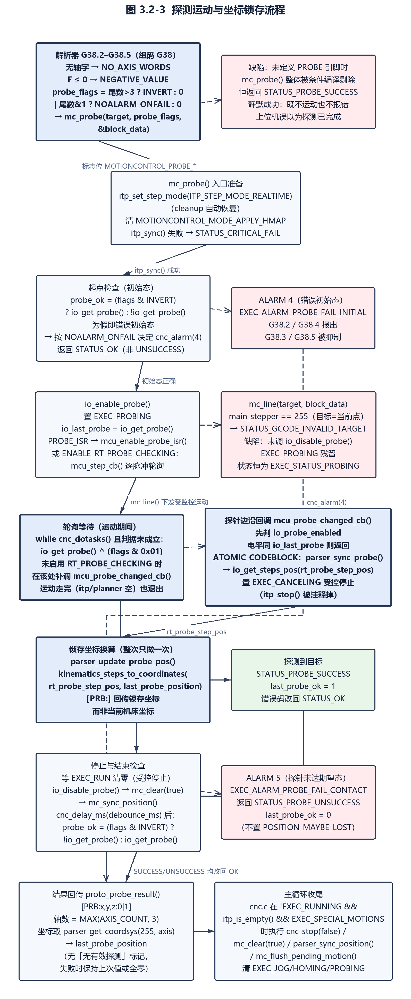

图 3.2-3 探测运动与坐标锁存流程

#### 3.2.8.1 G38.2–G38.5 的解析与参数校验

- 需求标识：UC-FREQ328-1
- 功能描述：解析器把 G38.2/G38.3/G38.4/G38.5 归入同一运动组代码 G38（38），用尾数区分四种语义，校验为「必须有轴字、尾数必须落在 2–5、必须有有效进给率」，然后以两个标志位调用 `mc_probe()`（用户需求）
- 调用条件：命令中 G38 属于模态运动组且带尾数；`DISABLE_PROBING_SUPPORT` 未定义时才参与编译
- 输入：G38 尾数、轴字（X/Y/Z…）、F 字或既有进给率
- 输出：校验失败返回 `STATUS_GCODE_NO_AXIS_WORDS`、`STATUS_GCODE_UNSUPPORTED_COMMAND`、`STATUS_GCODE_UNDEFINED_FEED_RATE`、`STATUS_NEGATIVE_VALUE` 等；成功时进入执行分支
- 处理：
- （1）带尾数的代码白名单中只有 38、39、43、59、61、90、92 允许出现尾数，其它带尾数的 G 代码返回 `STATUS_GCODE_COMMAND_VALUE_NOT_INTEGER`（`uCNC/src/core/parser.c:2430-2464`）；
- （2）G38 分支专门检查 `mantissa < 2 || mantissa > 5` 并返回 `STATUS_GCODE_UNSUPPORTED_COMMAND`，即 G38、G38.1、G38.6 均不支持（`uCNC/src/core/parser.c:2430-2464`；`uCNC/src/core/parser.h:45-47`）；
- （3）运动组校验中 G38 与 G0/G1 共用分支并额外要求 `has_axis`，无轴字即报错（`uCNC/src/core/parser.c:1128-1135`）；
- （4）进给率校验：G38 未把 `requires_feed` 置假，因此必须出现 F 字或已有非零进给率，且 F ≤ 0 报 `STATUS_NEGATIVE_VALUE`（`uCNC/src/core/parser.c:1261-1282`）；
- （5）执行时把尾数翻译为标志位：`probe_flags = (mantissa > 3) ? MOTIONCONTROL_PROBE_INVERT : 0`，再 `|= (mantissa & 0x01) ? MOTIONCONTROL_PROBE_NOALARM_ONFAIL : 0`，然后调用 `mc_probe(target, probe_flags, &block_data)`（`uCNC/src/core/parser.c:2007-2008`；`uCNC/src/core/motion_control.h:38-39`）；
- （6）探测执行结束后按返回值分流：`STATUS_PROBE_SUCCESS` 置 `last_probe_ok = 1`，`STATUS_PROBE_UNSUCCESS` 置 `last_probe_ok = 0`，两者都把错误改回 `STATUS_OK` 并调用 `parser_update_probe_pos()` 与 `proto_probe_result()`；其它错误（如无效目标、临界失败）只调用 `parser_sync_probe()` 并把错误码透传上去（`uCNC/src/core/parser.c:2013-2028`）。

| G 代码 | 尾数 | `flags` 位 | 语义（按源码行为） |
| --- | --- | --- | --- |
| G38.2 | 2 | 0 | 探针初始须为未触发；运动中信号由未触发变为触发即停止；失败报 ALARM 4/5 |
| G38.3 | 3 | `MOTIONCONTROL_PROBE_NOALARM_ONFAIL`=2 | 同 G38.2，但失败不报 ALARM |
| G38.4 | 4 | `MOTIONCONTROL_PROBE_INVERT`=1 | 初始须为已触发；运动中信号由触发变为未触发即停止；失败报 ALARM |
| G38.5 | 5 | 1 \| 2 = 3 | 同 G38.4，但失败不报 ALARM |

表 3.2-13 G38 尾数到标志位的映射（`uCNC/src/core/parser.c:2007-2008`、`uCNC/src/core/motion_control.h:38-39`）

#### 3.2.8.2 探针输入的读取与反相链路

- 需求标识：UC-FREQ328-2
- 功能描述：探针电平由 IO 层统一读取，读取时依次叠加设置项反相、板级条件宏与可选的自定义回调；探测开始前会把当前电平记入 `io_last_probe` 作为边沿判据基准
- 调用条件：`mc_probe()` 启动与结束检查、限位或探针中断回调、状态查询
- 输入：`IO_CONDITION_PROBE` 条件宏、`g_settings.probe_invert_mask`，以及 `PROBE_ENABLE_CUSTOM_CALLBACK` 时的三个函数指针
- 输出：`true`/`false` 电平值；未定义 `PROBE` 引脚时恒为 `false`
- 处理：
- （1）`io_get_probe()` 优先走自定义回调 `io_probe_custom_get`；否则在未定义 `PROBE` 引脚时直接返回 `false`（`uCNC/src/core/io_control.c:548-570`）；
- （2）有 `IO_CONDITION_PROBE` 时取 `bool probe = (IO_CONDITION_PROBE != 0)`，再按 `g_settings.probe_invert_mask` 决定是否取反（编号 6 的设置项，缺省 0 即不反相）（`uCNC/src/core/io_control.c:563-565`；`uCNC/src/interface/grbl_settings.c:171`；`uCNC/src/interface/defaults.h:159-160`）；
- （3）`io_enable_probe()` 置 `EXEC_PROBING` 状态、记录 `io_last_probe = io_get_probe()`，并在未强制软轮询且定义了 `PROBE_ISR` 时通过 `mcu_enable_probe_isr()` 打开引脚中断，最后置内部标志 `io_probe_enabled = true`（`uCNC/src/core/io_control.c:505-525`）；
- （4）`io_disable_probe()` 同时清 `EXEC_PROBING | EXEC_STOPPING`（用于结束探测运动），关闭中断或自定义回调并清 `io_probe_enabled`（`uCNC/src/core/io_control.c:527-546`）；
- （5）探针引脚中断的服务程序在 MCU 映射层绑定到 `mcu_probe_changed_cb()`（例如 `mcumap_rp2040.h` 定义 `PROBE_ISRCALLBACK mcu_probe_isr`），核心逻辑见 3.2.8.4（`uCNC/src/core/io_control.c:275-307`）；
- （6）`ENABLE_RT_PROBE_CHECKING` 强制取消 `PROBE_ISR` 并把 `mcu_enable_probe_isr`/`mcu_disable_probe_isr` 变成空宏，改由步进中断逐脉冲轮询（`uCNC/src/cnc_hal_config_helper.h:193-207`）；
- （7）源码中没有为探针输入实现数字滤波或多点采样去抖，唯一的去抖是探测结束后的固定延时 `cnc_delay_ms(g_settings.debounce_ms)`，复用的是归零设置项 26（`uCNC/src/core/motion_control.c:1144`；`uCNC/src/core/io_control.c:548-570`）。

#### 3.2.8.3 探测运动执行与实时触发停止

- 需求标识：UC-FREQ328-3
- 功能描述：`mc_probe()` 在实时步进模式下下发一次受监控的直线运动；运动期间由探针边沿（中断或逐脉冲轮询）触发受控停止，而非立即切断脉冲，从而在锁定坐标前保留一段减速行程；**未定义 `PROBE` 引脚时 `mc_probe()` 的函数体被预处理整段剔除，函数只返回成功码且不产生任何运动**
- 调用条件：`mc_probe()` 被 G38 执行分支或高度图采样调用；要求 `itp_sync()` 成功
- 输入：`target[]`（探测目标坐标）、`flags`、`block_data`
- 输出：`STATUS_PROBE_SUCCESS`（探测到目标）、`STATUS_PROBE_UNSUCCESS`（未触发到目标）、`STATUS_GCODE_INVALID_TARGET`（目标即当前点）、`STATUS_CRITICAL_FAIL`（同步失败）；未定义 `PROBE` 引脚时返回 `STATUS_PROBE_SUCCESS` 但不发生任何运动、也不报告任何错误
- 处理：
- （1）入口把插补器切到实时步进模式（cleanup 恢复）；若编译了高度图则先清掉本块 `block_data` 的 `MOTIONCONTROL_MODE_APPLY_HMAP` 位，保证探测运动不受高度补偿影响，然后 `itp_sync()`（`uCNC/src/core/motion_control.c:1087-1095`）；
- （2）起点检查：`probe_ok = (flags & INVERT) ? io_get_probe() : !io_get_probe()`；为假说明探针处于错误初始态，按 `NOALARM_ONFAIL` 决定是否报 `EXEC_ALARM_PROBE_FAIL_INITIAL`（4），随后返回 `STATUS_OK`（而非 `STATUS_PROBE_UNSUCCESS`）（`uCNC/src/core/motion_control.c:1097-1107`）；
- （3）`io_enable_probe()` 后 `mc_line(target, block_data)`；若 `block_data->main_stepper == 255`（目标与当前点重合），返回 `STATUS_GCODE_INVALID_TARGET`（`uCNC/src/core/motion_control.c:1113-1116`）；
- （4）轮询等待：循环执行 `cnc_dotasks()` 与探针电平判据 `io_get_probe() ^ (flags & 0x01)`，未启用 `ENABLE_RT_PROBE_CHECKING` 时在判据成立处直接调用 `mcu_probe_changed_cb()` 补做边沿处理；判据成立或运动自然走完（`!itp_is_empty() || !planner_buffer_is_empty()` 为假）时退出（`uCNC/src/core/motion_control.c:1119-1132`）；
- （5）退出后再等 `EXEC_RUN` 清零（受控停止完成，`while (cnc_dotasks() && cnc_get_exec_state(EXEC_RUN));`），然后 `io_disable_probe()` 与 `mc_clear(true)`（保留工具数据地清空），并 `mc_sync_position()` 把运动控制坐标拉回真实位置（`uCNC/src/core/motion_control.c:1134-1142`）；
- （6）结束检查在 `cnc_delay_ms(debounce_ms)` 之后进行：`probe_ok = (flags & INVERT) ? !io_get_probe() : io_get_probe()`；为假则按 `NOALARM_ONFAIL` 决定是否报 `EXEC_ALARM_PROBE_FAIL_CONTACT`（5）并返回 `STATUS_PROBE_UNSUCCESS`（`uCNC/src/core/motion_control.c:1144-1154`）；
- （7）未定义 `PROBE` 引脚时，`mc_probe()` 的整个函数体被条件编译剔除，调用方得到的是恒为 `STATUS_PROBE_SUCCESS` 的返回值：探测指令**静默成功**，既不运动也不报错，上位机据此认为探测已完成（`uCNC/src/core/motion_control.c:1083-1086`、`:1155-1157`）；
- （8）探测期间状态报告恒为 `EXEC_STATUS_PROBING`（`uCNC/src/cnc.c:1387-1391`）；
- （9）逐脉冲轮询路径在步进回调内比较探针电平并在变化时调用 `mcu_probe_changed_cb()`，用于没有探针引脚中断的构型（`uCNC/src/core/interpolator.c:1079-1104`）。

> **实现说明（缺陷）**：`mc_probe()` 在第（3）步返回 `STATUS_GCODE_INVALID_TARGET` 时没有调用 `io_disable_probe()`，`EXEC_PROBING` 会残留，此时 `cnc_get_status()` 持续返回 `EXEC_STATUS_PROBING`（`uCNC/src/core/motion_control.c:1113-1116`、`:1138`；`uCNC/src/cnc.c:1387-1391`）。

#### 3.2.8.4 探针坐标的实时锁存

- 需求标识：UC-FREQ328-4
- 功能描述：探针触发瞬间必须锁存当时的实时步进位置，而不是等运动完全停止后再取，否则减速行程会带来测量偏差；锁存值经坐标换算后同时供 `[PRB:]` 报告与高度图采样使用
- 调用条件：`mcu_probe_changed_cb()` 被引脚中断（`PROBE_ISR`）或步进中断（`ENABLE_RT_PROBE_CHECKING`）调用
- 输入：`io_probe_enabled`、`io_last_probe`、当前探针电平
- 输出：`rt_probe_step_pos[]`（步进坐标锁存值）、`parser_parameters.last_probe_position[]`（换算后的坐标）、执行状态 `EXEC_CANCELING`
- 处理：
- （1）回调先判 `io_probe_enabled`，未使能直接返回；再取当前电平，与 `io_last_probe` 相同则返回，即只处理边沿（`uCNC/src/core/io_control.c:275-307`）；
- （2）电平变化时更新 `io_last_probe`，在 `ATOMIC_CODEBLOCK` 内调用 `parser_sync_probe()`，其实现为 `io_get_steps_pos(rt_probe_step_pos)`，即把插补器当前的实时步进位置原子地拷出（`uCNC/src/core/parser.c:383-396`；`uCNC/src/core/io_control.c:730`）；
- （3）随后置 `EXEC_CANCELING` 触发受控停止，源码中 `itp_stop()` 被显式注释掉，注释说明用一个受控停止替代直接停机（`uCNC/src/core/io_control.c:275-307`）；
- （4）主循环在 `!EXEC_RUNNING && itp_is_empty() && EXEC_SPECIAL_MOTIONS` 成立时执行收尾：`cnc_stop(false)`、`mc_clear(true)`、`parser_sync_position()`、`mc_flush_pending_motion()`，并清 `EXEC_JOG | EXEC_HOMING | EXEC_PROBING`（`uCNC/src/cnc.c:1218-1241`）；
- （5）`io_get_steps_pos()` 按各轴步进计数器（含编码器修正路径）组装位置数组，`rt_probe_step_pos` 在解析器初始化时清零（`uCNC/src/core/io_control.c:730`；`uCNC/src/core/parser.c:48`、`:184`）；
- （6）坐标换算由 `parser_update_probe_pos()` 完成（`kinematics_steps_to_coordinates(rt_probe_step_pos, last_probe_position)`），只在探测成功或失败分流后调用一次（`uCNC/src/core/parser.c:383-396`、`:2013-2028`）。

#### 3.2.8.5 探测失败与告警

- 需求标识：UC-FREQ328-5
- 功能描述：探测的两类失败分别以 ALARM 4（初始态已触发或未就绪）与 ALARM 5（运动中未触达）上报；G38.3/G38.5 通过 `MOTIONCONTROL_PROBE_NOALARM_ONFAIL` 抑制报警，但仍以 `STATUS_PROBE_UNSUCCESS` 与 `last_probe_ok = 0` 体现失败（用户需求）
- 调用条件：`mc_probe()` 的起点检查与终点检查失败时
- 输入：`flags` 的 `NOALARM_ONFAIL` 位、探针电平
- 输出：`cnc_alarm(4)` 或 `cnc_alarm(5)`（仅未抑制时）；`STATUS_PROBE_UNSUCCESS`；`parser_parameters.last_probe_ok` 置 0
- 处理：
- （1）起点失败（探针处于错误初始态）时，带 `INVERT` 的探测要求初始已触发、不带则要求初始未触发；失败报 4 号告警并返回 `STATUS_OK`，因此解析器会把 `last_probe_ok` 记 0 但不产生错误码（`uCNC/src/core/motion_control.c:1097-1107`；`uCNC/src/core/parser.c:2013-2028`）；
- （2）终点失败（运动结束或受控停止后探针仍未到达期望态）报 5 号告警并返回 `STATUS_PROBE_UNSUCCESS`，解析器把错误改回 `STATUS_OK` 并把 `last_probe_ok` 记 0（`uCNC/src/core/motion_control.c:1144-1154`；`uCNC/src/core/parser.c:2013-2028`）；
- （3）被抑制告警时（G38.3/G38.5）完全不调用 `cnc_alarm()`，机器不停机，`[PRB:...:0]` 报告失败（`uCNC/src/core/motion_control.c:1097-1107`、`:1144-1154`）；
- （4）探针目标超出软限位时不是探针错误，而是 `mc_line()` 返回的 `STATUS_TRAVEL_EXCEEDED` 或软限位告警，`mc_probe()` 不检查该返回值（`uCNC/src/core/motion_control.c:317-348`）；
- （5）`STATUS_CRITICAL_FAIL` 只在 `itp_sync()` 失败时产生，用于指示运动无法同步（`uCNC/src/core/motion_control.c:1084-1097`）；
- （6）告警码定义与上报路径与归零共用：`EXEC_ALARM_PROBE_FAIL_INITIAL` 4、`EXEC_ALARM_PROBE_FAIL_CONTACT` 5（`uCNC/src/interface/grbl_interface.h:150-151`）；
- （7）探测失败不置 `EXEC_POSITION_MAYBE_LOST`，因为 4/5 不在 `[EXEC_ALARM_HOMING_FAIL_RESET, EXEC_ALARM_HOMING_FAIL_LIMIT_ACTIVE]` 区间内，失败后机器仍可继续运动（`uCNC/src/cnc.c:508-512`）。

#### 3.2.8.6 探测结果回传 `[PRB:...]`

- 需求标识：UC-FREQ328-6
- 功能描述：每次探测结束（成功或失败）都向上位机回传一条 Grbl 兼容的 `[PRB:x,y,z:ok]` 反馈；`$#` 参数查询也会附带输出最近一次探测结果；回传的是探测锁存坐标而不是当前机床坐标（用户需求）
- 调用条件：`proto_probe_result(val)` 在 G38 执行分流成功后调用一次，或在 `$#` 查询时调用
- 输入：`parser_get_probe_result()`（即 `last_probe_ok`）与 `parser_get_coordsys(255, axis)`（即 `last_probe_position`）
- 输出：`[PRB:<x>,<y>,<z>[:<0|1>]]` 形式的串口反馈，轴数取 `MAX(AXIS_COUNT, 3)`
- 处理：
- （1）`proto_probe_result()` 打印 `[PRB:` 后调用 `parser_get_coordsys(255, axis)`（该分支直接返回 `parser_parameters.last_probe_position`）并按 `MAX(AXIS_COUNT,3)` 个轴输出，随后输出 `:` 与状态值，最后以 `MSG_FEEDBACK_END`（`]`）结束（`uCNC/src/interface/grbl_protocol.c:654`、`:659-671`；`uCNC/src/core/parser.c:286-292`）；
- （2）状态值来自 `parser_get_probe_result()`，成功为 1、失败为 0（`uCNC/src/core/parser.c:316-319`）；
- （3）高度图采样时也会逐点调用 `proto_probe_result(1)`，因此一次 G39 会输出与采样点数相同的 `[PRB:]` 行（`uCNC/src/core/motion_control.c:1357`）；
- （4）`$#` 查询在输出 `[G54:]`…`[G28:]`/`[G30:]`/`[G92:]`/`[TLO:]` 之后调用同一个 `proto_probe_result()`（`uCNC/src/interface/grbl_protocol.c:654`、`:659-671`）；
- （5）`[PRB:]` 中的坐标是探测锁存值（`last_probe_position`）；若某次探测从未成功执行，该数组保持上次值或全零，源码没有「无有效探测」标记（`uCNC/src/core/parser.c:286-292`、`:383-396`）。

#### 3.2.8.7 探针相关设置项与编译期开关

- 需求标识：UC-FREQ328-7
- 功能描述：探针只有一个用户可调设置项（编号 6 反相），其余行为由编译期宏控制：探测支持总开关、引脚定义、中断方式、自定义回调与运行时轮询
- 调用条件：设置写入或编译配置阶段
- 输入：编号 6 的布尔值；`DISABLE_PROBING_SUPPORT`、`PROBE`、`PROBE_ISR`、`PROBE_PULLUP_ENABLE`、`ENABLE_RT_PROBE_CHECKING`、`FORCE_SOFT_POLLING`、`PROBE_ENABLE_CUSTOM_CALLBACK`
- 输出：`g_settings.probe_invert_mask`（持久化）；宏会改变编译产物，含自动关闭 G39（见 3.2.9）
- 处理：
- （1）唯一探针设置项为编号 6 的 `probe_invert_mask`（bool，缺省 0），作用于 `io_get_probe()` 的最终电平（`uCNC/src/interface/grbl_settings.h:48`；`uCNC/src/interface/grbl_settings.c:171`；`uCNC/src/interface/defaults.h:159-160`）；
- （2）`DISABLE_PROBING_SUPPORT` 移除 G38 解析与执行分支以及 `mc_probe()` 的声明与实现（`uCNC/src/core/parser.c:2002`、`:2439-2444`；`uCNC/src/core/motion_control.c:1083-1084`）；
- （3）探针引脚由板级 `PROBE` 定义，可选 `PROBE_PULLUP_ENABLE`（映射为 `PROBE_PULLUP`）启用上拉（`uCNC/src/core/io_control.c:497-503`）；
- （4）`PROBE_ISR` 决定是否使用引脚电平中断；`ENABLE_RT_PROBE_CHECKING` 则相反——取消 `PROBE_ISR`、把开关中断宏变成空操作，改为在 `mcu_step_cb()` 每输出一次脉冲就调用一次 `mcu_probe_changed_cb()`（`uCNC/src/cnc_hal_config_helper.h:193-207`；`uCNC/src/core/interpolator.c:1079-1104`）；
- （5）`FORCE_SOFT_POLLING` 也会让开关中断宏失效，探测改由 `mc_probe()` 的轮询循环检查（`uCNC/src/core/io_control.c:520-522`、`:539-541`）；
- （6）`PROBE_ENABLE_CUSTOM_CALLBACK` 允许用外部函数替换「读电平」「使能」「禁用」三个动作，等离子 THC 模块据此复用 `mc_probe()`（`uCNC/src/core/io_control.c:550-554`；`uCNC/src/hal/tools/tools/plasma_thc.c:190-197`）；
- （7）控制器启动时强制关闭探针，避免上电残留的使能状态（`uCNC/src/cnc.c:111`）。

| 宏 | 定义位置（示例） | 作用 |
| --- | --- | --- |
| `DISABLE_PROBING_SUPPORT` | 板级或 `cnc_config.h` | 关闭 G38 与 `mc_probe()`，并连带关闭 G39 |
| `PROBE` | 板级 boardmap | 探针输入引脚；未定义时 `io_get_probe()` 恒假且 `mc_probe()` 不执行运动、静默返回成功 |
| `PROBE_ISR` | 板级 boardmap（如 `uCNC/src/hal/boards/avr/boardmap_uno.h:82`） | 探针电平中断通道 |
| `ENABLE_RT_PROBE_CHECKING` | 板级 boardmap（如 `uCNC/src/hal/boards/avr/boardmap_mega_shield_v3.h:93`） | 取消探针中断，改为步进脉冲级轮询 |
| `FORCE_SOFT_POLLING` | 板级或 `cnc_config.h` | 禁用引脚中断，全部改软轮询 |
| `PROBE_PULLUP_ENABLE` | 板级 boardmap | 转换为 `PROBE_PULLUP` 上拉 |
| `PROBE_ENABLE_CUSTOM_CALLBACK` | 板级或模块 | 允许外部替换探针读写回调 |

表 3.2-14 探针相关编译期开关（示例定义位置见 `uCNC/src/hal/boards/`）

### 3.2.9 高度图（需求规格、用户需求）

高度图（G39）是一组**默认关闭**的可选功能：控制器在指定矩形区域内按网格逐点执行一次探针采样，把测得的工具轴高度存成一张二维偏移表，此后在直线运动中按双线性插值把偏移量加到工具轴目标坐标上，使 Z 随 XY 起伏（`uCNC/src/core/motion_control.c:1268-1433`、`:1233-1266`；`uCNC/src/core/parser.c:2031-2048`）。补偿以「改写目标 Z」而不是「在输出级叠加」的方式实现，因此它会影响软限位判定与进给率、加速度的几何计算，源码在算完限位与几何量后逐处还原，这也是 `mc_line()` 中出现 6 组条件还原代码的原因（`uCNC/src/core/motion_control.c:310-314`、`:320-323`、`:368-372`、`:385-387`、`:393-397`、`:432-435`）。G39 的采样与补偿数据流如图 3.2-4 所示。

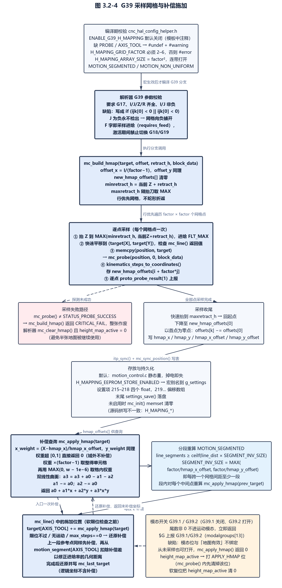

图 3.2-4 G39 采样网格与补偿施加

圆弧路径 `mc_arc()` 内部逐段调用 `mc_line()`，因此圆弧同样受补偿影响（`uCNC/src/core/motion_control.c:624-647`）。

#### 3.2.9.1 启用条件与编译期校验

- 需求标识：UC-FREQ329-1
- 功能描述：高度图是一组默认关闭的可选功能，必须由用户在 `cnc_config.h` 中显式打开 `ENABLE_G39_H_MAPPING`；打开后还有三重编译期约束——探测支持不能被关闭、必须存在工具轴 `AXIS_TOOL`、网格因子必须在 2–6 之间，否则自动降级或直接编译报错
- 调用条件：预处理阶段（`cnc_hal_config_helper.h` 被所有板级配置包含）
- 输入：`ENABLE_G39_H_MAPPING`、`DISABLE_PROBING_SUPPORT`、`AXIS_TOOL`、`H_MAPING_GRID_FACTOR`、`H_MAPPING_EEPROM_STORE_ENABLED`
- 输出：`ENABLE_G39_H_MAPPING` 被 `#undef`（并给出 `#warning`）或保留；`H_MAPING_ARRAY_SIZE` 定义为 `H_MAPING_GRID_FACTOR²`；`H_MAPPING_EEPROM_STORE_ENABLED` 在功能关闭时被 `#undef`
- 处理：
- （1）定义了 `DISABLE_PROBING_SUPPORT` 时，`ENABLE_G39_H_MAPPING` 被取消并给出警告「disabled via DISABLE_PROBING_SUPPORT」，因为采样依赖 `mc_probe()`（`uCNC/src/cnc_hal_config_helper.h:2355-2376`）；
- （2）未定义 `AXIS_TOOL` 时同样被取消，警告文案为「disabled via because AXIS_TOOL is not defined」，因为高度图只补偿工具轴（`uCNC/src/cnc_hal_config_helper.h:2355-2376`）；
- （3）`H_MAPING_GRID_FACTOR < 2 || > 6` 触发 `#error "H_MAPING_GRID_FACTOR must be a value between 2 and 6"`，合法区间即 4–36 个采样点（`uCNC/src/cnc_hal_config_helper.h:2355-2376`）；
- （4）功能开启时定义 `H_MAPING_ARRAY_SIZE`；功能关闭时无条件 `#undef H_MAPPING_EEPROM_STORE_ENABLED`，避免把无用的 215–255 号设置项编进固件（`uCNC/src/cnc_hal_config_helper.h:2355-2376`）；
- （5）模板配置中该开关默认被注释，网格因子缺省 3（9 点），EEPROM 存储默认也关闭，因此默认构建不含 G39（`uCNC/cnc_config.h:512-538`）；
- （6）打开该宏会连带打开 `MOTION_SEGMENTED` 与 `MOTION_NON_UNIFORM`，因为高度补偿要求把长直线切成小段以逐段重算补偿量（`uCNC/src/core/motion_control.c:35-44`）；
- （7）`G39` 常量只在功能开启时定义，关闭时解析器的对应分支整体不参与编译（`uCNC/src/core/parser.h:42-44`）；
- （8）源码中存在两处拼写不一致的宏名：数组与网格用 `H_MAPING_*`（少一个 P），存储开关用 `H_MAPPING_EEPROM_STORE_ENABLED`（双 P），二者按源码原样使用（`uCNC/src/cnc_hal_config_helper.h:2355-2376`；`uCNC/src/core/motion_control.c:72-92`）。

#### 3.2.9.2 G39 的参数形态与参数校验

- 需求标识：UC-FREQ329-2
- 功能描述：G39 用一行同时描述采样区域、探测深度与采样网格尺寸：X/Y 为区域左下角、I/J 为区域在 X/Y 方向的总跨度、Z 为探测深度目标、R 为安全抬刀高度；G39 还可带尾数 1/2 作为补偿开关；校验要求平面为 G17、I/J/Z/R 四个字齐全、I/J 非负（用户需求）
- 调用条件：G39 属于模态运动组且带轴字（`has_axis || GCODE_GROUP_MOTION`），在参数校验阶段处理
- 输入：X/Y/Z 轴字（`words->xyzabc`）、I/J（`words->ijk[0]`/`[1]`）、R（`words->r`）、当前平面 `new_state->groups.plane`
- 输出：校验失败返回 `STATUS_GCODE_VALUE_WORD_MISSING`、`STATUS_NEGATIVE_VALUE`、`STATUS_INVALID_PLANE_SELECTED`；通过后进入执行分支
- 处理：
- （1）G39 允许带尾数（白名单只在 `ENABLE_G39_H_MAPPING` 下加入），尾数非 0 时在字处理阶段就改写模态位并提前返回，不进入运动校验（`uCNC/src/core/parser.c:2430-2454`、`:2466-2468`）；
- （2）无尾数（G39）时要求 `plane == G17`，否则返回 `STATUS_INVALID_PLANE_SELECTED`（`uCNC/src/core/parser.c:1202-1223`）；
- （3）要求 `I`、`J`、`Z`、`R` 四个字全部出现，缺任一返回 `STATUS_GCODE_VALUE_WORD_MISSING`（`uCNC/src/core/parser.c:1202-1223`）；
- （4）要求 I、J 非负（负值返回 `STATUS_NEGATIVE_VALUE`）；该校验存在实现缺陷，判断写成 `if (words->ijk[0] < 0 || words->ijk[0] < 0)`，两侧都检查 I，**J 为负永远不会被检出**，后续 `mc_build_hmap()` 会用该负跨度算出负的网格步距并把采样点向反方向排布（`uCNC/src/core/parser.c:1217`；`uCNC/src/core/motion_control.c:1268`）；
- （5）G39 没有把 `requires_feed` 置假，因此 G39 行仍需 F 字或已有非零进给率，该进给率即采样时的探测进给率，`block_data->feed` 被透传给 `mc_build_hmap()` 并作为 `mc_probe()` 的进给（`uCNC/src/core/parser.c:1202-1223`、`:1261-1282`）；
- （6）高度图激活期间禁止切换到 G18/G19：校验阶段与执行阶段的平面选择处都检查 `height_map_active` 并返回 `STATUS_INVALID_PLANE_SELECTED`，因为补偿固定施加在 `AXIS_TOOL` 且网格定义在 XY 平面（`uCNC/src/core/parser.c:1167-1172`、`:1185-1191`、`:1561-1566`、`:1575-1580`）。

> **实现说明（缺陷）**：上述 I/J 校验缺陷的后果限于参数校验放行，实际运行为「网格向负方向铺开」而非立即报错，属可用性与安全问题而非内存越界——`offset_x`/`offset_y` 只影响循环步进量，数组索引仍由 `H_MAPING_GRID_FACTOR` 约束（`uCNC/src/core/parser.c:1217`；`uCNC/src/core/motion_control.c:1304-1313`、`:1320-1364`）。

#### 3.2.9.3 高度图采样构建流程

- 需求标识：UC-FREQ329-3
- 功能描述：`mc_build_hmap()` 按 `H_MAPING_GRID_FACTOR × H_MAPING_GRID_FACTOR` 的行优先网格逐点执行「抬高、平移到点、探测、记录 Z」，全部采样完成后再把测得的 Z 值相对第一个采样点归零、存入高度图表并落盘（可选）、打印
- 调用条件：解析器 G39 执行分支调用 `mc_build_hmap(target, words->ijk, words->r, &block_data)`
- 输入：`target[]`（X/Y 为区域左下角、`AXIS_TOOL` 为探测深度）、`offset[]`（I/J 跨度）、`retract_h`（R 安全抬刀高度）、`block_data->feed`（探测进给率）
- 输出：返回 `STATUS_OK` 表示地图已建成并激活；任一步失败返回该步错误码，采样失败统一为 `STATUS_CRITICAL_FAIL`
- 处理：
- （1）记录起点 `start_x`/`start_y`，把跨度换算为网格步距 `offset_x = offset[0]/(H_MAPING_GRID_FACTOR-1)`、`offset_y` 同理；准备临时数组 `new_hmap_offsets[H_MAPING_ARRAY_SIZE]` 并清零（`uCNC/src/core/motion_control.c:1304-1313`）；
- （2）取当前位置，`minretract_h = position[AXIS_TOOL] + retract_h`，`maxretract_h` 初始等于它并在每次抬刀时取 `MAX(maxretract_h, 当前Z + retract_h)`，用于最后一次性抬到本次采样中所需的最大安全高度（`uCNC/src/core/motion_control.c:1317-1318`）；
- （3）对每一行 j、每一列 i：先把 Z 抬到 `MAX(minretract_h, 当前Z + retract_h)`（进给 `FLT_MAX` 即快速），再以快速平移到 `(target[X], target[Y])`，两步都检查 `mc_line()` 返回值（`uCNC/src/core/motion_control.c:1320-1346`）；
- （4）把进给换回采样进给 `feed`，`memcpy(position, target, ...)` 后调用 `mc_probe(position, 0, block_data)`；标志位恒为 0，即按 G38.2 语义探测且失败会报 ALARM 4/5；返回值不等于 `STATUS_PROBE_SUCCESS` 时直接返回 `STATUS_CRITICAL_FAIL`，整张地图作废（`uCNC/src/core/motion_control.c:1347-1350`）；
- （5）探测成功后通过 `parser_get_probe(probe_position)` 取锁存步进位置、经 `kinematics_steps_to_coordinates()` 转成坐标，把 `position[AXIS_TOOL]` 存入 `new_hmap_offsets[i + H_MAPING_GRID_FACTOR * j]`，并逐点调用 `proto_probe_result(1)` 上报 `[PRB:]`（`uCNC/src/core/motion_control.c:1352-1357`）；
- （6）每采完一个点 `target[AXIS_X]` 累加 `offset_x`；每行结束后 `target[AXIS_Y]` 累加 `offset_y`，即行优先且不蛇形折返，每一行都从该行最左侧重新开始（`uCNC/src/core/motion_control.c:1358-1364`）；
- （7）全部采样后快速抬到 `maxretract_h`、快速平移回起点，再以采样进给下降到第一个采样点的 Z（`new_hmap_offsets[0]`）（`uCNC/src/core/motion_control.c:1366-1394`）；
- （8）以第一个采样点为零点重新标定：`new_hmap_offsets[k] -= new_hmap_offsets[0]`，使补偿量为相对值（`uCNC/src/core/motion_control.c:1396-1406`）；
- （9）写入 `hmap_x`/`hmap_y`/`hmap_x_offset`/`hmap_y_offset` 与 `hmap_offsets`（或 `g_settings` 同名成员），在 `H_MAPPING_EEPROM_STORE_ENABLED` 下调用 `settings_save()` 落盘，随后 `mc_print_hmap()` 打印地图、`itp_sync()` 同步并 `mc_sync_position()` 复位坐标系统（`uCNC/src/core/motion_control.c:1408-1430`；`uCNC/src/core/motion_control.c:1213-1231`）；
- （10）`mc_build_hmap()` 返回非 `STATUS_OK` 时，解析器执行分支调用 `mc_clear_hmap()` 并把 `height_map_active` 置 0，避免半张地图被继续使用（`uCNC/src/core/parser.c:2031-2048`）。

#### 3.2.9.4 高度图数据的存放与持久化

- 需求标识：UC-FREQ329-4
- 功能描述：高度图表默认存放在 `motion_control.c` 的静态变量中，掉电即失；只有打开 `H_MAPPING_EEPROM_STORE_ENABLED` 时才改存到 `g_settings` 结构体并获得 215–255 号设置项与 EEPROM 持久化能力
- 调用条件：编译期选择；运行期在 `mc_build_hmap()` 末尾写入，在 `mc_init()` 与 `mc_clear_hmap()` 中清零
- 输入：`H_MAPPING_EEPROM_STORE_ENABLED`、`H_MAPING_ARRAY_SIZE`、`H_MAPING_GRID_FACTOR`
- 输出：`hmap_x`、`hmap_y`、`hmap_x_offset`、`hmap_y_offset`、`hmap_offsets[]`（静态变量或 `g_settings` 成员，宏别名统一名字）
- 处理：
- （1）默认（未定义存储开关）时定义为文件级静态量：`hmap_x`/`hmap_y`/`hmap_x_offset`/`hmap_y_offset`/`hmap_offsets[H_MAPING_ARRAY_SIZE]`（`uCNC/src/core/motion_control.c:72-92`）；
- （2）定义存储开关时改为宏别名 `#define hmap_x g_settings.hmap_x` 等，数据进入设置结构体（`uCNC/src/core/motion_control.c:72-92`）；
- （3）设置结构体在存储开关下追加 5 个成员：4 个 float 与 1 个 `hmap_offsets[H_MAPING_ARRAY_SIZE]` 数组（`uCNC/src/interface/grbl_settings.h:105-111`）；
- （4）设置表按「单数组最多 31 项」的限制把偏移数组拆成两半，分别挂在编号 219 与 `219 + H_MAPING_ARRAY_HALF_SIZE`；网格因子 6（36 点）时两半各 18 项（`uCNC/src/interface/grbl_settings.c:226-235`）；
- （5）`mc_init()` 在未启用存储时 `memset` 清空偏移表，使软复位后地图归零；启用存储时该清空被跳过，地图从 EEPROM 恢复（`uCNC/src/core/motion_control.c:135-139`）；
- （6）`mc_build_hmap()` 末尾在启用存储时调用 `settings_save(SETTINGS_ADDRESS_OFFSET, (uint8_t *)&g_settings, sizeof(settings_t))` 把整块设置写回非易失存储（`uCNC/src/core/motion_control.c:1416-1419`）；
- （7）系统菜单在存储开关下提供对应菜单项（`uCNC/src/modules/system_menu.c:156`）。

| 编号 | 字段 | 类型 | 说明 |
| --- | --- | --- | --- |
| 215 | `hmap_x` | float | 采样区域起始角 X |
| 216 | `hmap_y` | float | 采样区域起始角 Y |
| 217 | `hmap_x_offset` | float | 区域 X 跨度 |
| 218 | `hmap_y_offset` | float | 区域 Y 跨度 |
| 219 … 219+half-1 | `hmap_offsets[0..half-1]` | float 数组 | 前半张地图 |
| 219+half … | `hmap_offsets[half..]` | float 数组 | 后半张地图（`half = factor²/2`） |

表 3.2-15 EEPROM 存储开启时的设置项（`uCNC/src/interface/grbl_settings.c:228-234`、`uCNC/src/interface/grbl_settings.h:105-111`）

#### 3.2.9.5 补偿量的施加与双线性插值

- 需求标识：UC-FREQ329-5
- 功能描述：高度补偿在运动控制的坐标变换入口施加：`mc_line()` 在软限位检查之前把查询到的补偿量加到 `target[AXIS_TOOL]`，运动过程中按配置把长直线细分为小段并逐段重新求补偿量，从而让 Z 随 XY 起伏；查询使用双线性（含交叉项）插值，落在采样区域之外时不补偿
- 调用条件：解析器在 `height_map_active` 为真时给每个运动块打上 `MOTIONCONTROL_MODE_APPLY_HMAP` 位；`mc_line()`/`mc_arc()` 路径据此调用 `mc_apply_hmap()`
- 输入：`target[]`（未补偿的轴坐标）、`hmap_x`/`hmap_y`/`hmap_x_offset`/`hmap_y_offset`/`hmap_offsets[]`、`H_MAPING_GRID_FACTOR`
- 输出：`AXIS_TOOL` 上的补偿量（float，单位与坐标一致），域外返回 0
- 处理：
- （1）模态位来源：解析器在执行运动前若 `height_map_active` 为真则把 `block_data.motion_mode` 或上 `MOTIONCONTROL_MODE_APPLY_HMAP`（该位仅在 G39 成功后由解析器置位，不做行内持久标记）（`uCNC/src/core/parser.c:1895-1902`）；
- （2）`mc_apply_hmap()` 把目标点归一化到区域：`x_weight = (X - hmap_x)/hmap_x_offset`、`y_weight` 同理；任一权重落在 `[0,1]` 之外直接返回 0（`uCNC/src/core/motion_control.c:1233-1266`）；
- （3）权重乘以 `H_MAPING_GRID_FACTOR - 1` 后取整得到单元格行/列号（用 `MAX(0, w - 0.000001f)` 防止落在整点上的浮点误差），再取格内小数权重（`uCNC/src/core/motion_control.c:1233-1266`）；
- （4）取四角点 `a0,a1,a2,a3`，构造 `a3 = a3 + a0 - a1 - a2`、`a1 -= a0`、`a2 -= a0`，返回 `a0 + a1*x_weight + a2*y_weight + a3*x_weight*y_weight`（双线性曲面）（`uCNC/src/core/motion_control.c:1233-1266`）；
- （5）`mc_line()` 在软限位检查前执行 `target[AXIS_TOOL] += mc_apply_hmap(target)`；软限位不通过时立即以 `target[AXIS_TOOL] -= target_hmap_offset` 还原，保证返回给解析器的坐标仍是未补偿坐标（`uCNC/src/core/motion_control.c:310-314`、`:320-323`）；
- （6）计算上一段参考点时同样先对 `prev_target` 施加补偿，并在算出行进矢量后把补偿差 `h_offset - target_hmap_offset` 从 `motion_segment[AXIS_TOOL]` 中扣除，使进给率计算基于真实几何距离；无运动时以及 `max_steps == 0` 时同样还原补偿（`uCNC/src/core/motion_control.c:368-372`、`:385-387`、`:393-397`、`:432-435`）；
- （7）在 `MOTION_SEGMENTED` 下把 `line_segments` 至少提升到 `ceilf(line_dist * H_MAPING_SEGMENT_INV_SIZE)`，其中 `H_MAPING_SEGMENT_INV_SIZE = MAX(H_MAPING_GRID_FACTOR/hmap_x_offset, H_MAPING_GRID_FACTOR/hmap_y_offset)`，即每跨过一个网格间距至少产生一段（`uCNC/src/core/motion_control.c:572-576`；`uCNC/src/core/motion_control.c:88-89`）；
- （8）分段循环内对每个中间点重新调用 `mc_apply_hmap(prev_target)` 施加补偿后再 `kinematics_coordinates_to_steps()`，段末再还原，保证每段的 Z 补偿量按该段位置更新（`uCNC/src/core/motion_control.c:599-612`、`:624-647`）；
- （9）全部完成后把 `target[AXIS_TOOL]` 还原并写入 `mc_last_target`，使运动控制的逻辑坐标始终不含补偿量（`uCNC/src/core/motion_control.c:661-664`）。

#### 3.2.9.6 G39.1/G39.2 模态位与状态报告

- 需求标识：UC-FREQ329-6
- 功能描述：带尾数的 G39.1/G39.2 用于开关补偿而不重新采样：G39.1 关闭、G39.2 打开；状态位 `height_map_active` 保存在解析器模态组中，`$G` 查询以 `G39.1`/`G39.2` 形式上报（用户需求）
- 调用条件：命令 G39 带尾数时在词处理阶段 `parser_gcode_word()` 处理
- 输入：`mantissa`（1 或 2 有定义，其余尾数也走同一分支）
- 输出：`new_state->groups.height_map_active` 被置 1 或 0；`$G` 输出 `G39.1`（未激活）或 `G39.2`（已激活）
- 处理：
- （1）`case 39:` 在词处理阶段先执行 `new_state->groups.height_map_active = (mantissa == 2) ? 1 : 0`，即只有 G39.2 能打开，G39.1 以及任何其它尾数（如 G39.3）都关闭（`uCNC/src/core/parser.c:2499-2510`）；
- （2）若 `mantissa` 非 0，函数立即 `return STATUS_OK`，不把 `motion = 39` 写入模态运动组，也不置 `GCODE_GROUP_MOTION`，因此纯开关行不会改变当前运动模态（`uCNC/src/core/parser.c:2499-2510`）；
- （3）尾数为 0 时（采样）继续走正常流程，`motion = 39`、`motion_mantissa = 0`，由执行分支完成采样；采样成功时 `height_map_active = 1` 自动打开补偿，失败时 `mc_clear_hmap()` 并置 0（`uCNC/src/core/parser.c:2031-2048`）；
- （4）解析器复位把 `height_map_active` 清 0，即软复位后补偿默认关闭（`uCNC/src/core/parser.c:2939-2941`）；
- （5）`parser_get_modes()` 把该位放到 `modalgroups[13]`，协议层据此打印：为真打印 `G39.2`，为假打印 `G39.1`（`uCNC/src/core/parser.c:276-278`；`uCNC/src/interface/grbl_protocol.c:713-722`；`uCNC/src/core/parser.h:229-230`）；
- （6）`ENABLE_G39_H_MAPPING` 未开启时 `G39` 常量、`case 39:`、模态位与 `$G` 分支全部不参与编译，`$G` 也不输出任何 G39 项（`uCNC/src/core/parser.h:42-44`；`uCNC/src/interface/grbl_protocol.c:713-722`）；
- （7）模态位的语义是「补偿是否施加」，与「地图是否有效」没有绑定：G39.2 可以对一张从未建立或已被清空的零地图打开补偿，此时 `mc_apply_hmap()` 返回 0，行为上等于无补偿，源码没有「地图未建立」错误码（`uCNC/src/core/motion_control.c:1233-1266`）。

> **实现说明**：`H_MAPING_SEGMENT_INV_SIZE` 以 `hmap_x_offset`/`hmap_y_offset` 作分母，若地图从未建立（两者为 0）且 G39.2 已打开补偿并触发一次直线运动，浮点除零会先产生 `inf`，随后经 `MAX`/`ceilf` 与段数上限处理的确切后果未实测（`uCNC/src/core/motion_control.c:88-89`、`:572-576`）。

#### 3.2.9.7 清零与重设机制

- 需求标识：UC-FREQ329-7
- 功能描述：高度图数据在软复位、`mc_init()`、采样失败与显式清图调用时被清零；归零命令**不会**复位地图，自述文档关于「归零复位地图」的表述与实现不符
- 调用条件：`mc_clear_hmap()`（显式清图）、`mc_init()`（初始化与软复位路径）、G39 采样失败分支
- 输入：无；作用于 `hmap_offsets[]`（或 `g_settings.hmap_offsets`）
- 输出：偏移表全部置 0；采样失败时同时把解析器的 `height_map_active` 置 0，`$G` 报告回落到 `G39.1`
- 处理：
- （1）`mc_clear_hmap()` 只是 `memset(hmap_offsets, 0, sizeof(hmap_offsets))`（`uCNC/src/core/motion_control.c:1435-1438`）；
- （2）解析器 G39 执行分支在 `mc_build_hmap()` 返回非 `STATUS_OK` 时调用 `mc_clear_hmap()` 并把 `height_map_active` 置 0，避免半张地图被继续使用（`uCNC/src/core/parser.c:2040-2045`）；
- （3）`mc_init()` 在未启用 EEPROM 存储时清空偏移表，因此软复位与上电会丢失地图；启用存储时该清空被跳过、地图保留（`uCNC/src/core/motion_control.c:135-139`）；
- （4）`cnc_reset()` 路径会调用 `mc_init()`，故「软复位清图」的自述成立（`uCNC/src/cnc.c:797-815`；`uCNC/src/core/motion_control.c:135-139`）；
- （5）归零命令不复位地图：`mc_home_axis()` 里对应的 `memset(hmap_offsets, ...)` 被整段注释掉（连同 `#ifdef ENABLE_G39_H_MAPPING`），因此 `$H` 之后原有地图与其激活状态都继续有效（`uCNC/src/core/motion_control.c:977-980`）；
- （6）地图不因限位或探测失败之外的原因自动失效；G39.1 只关补偿不清数据，重新 G39.2 即可恢复使用同一张图（`uCNC/src/core/motion_control.c:1435-1438`；`uCNC/src/core/parser.c:2499-2510`）。

> **自述差异**：`uCNC/cnc_config.h:526-528` 自述高度图「不存入内存并在硬件/软件复位与归零命令时复位」，实测该表述有两处与实现不符、一处成立：启用 `H_MAPPING_EEPROM_STORE_ENABLED` 时地图会存入 EEPROM 并在复位后保留（该自述段落未随 EEPROM 特性更新）；「归零命令复位」对应的清图代码在 `mc_home_axis()` 内被整段注释，实际不清图；成立的部分仅为「未启用 EEPROM 存储时的软复位清零」（`uCNC/src/core/motion_control.c:135-139`、`:977-980`、`:1416-1419`；`uCNC/src/cnc.c:797-815`）。

### 3.2.10 运动学变换（需求规格）

运动学变换把「逻辑轴坐标（X/Y/Z/A/B/C，经工件坐标系与 G92 偏移后的机器绝对坐标）」与「物理执行器坐标（步进电机步数）」双向映射；非线性运动学额外引入直线分段逼近作为独立通道（`uCNC/src/hal/kinematics/kinematic.h:48-120`；`uCNC/src/hal/kinematics/kinematic.c:49-98`）。运动学在**编译期**由单一宏 `KINEMATIC` 选定，运行期不可切换；规划器完全不感知运动学类型，只面对步数域（`uCNC/src/hal/kinematics/kinematicdefs.h:29-31`；`uCNC/src/core/planner.c` 内无 kinematics 相关标识符）。运动学变换在运动数据流中的位置与双向路径如图 3.2-5 所示。

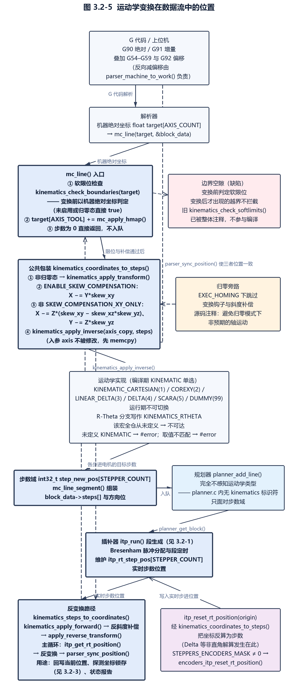

图 3.2-5 运动学变换在数据流中的位置

#### 3.2.10.1 运动学在数据流中的位置与调用边界

- 需求标识：UC-FREQ3210-1
- 功能描述：运动学变换位于解析器/规划器与步进执行之间：解析器把 G 代码换算成机器绝对坐标并叠加坐标系与 G92 偏移，运动控制层在进入规划器之前把该坐标经运动学变换转为各步进电机的目标步数；反向则由实时步数位置还原为坐标，用于回写当前位置、探测坐标与状态报告
- 调用条件：任何一段直线或圆弧运动进入 `mc_line()` 时执行正变换路径；系统同步位置（复位、归零、探测结束、状态报告）时执行反变换路径
- 输入：机器绝对坐标数组 `float target[AXIS_COUNT]`；反变换输入为步数数组 `int32_t[STEPPER_COUNT]`
- 输出：步数数组 `int32_t step_new_pos[STEPPER_COUNT]`（送入规划器）；反变换输出坐标数组 `float axis[AXIS_COUNT]`
- 处理：
- （1）解析器在 G90 绝对模式下把工件坐标系偏移与 G92 偏移加到目标轴坐标上，得到机器绝对坐标，随后以该坐标调用 `mc_line()`（`uCNC/src/core/parser.c:1801-1817`、`:1876`、`:1881`、`:1929`）；
- （2）`mc_line()` 先以**未做运动学变换**的机器坐标做软限位检查，再调用 `kinematics_coordinates_to_steps()` 完成几何变换、斜度补偿与逆变换，算出相对上一位置的步数差并求最大步数；步数为 0 时直接返回不入队（`uCNC/src/core/motion_control.c:317`、`:404`、`:408-427`、`:430-438`）；
- （3）每个子段由 `mc_line_segment()` 组装 `block_data->steps[]` 与方向位，最终交给规划器 `planner_add_line()`；规划器内部不含任何运动学相关代码，即规划器只面对步数域（`uCNC/src/core/motion_control.c:160-198`、`:279`）；
- （4）反向路径为 `itp_get_rt_position()` 取实时步数、`kinematics_steps_to_coordinates()` 还原坐标、`parser_sync_position()` 同步；插补器自身复位实时位置时也经运动学逆变换写入步数（`uCNC/src/core/motion_control.c:1166-1171`；`uCNC/src/core/interpolator.c:980-993`）；
- （5）坐标偏移的还原另有 `parser_machine_to_work()` 做减偏移，说明运动学负责的是「机器坐标↔步数」，坐标系偏移属于解析器职责，二者边界清晰（`uCNC/src/core/parser.c:3002-3007`）；
- （6）`mc_line()` 中的软限位检查发生在运动学变换之前，所以非线性运动学在变换后可能出现的越界不会在此处被拦截；源码中曾经存在的「变换后再查边界」版本 `kinematics_check_softlimits()` 已被整体注释掉，该函数当前不参与编译（`uCNC/src/core/motion_control.c:317`；`uCNC/src/hal/kinematics/kinematic.c:100-130`）。

#### 3.2.10.2 运动学接口面与契约

- 需求标识：UC-FREQ3210-2
- 功能描述：`kinematic.h` 对外声明一套与具体机构无关的接口，实现文件必须提供初始化、逆变换、正变换、归零与边界检查五类函数，并约定执行器数量、轴索引与归零错误位；所有接口以「轴坐标数组 + 步数数组」的原地改写方式工作，不返回坐标
- 调用条件：`kinematics_init()` 在控制器复位流程中调用；`kinematics_apply_inverse()`/`kinematics_apply_forward()` 由 `kinematic.c` 的公共包装调用；`kinematics_home()` 由 `cnc_home()` 调用；`kinematics_check_boundaries()` 由 `mc_line()` 调用
- 输入：轴坐标或步数指针、无符号 8 位的轴掩码与限位掩码（归零用）
- 输出：原地改写的另一侧数组；`kinematics_home()` 返回 `uint8_t` 错误码（`STATUS_OK` 或 `STATUS_*`）；`kinematics_check_boundaries()` 返回 `bool`
- 处理：
- （1）`void kinematics_init(void)` 读入该运动学的非易失参数并预计算 RAM 常量，只在复位时调用一次（`uCNC/src/hal/kinematics/kinematic.h:48`；`uCNC/src/cnc.c:813`）；
- （2）`void kinematics_apply_inverse(float *axis, int32_t *steps)` 完成机器绝对坐标到步数的换算，注释明确「在计算相对活动坐标系的偏移之后执行」（`uCNC/src/hal/kinematics/kinematic.h:50-58`）；
- （3）`void kinematics_apply_forward(int32_t *steps, float *axis)` 完成步数到机器绝对坐标的换算（`uCNC/src/hal/kinematics/kinematic.h:60-67`）；
- （4）`uint8_t kinematics_home(void)` 执行整机归零序列，逐轴调用 `mc_home_axis()` 并在结束时把归零后的坐标写回实时位置（`uCNC/src/hal/kinematics/kinematic.h:69-76`；`uCNC/src/hal/kinematics/kinematic_cartesian.c:46-148`）；
- （5）`void kinematics_apply_transform(float *axis)` 与 `void kinematics_apply_reverse_transform(float *axis)` 是可选几何变换钩子，注释声明「只作用于普通运动与 jog，归零运动直接进规划器」；`kinematic.c` 以 `__attribute__((weak))` 给出空实现，实际六种实现中只有 R-Theta 与 SCARA 显式再定义且同样为空，即本版本中该钩子在树内无实际作用（`uCNC/src/hal/kinematics/kinematic.h:78-92`；`uCNC/src/hal/kinematics/kinematic.c:27-29`、`:37-39`；`uCNC/src/hal/kinematics/kinematic_rtheta.c:152-158`；`uCNC/src/hal/kinematics/kinematic_scara.c:169-175`）；
- （6）`void kinematics_coordinates_to_steps(float *axis, int32_t *steps)` 与 `void kinematics_steps_to_coordinates(int32_t *steps, float *axis)` 是公共包装，串联变换钩子、斜度补偿与逆/正变换，是上层唯一应调用的入口（`uCNC/src/hal/kinematics/kinematic.h:94-111`；`uCNC/src/hal/kinematics/kinematic.c:49-98`）；
- （7）`bool kinematics_check_boundaries(float *axis)` 做软限位判定，返回 `true` 表示在边界内；调用方在越界时按 jog 与普通运动分别处理（`uCNC/src/hal/kinematics/kinematic.h:113-120`；`uCNC/src/core/motion_control.c:317-348`）；
- （8）执行器与轴的数量契约由 `AXIS_TO_STEPPERS`（默认等于 `AXIS_COUNT`）与 `STEPPER_COUNT`（默认等于 `AXIS_TO_STEPPERS`）确定，注释提醒二者应对应机器上线性执行器的数量；归零错误位 `KINEMATIC_HOMING_ERROR_X/Y/Z/A/B/C`（4 位掩码结构）也在本头文件声明（`uCNC/src/hal/kinematics/kinematic.h:28-36`、`:38-44`）。

#### 3.2.10.3 公共实现：斜度补偿与归零旁路

- 需求标识：UC-FREQ3210-3
- 功能描述：`kinematic.c` 提供与运动学无关的公共包装：逆变换方向先做可选的几何变换钩子与 X/Y/Z 斜度补偿，再做运动学逆变换；正变换方向先做运动学正变换，再做斜度反补偿与反向变换钩子；处于归零执行态时两侧都跳过变换钩子与斜度补偿
- 调用条件：每次坐标与步数互换都经过；归零态（`EXEC_HOMING`）下变换钩子与斜度补偿被跳过
- 输入：坐标数组或步数数组，以及全局设置中的 `skew_xy_factor`、`skew_xz_factor`、`skew_yz_factor`（`$37`/`$38`/`$39`）
- 输出：变换后的坐标或步数数组；`axis` 参数本身不被修改（内部先 `memcpy` 出 `axis_copy`）
- 处理：
- （1）逆变换路径复制轴数组到 `axis_copy`，避免改动调用方目标（`uCNC/src/hal/kinematics/kinematic.c:51-53`）；
- （2）若当前不在归零态，先调用 `kinematics_apply_transform()`，再在 `ENABLE_SKEW_COMPENSATION` 下做斜度修正：`X -= Y*skew_xy`，非 `SKEW_COMPENSATION_XY_ONLY` 时再 `X -= Z*(skew_xy - skew_xz*skew_yz)`、`Y -= Z*skew_yz`（`uCNC/src/hal/kinematics/kinematic.c:55-67`）；
- （3）最后调用运动学逆变换 `kinematics_apply_inverse(axis_copy, steps)`（`uCNC/src/hal/kinematics/kinematic.c:69`）；
- （4）正变换路径先调用 `kinematics_apply_forward(steps, axis)`，非归零态下做反斜度 `X += Y*skew_xy`（非 XY-only 时再加 `X += Z*skew_xz`、`Y += Z*skew_yz`），随后调用 `kinematics_apply_reverse_transform()`（`uCNC/src/hal/kinematics/kinematic.c:81-97`）；
- （5）归零态旁路的理由写在注释中：「归零模式下不施加任何运动学修正，以避免非预期的轴运动」（`uCNC/src/hal/kinematics/kinematic.c:54`、`:83`；`uCNC/src/hal/kinematics/README.md（第 135-148 行）`）；
- （6）斜度补偿位于公共层而非 `kinematic_cartesian.c` 内，因此理论上对任何运动学生效；SCARA 与 R-Theta 的头文件把 `ENABLE_SKEW_COMPENSATION` 注释掉，是该修正被主动关闭的两处实现事实（`uCNC/src/hal/kinematics/kinematic_scara.h:41-45`；`uCNC/src/hal/kinematics/kinematic_rtheta.h:41-44`）；
- （7）斜度设置项由 `uCNC/src/interface/grbl_settings.c:201-207` 映射为 `$37`–`$39`（`uCNC/src/interface/grbl_settings.c:201-207`）。

#### 3.2.10.4 编译期选择机制与默认行为

- 需求标识：UC-FREQ3210-4
- 功能描述：运动学在编译期由单一宏 `KINEMATIC` 选定：`kinematicdefs.h` 校验其已定义并按值包含对应实现头文件，实现 `.c` 文件再用 `#if (KINEMATIC == ...)` 包住全部函数体；未定义 `KINEMATIC` 直接编译报错，取值不匹配任何实现也报错
- 调用条件：编译期生效，运行期不可切换
- 输入：配置头中的 `#define KINEMATIC <ID>`，以及各实现的辅助宏（`COREXY_AXIS`、`MP_SCARA`、`STEPPER0_ANGLE` 等）
- 输出：被编入固件的唯一一套运动学实现；`KINEMATIC_TYPE_STR` 供系统信息报告使用
- 处理：
- （1）`kinematics.h` 给出 ID 常量：`KINEMATIC_CARTESIAN` 1、`KINEMATIC_COREXY` 2、`KINEMATIC_LINEAR_DELTA` 3、`KINEMATIC_DELTA` 4、`KINEMATIC_SCARA` 5、`KINEMATIC_DUMMY` 99，以及 CoreXY 的三个子类型 `COREXY_AXIS_XY`/`XZ`/`YZ`（`uCNC/src/hal/kinematics/kinematics.h:27-36`）；
- （2）`kinematicdefs.h` 在 `KINEMATIC` 未定义时执行 `#error Undefined kinematics`，并按 `AXIS_COUNT`（默认 3）有条件地定义 `AXIS_X`…`AXIS_C` 索引（`uCNC/src/hal/kinematics/kinematicdefs.h:29-31`、`:36-57`）；
- （3）选择链为 `KINEMATIC_CARTESIAN`→`kinematic_cartesian.h`、`KINEMATIC_COREXY`→`kinematic_corexy.h`、`KINEMATIC_LINEAR_DELTA`→`kinematic_linear_delta.h`、`KINEMATIC_DELTA`→`kinematic_delta.h`、`KINEMATIC_SCARA`→`kinematic_scara.h`、`KINEMATICS_RTHETA`→`kinematic_rtheta.h`、`KINEMATIC_DUMMY`→`kinematic_dummy.h`，其余执行 `#error Kinematics not implemented`，随后统一包含 `kinematic.h`（`uCNC/src/hal/kinematics/kinematicdefs.h:60-78`）；
- （4）每个实现 `.c` 以 `#if (KINEMATIC == ...)` 整体包裹，因此未被选中的实现展开为空翻译单元（`uCNC/src/hal/kinematics/kinematic_cartesian.c:22`、`:180`）；
- （5）各实现头文件用 `KINEMATIC_TYPE_STR` 自报名称：`"C"`、`"XY"`/`"XZ"`/`"YZ"`、`"D"`、`"LD"`、`"RT"`、`"SC"`、`"DMY"`，缺省时由协议层补一个 `"UK"`（undefined kynematic）（`uCNC/src/hal/kinematics/kinematic_cartesian.h:27`；`uCNC/src/hal/kinematics/kinematic_corexy.h:32`、`:37`、`:42`；`uCNC/src/hal/kinematics/kinematic_delta.h:27`；`uCNC/src/hal/kinematics/kinematic_linear_delta.h:27`；`uCNC/src/hal/kinematics/kinematic_rtheta.h:27`；`uCNC/src/hal/kinematics/kinematic_scara.h:27`；`uCNC/src/hal/kinematics/kinematic_dummy.h:27`；`uCNC/src/interface/grbl_protocol.c:959-963`）；
- （6）各实现的自定义参数通过四个宏注入全局设置：`KINEMATICS_VARS_DECL`（变量声明）、`KINEMATICS_VARS_DEFAULTS_INIT`（默认值）、`KINEMATICS_VARS_SETTINGS_INIT`（`$` 命令 ID 映射）、`KINEMATICS_VARS_SYSTEM_MENU_INIT`（显示菜单项）；前三个在 `kinematicdefs.h` 中给出空默认定义以保证未使用时不报错（`uCNC/src/interface/grbl_settings.h:88`；`uCNC/src/interface/grbl_settings.c:143`、`:214`；`uCNC/src/hal/kinematics/kinematicdefs.h:89-99`）；
- （7）选择链中 R-Theta 分支写作 `KINEMATICS_RTHETA`，而该标识符在全仓从未被定义，`kinematics.h` 中也没有对应的 ID 条目；实现文件自身同样写作 `KINEMATICS_RTHETA`。由于未定义标识符在 `#elif` 表达式中按 0 处理，该分支不会命中，也没有任何合法 ID 值能选中 R-Theta，因此 R-Theta 在本版本中是**源码存在但不可达**的代码（`uCNC/src/hal/kinematics/kinematicdefs.h:70`；`uCNC/src/hal/kinematics/kinematics.h:27-32`；`uCNC/src/hal/kinematics/kinematic_rtheta.c:22`；`uCNC/src/hal/kinematics/kinematic_rtheta.h:58-60`）。

| 运动学 | ID 宏 | 适用机型 | 轴数要求 | 专用配置宏 | 变换钩子 | 分段逼近 | 归零特殊处理 | 类型串 |
| --- | --- | --- | --- | --- | --- | --- | --- | --- |
| 笛卡尔 | `KINEMATIC_CARTESIAN`(1) | 通用直角坐标机 | `AXIS_COUNT` 默认 3，可用 A/B/C 扩轴 | — | 未定义（用弱空实现） | 无 | 按 Z→X→Y→A→B→C 顺序独立归零，支持 XY 同时归零 | `"C"` |
| CoreXY | `KINEMATIC_COREXY`(2) | CoreXY / CoreXZ / CoreYZ | XY 模式 2 轴，XZ/YZ 模式要求 ≥3 | `COREXY_AXIS`（默认 `COREXY_AXIS_XY`） | 未定义（用弱空实现） | 无 | 同笛卡尔，但极限开关按电机轴解释 | `"XY"/"XZ"/"YZ"` |
| Linear Delta | `KINEMATIC_LINEAR_DELTA`(3) | 线性（滑车）并联 Delta | ≥3 | `STEPPER0/1/2_ANGLE`（30/150/270）、`DELTA_ARM_MIN/MAX_ANGLE`（20/89） | 未定义（用弱空实现） | 有（1.0 mm，可改） | 只用 Z 掩码加 `LIMITS_DELTA_MASK` 同时压三个塔 | `"LD"` |
| Delta（旋转臂） | `KINEMATIC_DELTA`(4) | 旋转臂并联 Delta | ≥3 | `DELTA_HOME_LIMITS_MAXZ`（可选）、`SET_ORIGIN_AT_HOME_POS`（可选） | 未定义（用弱空实现） | 有（1.0 mm，可改） | 先按几何边界预置 Z 再压 Z 限位，并维护 `delta_cuboid_z_home` | `"D"` |
| R-Theta | 无有效 ID（选择链写作 `KINEMATICS_RTHETA`，本版本不可达） | 极坐标（旋转轴 + 径向臂） | ≥2 | — | 显式空实现 | 有（1.0 mm，可改） | 用 `$28`/`$29` 角度与距离经正变换预置原点 | `"RT"` |
| SCARA | `KINEMATIC_SCARA`(5) | 串联 SCARA / MP SCARA | ≥2 | `MP_SCARA`（可选） | 显式空实现 | 有（1.0 mm，可改） | 用 `$28`/`$29` 两关节角经正变换预置原点 | `"SC"` |
| DUMMY | `KINEMATIC_DUMMY`(99) | 占位与调试 | — | — | 未定义（用弱空实现） | 无 | 直接返回 `STATUS_OK` | `"DMY"` |

表 3.2-16 六种运动学实现对照（含 DUMMY 占位实现）

表中轴数要求的编译期断言分别位于 `uCNC/src/hal/kinematics/kinematic_delta.h:29-31`、`uCNC/src/hal/kinematics/kinematic_linear_delta.h:29-31`、`uCNC/src/hal/kinematics/kinematic_corexy.h:34-41`；分段逼近宏 `KINEMATICS_MOTION_BY_SEGMENTS` 与段长 `KINEMATICS_MOTION_SEGMENT_SIZE` 分别定义于 `uCNC/src/hal/kinematics/kinematic_delta.h:33-43`、`uCNC/src/hal/kinematics/kinematic_linear_delta.h:43-53`、`uCNC/src/hal/kinematics/kinematic_scara.h:29-39`、`uCNC/src/hal/kinematics/kinematic_rtheta.h:29-39`；各实现逆变换函数分别位于 `uCNC/src/hal/kinematics/kinematic_cartesian.c:30-36`、`uCNC/src/hal/kinematics/kinematic_corexy.c:36-57`、`uCNC/src/hal/kinematics/kinematic_linear_delta.c:57-79`、`uCNC/src/hal/kinematics/kinematic_delta.c:227-257`、`uCNC/src/hal/kinematics/kinematic_rtheta.c:47-61`、`uCNC/src/hal/kinematics/kinematic_scara.c:46-68`、`uCNC/src/hal/kinematics/kinematic_dummy.c:27-29`。

#### 3.2.10.5 笛卡尔：直通变换与归零位置回写

- 需求标识：UC-FREQ3210-5
- 功能描述：笛卡尔运动学的正/逆变换是逐轴直通：逆变换把每个坐标乘以该轴步数每毫米并四舍五入为步数，正变换把步数除以步数每毫米还原坐标；不含任何轴间耦合，也不定义变换钩子；归零按固定轴序执行，并在结束时把归零后的坐标写入实时位置
- 调用条件：`kinematics_apply_inverse()`/`kinematics_apply_forward()` 由公共包装调用；`kinematics_home()` 由 `cnc_home()` 在 `EXEC_HOMING` 状态下调用
- 输入：坐标数组 `axis[AXIS_COUNT]`（逆）、步数数组 `steps[STEPPER_COUNT]`（正）、`g_settings.step_per_mm[]`
- 输出：步数（逆，`lroundf` 取整）或坐标（正，浮点除法）；`kinematics_home()` 返回首个子步骤的错误码
- 处理：
- （1）逆变换对 `i = 0..AXIS_COUNT-1` 执行 `steps[i] = lroundf(step_per_mm[i] * axis[i])`（`uCNC/src/hal/kinematics/kinematic_cartesian.c:30-36`）；
- （2）正变换对 `i = 0..AXIS_COUNT-1` 执行 `axis[i] = steps[i] / step_per_mm[i]`（`uCNC/src/hal/kinematics/kinematic_cartesian.c:38-44`）；
- （3）`kinematics_init()` 为空实现，无预计算常量；变换钩子在公共层为弱空实现，本文件不再定义（`uCNC/src/hal/kinematics/kinematic_cartesian.c:26-28`；`uCNC/src/hal/kinematics/kinematic.c:27-29`）；
- （4）归零顺序为 Z、X、Y（`ENABLE_XY_SIMULTANEOUS_HOMING` 时 X 与 Y 合并为一次同时归零）、A、B、C，任何一步失败立即返回该错误码；`DISABLE_ALL_LIMITS` 下整块被跳过（`uCNC/src/hal/kinematics/kinematic_cartesian.c:51-124`）；
- （5）非 Grbl 风格归零时最后调用一次 `mc_home_motion_pulloff(255, true)` 做整体脱离（`uCNC/src/hal/kinematics/kinematic_cartesian.c:126-131`）；
- （6）归零完成后构造目标坐标：`SET_ORIGIN_AT_HOME_POS` 时全 0，否则按 `homing_dir_invert_mask` 逐轴取 0 或 `max_distance[i]`，再以 `itp_reset_rt_position(target)` 把该坐标经运动学逆变换换算为步数写入实时位置（`uCNC/src/hal/kinematics/kinematic_cartesian.c:134-145`；`uCNC/src/core/interpolator.c:980-993`）；
- （7）`kinematics_check_boundaries()` 在软限位未启用或处于归零态时直接返回 `true`；否则逐轴反序遍历，跳过 `max_distance[i] == 0` 的未定义轴；`SET_ORIGIN_AT_HOME_POS` 下按归零方向取反号比较；越界时若定义 `ALLOW_SOFT_LIMIT_JOG_MOTION_CLAMPING` 则把该轴坐标夹到 `[0, max_distance[i]]` 后返回 `false`（`uCNC/src/hal/kinematics/kinematic_cartesian.c:150-178`）；
- （8）同一份 `kinematics_home()` 的轴序与限位掩码结构被 CoreXY 原样复制，说明归零逻辑被视作与正/逆变换相对独立的一层（`uCNC/src/hal/kinematics/kinematic_corexy.c:82-184`）。

#### 3.2.10.6 CoreXY：两电机与 X/Y（或 X/Z、Y/Z）的线性耦合

- 需求标识：UC-FREQ3210-6
- 功能描述：CoreXY 把两个对角线电机的运动线性组合到两个笛卡尔轴上：XY 模式下电机 0/1 分别对应 `x+y` 与 `x-y`；XZ、YZ 模式下第三个电机与 Z（或 Y 与 Z 的组合）耦合；多余轴从 `COREXY_EXTRA_AXIS_START` 起直通
- 调用条件：与笛卡尔相同（进入 `mc_line()` 时逆变换、同步位置时正变换）；`COREXY_AXIS` 在编译期选定耦合平面
- 输入：坐标数组；`g_settings.step_per_mm[]`（按电机索引）
- 输出：步数数组；正变换输出坐标数组
- 处理：
- （1）`COREXY_EXTRA_AXIS_START` 由耦合平面决定：XZ/YZ 模式为 3，XY 模式为 2（`uCNC/src/hal/kinematics/kinematic_corexy.c:26-30`）；
- （2）逆变换三分支：XZ 模式 `steps[0] = spm0*(X+Z)`、`steps[1] = spm1*Y`、`steps[2] = spm2*(X-Z)`；YZ 模式 `steps[0] = spm0*X`、`steps[1] = spm1*(Y+Z)`、`steps[2] = spm2*(Y-Z)`；XY 模式 `steps[0] = spm0*(X+Y)`、`steps[1] = spm1*(X-Y)`（`uCNC/src/hal/kinematics/kinematic_corexy.c:38-49`）；
- （3）正变换取逆关系：XY 模式 `X = 0.5*(s0+s1)/spm0`、`Y = 0.5*(s0-s1)/spm1`，XZ/YZ 模式同理（`uCNC/src/hal/kinematics/kinematic_corexy.c:61-72`）；
- （4）`i >= COREXY_EXTRA_AXIS_START` 的轴按笛卡尔直通处理（`uCNC/src/hal/kinematics/kinematic_corexy.c:51-56`、`:74-79`）；
- （5）`kinematic_corexy.h` 校验 `COREXY_AXIS` 取值合法性，XZ/YZ 模式要求 `AXIS_COUNT >= 3`，非法值报 `#error "Invalid value for COREXY_AXIS..."`，合法值映射为 `KINEMATIC_TYPE_STR`（`uCNC/src/hal/kinematics/kinematic_corexy.h:27-46`）；
- （6）归零函数与笛卡尔逐行同构：逐电机用 `LINACT0/1/2_LIMIT_MASK` 归零，最后 `itp_reset_rt_position(target)` 写回；边界检查也逐轴比较 `max_distance[]`，不涉及电机耦合（`uCNC/src/hal/kinematics/kinematic_corexy.c:82-181`、`:186-214`）；
- （7）正变换用 `spm0` 除 `s0`、`spm1` 除 `s1`，而逆变换把 `x+y` 乘 `spm0`、`x-y` 乘 `spm1`，只有当两个电机的 `step_per_mm` 相等时正逆才互为精确逆运算；若两电机 `step_per_mm` 不同，同一坐标经「逆变换再正变换」不会还原，因此工程上应给 CoreXY 的两只电机配置相同的 `$100`/`$101`（`uCNC/src/hal/kinematics/kinematic_corexy.c:47-48`、`:70-71`）。

#### 3.2.10.7 Delta（旋转臂）：逆/正运动学与臂长半径参数

- 需求标识：UC-FREQ3210-7
- 功能描述：旋转臂 Delta 用三个摆臂角作为关节坐标：逆变换对三个塔分别求解单塔夹角 `theta`，再乘以「步数每度」得到步数；正变换由三个关节角求三球面（圆）交点，解一元二次方程得到笛卡尔坐标；无解时逆变换输出 `INT32_MAX` 哨兵、正变换输出 `NAN`
- 调用条件：每次逆变换或正变换；几何常数在 `kinematics_init()` 中由 `$28`/`$106`–`$109` 计算
- 输入：坐标（逆）或步数（正）；`g_settings.delta_base_radius`、`delta_effector_radius`、`delta_bicep_length`、`delta_forearm_length`、`delta_bicep_homing_angle`
- 输出：步数（逆，三塔角乘步数每度，隐式截断取整）或坐标（正）；无效解用哨兵值表示
- 处理：
- （1）逆变换：几何常数在初始化时预计算：`delta_base_half_f_tg30 = tan30/2 * base_radius`、`delta_effector_half_f_tg30 = tan30/2 * effector_radius`、二者之差，以及 `steps_per_angle[i] = step_per_mm[i] * (1/360)`，即 `$100`/`$101`/`$102` 对 Delta 解释为每转步数（`uCNC/src/hal/kinematics/kinematic_delta.c:191-196`、`:27-33`）；
- （2）逆变换先取 `z_offset = axis[AXIS_Z] + delta_cuboid_z_home`，把内部 Z 原点偏移并入高度（`uCNC/src/hal/kinematics/kinematic_delta.c:231`）；
- （3）三塔角度：塔 1 直接用 `(X, Y)`；塔 2 用绕 Z 轴 +120° 旋转后的坐标 `(X*cos120 + Y*sin120, Y*cos120 - X*sin120)`；塔 3 用 -120° 旋转 `(X*cos120 - Y*sin120, Y*cos120 + X*sin120)`，其中 `COS120 = -0.5`、`SIN120 = 0.8660...`（`uCNC/src/hal/kinematics/kinematic_delta.c:241-243`、`:27-28`）；
- （4）单塔求解 `delta_calcAngleYZ(x0, y0, z0, *theta)`：`y1 = -delta_base_half_f_tg30`，`y0 -= delta_effector_half_f_tg30`（把支点从中心平移到塔侧），`a = (x0²+y0²+z0²+rf²-re²-y1²)/(2*z0)`，`b = (y1-y0)/z0`，判别式 `d = -(a+b*y1)² + rf*(b²*rf+rf)`；`d < 0` 时置 `NAN` 并返回 -1（无解）（`uCNC/src/hal/kinematics/kinematic_delta.c:202-217`）；
- （5）有解时取外侧解 `yj = (y1 - a*b - sqrt(d)) / (b²+1)`、`zj = a + b*yj`，角度按 `theta = 180 * atan2(-zj, y1-yj) / π`（度）计算（`uCNC/src/hal/kinematics/kinematic_delta.c:218-224`）；
- （6）三塔均成功时 `steps[i] = steps_per_angle[i] * theta`（隐式浮点转 `int32_t`，未使用 `lroundf`）；任一塔失败则三轴步数全部写 `INT32_MAX` 作为不可达哨兵（`uCNC/src/hal/kinematics/kinematic_delta.c:244-256`）；
- （7）逆变换的附加轴处理：`AXIS_COUNT > 3` 的附加轴按 `g_settings.step_mm[i] * axis[i]` 直通，而本仓库设置结构体中没有 `step_mm` 成员，因此该分支一旦启用即无法编译（`uCNC/src/hal/kinematics/kinematic_delta.c:232-237`；`uCNC/src/interface/grbl_settings.c:216`）；
- （8）正变换：由三轴步数还原关节角：`theta_i = steps[i] * DEG_RAD_MULT / steps_per_angle[i]`（步数转度为弧度，`DEG_RAD_MULT = π/180`）（`uCNC/src/hal/kinematics/kinematic_delta.c:267-269`；`uCNC/src/utils.h:176`）；
- （9）按 `y1 = -(t + rf*cos θ1)`、`z1 = -rf*sin θ1`，`y2 = (t + rf*cos θ2)*sin30`、`x2 = y2*tan60`、`z2 = -rf*sin θ2`，`y3 = (t + rf*cos θ3)*sin30`、`x3 = -y3*tan60`、`z3 = -rf*sin θ3` 计算三塔臂端位置，其中 `t` 为半径差项 `delta_base_effector_half_f_tg30`（`uCNC/src/hal/kinematics/kinematic_delta.c:264-280`）；
- （10）由三圆交点列方程组：`dnm = (y2-y1)*x3 - (y3-y1)*x2`、`a1 = (z2-z1)*(y3-y1) - (z3-z1)*(y2-y1)`、`b1 = -((w2-w1)*(y3-y1) - (w3-w1)*(y2-y1))/2`、`a2 = -(z2-z1)*x3 + (z3-z1)*x2`、`b2 = ((w2-w1)*x3 - (w3-w1)*x2)/2`，其中 `w_i = x_i²+y_i²+z_i²`（`uCNC/src/hal/kinematics/kinematic_delta.c:282-294`）；
- （11）化为一元二次 `a*z² + b*z + c = 0`：`a = a1²+a2²+dnm²`、`b = 2*(a1*b1 + a2*(b2-y1*dnm) - z1*dnm²)`、`c = (b2-y1*dnm)² + b1² + dnm²*(z1²-re²)`，判别式 `d = b² - 4ac`；实现使用 `fast_flt_mul2`/`mul4`/`div2` 等近似宏（`uCNC/src/hal/kinematics/kinematic_delta.c:296-302`；`uCNC/src/utils.h:74`、`:102`、`:162`、`:165`）；
- （12）`d < 0` 时三轴坐标全部置 `NAN` 并返回；否则取 `z0 = -(b + sqrt(d)) / (2a)`，再算 `X = (a1*z0+b1)/dnm`、`Y = (a2*z0+b2)/dnm`、`Z = z0 - delta_cuboid_z_home`（与逆变换的偏移相消）（`uCNC/src/hal/kinematics/kinematic_delta.c:303-315`、`:317-322`）。

#### 3.2.10.8 Delta 工作空间（cuboid）计算与软限位

- 需求标识：UC-FREQ3210-8
- 功能描述：由于 Delta 的可用空间不是立方体而是三球面约束的交集，源码在初始化时用一个专门的搜索程序估算可达空间：先按几何上限与关节步数扫描求 Z 的上下界，再用二分式收敛求水平面可达半径，并把结果连同归零高度偏移缓存为静态量，供软限位与归零使用
- 调用条件：仅在 `kinematics_init()` 中调用一次（复位时）；结果依赖当时的 `$` 参数
- 输入：`delta_base_radius`、`delta_effector_radius`、`delta_bicep_length`、`delta_forearm_length`、`step_per_mm[0..2]`、`max_distance[AXIS_Z]`、`delta_bicep_homing_angle`
- 输出：静态量 `delta_cuboid_xy`、`delta_cuboid_z_min`、`delta_cuboid_z_max`、`delta_cuboid_z_home`
- 处理：
- （1）初值取 `maxx = -(effector_radius + base_radius + forearm_length + bicep_length)`、`maxz = maxx`、`minz = -maxx`，并把扫描上限设为三个轴中最大的 `step_per_mm`（`uCNC/src/hal/kinematics/kinematic_delta.c:56-62`）；
- （2）先把归零臂角换算为步数并经正变换求出归零高度 `homez`；该换算函数 `delta_home_angle_to_steps()` 只在此处被使用，归零流程本身并不调用它（`uCNC/src/hal/kinematics/kinematic_delta.c:44-52`、`:65-73`）；
- （3）令三塔步数同步从 0 递增到上限，逐点正变换，取有效的 Z 极值修正 `minz`/`maxz`（`uCNC/src/hal/kinematics/kinematic_delta.c:76-89`）；
- （4）按 `DELTA_HOME_LIMITS_MAXZ` 是否定义，用 `homez - max_distance[Z]` 或 `maxz - max_distance[Z]` 收紧 Z 下界（`uCNC/src/hal/kinematics/kinematic_delta.c:91-101`）；
- （5）以 `middlez = (maxz+minz)/2`、`original_dist = maxz-middlez` 为起点，用步长 `dist = original_dist/2` 沿 ±X±Y 的 8 个对角方向在上下两个 Z 层做逆变换探测；任一方向返回 `INT32_MAX`（不可达）则回退一步并把步长减半，全部可达则记录当前半径为新的 `minz` 并同步更新三个轴的步数极值（`uCNC/src/hal/kinematics/kinematic_delta.c:103-175`）；
- （6）循环终止条件为 `original_dist <= sum` 或步长不大于 0.1，随后写回 `delta_cuboid_xy`、`z_min`、`z_max`，并按 `SET_ORIGIN_AT_HOME_POS` 决定 `delta_cuboid_z_home` 取 `homez` 还是 `minz`（`uCNC/src/hal/kinematics/kinematic_delta.c:175-184`）；
- （7）`kinematics_init()` 先把 `delta_cuboid_z_home` 清零再计算边界，并把 `steps_per_angle` 定为每转步数的 1/360（`uCNC/src/hal/kinematics/kinematic_delta.c:187-198`）；
- （8）软限位判定：软限位关闭或处于归零态时返回 `true`，但在归零态下会按 `homing_dir_invert_mask` 把 Z 目标裁剪到 `delta_cuboid_z_max`（或抬到 `z_min`）以配合归零行程（`uCNC/src/hal/kinematics/kinematic_delta.c:400-415`）；
- （9）正常状态下以 `xy_limit = delta_cuboid_xy` 检查 `|X|`、`|Y|`，以 `[z_min - z_home, z_max - z_home]` 检查 Z，越界时按 `ALLOW_SOFT_LIMIT_JOG_MOTION_CLAMPING` 夹紧，其余轴按通用规则检查（`uCNC/src/hal/kinematics/kinematic_delta.c:417-465`）。

> **实现说明（缺陷）**：工作空间扫描中用 `if (axis[0] != NAN)` 判有效，浮点 `NAN` 与任何值比较均为真，该判断恒成立，无效解不会被过滤；同一文件 Y 轴越界分支把夹紧值写回 `axis[AXIS_X]`，是复制粘贴错误；此外 `delta_calc_bounds()` 只在 `kinematics_init()`（复位）时执行，运行中通过 `$106`–`$109` 改几何参数不会重算 cuboid，需复位生效（`uCNC/src/hal/kinematics/kinematic_delta.c:82`、`:431`、`:187-198`）。

#### 3.2.10.9 Linear Delta（线性滑车 Delta）

- 需求标识：UC-FREQ3210-9
- 功能描述：线性 Delta 用三个竖直滑车高度作为关节坐标：逆变换按每塔的水平偏移求臂长约束下的滑车高度，正变换用三球面交点法反求坐标；塔的方位由 `STEPPER0/1/2_ANGLE` 决定，可用空间由臂角上下限换算的行程半径限定
- 调用条件：与旋转臂 Delta 相同（进入 `mc_line()` 时逆变换、同步位置时正变换）；三个塔在归零时被同时驱动
- 输入：坐标或步数；`g_settings.delta_arm_length`（`$106`）、`delta_armbase_radius`（`$107`）、`STEPPER*_ANGLE`、`DELTA_ARM_MIN_ANGLE`/`DELTA_ARM_MAX_ANGLE`
- 输出：步数或坐标；`delta_base_max_travel` 等静态量用于软限位
- 处理：
- （1）逆变换：初始化计算塔的笛卡尔位置 `delta_x[i] = base_radius*cos(angle_i)`、`delta_y[i] = base_radius*sin(angle_i)`，角度默认 30°、150°、270°（`uCNC/src/hal/kinematics/kinematic_linear_delta.c:43-48`；`uCNC/src/hal/kinematics/kinematic_linear_delta.h:33-41`）；
- （2）`delta_arm_sqr = arm_length²`，`delta_base_height = sqrt(arm_sqr - delta_x[0]² - delta_y[0]²)` 作为基座高度基准（`uCNC/src/hal/kinematics/kinematic_linear_delta.c:42`、`:49`）；
- （3）行程半径由臂角上下限换算：`min_travel = arm_length*cos(20°) - base_radius`、`max_travel = arm_length*cos(89°) - base_radius`，取绝对值后 `delta_base_max_travel = MIN(min, max)`（`uCNC/src/hal/kinematics/kinematic_linear_delta.c:50-54`；`uCNC/src/hal/kinematics/kinematic_linear_delta.h:55-63`）；
- （4）逆变换三塔统一形式 `steps_mm = sqrt(arm_sqr - x² - y²) + z`，其中 `z = axis[AXIS_Z] - delta_base_height`；塔 1 取 `x = X - delta_x[0]`、`y = Y - delta_y[0]`，塔 2 与塔 3 取 `x = delta_x[i] - X`、`y = delta_y[i] - Y`（符号约定与前塔相反），步数 = `lroundf(step_per_mm[i] * steps_mm)`（`uCNC/src/hal/kinematics/kinematic_linear_delta.c:57-71`）；
- （5）正变换：先由三轴步数求等效高度 `z0`/`z1`/`z2`（除以 `step_per_mm`）（`uCNC/src/hal/kinematics/kinematic_linear_delta.c:84-86`）；
- （6）以塔 1 为原点构造三球面交点的平面基：`p01`、单位向量 `ex`、`p02`、`i = ex·p02`、`ey = p02 - i*ex` 单位化、`ez = ex × ey`（`uCNC/src/hal/kinematics/kinematic_linear_delta.c:87-123`）；
- （7）取 `Xnew = d2*inv_d/2`、`Ynew = ((i²+j2)/2 - i*Xnew)*inv_j`、`Znew = sqrt(arm_sqr - Xnew² - Ynew²)`，再回到原坐标系：`X = delta_x[0] + ex[0]*Xnew + ey[0]*Ynew - ez[0]*Znew`，Y 与 Z 同理，Z 额外加 `delta_base_height`（`uCNC/src/hal/kinematics/kinematic_linear_delta.c:125-136`）；
- （8）归零调用 `mc_home_axis(AXIS_Z_HOMING_MASK, LIMITS_DELTA_MASK)`，用 Delta 专用限位掩码把三个塔一起压下，随后依次归零 A/B/C 并按需做 pulloff（`uCNC/src/hal/kinematics/kinematic_linear_delta.c:146-152`、`:154-183`；`uCNC/src/cnc_hal_config_helper.h:1900`）；
- （9）软限位：`|X|`、`|Y|` 不得超过 `delta_base_max_travel`；Z 的范围按 `SET_ORIGIN_AT_HOME_POS` 分别取 `[-max_distance[Z], 0]` 或 `[0, max_distance[Z]]`；其余轴按通用规则（`uCNC/src/hal/kinematics/kinematic_linear_delta.c:199-262`）。

> **实现说明（缺陷）**：本实现不设旋转臂 Delta 那样的三球面工作空间扫描，改用两个臂角限位常数直接算出圆盘行程半径，因此初始化开销远小于 `kinematic_delta.c`；正变换算法也不同（trilateration 对旋转臂的解析圆交）。逆变换中 `sqrt()` 的负参数没有任何检测，越界输入会产生 `NaN` 并直接参与 `lroundf`，不像旋转臂 Delta 那样返回哨兵值（`uCNC/src/hal/kinematics/kinematic_linear_delta.c:50-54`、`:62`、`:66`、`:70`）。`kinematics_home()` 中 `float target[AXIS_COUNT];` 声明在 `#ifndef SET_ORIGIN_AT_HOME_POS` 块内却在块外无条件使用，一旦定义 `SET_ORIGIN_AT_HOME_POS`，该函数无法编译（`uCNC/src/hal/kinematics/kinematic_linear_delta.c:184-194`）。

#### 3.2.10.10 R-Theta（旋转轴 + 径向臂）

- 需求标识：UC-FREQ3210-10
- 功能描述：R-Theta 用极坐标表示平面位置：轴 0 为旋转角（按减比 `theta_reduction_ratio` 折算到电机）、轴 1 为径向距离；逆变换用 `atan2`/`sqrt` 求角与半径，正变换用 `cos`/`sin` 还原；平面可达范围是两个以中心为圆心的圆，半径上限由 `$107` 臂长给出。**该实现源码存在但在本版本不可达：选择链与实现使用的宏名 `KINEMATICS_RTHETA` 在全仓从未定义，`kinematics.h` 中也没有对应 ID，任何合法配置都无法选中它**（需求规格）
- 调用条件：与其它非线性运动学相同；但由于 3.2.10.4 所述的宏命名不一致，本版本中该实现无法被任何配置选中
- 输入：坐标或步数；`g_settings.rtheta_theta_homing_angle`（`$28`）、`rthera_arm_homing_distance`（`$29`，字段名含拼写错误）、`rtheta_theta_reduction_ratio`（`$106`）、`rtheta_arm_length`（`$107`）
- 输出：步数或坐标；旋转轴步数按「角除以 2π 乘每转步数」并乘减比
- 处理：
- （1）可达性：选择链分支写作 `KINEMATICS_RTHETA`，实现文件的整体条件编译同样写作该宏，而 `kinematics.h` 的 ID 常量表中没有 R-Theta 条目，因此该分支既不会命中也没有任何合法 ID 值可选中它（`uCNC/src/hal/kinematics/kinematicdefs.h:70`；`uCNC/src/hal/kinematics/kinematics.h:27-32`；`uCNC/src/hal/kinematics/kinematic_rtheta.c:22`）；
- （2）初始化：`arm_angle_fact = 2π/step_per_mm[0]`（弧度每步）、`arm_length_fact = 1/step_per_mm[1]`（毫米每步）、`theta_reduction_ratio` 及其倒数、`arm = rtheta_arm_length`，并调用 `mc_sync_position()` 让上层位置与步数一致（`uCNC/src/hal/kinematics/kinematic_rtheta.c:36-45`）；
- （3）逆变换：`angle = atan2f(Y, X)`、`distance = sqrt(X²+Y²)`；`steps[0] = round(ratio * angle * (1/2π) * step_per_mm[0])`、`steps[1] = round(distance * step_per_mm[1])`；`AXIS_COUNT > 2` 的轴直通（`uCNC/src/hal/kinematics/kinematic_rtheta.c:47-61`）；
- （4）正变换：`angle = steps[0] * arm_angle_fact / ratio`、`distance = steps[1] * arm_length_fact`，`X = distance*cos(angle)`、`Y = distance*sin(angle)`（`uCNC/src/hal/kinematics/kinematic_rtheta.c:63-78`）；
- （5）归零：逐轴单独归零（Z、X、Y、A、B、C），随后把 `$28` 角与 `$29` 距离换算为步数并经正变换求原点坐标，`itp_reset_rt_position(target)` 与 `mc_sync_position()` 同步，非 Grbl 风格时再做一次整体 pulloff（`uCNC/src/hal/kinematics/kinematic_rtheta.c:80-150`）；
- （6）`kinematics_apply_transform()` 与 `kinematics_apply_reverse_transform()` 在本文件被显式重定义为空函数；头文件同时注释掉了 `ENABLE_SKEW_COMPENSATION`（`uCNC/src/hal/kinematics/kinematic_rtheta.c:152-158`；`uCNC/src/hal/kinematics/kinematic_rtheta.h:41-44`）；
- （7）软限位：仅检查半径平方是否超过 `arm²`，超限返回 `false`（无夹紧分支），其余轴从 `i = AXIS_COUNT` 递减到 2 做通用检查，即 X、Y 不按 `max_distance[]` 检查（`uCNC/src/hal/kinematics/kinematic_rtheta.c:160-195`）；
- （8）该实现的三处源码缺陷使其即便被启用也无法正常工作：归零时 `steps_homing[1] = 距离 × step_per_mm[1] × (1/360)` 比逆变换多除 360，二者不自洽；字段名 `rthera_arm_homing_distance`（`rthera` 应为 `rtheta`）在头文件、实现与设置映射中三处一致地沿用；逆变换用 `atan2` 只给出 `(-π, π]` 的单圈角，源码未做多圈解绕，跨 ±180° 的运动需靠规划器分段逼近处理（`uCNC/src/hal/kinematics/kinematic_rtheta.c:135-136`、`:52-53`；`uCNC/src/hal/kinematics/kinematic_rtheta.h:48`、`:66`、`:71`；`uCNC/src/hal/kinematics/kinematic_rtheta.h:58-60`）。

#### 3.2.10.11 SCARA（串联与 MP 固定电机）

- 需求标识：UC-FREQ3210-11
- 功能描述：SCARA 用肩关节角与肘关节角作为关节坐标：逆变换用余弦定理求肘角、再用一次 `atan2` 修正肩角，仅取肘向上的解；`MP_SCARA` 定义下（两电机都固定在基座）第二关节步数存放的是前臂相对基座的绝对角；平面可达范围是内外半径之间的圆环
- 调用条件：与其它非线性运动学相同；`MP_SCARA` 在编译期选择机构变体
- 输入：坐标或步数；`g_settings.scara_arm_length`（`$106`）、`scara_forearm_length`（`$107`）、`scara_arm_homing_angle`（`$28`）、`scara_forearm_homing_angle`（`$29`）
- 输出：步数或坐标
- 处理：
- （1）逆变换：初始化预计算 `scara_arm_angle_fact[i] = 2π/step_per_mm[i]`，以及外半径平方 `(arm+forearm)²` 与内半径平方 `(arm-forearm)²`，随后调用 `mc_sync_position()`（`uCNC/src/hal/kinematics/kinematic_scara.c:34-44`）；
- （2）由余弦定理求肘角：`distance = (X²+Y² - arm² - forearm²) / (2*arm*forearm)`、`angle2 = acosf(distance)`，只取非负解（肘向上）（`uCNC/src/hal/kinematics/kinematic_scara.c:51-52`）；
- （3）肩角：`angle1 = atan2f(Y, X) - atan2f(forearm*sin(angle2), arm + forearm*distance)`（`uCNC/src/hal/kinematics/kinematic_scara.c:53`）；
- （4）`MP_SCARA` 下把相对肘角折算为绝对角：`angle2 += angle1`（`uCNC/src/hal/kinematics/kinematic_scara.c:55-57`）；
- （5）步数 = `round(angle * (1/2π) * step_per_mm[i])`，即 `$100`/`$101` 对 SCARA 解释为每转步数；其余轴直通（`uCNC/src/hal/kinematics/kinematic_scara.c:59-67`）；
- （6）正变换：`joint1 = steps[0]*arm_angle_fact[0]`、`joint2 = steps[1]*arm_angle_fact[1]`；非 `MP_SCARA` 时 `joint2 += joint1`（把相对肘角折为绝对角），`MP_SCARA` 时直接用（`uCNC/src/hal/kinematics/kinematic_scara.c:75-80`）；
- （7）`X = arm*cos(joint1) + forearm*cos(joint2)`、`Y = arm*sin(joint1) + forearm*sin(joint2)`；其余轴直通（`uCNC/src/hal/kinematics/kinematic_scara.c:85-93`）；
- （8）归零：Z、X、Y、A、B、C 逐轴单独归零后，用 `$28`/`$29` 两个关节角换算步数并经正变换求原点坐标，`itp_reset_rt_position(target)` 与 `mc_sync_position()`，非 Grbl 风格再做整体 pulloff（`uCNC/src/hal/kinematics/kinematic_scara.c:96-167`）；
- （9）变换钩子显式空实现，头文件注释掉斜度补偿（`uCNC/src/hal/kinematics/kinematic_scara.c:169-175`；`uCNC/src/hal/kinematics/kinematic_scara.h:41-45`）；
- （10）软限位：`X²+Y²` 必须落在 `[(arm-forearm)², (arm+forearm)²]` 内，否则返回 `false`（无夹紧分支）；其余轴从 `i = AXIS_COUNT` 递减到 2 做通用检查，X、Y 不按 `max_distance[]` 检查（`uCNC/src/hal/kinematics/kinematic_scara.c:177-213`）；
- （11）自述文档把两种机构差异描述为「肩电机固定于基座、肘电机固定于臂」与「两电机都固定于基座，用滑轮闭带传动」，与源码 `MP_SCARA` 分支把肘部步数解释为绝对角一致（`uCNC/src/hal/kinematics/README.md（第 55-70 行）`；`uCNC/src/hal/kinematics/kinematic_scara.c:55-57`、`:78-80`）；
- （12）`acosf` 的入参若因目标超出圆环而大于 1，会返回 `NaN` 并被 `roundf` 转换（转换结果未定义），源码在逆变换中未做域检查（`uCNC/src/hal/kinematics/kinematic_scara.c:51-52`、`:59-60`）。

#### 3.2.10.12 归零、软限位与原点回写（`itp_reset_rt_position`）

- 需求标识：UC-FREQ3210-12
- 功能描述：归零由控制器置 `EXEC_HOMING` 后调用运动学的 `kinematics_home()`；归零期间公共层跳过全部几何/运动学变换钩子与斜度补偿，但坐标到步数的逆变换本身仍然执行，因为回写实时位置必须落到步数域；归零结束时的原点由各运动学自行计算后经 `itp_reset_rt_position()` 写回，并由 `mc_sync_position()` 反向刷新解析器位置
- 调用条件：`cnc_home()` 调用；`itp_reset_rt_position()` 另在归零流程、坐标原点设置与上层复位流程中被调用
- 输入：归零产生的坐标数组 `origin`（各运动学构造）；`g_settings.homing_enabled`、`homing_dir_invert_mask`、`max_distance[]`
- 输出：实时步数位置 `itp_rt_step_pos[]` 被更新；`mc_last_target` 与解析器位置随后被同步
- 处理：
- （1）`cnc_home()` 先置 `EXEC_HOMING` 再调用 `kinematics_home()`，返回后 `mc_clear(false)`、清除 `EXEC_HOMING`（`uCNC/src/cnc.c:471-484`）；
- （2）公共包装在 `EXEC_HOMING` 为真时跳过 `kinematics_apply_transform()`/`kinematics_apply_reverse_transform()` 与斜度补偿，但仍然调用 `kinematics_apply_inverse()`/`kinematics_apply_forward()`（`uCNC/src/hal/kinematics/kinematic.c:54-69`、`:83-96`）；
- （3）`itp_reset_rt_position(origin)`：归零功能未启用时先把 `origin` 数组清零，然后用 `kinematics_coordinates_to_steps()` 把该坐标换算成步数写入 `itp_rt_step_pos`；若启用编码器还会同步编码器实时位置（`uCNC/src/core/interpolator.c:980-993`）；
- （4）`mc_sync_position()`：取实时步数、经 `kinematics_steps_to_coordinates()` 还原坐标、`parser_sync_position()`，使解析器、运动控制与插补器三者位置一致（`uCNC/src/core/motion_control.c:1166-1171`）；
- （5）笛卡尔与 CoreXY 在归零末尾以全 0 坐标或按方向取 0 或 `max_distance` 构造 `target` 后回写（`uCNC/src/hal/kinematics/kinematic_cartesian.c:134-145`；`uCNC/src/hal/kinematics/kinematic_corexy.c:170-181`）；
- （6）旋转臂 Delta 有专属流程：先把内部原点偏移清零、把 Z 预置到 cuboid 的远端极值并回写实时位置，再压 Z 限位（同时驱动三塔），归零后读取当前位置作为新的 `delta_cuboid_z_home`，最后以全 0 坐标再次 `itp_reset_rt_position()` 与 `mc_sync_position()` 使 Z 原点落在归零位置；Delta 因此被强制启用 `ENABLE_MULTI_STEP_HOMING`（`uCNC/src/hal/kinematics/kinematic_delta.c:325-396`；`uCNC/src/cnc_hal_config_helper.h:2212-2214`）；
- （7）Linear Delta 以全 0 坐标（归零方向取反时 Z 取 `max_distance[Z]`）直接回写；R-Theta 与 SCARA 则以「关节角或距离经正变换求坐标」的方式建立原点（`uCNC/src/hal/kinematics/kinematic_linear_delta.c:184-194`；`uCNC/src/hal/kinematics/kinematic_rtheta.c:134-139`；`uCNC/src/hal/kinematics/kinematic_scara.c:151-156`）；
- （8）软限位在归零态一律放行（各实现的 `kinematics_check_boundaries` 首句判断），Delta 是唯一在归零态仍对目标做修正的实现（`uCNC/src/hal/kinematics/kinematic_delta.c:400-415`）；
- （9）`itp_reset_rt_position()` 在 `g_settings.homing_enabled == 0` 时强制把 `origin` 清零，意味着不启用归零的机器上任何运动学的自定义原点都被抹平为 0，这是运动学原点回写与归零开关耦合的一处硬约束（`uCNC/src/core/interpolator.c:980-993`）。

#### 3.2.10.13 `KINEMATICS_MOTION_BY_SEGMENTS` 分段逼近机制

- 需求标识：UC-FREQ3210-13
- 功能描述：非线性运动学无法用一条直线段的两个端点保证关节空间也是直线，因此 `mc_line()` 在把坐标换算成步数后，按世界坐标直线长度把该运动拆成若干个等长子段，每个子段单独做一次运动学逆变换并独立送入规划器，从而用折线逼近真实的曲线轨迹
- 调用条件：定义了 `KINEMATICS_MOTION_BY_SEGMENTS` 的实现（Delta、Linear Delta、SCARA、R-Theta 的头文件中定义，见表 3.2-16）；子段数大于 1 时进入分段循环
- 输入：世界坐标直线长度 `line_dist`、段长上限 `KINEMATICS_MOTION_SEGMENT_SIZE`（默认 1.0 mm）、运动分段事件钩子
- 输出：`line_segments` 个独立的 `motion_data_t` 块进入规划器；内部子段的接合角 `cos_theta` 被置 1
- 处理：
- （1）编译期开关推导：只要定义了 `KINEMATICS_MOTION_BY_SEGMENTS`、`BRESENHAM_16BIT` 或 `ENABLE_G39_H_MAPPING` 即定义 `MOTION_SEGMENTED`；只要定义了 `KINEMATICS_MOTION_BY_SEGMENTS` 或高度图即定义 `MOTION_NON_UNIFORM`，后者的作用是让方向位与主步进电机在每个子段重新计算（`uCNC/src/core/motion_control.c:35-39`、`:42-44`、`:166-168`、`:178-196`）；
- （2）段长宏若未定义则默认 1.0 mm，并换算为倒数 `KINEMATICS_MOTION_SEGMENT_INV_SIZE`；四个非线性运动学头文件各自把默认段长也定义为 1.0 mm（`uCNC/src/core/motion_control.c:47-53`；`uCNC/src/hal/kinematics/kinematic_delta.h:41-43`；`uCNC/src/hal/kinematics/kinematic_linear_delta.h:51-53`；`uCNC/src/hal/kinematics/kinematic_scara.h:37-39`；`uCNC/src/hal/kinematics/kinematic_rtheta.h:37-39`）；
- （3）`line_dist` 由轴坐标差计算（`motion_segment[] = target - prev_target`，累加平方和再开方），与步数无关；子段数取 `line_segments = MAX(ceilf(line_dist / 段长), 1)`（`uCNC/src/core/motion_control.c:374-382`、`:454`、`:569-580`）；
- （4）子段数确定后仍可通过运动控制模块事件 `mc_line_calc_segments` 覆盖（`uCNC/src/core/motion_control.c:591-597`）；
- （5）分段循环：把整段位移 `motion_segment[]` 除以段数得到增量，逐子段累加得到新目标坐标，调用 `kinematics_coordinates_to_steps()` 求该子段步数并交给 `mc_line_segment()`；任一子段出错时把调用方的 `target` 回写成已走过的坐标并恢复原 `block_data->feed` 后返回（`uCNC/src/core/motion_control.c:599-647`）；
- （6）最后一个子段在循环外统一处理（用调用方原始 `target` 再算一次步数），循环结束后把 `target` 记入 `mc_last_target` 并恢复 `feed`、清零 `max_accel`（`uCNC/src/core/motion_control.c:649-672`）；
- （7）子段接合速度：第一个子段之后的每一段把 `block_data->cos_theta` 置为 1，即不再按子段间夹角削减接合速度，避免人为的分段减速（`uCNC/src/core/motion_control.c:645-646`）；
- （8）进给率的处理发生在分段之前：`block_data->feed` 由整段的轴向速度上限、加速度上限与目标进给共同决定并换算为步/秒，各子段沿用同一 `block_data`，因此倍率在规划器与插补器层对每个子段独立生效（`uCNC/src/core/motion_control.c:441-565`）；
- （9）分段是在 `mc_line()` 内部、`planner_add_line()` 之前完成的，规划器看到的已经是步数域的小线段，因此规划器的前瞻与加减速对运动学类型完全无感知；代价是一条 100 mm 的直线在 Delta 上会变成 100 个规划块，块数与段长成反比，这是非线性运动学的主要计算与缓冲区开销来源（`uCNC/src/core/motion_control.c:279`、`:634`、`:659`）。

#### 3.2.10.14 各运动学的限制与已知约束

- 需求标识：UC-FREQ3210-14
- 功能描述：源码与自述文档共同固化了若干限制：运动学只能编译期选择、非线性运动学必须分段逼近、几何参数改动需复位生效、软限位在变换前以机器绝对坐标判定，部分实现存在只在特定宏组合下才暴露的编译或运行缺陷
- 调用条件：适用于全部运动学实现
- 输入：编译期配置与运行期设置
- 输出：无（约束性需求，用于评审与消歧）
- 处理：
- （1）**无法运行期切换**：`KINEMATIC` 是编译期宏，未定义即 `#error`，取值非法亦 `#error`（`uCNC/src/hal/kinematics/kinematicdefs.h:29-31`、`:74-76`）；
- （2）**变换钩子在本版本无实际作用**：`kinematics_apply_transform`/`kinematics_apply_reverse_transform` 的全部实现（含显式重定义的两处）都是空函数，自述文档也说明这两个函数不必实现（`uCNC/src/hal/kinematics/kinematic.c:27-29`、`:37-39`；`uCNC/src/hal/kinematics/kinematic_rtheta.c:152-158`；`uCNC/src/hal/kinematics/kinematic_scara.c:169-175`；`uCNC/src/hal/kinematics/README.md（第 94-96 行）`）；
- （3）**软限位语义**：检查发生在运动学变换之前，参数是机器绝对坐标而非工件坐标（偏移已在解析器叠加），且 `EXEC_HOMING` 时一律放行；曾被设计为「变换后再查边界」的 `kinematics_check_softlimits()` 整段被注释、不参与编译（`uCNC/src/core/motion_control.c:317`；`uCNC/src/hal/kinematics/kinematic_cartesian.c:152-155`；`uCNC/src/hal/kinematics/kinematic.c:100-130`）；
- （4）**Delta 类几何参数的生效时机**：旋转臂 Delta 的工作空间 cuboid 只在 `kinematics_init()`（复位）中计算，Linear Delta 的塔位置与行程半径同理，运行中修改 `$106`–`$109` 不会立即重算（`uCNC/src/hal/kinematics/kinematic_delta.c:187-198`；`uCNC/src/hal/kinematics/kinematic_linear_delta.c:39-55`）；
- （5）**Delta 类的硬件前置条件**：`IS_DELTA_KINEMATICS` 下禁止双驱轴且 X/Y/Z 三个限位都必须存在，否则编译报错，并要求至少 3 轴（`uCNC/src/cnc_hal_config_helper.h:2113-2126`；`uCNC/src/hal/kinematics/kinematic_delta.h:29-31`；`uCNC/src/hal/kinematics/kinematic_linear_delta.h:29-31`）；
- （6）**CoreXY 的配置约束**：两个耦合电机的 `step_per_mm` 必须相同，否则正逆变换不互逆；XZ/YZ 变体要求 `AXIS_COUNT >= 3`（`uCNC/src/hal/kinematics/kinematic_corexy.c:47-48`、`:70-71`；`uCNC/src/hal/kinematics/kinematic_corexy.h:34-41`）；
- （7）**R-Theta 在本版本不可用**：选择链与实现使用的宏名 `KINEMATICS_RTHETA` 从未定义，`kinematics.h` 中没有对应 ID，故为源码存在但不可达（`uCNC/src/hal/kinematics/kinematicdefs.h:70`；`uCNC/src/hal/kinematics/kinematic_rtheta.c:22`；`uCNC/src/hal/kinematics/kinematics.h:27-32`）；
- （8）**额外轴换算引用不存在的字段**：旋转臂 Delta 与 Linear Delta 在 `AXIS_COUNT > 3` 分支使用 `g_settings.step_mm[i]`，而全局设置结构体只有 `step_per_mm`，该分支一旦启用即编译失败（`uCNC/src/hal/kinematics/kinematic_delta.c:232-237`；`uCNC/src/hal/kinematics/kinematic_linear_delta.c:73-78`；`uCNC/src/interface/grbl_settings.c:216`）；
- （9）**DUMMY 运动学不产生步数**：`kinematic_dummy.c` 的逆变换为空函数，而 `mc_line()` 中的 `step_new_pos[]` 是无初值的局部数组，因此启用 DUMMY 时步数数组内容未定义，只能作为编译占位使用（`uCNC/src/hal/kinematics/kinematic_dummy.c:27-29`；`uCNC/src/core/motion_control.c:401`）；
- （10）**SCARA 只取一种解**：逆变换只取肘向上的解，无左右手或镜像解选择，也缺少 `acos` 定义域检查（`uCNC/src/hal/kinematics/kinematic_scara.c:52`）；
- （11）**归零被排除在运动学变换之外**：归零运动绕过变换钩子与斜度补偿，但逆变换仍会把归零坐标写入步数域（`uCNC/src/hal/kinematics/kinematic.c:54-69`、`:83-96`；`uCNC/src/core/interpolator.c:980-993`）；
- （12）**分段与线性执行器规划器的交互未验证**：分段逻辑在 `MOTION_NON_UNIFORM` 下重算 `main_stepper` 与方向位，但当 `ENABLE_LINACT_PLANNER` 打开时 `block_data->cos_theta` 的计算路径被条件编译改变，二者组合下的接合速度行为在本版本未经验证（`uCNC/src/core/motion_control.c:166-198`、`:462-465`）。

### 3.2.11 G5 / G5.1 三次·二次样条插值（需求规格）

本节的实现对象为外部模块 `g5`（`uCNC-modules/g5/parser_g5.c`，245 行）。它向核心解析器添加 G5（三次样条）与 G5.1（二次样条）两个码号，供上位机用控制点描述曲线运动。装配条件为 `LOAD_MODULE(g5)` 与 `ENABLE_PARSER_MODULES` 同时成立（`uCNC-modules/g5/README.md（第 17 行）`、`uCNC-modules/g5/parser_g5.c:239-244`）；未启用解析器扩展时模块整体被编译掉，只给出 `#warning` 而不中断构建（`uCNC-modules/g5/parser_g5.c:243`）。

**可达性**：本版本内核上 **G5 可达、G5.1 不可达**。无尾数的 `G5` 取词失败返回错误码 20，事件触发，模块在 `uCNC-modules/g5/parser_g5.c:97` 命中；`G5.1` 带尾数，被内核白名单闸门拦下返回错误码 23（`uCNC/src/core/parser.c:2434-2453`），事件不触发，因此模块中「接受尾数 1」的分支（`uCNC-modules/g5/parser_g5.c:117-121`）在本版本为死代码，二次样条插值路径实际不可达。下文凡涉及 G5.1 的内容均为源码既有实现事实，不代表本版本可用特性。

**模块装配与接口总览**

| 项目 | 内容 | 证据 |
| --- | --- | --- |
| 码号声明 | 不声明 `EXTENDED_MCODE`/`EXTENDED_GCODE`；以 `#define G5 5` 在 `gcode_parse` 中直接匹配 `ptr->code == 5`；模态归属写 `EXTENDED_MOTION_GCODE(5)`，即 −5 | `uCNC-modules/g5/parser_g5.c:34`、`uCNC-modules/g5/parser_g5.c:97`、`uCNC-modules/g5/parser_g5.c:128` |
| 事件注册 | `gcode_parse` → `g5_parse`；`gcode_exec` → `g5_exec`；在 `DECL_MODULE(g5)` 内以 `ADD_EVENT_LISTENER` 登记 | `uCNC-modules/g5/parser_g5.c:39-40`、`uCNC-modules/g5/parser_g5.c:240-241` |
| 触发点 | `gcode_parse` 挂在核心解析器取词失败处；`gcode_exec` 挂在运动组 `switch` 的 `default` 分支 | `uCNC/src/core/parser.c:977`、`uCNC/src/core/parser.c:2055` |
| 地址字 | `X`/`Y` 目标点；`I`/`J` 第一控制点偏移（可链式继承）；`P`/`Q` 仅 G5 使用，其中 `Q` 与 `D` 共用存储位 | `uCNC-modules/g5/parser_g5.c:143-161`、`uCNC-modules/g5/parser_g5.c:180-197` |
| 动作 | 以当前坐标为 P0、目标点与 `I`/`J`/`P`/`Q` 构造控制点，按最大控制点间距切成固定弦长 1.0 的短段，逐段 `mc_line()` 交规划器，最后补一段到精确目标点 | `uCNC-modules/g5/parser_g5.c:189-228` |
| 装配开关 | `ENABLE_PARSER_MODULES` 缺失时仅 `#warning`（模块静默消失，构建通过） | `uCNC-modules/g5/parser_g5.c:243` |

表 3.2.11-1 g5 模块装配与接口总览

#### 3.2.11.1 码号声明与 G5 / G5.1 的解析捕获

- 需求标识：UC-FREQ3211-1
- 功能描述：模块在 `gcode_parse` 事件中以「G 字且数值整数部分等于 5」为条件截获 G5/G5.1 命令行，把它登记为运动组命令并写入负值扩展码号 −5，使内核在运动执行阶段把控制权交回模块；同一行已存在扩展码号或运动组命令时按模态组冲突拒绝。（需求规格）
- 调用条件：内核解析器对 `G5`（整数部分 5、尾数 0）或 `G5.1`（整数部分 5、尾数 1）取词失败、返回 `STATUS_GCODE_UNSUPPORTED_COMMAND`（错误码 20）时触发（`uCNC/src/core/parser.c:973-978`、`uCNC/src/core/parser.c:2636`）。
- 输入：`gcode_parse_args_t` 的 `word`、`code`、`value`、`new_state`、`cmd`（`uCNC/src/core/parser.h:357-366`）。
- 输出：`*(ptr->error)` 为 `STATUS_OK` 或 `STATUS_GCODE_MODAL_GROUP_VIOLATION`（错误码 21）；副作用为改写 `new_state->groups.motion`、`new_state->groups.motion_mantissa`、`cmd->groups` 的 `GCODE_GROUP_MOTION` 位与 `cmd->group_extended`；返回 `EVENT_HANDLED` 或 `EVENT_CONTINUE`。
- 处理：
- （1）仅当 `ptr->word == 'G'` 且 `ptr->code == 5` 时进入处理，否则返回 `EVENT_CONTINUE`，把内核原始错误放行给后续扩展（`uCNC-modules/g5/parser_g5.c:97`、`uCNC-modules/g5/parser_g5.c:134`）；
- （2）冲突前置检查：`ptr->cmd->group_extended` 非 0，或 `cmd->groups` 已置 `GCODE_GROUP_MOTION` 位时，写入 `STATUS_GCODE_MODAL_GROUP_VIOLATION` 并返回 `EVENT_HANDLED`，实现「一行只能出现一个自定义 G 码」的约束（`uCNC-modules/g5/parser_g5.c:99-104`）；
- （3）尾数由模块自行重算：`mantissa = lroundf((ptr->value - ptr->code) * 100.0f)`；结果小于 10 且非 0 时判为非法并置 255，否则除以 10 归一为 0 或 1（`uCNC-modules/g5/parser_g5.c:107-115`）；
- （4）尾数既非 0 也非 1 时返回 `EVENT_CONTINUE`，即 G5.2 及以上的尾数不被本模块承认，交由其它扩展处理（`uCNC-modules/g5/parser_g5.c:117-121`）；
- （5）链式判定：`is_chained_g5` 仅在「上一行运动模态为 G5 且上一行与本行尾数均为 0」时为真（`uCNC-modules/g5/parser_g5.c:124`）；
- （6）命中后写入 `new_state->groups.motion = G5`（值 5）、`motion_mantissa = mantissa`、置 `GCODE_GROUP_MOTION` 位、`cmd->group_extended = EXTENDED_MOTION_GCODE(5)`（展开为 −5），置 `*(ptr->error) = STATUS_OK` 并返回 `EVENT_HANDLED`（`uCNC-modules/g5/parser_g5.c:125-130`、`uCNC/src/core/parser.h:115`）。

**实现说明（尾数口径不一致）**：模块重算的尾数与内核在同一次取词中算出的尾数算法不同——内核把尾数归并到 0..5 或 255（`uCNC/src/core/parser.c:881-905`），模块折成 0/1/255（`uCNC-modules/g5/parser_g5.c:107-115`）。两者对 `.1` 的结论一致，对 `.50` 这类半尾数，内核给出 5 而模块给出 255（拒绝）。由于本版本只放行无尾数的 G5，该差异不影响可达路径。

#### 3.2.11.2 G5 执行期的参数校验

- 需求标识：UC-FREQ3211-2
- 功能描述：模块在 `gcode_exec` 事件中按几何可行性校验 G5 行的地址字组合：`I`/`J` 必须同时显式给出（或在链式样条中整体继承），`P`/`Q` 在三次样条（G5）中必须同时给出，且不允许出现 `Z`/`A`/`B`/`C` 轴字或非 XY 平面选择。（需求规格）
- 调用条件：`gcode_exec` 事件被调用且 `ptr->cmd->group_extended == EXTENDED_MOTION_GCODE(5)`（即 −5）时进入（`uCNC-modules/g5/parser_g5.c:141`）；该事件的调用点为内核运动组 `switch` 的 `default` 分支（`uCNC/src/core/parser.c:2050-2056`）。
- 输入：`gcode_exec_args_t` 的 `cmd->words` 地址字位掩码、`new_state->groups.motion_mantissa`、`new_state->groups.plane`、`words->ijk[]`（`uCNC/src/core/parser.h:370-378`）。
- 输出：`*(ptr->error)` 为 `STATUS_GCODE_VALUE_WORD_MISSING`（错误码 28）或 `STATUS_GCODE_AXIS_COMMAND_CONFLICT`（错误码 24），校验全部通过时进入几何计算；返回 `EVENT_HANDLED`。
- 处理：
- （1）`I`/`J` 联合判定：`I`、`J` 两位未同时置位时，若「本行不是链式 G5」或「至少显式给出了 `I`/`J` 之一」，报 `STATUS_GCODE_VALUE_WORD_MISSING`；只有「链式 G5 且两者均缺省」才允许继续（`uCNC-modules/g5/parser_g5.c:143-151`）；
- （2）`P`/`Q` 联合判定：仅当 `motion_mantissa` 为 0（即三次样条 G5）时要求 `P`、`Q` 同时给出，否则报 `STATUS_GCODE_VALUE_WORD_MISSING`；尾数为 1 的二次样条不要求 `P`/`Q`（`uCNC-modules/g5/parser_g5.c:153-161`）；
- （3）轴字冲突：`cmd->words` 中含 `Z`、`A`、`B`、`C` 任一位时立即报 `STATUS_GCODE_AXIS_COMMAND_CONFLICT`（`uCNC-modules/g5/parser_g5.c:163-168`）；
- （4）平面约束：`new_state->groups.plane != G17`（非 XY 平面）时报同一个轴冲突错误（`uCNC-modules/g5/parser_g5.c:170-175`）；
- （5）上述四项全部通过后不返回，直接进入 3.2.11.3 的几何计算（`uCNC-modules/g5/parser_g5.c:177` 起）。

**错误码取值（数据字典里找）**：`STATUS_GCODE_VALUE_WORD_MISSING` 取值为 28，`STATUS_GCODE_AXIS_COMMAND_CONFLICT` 取值为 24（`uCNC/src/interface/grbl_interface.h:78`、`uCNC/src/interface/grbl_interface.h:74`）。

**实现说明（共用存储位）**：`GCODE_WORD_Q` 与 `GCODE_WORD_D` 共用同一掩码位（`uCNC/src/core/parser.h:168`），故模块读取 `Q` 时使用的是 `words->d`（`uCNC-modules/g5/parser_g5.c:185`、`uCNC-modules/g5/parser_g5.c:197`）。平面约束分支的源码注释系从上一分支复制而来，与实际判据不符（`uCNC-modules/g5/parser_g5.c:172`），属注释缺陷而非逻辑缺陷。

#### 3.2.11.3 三次 / 二次样条的离散化与运动提交

- 需求标识：UC-FREQ3211-3
- 功能描述：模块把 G5 行转换为运动：以当前机床位置为起点 P0、`X+I`/`Y+J` 为第一控制点 P1、目标点加 `P`/`Q` 为第二控制点 P2、目标点为 P3，按控制点之间的最大直线距离确定参数步长，用三次（G5）或二次（G5.1）贝塞尔插值逐段生成中间点并逐段提交运动控制器，最后补一段到精确目标点。（需求规格）
- 调用条件：通过 3.2.11.2 的全部校验后（`uCNC-modules/g5/parser_g5.c:177` 起）。
- 输入：内核已算好的目标坐标 `ptr->target[]`、`ptr->words->ijk[AXIS_X]`、`ptr->words->ijk[AXIS_Y]`、`ptr->words->p`、`ptr->words->d`、上一行保留的静态偏移 `next_x`/`next_y`、`ptr->block_data`。
- 输出：对规划器的一串 `mc_line()` 调用；`*(ptr->error)` 为最后一段 `mc_line()` 的返回码；返回 `EVENT_HANDLED`。
- 处理：
- （1）取第一控制点偏移：本行显式给出 `I`/`J` 时用 `words->ijk[AXIS_X]`、`words->ijk[AXIS_Y]`，否则用上一行写入的静态量 `next_x`/`next_y`（`uCNC-modules/g5/parser_g5.c:180-181`）；
- （2）写供下一行链式继承的缺省值：`next_x = -ptr->words->p`、`next_y = -ptr->words->d`，即本次第二控制点相对目标点的反向偏移（`uCNC-modules/g5/parser_g5.c:184-185`）；
- （3）以 `mc_get_position(current)` 取当前机床位置得到 P0；P1 = P0 + 偏移；`p2_x = p3_x = target[X]`、`p2_y = p3_y = target[Y]`，随后仅在三次样条时把 `p`、`d`（即 `Q`）加到 P2 上，使二次样条时 P2 与 P3 重合而退化为二次曲线（`uCNC-modules/g5/parser_g5.c:187-197`）；
- （4）参数步长：取 P0P1、P1P2 两段直线距离的最大值（三次样条再并入 P2P3 段），`t_inc = G5_MAX_SEGMENT_LENGTH / max_len`，即每段弦长不超过 1.0 个长度单位（`uCNC-modules/g5/parser_g5.c:202-209`、`uCNC-modules/g5/parser_g5.c:29-31`）；
- （5）主循环 `for (t = t_inc; t < 1.0f; t += t_inc)` 内按模式调用 `cubic_spline_interpol()`（三次）或 `quadratic_spline_interpol()`（二次）计算下一个 XY 点，并以 `mc_line(next, ptr->block_data)` 提交；任一段返回非 `STATUS_OK` 即写回错误并返回 `EVENT_HANDLED`（`uCNC-modules/g5/parser_g5.c:214-225`）；
- （6）循环结束后再执行一次 `mc_line(ptr->target, ptr->block_data)` 保证终点精确命中，其返回值即本命令的错误码（`uCNC-modules/g5/parser_g5.c:228`）；
- （7）两种插值各提供两条实现路径，由宏 `SPLINE_USE_CASTELJAUS` 选择：默认（该宏在源文件中被注释掉）走优化多项式形式，三次为 9 次乘法加 8 次加法、二次为 6 次乘法加 5 次加法；定义该宏后改走 De Casteljau 形式，三次为 12 次乘法加 12 次加法、二次为 6 次乘法加 6 次加法（`uCNC-modules/g5/parser_g5.c:45`、`uCNC-modules/g5/parser_g5.c:52-68`、`uCNC-modules/g5/parser_g5.c:71-90`）。

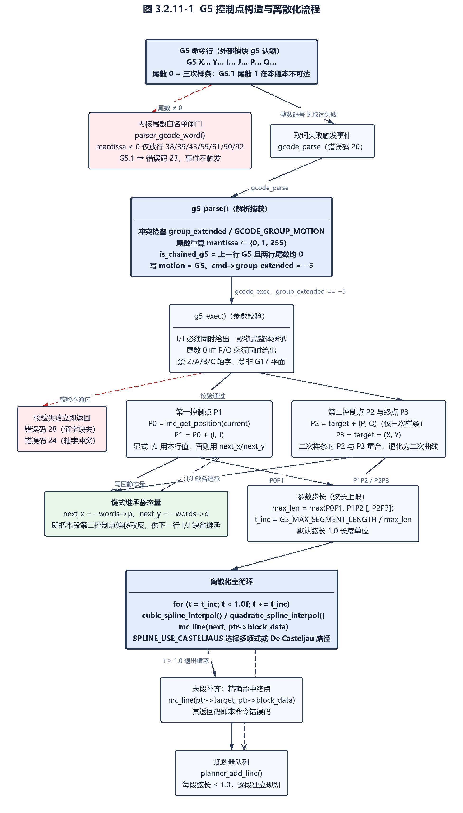

图 3.2.11-1 G5 控制点构造与离散化流程

#### 3.2.11.4 链式 G5 的 I/J 缺省继承

- 需求标识：UC-FREQ3211-4
- 功能描述：连续两行以上不带尾数的 G5 构成链式样条，后续行可以完全省略 `I`/`J`，此时第一控制点取上一行终止时保留的镜像偏移量，使多段样条在节点处保持切线连续。（需求规格）
- 调用条件：解析期 `is_chained_g5` 为真（上一行运动模态为 G5 且两行尾数均为 0），且执行期 `I`、`J` 均缺省（`uCNC-modules/g5/parser_g5.c:124`、`uCNC-modules/g5/parser_g5.c:146`）。
- 输入：静态量 `is_chained_g5`、`next_x`、`next_y`，以及本行给出的 `P`/`Q` 值（`uCNC-modules/g5/parser_g5.c:42-44`）。
- 输出：本行实际使用的 P1 偏移；并把本行 `P`/`Q` 的镜像值写入 `next_x`/`next_y` 供下一行使用。
- 处理：
- （1）`is_chained_g5` 只在解析阶段被赋值、只在执行阶段被读取，且任何一次执行都不清除它，其值始终反映最近一次解析到的 G5 行是否与前一行构成链（`uCNC-modules/g5/parser_g5.c:124`）；
- （2）显式给出 `I` 或 `J` 中任意一个时，两个偏移都改用本行值，不会出现一个继承、一个取新值的混合情形（`uCNC-modules/g5/parser_g5.c:180-181`）；
- （3）继承值为上一步算出的 `next_x = -p`、`next_y = -q`，即把上一段终点的第二控制点偏移取反后当作本段的第一控制点偏移（`uCNC-modules/g5/parser_g5.c:184-185`）；
- （4）该机制只对 `I`/`J` 生效，对 `P`/`Q` 不生效：三次样条分支强制要求 `P`、`Q` 同时给出，缺一即报错，无法继承（`uCNC-modules/g5/parser_g5.c:153-161`）。

> **自述差异**：`uCNC-modules/g5/README.md（第 7 行）` 称本模块向解析器添加 G5（cubic spline）与 G5.1（quadratic spline），与源码中并存的两条插值路径一致（`uCNC-modules/g5/parser_g5.c:107-121`、`uCNC-modules/g5/parser_g5.c:214-225`），但自述未提及本版本内核尾数闸门导致 G5.1 不可达。自述的三步安装说明（`uCNC-modules/g5/README.md（第 11-20 行）`）只要求开启 `ENABLE_PARSER_MODULES`，未说明该开关缺失时模块静默消失（源码仅给 `#warning`，`uCNC-modules/g5/parser_g5.c:243`）；自述亦未提及两个可调项——分段弦长 `G5_MAX_SEGMENT_LENGTH`（`uCNC-modules/g5/parser_g5.c:29-31`）与插值实现选择宏 `SPLINE_USE_CASTELJAUS`（`uCNC-modules/g5/parser_g5.c:45`），以及三项由实现强加于程序的几何约束——链式 `I`/`J` 继承（`uCNC-modules/g5/parser_g5.c:124`）、三次样条强制 `P`/`Q` 配对（`uCNC-modules/g5/parser_g5.c:153-161`）、只允许 G17 平面（`uCNC-modules/g5/parser_g5.c:170-175`）。实测结论以源码为准。

---

### 3.2.12 G7 / G8 车床半径·直径模式（需求规格）

本节的实现对象为外部模块 `g7_g8`（`uCNC-modules/g7_g8/parser_g7_g8.c`，150 行）。它按 LinuxCNC 语义为车床提供 G7（直径模式）与 G8（半径模式）两个码号，并按模式改写 X 轴目标值。装配条件为 `LOAD_MODULE(g7_g8)` 与 `ENABLE_PARSER_MODULES` 同时成立（`uCNC-modules/g7_g8/README.md（第 17 行）`）；未启用解析器扩展时模块给出 `#error` 使构建直接失败，而不像 `g5` 那样降级（`uCNC-modules/g7_g8/parser_g7_g8.c:148`）。模块的版本闸门为 `UCNC_MODULE_VERSION >= 10800`（`uCNC-modules/g7_g8/parser_g7_g8.c:26-28`），本版本为 11700，闸门通过（`uCNC/src/cnc_build.h:32`）。

**可达性：本模块在本版本完全不可达。** 源码以 `#define G7 1`、`#define G8 0` 定义两个码号常量（`uCNC-modules/g7_g8/parser_g7_g8.c:33-34`），却把它们直接用作 `switch (ptr->code)` 的标签（`uCNC-modules/g7_g8/parser_g7_g8.c:59-67`）；而 `ptr->code` 是 G 字数值的整数部分（`uCNC/src/core/parser.c:879`），G7、G8 分别取 7 和 8，与标签值 1 和 0 不符。标签 0 与 1 只对应内核已实现的 `G0`/`G1`（`uCNC/src/core/parser.c:2470-2471`），这两条命令解析成功、错误码为 `STATUS_OK`，根本不会触发 `gcode_parse` 事件（`uCNC/src/core/parser.c:973-978`），故两个 `case` 在实际调用路径上均不可达。其直接后果是静态开关 `parser_lathe_radius_mode`（`uCNC-modules/g7_g8/parser_g7_g8.c:30`）在运行期只能被复位回调写为 0（`uCNC-modules/g7_g8/parser_g7_g8.c:118`），3.2.12.2 的 X 轴折半与还原路径恒为死代码。**本模块的 G7/G8 不得当作可用特性使用**；程序送入 `G7` 或 `G8` 时，内核按「不支持命令」返回错误码 20（`uCNC/src/core/parser.c:2636`）。

**模块装配与接口总览**

| 项目 | 内容 | 证据 |
| --- | --- | --- |
| 码号声明 | `#define G7 1`、`#define G8 0`，直接用作 `switch (ptr->code)` 标签（取值域错配）；不设 `group_extended`，不声明任何 `EXTENDED_*` 码 | `uCNC-modules/g7_g8/parser_g7_g8.c:33-34`、`uCNC-modules/g7_g8/parser_g7_g8.c:59-67` |
| 事件注册 | `gcode_parse`、`gcode_before_motion`、`gcode_after_motion`、`parser_reset`、`protocol_send_gcode_modes` 五个事件 | `uCNC-modules/g7_g8/parser_g7_g8.c:44-48`、`uCNC-modules/g7_g8/parser_g7_g8.c:142-146` |
| 触发点 | `gcode_parse` 在核心取词失败处；`gcode_before_motion` 在运动目标组装完成后；`gcode_after_motion` 在运动提交完成后 | `uCNC/src/core/parser.c:977`、`uCNC/src/core/parser.c:1905`、`uCNC/src/core/parser.c:2061` |
| 地址字 | 不读任何地址字，只读静态开关 `parser_lathe_radius_mode` | `uCNC-modules/g7_g8/parser_g7_g8.c:87-114` |
| 动作 | 半径模式为非 0 时把 X 目标值折半（进入运动前）、运动完成后乘 2 还原；`$G` 报告时追加 `G7 ` 或 `G8 ` | `uCNC-modules/g7_g8/parser_g7_g8.c:92-95`、`uCNC-modules/g7_g8/parser_g7_g8.c:107-110`、`uCNC-modules/g7_g8/parser_g7_g8.c:122-135` |
| 装配开关 | `ENABLE_PARSER_MODULES` 缺失时 `#error`，构建失败 | `uCNC-modules/g7_g8/parser_g7_g8.c:148` |

表 3.2.12-1 g7_g8 模块装配与接口总览

#### 3.2.12.1 码号声明与解析分支

- 需求标识：UC-FREQ3212-1
- 功能描述：模块意图在 `gcode_parse` 事件中捕获 `G7`（直径模式）与 `G8`（半径模式），把选中的模式写入静态开关 `parser_lathe_radius_mode`，并在命中时以 `STATUS_OK` 加 `EVENT_HANDLED` 阻断内核「不支持命令」错误继续上报。**实现事实**：匹配用的 `switch` 标签取自模块自定义的 `G7=1`、`G8=0` 常量，与 `ptr->code` 的取值域不符，两个 `case` 均不可达，函数总是返回 `EVENT_CONTINUE`，`G7`/`G8` 命令行最终以错误码 20 结束。（需求规格）
- 调用条件：内核解析器对 `G7`/`G8` 取词失败、返回 `STATUS_GCODE_UNSUPPORTED_COMMAND` 时触发（`uCNC/src/core/parser.c:973-978`）；由于取词结果与标签不匹配，本模块的回调体在正常路径上不被执行到命中分支。
- 输入：`gcode_parse_args_t` 的 `word`、`code`（`uCNC/src/core/parser.h:357-366`；`code` 的来源为 `uCNC/src/core/parser.c:879` 的 `(uint8_t)truncf(value)`）。
- 输出：命中时置 `STATUS_OK` 并返回 `EVENT_HANDLED`；未命中时保持内核传入的错误值并返回 `EVENT_CONTINUE`。
- 处理：
- （1）仅当 `ptr->word == 'G'` 时进入 `switch`（`uCNC-modules/g7_g8/parser_g7_g8.c:54`）；
- （2）`switch (ptr->code)` 的两个标签为 `case G7:`（即 `case 1:`）与 `case G8:`（即 `case 0:`），分别把 `parser_lathe_radius_mode` 置为 1 与 0（`uCNC-modules/g7_g8/parser_g7_g8.c:59-67`）；
- （3）标签 0 与 1 对应内核已实现的 `G0`、`G1`，其取词成功、错误码为 `STATUS_OK`，不会触发 `gcode_parse` 事件（`uCNC/src/core/parser.c:2470-2471`、`uCNC/src/core/parser.c:973-978`），故两个分支在本版本均不可达；
- （4）`default` 分支把局部变量 `ok` 置为假，随后 `if (ok)` 恒不成立，落到函数末尾的 `return EVENT_CONTINUE`（`uCNC-modules/g7_g8/parser_g7_g8.c:68-83`）；
- （5）因此静态开关 `parser_lathe_radius_mode` 在运行期只能由 `parser_reset` 事件写为 `G8`（值 0）（`uCNC-modules/g7_g8/parser_g7_g8.c:118`），始终为 0。

**实现说明（缺陷）**：本模块的解析分支为「源码存在但不可达」，成因是 `#define G7 1`、`#define G8 0`（`uCNC-modules/g7_g8/parser_g7_g8.c:33-34`）与 `ptr->code` 的取值域（G7→7、G8→8）错配；正确的匹配应使用字面量 7 与 8 或 `EXTENDED_GCODE` 形式的码号。此外，源码变量名 `parser_lathe_radius_mode` 在 **G7** 分支被置 1 并导致 X 折半（`uCNC-modules/g7_g8/parser_g7_g8.c:61-62`、`uCNC-modules/g7_g8/parser_g7_g8.c:92-95`），而按 LinuxCNC 语义 G7 是直径模式，变量命名与行为方向相反。

#### 3.2.12.2 半径·直径模式对运动目标的换算

- 需求标识：UC-FREQ3212-2
- 功能描述：当 `parser_lathe_radius_mode` 非 0 时，模块在每条含轴字的运动块进入规划器之前把 X 目标值折半，在运动块提交之后再把 X 目标值乘 2 还原，使内核用于后续比较的 `parser_last_pos` 与程序坐标系保持一致。（需求规格）
- 调用条件：`gcode_before_motion` 事件与 `gcode_after_motion` 事件被触发时（`uCNC/src/core/parser.c:1905`、`uCNC/src/core/parser.c:2061`）。
- 输入：`gcode_exec_args_t` 的 `target` 目标数组（`uCNC/src/core/parser.h:376`）与静态开关 `parser_lathe_radius_mode`。
- 输出：被就地改写的 `ptr->target[AXIS_X]`；`*(ptr->error)` 被置为 `STATUS_OK`；返回 `EVENT_CONTINUE`，不阻断其它监听器。
- 处理：
- （1）`g7_g8_before_motion`：模式为非 0 时执行 `ptr->target[AXIS_X] = fast_flt_div2(ptr->target[AXIS_X])`（`uCNC-modules/g7_g8/parser_g7_g8.c:92-95`）；
- （2）`fast_flt_div2` 默认定义为 `(x) * 0.5f`，启用 `FAST_FLOAT` 时改写为位操作形式（`uCNC/src/utils.h:74`、`uCNC/src/utils.h:162`）；
- （3）`g7_g8_after_motion`：同一条件成立时执行 `ptr->target[AXIS_X] = fast_flt_mul2(ptr->target[AXIS_X])`，还原为直径值（`uCNC-modules/g7_g8/parser_g7_g8.c:107-110`、`uCNC/src/utils.h:94`、`uCNC/src/utils.h:164`）；
- （4）两个回调都无条件把 `*(ptr->error)` 置为 `STATUS_OK`（`uCNC-modules/g7_g8/parser_g7_g8.c:97`、`uCNC-modules/g7_g8/parser_g7_g8.c:112`），即会清除此前其它监听器留下的错误码；
- （5）由于 3.2.12.1 的码值错配，上述折半与还原分支在运行期恒不执行，`parser_lathe_radius_mode` 始终为 0。

**实现说明（缺陷）**：步骤（5）所述的死代码状态由 3.2.12.1 的缺陷直接导致，属源码存在但不可达的实现路径，不作为可用特性。

#### 3.2.12.3 $G 模态上报与复位

- 需求标识：UC-FREQ3212-3
- 功能描述：模块在 `$G` 模态报告事件中向报告串追加本次模式状态（`G7 ` 或 `G8 `），并在解析器复位事件中把模式恢复为默认的 G8（半径模式关闭）。（需求规格）
- 调用条件：`proto_gcode_modes` 事件在打印 `[GC:...]` 时被触发，`g7_g8` 通过兼容别名 `protocol_send_gcode_modes` 挂接（`uCNC/src/interface/grbl_protocol.c:725`、`uCNC/src/interface/serial_compatibility.h:74-78`，受 `ENABLE_PARSER_MODULES` 保护）；`parser_reset` 事件在 `parser_reset()` 中被触发（`uCNC/src/core/parser.c:2944`）。
- 输入：静态开关 `parser_lathe_radius_mode`；报告回调与复位回调均不使用传入的 `args`。
- 输出：直写串口的字符序列 `G7 ` 或 `G8 `；`parser_lathe_radius_mode` 被写为 0；两者都返回 `EVENT_CONTINUE`。
- 处理：
- （1）报告回调 `g7_g8_send_gcode_modes` 用 `serial_putc()` 逐字符直写串口，依次输出 `'G'`、按模式输出 `'7'` 或 `'8'`、空格，不经过内核的 `proto_parser_modalstate()`（`uCNC-modules/g7_g8/parser_g7_g8.c:122-135`、`uCNC/src/interface/grbl_protocol.c:696-711`）；
- （2）该输出位于内核打印 G 组模态之后、M 组模态之前，因此 `[GC:...]` 串中 `G7`/`G8` 出现在 M 码之前（`uCNC/src/interface/grbl_protocol.c:698-728`）；
- （3）复位回调 `g7_g8_reset` 无视参数，直接把模式置为 `G8`（即 0）并返回 `EVENT_CONTINUE`（`uCNC-modules/g7_g8/parser_g7_g8.c:116-120`）；
- （4）由于模式恒为 0，报告输出在本版本恒为 `G8 `（`uCNC-modules/g7_g8/parser_g7_g8.c:125-132`）；
- （5）源文件中 `g7_g8_reset` 的声明被重复书写三次（`uCNC-modules/g7_g8/parser_g7_g8.c:39-41`），在 C 语言下合法，仅属冗余。

**实现说明（`$` 参数面）**：`g7_g8` 不参与 `$` 参数查询——内核把「车床直径模式」「车床半径模式」两个查询子项硬编码返回 0（`uCNC/src/core/parser.c:3486-3487`），模式状态只能由本模块经 `$G` 报告输出。

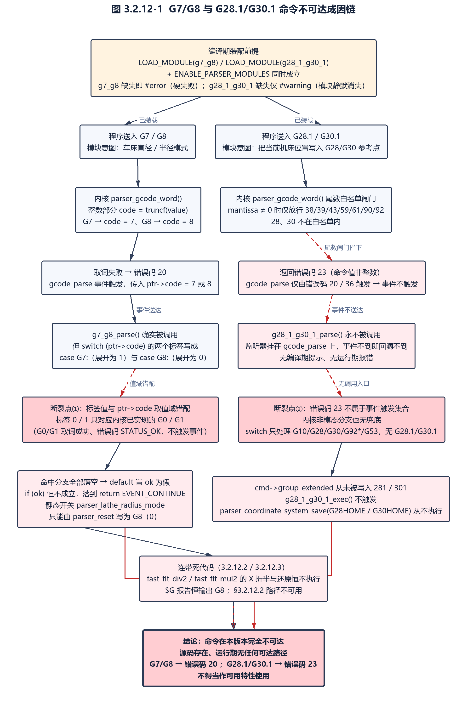

图 3.2.12-1 G7/G8 与 G28.1/G30.1 命令不可达成因链

> **自述差异**：`uCNC-modules/g7_g8/README.md（第 7 行）` 称本模块「adds custom G7/G8 code … to set radius mode for lathes」，即宣称该功能可用；实测两个 `case` 均不可达（`uCNC-modules/g7_g8/parser_g7_g8.c:33-34`、`uCNC-modules/g7_g8/parser_g7_g8.c:59-67`），静态开关只能由复位回调写为 0（`uCNC-modules/g7_g8/parser_g7_g8.c:118`），**自述宣称的功能在本版本内核上不存在**。自述亦未说明 G7 置 1、G8 置 0，未说明变量命名与 LinuxCNC 直径/半径语义方向相反，亦未说明本模块不声明扩展码、不写 `cmd->groups`、不参与 `$` 参数查询（`uCNC/src/core/parser.c:3486-3487`）。源文件头注释（`uCNC-modules/g7_g8/parser_g7_g8.c:3`）与自述同调，与实现的关系同上。

---

### 3.2.13 G28.1 / G30.1 存取参考点（需求规格）

本节的实现对象为外部模块 `g28_1_g30_1`（`uCNC-modules/g28_1_g30_1/parser_g28_1_g30_1.c`，119 行）。它按 LinuxCNC 语义提供 `G28.1`、`G30.1` 两条命令，把当前机床位置写入 G28/G30 参考点存储区。装配条件为 `LOAD_MODULE(g28_1_g30_1)` 与 `ENABLE_PARSER_MODULES` 同时成立（`uCNC-modules/g28_1_g30_1/README.md（第 17 行）`）；未启用解析器扩展时模块只给出 `#warning`，模块整体消失而构建通过（`uCNC-modules/g28_1_g30_1/parser_g28_1_g30_1.c:117`）。版本闸门为 `UCNC_MODULE_VERSION >= 10801`（`uCNC-modules/g28_1_g30_1/parser_g28_1_g30_1.c:25-27`），本版本为 11700，闸门通过（`uCNC/src/cnc_build.h:32`）。

**可达性：本模块在本版本完全不可达。** 内核 `parser_gcode_word` 对一切带尾数的 G 码设有白名单闸门，仅放行 38、39（受条件编译保护）、43、59、61、90、92，28 与 30 不在其列，直接返回 `STATUS_GCODE_COMMAND_VALUE_NOT_INTEGER`（错误码 23）（`uCNC/src/core/parser.c:2434-2453`、`uCNC/src/interface/grbl_interface.h:73`）；而 `gcode_parse` 事件仅在内核错误码为 20 或 36 时触发（`uCNC/src/core/parser.c:973-978`）。故本模块注册的解析监听器（`uCNC-modules/g28_1_g30_1/parser_g28_1_g30_1.c:36`）永不被调用，281/301 两个扩展码号从未被写入 `cmd->group_extended`，执行回调亦不触发；程序送入 `G28.1` 或 `G30.1` 时只会收到错误码 23。内核侧亦无对应的非模态分支可供兜底（`uCNC/src/core/parser.c:1733-1783`）。**本模块的 G28.1/G30.1 不得当作可用特性使用。**

**模块装配与接口总览**

| 项目 | 内容 | 证据 |
| --- | --- | --- |
| 码号声明 | `#define G28_1 EXTENDED_GCODE(28.1)`、`#define G30_1 EXTENDED_GCODE(30.1)`，展开为正值 281、301，走内核「独立扩展命令」分支 | `uCNC-modules/g28_1_g30_1/parser_g28_1_g30_1.c:30-31`、`uCNC/src/core/parser.h:111-114` |
| 事件注册 | `gcode_parse` → `g28_1_g30_1_parse`；`gcode_exec` → `g28_1_g30_1_exec` | `uCNC-modules/g28_1_g30_1/parser_g28_1_g30_1.c:36-37`、`uCNC-modules/g28_1_g30_1/parser_g28_1_g30_1.c:114-115` |
| 触发点 | `gcode_parse` 在核心取词失败处；`gcode_exec` 在独立扩展命令分支的 `default` 内 | `uCNC/src/core/parser.c:977`、`uCNC/src/core/parser.c:1432` |
| 地址字 | 不读任何地址字，仅用 `ptr->value` 重算尾数 | `uCNC-modules/g28_1_g30_1/parser_g28_1_g30_1.c:54-58` |
| 动作 | 读取当前机床位置（坐标系统号 253），写入 G28/G30 参考点存储 | `uCNC-modules/g28_1_g30_1/parser_g28_1_g30_1.c:82-103` |
| 装配开关 | `ENABLE_PARSER_MODULES` 缺失时仅 `#warning`（模块静默消失） | `uCNC-modules/g28_1_g30_1/parser_g28_1_g30_1.c:117` |

表 3.2.13-1 g28_1_g30_1 模块装配与接口总览

#### 3.2.13.1 扩展码号声明与取值

- 需求标识：UC-FREQ3213-1
- 功能描述：模块为 G28.1 与 G30.1 各分配一个正整数扩展码号（`EXTENDED_GCODE(28.1)` 展开为 281、`EXTENDED_GCODE(30.1)` 展开为 301），使这两条命令在内核执行阶段落入「独立扩展命令」分支而非运动分支，并因此受内核「扩展命令不得与其它模态组同行」的约束。（需求规格）
- 调用条件：模块被 `LOAD_MODULE(g28_1_g30_1)` 装载后，任一次 `G28.1`/`G30.1` 解析成功即写入该码号（在本版本该条件不可达，见 3.2.13.4）。
- 输入：无（宏常量）。
- 输出：`cmd->group_extended` 被写为 281 或 301。
- 处理：
- （1）宏展开：`EXTENDED_GCODE(X)` 定义为 `EXTENDED_GCODE_BASE + (int16_t)(X * 10)`，而 `EXTENDED_GCODE_BASE` 为 0，故 28.1 得 281、30.1 得 301（`uCNC/src/core/parser.h:111-114`）；
- （2）正值语义：内核 `parser_exec_command` 以 `if (cmd->group_extended > 0)` 进入独立扩展命令分支，先无条件 `itp_sync()` 再按码号分发；281/301 不在内核已知码号之列，落入 `default`，内核把错误置为 `STATUS_GCODE_UNSUPPORTED_COMMAND` 并触发 `gcode_exec` 事件（`uCNC/src/core/parser.c:1415-1436`）；
- （3）同行模态约束：内核在 `parser_validate_command` 中判定 `cmd->group_extended > 0` 且 `cmd->groups` 非 0 时返回 `STATUS_GCODE_MODAL_GROUP_VIOLATION`（`uCNC/src/core/parser.c:1335-1338`），故 G28.1/G30.1 不能与任何模态 G/M 码同行；
- （4）与内核原生 `G28`/`G30` 无码号冲突：内核把无尾数的 28/30 归入非模态组（`code = floorf(code * 0.10001f) + mantissa`，28 得 2、30 得 3），走非模态分支而不使用 `group_extended`（`uCNC/src/core/parser.c:2630-2633`、`uCNC/src/core/parser.c:1755-1760`）。

#### 3.2.13.2 解析捕获与 .1 尾数判定

- 需求标识：UC-FREQ3213-2
- 功能描述：模块在 `gcode_parse` 事件中判定「G 字、尾数恰为 .1、整数部分为 28 或 30」，命中后把该行的扩展码号写为 281 或 301 并抑制内核「不支持命令」错误；若本行已有其它扩展码号则报模态组冲突。（需求规格）
- 调用条件：内核解析器对 `G28.1`/`G30.1` 取词失败并触发 `gcode_parse` 事件时；在本版本该事件不会因这两条命令触发，见 3.2.13.4（`uCNC/src/core/parser.c:973-978`）。
- 输入：`gcode_parse_args_t` 的 `word`、`code`、`value`、`cmd`（`uCNC/src/core/parser.h:357-366`）。
- 输出：`*(ptr->error)` 为 `STATUS_OK` 或 `STATUS_GCODE_MODAL_GROUP_VIOLATION`；`cmd->group_extended`；返回 `EVENT_HANDLED` 或 `EVENT_CONTINUE`。
- 处理：
- （1）仅当 `ptr->word == 'G'` 时继续（`uCNC-modules/g28_1_g30_1/parser_g28_1_g30_1.c:44`）；
- （2）冲突前置检查：`ptr->cmd->group_extended` 非 0 时写入 `STATUS_GCODE_MODAL_GROUP_VIOLATION` 并返回 `EVENT_HANDLED`（`uCNC-modules/g28_1_g30_1/parser_g28_1_g30_1.c:46-51`）；
- （3）尾数判定：`m = lroundf((ptr->value - ptr->code) * 100.0f)`，仅接受 `m == 10`（即恰好 .1），其余一律返回 `EVENT_CONTINUE`；此处不设「非法尾数」哨兵，`.15` 之类的取值被直接放行给其它扩展处理（`uCNC-modules/g28_1_g30_1/parser_g28_1_g30_1.c:54-58`）；
- （4）整数部分用 `switch (ptr->code)` 的 `case 28:` 与 `case 30:` 匹配，不使用宏名作标签，因而不存在 3.2.12.1 那类码值错配（`uCNC-modules/g28_1_g30_1/parser_g28_1_g30_1.c:60-63`）；
- （5）命中后写入 `ptr->cmd->group_extended = EXTENDED_GCODE(ptr->value)`，此处传入的是 `ptr->value`（即 28.1 整体）而非 `ptr->code`（`uCNC-modules/g28_1_g30_1/parser_g28_1_g30_1.c:64`）；
- （6）随后置 `*(ptr->error) = STATUS_OK` 并返回 `EVENT_HANDLED`；未命中则返回 `EVENT_CONTINUE`，把内核原始错误放行（`uCNC-modules/g28_1_g30_1/parser_g28_1_g30_1.c:66-72`）。

#### 3.2.13.3 执行：把当前坐标写入 G28 / G30 参考点

- 需求标识：UC-FREQ3213-3
- 功能描述：模块在 `gcode_exec` 事件中识别 281/301 两个扩展码号，读出当前机床位置（坐标系统号 253），把它保存为 G28 或 G30 的参考点，使后续裸 `G28`/`G30` 具备可由程序设定的目标点。（需求规格）
- 调用条件：内核 `parser_exec_command` 在 `group_extended > 0` 分支未匹配到已知码号、把错误置为 `STATUS_GCODE_UNSUPPORTED_COMMAND` 后触发 `gcode_exec` 事件（`uCNC/src/core/parser.c:1429-1433`）。
- 输入：`gcode_exec_args_t` 的 `cmd->group_extended`；当前机床位置由 `parser_get_coordsys(253, axis)` 取得。
- 输出：X/Y/Z/A/B/C 各轴坐标被写入 G28/G30 参考点存储区；`*(ptr->error)` 为 `STATUS_OK`；返回 `EVENT_HANDLED`。
- 处理：
- （1）先把 `axis[AXIS_COUNT]` 用 `memset` 清零（`uCNC-modules/g28_1_g30_1/parser_g28_1_g30_1.c:80-81`）；
- （2）按 `switch (ptr->cmd->group_extended)` 匹配 `G28_1`（281）与 `G30_1`（301）两个分支（`uCNC-modules/g28_1_g30_1/parser_g28_1_g30_1.c:82-84`、`uCNC-modules/g28_1_g30_1/parser_g28_1_g30_1.c:94`）；
- （3）两个分支都先以 `parser_get_coordsys(253, axis)` 取当前机床位置——内核中系统号 253 对应 `parser_last_pos`，254 对应刀具长度偏移，255 对应最近探测点（`uCNC/src/core/parser.c:286-298`）；
- （4）保存路径按模块版本闸门分流：G28 分支在 `UCNC_MODULE_VERSION < 11179` 时调用 `settings_save(G28ADDRESS, (uint8_t *)axis, sizeof(axis))`，否则调用 `parser_coordinate_system_save(G28HOME, axis)`（`uCNC-modules/g28_1_g30_1/parser_g28_1_g30_1.c:86-90`）；G30 分支在 `UCNC_MODULE_VERSION < 11200` 时调用 `settings_save(G30ADDRESS, ...)`，否则调用 `parser_coordinate_system_save(G30HOME, axis)`（`uCNC-modules/g28_1_g30_1/parser_g28_1_g30_1.c:96-100`）。本版本 `UCNC_MODULE_VERSION` 为 11700，两个分支都编译进新路径（`uCNC/src/cnc_build.h:32`）；
- （5）`G28HOME`/`G30HOME` 分别定义为 `COORD_SYS_COUNT` 与 `COORD_SYS_COUNT + 1`，即坐标系统数组末尾追加的两个槽位；`G28ADDRESS`/`G30ADDRESS` 是它们在非易失存储中的对应地址，仅老路径使用（`uCNC/src/interface/grbl_settings.h:134-139`）；
- （6）两个分支各自置 `STATUS_OK` 并返回 `EVENT_HANDLED`；码号不匹配时落到函数末尾返回 `EVENT_CONTINUE`（`uCNC-modules/g28_1_g30_1/parser_g28_1_g30_1.c:91-93`、`uCNC-modules/g28_1_g30_1/parser_g28_1_g30_1.c:101-106`）。

**实现说明（坐标来源语义）**：保存的坐标来源是 `parser_last_pos`，即「最近一次解析到的目标位置」，而非驱动器实时位置——内核在每次运动执行末尾以 `memcpy(parser_last_pos, target, ...)` 更新该数组（`uCNC/src/core/parser.c:2067`）。存在进给保持或未完成运动时，二者可能不同。

#### 3.2.13.4 内核 .1 尾数闸门导致的不可达

- 需求标识：UC-FREQ3213-4
- 功能描述：记录 G28.1/G30.1 在本版本内核下无法到达本模块的原因链：内核 `parser_gcode_word` 对任何带尾数的 G 码设有白名单闸门，不在白名单内的码直接返回「命令值非整数」错误；而 `gcode_parse` 事件只在「不支持命令」或「未使用字」两种错误下触发，因此本模块的解析监听器不会被调用。（需求规格）
- 调用条件：任何 `G28.1`/`G30.1` 命令行进入内核解析阶段。
- 输入：`G28.1`/`G30.1` 的取词结果（`code` 为 28 或 30，`mantissa` 为 1）。
- 输出：内核返回 `STATUS_GCODE_COMMAND_VALUE_NOT_INTEGER`（错误码 23）；模块无任何副作用；命令行以错误码 23 结束。
- 处理：
- （1）内核在 `parser_gcode_word` 首段即判尾数：`if (mantissa)` 时只放行 38、39（受条件编译保护）、43、59、61、90、92，其余码经 `default` 返回 `STATUS_GCODE_COMMAND_VALUE_NOT_INTEGER`；28 与 30 均不在白名单内（`uCNC/src/core/parser.c:2434-2453`）；
- （2）该错误码为 23，既不是 `STATUS_GCODE_UNSUPPORTED_COMMAND`（20）也不是 `STATUS_GCODE_UNUSED_WORDS`（36）（`uCNC/src/interface/grbl_interface.h:70`、`uCNC/src/interface/grbl_interface.h:73`、`uCNC/src/interface/grbl_interface.h:86`）；
- （3）`gcode_parse` 事件的触发条件被硬编码为「错误码等于 20 或 36」，故事件不触发，本模块的 `g28_1_g30_1_parse` 收不到 `G28.1`/`G30.1`（`uCNC/src/core/parser.c:974`）；
- （4）内核中仍留有面向 `G28.1`/`G30.1` 的痕迹：非模态码换算 `code += mantissa` 会把 28 变为非模态索引 4（`uCNC/src/core/parser.c:2630-2633`），但 `switch (new_state->groups.nonmodal)` 只处理 `G10`、`G28`、`G30`、`G92*`、`G53`，没有 G28.1/G30.1 分支，说明尾数白名单与这段残留代码之间存在不一致（`uCNC/src/core/parser.c:1733-1783`）；
- （5）因此本模块在本版本只有「编译期存在、运行期不可达」的代码，其 281/301 码号从未被写入 `cmd->group_extended`。

**实现说明（缺陷）**：本模块不可达的成因在内核侧而非模块侧——需内核放行 28/30 的尾数，或把这两条命令改用其它方式接入。其表现与 G5.1 同源，见 3.2.11 的同一闸门引用，成因链见 图 3.2.12-1。

> **自述差异**：`uCNC-modules/g28_1_g30_1/README.md（第 7 行）` 称本模块「allows to set G28-G30 home position to the current machine position」；实测在本版本内核上命令不可达（`uCNC/src/core/parser.c:2434-2453`、`uCNC/src/core/parser.c:973-978`），程序侧只会收到错误码 23，自述全篇未提该限制。自述（第 5 行）使用一级标题，与本节其余模块 README 的二级标题不一致；安装步骤编号为 1、2、4（`uCNC-modules/g28_1_g30_1/README.md（第 13、14、20 行）`），缺第 3 步；自述（第 13 行）要求把 `G28_1-G30_1` 目录拷入 `src/modules/`，而仓库实际目录名为 `g28_1_g30_1`，同文件（第 17 行）的 `LOAD_MODULE(g28_1_g30_1)` 用的是下划线形式；自述亦未提版本闸门 10801（`uCNC-modules/g28_1_g30_1/parser_g28_1_g30_1.c:25-27`）。源文件头注释（`uCNC-modules/g28_1_g30_1/parser_g28_1_g30_1.c:3`）与实现的落盘方式一致。

---

### 3.2.14 G33 螺纹车削·同步进给（需求规格）

本节的实现对象为外部模块 `g33`（`uCNC-modules/g33/parser_g33.c`，538 行），是本节所述外部 G 代码模块中唯一使用实时钩子与闭环修正的实现。它提供 G33（螺纹车削 / 主轴同步进给）：运动轴按每转进给量 `K` 与实测主轴转速联动，使刀具位置与主轴转角锁相。装配条件为 `LOAD_MODULE(g33)`（`uCNC-modules/g33/README.md（第 17 行）`）与 `ENABLE_PARSER_MODULES`、`ENABLE_MAIN_LOOP_MODULES`、`ENABLE_RT_SYNC_MOTIONS` 三项编译开关同时成立，且必须指定参与同步的编码器 `G33_ENCODER`；任一缺失均以 `#error` 使构建失败（`uCNC-modules/g33/parser_g33.c:26`、`uCNC-modules/g33/parser_g33.c:40-42`、`uCNC-modules/g33/parser_g33.c:523-537`）。版本闸门为 `UCNC_MODULE_VERSION >= 11501`（`uCNC-modules/g33/parser_g33.c:28-30`），本版本为 11700，闸门通过（`uCNC/src/cnc_build.h:32`）。

**可达性：本模块可达。** 它用负值运动扩展码 `EXTENDED_MOTION_GCODE(33)`（即 −33）把执行权交回模块，走内核运动组 `switch` 的 `default` 分支与 `gcode_exec` 事件（`uCNC-modules/g33/parser_g33.c:182`、`uCNC/src/core/parser.c:2050-2056`）。内核 `parser_gcode_word` 中无码号 33，故不存在同码号冲突（`uCNC/src/core/parser.c:2456-2636`）。

**模块装配与接口总览**

| 项目 | 内容 | 证据 |
| --- | --- | --- |
| 码号声明 | `#define G33 33`，但匹配语句使用整数字面量 `ptr->code == 33`，宏在该语句中未被引用；模态归属写 `EXTENDED_MOTION_GCODE(33)`，即 −33 | `uCNC-modules/g33/parser_g33.c:148`、`uCNC-modules/g33/parser_g33.c:160`、`uCNC-modules/g33/parser_g33.c:182` |
| 事件注册 | `gcode_parse`、`gcode_exec`、`input_change`（仅在定义 `G33_INDEX_PIN` 时）、`proto_status`、`cnc_dotasks` 五类 | `uCNC-modules/g33/parser_g33.c:153-154`、`uCNC-modules/g33/parser_g33.c:143-145`、`uCNC-modules/g33/parser_g33.c:438`、`uCNC-modules/g33/parser_g33.c:517` |
| 钩子挂接 | 运行期以 `HOOK_ATTACH_CALLBACK` 挂接 `enc<X>_index` 与 `itp_rt_stepbits`，以 `HOOK_RELEASE` 释放 | `uCNC-modules/g33/parser_g33.c:221-237`、`uCNC-modules/g33/parser_g33.c:380`、`uCNC-modules/g33/parser_g33.c:394-411` |
| 触发点 | `gcode_parse` 在核心取词失败处；`gcode_exec` 在运动组 `default` 分支；同步修正跑在 `cnc_dotasks` 上 | `uCNC/src/core/parser.c:977`、`uCNC/src/core/parser.c:2055`、`uCNC/src/cnc.c:69-71` |
| 地址字 | `X`/`Y`/`Z` 至少一个；`K` 为每转进给量（存于 `words->ijk[2]`）；不要求 `F` | `uCNC-modules/g33/parser_g33.c:197-209`、`uCNC/src/core/parser.c:2811-2813` |
| 动作 | 由 `K` 与实测转速推出进给，把运动块标记为同步并提交；等待主轴索引脉冲启动运动；实时步进中断计数、主循环按步位误差反复修正进给 | `uCNC-modules/g33/parser_g33.c:344-391`、`uCNC-modules/g33/parser_g33.c:440-484` |
| 装配开关 | 解析器扩展、主循环扩展、实时同步运动三项缺一即 `#error`；`G33_ENCODER` 未定义即 `#error` | `uCNC-modules/g33/parser_g33.c:40-42`、`uCNC-modules/g33/parser_g33.c:523-537` |

表 3.2.14-1 g33 模块装配与接口总览

#### 3.2.14.1 码号声明与解析捕获

- 需求标识：UC-FREQ3214-1
- 功能描述：模块在 `gcode_parse` 事件中截获整数码号为 33 的 G 字（G33 螺纹 / 同步进给），把它登记为运动组命令并写入负值扩展码号 −33，使内核在执行阶段把该行交给模块；同时拒绝任何带尾数的 G33.x，并对同一行内的模态码与扩展码冲突报错。（需求规格）
- 调用条件：内核解析器对 `G33` 取词失败、返回 `STATUS_GCODE_UNSUPPORTED_COMMAND` 时触发（`uCNC/src/core/parser.c:973-978`、`uCNC/src/core/parser.c:2636`；内核 `parser_gcode_word` 中无码号 33 的分支，`uCNC/src/core/parser.c:2456-2636`）。
- 输入：`gcode_parse_args_t` 的 `word`、`code`、`value`、`cmd`、`new_state`（`uCNC/src/core/parser.h:357-366`）。
- 输出：`*(ptr->error)` 为 `STATUS_OK`、`STATUS_GCODE_MODAL_GROUP_VIOLATION` 或 `STATUS_GCODE_UNSUPPORTED_COMMAND`；副作用为改写 `new_state->groups.motion`、`new_state->groups.motion_mantissa`、`cmd->groups` 与 `cmd->group_extended`；返回 `EVENT_HANDLED` 或 `EVENT_CONTINUE`。
- 处理：
- （1）匹配条件为 `ptr->word == 'G'` 且 `ptr->code == 33`；此处使用整数字面量，文件中为该码号定义的 `#define G33 33` 在本语句中未被引用（`uCNC-modules/g33/parser_g33.c:148`、`uCNC-modules/g33/parser_g33.c:160`）；
- （2）冲突前置检查：`ptr->cmd->group_extended` 非 0，或 `cmd->groups` 已置 `GCODE_GROUP_MOTION` 位时报 `STATUS_GCODE_MODAL_GROUP_VIOLATION` 并返回 `EVENT_HANDLED`（`uCNC-modules/g33/parser_g33.c:163-168`）；
- （3）尾数拒绝：`mantissa = lroundf((ptr->value - ptr->code) * 100.0f)`，只要非 0 即写 `STATUS_GCODE_UNSUPPORTED_COMMAND` 并返回 `EVENT_HANDLED`，即 `G33.1` 刚性攻丝被明确拒绝且错误码仍报「不支持」（`uCNC-modules/g33/parser_g33.c:171-177`）；
- （4）登记：写入 `new_state->groups.motion = G33`（值 33）、`motion_mantissa = 0`、置 `GCODE_GROUP_MOTION` 位、`cmd->group_extended = EXTENDED_MOTION_GCODE(33)`（展开为 −33）、置 `*(ptr->error) = STATUS_OK` 并返回 `EVENT_HANDLED`（`uCNC-modules/g33/parser_g33.c:179-184`、`uCNC/src/core/parser.h:115`）；
- （5）未命中时返回 `EVENT_CONTINUE`，放行内核原始错误给其它扩展（`uCNC-modules/g33/parser_g33.c:188`）。

#### 3.2.14.2 执行期参数校验与工具同步

- 需求标识：UC-FREQ3214-2
- 功能描述：模块在 `gcode_exec` 事件中校验同步进给命令的必要地址字——必须至少给出一个 XYZ 轴字，且必须给出每转进给量 `K`；校验通过后先把本行的工具（主轴）状态推给工具层，使后续转速测量与同步动作基于最新主轴设置。（需求规格）
- 调用条件：`gcode_exec` 事件被调用且 `ptr->cmd->group_extended == EXTENDED_MOTION_GCODE(33)`（即 −33）时进入（`uCNC-modules/g33/parser_g33.c:195`）；该事件的调用点为内核运动组 `switch` 的 `default` 分支（`uCNC/src/core/parser.c:2050-2056`）。
- 输入：`gcode_exec_args_t` 的 `cmd->words` 地址字位掩码、`cmd->group_extended`、`block_data`（`uCNC/src/core/parser.h:370-378`）。
- 输出：`*(ptr->error)` 为 `STATUS_GCODE_NO_AXIS_WORDS`（26）、`STATUS_GCODE_VALUE_WORD_MISSING`（28）、`STATUS_CRITICAL_FAIL`（254）或 `STATUS_OK`；返回 `EVENT_HANDLED`。
- 处理：
- （1）扩展码判定：`ptr->cmd->group_extended == EXTENDED_MOTION_GCODE(33)` 时进入（`uCNC-modules/g33/parser_g33.c:195`）；
- （2）轴字缺失：`cmd->words` 未置 `GCODE_XYZ_AXIS` 任一位时报 `STATUS_GCODE_NO_AXIS_WORDS` 并返回 `EVENT_HANDLED`（`uCNC-modules/g33/parser_g33.c:197-202`）；`GCODE_XYZ_AXIS` 为 `X|Y|Z` 三位，故 A/B/C 旋转轴不能单独作为螺纹轴（`uCNC/src/core/parser.h:187`）；
- （3）`K` 字缺失：`cmd->words` 未置 `GCODE_WORD_K` 时报 `STATUS_GCODE_VALUE_WORD_MISSING`（`uCNC-modules/g33/parser_g33.c:204-209`）；`K` 由内核存入 `words->ijk[2]`，模块后续按 `ijk[2]` 读取，语义为每转进给量（`uCNC/src/core/parser.c:2811-2813`）；
- （4）工具同步：调用 `mc_update_tools(ptr->block_data)`，返回非 `STATUS_OK` 时报 `STATUS_CRITICAL_FAIL` 并返回 `EVENT_HANDLED`（`uCNC-modules/g33/parser_g33.c:212-216`）；G33 由模块自行调用该函数，以使本行的主轴状态先于转速测量生效；
- （5）本模块不要求 `F` 字：进给量完全由 `K` 与实测转速推出，内核的进给字校验只覆盖 `group_extended` 为 0 的运动命令（`uCNC/src/core/parser.c:1261`）；
- （6）三项校验全部通过后直接进入 3.2.14.3，不再返回中间结果。

**错误码取值（数据字典里找）**：`STATUS_GCODE_NO_AXIS_WORDS` 取值为 26，`STATUS_GCODE_VALUE_WORD_MISSING` 取值为 28，`STATUS_CRITICAL_FAIL` 取值为 254（`uCNC/src/interface/grbl_interface.h:76`、`uCNC/src/interface/grbl_interface.h:78`、`uCNC/src/interface/grbl_interface.h:114`）。

#### 3.2.14.3 同步进给量的推导与 mc_line 提交

- 需求标识：UC-FREQ3214-3
- 功能描述：模块把 G33 行折算成一条带同步标记的运动块：取当前与目标位置的运动学坐标与步位，算出直线距离、总步数、允许的最大进给与最大加速度；再用实测主轴转速与 `K` 推出每秒进给、每转步数以及「转速→步进频率」比例常数；把运动块交规划器排队并挂接索引脉冲回调与实时步进计数钩子，随后等待索引脉冲启动运动直至运动结束。（需求规格）
- 调用条件：`gcode_exec` 事件中扩展码为 −33 且通过 3.2.14.2 的校验后（`uCNC-modules/g33/parser_g33.c:218` 起）。
- 输入：`ptr->target[]`、`ptr->block_data`、`ptr->words->ijk[2]`（`K`）、`g_settings.encoders_resolution[G33_ENCODER]`、`g_settings.max_feed_rate[]`、`g_settings.acceleration[]`；实测转速由 `spindle_index_time`、`spindle_index_last_time` 两个时间戳导出。
- 输出：`synched_motion_status` 状态机推进；`steps_per_index`、`rpm_to_stepfeed_constant`、`motion_total_steps`、`motion_total_distance`、`enc_res` 等静态量被写入；`block_data->feed`、`block_data->max_accel` 与 `motion_flags.bit.synched` 被改写；`*(ptr->error)`；返回 `EVENT_HANDLED`。
- 处理：
- （1）取编码器分辨率 `g_settings.encoders_resolution[G33_ENCODER]` 存入静态量 `enc_res`，并以条件编译把 `spindle_index_cb_handler` 挂到 `G33_ENCODER` 对应的编码器索引钩子上（ENC0–ENC7 各一个分支）（`uCNC-modules/g33/parser_g33.c:218`、`uCNC-modules/g33/parser_g33.c:221-237`；钩子声明见 `uCNC/src/modules/encoder.h:51-58`，挂接宏见 `uCNC/src/module.h:156`）；
- （2）定义 `TOOL_WAIT_FOR_SPEED` 时先等主轴升速：容许误差为 `TOOL_WAIT_FOR_SPEED_MAX_ERROR * 1% * 编程转速`，超时窗口为 `DELAY_ON_RESUME_SPINDLE * 1000` 毫秒，超时或后台任务返回失败即报 `STATUS_SPINDLE_RPM_ERROR`（错误码 62）并返回（`uCNC-modules/g33/parser_g33.c:239-254`、`uCNC/src/interface/grbl_interface.h:113`）；
- （3）等待索引脉冲：在无限循环内以原子块读取 `spindle_index_time` 与 `spindle_index_last_time`，上一时刻非 0 即跳出，否则继续执行 `cnc_dotasks()`（`uCNC-modules/g33/parser_g33.c:255-269`）；
- （4）按索引脉冲间隔算转速：`index_rpm = 1000000.0f / (delta_t * MIN_SEC_MULT)`；若 `index_rpm < 1` 视为转速无效，报 `STATUS_SPINDLE_RPM_ERROR` 并退出（`uCNC-modules/g33/parser_g33.c:270-280`）；
- （5）取当前位置 `mc_get_position(prev_target)`，经 `kinematics_apply_transform` 与 `kinematics_apply_inverse` 得到起点步位 `prev_step_pos[]`；对目标副本做同样变换得到 `next_step_pos[]`（`uCNC-modules/g33/parser_g33.c:284-296`）；
- （6）直线距离 `line_dist` 为各轴位移平方和的开方（同时存入 `motion_total_distance`）；归一化方向向量后按各轴 `max_feed_rate`、`acceleration` 反算合成最大进给 `max_feed`（并受 `F_STEP_MAX` 上限）与最大加速度 `max_accel`（`uCNC-modules/g33/parser_g33.c:299-326`）；
- （7）总步数 `total_steps` 取各步进器位移绝对值的最大值，并存入 `motion_total_steps`（`uCNC-modules/g33/parser_g33.c:329-342`）；
- （8）比例常数 `rpm_to_stepfeed_constant = K * total_steps * MIN_SEC_MULT / line_dist`，源码注释给出其含义为「步进频率 = 该常数 × 转速」（`uCNC-modules/g33/parser_g33.c:344-346`）；
- （9）按实测转速推算本行名义进给 `feed = K * index_rpm`（`K` 为每转进给量、转速为转每分，故量纲为每分钟进给）；若 `feed > max_feed` 则报 `STATUS_MAX_STEP_RATE_EXCEEDED`（错误码 12）并退出（`uCNC-modules/g33/parser_g33.c:348-356`、`uCNC/src/interface/grbl_interface.h:64`）；
- （10）总圈数 `total_revs = line_dist / K`，每圈步数 `steps_per_rev = total_steps / total_revs`，`steps_per_index = lroundf(steps_per_rev * 100.0f)`——放大 100 倍以减小后续整数运算的舍入误差（`uCNC-modules/g33/parser_g33.c:358-360`）；
- （11）写运动块：`block_data->feed = feed`、`block_data->motion_flags.bit.synched = 1`、`block_data->max_accel = max_accel`，随后把 `feed` 换算为每秒进给供更新循环使用（`uCNC-modules/g33/parser_g33.c:362-367`）；
- （12）复位 `spindle_index_counter` 与 `itp_sync_step_counter` 后调用 `mc_line(ptr->target, ptr->block_data)` 入队；失败时报 `STATUS_CRITICAL_FAIL` 并把 `synched_motion_status` 清为 `SYNC_DISABLED` 后返回（`uCNC-modules/g33/parser_g33.c:369-377`）；
- （13）挂接实时步进计数钩子 `HOOK_ATTACH_CALLBACK(itp_rt_stepbits, itp_rt_stepcount_cb_handler)`（`uCNC-modules/g33/parser_g33.c:380`；钩子声明见 `uCNC/src/core/interpolator.h:129`，调用点见 `uCNC/src/core/interpolator.c:1124`，受 `ENABLE_RT_SYNC_MOTIONS` 保护，`uCNC/src/core/interpolator.c:1120`）；
- （14）置 `synched_motion_status = SYNC_READY` 通知索引回调可以启动运动，随后阻塞在 `itp_sync()` 上等待运动结束；`itp_sync()` 返回非 `STATUS_OK` 时报 `STATUS_CRITICAL_FAIL`（`uCNC-modules/g33/parser_g33.c:383`、`uCNC-modules/g33/parser_g33.c:385-391`）；
- （15）运动结束后置 `SYNC_DISABLED`，按 `G33_ENCODER` 释放编码器索引钩子并释放 `itp_rt_stepbits` 钩子，置 `STATUS_OK` 返回（`uCNC-modules/g33/parser_g33.c:392`、`uCNC-modules/g33/parser_g33.c:394-414`）。

**实现说明（缺陷）**：步骤（12）的失败分支在报 `STATUS_CRITICAL_FAIL` 后直接返回，未走到步骤（15）的 `HOOK_RELEASE`（`uCNC-modules/g33/parser_g33.c:372-377` 与 `uCNC-modules/g33/parser_g33.c:394-411`），即 `mc_line` 入队失败时索引钩子与实时步进计数钩子不会被释放；同一条路径上 `synched_motion_status` 会被清为 `SYNC_DISABLED`，使残留钩子处于不动作状态。此外，模块自己声明的 `static volatile int32_t itp_sync_step_counter`（`uCNC-modules/g33/parser_g33.c:61`）与内核 `uCNC/src/core/interpolator.h:117` 中被注释掉的同名变量无关联。

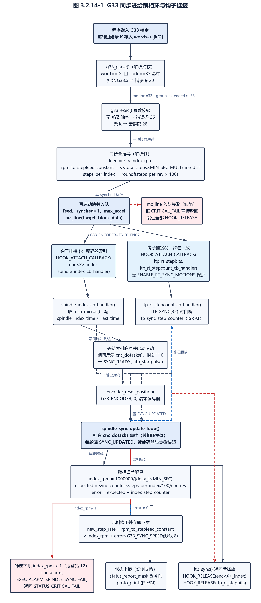

图 3.2.14-1 G33 同步进给锁相环与钩子挂接

#### 3.2.14.4 索引脉冲回调与实时步进计数钩子

- 需求标识：UC-FREQ3214-4
- 功能描述：模块提供两个中断侧回调：编码器索引脉冲回调用于测量主轴转一圈的时间，并在收到「已就绪」状态时真正启动同步运动；实时步进计数回调则在带同步标志的步进中断里累加已发出的同步步数，供主循环比对期望步位与实际步位。（需求规格）
- 调用条件：索引回调由编码器索引钩子（执行期由 3.2.14.3 步骤 1 挂接）或 `G33_INDEX_PIN` 的 `input_change` 事件触发；步进计数回调由 `itp_rt_stepbits` 钩子在实时步进中断中触发（`uCNC-modules/g33/parser_g33.c:380`、`uCNC-modules/g33/parser_g33.c:143-145`）。
- 输入：`mcu_micros()` 时间戳、编码器索引信号、步进中断标志 `itp_flags` 与步进位图。
- 输出：`spindle_index_time`、`spindle_index_last_time`、`spindle_index_counter`、`spindle_index_step_counter`、`itp_sync_step_counter`、`synched_motion_status` 等静态量；在就绪态下触发 `itp_start(false)` 与 `encoder_reset_position(G33_ENCODER, 0)`。
- 处理：
- （1）实时步进计数回调 `itp_rt_stepcount_cb_handler(uint8_t stepbits, uint8_t itp_flags)`：仅当 `itp_flags` 置有 `ITP_SYNC`（值 32）时把 `synched_motion_status` 或上 `SYNC_RUNNING` 并自增 `itp_sync_step_counter`（`uCNC-modules/g33/parser_g33.c:99-106`、`uCNC/src/core/interpolator.h:40`）；
- （2）索引侧脉冲回调的函数名由宏拼接生成：`g33_enc_pulse(G33_ENCODER)` 展开为 `enc<X>_pulse(void)`，即被挂接的实为内核编码器模块的脉冲函数名（`uCNC-modules/g33/parser_g33.c:108-113`）；该函数仅在 `synched_motion_status > SYNC_DISABLED` 时把当前 `itp_sync_step_counter` 快照到 `spindle_index_step_counter` 并置 `SYNC_UPDATED`（`uCNC-modules/g33/parser_g33.c:115-119`）；
- （3）`spindle_index_cb_handler()`：取 `mcu_micros()`，把上次时间戳移入 `spindle_index_last_time`、当前时间存入 `spindle_index_time`，并自增 `spindle_index_counter`（`uCNC-modules/g33/parser_g33.c:127-130`）；
- （4）状态机动作：处于 `SYNC_READY` 时调用 `itp_start(false)` 启动运动（不同步启动，因为节拍由索引脉冲驱动），状态转为 `SYNC_STARTING`，清零 `spindle_index_counter` 并以 `encoder_reset_position(G33_ENCODER, 0)` 把编码器计数归零（`uCNC-modules/g33/parser_g33.c:131-139`、`uCNC/src/modules/encoder.h:71`）；
- （5）`G33_INDEX_PIN` 路径：定义该宏时额外注册 `CREATE_EVENT_LISTENER(input_change, spindle_index_cb_handler)`，由内核输入变化事件在任意可中断引脚翻转时调用（`uCNC-modules/g33/parser_g33.c:143-145`、`uCNC/src/core/io_control.c:380-382`，受 `ENABLE_IO_MODULES` 保护）；未定义该宏时改用编码器索引钩子，两条路径由条件编译二选一；
- （6）步进计数钩子以 `HOOK_ATTACH_CALLBACK` 与 `HOOK_RELEASE` 成对挂接和释放，不使用事件链表，因而不参与事件优先级，钩子宏本身即函数指针赋值（`uCNC/src/module.h:156-157`）；
- （7）如 3.2.14.3 的缺陷条所述，`mc_line` 失败路径会跳过释放，此时钩子保持挂接状态但 `synched_motion_status` 已为 `SYNC_DISABLED`。

#### 3.2.14.5 主循环同步误差修正与进给更新

- 需求标识：UC-FREQ3214-5
- 功能描述：模块在主循环任务事件中每收到一次「索引脉冲时刻的步位快照」，就按编码器当前位置算出主轴理论位置对应的期望步位，与实际步位比较得到同步误差，用该误差对进给频率做比例修正并立即下发插补器，从而把刀具位置与主轴转角锁相。（需求规格）
- 调用条件：`cnc_dotasks` 事件触发且 `synched_motion_status` 置有 `SYNC_UPDATED`（由 3.2.14.4 的索引脉冲回调置位）（`uCNC-modules/g33/parser_g33.c:442`）。
- 输入：`encoder_get_position(G33_ENCODER)`、`encoder_get_delta(G33_ENCODER)`、`g_settings.encoders_resolution[G33_ENCODER]`，以及静态量 `steps_per_index`、`rpm_to_stepfeed_constant`、`spindle_index_step_counter`。
- 输出：静态量 `current_error`；误差非 0 时以 `itp_update_feed(new_step_rate)` 改写插补器进给频率；转速过低时触发 `cnc_alarm(EXEC_ALARM_SPINDLE_SYNC_FAIL)` 并返回 `STATUS_CRITICAL_FAIL`。
- 处理：
- （1）`spindle_sync_update_loop` 注册在 `cnc_dotasks` 事件上，整体受 `ENABLE_MAIN_LOOP_MODULES` 保护（`uCNC-modules/g33/parser_g33.c:422`、`uCNC-modules/g33/parser_g33.c:517-518`；事件处理器定义见 `uCNC/src/cnc.c:69-71`）；
- （2）快照取数在原子块内完成：同步脉冲计数 `encoder_get_position(G33_ENCODER)`、索引时刻步位 `spindle_index_step_counter`、本次与上次索引时间戳，并清除 `SYNC_UPDATED`（`uCNC-modules/g33/parser_g33.c:448-455`、`uCNC/src/modules/encoder.h:69`）；
- （3）转速改用编码器增量计算：`delta_t = encoder_get_delta(G33_ENCODER) * g_settings.encoders_resolution[G33_ENCODER]`，随后 `index_rpm = 1000000.0f / (delta_t * MIN_SEC_MULT)`；第（2）步刚从 `spindle_index_time` 赋入的 `delta_t` 在本步被直接覆盖（`uCNC-modules/g33/parser_g33.c:456-457`、`uCNC/src/modules/encoder.h:75`）；
- （4）转速下限保护：`index_rpm < 1` 时调用 `cnc_alarm(EXEC_ALARM_SPINDLE_SYNC_FAIL)`（报警码 12）并返回 `STATUS_CRITICAL_FAIL`（`uCNC-modules/g33/parser_g33.c:458-462`、`uCNC/src/interface/grbl_interface.h:158`）；
- （5）期望步位：`expected_position = (synchronization_counter * steps_per_index) / 100.0f`，再除以编码器分辨率，即把编码器脉冲计数换算为对应的指令步数，`steps_per_index` 的 100 倍放大在此处除回（`uCNC-modules/g33/parser_g33.c:464-466`）；
- （6）同步误差 `error = expected_position - index_step_counter` 写入静态量 `current_error`；误差为正表示轴落后于主轴（需加速），为负表示轴超前（需减速）（`uCNC-modules/g33/parser_g33.c:469-472`）；
- （7）误差非 0 时做比例修正：`new_step_rate = rpm_to_stepfeed_constant * index_rpm + error * G33_SYNCHRONIZATION_SPEED`，其中 `G33_SYNCHRONIZATION_SPEED` 默认为 8（`uCNC-modules/g33/parser_g33.c:44-46`、`uCNC-modules/g33/parser_g33.c:478-484`）；`itp_update_feed()` 直接把新频率写入插补器，作用于下一个步进而非仅下一个规划块（`uCNC/src/core/interpolator.h:125`）；
- （8）误差为 0 时不调用 `itp_update_feed`，即保持上一轮频率（`uCNC-modules/g33/parser_g33.c:478`）；
- （9）`else if (synched_motion_status)` 分支的调试打印整体包在 `#ifdef G33_DEBUG` 内，默认不编译；定义 `G33_DEBUG` 后该分支以 1 秒为节流周期向串口打印一次实测主轴转速（`uCNC-modules/g33/parser_g33.c:486-511`）。

**实现说明（缺陷）**：定义 `G33_DEBUG` 后，`uCNC-modules/g33/parser_g33.c:487` 的 `proto_info` 调用引用了标识符 `index_counter`，而函数内并无该变量（同名近似量有 `spindle_index_counter` 与局部量 `index_step_counter`、`synchronization_counter`，`uCNC-modules/g33/parser_g33.c:445`）。该行默认不参与编译，故不影响默认构建；一旦启用 `G33_DEBUG` 即编译失败。

#### 3.2.14.6 同步误差的状态上报

- 需求标识：UC-FREQ3214-6
- 功能描述：在同步运动进行期间，模块向 Grbl 状态报告追加一个 `Se:` 字段，给出换算成毫米的当前同步误差，供上位机观察螺纹锁相质量。（需求规格）
- 调用条件：`proto_status` 事件触发时（`uCNC/src/interface/grbl_protocol.c:591`），且 `g_settings.status_report_mask` 的第 3 位（值 4）已置位，同时 `synched_motion_status` 大于 `SYNC_DISABLED`。
- 输入：`g_settings.status_report_mask`，以及静态量 `synched_motion_status`、`motion_total_distance`、`motion_total_steps`、`current_error`。
- 输出：经 `proto_printf("|Se:%f", error)` 追加到状态报告串的一个浮点字段；返回 `EVENT_CONTINUE`。
- 处理：
- （1）监听器 `g33_proto_status` 注册在 `proto_status` 事件上，并受 `ENABLE_MAIN_LOOP_MODULES` 保护（`uCNC-modules/g33/parser_g33.c:423-438`）；
- （2）两层门槛依次判定：先判 `g_settings.status_report_mask & 4`，再判 `synched_motion_status > SYNC_DISABLED`，二者都成立才输出（`uCNC-modules/g33/parser_g33.c:425-428`、`uCNC/src/interface/grbl_settings.h:49`）；
- （3）误差换算：`error = motion_total_distance * current_error / motion_total_steps`，即把步误差按「总距离 ÷ 总步数」折算为长度误差，单位随 G20/G21 的长度单位（`uCNC-modules/g33/parser_g33.c:429-430`）；
- （4）输出格式为 `|Se:<浮点值>`，与内核状态报告的竖线分隔字段风格一致；源码中保留了格式更详细的调试行但已被注释（`uCNC-modules/g33/parser_g33.c:431-432`）；
- （5）无论是否输出都返回 `EVENT_CONTINUE`，不影响内核自身的状态报告内容（`uCNC-modules/g33/parser_g33.c:436`）。

#### 3.2.14.7 编译开关、必需配置与内核冲突面

- 需求标识：UC-FREQ3214-7
- 功能描述：模块对构建配置有强制要求：必须启用解析器扩展、主循环扩展与实时同步运动三项功能，且必须指定参与同步的编码器，任一缺失即编译报错而不降级；同时约定可调参数与内核冲突面的边界。（需求规格）
- 调用条件：编译期（预处理阶段）。
- 输入：`cnc_config.h` 与 `cnc_hal_config.h` 中的编译开关及 `G33_*` 配置宏。
- 输出：编译错误（`#error`）或可执行代码。
- 处理：
- （1）文件体整体包在 `#ifdef ENABLE_PARSER_MODULES` 内（`uCNC-modules/g33/parser_g33.c:26`、`uCNC-modules/g33/parser_g33.c:420`），`DECL_MODULE` 体内再判一次，缺失时报 `#error "Parser extensions are not enabled. G33 code extension will not work."`（`uCNC-modules/g33/parser_g33.c:523-528`）——与 `g5`、`g28_1_g30_1` 的 `#warning` 不同，此处为硬失败；
- （2）主循环扩展：`#ifdef ENABLE_MAIN_LOOP_MODULES` 包住 `proto_status` 与 `cnc_dotasks` 两个监听器，缺失时报 `#error "Main loop extensions are not enabled. ..."`（`uCNC-modules/g33/parser_g33.c:422`、`uCNC-modules/g33/parser_g33.c:518`、`uCNC-modules/g33/parser_g33.c:529-534`）；
- （3）实时同步运动：`ENABLE_RT_SYNC_MOTIONS` 未定义时报 `#error "ENABLE_RT_SYNC_MOTIONS must be enabled to allow realtime step counting in sync motions."`；该开关也是 `itp_rt_stepbits` 钩子被调用的前提（`uCNC-modules/g33/parser_g33.c:535-537`、`uCNC/src/core/interpolator.c:1120`）；
- （4）编码器必需：`G33_ENCODER` 未定义时报 `#error "G33 requires to have an assigned encoder"`（`uCNC-modules/g33/parser_g33.c:40-42`）；其取值必须是 `ENC0`–`ENC7` 之一，否则两组条件编译分支（挂接与释放）全不命中，导致索引钩子既不挂也不释（`uCNC-modules/g33/parser_g33.c:221-237`、`uCNC-modules/g33/parser_g33.c:394-410`）；
- （5）`G33_INDEX_PIN` 为可选项：定义它时走 `input_change` 事件路径，需要内核 `ENABLE_IO_MODULES`（`uCNC/src/core/io_control.c:380`）；未定义时走编码器索引钩子，两条路径由条件编译二选一（`uCNC-modules/g33/parser_g33.c:143-145`）；
- （6）版本闸门：`UCNC_MODULE_VERSION < 11501` 时报 `#error`（`uCNC-modules/g33/parser_g33.c:28-30`）；本版本的 `UCNC_MODULE_VERSION` 为 11700，闸门通过（`uCNC/src/cnc_build.h:32`）；
- （7）可调参数：`G33_SYNCHRONIZATION_SPEED` 默认 8（`uCNC-modules/g33/parser_g33.c:44-46`）；`AXIS_DIR_VECTORS` 在定义 `ABC_INDEP_FEED_CALC` 时取 `MIN(AXIS_COUNT, 3)`，否则取 `AXIS_COUNT`（`uCNC-modules/g33/parser_g33.c:32-38`）；`G33_FEEDBACK_LOOP_USE_ENC_PULSE` 与 `G33_DEBUG` 在源文件中只以注释形式给出，属未启用状态（`uCNC-modules/g33/parser_g33.c:47-53`）；
- （8）与内核的冲突面：内核 `parser_gcode_word` 无码号 33，码号无冲突（`uCNC/src/core/parser.c:2456-2636`）；内核 `parser_reset` 不参与本模块的状态清理——模块只在 `DECL_MODULE` 初始化时把 `synched_motion_status` 清为 `SYNC_DISABLED`，未注册 `parser_reset` 监听器（`uCNC-modules/g33/parser_g33.c:520-522`）；
- （9）内核把 `$` 参数查询中「主轴恒线速模式」「车床直径模式」「车床半径模式」三个子项硬编码返回 0，即内核自身不报告这些模态（`uCNC/src/core/parser.c:3485-3488`），与本模块的 G33 语义无关。

> **自述差异**：`uCNC-modules/g33/README.md（第 7 行）` 称 G33「allows to make motions synched with the spindle」；实测实现要求必须给出每转进给量 `K`（`uCNC-modules/g33/parser_g33.c:204-209`）并明确拒绝任何带尾数的 G33.x（`uCNC-modules/g33/parser_g33.c:171-177`），自述均未提。自述（第 26-27 行）给出的编码器配置样例把 `ENC0_PULSE` 与 `ENC0_DIR` 都写成 `DIN7`（脉冲与方向共用一个引脚），而（第 30 行）的 `ENC0_INDEX` 才是 `DIN8`。自述（第 55 行）把开关清单写为 `ENABLE_MAIN_LOOP_MODULES`、`ENABLE_PARSER_MODULES`、`ENABLE_IO_MODULES`、`ENABLE_RT_SYNC_MOTIONS` 四项，与源码 `#error` 强制的三项（解析器扩展、主循环扩展、实时同步运动）不一致——`ENABLE_IO_MODULES` 只在选用 `G33_INDEX_PIN` 时才必需（`uCNC/src/core/io_control.c:380`）。自述（第 41-43 行）称可开启 `G33_REPLACE_FP_OPERATION_IN_ISR` 以在索引中断中用定点运算替代浮点运算，实测该标识符在 `uCNC-modules/g33/parser_g33.c` 中不存在，定义它不会有任何效果。自述亦未提 `G33_ENCODER` 未定义即 `#error` 及其取值必须为 `ENC0`–`ENC7`（`uCNC-modules/g33/parser_g33.c:40-42`、`uCNC-modules/g33/parser_g33.c:221-237`），未提 `G33_SYNCHRONIZATION_SPEED` 默认 8 与 `AXIS_DIR_VECTORS` 的派生规则（`uCNC-modules/g33/parser_g33.c:44-46`、`uCNC-modules/g33/parser_g33.c:32-38`）。此外，源文件头注释（`uCNC-modules/g33/parser_g33.c:3`、`uCNC-modules/g33/parser_g33.c:5-6`）为 UTF-8 双重编码的错误文本，属编码瑕疵。

---

### 3.2.15 G96 / G97 恒线速·恒转速（需求规格）

本节的实现对象为外部模块 `g96_g97`（`uCNC-modules/g96_g97/parser_g96_g97.c`，236 行）。它为车床提供 G96（恒线速，CSS）与 G97（恒转速）：G96 打开恒线速模式后，主轴转速随刀具到旋转中心的距离变化被逐段重算；G97 关闭该模式。装配条件为 `LOAD_MODULE(g96_g97)`（`uCNC-modules/g96_g97/README.md（第 17 行）`）与 `ENABLE_PARSER_MODULES`、`ENABLE_MOTION_CONTROL_MODULES` 同时成立，任一缺失即 `#error` 使构建失败（`uCNC-modules/g96_g97/parser_g96_g97.c:24`、`uCNC-modules/g96_g97/parser_g96_g97.c:226-235`）。版本闸门为 `UCNC_MODULE_VERSION >= 11680`（`uCNC-modules/g96_g97/parser_g96_g97.c:26-28`），本版本为 11700，闸门通过（`uCNC/src/cnc_build.h:32`）。

**可达性：本模块可达，但 G97 功能缩水。** 两个码号以字面量形式直接匹配核心取词结果，不声明扩展码、不写 `cmd->groups`，因此不受「扩展命令不得与其它模态组同行」的约束（`uCNC-modules/g96_g97/parser_g96_g97.c:70-89`、`uCNC/src/core/parser.c:1335-1338`），`G96 S100 M3` 这类同行组合是允许的。**G97 实测只起「关闭恒线速」的作用**：修正回调对 G96、G97 两种模式都执行 `css_s_value = words->s` 并随后清除 `cmd->words` 的 `S` 位，使内核的 `new_state->spindle = trunc(words->s)` 不再执行；而 G97 分支只把 `spindle_css_mode` 置 0，`css_s_value` 的唯一读取点又以该模式为门，故 `G97 S<rpm>` 的转速值被丢弃，主轴转速不会因此改变（`uCNC-modules/g96_g97/parser_g96_g97.c:147-152`、`uCNC-modules/g96_g97/parser_g96_g97.c:207-211`、`uCNC/src/core/parser.c:1459-1462`）。若程序需要设定恒定转速，必须另用独立的 `S` 字行而不依赖 `G97`。

**模块装配与接口总览**

| 项目 | 内容 | 证据 |
| --- | --- | --- |
| 码号声明 | `#define G96 96`、`#define G97 97`，直接匹配 `p->code`；不设 `group_extended`，不声明 `EXTENDED_*` 码，不注册模态组 | `uCNC-modules/g96_g97/parser_g96_g97.c:44-45`、`uCNC-modules/g96_g97/parser_g96_g97.c:70-89` |
| 事件注册 | `gcode_parse`、`parser_reset`、`gcode_exec_modifier`、`proto_gcode_modes`、`mc_line_calc_segments`、`mc_line_segment_pre` 六个事件 | `uCNC-modules/g96_g97/parser_g96_g97.c:54-59`、`uCNC-modules/g96_g97/parser_g96_g97.c:221-232` |
| 触发点 | `gcode_parse` 在核心取词失败处；参数处理在 `gcode_exec_modifier`；转速改写挂在运动控制的两个事件上 | `uCNC/src/core/parser.c:977`、`uCNC/src/core/parser.c:1387`、`uCNC/src/core/motion_control.c:596`、`uCNC/src/core/motion_control.c:632` |
| 地址字 | `S`（G96 时为线速、G97 时为转速，必填）；`D`（G96 专用的最高转速限幅，可选） | `uCNC-modules/g96_g97/parser_g96_g97.c:122-146` |
| 动作 | G96 打开恒线速并按 `D` 或 `g_settings.spindle_max_rpm` 设上限；G97 关闭恒线速；恒线速下把直线运动按参考轴行程切段，逐段按目标 X 到中心距离重算主轴转速；`$G` 报告追加 `G96 ` 或 `G97 ` | `uCNC-modules/g96_g97/parser_g96_g97.c:136-152`、`uCNC-modules/g96_g97/parser_g96_g97.c:175-211` |
| 装配开关 | 解析器扩展与运动控制扩展任一缺失即 `#error` | `uCNC-modules/g96_g97/parser_g96_g97.c:24`、`uCNC-modules/g96_g97/parser_g96_g97.c:226-235` |

表 3.2.15-1 g96_g97 模块装配与接口总览

#### 3.2.15.1 码号声明与解析捕获

- 需求标识：UC-FREQ3215-1
- 功能描述：模块在 `gcode_parse` 事件中截获 G96（恒线速）与 G97（恒转速）两个 G 字，把码号记入「本行待处理的模式」静态变量并抑制内核「不支持命令」错误；同一行重复出现 G96/G97 时报模态组冲突。（需求规格）
- 调用条件：内核解析器对 `G96`/`G97` 取词失败、返回 `STATUS_GCODE_UNSUPPORTED_COMMAND` 时触发（`uCNC/src/core/parser.c:973-978`、`uCNC/src/core/parser.c:2636`；内核无 96/97 码号分支，`uCNC/src/core/parser.c:2456-2636`）。
- 输入：`gcode_parse_args_t` 的 `word`、`code`、`error`（`uCNC/src/core/parser.h:357-366`）。
- 输出：`*(p->error)` 为 `STATUS_OK` 或 `STATUS_GCODE_MODAL_GROUP_VIOLATION`；静态变量 `new_spindle_mode`；返回 `EVENT_HANDLED` 或 `EVENT_CONTINUE`。
- 处理：
- （1）仅当 `p->word == 'G'` 时进入 `switch (p->code)`（`uCNC-modules/g96_g97/parser_g96_g97.c:65-70`）；
- （2）两个标签使用宏 `G96`（96）与 `G97`（97），与 `p->code` 的取值域一致，不存在 3.2.12.1 那类码值错配（`uCNC-modules/g96_g97/parser_g96_g97.c:44-45`、`uCNC-modules/g96_g97/parser_g96_g97.c:72-73`）；
- （3）同行重复检测：`new_spindle_mode` 已非 0 时（说明本行已被记入一次 G96 或 G97）报 `STATUS_GCODE_MODAL_GROUP_VIOLATION` 并返回 `EVENT_HANDLED`，实现模态组「一行只能出现一次」的约束（`uCNC-modules/g96_g97/parser_g96_g97.c:74-79`）；
- （4）命中后记入 `new_spindle_mode = p->code`（96 或 97），置 `STATUS_OK` 并返回 `EVENT_HANDLED`（`uCNC-modules/g96_g97/parser_g96_g97.c:80-83`）；
- （5）`default` 分支把局部变量 `ok` 置假，随后的 `if (ok)` 恒不成立，属死代码；未命中路径实际由函数末尾的 `return EVENT_CONTINUE` 完成（`uCNC-modules/g96_g97/parser_g96_g97.c:85-100`）；
- （6）本模块不写 `cmd->groups`，也不写 `cmd->group_extended`，故内核不施加「扩展命令不得与其它模态组同行」的约束（`uCNC/src/core/parser.c:1335-1338`）。

#### 3.2.15.2 执行前置修正：S/D 字与主轴运行判定

- 需求标识：UC-FREQ3215-2
- 功能描述：模块在内核执行阶段的第一个钩子中完成 G96/G97 的全部语义动作：同步插补器、校验 `S` 字存在且主轴正在运行、按 G96/G97 分别打开或关闭恒线速模式、用 `D` 字或设置项上限确定最高转速限幅，并把 `S` 值转存到模块自己的静态量后从 `cmd->words` 中摘除 `S` 位，以免内核把它当作普通主轴转速设置处理。（需求规格）
- 调用条件：`gcode_exec_modifier` 事件被触发（调用点位于 `parser_exec_command` 最前端，早于内核对 `F`/`S`/`T` 字的处理），且 `new_spindle_mode` 非 0（`uCNC/src/core/parser.c:1387`、`uCNC/src/core/parser.c:1452-1462`、`uCNC-modules/g96_g97/parser_g96_g97.c:116`）。
- 输入：`gcode_exec_args_t` 的 `cmd->words`、`words->s`、`words->d`、`g_settings.spindle_min_rpm`、`g_settings.spindle_max_rpm`、`g_planner_state.state_flags.bit.spindle_running`（`uCNC/src/interface/grbl_settings.h:68-69`）。
- 输出：静态量 `spindle_css_mode`、`spindle_max_rpm`、`css_s_value`；`new_spindle_mode` 被清零；`cmd->words` 的 `GCODE_WORD_S` 位被清除；`*(p->error)`；返回 `EVENT_CONTINUE`。
- 处理：
- （1）取走并清零本行模式：`new_mode = new_spindle_mode; new_spindle_mode = 0;`，使同一行的后续修正调用不会重复处理（`uCNC-modules/g96_g97/parser_g96_g97.c:114-115`）；
- （2）同步插补器：仅当 `itp_sync() == STATUS_OK` 时继续，否则整段修正被跳过（`uCNC-modules/g96_g97/parser_g96_g97.c:118`）；该调用保证此前排队的运动已落到规划器，避免模式切换与在途运动交叉；
- （3）`S` 字存在性：`cmd->words` 未置 `GCODE_WORD_S` 时报 `STATUS_GCODE_MODAL_GROUP_VIOLATION`（错误码 21）并返回（`uCNC-modules/g96_g97/parser_g96_g97.c:122-126`）；`S` 字只有在 `TOOL_COUNT > 0` 的构建中才被内核作为合法字母字接收（`uCNC/src/core/parser.c:2833-2841`），故 `TOOL_COUNT == 0` 时程序会在上游先收到字错误；
- （4）主轴运行判定：`g_planner_state.state_flags.bit.spindle_running` 为假时报 `STATUS_SPINDLE_STOPPED`（错误码 50）并返回（`uCNC-modules/g96_g97/parser_g96_g97.c:128-132`）；该位是 `motion_flags_t` 的位域，由内核在设置主轴状态时刷新（`uCNC/src/core/motion_control.h:41-62`、`uCNC/src/core/parser.c:1493`）；
- （5）G96 分支：置 `spindle_css_mode = 1`；本行给出 `D` 字时 `spindle_max_rpm = CLAMP(g_settings.spindle_min_rpm, (uint16_t)trunc(words->d), g_settings.spindle_max_rpm)`，否则取 `g_settings.spindle_max_rpm`；`CLAMP` 的参数顺序为「下限、值、上限」，故 `D` 值被夹在主轴最小与最大转速之间（`uCNC-modules/g96_g97/parser_g96_g97.c:136-146`）；
- （6）G97 分支：置 `spindle_css_mode = 0`，即关闭恒线速、回到恒转速语义，不改变任何转速设定（`uCNC-modules/g96_g97/parser_g96_g97.c:147-149`）；
- （7）对两种模式都执行 `css_s_value = p->words->s`，随后以 `CLEARFLAG(p->cmd->words, GCODE_WORD_S)` 摘除 `S` 位（`uCNC-modules/g96_g97/parser_g96_g97.c:151-152`），使 `uCNC/src/core/parser.c:1459-1462` 处的 `new_state->spindle = trunc(words->s)` 不执行；
- （8）函数无条件返回 `EVENT_CONTINUE`，不阻断后续监听器（`uCNC-modules/g96_g97/parser_g96_g97.c:156`）。

**实现说明（G97 功能缩水）**：`S` 位被摘除后内核不再更新 `new_state->spindle`。对 G96 这是设计意图（转速由分段回调按半径重算）；对 G97 则意味着 `G97 S<rpm>` 的转速值只被写入 `css_s_value`，而该静态量仅在 `spindle_css_mode` 非 0 时被读取，故主轴转速不会改变——G97 在本模块中实际只起「关闭恒线速」的作用。

#### 3.2.15.3 恒线速的分段与每段转速计算

- 需求标识：UC-FREQ3215-3
- 功能描述：恒线速模式生效时，模块把每条直线运动按参考轴（默认 X）的行程切成若干段，使转速能随半径变化逐段刷新；在每段提交规划器之前按目标点到旋转中心的距离重算主轴转速并夹到设置项给出的转速区间内。（需求规格）
- 调用条件：`mc_line_calc_segments` 事件（`uCNC/src/core/motion_control.c:596`）与 `mc_line_segment_pre` 事件（`uCNC/src/core/motion_control.c:632`、`uCNC/src/core/motion_control.c:657`）被触发，且 `spindle_css_mode` 非 0。
- 输入：`mc_line_calc_segments_args_t` 的 `line_dist`、`dir_vect`、`line_segments`，`mc_line_segment_pre_args_t` 的 `target`、`block_data`（`uCNC/src/core/motion_control.h:139-153`），以及静态量 `css_s_value`、`spindle_max_rpm` 与配置宏 `G96_REFERENCE_AXIS`、`G96_MIN_SEGM_SIZE`。
- 输出：`*(p->line_segments)` 被抬高（分段数只增不减）；`p->block_data->spindle` 被写为按半径换算的转速；两个回调都返回 `EVENT_CONTINUE`。
- 处理：
- （1）`G96_REFERENCE_AXIS` 默认 `AXIS_X`，可由配置文件覆盖；`G96_MIN_SEGM_SIZE` 默认 1，即参考轴每移动 1 个长度单位刷新一次转速（`uCNC-modules/g96_g97/parser_g96_g97.c:30-36`）；
- （2）分段回调：非恒线速模式立即返回 `EVENT_CONTINUE`（`uCNC-modules/g96_g97/parser_g96_g97.c:179-182`）；
- （3）参考轴行程 `axis_travel = line_dist * dir_vect[G96_REFERENCE_AXIS]`，即直线长度乘以参考轴方向余弦，为参考轴上的带符号位移量（`uCNC-modules/g96_g97/parser_g96_g97.c:185`）；
- （4）行程为 0（参考轴不参与本条运动）时直接返回，不改变分段数（`uCNC-modules/g96_g97/parser_g96_g97.c:188-191`）；
- （5）分段数 `segs = ceilf(ABS(axis_travel) / G96_MIN_SEGM_SIZE)`，仅当大于内核已算出的 `*(p->line_segments)` 时才改写，即抬高但不降低内核已有的分段需求（`uCNC-modules/g96_g97/parser_g96_g97.c:194-198`）；
- （6）单段转速回调：`rpm = 500 * M_PI_INV * css_s_value / p->target[G96_REFERENCE_AXIS]`；`M_PI_INV` 为 `1/π`，故常数 `500/π ≈ 159.155`，等价于 `rpm = 1000 · S / (2π · r)`，即该公式把 `S` 当作以 m/min 为单位的线速度、把参考轴坐标当作以 mm 为单位的半径（`uCNC-modules/g96_g97/parser_g96_g97.c:210`、`uCNC/src/utils.h:188-189`）；
- （7）转速夹取：`p->block_data->spindle = CLAMP(g_settings.spindle_min_rpm, (uint16_t)trunc(rpm), spindle_max_rpm)`，上限来自 G96 行的 `D` 字或 `g_settings.spindle_max_rpm`（`uCNC-modules/g96_g97/parser_g96_g97.c:211`）；
- （8）该回调在每个分段点被调用一次，并在整条线提交前对最终目标点再调用一次；后一处调用点位于内核 `MOTION_SEGMENTED` 区块之外，因此即使内核未启用分段，转速仍会被刷新一次（`uCNC/src/core/motion_control.c:631-632`、`uCNC/src/core/motion_control.c:654-657`）。

**实现说明（缺陷）**：步骤（6）的转速计算没有零除保护。`p->target[G96_REFERENCE_AXIS]` 为 0（刀具经过旋转中心）时分母为零，`rpm` 变为无穷或非数，随后 `(uint16_t)trunc(rpm)` 对超范围浮点值的转换结果未定义（`uCNC-modules/g96_g97/parser_g96_g97.c:210-211`）；同一文件的另一个回调对零行程做了显式保护（`uCNC-modules/g96_g97/parser_g96_g97.c:188-191`），此处没有对应保护。

#### 3.2.15.4 $G 模态上报与复位

- 需求标识：UC-FREQ3215-4
- 功能描述：模块在 `$G` 模态报告里追加 `G96 ` 或 `G97 `，反映当前是否处于恒线速模式；在解析器复位时清空「本行待处理模式」与恒线速模式状态。（需求规格）
- 调用条件：`proto_gcode_modes` 事件（`uCNC/src/interface/grbl_protocol.c:725`）与 `parser_reset` 事件（`uCNC/src/core/parser.c:2944`）被触发时。
- 输入：静态量 `spindle_css_mode`；两个回调均不使用传入的 `args`。
- 输出：直写串口的字符序列 `G96 ` 或 `G97 `；`new_spindle_mode` 与 `spindle_css_mode` 被清零；两者都返回 `EVENT_CONTINUE`。
- 处理：
- （1）报告回调 `g96_g97_send_gcode_modes` 用 `serial_putc()` 逐字符输出 `'G'`、`'9'`，再按 `spindle_css_mode` 输出 `'6'` 或 `'7'`，最后输出一个空格（`uCNC-modules/g96_g97/parser_g96_g97.c:159-173`）；不经内核的 `proto_parser_modalstate()`，风格与 `g7_g8` 模块一致（`uCNC-modules/g7_g8/parser_g7_g8.c:122-135`）；
- （2）输出位置在内核打印完 G 组模态之后、M 组模态之前，因此 `[GC:...]` 串中 `G96`/`G97` 出现在 M 码之前（`uCNC/src/interface/grbl_protocol.c:696-728`）；
- （3）复位回调 `g96_g97_reset` 把 `new_spindle_mode` 与 `spindle_css_mode` 双双清零（`uCNC-modules/g96_g97/parser_g96_g97.c:103-109`）；前者是必要清理——若复位发生在 G96 行解析完成、执行尚未开始的窗口内，残留值会在下一行被修正回调误当作模式切换；
- （4）`spindle_max_rpm` 与 `css_s_value` 不在复位范围内，属残留状态；因 `spindle_css_mode` 归零，二者不会被读取（`uCNC-modules/g96_g97/parser_g96_g97.c:103-109`）；
- （5）内核把 `$` 参数查询中的「主轴恒线速模式」「车床直径模式」「车床半径模式」三个子项硬编码返回 0，故 G96/G97 只存在于 `$G` 报告，不出现在 `$` 参数查询结果中（`uCNC/src/core/parser.c:3485-3488`）。

#### 3.2.15.5 编译开关、配置项与内核冲突面

- 需求标识：UC-FREQ3215-5
- 功能描述：模块要求解析器扩展与运动控制扩展两项同时启用，任一缺失即编译失败；同时提供两个可由配置文件覆盖的行为参数（参考轴与转速刷新步长），并约定与内核在码号、模态组与模态上报三处的不冲突边界与残余风险。（需求规格）
- 调用条件：编译期（预处理阶段）。
- 输入：`ENABLE_PARSER_MODULES`、`ENABLE_MOTION_CONTROL_MODULES`、`G96_REFERENCE_AXIS`、`G96_MIN_SEGM_SIZE`。
- 输出：编译错误或可执行代码。
- 处理：
- （1）文件体总闸为 `#if defined(ENABLE_PARSER_MODULES) && defined(ENABLE_MOTION_CONTROL_MODULES)`，只满足其一则整个函数体被编译掉（`uCNC-modules/g96_g97/parser_g96_g97.c:24`、`uCNC-modules/g96_g97/parser_g96_g97.c:217`）；
- （2）`DECL_MODULE(g96_g97)` 位于总闸之外，故任何配置下都存在，并在内部再判两次：缺解析器扩展时报 `#error "Parser extensions are not enabled. G96-G97 code extension will not work."`，缺运动控制扩展时报 `#error "Motion control extensions are not enabled. G96-G97 code extension will not work."`，即任一缺失均为硬失败，不会出现模块静默消失（`uCNC-modules/g96_g97/parser_g96_g97.c:219-235`）；
- （3）版本闸门：`UCNC_MODULE_VERSION < 11680` 时报 `#error`；本版本为 11700，闸门通过（`uCNC-modules/g96_g97/parser_g96_g97.c:26-28`、`uCNC/src/cnc_build.h:32`）；
- （4）行为参数：`G96_REFERENCE_AXIS` 默认 `AXIS_X`、`G96_MIN_SEGM_SIZE` 默认 1，两者均以 `#ifndef` 保护，可被配置文件覆盖（`uCNC-modules/g96_g97/parser_g96_g97.c:30-36`）；
- （5）分段事件的可用性差异：`mc_line_calc_segments` 的调用点位于内核 `MOTION_SEGMENTED` 区块内，而该宏由 `KINEMATICS_MOTION_BY_SEGMENTS`、`BRESENHAM_16BIT`、`ENABLE_G39_H_MAPPING` 任一自动定义（`uCNC/src/core/motion_control.c:35-39`、`uCNC/src/core/motion_control.c:569`、`uCNC/src/core/motion_control.c:593-597`）；三者都未定义时该事件不触发，恒线速仍可经区块之外的 `mc_line_segment_pre` 在每条线整体刷新一次转速，但失去按参考轴行程细分的能力，线速精度依赖上位机把轨迹切成短线段（`uCNC/src/core/motion_control.c:654-657`）；
- （6）与内核的冲突面：内核无 96/97 码号，无同码号冲突（`uCNC/src/core/parser.c:2456-2636`）；模块不写 `cmd->groups` 与 `cmd->group_extended`，不触发内核模态组约束（`uCNC/src/core/parser.c:1335-1338`）；内核的 `$` 参数查询对该模式硬编码返回 0，与本模块的 `$G` 上报并存（`uCNC/src/core/parser.c:3485-3488`）；
- （7）残余风险：`mc_line_segment_pre` 回调以 `block_data->spindle` 覆盖每段转速（`uCNC-modules/g96_g97/parser_g96_g97.c:211`），而内核在 `mc_update_tools` 路径上也会以同一字段决定主轴输出（`uCNC/src/core/parser.c:1492-1499`）；同一条含 G96 的运动行若同时带有主轴状态变化，两处写值的先后取决于修正钩子与运控事件的调用顺序，源码未作顺序说明。

> **自述差异**：`uCNC-modules/g96_g97/README.md（第 5 行）` 的标题写作 `## About G33 for µCNC`，正文（第 7 行起）描述的却是 G96/G97；安装步骤编号为 1、2、3、5（`uCNC-modules/g96_g97/README.md（第 13、14、20、31 行）`），缺第 4 步；源文件头注释（`uCNC-modules/g96_g97/parser_g96_g97.c:3`）仍写「Implements a parser extension for LinuxCNC G7-G8 for µCNC」，系从 `g7_g8` 复制后未改写。自述（第 20-29 行）给出的两个配置项及其默认值与实现一致，第 31 行要求的 `ENABLE_MOTION_CONTROL_MODULES`、`ENABLE_PARSER_MODULES` 也与实现总闸及两处 `#error` 一致（`uCNC-modules/g96_g97/parser_g96_g97.c:30-36`、`uCNC-modules/g96_g97/parser_g96_g97.c:24`、`uCNC-modules/g96_g97/parser_g96_g97.c:227`、`uCNC-modules/g96_g97/parser_g96_g97.c:234`）。自述未提 `D` 字的最高转速限幅作用、`S` 字为必需项、必须主轴正在运行（`uCNC-modules/g96_g97/parser_g96_g97.c:136-146`、`uCNC-modules/g96_g97/parser_g96_g97.c:122-126`、`uCNC-modules/g96_g97/parser_g96_g97.c:128-132`），也未提分段路径额外受内核 `MOTION_SEGMENTED` 影响，更未提 G97 在本实现中只起关闭恒线速的作用。

## 3.3 系统调度与状态机（需求规格）

本节描述控制器的控制流骨架：冷启动初始化、永不返回的主循环、执行状态位图、报警与解锁、实时命令的投递与消费、故障与联锁检查、IO 巡检与启动块、延时与驻留、状态查询，以及 `cnc.h` 的对外契约面。状态机的唯一实现文件是 `uCNC/src/cnc.c`（1424 行）与 `uCNC/src/cnc.h`（235 行）；其对外声明集中在 `uCNC/src/cnc.h:161-222`。运动规划与插补的内部算法属 3.2.4–3.2.6。

| 主循环状态 | 值 | 语义 | 证据 |
| --- | --- | --- | --- |
| `LOOP_STARTUP_RESET` | 0 | 启动/复位期间，下游任务被短路 | `uCNC/src/cnc.c:30` |
| `LOOP_UNLOCK` | 1 | 已解锁、尚未进入运行 | `uCNC/src/cnc.c:31` |
| `LOOP_RUNNING` | 2 | 正常运行 | `uCNC/src/cnc.c:32` |
| `LOOP_FAULT` | 3 | 故障态 | `uCNC/src/cnc.c:33` |
| `LOOP_REQUIRE_RESET` | 4 | 要求复位 | `uCNC/src/cnc.c:34` |
| `LOOP_DO_RESET` | 5 | 执行复位 | `uCNC/src/cnc.c:35` |

表 3.3-1 主循环状态枚举

### 3.3.1 控制器初始化：`cnc_init()`

- 需求标识：UC-FREQ331-1
- 功能描述：`cnc_init()` 是控制器的唯一冷启动入口，按固定顺序把 MCU、IO、输入流、设置、网络、模块、插补器、规划器、工具依次初始化，最后根据回零使能位预置"位置可能已丢失"的执行状态位；初始化结束即把主循环状态置为 `LOOP_STARTUP_RESET`。
- 调用条件：由各端口/示例的 `main()`/`setup()` 调用一次；等价别名 `ucnc_init` 由 `uCNC/src/cnc.h:224-226` 提供。该函数不自行使能中断或启动主循环。
- 输入：无显式形参；隐式读取 `g_settings.step_enable_invert` 与 `g_settings.homing_enabled`。
- 输出：无返回值；副作用是各初始化子系统的内部状态被建立，`cnc_state.loop_state` 被设为 `LOOP_STARTUP_RESET`（值 0）。
- 处理：
- （1）清零动作由编译开关控制：仅当 `FORCE_GLOBALS_TO_0` 定义时才 `memset(&cnc_state, 0, sizeof(cnc_state_t))` 并把 `cnc_status_report_lock` 置假，故该宏未定义时依赖运行前的静态零初始化；
- （2）`loop_state` 在初始化序列之前即被置为 `LOOP_STARTUP_RESET`；
- （3）初始化序列严格为 `mcu_init()` → `mcu_io_reset()` → `io_enable_steppers(~g_settings.step_enable_invert)`（启动时禁用步进）→ `io_disable_probe()` → `grbl_stream_init()` → `settings_init()`；
- （4）网络初始化排在流注册之后、模块初始化之前，以便有线流立即可用，并使网络栈在依赖网络的模块注册监听器之前就绪；
- （5）随后依次调用 `mod_init()` → `itp_init()` → `planner_init()` → 工具初始化（`TOOL_COUNT > 0` 时）；
- （6）末尾仅当 `g_settings.homing_enabled` 为真时置位 `EXEC_POSITION_MAYBE_LOST`；未开启回零的机器启动后该位恒为 0。
> **证据**：（需求规格）`uCNC/src/cnc.c:99-135`、`uCNC/src/cnc.h:163`、`uCNC/src/cnc.h:224-226`

> **实现说明（缺陷）**：初始化序列中 `settings_init()` 排在 `grbl_stream_init()` 之后，而 `io_enable_steppers(~g_settings.step_enable_invert)` 又发生在 `settings_init()` 之前（`uCNC/src/cnc.c:108-113`），因此第一次使能步进读到的是设置加载前的极性值。该次序由源码次序固化。

### 3.3.2 网络初始化弱符号：`cnc_network_init()`

- 需求标识：UC-FREQ332-1
- 功能描述：`cnc_network_init()` 是弱符号可覆盖钩子，默认实现启动网络栈与 Telnet 服务器；板级或示例可用同名强符号整体替换，而不必改动 `uCNC/src/cnc.c`。
- 调用条件：由 `cnc_init()` 无条件调用；条件编译在函数体内部。
- 输入：无。
- 输出：无返回值；副作用是网络/蓝牙子系统就绪，`telnet_sock` 被赋值。
- 处理：
- （1）定义形态为 `void __attribute__((weak)) cnc_network_init(void)`，符号弱化在定义处而非声明处；
- （2）`ENABLE_SOCKETS` 下先调用 `mcu_network_init()`，再以 23 端口启动 Telnet 服务器并记录套接字句柄；Telnet 是本仓库唯一由 `cnc.c` 自动启动的服务器；
- （3）`MCU_HAS_BLUETOOTH` 下追加调用 `mcu_bt_init()`；
- （4）两个条件都不成立时函数体为空，弱符号的意义在于给板级留出替换点；
- （5）同一函数在 `uCNC/src/cnc.h` 内被声明两次（无条件一次、`ENABLE_SOCKETS` 内一次），签名相同，不构成编译错误。
> **证据**：（需求规格）`uCNC/src/cnc.c:121`、`uCNC/src/cnc.c:137-146`、`uCNC/src/cnc.h:164`、`uCNC/src/cnc.h:198-200`

### 3.3.3 主循环 `cnc_run()` 与复位等待 `cnc_wait_for_reset()`

- 需求标识：UC-FREQ333-1
- 功能描述：`cnc_run()` 是永不返回的无限主循环，每一轮取一条命令、推进所有任务，再按报警码的正负与具体码值分派退出或等待动作。`cnc_wait_for_reset()` 是配套的阻塞式等待循环，其间仍持续推进任务与处理输入流，因此报警状态下 IO 与实时命令仍被巡检。
- 调用条件：`cnc_run()` 由端口 `main()` 调用（等价别名 `ucnc_run`）；`cnc_wait_for_reset()` 为内部函数，仅由 `cnc_run()` 在紧急停止分支调用。
- 输入：`cnc_run()` 无显式形参，读取报警码、主循环状态、`EXEC_POSITION_MAYBE_LOST` 位与 `g_settings.step_enable_invert`。
- 输出：`cnc_run()` 在软复位或位置丢失分支下返回到调用者，其余情况不返回；`cnc_wait_for_reset()` 无返回值。
- 处理：
- （1）进入循环前先执行软复位，再以 `force = false` 调用解锁；只要返回值不是 `UNLOCK_ERROR` 就把报警码清为无报警（`UNLOCK_LOCKED` 也放行），随后置 `LOOP_RUNNING`；
- （2）每轮固定先 `cnc_parse_cmd()` 后 `cnc_dotasks()`；该次序为两条主干的固定次序；
- （3）报警上报发生在分派之前：报警码为正数时调用 `cnc_alarm()` 补发一帧；正数只可能来自 ISR 之外的初次投递路径；
- （4）按报警码分派四个分支：无报警空转；硬限位与软限位分支使能步进、发反馈帧、置 `LOOP_REQUIRE_RESET` 后穿透进紧急停止分支；紧急停止分支进入等待循环后同样穿透；软复位分支清报警并返回；
- （5）默认分支仅在位置丢失位置位时才返回，否则继续循环；
- （6）等待循环每轮读一个可读字符，遇行结束符且启动仿真等级不高于 2 时回一条反馈与"系统已锁"错误，随后仍调用 `cnc_dotasks()`；
- （7）等待循环的退出判据是"仍要求复位或急停位仍置"，故正常解锁路径必须同时清掉急停位并把主循环状态推过 `LOOP_REQUIRE_RESET`。
> **证据**：（需求规格）`uCNC/src/cnc.c:30-35`、`uCNC/src/cnc.c:148-170`、`uCNC/src/cnc.c:172-217`、`uCNC/src/cnc.h:165`、`uCNC/src/cnc.h:227-229`

报警码字段 `cnc_state.alarm` 具有双语义：**正数表示尚未发送给上位机的新报警，负数表示已发送过的报警**。`cnc_run()` 用正数判据补发、用负数值进入分派分支，故不会对已发送的报警重复上报；而 `cnc_get_alarm()` 返回绝对值，会丢失这一区分。

> **实现说明（缺陷）**：`cnc_wait_for_reset()` 的循环条件含"主循环状态等于 `LOOP_REQUIRE_RESET`"，而该量在循环体内不会被清除，唯一的退出点是软复位码分支；也就是说硬限位、软限位、急停三条路径进入等待后，只能靠软复位（`0x18`）退出，普通解锁命令 `$X` 不构成退出条件（`uCNC/src/cnc.c:164-169`）。

### 3.3.4 软复位：`cnc_reset()`

- 需求标识：UC-FREQ334-1
- 功能描述：`cnc_reset()` 执行一次全系统软复位：清空三组实时命令标志、把复位锁定态一次置入执行状态位、条件性清零报警码、清输入流缓冲、复位运动控制/运动学/解析器/插补器/编码器，最后广播并打印启动横幅。
- 调用条件：由 `cnc_run()` 与单元测试入口调用；对外的软复位实时命令走实时命令消费路径。
- 输入：无；隐式依赖控制输入变化回调与启动仿真编译等级。
- 输出：无返回值；副作用是三组实时命令字段全清、执行状态位置位、报警码条件性清零、各子系统复位、输入流重新广播并输出启动横幅。
- 处理：
- （1）第一步调用控制输入变化回调，即复位时先重读物理控制输入；
- （2）三个实时命令字段被显式赋 `RT_CMD_CLEAR`（0），而不是按位清除；
- （3）状态位置位使用按位或赋值而非原子或，与置位访问函数走原子路径的做法不对称；
- （4）报警码仅在启动仿真等级不高于 2 时清成无报警；高等级启动仿真下复位不清报警码；
- （5）清理序列为清输入流 → 清运动控制 → 运动学初始化 → 解析器初始化 → 运动控制初始化 → 编码器位置复位（`ENCODERS > 0` 时）；
- （6）主循环模块启用时投递 `cnc_reset` 事件，随后重新开始广播并输出启动横幅。
> **证据**：（需求规格）`uCNC/src/cnc.c:797-824`、`uCNC/src/cnc.c:63-66`、`uCNC/src/cnc.c:174`、`uCNC/src/cnc.c:222`

> **实现说明（缺陷）**：`uCNC/src/cnc.c` 内对执行状态位图有 3 处非原子直写——本节的按位或赋值，以及 `cnc_unlock()` 中两处 `CLEARFLAG` 清除位置丢失位（`uCNC/src/cnc.c:577`、`uCNC/src/cnc.c:616`，其中一处附注释说明为何必须绕过清位函数）。`CLEARFLAG`/`SETFLAG` 本身即非原子宏（`uCNC/src/utils.h:39-40`），三处在 ISR 并发下均存在读-改-写丢失窗口；走原子路径的只有置位与清位两个访问函数。

### 3.3.5 命令解析入口：`cnc_parse_cmd()`

- 需求标识：UC-FREQ335-1
- 功能描述：`cnc_parse_cmd()` 是主循环的输入侧入口：有可读数据时先做 1 字节前瞻分流——溢出字节走缓冲冲洗并返回溢出状态，行结束符被直接吃掉以产生空行，其余交给解析器执行命令；无论走哪个分支，随后都泵一次实时命令并回报解析结果；出错时同步插补器、运动控制与解析器位置，并投递解析错误事件。
- 调用条件：`cnc_run()` 与单元测试单步入口每轮调用。
- 输入：无；数据来自当前 Grbl 流。
- 输出：`uint8_t` 状态码（成功、缓冲溢出或解析器返回值）。
- 处理：
- （1）总入口条件是可读数据可用，无数据时直接返回成功状态；
- （2）溢出分支冲洗输入流缓冲并把错误码置为溢出状态；
- （3）行结束符分支只取走一个字符吞掉空行，错误码保持成功；
- （4）默认分支调用 `parser_run_command()`；解析耗时调试宏定义时以毫秒计时并输出执行耗时信息；
- （5）三个分支汇聚后统一先泵实时命令再回报错误码，因此解析出错也会先泵一次实时命令；
- （6）出错时的同步序列为插补器同步 → 运动控制位置同步 → 解析器位置同步，随后在主循环模块启用时投递 `cnc_parse_cmd_error` 事件，事件实参是错误码指针。
> **证据**：（需求规格）`uCNC/src/cnc.c:264-315`、`uCNC/src/cnc.c:183`、`uCNC/src/cnc.c:232`、`uCNC/src/cnc.h:190`

### 3.3.6 任务调度：`cnc_dotasks()`

- 需求标识：UC-FREQ336-1
- 功能描述：`cnc_dotasks()` 是周期性任务泵，按固定次序执行 IO 巡检、实时命令、启动/复位短路、报警短路、联锁检查、插补推进、工具 PID 更新与主循环模块回调；返回真表示系统仍可继续，返回假表示应中止当前动作。
- 调用条件：由主循环每轮、等待复位循环每轮、驻留空转、运动现场保存/恢复的等待循环以及解析器与规划器的让出路径调用。
- 输入：无；读取主循环状态、报警判据与急停、联锁失败两个状态位。
- 输出：`bool`。短路时返回假；报警或故障期返回急停位的反；联锁失败返回联锁失败位的反；正常末尾返回急停位的反。
- 处理：
- （1）单元测试编译开关下先推进虚拟时钟；
- （2）先调 IO 巡检再泵实时命令，即 IO 巡检先于实时命令；
- （3）主循环状态为 `LOOP_STARTUP_RESET` 时直接返回假，启动/复位期间所有下游任务被短路；
- （4）报警码非零或主循环状态不低于 `LOOP_FAULT` 时返回急停位的反，不再发报警；
- （5）联锁检查失败时记录调试日志并返回联锁失败位的反；
- （6）插补进给任务宏未定义时在此处推进插补，定义时改由毫秒回调驱动；
- （7）随后依次执行工具 PID 更新（对应宏定义时）与主循环模块任务回调（对应宏定义时）；
- （8）末尾返回急停位的反。
> **证据**：（需求规格）`uCNC/src/cnc.c:317-365`、`uCNC/src/cnc.c:162`、`uCNC/src/cnc.c:184`、`uCNC/src/cnc.c:375`、`uCNC/src/cnc.c:405`、`uCNC/src/cnc.c:794`、`uCNC/src/cnc.h:175`、`uCNC/src/cnc.h:207-213`

本函数的返回值在四处语义并不一致：启动复位分支返回硬编码假，报警与联锁分支返回相应状态位的反，末尾返回急停位的反。调用方一律把假解释为"中止并返回"，因此**启动复位期间的假会让等待循环提前退出，而不代表发生错误**。

> **实现说明（缺陷）**：报警短路分支不再调用联锁检查，而报警查询函数的设计意图是靠联锁检查补设报警码（`uCNC/src/cnc.c:539-540`）。两者组合的结果是：报警已存在时联锁检查被跳过，报警查询函数的强制刷新在该路径上不起作用。

### 3.3.7 执行状态位全集与掩码组合（`EXEC_*`）

- 需求标识：UC-FREQ337-1
- 功能描述：控制器用单个 16 位位图 `cnc_state.exec_state` 表达全部运行态，该位图定义 13 个原子位（含值为 0 的空闲态）与 10 个由原子位按位或拼出的复合掩码；原子位是"可被独立置/清的最小语义单位"，复合掩码是查询与批量判定用的口径。
- 调用条件：任何需要读/写运行态的代码路径；典型调用点包括解锁使用复位锁定掩码、主循环使用位置丢失位。
- 输入：16 位掩码常量。
- 输出：位图状态。
- 处理：
- （1）原子位及其值为：空闲 `0x0000`、运行 `0x0001`、驻留 `0x0002`、探测 `0x0004`、保持 `0x0008`、正在取消 `0x0010`、正在恢复 `0x0020`、点动 `0x0040`、回零 `0x0080`、安全门 `0x0100`、限位 `0x0200`、位置可能丢失 `0x4000`、急停 `0x8000`；
- （2）位 10–13（`0x0400`/`0x0800`/`0x1000`/`0x2000`）无任何定义，构成位图中的空洞，只有全掩码 `EXEC_ALLACTIVE 0xFFFF` 会覆盖它们；
- （3）复合掩码为：回零命中（回零或限位）、联锁失败（限位或急停）、报警（位置可能丢失或联锁失败）、停机中（安全门或保持或正在取消）、运行中（运行或正在恢复）、运动类（运行中或停机中或驻留或探测）、特殊运动类（点动或回零或探测或安全门）、复位锁定（报警或安全门或运动类）、点动锁定（报警或安全门）、G 代码锁定（点动锁定或点动）；
- （4）报警掩码的成员是位置可能丢失与联锁失败，而联锁失败本身含急停位，故急停位是报警掩码的传递成员；
- （5）运动类掩码不包含点动与回零（两者只在特殊运动类掩码中），按运动类掩码判断"运动中"会漏掉点动与回零；
- （6）复位锁定掩码覆盖报警、安全门与全部运动态，但不含位置可能丢失位，这正是复位与解锁使用"复位锁定掩码去掉位置丢失位"的原因。
> **证据**：（需求规格）`uCNC/src/cnc.h:59-82`、`uCNC/src/cnc.c:562`、`uCNC/src/cnc.c:805`

| 原子位 | 值 | 语义 |
| --- | --- | --- |
| `EXEC_IDLE` | `0x0000` | 空闲（非独立位） |
| `EXEC_RUN` | `0x0001` | 运行 |
| `EXEC_DWELL` | `0x0002` | 驻留 |
| `EXEC_PROBING` | `0x0004` | 探测 |
| `EXEC_HOLD` | `0x0008` | 进给保持 |
| `EXEC_CANCELING` | `0x0010` | 正在取消 |
| `EXEC_RESUMING` | `0x0020` | 正在恢复 |
| `EXEC_JOG` | `0x0040` | 点动 |
| `EXEC_HOMING` | `0x0080` | 回零 |
| `EXEC_DOOR` | `0x0100` | 安全门 |
| `EXEC_LIMITS` | `0x0200` | 限位 |
| `EXEC_POSITION_MAYBE_LOST` | `0x4000` | 位置可能丢失 |
| `EXEC_KILL` | `0x8000` | 急停 |

表 3.3-2 执行状态原子位表

空闲态是 `0x0000` 而非独立位，因此"空闲"只能由"全掩码读取结果为 0"判定，不存在置位空闲态的用法；同理复合掩码不是状态而是判据，把它们传给清位函数会同时清掉多个原子位（解锁路径即利用这一性质清掉 G 代码锁定与停机中两位）。

### 3.3.8 执行状态的读/置/清：`cnc_get/set/clear_exec_state()`

- 需求标识：UC-FREQ338-1
- 功能描述：三个函数是执行状态位图的唯一访问通道。读取函数以 acquire 语义原子读并与掩码相与；置位函数在置位前做三条语义修正再原子或；清位函数在清位前做一整套物理条件否决，并在从保持态恢复时补做主轴与冷却同步及可选等待。
- 调用条件：全系统；清位函数的否决逻辑仅在禁用全部控制项的宏未定义时生效，位置丢失位的设置错误否决仅在禁用安全设置宏未定义时生效。
- 输入：16 位 `statemask`；该形参在置位函数内会被就地修改。
- 输出：读取函数返回状态位图与掩码的按位与结果；另两个无返回值。
- 处理：
- （1）读路径为原子读后再与掩码相与，不做非零归一化；
- （2）置位修正之一：掩码含保持位且当前处于回零或点动时，从掩码中删除保持位；若当前处于点动则额外加入正在取消位；
- （3）置位修正之二：掩码含安全门位时强制加入保持位，即开门必然伴随保持；掩码含运行位时先清除正在恢复位；
- （4）最终动作为原子或；调试宏定义时才比较前后值打日志；
- （5）清位否决之一（物理输入）：急停输入有效时从掩码删除急停位并直接返回；安全门输入有效时删除安全门位与保持位；进给保持输入有效时删除保持位；
- （6）清位否决之二：报警码非零或回零使能时删除位置可能丢失位；设置读取失败时同样删除；硬限位使能且限位触发时再删除；
- （7）清保持位且当前确实处于保持且规划器缓冲非空时，置正在恢复位并做恢复动作：重置主轴倍率、重设冷却、同步主轴，以及恢复延时配置大于 0 时执行驻留等待；
- （8）最终动作为原子与非，即掩码里被删掉的条件都被否决。
> **证据**：（需求规格）`uCNC/src/cnc.c:637-641`、`uCNC/src/cnc.c:643-681`、`uCNC/src/cnc.c:683-776`、`uCNC/src/cnc.h:193-195`

> **实现说明（缺陷）**：清位函数对急停输入的处理使用提前返回，语义是"急停输入有效时整次清位请求全部作废"，而不只是否决急停位。调用方若在同一次调用里清多个位（如解锁路径同时清 G 代码锁定与停机中），只要急停仍有效，其余位也不会被清；该"连坐"行为源码未在注释中说明。

> **实现说明（缺陷）**：清位函数在保持恢复路径上调用驻留等待函数，而驻留等待函数内部又回调任务泵，形成同一条重入链"任务泵 → 实时命令消费 → 清位函数 → 驻留等待 → 任务泵"。该重入在恢复延时配置为 0（默认）时不发生，配置非零时真实出现，源码未做重入保护。

### 3.3.9 报警机制：`cnc_alarm()` / `cnc_has_alarm()` / `cnc_get_alarm()`

- 需求标识：UC-FREQ339-1
- 功能描述：报警机制由两个判据函数、一个投递函数与一个 `volatile int8_t` 报警码字段构成。投递函数是唯一入口：置急停位、停运动与工具、按报警优先级决定是否登记新码，并在非 ISR 上下文时才向上位机发送报警帧且把码取负；回零失败码段额外置位置可能丢失位。
- 调用条件：投递函数的调用点遍布解析器、运动控制与 IO；报警判据被任务泵与解锁路径使用。
- 输入：投递函数收 `int8_t code`（报警码常数集）；另两个无输入。
- 输出：有报警判据返回 `bool`；报警码查询返回 `uint8_t`（取绝对值）。
- 处理：
- （1）投递函数首两步无条件执行：置急停位并调用停机（停工具），即任何报警都先杀运动并停工具；
- （2）登记条件是"当前无码，或新码是负值"；正数报警不覆盖已登记的报警码；
- （3）正数码落在回零失败码段（6–11）闭区间时置位置可能丢失位；
- （4）不在 ISR 上下文时才发送报警帧并把报警码取负；ISR 内投递的报警保持正值，留待主循环补发；
- （5）主循环模块启用且形参为正时投递 `cnc_alarm` 事件（事件无实参）；
- （6）IO 报警调试宏定义时额外输出限位与控制输入的原始位图；
- （7）有报警判据是"急停位置位或报警码非零"的短路或；
- （8）报警码查询先无条件调用联锁检查再取绝对值，因此该函数有副作用（可能置位报警），不是纯查询。
> **证据**：（需求规格）`uCNC/src/cnc.c:41-50`、`uCNC/src/cnc.c:498-543`、`uCNC/src/interface/grbl_interface.h:143-161`、`uCNC/src/interface/grbl_interface.h:181`、`uCNC/src/cnc.h:177-179`

报警码是三段式取值：**负数**为控制流码（软复位 `-127`、紧急停止 `-126`、设置读取错误 `-3`），**0** 为无报警，**正数**为 Grbl 报警码（1–15）。字段类型为 `int8_t`，故正数段上限 127。

> **实现说明（缺陷）**：主循环把正数报警码重新交给投递函数时，投递函数既不会重新登记（已有码）、也不满足负值覆盖条件，只会重复执行置急停位与停机、然后发送报警帧并把码取负。这正是"补发一帧报警"的实际机制，但对停运动动作存在每轮重放。

### 3.3.10 解锁：`cnc_unlock()`

- 需求标识：UC-FREQ3310-1
- 功能描述：`cnc_unlock(force)` 是 `$X`/`$H` 走的解锁入口，返回三值结果码（成功 / 仍锁定 / 错误）。它先无条件清一批锁定状态位（回零使能时连位置丢失位一起清，否则留着），再按 `force` 走两条不同路径：强制解锁直接清位置丢失位与报警码；非强制解锁重新评估物理故障。最后再次检查是否仍有报警，决定返回仍锁定/错误，或在成功路径上重新使能步进、复位解析器、未回零时执行启动块。
- 调用条件：主循环启动时以 `force = false` 调用；单元测试入口同样；`$X` 命令路径以强制解锁调用。
- 输入：`bool force`，真表示用户显式要求强制解锁。
- 输出：`uint8_t`，取值为成功、仍锁定或错误。
- 处理：
- （1）首句清位即带条件：回零使能时清复位锁定掩码全体，未使能时从中去掉位置丢失位；即未开启回零的机器不清位置丢失位；
- （2）启动仿真等级不高于 2 时立刻复查急停；
- （3）强制解锁分支内，若设置读取失败且未定义禁用安全设置宏则整段强制清除被跳过；否则清除位置丢失位并清零报警码；随后无论走哪个分支都按是否回零设置限位极性；
- （4）非强制解锁分支只调用故障检查函数；
- （5）判定段中，若报警掩码或报警判据仍成立，则急停位未置时发两条反馈并返回仍锁定，否则返回错误；
- （6）成功路径先用非原子宏直清位置丢失位（因清位函数会再查限位状态），再清 G 代码锁定与停机中两位，然后设置步进极性、使能步进并复位解析器；
- （7）仅当主循环状态低于 `LOOP_RUNNING` 且回零未使能时执行启动块，最后返回成功。
> **证据**：（需求规格）`uCNC/src/cnc.c:559-635`、`uCNC/src/cnc.h:85-87`、`uCNC/src/cnc.c:175`、`uCNC/src/cnc.c:223`

> **实现说明（缺陷）**：设置类反馈"设置已保存"、"设置已载入"、"设置已恢复默认"三处的全部输出点被 `ENABLE_EXTRA_SETTINGS_CMDS` 包住（`uCNC/src/core/parser.c:781-789`），而该宏在全仓库唯一出现处是注释行（`uCNC/cnc_config.h:706-716`），故默认配置下三者不可达。另"系统已锁"这条反馈在全仓唯一输出点位于本函数（`uCNC/src/cnc.c:598`），守卫是"未定义禁用安全设置宏"加运行期设置读取失败条件，在未禁用安全设置的板级上可达。

### 3.3.11 停机：`cnc_stop()`

- 需求标识：UC-FREQ3311-1
- 功能描述：`cnc_stop(toolstop)` 是最小粒度的紧急停机原语，做两件事——停插补器，按参数可选停工具，再在主循环模块启用时投递停机事件。它不触碰执行状态位与报警码，那由调用方负责。
- 调用条件：由报警投递函数与联锁检查调用，均可传真。
- 输入：`bool toolstop`。
- 输出：无返回值。
- 处理：
- （1）首先调用插补器停止，实际参数与实参无关，即运动一定被停；
- （2）仅当 `toolstop` 为真才停工具；
- （3）主循环模块启用时投递 `cnc_stop` 事件，事件无实参；
- （4）本函数与报警投递函数是两层关系：后者等于置急停位加本函数加登记报警码加发协议帧；
- （5）联锁检查路径中报警投递之后又显式调用本函数，属重复但无害。
> **证据**：（需求规格）`uCNC/src/cnc.c:545-557`、`uCNC/src/cnc.c:81-84`、`uCNC/src/cnc.h:180`、`uCNC/src/cnc.h:216-217`

### 3.3.12 回零入口：`cnc_home()`

- 需求标识：UC-FREQ3312-1
- 功能描述：`cnc_home()` 是 `$H` 的实现：置回零状态位后把实际回零动作整体委托给运动学层的回零函数；返回后清限位锁、清运动控制缓冲、清回零状态位，成功时执行启动块。返回值受启动仿真等级影响：等级大于 2 时无条件返回成功，吞掉回零错误码。
- 调用条件：由解析器的回零分支在确认回零已使能且安全门已清后调用；对外声明见 `uCNC/src/cnc.h`。
- 输入：无。
- 输出：`uint8_t` 状态码；启动仿真等级大于 2 时恒为成功。
- 处理：
- （1）进入即置回零状态位，把回零标志位置给整个系统；
- （2）核心动作是调用运动学层回零函数并保存其返回码，本函数不含任何轴运动逻辑；
- （3）多步回零宏定义时解除多轴回零期间的限位锁；
- （4）冲刷回零运动并同步运动控制，注释明确"无论出错还是成功都执行"；
- （5）清除回零状态位，恢复通行的报警与限位上报；
- （6）返回码为成功时执行启动块；
- （7）返回段按启动仿真等级分叉：大于 2 返回成功，否则返回运动学层的错误码。
> **证据**：（需求规格）`uCNC/src/cnc.c:471-496`、`uCNC/src/core/parser.c:763-776`、`uCNC/src/cnc.h:176`

### 3.3.13 运动现场保存与恢复：`cnc_store_motion()` / `cnc_restore_motion()`

- 需求标识：UC-FREQ3313-1
- 功能描述：两个函数是运动控制劫持功能的拾取与放回原语，用于在执行非运动任务前把在途运动整体保存到旁路区、任务结束后再恢复（典型用途是换刀或需要在原位暂停的辅助动作）。二者都在操作前后用保持状态位做成受控停止窗口，并在等待期间持续调用任务泵以保持系统活性。
- 调用条件：仅当运动控制劫持宏定义时函数体非空，否则两者都是完全空的函数。
- 输入：无。
- 输出：无返回值；关键副作用是规划器与运动控制的保存/恢复以及解析器位置同步。
- 处理：
- （1）保存函数先记下保持位的前值再置保持位；等待条件是"插补器非空且运行位置位"；
- （2）等待中若任务泵返回假则直接返回且不清理现场，即保存动作半途放弃；
- （3）保存动作为规划器保存 → 运动控制保存 → 清运动控制缓冲，随后仅在前值为 0 时清保持位；
- （4）保存路径末尾在插补进给任务宏未定义时释放插补锁；
- （5）恢复函数的等待条件少了运行位判据（只判插补器非空），与保存路径不对称；
- （6）恢复动作为清运动控制缓冲 → 运动控制恢复 → 规划器恢复 → 解析器位置同步，再按前值决定是否清保持位，末尾同样释放插补锁。
> **证据**：（需求规格）`uCNC/src/cnc.c:367-395`、`uCNC/src/cnc.c:397-428`、`uCNC/src/cnc.h:184-185`

> **实现说明（缺陷）**：保存函数的失败路径在任务泵返回假时直接返回，此时保持位已被置位而规划器与运动控制的保存动作尚未执行——现场既未保存也未恢复，且保持位留给了系统。由于任务泵返回假在报警、联锁失败、启动复位三种情况都会发生，该路径可达。

### 3.3.14 实时命令：`cnc_call_rt_command()` 与 `cnc_exec_rt_commands()`

- 需求标识：UC-FREQ3314-1
- 功能描述：实时命令采用投递与延迟执行两段式：投递函数通常可由 ISR 与协议层直接调用，只做轻量登记（置实时命令位字段，或在少数几种命令上直接改执行状态）；消费函数在主循环里集中消费三个位字段，按"操作命令 → 进给倍率 → 工具倍率"三组顺序生效。设计意图是只有复位命令立即执行，控制类命令直接改执行状态，效果在任务泵里传播。
- 调用条件：投递函数由协议层解析实时字符后调用；消费函数由命令解析入口与任务泵调用。
- 输入：投递函数收 `uint8_t command`（命令码）；消费函数无输入。
- 输出：均无返回值。
- 处理：
- （1）命令码分派：复位置复位位；点动取消仅在处于点动态时置取消位并同时置正在取消状态位；进给保持不登记位而是直接置保持状态位；报告请求置报告位；循环启动仅在不在运行时置启动位；
- （2）安全门引脚存在时，安全门命令直接置保持位与安全门位并置门变化位；
- （3）默认分支按值区间而非穷举码值分派：进给倍率段用整字段覆盖（不是按位或）；主轴段先保留冷却位再或入移位值；冷却段先保留主轴位再或入；
- （4）执行段第一步取实时命令字段快照；自动上报间隔宏不低于 100 时用静态计数器做周期判定并或入报告位；
- （5）快照非零时用原子代码块把该字段整体清零，再按位分派；
- （6）复位命令是最复杂的一条：回零中投回零失败复位报警并返回；运动中投中止循环报警并返回；否则投软复位报警、置启动复位状态并返回——三条路径都提前返回，会跳过同批次里的其他实时命令；
- （7）门变化命令在安全门输入有效时发反馈、停工具，并在安全门停靠宏定义时调用停靠；
- （8）点动取消命令把输入流读到行结束符并回点动取消状态；
- （9）循环启动命令先清保持位，若安全门位仍在则（停靠宏定义时）取消停靠，然后清安全门位；
- （10）报告命令立即输出状态帧；此后若处于启动复位状态则返回，倍率命令一律被推迟；
- （11）进给倍率段把字段清零后，用常速掩码与快速掩码两个独立分支分别处理常速与快速倍率；
- （12）工具倍率段同理清字段，工具数大于 0 时才调规划器的主轴倍率接口，冷却切换带"非报警"门禁，末尾需要更新工具时更新插补器并在主轴模式或两级缓冲皆空时同步主轴。
> **证据**：（需求规格）`uCNC/src/cnc.c:826-888`、`uCNC/src/cnc.c:890-1100`、`uCNC/src/cnc.c:300`、`uCNC/src/cnc.c:330`、`uCNC/src/cnc.h:196`

> **实现说明（缺陷）**：投递函数对倍率使用"值区间加整体覆盖"语义，而执行段用按位掩码解释同一位段。两条不同倍率命令在同一轮之间投递时，后者会覆盖前者的字段（进给倍率）或与前者共存（工具倍率，因另一组位被先掩掉）；注释已声明"两组标志若影响同一属性，低有效位者最后运行并覆盖"，即这是有意的覆盖语义。

> **实现说明（缺陷）**：自动上报间隔宏的允许区间为 0–1000（`uCNC/src/cnc_hal_config_helper.h:2208-2209`），而本节消费点的判据是"不低于 100"（`uCNC/src/cnc.c:904`），故 **1–99 是无效档**：既不编译自动上报代码块，也不报错。取值 0 只表示关闭，源码层与 1–99 走同一条跳过路径。另一消费点在 `uCNC/src/hal/mcus/mcu.c:984`，两侧须同口径。

> **实现说明（缺陷）**：安全门停靠接口 `cnc_park()`/`cnc_unpark()` 在本仓库全无定义：`uCNC/src/cnc.h:186-188` 只有声明，全仓仅有 `uCNC/src/cnc.c:948` 与 `uCNC/src/cnc.c:975` 两处调用。定义了安全门停靠宏的构建若无人提供定义，将在链接期失败。

### 3.3.15 故障检查与联锁：`cnc_check_fault_systems()` / `cnc_check_interlocking()`

- 需求标识：UC-FREQ3315-1
- 功能描述：两个函数分工明确：故障检查函数是纯反馈函数，只把当前物理故障以上位机反馈告知并在设置读取失败时置位，不改报警码；联锁检查函数是状态收敛函数，把急停、限位、安全门、特殊运动四类条件映射为具体报警码与清理动作，并返回联锁是否通过。
- 调用条件：故障检查函数在非强制解锁路径与启动路径调用；联锁检查函数每轮任务泵、报警码查询以及低等级启动仿真的解锁开头调用。
- 输入：均无显式形参，读控制输入、限位输入、硬限位使能位、设置错误标志与执行状态位。
- 输出：故障检查函数无返回值；联锁检查函数返回 `bool`（真表示联锁通过）。
- 处理：
- （1）故障检查函数的输入收集受条件编译控制：控制掩码定义时才读控制输入，未定义时输入保持 0；
- （2）四段检查：急停有效（且启动仿真等级不高于 2）发对应反馈；安全门有效发对应反馈；硬限位使能且限位触发发对应反馈（此处重新读限位输入覆盖变量）；急停位已置且报警码不是软复位或无报警时发对应反馈；
- （3）末尾在未定义禁用安全设置时，若设置读取失败则置位置可能丢失位——这是本函数唯一的写状态动作；
- （4）联锁检查分支一：若急停位已置，且急停输入有效（等级不高于 2）则投紧急停止报警并返回假；否则若位置可能丢失位置位则投中止循环报警；随后停机并返回假；
- （5）分支二：若限位位置位且不在回零中，则按是否同时位置丢失投硬限位或硬限位无运动报警（等级大于 2 时一律投硬限位），并返回假；
- （6）分支三：安全门引脚存在时，若安全门位置位且正在回零，则投回零失败（安全门）报警并返回假；
- （7）分支四（收敛动作）：当"非运行中、插补器空、特殊运动态"成立时，按是否有正在取消位决定是否冲刷，并调用清运动控制、同步解析器位置、冲刷待处理运动，再清点动/回零/探测位，最后清点动与正在取消位；
- （8）收尾：运行位置位时清正在恢复位，返回真。
> **证据**：（需求规格）`uCNC/src/cnc.c:1102-1151`、`uCNC/src/cnc.c:1153-1249`、`uCNC/src/cnc.c:345`、`uCNC/src/cnc.c:540`、`uCNC/src/cnc.c:566`、`uCNC/src/cnc.c:586`、`uCNC/src/cnc.h:191`

> **实现说明（缺陷）**：故障检查函数名为"检查"但实际只发反馈：它不返回布尔、不登记报警码，唯一的状态副作用是设置读取失败时置位置可能丢失位。真正的联锁判据在联锁检查函数中。

> **实现说明（缺陷）**：联锁检查分支一只判急停位，而急停位也由报警投递函数主动置位，因此任何报警都会让下一轮联锁检查走回该分支并再执行一次停机；由于报警投递函数内有"无码才登记"的门禁、不会重复登记，行为上是幂等的，但每轮都会重放停止动作。

### 3.3.16 IO 巡检与启动块：`cnc_io_dotasks()` / `cnc_run_startup_blocks()`

- 需求标识：UC-FREQ3316-1
- 功能描述：IO 巡检函数是每轮必跑的硬件巡检（MCU 内部任务、扩展 IO 刷新、限位/控制/通用输入变化回调、模块事件、步进使能超时、套接字轮询）；启动块函数从非易失存储里按地址表逐条取出启动 G 代码文本，借助"把 EEPROM 伪装成输入流"的方式交给命令解析入口执行，最后把输入流切回默认。
- 调用条件：IO 巡检函数仅由任务泵调用；启动块函数由回零（成功时）与解锁（未回零且未进主循环时）调用。两者在 `uCNC/src/cnc.h` 中都没有声明。
- 输入：均无。
- 输出：均无返回值。
- 处理：
- （1）IO 巡检顺序为：MCU 内部任务（USB 与通信）→ 移位寄存器计数大于 0 时刷新扩展 IO；
- （2）随后无条件调用限位变化回调与控制输入变化回调，源码里被注释掉的条件编译标记表明这两次调用与毫秒中断里的检查是有意的重复；
- （3）通用输入变化掩码非 0 且编码器数小于 1 时追加通用输入变化回调（无 ISR 时的补检）；
- （4）主循环模块启用时投递 `cnc_io_dotasks` 事件；
- （5）步进使能超时宏定义时用静态时间戳做空闲关使能：仅当全状态位为空闲且超时才关，否则把超时点推到"当前加设置项超时值"；关闭后把时间戳设为最大值防重复；
- （6）末尾套接字功能启用时轮询套接字任务；
- （7）启动块函数对序号小于启动块数量的每一条：先同步插补器，按启动块地址偏移取地址，地址有效时才挂流；
- （8）挂流方式是"以 EEPROM 为源建立输入流 + 调用命令解析入口"，即启动块走的是与串口命令完全相同的一条解析路径；多行启动块宏定义时额外逐字符找分隔符，遇到时重新广播输出并输出多行提示符；
- （9）全部执行完后把输入流复位回默认流。
> **证据**：（需求规格）`uCNC/src/cnc.c:1251-1297`、`uCNC/src/cnc.c:1299-1336`、`uCNC/src/cnc.c:328`、`uCNC/src/cnc.c:488`、`uCNC/src/cnc.c:629`

> **实现说明（缺陷）**：启动块函数没有 `uCNC/src/cnc.h` 的对外声明，函数定义处也没有 `static`，只有前置声明带 `static`（`uCNC/src/cnc.c:59`、`uCNC/src/cnc.c:1302`）——即在 `uCNC/src/cnc.c` 之外它是可链接的强符号但无头文件契约。同时多行启动块标志全局量在本文件内无任何读写点。

### 3.3.17 延时与驻留：`cnc_delay_ms()` / `cnc_dwell_ms()`

- 需求标识：UC-FREQ3317-1
- 功能描述：两个函数都基于毫秒时基的绝对时间戳做忙等，区别在等待期间是否推进系统：延时函数只让出 CPU（并喂看门狗），不跑任务；驻留函数每轮调用任务泵并在其返回假时提前退出。前者用于阻塞式等待，后者是 `G4` 驻留的正确实现（需维持 IO 巡检与实时命令响应）。
- 调用条件：驻留函数被驻留指令路径与清位函数的恢复延时使用；延时函数被模块与 Flash 更新等场景使用。
- 输入：`uint32_t milliseconds`。
- 输出：无返回值；驻留函数在任务泵返回假时提前返回，不补足剩余时间。
- 处理：
- （1）两者都先把入参转成绝对截止时间；
- （2）延时函数的循环体只有让出动作，判据是当前毫秒小于截止毫秒；
- （3）驻留函数是空循环体，判据为"当前毫秒小于截止毫秒且任务泵返回真"；短路顺序保证时间到就不再调用任务泵；
- （4）两者都不检查报警本身，驻留函数的提前退出完全靠任务泵的返回值；
- （5）绝对时间是 32 位毫秒，未做回绕处理，在约 49.7 天附近会回绕（按代码推断），等待可能异常延长。
> **证据**：（需求规格）`uCNC/src/cnc.c:778-795`、`uCNC/src/cnc.c:747`、`uCNC/src/cnc.c:759`、`uCNC/src/cnc.h:182-183`

延时函数不调用任务泵，因此它既不驱动 IO 巡检也不处理实时命令；在需要上位机仍能急停的场景中必须使用驻留函数。

### 3.3.18 状态查询：`cnc_get_status()` 与状态码全集

- 需求标识：UC-FREQ3318-1
- 功能描述：`cnc_get_status()` 把 16 位执行状态位图折叠成单一的 Grbl 状态码（取值 0–60），折叠过程带优先级次序与若干特例（报警优先于一切、位置丢失在非回零时判为锁定、限位在非回零时判为报警、门状态四象限、保持三态、探测态恒优先于保持）。该返回值是状态报告报文里状态字段首位字符串的唯一来源。
- 调用条件：由状态报告入口调用，即凡被状态报告触发的路径（实时报告、自动上报、启动混合报告）。
- 输入：无；读取报警判据、位置可能丢失位、检查模式、全状态位图与控制输入。
- 输出：`uint8_t` 状态码，取值集为 0/1/2/3/4/10/11/12/20/30/31/32/33/40/50/60。
- 处理：
- （1）第一判据是报警判据成立，返回报警码 60，压倒一切；
- （2）第二判据是位置可能丢失位：非回零时返回锁定码 50，回零中返回回零码 20；
- （3）第三判据是检查模式，返回检查码 40；
- （4）随后取全状态位图快照，按固定优先级判：限位位置位时非回零返回报警码、回零中返回回零码；
- （5）安全门引脚存在时按安全门位四象限返回：运行位同在返回门开暂停码 32；控制输入中门仍有效返回门开码 31；否则按运行中位返回门闭恢复码 33 或门闭码 30；
- （6）再依次判回零位（20）与探测位（1），注释写明"探测成功后的受控停止期间也仍报 Probe"；
- （7）保持段三分支：运行位同在返回保持待处理码 11；扩展 Grbl 状态宏定义时正在恢复位返回保持恢复码 12；否则返回保持码 10；
- （8）最后依次判点动位（4）、运行中位（3）、驻留位（2），兜底返回空闲码 0。
> **证据**：（需求规格）`uCNC/src/cnc.c:1338-1424`、`uCNC/src/interface/grbl_interface.h:163-178`、`uCNC/src/interface/grbl_protocol.c:415`

| 状态码 | 值 | 触发条件 |
| --- | --- | --- |
| `EXEC_STATUS_IDLE` | 0 | 兜底 |
| `EXEC_STATUS_PROBING` | 1 | 探测位 |
| `EXEC_STATUS_DWELL` | 2 | 驻留位 |
| `EXEC_STATUS_RUN` | 3 | 运行中位 |
| `EXEC_STATUS_JOG` | 4 | 点动位 |
| `EXEC_STATUS_HOLD` | 10 | 保持位（无运行位、非恢复） |
| `EXEC_STATUS_HOLD_PENDING` | 11 | 保持位与运行位同在 |
| `EXEC_STATUS_HOLD_RESUMING` | 12 | 保持位与正在恢复位（需扩展状态宏） |
| `EXEC_STATUS_HOMING` | 20 | 回零位，或位置丢失/限位期间处于回零 |
| `EXEC_STATUS_DOOR_CLOSED` | 30 | 门闭 |
| `EXEC_STATUS_DOOR_OPENED` | 31 | 门开 |
| `EXEC_STATUS_DOOR_OPENED_PAUSING` | 32 | 门开且运行位在 |
| `EXEC_STATUS_DOOR_CLOSED_RESUMING` | 33 | 门闭且正在恢复 |
| `EXEC_STATUS_CHECK` | 40 | 检查模式 |
| `EXEC_STATUS_LOCKED` | 50 | 位置丢失且非回零 |
| `EXEC_STATUS_ALARM` | 60 | 报警判据成立 |

表 3.3-3 Grbl 状态码全集

> **自述差异**：`docs/Grbl-states.md（第 1-61 行）`是一张状态迁移表而非状态集清单。该表既**缺少** `Locked`、`Dwell`、`Probe` 三个状态（而实现可达 `EXEC_STATUS_LOCKED`/`EXEC_STATUS_DWELL`/`EXEC_STATUS_PROBING`，`uCNC/src/cnc.c:1347`、`uCNC/src/cnc.c:1390`、`uCNC/src/cnc.c:1420`），也缺少实现实际输出的 `Hold:2` 与 `Door:3` 后缀（`uCNC/src/interface/grbl_protocol.c:484-486`、`uCNC/src/interface/grbl_protocol.c:491-495`）；反向还**多写**了一个代码中不存在的 `Sleep` 状态（`uCNC/src/interface/grbl_interface.h:163-178` 的 16 个状态码中无睡眠码）。

> **自述差异**：默认（未开启 `ENABLE_EXTRA_GRBL_STATES`）时 `EXEC_STATUS_LOCKED` 会回落到 `Alarm` 文本、`Dwell` 与 `Probing` 会一起回落到 `Run`（`uCNC/src/interface/grbl_protocol.c:420-425`、`uCNC/src/interface/grbl_protocol.c:457-469` 的分支穿透）。因此"实际输出里有 `Locked`/`Dwell`/`Probe` 字样"只在扩展状态开关打开时成立；`Hold:2` 与 `Door:3` 同样要求该宏（`uCNC/src/interface/grbl_protocol.c:491-495`）。扩展状态宏在用户配置中的默认形态为注释项（`uCNC/cnc_config.h:671-677`）。

> **实现说明（缺陷）**：状态码折叠的优先级使驻留位（2）排在运行中位（3）之后（`uCNC/src/cnc.c:1413-1421`）。驻留期间若同时置着运行位（如驻留嵌在运动段中），上报的状态是 `Run` 而非 `Dwell`；只有在运行位已清时才可能报 `Dwell`。上游状态文档完全没有 Dwell 行，无法据此发现该次序。

### 3.3.19 单元测试入口与毫秒节拍：`cnc_unit_test_start()` / `cnc_unit_test_run_once()` / `mcu_rtc_cb()`

- 需求标识：UC-FREQ3319-1
- 功能描述：单元测试编译开关下 `uCNC/src/cnc.c` 提供两个确定性宿主测试驱动入口，把无限主循环拆成"初始化加单步"，使测试线程成为控制器执行的唯一所有者；毫秒实时时钟回调是每毫秒在 ISR 上下文递归调用的回调，在插补进给任务宏定义时驱动插补推进与活动灯闪烁。
- 调用条件：两个测试入口仅在 `PIO_UNIT_TESTING` 定义时编译与声明；毫秒回调由 MCU 定时中断按每毫秒调用，且禁用实时时钟代码宏未定义时才编译。
- 输入：毫秒回调收 `uint32_t millis`（当前毫秒）；两个测试函数无输入。
- 输出：单步入口返回 `bool`——真表示可继续单步，假表示测试应结束（软复位分支）；另两个无返回值。
- 处理：
- （1）测试启动函数的进入段与主循环逐句相同（复位 → 非强制解锁 → 视结果清报警 → 置运行态），区别只是不进入死循环；
- （2）单步入口的开头与主循环循环体相同：命令解析入口 → 任务泵 → 正数报警补发；
- （3）返回值映射与主循环的分派不同构：无报警返回真；硬限位与软限位在使能/反馈/置要求复位后返回真（主循环此处会落进急停分支）；紧急停止只置要求复位并返回真；软复位清报警并返回假；默认分支返回位置丢失位的反；
- （4）任务泵在单元测试下每轮先把虚拟时钟推进 1 秒；
- （5）毫秒回调首句进入 ISR 上下文，源码保留了待复核标记；
- （6）回调主体在插补进给任务宏定义时用三重条件才推进插补——运行态、无报警、无联锁失败——这是与任务泵里插补推进互斥的另一条驱动路径；
- （7）活动灯引脚存在时用静态时间戳以减法比较判据闪烁活动灯（注释称约每 1024 ms 一次）。
> **证据**：（需求规格）`uCNC/src/cnc.c:219-262`、`uCNC/src/cnc.c:319-326`、`uCNC/src/cnc.c:431-469`、`uCNC/src/cnc.c:174-180`、`uCNC/src/cnc.h:166-173`

单步入口的返回值不是"系统健康"，而是"测试循环是否继续"：终止性报警在主循环里会阻塞等待复位，而在单步驱动里直接返回真让测试自行决定后续。两条路径对同一报警的处理刻意不同，不得把测试路径的行为当作生产路径语义。

毫秒回调在插补进给任务宏下驱动插补的门禁只有三项（运行态、无报警、无联锁失败），保持与安全门**不在**该门禁内；任务泵里的插补推进则完全无条件调用。即**调度层从不按保持位拦插补**，保持期间是否推进由插补器自身实现决定。

### 3.3.20 `cnc.h` 对外契约清单与 `cnc_state_t` 结构

- 需求标识：UC-FREQ3320-1
- 功能描述：`uCNC/src/cnc.h`（235 行）是控制器的总装配头，也是调度层唯一的对外契约面：它先给出四组常量（实时命令位、执行状态位、解锁结果码与控制输入掩码、STEP/LINACT IO 掩码），再把 HAL 配置助手与 12 个内部头文件包含进来，然后声明 25 个函数（26 处声明，其中一个重复一次）、1 个 `extern` 全局、6 个事件处理器与 2 个别名宏。`cnc_state_t` 结构体不在 `uCNC/src/cnc.h` 中，是 `uCNC/src/cnc.c` 的文件私有类型。
- 调用条件：任何需要调用调度接口的 `.c` 文件包含 `uCNC/src/cnc.h`；C++ 编译下整体包 `extern "C"`。
- 输入：无（声明集合）。
- 输出：对外符号面（见处理）。
- 处理：
- （1）常量区共四组：实时命令位宏、执行状态位、解锁结果码与控制输入掩码、STEP 与 LINACT IO 掩码；实时命令位宏同时定义了三个不同字段的同名位宏，值域互相重叠；
- （2）包含段共 12 个内部头加 HAL 配置助手与工具头，且在套接字启用时追加 4 个网络头；HAL 配置助手被有意放在函数声明之前，因为后续声明依赖它推导出的板级事实；
- （3）`extern` 全局只有 1 个：`cnc_status_report_lock`，定义在 `uCNC/src/cnc.c:53`；全仓无任何读取点，仅在强制清零分支被置假，属只写不读的对外契约；
- （4）函数声明 26 处、25 个函数名，全部集中在 `uCNC/src/cnc.h:163-200`，覆盖初始化、主循环、单元测试、任务泵、回零、报警、停机、解锁、延时/驻留、运动现场保存恢复、安全门停靠、命令解析、联锁检查、执行状态三个访问函数、实时命令投递与状态查询；
- （5）主循环模块段声明 6 个事件处理器（`cnc_reset`、`cnc_dotasks`、`cnc_io_dotasks`、`cnc_stop`、`cnc_parse_cmd_error`、`cnc_alarm`），并给出两个可覆盖的模块任务宏；
- （6）别名宏 `ucnc_init`/`ucnc_run` 供编译期换名，均用条件定义保护；
- （7）私有状态结构 `cnc_state_t` 共 6 个有效成员（执行状态位图、主循环状态、实时命令字段、进给倍率字段、工具倍率字段、报警码）；其中除主循环状态外均标 `volatile`；
- （8）结构实例在 `uCNC/src/cnc.c` 内为 `static`，外部无法直接访问，只能经三个状态访问函数与报警/实时命令接口间接操作。
> **证据**：（需求规格）`uCNC/src/cnc.h:19-25`、`uCNC/src/cnc.h:28-53`、`uCNC/src/cnc.h:59-82`、`uCNC/src/cnc.h:85-93`、`uCNC/src/cnc.h:110-125`、`uCNC/src/cnc.h:128-150`、`uCNC/src/cnc.h:161-200`、`uCNC/src/cnc.h:202-229`、`uCNC/src/cnc.c:41-52`、`uCNC/src/cnc.c:53`、`uCNC/src/cnc.c:104`

> **自述差异**：上游任务材料把 `cnc_state_t` 与 `cnc.h` 的对外接口并列要求，但实测该结构体不在 `uCNC/src/cnc.h` 内——`uCNC/src/cnc.c:41-50` 定义之，`uCNC/src/cnc.h` 全文既不 `typedef` 也不前向声明。因此本节"对外契约"只包含 `uCNC/src/cnc.h:161-229` 的内容；对外可观察的状态面是单个状态码与执行状态位图，不存在"控制器状态对象"这一层契约。

> **实现说明（缺陷）**：`uCNC/src/cnc.h:28-53` 的三组实时命令位宏共用同一批数值（如复位位、进给百分百位、主轴百分百位都等于 1），它们分属实时命令、进给倍率、工具倍率三个互不相干的位字段；按名字去重或当成统一命名空间会得出"命令码冲突"的错误结论。

> **实现说明（缺陷）**：`cnc_network_init()` 的声明在 `uCNC/src/cnc.h` 内重复两次（无条件一次、套接字启用分支内一次），签名相同、不报错但属冗余。

## 3.4 内核并发原语与缓冲（需求规格）

µCNC 是裸机单主循环加中断的模型，没有 RTOS 任务调度（ESP32 侧借用 FreeRTOS 的信号量类型与让出原语，但主循环仍是 `cnc_dotasks`）。因此"并发"只有两种形态：**（A）中断上下文与主循环上下文的互斥**，由关中断临界区解决；**（B）主循环与其它上下文共用一把二值信号量**，由 `BIN_SEMPH_*` 族解决。环形缓冲的函数版实现走的是（A）的变体——不关中断，而靠每槽就绪标志位加 acquire/release 标注达成无锁单生产者单消费者（SPSC）队列。

本节给出并发相关项的缓冲容量需求，见表 3.4-2。

### 3.4.1 临界区族与原子读改写原语（需求规格）

- 需求标识：UC-FREQ341-1
- 功能描述：`ATOMIC_CODEBLOCK` 与 `ATOMIC_CODEBLOCK_NR` 是「进入临界区并自动退出」的两个语句宏，均为 `for` 循环形式且循环变量带 `__attribute__((__cleanup__))`，离开作用域时由编译器自动调用恢复函数还原进入前的中断使能状态；两者差别只在退出时是否无条件开中断。
- 调用条件：任何需要与中断服务程序互斥的读写处；平台可抢先定义同名宏覆盖（`uCNC/src/atomic.h:63`、`uCNC/src/atomic.h:66`）。
- 输入：无参数；依赖 `mcu_get_global_isr()`、`mcu_disable_global_isr()`、`mcu_enable_global_isr()`。
- 输出：临界区作用域；退出后中断使能状态被恢复（`ATOMIC_CODEBLOCK`）或被强制打开（`ATOMIC_CODEBLOCK_NR`）。
- 处理：
- （1）默认实现用 `__cleanup__` 属性捕获进入前的 `mcu_get_global_isr()`，并由 `__AtomLock` 保证循环只迭代一次（`uCNC/src/atomic.h:64`）；
- （2）进入钩子无条件关中断并返回真，因此"是否恢复"的依据是进入前抓取的中断状态而非返回值（`uCNC/src/atomic.h:37-41`）；
- （3）退出钩子在进入前中断为开时恢复开、为关时保持关，这是临界区可嵌套的关键；`ATOMIC_CODEBLOCK_NR` 的退出钩子忽略现场、直接开中断（`uCNC/src/atomic.h:43-61`、`uCNC/src/atomic.h:67`）；
- （4）`MEM_BARRIER` 是空汇编加 `"memory"` clobber，阻止编译器把临界区内的访存搬出或搬入（`uCNC/src/atomic.h:32`）；
- （5）**约束**：两宏是 `for` 语句而非 `do/while`，调用处的大括号即循环体，在其中使用 `break`/`continue` 会破坏"退出即恢复"的语义；全仓调用点均使用 `ATOMIC_CODEBLOCK` 加花括号的形式（`uCNC/src/buffer.h:133`、`uCNC/src/cnc.c:918`）。

- 需求标识：UC-FREQ341-2
- 功能描述：`ATOMIC_*` 读改写宏族共 8 个——`ATOMIC_LOAD_N`、`ATOMIC_STORE_N`、`ATOMIC_COMPARE_EXCHANGE_N` 与 5 个 `ATOMIC_FETCH_*`；它们**不是**编译器内建的 `__atomic_*`，而是用临界区把普通读写或读-改-写包起来的 GCC 语句表达式，仅返回值语义对齐同名内建族。
- 调用条件：始终可用；带 `#ifdef __GNUC__` 双分支，且每个宏受 `#ifndef` 保护可被平台抢先定义（`uCNC/src/atomic.h:79`）。
- 输入：目标指针、比较值指针、期望值，以及**被忽略**的 `mode`/`sucmode`/`failmode` 参数。
- 输出：载入宏返回载入值；存储宏为语句宏；比较交换宏返回是否成功，失败时把实际值回写比较值指针；5 个取回宏返回**修改前**的旧值。
- 处理：
- （1）载入宏用语句表达式的最后一项作值；存储宏不自行加花括号，直接接调用处的花括号（`uCNC/src/atomic.h:80-87`）；
- （2）比较交换宏在临界区内"比较相等则写入期望值，否则回写实际值"，语义与内建一致但**不做重试循环**，是一次尝试（`uCNC/src/atomic.h:89-91`）；
- （3）5 个取回宏结构同构：临界区内取旧值、插入内存屏障、写入新值、返回旧值，故实现的是读-改-写原子而非硬件原子指令（`uCNC/src/atomic.h:93-107`）；
- （4）非 GNU 分支把临时变量类型收紧为 `buffer_index_t` 并发 `#warning`，即脱离 GCC 后这套原语只能用于缓冲索引类型（`uCNC/src/atomic.h:108-138`）；
- （5）**否定需求**：8 个宏的 `mode`/`sucmode`/`failmode` 形参在宏体内**一次都未被使用**，调用方传入的内存序常量在展开后被丢弃；头文件中建议改用内建的写法全部处于注释状态。因此在本 tag 上讨论这些原语的"内存序"是叙述性的，实际的顺序保证只有"关中断 + 内存屏障"（`uCNC/src/atomic.h:73-78`、`uCNC/src/atomic.h:81-137`、`uCNC/src/buffer.c:25`）。

- 需求标识：UC-FREQ341-3
- 功能描述：`ATOMIC_SPIN()` 是自旋等待原语，默认展开为一次空操作，被缓冲实现的"等待生产者发布槽位"路径当作忙等循环体。
- 调用条件：总线未就绪、槽位未发布等需要"再试一次"的场合；平台可覆盖（`uCNC/src/atomic.h:140-142`）。
- 输入：无参数；依赖 `mcu_nop()`。
- 输出：无（语句宏）。
- 处理：
- （1）默认定义为 `mcu_nop()`，由各 MCU 用内联汇编或空语句提供（`uCNC/src/atomic.h:141`）；
- （2）**否定需求**：它**不**主动让出，因此在主循环里自旋会阻塞主循环本身，且没有重试上限与超时（`uCNC/src/buffer.c:98-110`）；
- （3）ESP32 平台把它改为带任务让出的版本，`virtual` 平台把它定义为空宏（`uCNC/src/hal/mcus/esp32common/esp32_common.h:119`、`uCNC/src/hal/mcus/virtual/mcumap_virtual.h:533`）。

- 需求标识：UC-FREQ341-4
- 功能描述：`atomic.h` 后半段提供二值信号量加互斥量原语：`DECL_MUTEX` 声明初值为 `BIN_SEMPH_UNDEF` 的锁变量，初始化与解锁用一次比较交换改状态，`BIN_SEMPH_TRYLOCK`/`BIN_SEMPH_LOCK`/`BIN_SEMPH_TIMEDLOCK` 分别对应试一次、不超时自旋与带毫秒超时。
- 调用条件：`DECL_MUTEX` 未被平台抢先定义时启用；加锁失败的自旋体是 `TASK_YIELD()`（`uCNC/src/atomic.h:144`、`uCNC/src/atomic.h:157`）。
- 输入：锁变量名、初始锁定状态、毫秒超时值。
- 输出：试锁与定时锁返回 `bool`；无超时锁为"等到拿到为止"的语句宏；初始化与解锁返回比较交换结果。
- 处理：
- （1）三个状态常量为"未定义（全 1）/已锁/未锁"，锁变量类型由 `ATOMIC_TYPE` 决定，缺省 8 位（`uCNC/src/atomic.h:158-164`）；
- （2）`DECL_MUTEX` 的初值**不是未锁状态**，因此必须先初始化才能加锁（`uCNC/src/atomic.h:167`）；
- （3）初始化与解锁各用一次比较交换把状态改为目标值，同样丢弃内存序实参（`uCNC/src/atomic.h:168-169`）；
- （4）定时锁把毫秒换算为微秒（仅在不溢出时换算），随后循环：试锁成功即返回真，超时为零立即返回假，否则让出并以微秒计时递减剩余超时（`uCNC/src/atomic.h:177-204`）；
- （5）`TASK_YIELD()` 默认展开为"不在中断上下文里就跑一轮主循环"，它同时声明了中断上下文判据与主循环函数（`uCNC/src/atomic.h:144-152`）；
- （6）三个门面为：定时锁转发到带超时的加锁函数，无超时锁循环试锁并让出，试锁直接转发（`uCNC/src/atomic.h:205-209`）。

> **实现说明（缺陷）**：定时锁的时间差公式在计时器回退分支使用了硬编码的模数 1000，而微秒计时是 32 位、正确补正应以 2^32 为模；后果是该分支下已耗时被低估约 4294 秒，把"已超时"误判为"仍有余额"，使 `BIN_SEMPH_TIMEDLOCK` 的 timeout 在该路径失效（`uCNC/src/atomic.h:196`）。另：无超时锁宏展开为不带尾分号的 `while` 语句，调用处必须自行写分号（`uCNC/src/atomic.h:206-208`）。

- 需求标识：UC-FREQ341-5
- 功能描述：`atomic.h` 末尾定义了两个空宏 `BUFFER_GUARD_INIT(s)` 与 `BUFFER_GUARD`，并配对声明了缓冲重入相关的 ISR 上下文计数器；空宏的存在说明实现者曾计划给缓冲加重入保护，但本 tag 中两宏展开为空且无任何作用。
- 调用条件：无条件定义（无 `#ifndef` 保护）（`uCNC/src/atomic.h:154-155`）。
- 输入：初始化宏接受一个参数。
- 输出：无。
- 处理：
- （1）**否定需求**：两个宏都是**死宏**，全仓对其使用点为零，不得当作存在的重入保护机制写入需求（`uCNC/src/atomic.h:154-155`）；
- （2）ISR 上下文计数是取回-加法原语的第一个非缓冲使用者：进入钩子返回旧计数，配合 `__cleanup__` 属性的离开钩子成对自增自减（`uCNC/src/hal/mcus/mcu.h:682-687`）；
- （3）让出原语即以此计数器为判据：只有非零（在中断里）才避免递归调用主循环，防止在中断里跑主循环（`uCNC/src/atomic.h:149-151`）。

### 3.4.2 平台实现差异：AVR 8 位、ARM 32 位、ESP32 双核（需求规格）

除内存屏障、缓冲保护宏与锁类型外，`atomic.h` 的几乎所有宏都受 `#ifndef` 保护，其设计意图是"平台先定义、本文件兜底"。实测包含顺序确为平台映射头先于 `atomic.h`，故平台覆盖总是先到（`uCNC/src/cnc.h:128`、`uCNC/src/cnc.h:130`、`uCNC/src/hal/boards/boarddefs.h:45`）。

- 需求标识：UC-FREQ342-1
- 功能描述：AVR 平台上临界区直接使用 avr-libc 的 `ATOMIC_BLOCK`，缓冲索引类型被收紧为 8 位，中断使能状态从 `SREG` 的 bit7 读出。
- 调用条件：编译 `MCU_AVR` 且板级映射经 `mcudefs.h` 引入 AVR 映射头。
- 输入：无。
- 输出：两个临界区宏被替换为带恢复与强制开启选项的 `ATOMIC_BLOCK`；缓冲索引类型为 8 位。
- 处理：
- （1）中断门面被替换为 `sei`/`cli` 与对 `SREG` 的位测试（`uCNC/src/hal/mcus/avr/mcumap_avr.h:4954-4956`）；
- （2）ISR 上下文判据改为直接读中断标志的取反，故 AVR 上不存在计数器路径（`uCNC/src/hal/mcus/avr/mcumap_avr.h:4960-4961`）；
- （3）临界区替换为 avr-libc 的两档宏，语义与兜底实现一一对应（`uCNC/src/hal/mcus/avr/mcumap_avr.h:4976-4978`）；
- （4）缓冲索引类型改为 8 位，故 AVR 上环形缓冲的 head/tail 只有模 256，深度超过 255 槽的缓冲不可用（`uCNC/src/hal/mcus/avr/mcumap_avr.h:4958`）；
- （5）**否定需求**：`ATOMIC_*` 读改写族在 AVR 上**没有平台覆盖**，全部走兜底分支，即退化为关中断的普通读改写（`uCNC/src/atomic.h:79-107`）；
- （6）AVR 的微秒计时由定时器计数换算得到，是定时锁超时计算的时基（`uCNC/src/hal/mcus/avr/mcumap_avr.h:4967`）。

- 需求标识：UC-FREQ342-2
- 功能描述：ARM Cortex-M 平台上临界区沿用兜底实现，但中断门面被三条内联函数替换，缓冲索引保持 32 位；八个 ARM 平台写法完全一致。
- 调用条件：任一 Cortex-M 映射头被引入。
- 输入：无。
- 输出：三条中断门面内联函数；缓冲索引类型取缺省 32 位。
- 处理：
- （1）三条门面在所有 ARM 平台上逐字相同，用 `PRIMASK` 判断中断是否使能（`uCNC/src/hal/mcus/stm32f4x/mcumap_stm32f4x.h:4548-4550`、`uCNC/src/hal/mcus/rp2040/mcumap_rp2040.h:1410-1412`）；
- （2）两个临界区宏**未被 ARM 覆盖**，使用带自动恢复的兜底实现，嵌套安全性由进入前读现场保证（`uCNC/src/atomic.h:64`）；
- （3）**否定需求**：`ATOMIC_*` 读改写族也未被 ARM 覆盖，故 ARM 上这些"原子操作"同样是关中断临界区而非硬件原子指令（`uCNC/src/atomic.h:79-107`）；
- （4）缓冲索引在 ARM 上取缺省 32 位，head/tail 环绕模数为 2^32（`uCNC/src/buffer.h:37-39`）；
- （5）锁类型在 ARM 上取缺省 8 位，全仓唯一使用者是 ESP8266 的 MCU 实现（`uCNC/src/atomic.h:163-167`、`uCNC/src/hal/mcus/esp8266/mcu_esp8266.c:119`）。

- 需求标识：UC-FREQ342-3
- 功能描述：ESP32 系三个平台同时覆盖了中断门面与 `ATOMIC_*` 原语：原子族被改写为 GCC 内建 `__atomic_*`（真硬件原子），互斥量族被整体替换为 FreeRTOS 二值信号量，让出原语换成任务让出；ESP32-C3 额外把两个临界区宏定义为空宏。
- 调用条件：ESP32/ESP32-S3 与 ESP32-C3 分别经各自映射头引入同一份公共实现（`uCNC/src/hal/mcus/esp32/mcumap_esp32.h:3542`、`uCNC/src/hal/mcus/esp32c3/mcumap_esp32c3.h:3523`）。
- 输入：FreeRTOS 的信号量类型与创建/取用/给予、让出、关中断、ISR 上下文判据等接口。
- 输出：8 个原子宏被替换为内建；互斥量族全部指向 FreeRTOS 信号量；ESP32-C3 上临界区为空。
- 处理：
- （1）ISR 上下文判据与让出改为真实任务切换，与 AVR/ARM 的"跑一轮主循环"不同（`uCNC/src/hal/mcus/esp32common/esp32_common.h:66-69`）；
- （2）互斥量被整体替换为信号量句柄，状态常量随之改为空指针/真/假，因此兜底文件里的加锁函数与三个信号量门面在该平台整体不参与编译（`uCNC/src/hal/mcus/esp32common/esp32_common.h:74-78`）；
- （3）初始化变为惰性创建，解锁增加空指针保护；定时锁**直接以毫秒作 tick 数**，未做毫秒到 tick 的换算；无超时锁用最大延时、试锁用零超时（`uCNC/src/hal/mcus/esp32common/esp32_common.h:80-102`）；
- （4）8 个原子宏被**无条件重定义**（无 `#ifndef`）为 GCC 内建，这一批**真正使用了内存序形参**，与兜底版本形成实质差异（`uCNC/src/hal/mcus/esp32common/esp32_common.h:111-118`）；
- （5）自旋原语从"空操作"变为主动让出（中断内用 ISR 版让出），故缓冲等待在 ESP32 上不会空转死等（`uCNC/src/hal/mcus/esp32common/esp32_common.h:119-127`）；
- （6）ESP32-C3 把两个临界区宏定义为**空宏**并改用平台级关中断函数；因原子族已是硬件原子，空临界区的唯一残余后果是形如临界区的代码块不再有额外中断屏蔽（`uCNC/src/hal/mcus/esp32c3/mcumap_esp32c3.h:74-77`、`uCNC/src/atomic.h:63-66`）。

> **跨核口径（含否定需求）**：ESP32 双核下原子性只**部分成立**。`ATOMIC_*` 族已换成硬件原子，跨核原子性成立；但临界区宏体内调用的关中断函数**只屏蔽当前核**，且带"不在中断上下文才执行"的前置条件，因此在 ESP32 双核上**"用临界区让两核互斥"不成立**，它只有同核内中断与主循环互斥的语义（`uCNC/src/hal/mcus/esp32/mcumap_esp32.h:3533-3538`）。跨核共享数据的保护依赖原子族与缓冲的每槽标志位，而非临界区宏。

- 需求标识：UC-FREQ342-4
- 功能描述：`virtual`（PC 仿真）平台把全部原子读改写宏换成 GCC 内建，并把自旋原语定义为空宏；其"关中断"退化为一个布尔全局变量。
- 调用条件：`MCU_VIRTUAL_WIN`(1000) 或 `MCU_VIRTUAL_LINUX`(2000)。
- 输入：无。
- 输出：原子族走内建；自旋为空；关中断只改变一个布尔状态位。
- 处理：
- （1）8 个原子宏在该映射头中被**重复定义两遍**（两处宏体逐字相同），自旋定义为空宏（`uCNC/src/hal/mcus/virtual/mcumap_virtual.h:514-533`）；
- （2）开关中断实现为普通函数读写一个布尔全局变量，因此临界区在 PC 上只改变该布尔值，**不阻塞任何线程**（`uCNC/src/hal/mcus/virtual/mcu_virtual.c:43-45`）；
- （3）该平台虽引入了标准原子头，但本节的宏并不使用其接口，两者互不相干（`uCNC/src/hal/mcus/virtual/mcu_virtual.c:32`）；
- （4）自旋为空宏使缓冲的等待循环退化为纯忙等，是 PC 仿真上唯一可能真正空转的路径。

### 3.4.3 环形缓冲的数据结构与门面宏全表（需求规格）

缓冲层以 `USE_MACRO_BUFFER` 分成两个互斥实现分支——未定义时暴露函数原型、函数体在 `buffer.c`；定义时全部退化为纯宏。两套的**门面宏名字完全相同**，上层代码无需区分。全仓只有两块 AVR 板定义该宏。

- 需求标识：UC-FREQ343-1
- 功能描述：`ring_buffer_t` 是固件唯一的环形缓冲描述结构，含 6 个字段：`head`/`tail` 是 `volatile` 索引，`flags` 是每槽位就绪标志位图，`data` 是字节型存储，`size`/`elem_size` 是运行期不可变的 8 位常量。缓冲最大 255 槽、单元素最大 255 字节。
- 调用条件：经统一工具头引入本头文件；定义 `USE_CUSTOM_BUFFER_IMPLEMENTATION` 时可由用户提供同名实现。
- 输入：缓冲索引类型的选择（缺省 32 位）；`DECL_BUFFER` 给出的元素类型、名字与槽数。
- 输出：`ring_buffer_t` 实例；`flags` 指向索引类型数组，`data` 指向字节数组。
- 处理：
- （1）索引类型可被平台覆盖，AVR 覆盖为 8 位（`uCNC/src/buffer.h:37-39`、`uCNC/src/hal/mcus/avr/mcumap_avr.h:4958`）；
- （2）三个派生常量由索引类型的位宽算出：位数、位偏移量，以及由 `__builtin_ctz` 或按 `sizeof` 硬编码得到的字节偏移量，两者都失败则编译报错（`uCNC/src/buffer.h:41-59`）；
- （3）结构声明中只有两个索引是 `volatile`，`flags`/`data` **不是**；`size` 与 `elem_size` 为 8 位常量，即容量硬上限 255（`uCNC/src/buffer.h:61-69`）；
- （4）`flags` 位图的元素个数由"向上取整到索引类型位宽"的公式算出（`uCNC/src/buffer.h:86`）；
- （5）**否定需求**：**没有**运行期初始化函数——`BUFFER_INIT` 在两个实现分支里都是空宏，初始化完全由 `DECL_BUFFER` 的静态初始化完成（`uCNC/src/buffer.h:87-89`、`uCNC/src/buffer.h:123`）；
- （6）例外见 3.4.5：在 RP2040/RP2350 上 `BUFFER_INIT` 不是空宏，上述结论只对未定义 `USE_CUSTOM_BUFFER_IMPLEMENTATION` 的平台成立。

- 需求标识：UC-FREQ343-2
- 功能描述：环形缓冲的函数式 API 构成「可用量查询 → 空/满判定 → 查看 → 单元素原子入出队 → 批量入出队 → 清空」的完整接口面，全部以缓冲指针为第一参数。
- 调用条件：`USE_MACRO_BUFFER` 未定义；定义 `USE_CUSTOM_BUFFER_IMPLEMENTATION` 时只屏蔽宏门面，不屏蔽函数原型（`uCNC/src/buffer.h:83`、`uCNC/src/buffer.h:108`）。
- 输入：缓冲指针；入队、出队或查看还要一个目标/源指针；批量版还要长度与输出计数指针。
- 输出：可用量或空/满判定；原子入出队返回 `bool`；批量版把实搬数量写回出参。
- 处理：
- （1）可用量查询是无副作用的纯函数，且**不对称**：可用写量减 1（留一格判满），可用读量不减（`uCNC/src/buffer.c:45-57`）；
- （2）空判据为 `tail == head`，满判据为"下一槽等于 tail"（`uCNC/src/buffer.c:59-73`）；
- （3）查看接口是非破坏性的：为空或槽位未就绪时不清空也不报错，而是把目标内存清零后返回；其就绪判据用最宽松的载入语义，是全部 API 中唯一一处（`uCNC/src/buffer.c:75-86`）；
- （4）单元素入队是乐观比较交换路径：先判满，再占索引，失败重试；关键顺序是"先占索引、再写数据、最后置标志位"（`uCNC/src/buffer.c:88-117`）；
- （5）单元素出队先清零目标（即使最终失败也已清零），再按"空则假、槽位未发布则自旋重试、抢占失败则自旋重试"推进（`uCNC/src/buffer.c:119-158`）；
- （6）批量入出队是逐元素循环版，每次迭代重新载入索引并比较交换，在满/空时提前返回并把已搬数量写回出参（`uCNC/src/buffer.c:160-262`）；
- （7）清空操作的源码注释明确要求**外部静默**（无并发生产者与消费者），实现是清零整个标志位图与整个数据区并把两个索引以释放语义置 0，是 O(容量) 操作（`uCNC/src/buffer.c:264-275`）。

| 门面宏 | 函数版 | 宏版要点 |
| --- | --- | --- |
| `DECL_BUFFER(type,name,size)` | 静态 data 数组 + flags 位图 + 结构静态初始化 | 静态 data 数组 + 匿名结构（head/tail/count） |
| `BUFFER_INIT(type,buffer,size)` | 空宏 | 空宏 |
| `BUFFER_WRITE_AVAILABLE(buffer)` | 调用 `buffer_write_available` | `(buffer##_size - buffer.count)` |
| `BUFFER_READ_AVAILABLE(buffer)` | 调用 `buffer_read_available` | `(buffer.count)` |
| `BUFFER_EMPTY(buffer)` / `BUFFER_FULL(buffer)` | 调用同名函数 | 计数值判定 |
| `BUFFER_PEEK(buffer[,ptr])` | **两实参**，写入目标内存 | **单实参**，直接返回存储槽左值 |
| `BUFFER_TRY_DEQUEUE` / `BUFFER_TRY_ENQUEUE` | 调用同名函数 | 语句表达式，临界区取索引 + `memcpy` + 临界区推进索引 |
| `BUFFER_DEQUEUE` / `BUFFER_ENQUEUE` | 循环调用 `TRY` 版直到成功 | 同构 |
| `BUFFER_WRITE` / `BUFFER_READ` | 调用同名函数（出参取地址） | 语句表达式，两段 `memcpy` 处理回绕 |
| `BUFFER_CLEAR(buffer)` | 调用 `buffer_clear`，**自带尾分号** | 复合语句块，清 data/tail/head/count |

表 3.4-1 `BUFFER_*` 门面宏两版对照表

> **接口不兼容点（两版同名不同形）**：`BUFFER_PEEK` 的实参个数在两版中不同（2 对 1），全仓使用点为零故本 tag 未暴露；`BUFFER_CLEAR` 函数版结尾自带分号；批量入出队的出参都要求**左值**（函数版取地址、宏版赋值）。`BUFFER_INIT`、`BUFFER_WRITE_AVAILABLE` 等在两版一致，但在 RP2040/RP2350 上另有一套语义，见 3.4.5。

### 3.4.4 索引推进、满/空判据与溢出处理（需求规格）

- 需求标识：UC-FREQ344-1
- 功能描述：索引模型是"单调递增的槽索引 + 显式回绕函数"而非"与容量取模"：`head`/`tail` 在函数内部以索引全宽计算，回绕靠一个只处理"恰好越过容量"的回绕函数，对外读出的索引再被强制截断为 8 位。满/空判据分别是"下一槽等于 tail"与"tail 等于 head"，因此声明容量为 N 的缓冲**有效容量是 N-1**。
- 调用条件：`USE_MACRO_BUFFER` 未定义；任一 API 被调用。
- 输入：缓冲的 `size`、`elem_size`、`head`/`tail`。
- 输出：推进后的索引、标志位图、实搬字节数。
- 处理：
- （1）回绕函数只有一行"大于等于容量则归零"，**不做取模**，故其正确性前提是调用方保证步进为 1；实测五处使用点全部遵循该写法（`uCNC/src/buffer.c:40-43`、`uCNC/src/buffer.c:95`、`uCNC/src/buffer.c:174`）；
- （2）查询类 API 把索引截断为 8 位再相减，因容量不超过 255，截断后无符号减法恰好给出环形距离（`uCNC/src/buffer.c:47-49`、`uCNC/src/buffer.c:54-56`）；
- （3）满判据永远留一个空槽，与可用写量减 1 一致，故有效容量为 N-1（`uCNC/src/buffer.c:72`）；
- （4）**否定需求**：溢出（写满）时**不覆盖、不阻塞、不报错**——单元素入队直接返回假，批量入队写回已搬数量后返回；**没有"丢弃最旧元素"策略**，缓冲在满时表现为硬截断（`uCNC/src/buffer.c:99`、`uCNC/src/buffer.c:176-184`）；
- （5）下溢（读空）处理同理：出队返回假、批量读写回计数后返回、查看接口清零目标后返回（`uCNC/src/buffer.c:79-83`、`uCNC/src/buffer.c:130`、`uCNC/src/buffer.c:223-231`）；
- （6）标志位的置位/测位/清位分别用或、载入、与非三种原子操作实现，字节下标与位下标由索引位宽常量导出（`uCNC/src/buffer.c:23-38`）。

> **实现说明（隐式契约）**：回绕函数只能安全用于"步进 1"。AVR 上索引为 8 位，`head + 1` 会被整型提升为 `int`，故在 `head == 255` 时恰好得到正确结果；但若某处以 `len > 1` 直接调用它，函数会原样返回未经修正的值。全仓使用点均满足该前提，本 tag 无实际越界，但这是**隐式契约**而非显式检查（`uCNC/src/buffer.c:42`）。

- 需求标识：UC-FREQ344-2
- 功能描述：标志位图构成一层发布/订阅协议：生产者写完数据后才以释放语义置位，消费者先以获取语义测位才读数据，读完以宽松语义清位。它把经典无锁环形缓冲的相对索引比较升级为"每槽就绪"语义，使消费者不会读到生产者尚未写完的槽位。
- 调用条件：函数版实现（宏版没有标志位字段）（`uCNC/src/buffer.h:116-121`）。
- 输入：槽索引与缓冲的标志位图。
- 输出：相应位被置位或清除；测位返回 `bool`。
- 处理：
- （1）索引到位图的映射为「索引右移字节偏移量」与「索引与位偏移量」（`uCNC/src/buffer.c:25`、`uCNC/src/buffer.c:30`、`uCNC/src/buffer.c:37`）；
- （2）置位用或、测位用载入、清位用与非，三者的内存序标注见表后说明（`uCNC/src/buffer.c:23-38`）；
- （3）**否定需求**：在无平台覆盖的平台上（AVR/ARM），这三处的内存序实参被兜底宏丢弃，实际的顺序保证只剩关中断与内存屏障；只有 ESP32 上才有真正的硬件原子加释放/获取语义（`uCNC/src/hal/mcus/esp32common/esp32_common.h:111-118`）；
- （4）**否定需求**：消费者在标志未置位时**无限自旋且不超时、不让出**——AVR/ARM 上自旋体只是空操作。若生产者写了数据却停止推进，消费者永不退出（`uCNC/src/buffer.c:136-140`、`uCNC/src/buffer.c:234-238`）；
- （5）位图**没有版本号或世代计数**，清位后同一槽位可被生产者再次置位，正确性依赖"同一槽位不会被生产者连续写两次而消费者一次都没取"，这由满判据保证（`uCNC/src/buffer.c:97-100`、`uCNC/src/buffer.c:153`、`uCNC/src/buffer.c:196`）。

### 3.4.5 第三套缓冲实现：RP2040/RP2350 的 Pico SDK 队列替换（需求规格）

- 需求标识：UC-FREQ345-1
- 功能描述：RP2040 与 RP2350 平台把环形缓冲整体换成 Pico SDK 的无锁队列：`ring_buffer_t` 结构被复用但只当外壳（`data` 字段被强转为队列指针，`flags` 字段弃用），容量语义从"声明 N 实存 N-1"变成**精确容量 N**，清空语义从"清零存储"变成"逐个弹出"。在这两个平台上 `buffer.h`/`buffer.c` 提供的门面一个都不生效。
- 调用条件：`MCU_RP2040`(60) 或 `MCU_RP2350`(61)。
- 输入：`DECL_BUFFER` 的类型、名字与槽数；`BUFFER_INIT` 还会用到同名的结构变量。
- 输出：`ring_buffer_t` 实例，其 `data` 实际指向静态队列对象。
- 处理：
- （1）两平台先定义 `USE_CUSTOM_BUFFER_IMPLEMENTATION` 再引入 Pico 队列头（`uCNC/src/hal/mcus/rp2040/mcumap_rp2040.h:1423-1425`）；
- （2）`DECL_BUFFER` 改为"静态队列对象 + 把其地址塞进结构字段"，其中 `flags` 初值一处写空指针、一处写 0，等价但不一致（`uCNC/src/hal/mcus/rp2040/mcumap_rp2040.h:1426-1428`、`uCNC/src/hal/mcus/rp2350/mcumap_rp2350.h:1414-1416`）；
- （3）`BUFFER_INIT` 在这两个平台上是**真正的初始化**（调用队列初始化函数）（`uCNC/src/hal/mcus/rp2040/mcumap_rp2040.h:1429-1431`）；
- （4）可用量语义变化：可用写量为"容量减队列当前长度"，**不减 1**，故有效容量为 N，"N-1"结论在此不成立；空/满判据交给 SDK（`uCNC/src/hal/mcus/rp2040/mcumap_rp2040.h:1432-1435`）；
- （5）出队与查看在失败时仍清零目标内存，与函数版行为一致，但**展开为 `if` 语句而非表达式**，不能当布尔值使用；入队仍保留布尔返回值（`uCNC/src/hal/mcus/rp2040/mcumap_rp2040.h:1436-1450`）；
- （6）**否定需求**：批量入出队改为逐元素队列操作，且**不先把出参清零**，调用方必须自行保证出参初值为零，否则计数从旧值开始累加（对照函数版会显式置零）（`uCNC/src/hal/mcus/rp2040/mcumap_rp2040.h:1455-1456`、`uCNC/src/buffer.c:192`）；
- （7）清空改为"逐个弹出直到空"，**不再触碰**结构的标志位与两个索引，故函数版的清空函数在这两个平台上不被任何宏调用（`uCNC/src/hal/mcus/rp2040/mcumap_rp2040.h:1457-1461`、`uCNC/src/buffer.c:264-275`）；
- （8）两平台的 ISR 上下文判据也被单独改写为读中断状态寄存器，故计数器分支同样被跳过（`uCNC/src/hal/mcus/rp2040/mcumap_rp2040.h:1413`、`uCNC/src/hal/mcus/rp2350/mcumap_rp2350.h:1394`）。

> **实现说明（缺陷）**：定时锁的超时计算依赖微秒计时，三个平台三种写法：RP2040 用 SysTick 计数换算，AVR 用定时器计数换算，而 **RP2350 直接把微秒对 1000 取模**，值域只有 0–999（`uCNC/src/hal/mcus/rp2350/mcumap_rp2350.h:1387`、`uCNC/src/hal/mcus/rp2040/mcumap_rp2040.h:1415`、`uCNC/src/hal/mcus/avr/mcumap_avr.h:4967`）。该返回值被当作"自某零点起单调递增的微秒数"使用，因此任何超过 1 ms 的超时都会因该值反复回绕而**永远算不出已超时**，`BIN_SEMPH_TIMEDLOCK` 在 RP2350 上退化为近似无限等待。

各缓冲容量需求中，与本节并发语义相关的是"有效容量 = 声明值 − 1"（RP2040/RP2350 除外）与"接收缓冲上限 255 触发编译期报错"两项。

| 缓冲 | 容量 | 有效容量与并发含义 | 证据 |
| --- | --- | --- | --- |
| 规划块缓冲 | 20 块（AVR UNO 与 UNO 镜像板覆盖为 14） | 主循环单上下文消费 | `uCNC/src/core/planner.h:32-34`、`uCNC/src/hal/boards/avr/boardmap_uno.h:158` |
| 插补段缓冲 | 5 个窗口 | 静态数组，非环形缓冲 | `uCNC/src/core/interpolator.c:34`、`uCNC/src/core/interpolator.c:47` |
| 接收缓冲 | 130 字节（容量宏 128 + 安全余量 2） | 有效容量 = 声明值 − 1；ISR 生产、主循环消费 | `uCNC/src/interface/grbl_stream.h:34-38` |
| 接收缓冲上限 | 255 字节，超出即编译报错 | 与索引 8 位截断口径一致 | `uCNC/src/interface/grbl_stream.h:40-42` |
| 发送缓冲 | 64 字节（按 MCU 分设） | 主循环生产、发送中断消费 | `uCNC/src/hal/mcus/mcu.c:869`、`uCNC/src/hal/mcus/mcu.c:887`、`uCNC/src/hal/mcus/mcu.c:927` |
| 命令行缓冲 | 32 字节 | 逐行组装，单上下文 | `uCNC/src/core/parser.h:123` |
| I2C 从机缓冲 | 48 字节 | 从机回调上下文 | `uCNC/src/hal/mcus/mcu.h:569` |
| 网络接收缓冲 | 1024 字节 | 套接字轮询上下文 | `uCNC/src/modules/net/socket.h:69-71` |

表 3.4-2 缓冲容量需求

### 3.4.6 单生产者单消费者假设与并发安全性（需求规格）

- 需求标识：UC-FREQ346-1
- 功能描述：全仓 50 处环形缓冲实例**全部被当作单生产者单消费者队列使用**：数据流方向固定，一端是某个中断服务程序、另一端是主循环（或 PC 侧回调）；没有任何实例存在"两个中断同时入队"或"两个上下文同时出队"的设计意图。
- 调用条件：各 MCU 的串口/USB/蓝牙初始化；调试流开启时的调试发送缓冲；套接字开启时的网络收发缓冲。
- 输入：`DECL_BUFFER` 实例及其两端的调用点。
- 输出：单向的 SPSC 数据流；`head` 只由生产侧 API 推进，`tail` 只由消费侧 API 推进。
- 处理：
- （1）接收方向（中断生产、主循环消费）的典型实现是"中断内入队失败即记溢出"与"取字节时出队"（`uCNC/src/hal/mcus/avr/mcu_avr.c:439-449`、`uCNC/src/hal/mcus/avr/mcu_avr.c:688-693`）；
- （2）发送方向（主循环生产、中断消费）的典型实现是"入队失败即调用 flush 自旋"与"发送中断内出队，取不到就关闭发送中断"（`uCNC/src/hal/mcus/avr/mcu_avr.c:460-470`、`uCNC/src/hal/mcus/avr/mcu_avr.c:705-717`）；
- （3）同一对称结构在其余平台复现，ESP32 系、STM32 系与 SAMD21 的收/发路径均为单一中断对单一主循环（`uCNC/src/hal/mcus/esp32common/esp32_uart.c:60`、`uCNC/src/hal/mcus/stm32f4x/mcu_stm32f4x.c:648`、`uCNC/src/hal/mcus/samd21/mcu_samd21.c:928`）；
- （4）网络方向是**单一上下文**：收包回调与取字节两端都在主循环线程内，发送缓冲则是"主循环生产、套接字任务消费"（`uCNC/src/hal/mcus/mcu.c:58`、`uCNC/src/hal/mcus/mcu.c:86`、`uCNC/src/hal/mcus/mcu.c:112`）；
- （5）纯主循环实例（调试发送缓冲、文件系统缓冲）在单一上下文内使用，不构成真正的并发（`uCNC/src/interface/grbl_stream.c:35`、`uCNC/src/modules/file_system.c:228`）；
- （6）SPSC 得以无锁成立的**唯一结构性前提**是：入队只推进 `head`、出队只推进 `tail`，二者互不写对方的索引（`uCNC/src/buffer.c:102`、`uCNC/src/buffer.c:142`）。

- 需求标识：UC-FREQ346-2
- 功能描述：函数版缓冲的索引层（两个索引的比较交换抢占）在多生产者、多消费者下**是安全的**，但槽位载荷（数据内容与对应标志位）的所有权没有跨上下文保证，清空操作属**显式不安全**。即"SPSC 之外"的用法在索引层可行、在载荷层不安全。
- 调用条件：任何超出"每个缓冲一个生产者加一个消费者"的使用；或消费者在出队成功后、清位前被抢占。
- 输入：并发的多个入队或出队调用。
- 输出：索引不会重复分配；但可能出现读到被重写的槽位或标志位滞留。
- 处理：
- （1）**多生产者安全**：入队只有一个竞争点（抢占 head），抢占失败者重头再来，因此两个生产者不可能拿到同一槽位；占位后各自写数据并置标志位（`uCNC/src/buffer.c:102-113`）；
- （2）**多消费者的索引层安全**：出队同样只抢占 tail，失败自旋重试（`uCNC/src/buffer.c:142-146`）；
- （3）**多消费者的载荷层不安全**：出队的顺序是"先推进 tail、再取数据、最后清标志位"，索引一旦推进该槽位在索引意义上已被消费；若消费者在取数据完成前被抢占，而生产者在此窗口内完成一次整圈回绕，同槽位会被写入新数据并重新置位，恢复后的消费者读到的是**已被覆盖的数据**（`uCNC/src/buffer.c:142`、`uCNC/src/buffer.c:149-153`、`uCNC/src/buffer.c:196`）；
- （4）清位使用最宽松的内存序，源码注释给出理由；在**多消费者**下这一放松进一步削弱可见性保证（`uCNC/src/buffer.c:34-37`）；
- （5）**否定需求**：清空操作不提供任何并发保护，其源码注释直写"要求外部静默"；与生产/消费并发时轻则丢数据，重则使消费者在未置位的标志上永久自旋（`uCNC/src/buffer.c:266-270`）；
- （6）**否定需求**：查询类 API 是瞬时快照（head 与 tail 分两次独立载入），其返回值只能作提示，**不可当作"保证能读/写这么多"的凭据**（`uCNC/src/buffer.c:47-48`、`uCNC/src/buffer.c:54-55`）；
- （7）标志位图的相邻槽位共享同一个字，但置位与清位在 AVR/ARM 上展开为关中断临界区、在 ESP32 上展开为硬件原子，故**不会丢失更新**（`uCNC/src/atomic.h:94`、`uCNC/src/hal/mcus/esp32common/esp32_common.h:114-115`）；
- （8）这些等待路径**不使用**让出原语（只有互斥量族使用），故缓冲层的一切等待都是不让出的自旋，这正是它只能在"对端一定会推进"的 SPSC 前提下使用的根本原因。

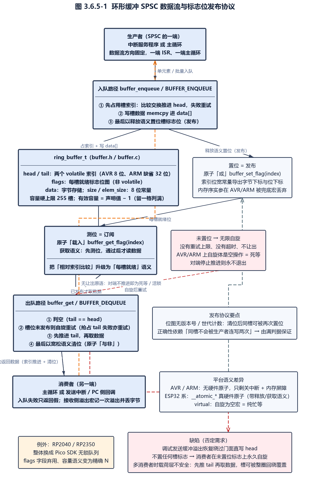

图 3.4-1 环形缓冲 SPSC 数据流与标志位发布协议

- 需求标识：UC-FREQ346-3
- 功能描述：缓冲的"满"与"空"在两端表现为两种不同的阻塞策略：消费者在写入方未发布槽位时自旋等待（不超时、不让出），生产者在缓冲满时由调用方决定（缓冲层只返回假，多数 MCU 的发送入队自行无限重试）。由此存在两类可构造的死锁或活锁路径。
- 调用条件：①在中断被屏蔽的上下文中调用会阻塞的发送接口；②对端停止推进（例如发送中断被关闭、对端任务不运行）。
- 输入：原子入出队的返回值；自旋原语的平台实现。
- 输出：自旋（可能永不退出）；或在自旋带让出语义的平台上演化为活锁。
- 处理：
- （1）消费者自旋点共四处（标志未置与抢占失败各两处），全部是"自旋后重试"，**没有重试上限、没有超时**（`uCNC/src/buffer.c:136-146`、`uCNC/src/buffer.c:234-246`）；
- （2）自旋原语的平台语义决定后果：AVR/ARM 上是空操作即**死等**，ESP32 上带让出即**活锁但能让出**，`virtual` 上是空宏即纯忙等（`uCNC/src/atomic.h:141`、`uCNC/src/hal/mcus/esp32common/esp32_common.h:119-127`）；
- （3）生产者侧的阻塞在调用方：发送入队失败即调用 flush 重试；若该接口在**关中断临界区**内被调用（例如从临界区内部输出调试串），发送中断永远得不到服务，循环永不退出——这是本 tag 一个可构造的死锁（`uCNC/src/hal/mcus/avr/mcu_avr.c:708-711`）；
- （4）发送接口写成阻塞式并非个例，多平台实现均为无限重试，其中 PC 仿真平台是唯一带"放弃条件"的实现（`uCNC/src/hal/mcus/esp32common/esp32_uart.c:90`、`uCNC/src/hal/mcus/virtual/mcu_virtual.c:82`）；
- （5）**接收方向不阻塞**：入队失败只调用溢出处理宏（展开为"记一次溢出并放弃该字节"），即**丢帧风险在接收侧被显式接受**；溢出计数由主循环消费并上报（`uCNC/src/interface/grbl_stream.h:75-77`、`uCNC/src/interface/grbl_stream.c:300-336`、`uCNC/src/cnc.c:278`）；
- （6）溢出处理宏是"调用加返回"两条语句而非语句块，在条件分支内使用时会直接从当前上下文返回，这是设计意图而非缺陷（`uCNC/src/hal/mcus/avr/mcu_avr.c:445-448`）。

- 需求标识：UC-FREQ346-4
- 功能描述：调试发送缓冲的溢出恢复路径**绕过缓冲门面，直接写其 `head` 字段与数据区**。该写法在纯宏版实现下恰好自洽，但在标志位版实现下不会置位任何槽位标志，导致消费者在未置位的标志上永久自旋。
- 调用条件：调试流已开启且调试发送缓冲被写满（其容量缺省 250、上限 255）。
- 输入：调试输出宏在入队失败时的恢复代码。
- 输出：数据区被直接改写为一条溢出提示串，`head` 被直接置为该串长度，行计数置 1。
- 处理：
- （1）恢复代码由"清空缓冲 → 直接写数据区 → 置行计数 → 直接写 `head`"四步构成（`uCNC/src/interface/grbl_stream.c:114-120`）；
- （2）纯宏版实现的出队只看计数值，故直接写 `head` 后立刻可读；函数版实现的读取路径必须先过标志位测试（`uCNC/src/buffer.h:118`、`uCNC/src/buffer.h:130-150`、`uCNC/src/buffer.c:136`）；
- （3）清空操作在函数版下会把**整个标志位图清零**，随后直接设 `head` 而不置标志位，于是"非空"与"标志未置"同时成立（`uCNC/src/buffer.c:269`）；
- （4）消费者的循环第一跳即进入自旋；AVR/ARM 上自旋是空操作，等于**主循环硬挂死**（`uCNC/src/interface/grbl_stream.c:99-109`）；
- （5）该路径由调试输出本身触发（调试宏先输出再 flush），属"调试功能把自己挂死"的自我放大缺陷（`uCNC/src/interface/grbl_stream.h:103-104`）；
- （6）在 RP2040/RP2350 上更严重：其出队走 Pico 队列，而恢复代码改的 `head` 是**从未被队列使用的字段**，消息永远滞留在队列之外（`uCNC/src/hal/mcus/rp2040/mcumap_rp2040.h:1441-1445`）。

> **实现说明（缺陷）**：该恢复路径属于依赖具体实现分支的内部访问。全仓只有两块 AVR 板定义纯宏版缓冲，其余平台（ARM、ESP32、RP2040/RP2350）走的都是标志位或第三方队列实现，故在这些平台上只要调试流开启并把缓冲写满，就会命中该挂死路径（`uCNC/src/hal/boards/avr/boardmap_uno.h:161-162`、`uCNC/src/hal/boards/avr/boardmap_uno_mirror.h:87-88`）。另：调试行计数与输出计数都是**普通静态计数**，由主循环与中断并发读写，不产生撕裂读但计数本身会被覆盖丢失（`uCNC/src/interface/grbl_stream.c:36`、`uCNC/src/interface/grbl_stream.c:411`、`uCNC/src/interface/grbl_stream.c:438`）。

---
